# T-026 — Hallazgos de la revisión integral de guías, entregables y exportados

- **Revisor:** Jean Piero Huamani Rodriguez (rol `revisor-documental`), con Claude como asistente · **Fecha:** 15/11/2026 · **Rama:** `docs/t026-revision` (desde `develop` 250fdf5)
- **Encargo:** [`.claude/intercambios/T-026_porras_revision-entregables.md`](../../intercambios/T-026_porras_revision-entregables.md) · **Criterios y decisiones:** [`CRITERIOS.md`](CRITERIOS.md) · **Checklist:** [`CHECKLIST.md`](CHECKLIST.md)
- **Requisitos `R-xx` y cotejo por semana:** [`requisitos/`](requisitos/) · **Capturas:** [`capturas/`](capturas/) (`H-###_antes.png` y `H-###_despues.png`)
- **Totales:** 118 hallazgos: 82 cerrados y 36 pendientes justificados. Los candidatos que no eran defectos figuran como «Candidatos descartados» al final de cada semana, con su motivo.
- **IDs por bloques:** S1 H-001…, S2 H-020…, S3-4 H-040…, S5 H-060…, S6 H-080…, S9 H-100…, S10 H-120…, S11 H-140…, S12 H-160…, S13 H-180…, transversales H-220…. Los huecos de numeración son intencionados.
- **Estados:** `Cerrado` = corregido en la fuente, exportado regenerado si correspondía y verificado con captura después. `Pendiente justificado` = necesita decisión o trabajo del equipo, del docente o del Leader; no cuenta como cumplido.

## Índice

| ID | Semana | Severidad | Hallazgo | Estado |
| --- | --- | --- | --- | --- |
| [H-001](#h-001) | S01 | media | Atribución a la entrevista de afirmaciones que el Anexo C no contiene | Cerrado |
| [H-002](#h-002) | S01 | media | Tabla 10 imprecisa sobre la correspondencia M1-M6 con INC-1 a INC-6 | Cerrado |
| [H-003](#h-003) | S01 | baja | Carátula sin la unidad del sílabo | Cerrado |
| [H-004](#h-004) | S01 | baja | Comentarios HTML «DIAG-00x pendiente» con los SVG ya existentes | Cerrado |
| [H-005](#h-005) | S01 | baja | La Figura 2 (AS-IS) no tiene un nodo rotulado «Fin» | Pendiente |
| [H-006](#h-006) | S01 | media | El entregable no vincula el trabajo con el proyecto aplicado en la empresa | Pendiente |
| [H-007](#h-007) | S01 | baja | Extensión superior a «documento breve» | Pendiente |
| [H-020](#h-020) | S02 | baja | Carátula sin la unidad del sílabo | Cerrado |
| [H-021](#h-021) | S02 | baja | Comentario HTML «DIAG-006 pendiente» con el SVG existente | Cerrado |
| [H-022](#h-022) | S02 | media | Marcadores «[PENDIENTE…]» visibles en la Tabla 11 | Cerrado |
| [H-023](#h-023) | S02 | media | Tabla 8 describe la integración continua en presente mientras §9 y la Tabla 16 la presentan como planificada | Cerrado |
| [H-024](#h-024) | S02 | baja | La visita domiciliaria priorizada (M4) no aparece en la Tabla 9 | Cerrado |
| [H-040](#h-040) | S03-04 | alta | Cadena normativa incompleta (falta la RM 251-2024-MINSA) | Cerrado |
| [H-041](#h-041) | S03-04 | media | Marcadores pendientes contradichos por la evidencia del mismo corte (25/09) | Cerrado |
| [H-042](#h-042) | S03-04 | media | Códigos internos de coordinación y comentarios HTML en un entregable académico | Cerrado |
| [H-043](#h-043) | S03-04 | media | «Todavía no confirmados en git» sin commit de referencia | Cerrado |
| [H-044](#h-044) | S03-04 | baja | Falta la unidad del sílabo en la carátula | Cerrado |
| [H-045](#h-045) | S03-04 | media | Acta de aceptación H1, meta del indicador de calidad y horas reales sin registrar | Pendiente |
| [H-046](#h-046) | S03-04 | media | La desviación de +6 h de la Tabla 27 no figura en la matriz de control (Tabla 33) | Pendiente |
| [H-047](#h-047) | S03-04 | media | No se declara el proyecto aplicado en la empresa ni la modalidad | Pendiente |
| [H-060](#h-060) | S05 | alta | Marcador «CARGA_CIERRE» en lugar de la tabla de carga | Cerrado |
| [H-061](#h-061) | S05 | alta | Carátula con [PENDIENTE] y sin unidad del sílabo | Cerrado |
| [H-062](#h-062) | S05 | media | Ramas citadas que ya no existen | Cerrado |
| [H-063](#h-063) | S05 | media | «Todavía no constituyen un commit» frente al historial | Cerrado |
| [H-064](#h-064) | S05 | alta | Sin modelo de ciclo de vida declarado | Cerrado |
| [H-065](#h-065) | S05 | alta | PDF de Actividad 5 con cifras de la versión anterior frente al .md vigente | Cerrado |
| [H-066](#h-066) | S05 | media | Defectos críticos abiertos y registro de casos sin documentar | Pendiente |
| [H-067](#h-067) | S05 | baja | Uso de herramientas modernas (CI, gestión de proyecto) sin justificar | Pendiente |
| [H-068](#h-068) | S05 | baja | La norma del clasificador no se citaba | Cerrado |
| [H-080](#h-080) | S06 | alta | El integrador S6 de develop era el borrador del 25/09 | Cerrado |
| [H-081](#h-081) | S06 | alta | Faltaban la presentación de 7 diapositivas, los exportados y las figuras 50-68 de S6 | Cerrado |
| [H-082](#h-082) | S06 | media | Umbral de esfuerzo atribuido a S3-4 con un valor que S3-4 no define | Cerrado |
| [H-083](#h-083) | S06 | media | Densidad de defectos con dos cifras de código incompatibles | Cerrado |
| [H-084](#h-084) | S06 | baja | Frases con residuo de sustitución en la descripción del Product Owner | Cerrado |
| [H-085](#h-085) | S06 | baja | El checklist cita una consigna con un nombre de archivo que no existe | Cerrado |
| [H-086](#h-086) | S06 | baja | Sin captura de una ejecución del pipeline en GitHub Actions | Pendiente |
| [H-087](#h-087) | S06 | baja | Valor organizacional sin medir en el tablero de indicadores | Pendiente |
| [H-100](#h-100) | S09 | alta | `num_doc` del CSV de la DIRESA y afirmación «sin DNI utilizables» | Pendiente |
| [H-101](#h-101) | S09 | media | Nota de la adenda v4.0 ausente en PDF y DOCX | Cerrado |
| [H-102](#h-102) | S09 | media | Pies de las Figuras 51 a 55 ausentes en el PDF | Cerrado |
| [H-103](#h-103) | S09 | media | Enlaces de PDF/DOCX a la rama `feature/inc2-agenda-alertas` (borrada) | Cerrado |
| [H-104](#h-104) | S09 | media | Unidad de 12 486: niños frente a diagnósticos/filas | Cerrado |
| [H-105](#h-105) | S09 | baja | «44 capturas PNG» frente a 45 | Cerrado |
| [H-106](#h-106) | S09 | baja | «856 de 856 sondas en las tres versiones» | Cerrado |
| [H-107](#h-107) | S09 | media | Unidad del sílabo no declarada | Cerrado |
| [H-108](#h-108) | S09 | baja | Referencia de p95 de v1.0 sin sesión en la Tabla 40 | Cerrado |
| [H-109](#h-109) | S09 | baja | Lista de trabajo «Lista previa a la exposición» dentro del entregable | Cerrado |
| [H-110](#h-110) | S09 | baja | Cuenta confusa de las 18 pruebas de arquitectura | Cerrado |
| [H-111](#h-111) | S09 | baja | Metadatos del DOCX sin título ni autor | Cerrado |
| [H-112](#h-112) | S09 | media | Modelo de evaluación de procesos no nombrado | Cerrado |
| [H-113](#h-113) | S09 | media | Satisfacción del usuario sin medir (SUS) | Pendiente |
| [H-114](#h-114) | S09 | media | Valor demostrado como capacidad, no como impacto | Pendiente |
| [H-120](#h-120) | S10 | media | El escenario HIST-4.2 no explicaba por qué el webhook firmado no registró la respuesta | Cerrado |
| [H-121](#h-121) | S10 | alta | Tabla 30 afirmaba que las etiquetas y commits no existían | Cerrado |
| [H-122](#h-122) | S10 | media | «3 criterios no medidos» frente a la Tabla 5 | Cerrado |
| [H-123](#h-123) | S10 | media | Tabla 9 no coincide con los colores del gráfico de Hb | Cerrado |
| [H-124](#h-124) | S10 | media | La IA figuraba como cuarto integrante del equipo | Cerrado |
| [H-125](#h-125) | S10 | baja | Falta la unidad del sílabo en la carátula (D-03) | Cerrado |
| [H-126](#h-126) | S10 | media | Mediciones no realizadas sin declarar (WCAG 1.1.1 y vulnerabilidad Alta abierta) | Pendiente |
| [H-127](#h-127) | S10 | alta | No hay evaluación del proceso ni métricas del proceso antes y después (Unidad III) | Pendiente |
| [H-128](#h-128) | S10 | media | No existe el informe en PDF | Pendiente |
| [H-129](#h-129) | S10 | media | Alcance por incremento distinto al de la guía, sin declarar | Pendiente |
| [H-130](#h-130) | S10 | baja | Formato decimal mezclado e inglés en tablas | Cerrado |
| [H-140](#h-140) | S11 | alta | PDF de S11 desactualizado frente al .md | Cerrado |
| [H-141](#h-141) | S11 | alta | Contradicción sobre la ejecución de las migraciones 3.0 y 4.0 en Supabase | Cerrado |
| [H-142](#h-142) | S11 | media | Conteo de pruebas de regresión: 3, 5 y 6 | Cerrado |
| [H-143](#h-143) | S11 | media | Número de pruebas E2E de v2.0 (17 frente a 15) | Cerrado |
| [H-144](#h-144) | S11 | media | Texto alternativo de la feria: «prioridad elevada» frente a MEDIA | Cerrado |
| [H-145](#h-145) | S11 | media | Feria: cifras de pruebas sin versión ni fecha de corte coherentes | Cerrado |
| [H-146](#h-146) | S11 | media | «Fusiones» #7 y #6 son commits de integración por squash | Cerrado |
| [H-147](#h-147) | S11 | media | Asistente de IA dentro de la tabla de integrantes | Cerrado |
| [H-148](#h-148) | S11 | media | Falta la unidad del sílabo en la carátula | Cerrado |
| [H-149](#h-149) | S11 | baja | «Meta M2.2 de la guía» sin indicar la guía | Cerrado |
| [H-150](#h-150) | S11 | alta | Análisis estático con SonarQube/SonarCloud no ejecutado | Pendiente |
| [H-151](#h-151) | S11 | baja | Falta la matriz de puertos y adaptadores y el C4 solo cubre el Inc. 1 | Pendiente |
| [H-152](#h-152) | S11 | baja | Referencias sin la bibliografía del sílabo | Pendiente |
| [H-153](#h-153) | S11 | media | Fechas y responsables del plan de mejora son propuesta sin confirmar | Pendiente |
| [H-154](#h-154) | S11 | baja | Ciclo PDCA y tablero de GitHub Projects ausentes en S11 | Pendiente |
| [H-155](#h-155) | S11 | baja | Commits semánticos sin convención escrita | Pendiente |
| [H-156](#h-156) | S11 | media | Despliegue de v4.0-Inc4 sin verificación posterior | Pendiente |
| [H-160](#h-160) | S12 | media | Falta el exportado del informe S12 | Cerrado |
| [H-161](#h-161) | S12 | media | Numeración obsoleta en las correcciones S12 | Cerrado |
| [H-162](#h-162) | S12 | alta | Correos personales en la exportación de SonarCloud | Cerrado |
| [H-163](#h-163) | S12 | alta | Correo institucional visible en PROD_05 | Cerrado |
| [H-165](#h-165) | S12 | alta | Anexo C contradice el video del repositorio | Cerrado |
| [H-166](#h-166) | S12 | alta | Video de 5:59, sin locución | Pendiente |
| [H-167](#h-167) | S12 | alta | Tabla 43: «SonarCloud no ejecutado» | Cerrado |
| [H-168](#h-168) | S12 | media | Tabla 35 cuenta 9 hallazgos CAR; la Tabla 37 tiene 10 | Cerrado |
| [H-169](#h-169) | S12 | media | Carátula sin fecha de entrega ni unidad del sílabo | Cerrado |
| [H-170](#h-170) | S12 | media | Bloque / sección (NRC) ausente en la carátula | Pendiente |
| [H-171](#h-171) | S12 | media | DoD (filas 6 a 8) y «0 vulnerabilidades» no cumplidos | Pendiente |
| [H-172](#h-172) | S12 | baja | M2.1: «Inc. 3 e Inc. 4… 18 de 18» describía el acumulado | Cerrado |
| [H-173](#h-173) | S12 | baja | V5: 64/64 sondas frente a 332 sondeos | Pendiente |
| [H-180](#h-180) | S13 | alta | Lab «reglas requeridas por la guía» con un ruleset sin checks obligatorios | Cerrado |
| [H-181](#h-181) | S13 | alta | Falta la regla Require status checks en el ruleset de GitHub | Pendiente |
| [H-182](#h-182) | S13 | alta | Tabla 5: PR #8 con «revisión independiente documentada» frente a la auditoría | Cerrado |
| [H-183](#h-183) | S13 | media | Informe S13: «Unidad III» en la portada | Cerrado |
| [H-184](#h-184) | S13 | media | Informe S13: SonarCloud «fuera del CI» / «aún no se ejecuta desde el CI» | Cerrado |
| [H-185](#h-185) | S13 | media | PDCA dominio 9: «dependencias Node.js a versión 24» | Cerrado |
| [H-186](#h-186) | S13 | media | Indicador de commits: la columna «noche» usa los valores de la tarde | Cerrado |
| [H-187](#h-187) | S13 | media | Cobertura de v4.0-Inc4: 99,88 % frente a 99,79 % | Cerrado |
| [H-188](#h-188) | S13 | media | RFC #14, #15 y #17: evaluación presentada como formal sin precisar que fue retroactiva | Cerrado |
| [H-189](#h-189) | S13 | media | Tabla 4: 5 fichas frente a 6 releases | Cerrado |
| [H-190](#h-190) | S13 | media | Ramas `release/*` afirmadas en el informe y sin desviación declarada en el laboratorio | Cerrado |
| [H-191](#h-191) | S13 | baja | PDCA dom. 4: «1 de 21 PR» en el diagnóstico de la tarde | Cerrado |
| [H-192](#h-192) | S13 | baja | Anexo B: «20 páginas» y «14 grupos» del script | Cerrado |
| [H-193](#h-193) | S13 | baja | Tabla 3: filtro `paths` de `ci.yml` no declarado | Cerrado |
| [H-194](#h-194) | S13 | media | Autoevaluación: criterio 4 «Excelente» con 1 de 11 PR vinculadas | Pendiente |
| [H-195](#h-195) | S13 | media | v1.0-PMV y otras releases sin archivos adjuntos | Pendiente |
| [H-196](#h-196) | S13 | media | Captura obligatoria 3: ninguna PR reúne aprobación, checks y vínculo a Issue | Pendiente |
| [H-197](#h-197) | S13 | baja | SemVer sin parche y etiquetas no firmadas, sin declarar | Cerrado |
| [H-198](#h-198) | S13 | baja | PDCA: escala de seguimiento con descripciones distintas a las de la guía, sin declararlo | Cerrado |
| [H-199](#h-199) | S13 | baja | `ci.yml`: `pytest --cov` sin `--cov-fail-under=80` | Pendiente |
| [H-200](#h-200) | S13 | baja | Gráfico de red sin ramas `feature/*` | Pendiente |
| [H-220](#h-220) | Transversal | alta | La rúbrica de la evaluación final (S16) está vacía en el repositorio | Pendiente |
| [H-221](#h-221) | Transversal | baja | RUTAS.md apuntaba a rutas de S6 que no existían y no registraba la carpeta de la revisión | Cerrado |
| [H-222](#h-222) | Transversal | media | El índice de exportados no decía de qué fuente sale cada archivo | Cerrado |
| [H-223](#h-223) | Transversal | alta | La PR #35 de esta revisión se integró sin revisión aprobada | Pendiente |

## S01
### H-001 · media · Atribución a la entrevista de afirmaciones que el Anexo C no contiene
- **Archivo y ubicación:** `entregables/semana-01/Entregable_Semana1_Anemia_Junin.md` §9.1 (línea 255)
- **Requisito afectado:** R-15 / coherencia con Anexo C
- **Descripción:** El texto dice «Según la entrevista» y enseguida atribuye el triple registro «manual» con errores y duplicidad y las visitas «sin herramientas digitales»; el Anexo C solo menciona historia clínica, tarjeta de control y sistema de información, y la visita semanal.
- **Evidencia antes:** 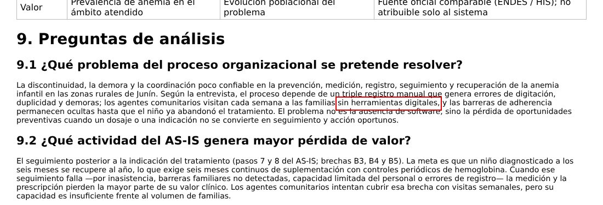
- **Corrección aplicada:** Se separó lo que dice la entrevista de lo que es diagnóstico del equipo («según el diagnóstico del equipo, …»), sin cambiar el contenido.
- **Evidencia después:** 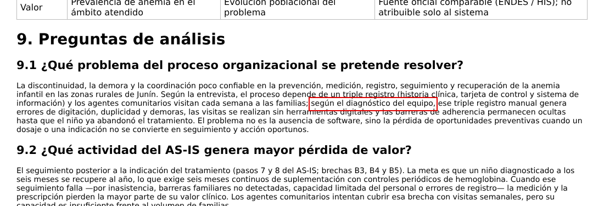
- **Estado:** Cerrado

### H-002 · media · Tabla 10 imprecisa sobre la correspondencia M1-M6 con INC-1 a INC-6
- **Archivo y ubicación:** `entregables/semana-01/Entregable_Semana1_Anemia_Junin.md` §10, Tabla 10 (línea 300)
- **Requisito afectado:** coherencia interna (Tabla 4) y con S2 Tabla 9
- **Descripción:** Decía que M1-M6 «se convierten» en INC-1 a INC-6 con la lista registro, agenda, offline, WhatsApp, modelo, tablero. Según la Tabla 4, M4 es visita priorizada y M6 es registro sin conexión e indicadores; esa lista no corresponde uno a uno con M1-M6.
- **Evidencia antes:** 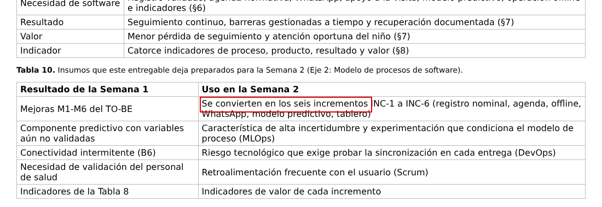
- **Corrección aplicada:** Se explicitó la correspondencia con los datos de la Tabla 4 y de la Tabla 9 de S2 (B4 y B6 en INC-3; B6 en INC-6): M1→INC-1, M2→INC-2, M3→INC-4, M4 y la parte sin conexión de M6→INC-3, M5→INC-5, indicadores de M6→INC-6.
- **Evidencia después:** 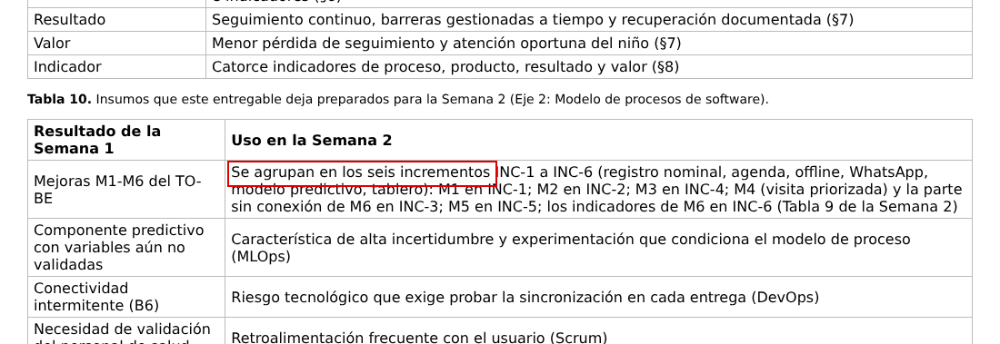
- **Estado:** Cerrado

### H-003 · baja · Carátula sin la unidad del sílabo
- **Archivo y ubicación:** `entregables/semana-01/Entregable_Semana1_Anemia_Junin.md` carátula (línea 5)
- **Requisito afectado:** S-1 (sílabo §3 y §7); D-03
- **Descripción:** Solo figuraba el título de la guía, sin la unidad del sílabo.
- **Evidencia antes:** 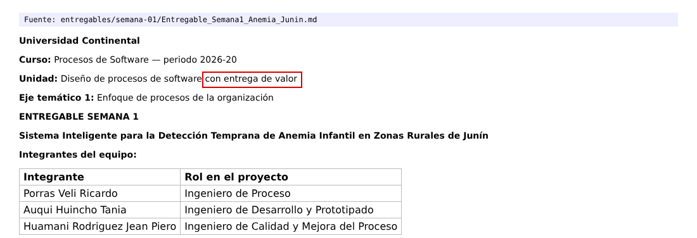
- **Corrección aplicada:** Se añadió «Unidad del sílabo: Unidad I — Fundamentos de procesos de software».
- **Evidencia después:** 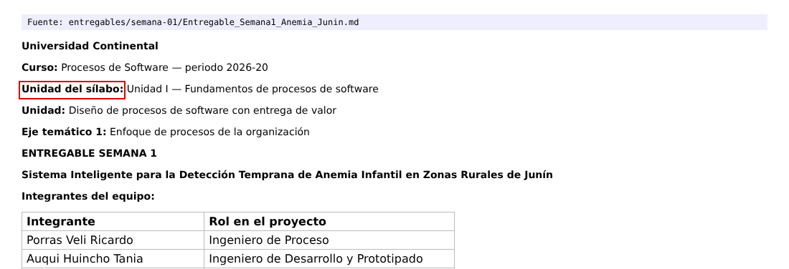
- **Estado:** Cerrado

### H-004 · baja · Comentarios HTML «DIAG-00x pendiente» con los SVG ya existentes
- **Archivo y ubicación:** `entregables/semana-01/Entregable_Semana1_Anemia_Junin.md` líneas 87, 151, 204, 431 y 436
- **Requisito afectado:** residuos de plantilla
- **Descripción:** Cinco comentarios ocultos indicaban diagramas pendientes aunque los SVG existen y están insertados.
- **Evidencia antes:** 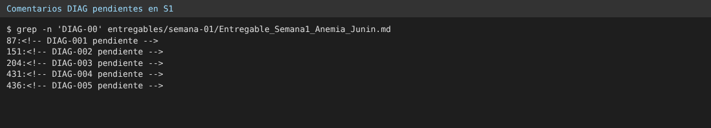
- **Corrección aplicada:** Se eliminaron los cinco comentarios.
- **Evidencia después:** 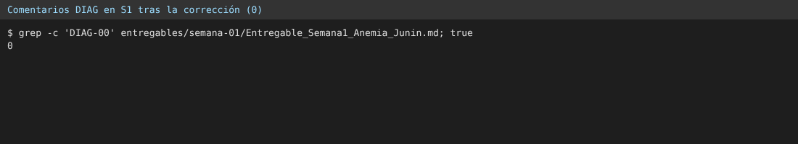
- **Estado:** Cerrado

### H-005 · baja · La Figura 2 (AS-IS) no tiene un nodo rotulado «Fin»
- **Archivo y ubicación:** `entregables/semana-01/Entregable_Semana1_Anemia_Junin.md` §3, Figura 2; `.claude/diagramas/svg/10_s1_proceso_as_is.svg`
- **Requisito afectado:** R-05 (guía §5: inicio y fin del proceso)
- **Descripción:** El texto del §3 declara el «Fin», pero el SVG termina en «Registra recuperación y cierra el caso» y no tiene rótulo «Fin». El SVG está fuera del alcance de esta corrección.
- **Evidencia antes:** 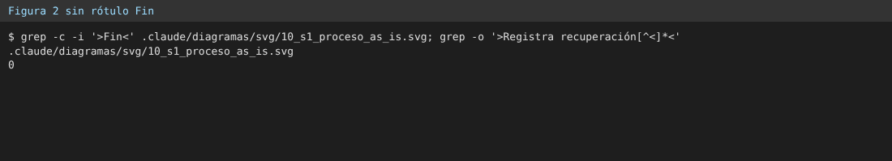
- **Corrección aplicada:** —
- **Evidencia después:** — (pendiente)
- **Estado:** Pendiente justificado: decide el equipo (rol diagramación, solicitud DIAG) si rotula el nodo final como «Fin»; falta editar el SVG, que queda fuera de los archivos de esta semana.

### H-006 · media · El entregable no vincula el trabajo con el proyecto aplicado en la empresa
- **Archivo y ubicación:** `entregables/semana-01/Entregable_Semana1_Anemia_Junin.md` carátula y Anexo C
- **Requisito afectado:** S-2 (sílabo §7)
- **Descripción:** No se declara que el entregable forme parte del proyecto aplicado en la empresa ni se nombra la organización o su equivalente (la posta rural omite su nombre por privacidad).
- **Evidencia antes:** 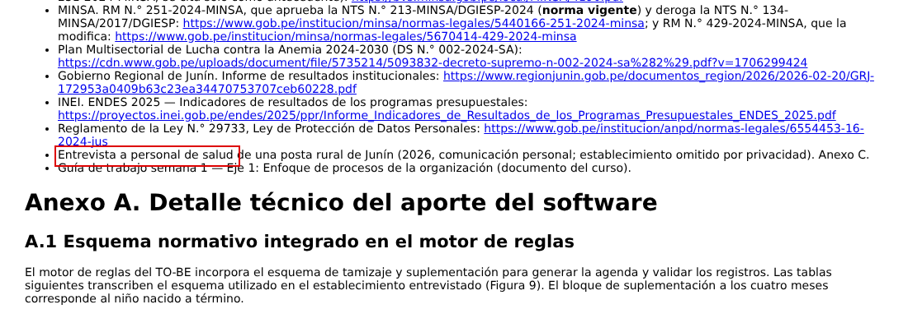
- **Corrección aplicada:** —
- **Evidencia después:** — (pendiente)
- **Estado:** Pendiente justificado: decide el docente (si acepta «Proyecto aplicado: posta rural de Junín, nombre omitido por privacidad») y el equipo; falta esa confirmación para no inventar un dato.

### H-007 · baja · Extensión superior a «documento breve»
- **Archivo y ubicación:** `entregables/semana-01/Entregable_Semana1_Anemia_Junin.md` (441 líneas, §1 a §12 y Anexos A a C)
- **Requisito afectado:** R-14 (guía §11)
- **Descripción:** La guía pide un documento breve; el entregable contiene 11 secciones, 3 anexos y 16 tablas.
- **Evidencia antes:** 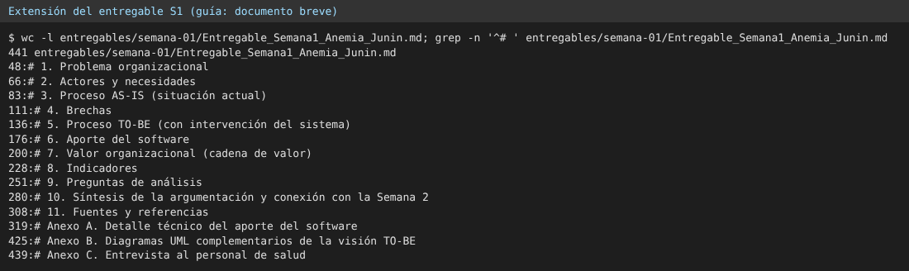
- **Corrección aplicada:** —
- **Evidencia después:** — (pendiente)
- **Estado:** Pendiente justificado: decide el equipo (con el docente) qué trasladar a anexos; es un cambio de fondo que no corresponde a esta revisión.

### Candidatos descartados
| Candidato (archivo:línea) | Motivo |
| --- | --- |
| S01.md:306 «Estado de implementación … anemia_junin/» | D-01: instantánea de la entrega (25/09/2026); `pmv_fastapi/` con INC-2 a INC-4 es posterior (commits del 30/10/2026). |
| S01.md:52 pérdida de datos, retrasos y escasa visibilidad | El texto no atribuye esas consecuencias a la entrevista (la atribución explícita es solo la de la oración anterior); es análisis del equipo. |
| S01.md:105, 121, 122 reporte en papel, barreras, carga manual | No se atribuyen a la entrevista; son descripción del equipo. |
| S01.md:316 y :441 (proyecto aplicado) | Ya recogido como H-006. |
| S01.md:5 y :7 unidad sin número | Ya recogido como H-003 (D-03). |
| `entregables/semana-01/img/` imágenes sin referenciar | Regla de no eliminar material; observación sin defecto. |

## S02
### H-020 · baja · Carátula sin la unidad del sílabo
- **Archivo y ubicación:** `entregables/semana-02/Entregable_Semana2_Anemia_Junin.md` carátula (línea 5)
- **Requisito afectado:** S-1 (sílabo §3 y §7); D-03
- **Descripción:** Solo figuraba el título de la guía, sin la unidad del sílabo.
- **Evidencia antes:** 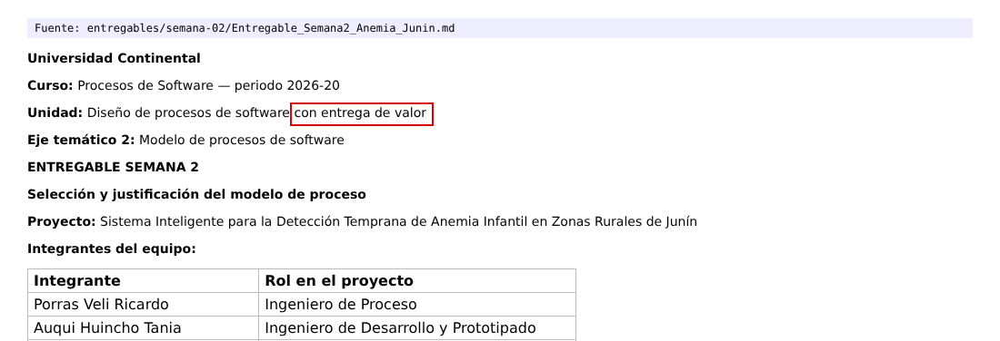
- **Corrección aplicada:** Se añadió «Unidad del sílabo: Unidad I — Fundamentos de procesos de software».
- **Evidencia después:** 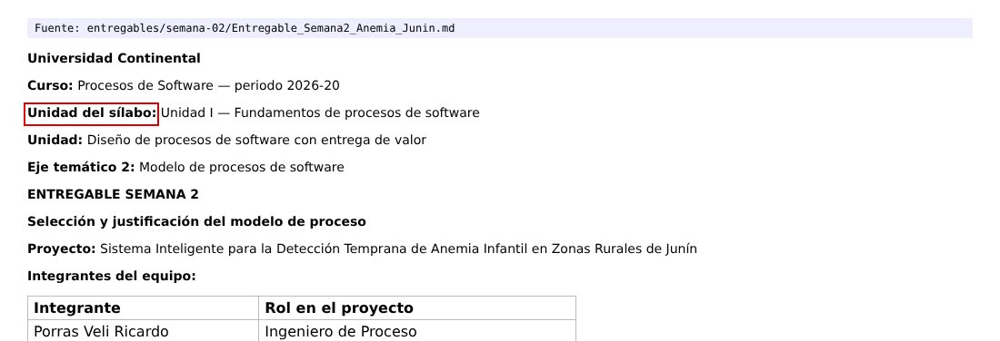
- **Estado:** Cerrado

### H-021 · baja · Comentario HTML «DIAG-006 pendiente» con el SVG existente
- **Archivo y ubicación:** `entregables/semana-02/Entregable_Semana2_Anemia_Junin.md` §6 (línea 220)
- **Requisito afectado:** residuos de plantilla
- **Descripción:** El comentario indicaba el diagrama pendiente aunque el SVG 15 existe y está insertado.
- **Evidencia antes:** 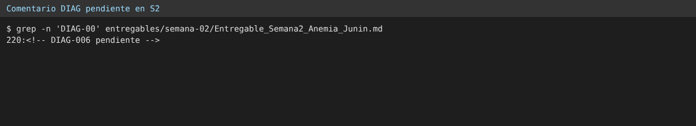
- **Corrección aplicada:** Se eliminó el comentario.
- **Evidencia después:** 
- **Estado:** Cerrado

### H-022 · media · Marcadores «[PENDIENTE…]» visibles en la Tabla 11
- **Archivo y ubicación:** `entregables/semana-02/Entregable_Semana2_Anemia_Junin.md` §9, Tabla 11 (líneas 279, 282 y 289)
- **Requisito afectado:** R-16 (guía §12)
- **Descripción:** Tres marcadores visibles (tablero, CI y prototipos). No hay en el repositorio un enlace verificable a GitHub Projects ni a Figma (el único registro es una lista de capturas pendientes).
- **Evidencia antes:** 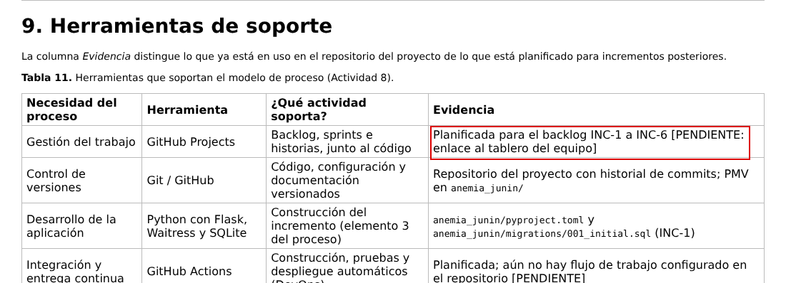
- **Corrección aplicada:** Se reemplazaron por «no disponible en la fecha de esta entrega» (sin inventar enlaces); en la fila de CI se fechó el estado: «aún no hay flujo de trabajo configurado … a la fecha de esta entrega (25/09/2026)», verdadero en esa fecha (el `ci.yml` es de octubre-noviembre de 2026).
- **Evidencia después:** 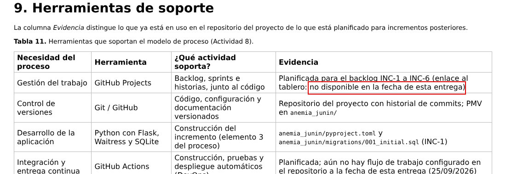
- **Estado:** Cerrado

### H-023 · media · Tabla 8 describe la integración continua en presente mientras §9 y la Tabla 16 la presentan como planificada
- **Archivo y ubicación:** `entregables/semana-02/Entregable_Semana2_Anemia_Junin.md` §6, Tabla 8, elemento 4 (línea 230)
- **Requisito afectado:** coherencia interna
- **Descripción:** La Tabla 8 decía «Integración continua de cada cambio» y la Tabla 11 y la Tabla 16 la dan por planificada.
- **Evidencia antes:** 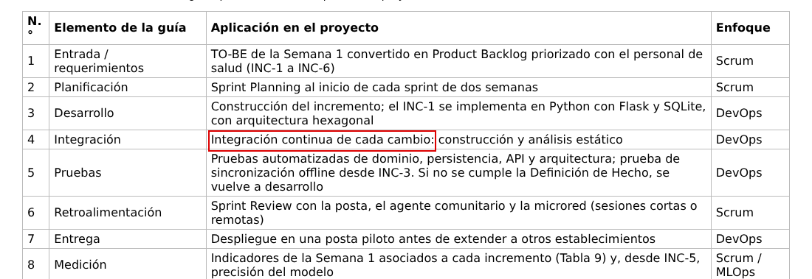
- **Corrección aplicada:** Se redactó «Integración continua prevista para cada cambio (herramienta planificada en §9)».
- **Evidencia después:** 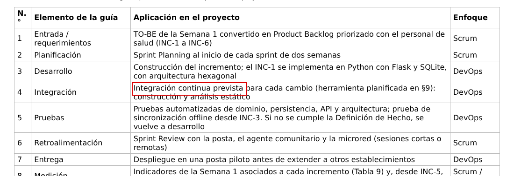
- **Estado:** Cerrado

### H-024 · baja · La visita domiciliaria priorizada (M4) no aparece en la Tabla 9
- **Archivo y ubicación:** `entregables/semana-02/Entregable_Semana2_Anemia_Junin.md` §7, Tabla 9, INC-3 (línea 250)
- **Requisito afectado:** R-14 (guía §10); coherencia con S1 Tabla 4
- **Descripción:** INC-3 cubre la brecha B4 (visita domiciliaria) pero la funcionalidad solo mencionaba offline y sincronización.
- **Evidencia antes:** 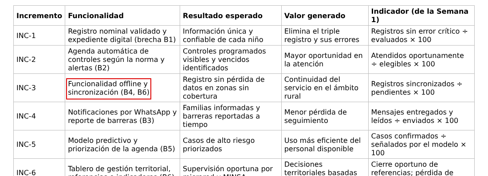
- **Corrección aplicada:** Se añadió «visita domiciliaria priorizada» a la funcionalidad de INC-3 (coincide con B4 de la propia fila y con el alcance de la versión 3.0-Inc3 del repositorio, commit c870a7e).
- **Evidencia después:** 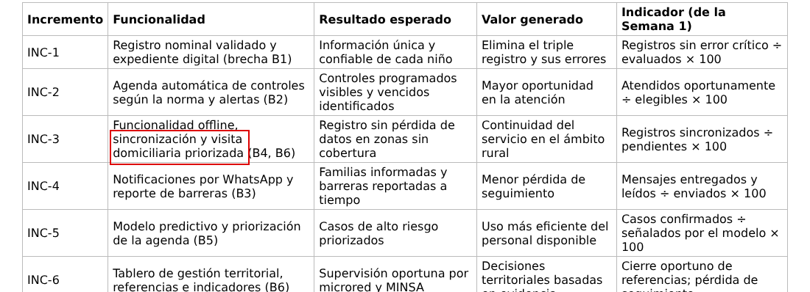
- **Estado:** Cerrado

### Candidatos descartados
| Candidato (archivo:línea) | Motivo |
| --- | --- |
| S02.md:282 y :470 CI «planificada», sin flujo | D-01: `ci.yml` se creó después de la entrega (25/09/2026); el primer commit de `.github/workflows/ci.yml` en el historial es posterior (30/10/2026 o después). |
| S02.md:280, 281, 284, 287, 484 estado y rutas en `anemia_junin/` | D-01: instantánea de la entrega; INC-2 a INC-4 en `pmv_fastapi/` son posteriores. |
| S02.md:65-76 doce factores en «Alto» | Cumple formalmente la guía (matriz con nivel y evidencia); la graduación es juicio del equipo. |
| S02.md:250-253 M4 sin incremento | Resuelto como H-024. |
| S02.md:5 y :7 unidad sin número | Ya recogido como H-020 (D-03). |
| `entregables/semana-02/img/image1.png` sin referenciar | Regla de no eliminar material; observación sin defecto. |

### Nota para el coordinador
- Los cinco diagramas SVG viven en `.claude/diagramas/svg/`, fuera de mi alcance (H-005).

## S03-04
### H-040 · alta · Cadena normativa incompleta (falta la RM 251-2024-MINSA)
- **Archivo y ubicación:** `entregables/semana-03-04/Entregable_Semana3y4_Anemia_Junin.md` §8.4 (l.447) y Referencias (l.1051)
- **Requisito afectado:** coherencia con `anemia_junin/config/normativa_v1.json` (l.4-6)
- **Descripción:** La cadena normativa omitía la RM 251-2024-MINSA, que aprueba la NTS 213 y deroga la NTS 134, y dejaba un marcador pendiente hacia la investigación documental.
- **Evidencia antes:** 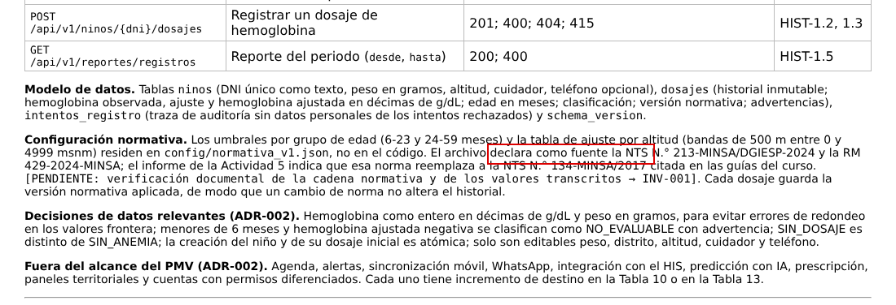
- **Corrección aplicada:** Cadena completa (NTS 213 aprobada por RM 251-2024, modificada por RM 429-2024), referencia a la investigación documental del 25/09 y dos referencias bibliográficas separadas. Se mantiene la nota de que los valores son de referencia académica.
- **Evidencia después:** 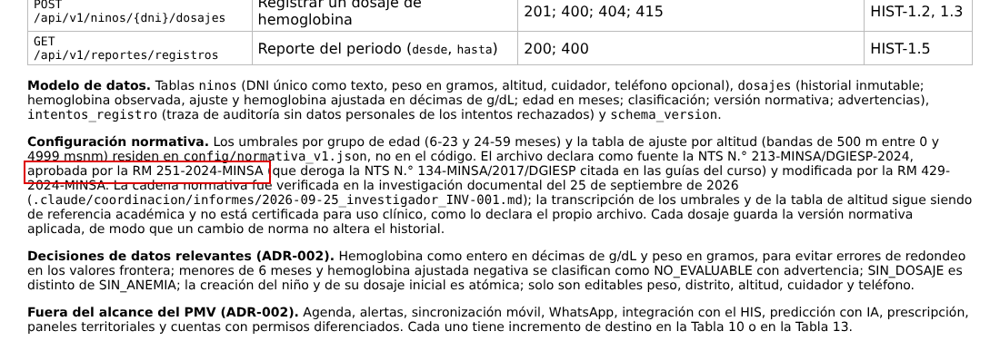
- **Estado:** Cerrado

### H-041 · media · Marcadores pendientes contradichos por la evidencia del mismo corte (25/09)
- **Archivo y ubicación:** `entregables/semana-03-04/Entregable_Semana3y4_Anemia_Junin.md` Tablas 25 y 28 (l.652-706)
- **Requisito afectado:** R-28, R-29 (coherencia interna con S5)
- **Descripción:** Las Tablas 25 y 28 dejaban «[PENDIENTE: T-008]» el reporte de pruebas y la cobertura, pero `anemia_junin/docs/evidencias/pytest_cierre.txt` (25/09/2026) registra 266 pruebas aprobadas y 96,69 %.
- **Evidencia antes:** 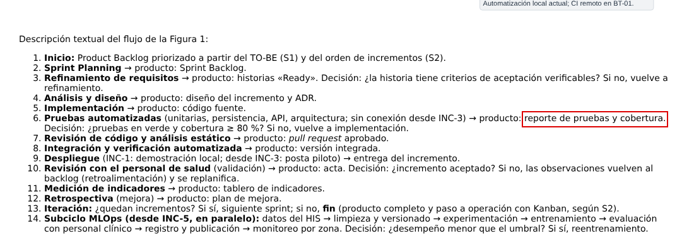
- **Corrección aplicada:** Se citan los resultados del cierre del 25/09 y la ruta de la evidencia. No se cambia el resto del estado de la instantánea (D-01).
- **Evidencia después:** 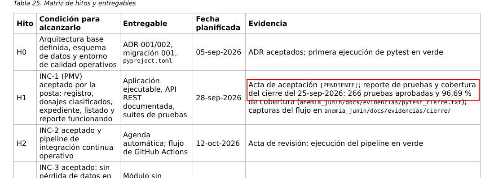
- **Estado:** Cerrado

### H-042 · media · Códigos internos de coordinación y comentarios HTML en un entregable académico
- **Archivo y ubicación:** `entregables/semana-03-04/Entregable_Semana3y4_Anemia_Junin.md` l.177, 333, 386-392, 397, 602, 620, 641, 687, 706, 822, 1003, 1069
- **Requisito afectado:** forma / residuos de plantilla
- **Descripción:** Comentarios `<!-- DIAG-10x pendiente -->` y códigos T-008, DEV-1xx y DIAG-100 a DIAG-105 en el texto.
- **Evidencia antes:** 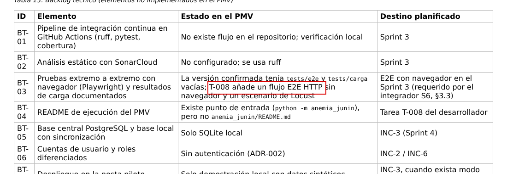
- **Corrección aplicada:** Seis comentarios retirados y códigos sustituidos por texto explicativo con el commit de referencia.
- **Evidencia después:** 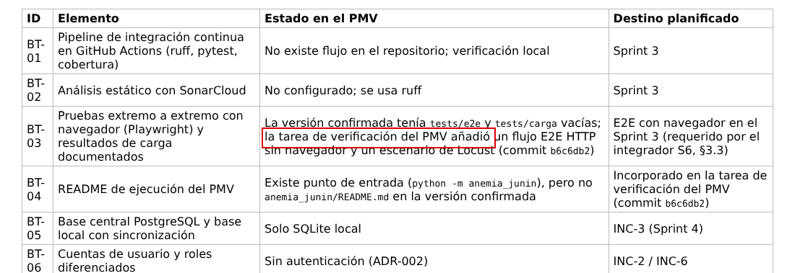
- **Estado:** Cerrado

### H-043 · media · «Todavía no confirmados en git» sin commit de referencia
- **Archivo y ubicación:** `entregables/semana-03-04/Entregable_Semana3y4_Anemia_Junin.md` §8.4 (l.397) y Tabla 13 (BT-03, BT-04, BT-09)
- **Requisito afectado:** R-07 / coherencia con Git
- **Descripción:** Se describían ajustes del árbol de trabajo sin citar commit. Hoy existen: `b6c6db2` (README, E2E, Locust, advertencia de altitud) y `4e7135a` (cierre, 25/09/2026). BT-04 afirmaba la ausencia de `anemia_junin/README.md`, que `b6c6db2` incorpora.
- **Evidencia antes:** 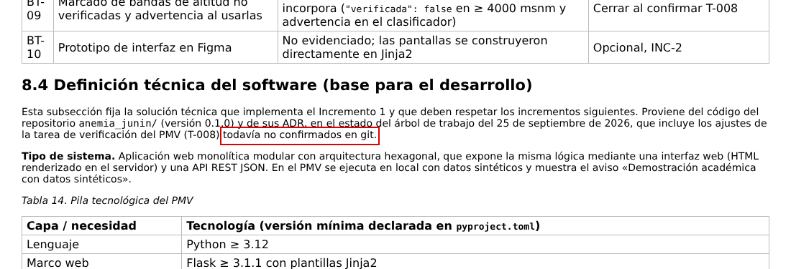
- **Corrección aplicada:** Se cita cada commit, se precisa que BT-04 se refería a la versión confirmada previa y se marca BT-09 como cerrado en `b6c6db2`. Se conserva la afirmación fechada (D-01).
- **Evidencia después:** 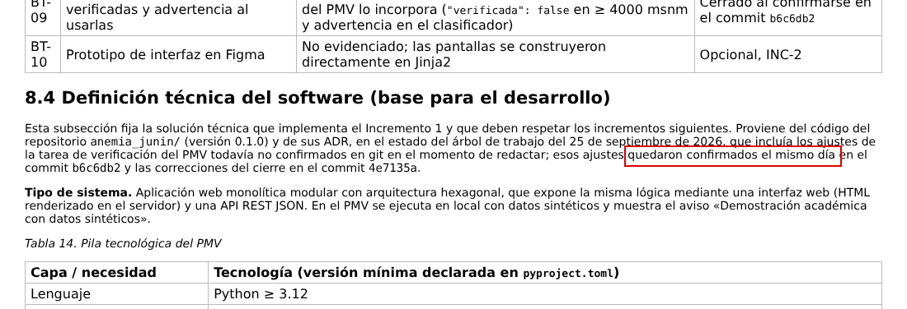
- **Estado:** Cerrado

### H-044 · baja · Falta la unidad del sílabo en la carátula
- **Archivo y ubicación:** `entregables/semana-03-04/Entregable_Semana3y4_Anemia_Junin.md` carátula (l.7)
- **Requisito afectado:** R-51 (sílabo §7, D-03)
- **Descripción:** La carátula solo traía el nombre de la unidad de la guía.
- **Evidencia antes:** 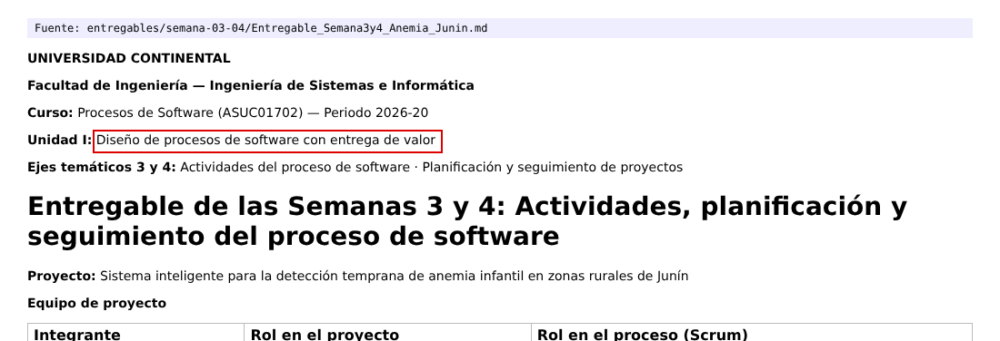
- **Corrección aplicada:** Línea «Unidad del sílabo: Unidad I — Fundamentos de procesos de software».
- **Evidencia después:** 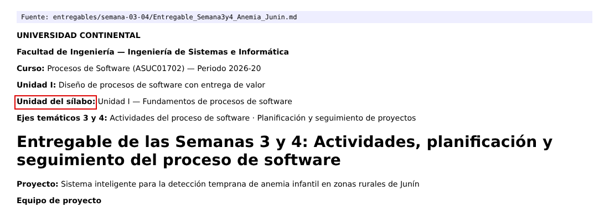
- **Estado:** Cerrado

### H-045 · media · Acta de aceptación H1, meta del indicador de calidad y horas reales sin registrar
- **Archivo y ubicación:** `entregables/semana-03-04/Entregable_Semana3y4_Anemia_Junin.md` Tabla 25 (l.655), Tabla 28 (horas reales) y Tabla 30 (l.774)
- **Requisito afectado:** R-28, R-29, R-13, R-50
- **Descripción:** Siguen `[PENDIENTE]` el acta de aceptación de H1, la meta de «Valor: calidad del registro» y el registro de horas reales. No existe evidencia en el repositorio; no se inventan.
- **Evidencia antes:** 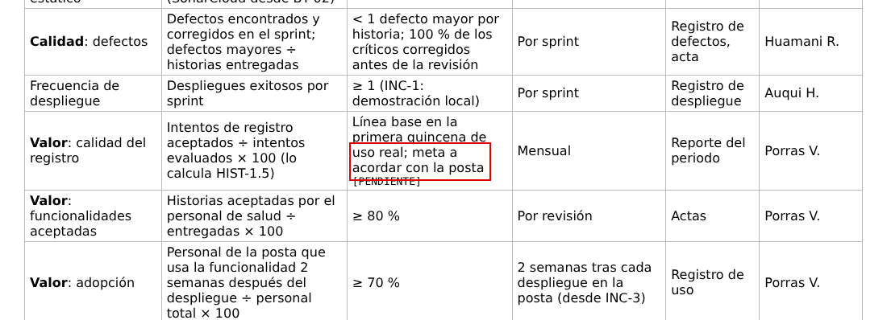
- **Corrección aplicada:** —
- **Evidencia después:** — (pendiente)
- **Estado:** Pendiente justificado: el equipo debe aportar el acta del Product Owner , acordar la meta con la posta y entregar el registro de horas ; decide el docente si se exige antes de la calificación.

### H-046 · media · La desviación de +6 h de la Tabla 27 no figura en la matriz de control (Tabla 33)
- **Archivo y ubicación:** `entregables/semana-03-04/Entregable_Semana3y4_Anemia_Junin.md` Tablas 27 (l.696) y 33 (l.816-825)
- **Requisito afectado:** R-14, R-31
- **Descripción:** La fila de horas del escenario simulado muestra +6 h (+8,7 %) y la Tabla 33 no la recoge. Añadirla exige asignar un responsable y una nueva fecha que el documento no define.
- **Evidencia antes:** 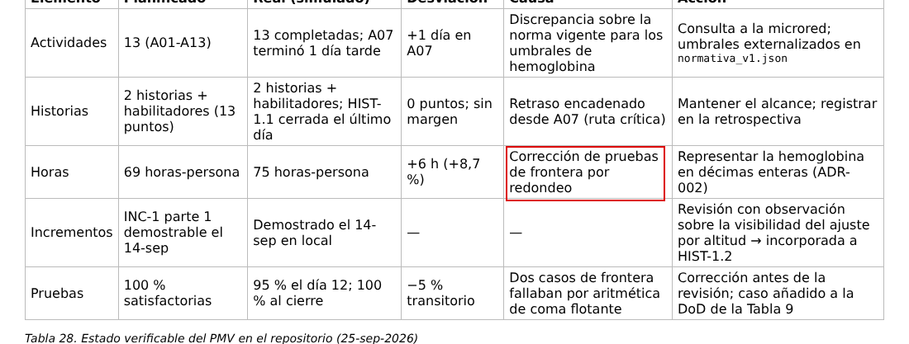
- **Corrección aplicada:** —
- **Evidencia después:** — (pendiente)
- **Estado:** Pendiente justificado: decide el equipo  el responsable y la fecha de la fila; el escenario es simulado y la Tabla 27 lo declara.

### H-047 · media · No se declara el proyecto aplicado en la empresa ni la modalidad
- **Archivo y ubicación:** `entregables/semana-03-04/Entregable_Semana3y4_Anemia_Junin.md` carátula (l.1-25)
- **Requisito afectado:** R-52 (sílabo §7)
- **Descripción:** El sílabo no fija la modalidad; el documento menciona la posta piloto pero no la declara como proyecto aplicado.
- **Evidencia antes:** 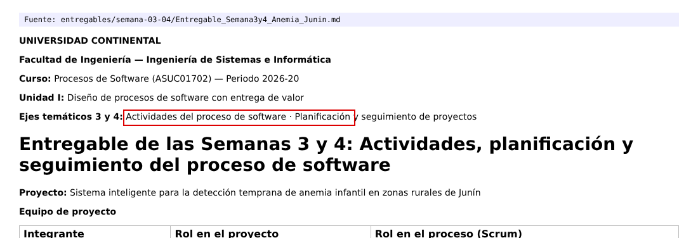
- **Corrección aplicada:** —
- **Evidencia después:** — (pendiente)
- **Estado:** Pendiente justificado: debe confirmarlo el docente (Guevara Jimenez, Jorge Alfredo) y luego el equipo añade la línea.

### Candidatos descartados
| Candidato (archivo:línea) | Motivo |
| --- | --- |
| S03-04.md:652-661 y 25-sep: hitos H2 a H4 «vencidos» sin estado | D-01: el documento es la planificación del 25/09; los hitos aún no habían vencido. |
| S03-04.md:692, 698-702: columna «Real» simulada | El documento ya lo declara en la l.692 y en los títulos de la Tabla 27 («Real (simulado)»); no hay nada que aclarar. Los datos reales son pendiente del equipo (H-045). |
| S03-04.md:384: BT-01 «No existe flujo en el repositorio» | D-01: cierto el 25/09; `ci.yml` es posterior y apunta a `pmv_fastapi/`. |
| S03-04.md:1-25: «fecha de corte» y columna de estado en Tabla 25 | D-01: la fecha de la versión (25/09) ya es el corte. |

#### Nota para el coordinador
- La Tabla 33 (H-046) y la modalidad (H-047) necesitan al equipo y al docente.
- La rama de trabajo no se modificó fuera de los archivos de la semana.

## S05
### H-060 · alta · Marcador «CARGA_CIERRE» en lugar de la tabla de carga
- **Archivo y ubicación:** `entregables/semana-05/Entregable_Semana5_Anemia_Junin.md` §4, «Resultados de carga» (l.107) y EV-09 (l.100)
- **Requisito afectado:** R-13 (Act. 4, rúbrica «Pruebas»)
- **Descripción:** El marcador sustituía la tabla y EV-09 remitía a ella.
- **Evidencia antes:** 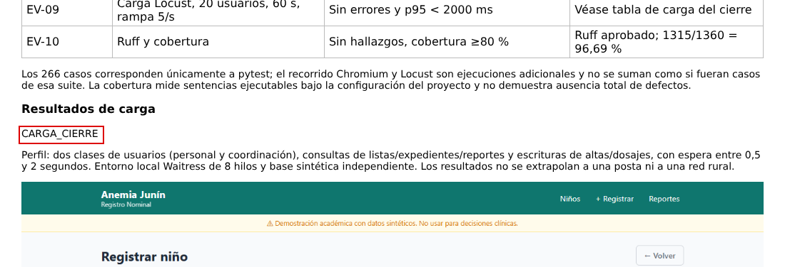
- **Corrección aplicada:** Tabla con las cifras de `anemia_junin/docs/evidencias/carga_locust_20u_60s.txt` (1011 solicitudes, 0 fallos, p95 53 ms, 17,04 req/s) y EV-09 completada. Exportado regenerado.
- **Evidencia después:** 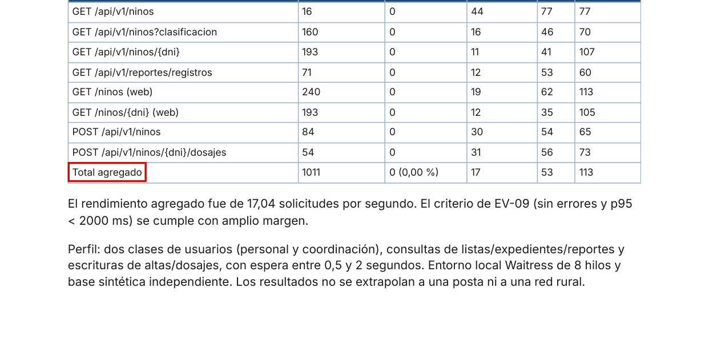
- **Estado:** Cerrado

### H-061 · alta · Carátula con [PENDIENTE] y sin unidad del sílabo
- **Archivo y ubicación:** `entregables/semana-05/Entregable_Semana5_Anemia_Junin.md` carátula (l.1-13)
- **Requisito afectado:** R-16, R-25 (D-02, D-03)
- **Descripción:** Códigos, docente y fecha estaban pendientes y no constaba la unidad.
- **Evidencia antes:** 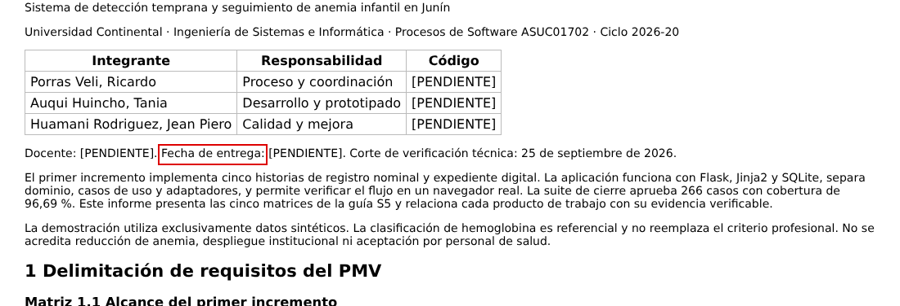
- **Corrección aplicada:** Códigos y docente tomados del integrador S6 (Tabla 1); «Unidad II — Implementación del proceso de software». La fecha de entrega no figura en el repositorio y queda «no registrada».
- **Evidencia después:** 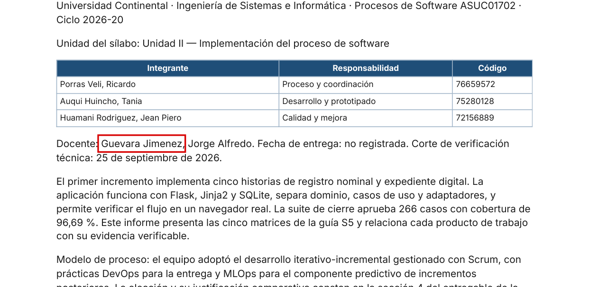
- **Estado:** Cerrado (la fecha de entrega la aportará el equipo si se desea; no consta en el repositorio)

### H-062 · media · Ramas citadas que ya no existen
- **Archivo y ubicación:** `entregables/semana-05/Entregable_Semana5_Anemia_Junin.md` Matriz 3.1 y l.80
- **Requisito afectado:** R-09
- **Descripción:** `desarrollo-anemia` (PR #1, merge 67f2c01) fue una rama de la época, ya eliminada; `codex/<tema>` era un nombre de herramienta de IA.
- **Evidencia antes:** 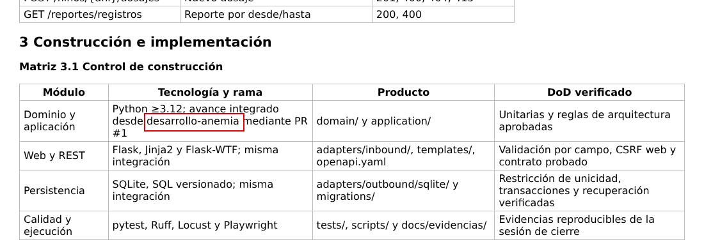
- **Corrección aplicada:** Se aclara que `desarrollo-anemia` es una rama de la época, ya eliminada del remoto. La propuesta de la época (`codex/<tema>`) se conserva tal cual (D-01; revisión del coordinador). No se inventa una estrategia por módulo.
- **Evidencia después:** 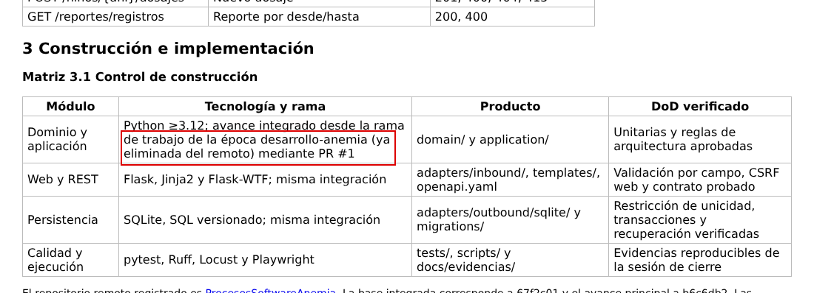
- **Estado:** Cerrado (la estrategia de ramificación por módulo, columna propia, queda como pendiente del equipo, R-09)

### H-063 · media · «Todavía no constituyen un commit» frente al historial
- **Archivo y ubicación:** `entregables/semana-05/Entregable_Semana5_Anemia_Junin.md` l.80
- **Requisito afectado:** R-03
- **Descripción:** Las correcciones de la sesión de cierre (validadores, pruebas, evidencias) están en el commit `4e7135a` del 25/09/2026.
- **Evidencia antes:** 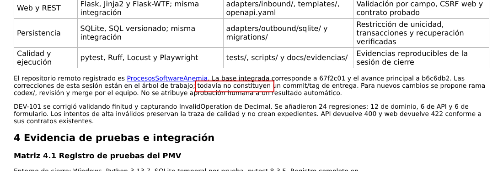
- **Corrección aplicada:** Se cita el commit y se aclara que no hay tag.
- **Evidencia después:** 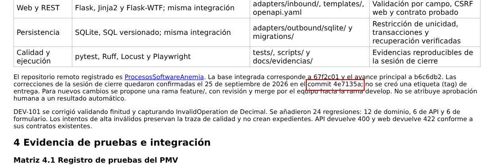
- **Estado:** Cerrado

### H-064 · alta · Sin modelo de ciclo de vida declarado
- **Archivo y ubicación:** `entregables/semana-05/Entregable_Semana5_Anemia_Junin.md` introducción
- **Requisito afectado:** R-26 (sílabo §7, U2)
- **Descripción:** El documento no declaraba el modelo.
- **Evidencia antes:** 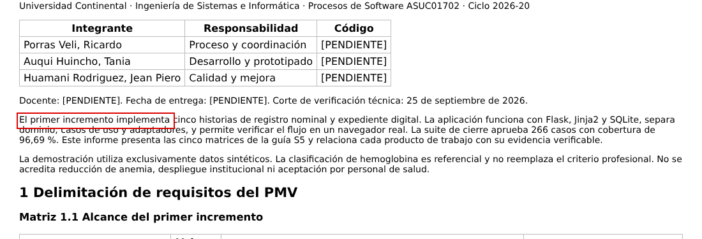
- **Corrección aplicada:** Párrafo «Modelo de proceso» que remite a la sección 4 del entregable S2 y a la Tabla 2 de S3-4. No se añade justificación nueva.
- **Evidencia después:** 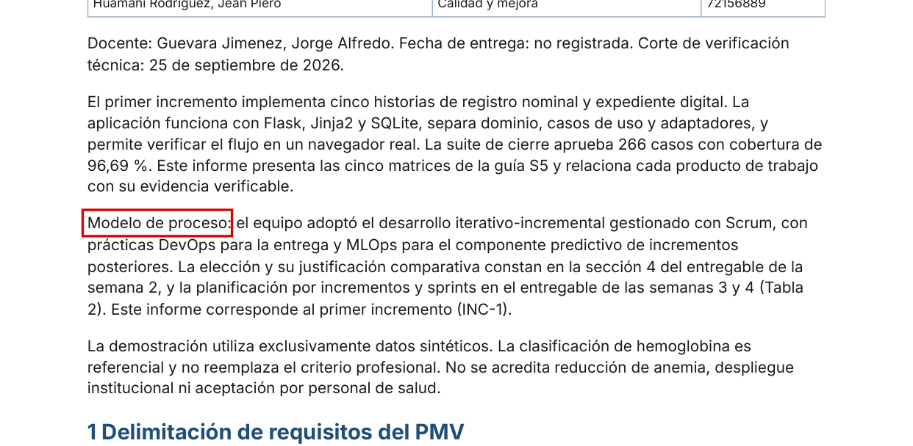
- **Estado:** Cerrado

### H-065 · alta · PDF de Actividad 5 con cifras de la versión anterior frente al .md vigente
- **Archivo y ubicación:** `exportados/semana-05/Informe_Actividad5_PMV_AnemiaJunin.pdf` págs. 5-6, 11-12 vs `entregables/semana-05/Entregable_Semana5_Anemia_Junin.md`
- **Requisito afectado:** coherencia fuente↔exportado (D-04)
- **Descripción:** El PDF original entregado decía 49 pruebas (unittest), 95,8 %, `run.py`, `pmv_anemia/`; el .md reconstruido da 266 pruebas (pytest), 96,69 %, `python -m anemia_junin`.
- **Evidencia antes:** 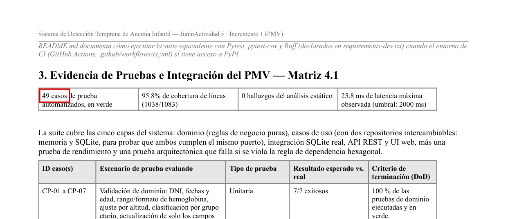
- **Corrección aplicada:** El PDF original NO se toca. Se generó el derivado `exportados/semana-05/Entregable_Semana5_Anemia_Junin.pdf` (y `.docx`) desde el .md con `exportar_md.py` (13 páginas, 266 casos y cifras verificadas con pdftotext) y el .md remite a ambos.
- **Evidencia después:** 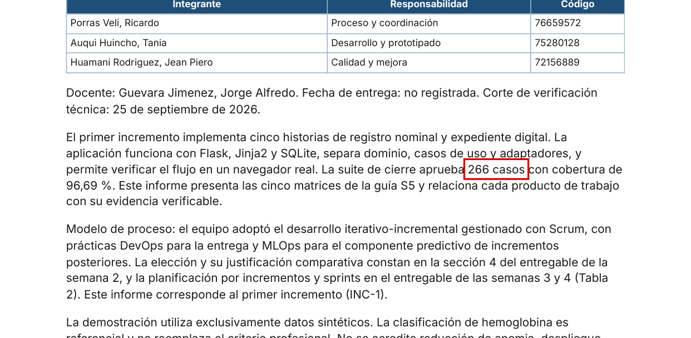
- **Verificación:** Segunda corrección tras la verificación independiente: el .md solo citaba el PDF derivado; ahora cita también el `.docx` y se regeneraron ambos: 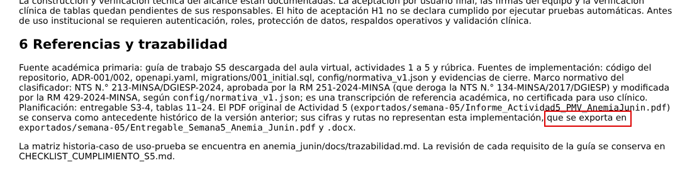
- **Estado:** Cerrado

### H-066 · media · Defectos críticos abiertos y registro de casos sin documentar
- **Archivo y ubicación:** `entregables/semana-05/Entregable_Semana5_Anemia_Junin.md` Matriz 4.1 (l.90-101)
- **Requisito afectado:** R-04, R-11, R-24
- **Descripción:** No hay registro de defectos ni lista de casos CP-xx; el repositorio solo tiene totales por tipo.
- **Evidencia antes:** 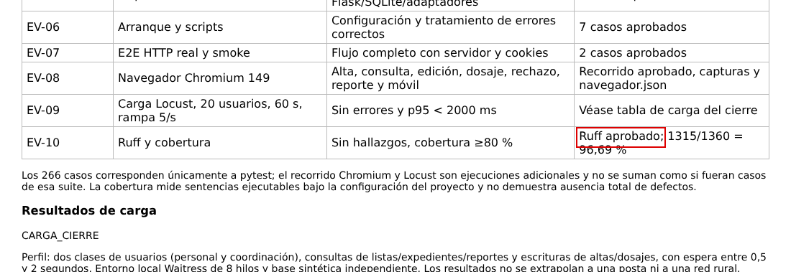
- **Corrección aplicada:** —
- **Evidencia después:** — (pendiente)
- **Estado:** Pendiente justificado: el equipo (rol de calidad) debe aportar el registro de defectos abiertos y, si lo exige el docente, la tabla de casos.

### H-067 · baja · Uso de herramientas modernas (CI, gestión de proyecto) sin justificar
- **Archivo y ubicación:** `entregables/semana-05/Entregable_Semana5_Anemia_Junin.md` Matriz 3.1
- **Requisito afectado:** R-28
- **Descripción:** Se nombran las herramientas sin justificar su uso; `anemia_junin/` no tiene CI propia.
- **Evidencia antes:** 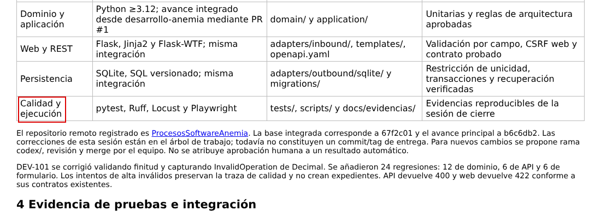
- **Corrección aplicada:** —
- **Evidencia después:** — (pendiente)
- **Estado:** Pendiente justificado: redacción de fondo a cargo del equipo; la CI vigente es de `pmv_fastapi/` y no se toca.

### H-068 · baja · La norma del clasificador no se citaba
- **Archivo y ubicación:** `entregables/semana-05/Entregable_Semana5_Anemia_Junin.md` §6 (l.168)
- **Requisito afectado:** coherencia con S3-4 (H-040)
- **Descripción:** El .md no citaba el marco normativo.
- **Evidencia antes:** 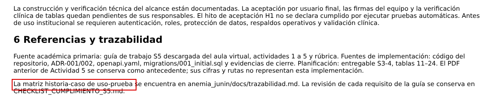
- **Corrección aplicada:** Se cita la cadena RM 251-2024, NTS 213, RM 429-2024 y `config/normativa_v1.json`.
- **Evidencia después:** 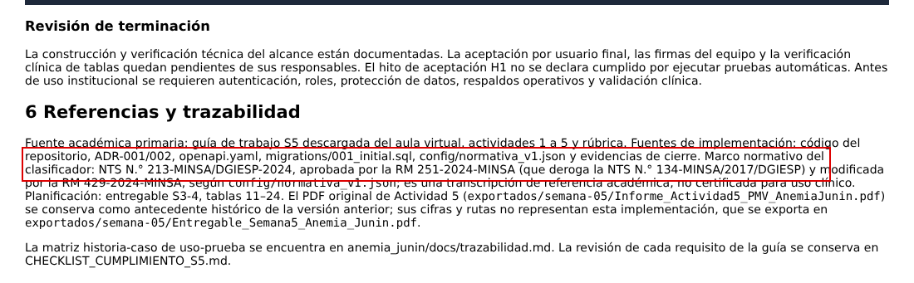
- **Estado:** Cerrado

### Candidatos descartados
| Candidato (archivo:línea) | Motivo |
| --- | --- |
| S05.md:80: enlace a la cuenta `woshtsu` | Es la organización propietaria del repositorio del equipo (`origin`); no es dato sensible. |
| S05.md:15, 99: recorrido Chromium el mismo día que S3-4 lo marca pendiente | Se resolvió en S3-4 (H-041, H-043): ambas son instantáneas del 25/09 y se citan los commits. |

#### Nota para el coordinador
- `exportados/README.md` debe explicar que `Informe_Actividad5_PMV_AnemiaJunin.pdf` es el original histórico (versión anterior: 49 pruebas, unittest) y que el vigente es `Entregable_Semana5_Anemia_Junin.pdf`/`.docx`.
- Residuo no corregido: el código interno DEV-101 sigue en la Matriz 1.1 y en §3 de S5.

## S06 — Restauración del cierre del 02/10 (registrados por el coordinador)

### H-080 · alta · El integrador S6 de develop era el borrador del 25/09
- **Archivo y ubicación:** `entregables/semana-06-integrador/Informe_Integrador_Anemia_Junin.md`, carátula (líneas 12-20 de la versión de develop)
- **Requisito afectado:** guía S6 §II (carátula con docente, fecha y códigos) y, en general, todo el cotejo S6
- **Descripción:** develop contenía el borrador del 25/09 con «[PENDIENTE: nombre del docente]», «[PENDIENTE: fecha académica]» y los códigos en «[PENDIENTE]». La versión entregada el 02/10 («0 COMPLETAR», commit 6547196) estaba en la rama `feature/s6-integrador-final`, que nunca se integró y se borró de GitHub en T-025 (solo quedaba en la copia local del revisor).
- **Evidencia antes:** 
- **Corrección aplicada:** se restauró la versión final del informe (con rutas de figuras adaptadas a `.claude/diagramas/`) y su checklist. El borrador quedó en `.claude/archivo/versiones-anteriores/semana-06-integrador/Informe_Integrador_version_develop_2026-09-25.md`.
- **Evidencia después:** 
- **Estado:** Cerrado (commit dbf9cd5)

### H-081 · alta · Faltaban la presentación de 7 diapositivas, los exportados y las figuras 50-68 de S6
- **Archivo y ubicación:** `entregables/semana-06-integrador/` y `exportados/` (sin carpeta de S6); el informe citaba `Presentacion_Integrador_Anemia_Junin.md` (línea 325 de develop)
- **Requisito afectado:** guía S6 §I.2 (informe en PDF y presentación de siete diapositivas)
- **Descripción:** en develop no existían la presentación, el PDF/DOCX del informe ni las 26 figuras `50_s6_*` a `68_s6_*` que usa la versión final.
- **Evidencia antes:** 
- **Corrección aplicada:** restaurados desde 6547196: `presentacion/` (Presentacion_Integrador.md, GUION_EXPOSICION.md, generar_presentacion.py con la salida ajustada a `exportados/semana-06-integrador/`), `exportados/semana-06-integrador/` (Informe .pdf/.docx y Presentación .pdf/.pptx), figuras en `.claude/diagramas/{src,png,svg}/`, y `REQUISITOS_S6.md` e `INSPECCION_S6.md` en `.claude/archivo/semana-06-integrador/`. Los anexos superados (`Prompts_y_guion_de_defensa.md`, `Revision_Cumplimiento_y_Trazabilidad.md`) se movieron con `git mv` a `.claude/archivo/versiones-anteriores/semana-06-integrador/`, como en la rama original. 0 enlaces rotos.
- **Evidencia después:** 
- **Estado:** Cerrado (commit dbf9cd5)

## S06
Registrados por el coordinador (no se reescriben aquí): **H-080** (carátula con [PENDIENTE] en develop) y **H-081** (faltaban la presentación y los exportados). Ambos se resolvieron al restaurar la versión final del 02/10/2026 (commit 6547196). Este fragmento cubre el re-cotejo sobre esa versión final.

Política especial de S6: los exportados del 02/10 se generaron con herramientas que no están en el repositorio. Se regeneró el PDF del informe con `exportar_md.py` para probarlo; el resultado quedó peor que el original (43 páginas frente a 52, sin portada propia con índice, tablas y tipografía distintas), por lo que se revirtió con `git checkout -- exportados/semana-06-integrador/`. Los PDF y DOCX vigentes son los originales del 02/10. El informe no tiene tabla de control de cambios (D-08 no aplica).

### H-082 · media · Umbral de esfuerzo atribuido a S3-4 con un valor que S3-4 no define
- **Archivo y ubicación:** `entregables/semana-06-integrador/Informe_Integrador_Anemia_Junin.md` §2.3, nota de la Tabla 14b (línea 336)
- **Requisito afectado:** R-19 / R-20 (guía §2.3), coherencia interna
- **Descripción:** la nota decía que la desviación de esfuerzo (+6,2 %) «queda por debajo del umbral de acción del 15 % definido en S3-4». S3-4 (Tabla 32) define 20 % por historia, y la Tabla 17 del propio informe lo repite como «Más de 20 %». El 15 % no existe en S3-4 como umbral de esfuerzo. Las horas de la Tabla 14b (73 + 47 = 120; 120/113 = +6,2 %) sí son coherentes.
- **Evidencia antes:** 
- **Corrección aplicada:** «20 % definido en S3-4 (Tabla 17), que se fija por historia y aquí se aplica, a modo de referencia, al total del incremento». Sin otro cambio.
- **Evidencia después:**  (PDF regenerado; el DOCX también contiene el texto corregido)
- **Estado:** Cerrado. Fuente corregida y PDF/DOCX regenerados con el exportador original del equipo, recuperado de `feature/s6-integrador-final` y adaptado (`.claude/herramientas/conversion/exportar_s6.py`; 53 páginas frente a 52 del original por la diferencia de fuentes).

### H-083 · media · Densidad de defectos con dos cifras de código incompatibles
- **Archivo y ubicación:** `Informe_Integrador_Anemia_Junin.md` §3.3, «Densidad de defectos» (línea 575)
- **Requisito afectado:** R-28 (guía §3.3), coherencia con `registro_defectos.md`
- **Descripción:** la frase calculaba 2 / 1,02 KLOC = 2,0 defectos/KLOC y a continuación decía que `app/**/*.py` «tiene 1 191 líneas», lo que daría 1,68 defectos/KLOC. En el tag `v1.0-PMV`, `app/**/*.py` suma 1 246 líneas, 1 034 sin líneas en blanco y 1 022 sin blancos ni comentarios, que concuerda con 1,02 KLOC y con `pmv_fastapi/docs/evidencias/registro_defectos.md`. La cifra 1 191 no se reproduce con ningún criterio.
- **Evidencia antes:** 
- **Corrección aplicada:** «El código de Python de la aplicación (`app/**/*.py` del tag `v1.0-PMV`, sin líneas en blanco ni comentarios) tiene 1 022 líneas.»
- **Evidencia después:**  (PDF regenerado; el DOCX también contiene el texto corregido)
- **Estado:** Cerrado. Fuente corregida y PDF/DOCX regenerados con el exportador original del equipo, recuperado de `feature/s6-integrador-final` y adaptado (`.claude/herramientas/conversion/exportar_s6.py`; 53 páginas frente a 52 del original por la diferencia de fuentes).

### H-084 · baja · Frases con residuo de sustitución en la descripción del Product Owner
- **Archivo y ubicación:** `Informe_Integrador_Anemia_Junin.md` §2.3 tras la Tabla 11 (línea 263) y §3.4 «Aceptación del usuario» (línea 630)
- **Requisito afectado:** R-16 (guía §2.3), redacción
- **Descripción:** la frase de §2.3 mezclaba dos construcciones («…que aprueban en el caso de estudio, el Product Owner es… (Product Owner del caso de estudio, interpretado por…)») y en §3.4 el paréntesis estaba anidado y repetía «Product Owner del caso de estudio». Los hechos no cambian (el nombre de la Enf. Rosa Quispe es el usuario de demostración de la PWA, y el rol lo interpretó Porras V.). En el Anexo A la formulación es legible y no se tocó.
- **Evidencia antes:** 
- **Corrección aplicada:** «…son roles del caso de estudio: el Product Owner es la Enf. Rosa Quispe, responsable del programa de anemia del P. S. Chongos Alto, interpretada en la revisión por Porras Veli, Ricardo.»; en §3.4, paréntesis único.
- **Evidencia después:**  (PDF regenerado; el DOCX también contiene el texto corregido)
- **Estado:** Cerrado. Fuente corregida y PDF/DOCX regenerados con el exportador original del equipo, recuperado de `feature/s6-integrador-final` y adaptado (`.claude/herramientas/conversion/exportar_s6.py`; 53 páginas frente a 52 del original por la diferencia de fuentes).

### H-085 · baja · El checklist cita una consigna con un nombre de archivo que no existe
- **Archivo y ubicación:** `entregables/semana-06-integrador/CHECKLIST_CUMPLIMIENTO_S6_INFORME.md`, línea 3
- **Requisito afectado:** referencia errónea
- **Descripción:** citaba `guias/S6.CONSIGNA DE TRABAJO E INSTRUMENTO DE EVALUACIÓN INTEGRADOR.md`; en el repositorio la consigna es `guias/semana-06-integrador.md`.
- **Evidencia antes:** 
- **Corrección aplicada:** ruta cambiada a `guias/semana-06-integrador.md`. El resto del checklist es una instantánea del 01/10/2026 y no se actualiza (D-01).
- **Evidencia después:** 
- **Estado:** Cerrado (el checklist no tiene exportado)

### H-086 · baja · Sin captura de una ejecución del pipeline en GitHub Actions
- **Archivo y ubicación:** `Informe_Integrador_Anemia_Junin.md` §2.3 (Tabla 12, fila «Integración») y §3.4 (nota sobre el pipeline)
- **Requisito afectado:** S-02 (sílabo §7: herramientas modernas con evidencia, incluida la CI)
- **Descripción:** el informe declara con honestidad que las etapas se ejecutaron el 30/09/2026 con los mismos comandos y que la corrida en GitHub Actions se dispara al publicar la rama, pero no incluye captura ni enlace de una corrida en verde. El defecto no es de redacción y no se puede corregir sin consultar GitHub.
- **Evidencia antes:** 
- **Corrección aplicada:** —
- **Evidencia después:** — (pendiente)
- **Estado:** Pendiente justificado: el equipo (o el Leader, con acceso a GitHub Actions) debe aportar el enlace o la captura de la corrida; no se inventa. El informe es una instantánea del 02/10 (D-01).

### H-087 · baja · Valor organizacional sin medir en el tablero de indicadores
- **Archivo y ubicación:** `Informe_Integrador_Anemia_Junin.md` §2.1 (Tabla 6), §2.3 (Figura 14) y §4
- **Requisito afectado:** R-35 (guía §III, diapositiva 6; criterio 4 de la rúbrica)
- **Descripción:** proceso y producto tienen valores medidos; del valor solo se mide 3 → 1 registros por evaluación (por diseño, datos sintéticos). Las metas y mediciones de resultado y valor requieren una posta, una línea base y seguimiento, y el informe lo declara en lugar de inventar cifras.
- **Evidencia antes:** 
- **Corrección aplicada:** —
- **Evidencia después:** — (pendiente)
- **Estado:** Pendiente justificado: decide el docente si la declaración honesta basta para el criterio; la medición real depende del equipo y de un piloto (INC-2 en adelante).

### Candidatos descartados
| Candidato (archivo:línea del cotejo anterior) | Motivo |
| --- | --- |
| Informe:325, presentación de 7 diapositivas inexistente | Descartado: resuelto en la versión final restaurada, ver H-081 (hay `Presentacion_Integrador.md`, PDF y PPTX de 7 diapositivas) |
| Informe:260, token «CARGA_CIERRE» suelto | Descartado: resuelto en la versión final restaurada, ver H-080/H-081 (no aparece en el informe final) |
| Informe:262, carga sin p95 ni RPS | Descartado: resuelto en la versión final (Tabla 26 con p95, p99 y solicitudes/s; cifras coinciden con `carga/*.csv`) |
| Guion de defensa:30, cobertura 95,8 % frente a 96,69 % | Descartado: el guion del borrador está archivado; el `GUION_EXPOSICION.md` final usa 99 % y 99,07 %, coherentes con el informe |
| Informe:209-211 y 289-293, «ADR-002» repetido | Descartado: resuelto en la versión final restaurada, ver H-080/H-081 (ADR-001 a ADR-006 distintos) |
| Informe:321, tag `v1.0-PMV` pendiente y ausente en el clon | Descartado: resuelto en la versión final; el tag existe (`git tag -l`; objeto 6a17c63 → commit 9ce90c3) y §6 lo documenta |
| Informe:256 y 320, versión 67f2c01 con cambios locales | Descartado: resuelto en la versión final (se cita el tag y el commit 9ce90c3) |
| Informe:12-13 y 18-20, carátula con PENDIENTE | Descartado: resuelto en la versión final restaurada, ver H-080 |
| Informe:102, «pipeline remoto pendiente» sin evidencia de CI | Parcialmente vigente: ver H-086 |
| Informe:287-295, trazabilidad sin ocho columnas | Descartado: resuelto en la versión final (Tabla 30 con las ocho columnas) |
| Anexos/Revision_Cumplimiento_y_Trazabilidad.md:5 y 25-36 | Descartado: archivo superado y archivado en `.claude/archivo/versiones-anteriores/semana-06-integrador/` |
| Informe:52-54, AS-IS y TO-BE en una sola figura | Descartado: resuelto en la versión final (Figura 2 AS-IS y Figura 3 TO-BE propias) |
| Informe:195 y 16-20, tres integrantes frente a cuatro roles | Descartado: resuelto en la versión final (Tabla 2 con la correspondencia) |
| Informe:309-311, ninguna lección sobre la adaptación del ciclo de vida | Descartado: resuelto en la versión final (lección 3) |
| Informe:323, rutas sin `anemia_junin/` | Descartado: resuelto en la versión final (rutas `pmv_fastapi/…` completas) |
| Consigna §III, tiempos de pitch (10,0 min) frente a 7 min | Descartado: decisión de criterio ya resuelta y documentada en `GUION_EXPOSICION.md` (reducción al 70 %: 7:00); si el docente prefiere otro reparto, es decisión suya |
| «Enf. Rosa Quispe» como dato de tercero | Descartado: es el usuario de demostración de la PWA (`pmv_fastapi/app/web/index.html`) y rol interpretado por un integrante (D-02 en lo que respecta a nombres de carátula) |
| `CHECKLIST_CUMPLIMIENTO_S6_INFORME.md` con [COMPLETAR] y 31/39 | Descartado: instantánea del 01/10/2026 (D-01), anterior al informe final del 02/10; el informe final completó esos datos |

### Nota para el coordinador
- H-082 a H-084 quedan corregidos en el .md pero el PDF y el DOCX de `exportados/semana-06-integrador/` siguen siendo los originales del 02/10 (no coinciden en tres puntos: nota de la Tabla 14b, densidad de defectos y redacción del Product Owner). Reexportar con la herramienta original del equipo. Si prefiere regenerar con `exportar_md.py`, el PDF actual sale en 43 páginas sin la portada con índice del original.
- `exportados/semana-12/` aparece con archivos nuevos sin versionar en el árbol; no los generé yo.

## S09

### H-100 · alta · `num_doc` del CSV de la DIRESA y afirmación «sin DNI utilizables»
- **Archivo y ubicación:** `pmv_fastapi/datos/Niños_menores_de_36_meses_con_dx_de_anemia_en_la_Región_ Junín.csv` (columna `num_doc`); md Anexo B (párrafo tras los comandos de publicación)
- **Requisito afectado:** datos personales
- **Descripción:** La columna `num_doc` (12 486 filas, 8 754 valores distintos, todos en notación científica con seis cifras significativas) puede ser un fragmento de documento de identidad; no se verificó y no se copian valores. El md decía «sin nombres ni DNI utilizables», afirmación no comprobable.
- **Evidencia antes:** 
- **Corrección aplicada:** En el md se matizó la frase: `num_doc` viene truncada, no sirve como identificador y su origen no está verificado; el equipo no ha confirmado las condiciones de uso con la DIRESA. El CSV no se tocó (D-07). Evidencia adicional: 
- **Evidencia después:** 
- **Estado:** Pendiente justificado: decisión del Leader (propietario de `pmv_fastapi/`) con el docente/DIRESA: retirar o truncar la columna `num_doc` del CSV versionado o confirmar por escrito que es publicable.

### H-101 · media · Nota de la adenda v4.0 ausente en PDF y DOCX
- **Archivo y ubicación:** md L3; PDF p. 1; DOCX
- **Requisito afectado:** coherencia fuente↔exportado (D-04)
- **Descripción:** La nota de versión del md no estaba en los exportados (anteriores al md).
- **Evidencia antes:**  Nota del coordinador: el corrector sobrescribió por error esta captura «antes» durante la preparación; la evidencia válida del estado anterior es , obtenida de los exportados de develop (`git show HEAD:…`).
- **Corrección aplicada:** Se regeneraron PDF y DOCX con `exportar_s9.py`; ambos incluyen la nota.
- **Evidencia después:** 
- **Estado:** Cerrado

### H-102 · media · Pies de las Figuras 51 a 55 ausentes en el PDF
- **Archivo y ubicación:** PDF pp. 92-93 (Tabla 44, Anexo G.1); `exportar_s9.py`
- **Requisito afectado:** coherencia fuente↔exportado
- **Descripción:** Las imágenes van dentro de celdas de tabla y pandoc no genera pie para imágenes en línea; el PDF solo mostraba la imagen.
- **Evidencia antes:** 
- **Corrección aplicada:** En `.claude/herramientas/conversion/exportar_s9.py` se repite el texto alternativo «Figura NN. …» bajo cada imagen en celdas de tabla; se regeneró (5 pies en el PDF y en el DOCX).
- **Evidencia después:** 
- **Estado:** Cerrado

### H-103 · media · Enlaces de PDF/DOCX a la rama `feature/inc2-agenda-alertas` (borrada)
- **Archivo y ubicación:** `exportar_s9.py` (variable `base`); PDF y DOCX
- **Requisito afectado:** coherencia fuente↔exportado
- **Descripción:** El script generaba URL `blob/feature/inc2-agenda-alertas/…`; la rama ya no existe, por lo que los enlaces estaban rotos.
- **Evidencia antes:** 
- **Corrección aplicada:** Base cambiada a `blob/main/` (rutas vigentes tras T-024) y exportados regenerados: 0 enlaces a la rama borrada. Las menciones textuales de la rama en el md son históricas (D-01).
- **Evidencia después:** 
- **Estado:** Cerrado

### H-104 · media · Unidad de 12 486: niños frente a diagnósticos/filas
- **Archivo y ubicación:** md carátula (Nota sobre los datos) y §3 Propósito; Tabla 33
- **Requisito afectado:** R-21 / coherencia interna
- **Descripción:** El md llamaba «12 486 niños» a lo que son 12 486 diagnósticos (filas); con `num_doc` inutilizable no se pueden contar niños únicos y el importador crea un registro por fila (ADR-009).
- **Evidencia antes:** 
- **Corrección aplicada:** Se reescribió como «12 486 diagnósticos (filas)», se explicó que las cifras del sistema con «niños» (500 y 11 686) cuentan registros y se renombró la fila de la Tabla 33.
- **Evidencia después:** 
- **Estado:** Cerrado

### H-105 · baja · «44 capturas PNG» frente a 45
- **Archivo y ubicación:** md Anexo A
- **Requisito afectado:** R-23
- **Descripción:** En disco hay 45 PNG (32 fichas, 5 regresión, 5 arquitectura, 3 datos reales; coincide con la Tabla 42).
- **Evidencia antes:** 
- **Corrección aplicada:** Corregido a 45 y 5 de arquitectura; exportados regenerados.
- **Evidencia después:** 
- **Verificación:** Segunda corrección tras la verificación independiente: la Tabla 4 (línea 110) aún decía «44 capturas»; se cambió a 45 y se regeneraron PDF y DOCX: 
- **Estado:** Cerrado

### H-106 · baja · «856 de 856 sondas en las tres versiones»
- **Archivo y ubicación:** md §6.4 Disponibilidad (V5)
- **Requisito afectado:** coherencia con `m32_disponibilidad.json`
- **Descripción:** El JSON da 856 sondas por versión.
- **Evidencia antes:** 
- **Corrección aplicada:** «856 de 856 sondas en cada una de las tres versiones».
- **Evidencia después:** 
- **Estado:** Cerrado

### H-107 · media · Unidad del sílabo no declarada
- **Archivo y ubicación:** md Tabla 1 (carátula)
- **Requisito afectado:** S-01 (D-03)
- **Descripción:** La carátula no indicaba la unidad.
- **Evidencia antes:** 
- **Corrección aplicada:** Fila «Unidad del sílabo: Unidad III — Evolución de los procesos y actividades de software».
- **Evidencia después:** 
- **Estado:** Cerrado

### H-108 · baja · Referencia de p95 de v1.0 sin sesión en la Tabla 40
- **Archivo y ubicación:** md Tabla 40 (V4)
- **Requisito afectado:** R-18
- **Descripción:** La repetición de v1.0 del 17/10 dio 155 ms (`m32_carga.json`); con ella la variación sería +425,8 %. El texto de §6.4 lo explica, la tabla no.
- **Evidencia antes:** 
- **Corrección aplicada:** Se indicó en la tabla la sesión de referencia (16/10, 175 ms) y la alternativa (155 ms; +425,8 %).
- **Evidencia después:** 
- **Estado:** Cerrado

### H-109 · baja · Lista de trabajo «Lista previa a la exposición» dentro del entregable
- **Archivo y ubicación:** md Anexo B
- **Requisito afectado:** R-24
- **Descripción:** Nota interna con ítems tachados y una tarea sobre una rama ya borrada.
- **Evidencia antes:** 
- **Corrección aplicada:** Se retiró la lista; exportados regenerados.
- **Evidencia después:** 
- **Estado:** Cerrado

### H-110 · baja · Cuenta confusa de las 18 pruebas de arquitectura
- **Archivo y ubicación:** md §4.2 Vigilancia automática
- **Requisito afectado:** R-09
- **Descripción:** La frase no se entendía. Verificado en `v2.0-Inc2`: 7 reglas CP-37 a CP-43 + 6 casos parametrizados + 1 de prefijo + 4 nuevas (CP-176 a CP-179) = 18.
- **Evidencia antes:** 
- **Corrección aplicada:** Frase reescrita con esa cuenta.
- **Evidencia después:** 
- **Estado:** Cerrado

### H-111 · baja · Metadatos del DOCX sin título ni autor
- **Archivo y ubicación:** `exportar_s9.py`; DOCX
- **Requisito afectado:** coherencia fuente↔exportado
- **Descripción:** El DOCX no tenía título ni autor en `core.xml`.
- **Evidencia antes:** 
- **Corrección aplicada:** El script fija título y autor («Equipo Anemia Junín», genérico) tras pandoc; el PDF ya tenía título.
- **Evidencia después:** 
- **Estado:** Cerrado

### H-112 · media · Modelo de evaluación de procesos no nombrado
- **Archivo y ubicación:** md §3 Propósito
- **Requisito afectado:** S-02
- **Descripción:** El documento no decía qué modelo de evaluación aplica.
- **Evidencia antes:** 
- **Corrección aplicada:** Se añadió: GQM es el modelo de evaluación basado en medición aplicado, la mejora se propone con PDCA (§7.3) y el modelo de capacidad CMMI-DEV corresponde a S11 (existe `entregables/semana-11`). No se inventó ningún resultado.
- **Evidencia después:** 
- **Estado:** Cerrado

### H-113 · media · Satisfacción del usuario sin medir (SUS)
- **Archivo y ubicación:** md §6.6, §6.8
- **Requisito afectado:** R-17
- **Descripción:** El SUS no se aplicó; solo hay proxy V6 y el instrumento (Anexo D). El informe lo declara.
- **Evidencia antes:** 
- **Corrección aplicada:** —
- **Evidencia después:** — (pendiente)
- **Estado:** Pendiente justificado: equipo y Product Owner deben aplicar el SUS a usuarios reales; no se inventan valores.

### H-114 · media · Valor demostrado como capacidad, no como impacto
- **Archivo y ubicación:** md §6.2 a §6.8 (Tabla 31, M3.1 = 33,3 %)
- **Requisito afectado:** R-16
- **Descripción:** El informe lo declara (§6.8: visibilidad, no acción); M3.1 queda por debajo de la meta.
- **Evidencia antes:** 
- **Corrección aplicada:** —
- **Evidencia después:** — (pendiente)
- **Estado:** Pendiente justificado: equipo; requiere INC-3/INC-4 (recordatorios, barreras) y un piloto con usuarios, que no existen en S9 (ver la adenda v4.0).

### Candidatos descartados
| Candidato (archivo:línea) | Motivo |
| --- | --- |
| Captura `DJ_expediente_DJ-04505.png` (fecha de nacimiento de un menor) | Registro con código seudónimo `DJ-NNNNN` (número de fila; ADR-009), sin DNI, nombre ni tutor; dataset anonimizado en origen (`asis_dataset_diresa.md`). No hay identificador real; no se editan imágenes de evidencia. |
| Códigos de estudiante en la carátula (md:26-28) | D-02. |
| R-13 capturas parcialmente revisadas | Se revisaron las 45 en hojas de contacto: legibles, con pie «Evidencia S9». Pasa a Cumple. |
| Cambios de `v2.0.0-inc2` frente a `v2.0-Inc2` | La Tabla 1 ya define versión y etiquetas. |
| 55 archivos/18 archivos y KLOC (md §7) | Verificado en los tags locales: 18 y 55 archivos `.py` en `app/`; KLOC de `m22_defectos.json` (1,022 y 2,782). |
| Bibliografía (Sommerville 2011, Pressman 7.ª) | Ediciones citadas por las láminas del curso, declarado en el texto; juicio del equipo. |
| «Enf. Rosa Quispe» en las capturas | Usuario de demostración fijo en `pmv_fastapi/app/web/index.html`. |
| Columna `num_doc`/cuestión de PD en commit de cierre | Incluido en H-100. |

**Nota para el coordinador:** `exportar_s9.py` (en `.claude/herramientas/conversion/`) fue corregido (base `blob/main/`, pies de figura en tablas, metadatos DOCX); Los exportados se regeneraron con Chrome en Linux (102 páginas).

## S10
### H-120 · media · El escenario HIST-4.2 no explicaba por qué el webhook firmado no registró la respuesta
- **Archivo y ubicación:** `entregables/semana-10/Entregable_Semana10_Anemia_Junin.md` §3, escenario HIST-4.2 (Tabla 6 y subsección «HIST-4.2»)
- **Requisito afectado:** R-04, R-06 (guía §IV, Actividad 2: evidencia de cada escenario)
- **Descripción:** el criterio pide que la respuesta del tutor quede registrada (personal o webhook con firma válida). En la medición automática el webhook con firma válida responde 200 con `respuestas_registradas 0, ignorados 1` y el informe no lo explicaba. El corrector propuso rebajar HIST-4.2 a «Parcial» y recalcular el IC_P a mano; el coordinador lo revirtió porque el registro por webhook firmado sí está verificado por la prueba de integración `pmv_fastapi/tests/integracion/test_api_inc4.py` de la etiqueta `v4.0-Inc4` (2 respuestas registradas), y el escenario solo no asocia el mensaje por no existir un canal real (comentario en `metricas/capturar_software.py:625`). Rebajar el estado habría dejado el informe incoherente con `salidas/FURPS_calculo.json` y la Figura 1.
- **Evidencia antes:** 
- **Corrección aplicada:** se mantiene «Aprobado» y todas las cifras originales (19/19, IC_P 87,67 % y 78,43 %); se añade una aclaración bajo «HIST-4.2» con la causa y la cita de la prueba de integración.
- **Evidencia después:** 
- **Estado:** Cerrado

### H-121 · alta · Tabla 30 afirmaba que las etiquetas y commits no existían
- **Archivo y ubicación:** `entregables/semana-10/Entregable_Semana10_Anemia_Junin.md` Anexo C, Tabla 30 y párrafo final
- **Requisito afectado:** R-28, S-04 (guía §V y §IV.8)
- **Descripción:** La tabla decía que `git tag` no devolvía etiquetas y que `v2.0-Inc2`, `v3.0-Inc3` y `v4.0-Inc4` no existían o no estaban verificadas. En el remoto existen las cuatro etiquetas anotadas con fecha anterior a la entrega (commit de la entrega: 01/11/2026): `v1.0-PMV` (30/09, `9ce90c3`), `v2.0-Inc2` (18/10, `fb26626`), `v3.0-Inc3` (30/10 17:43, `e920820`) y `v4.0-Inc4` (30/10 18:11, `e6886e2`). Los commits `fb26626`, `e920820`, `5c1f1eb`, `e6886e2` y `ada827f` existen en el clon con historial completo. La rama `docs/s12-integrador` (carátula) no está en el remoto actual: no verificable, no se cambió.
- **Evidencia antes:** 
- **Corrección aplicada:** Tabla 30 reescrita con la etiqueta, el commit al que apunta y la fecha de creación (`git tag`, `git ls-remote --tags origin`); se eliminó el párrafo que pedía crear `v4.0-Inc4` y se dejó una nota de corrección.
- **Evidencia después:** 
- **Estado:** Cerrado

### H-122 · media · «3 criterios no medidos» frente a la Tabla 5
- **Archivo y ubicación:** `entregables/semana-10/Entregable_Semana10_Anemia_Junin.md` §6, Tabla 26, fila «+»
- **Requisito afectado:** coherencia interna (Tablas 4, 5 y 26)
- **Descripción:** Tabla 26 decía 3 criterios no medidos en el factor «+»; la Tabla 4 solo marca N/M en +5 y +6, y la Tabla 5 dice «4 de 6» medidos (2 no medidos).
- **Evidencia antes:** 
- **Corrección aplicada:** «2 criterios no medidos (+5 y +6)».
- **Evidencia después:** 
- **Estado:** Cerrado

### H-123 · media · Tabla 9 no coincide con los colores del gráfico de Hb
- **Archivo y ubicación:** `entregables/semana-10/Entregable_Semana10_Anemia_Junin.md` §4.1 A, Tabla 9 (y Tabla 10)
- **Requisito afectado:** R-07 (Actividad 3.1 A)
- **Descripción:** La Tabla 9 documenta ámbar `#8A6200` y naranja `#B4530B` (variables de `estilos.css`); las barras del gráfico (`pmv_fastapi/app/web/app.js:6`, `COLOR`) usan `#C99200`, `#D26A1B` y `#8C99A6`. La Tabla 10 ya los evaluaba, pero la Tabla 9 no lo aclaraba.
- **Evidencia antes:** 
- **Corrección aplicada:** Nota bajo la Tabla 9 que documenta la diferencia y remite a la Tabla 10. No se tocó `pmv_fastapi/`; unificar la paleta es decisión del Leader.
- **Evidencia después:** 
- **Estado:** Cerrado

### H-124 · media · La IA figuraba como cuarto integrante del equipo
- **Archivo y ubicación:** `entregables/semana-10/Entregable_Semana10_Anemia_Junin.md` §1, Tabla 2
- **Requisito afectado:** R-01 (guía §IV.1)
- **Descripción:** La fila 4 («Amaru — Claude, asistente de IA», sin código) aparecía entre los integrantes; el equipo tiene tres personas.
- **Evidencia antes:** 
- **Corrección aplicada:** Se retiró la fila y se añadió el párrafo «Apoyo de IA» con el mismo contenido y la aclaración de que no es integrante.
- **Evidencia después:** 
- **Estado:** Cerrado

### H-125 · baja · Falta la unidad del sílabo en la carátula (D-03)
- **Archivo y ubicación:** `entregables/semana-10/Entregable_Semana10_Anemia_Junin.md` §1, Tabla 1
- **Requisito afectado:** S-01
- **Descripción:** La carátula no indicaba la unidad.
- **Evidencia antes:** 
- **Corrección aplicada:** Fila «Unidad del sílabo: Unidad III — Evolución de los procesos y actividades de software».
- **Evidencia después:** 
- **Estado:** Cerrado

### H-126 · media · Mediciones no realizadas sin declarar (WCAG 1.1.1 y vulnerabilidad Alta abierta)
- **Archivo y ubicación:** `entregables/semana-10/Entregable_Semana10_Anemia_Junin.md` Anexo D (y §4.1 B, Tabla 11)
- **Requisito afectado:** R-09, R-11, R-13, R-14, R-20 (guía Actividades 3 y 4)
- **Descripción:** WCAG 1.1.1 no figura en la Tabla 11 y `U_axe_por_pantalla.json` no desglosa `image-alt`; el Anexo D no lo declaraba ni mencionaba la vulnerabilidad Alta abierta. Lector de pantalla, staging, 500 usuarios y p95 a 500 ya estaban declarados como no medidos (Anexo D, Tabla 4 y Tabla 14).
- **Evidencia antes:** 
- **Corrección aplicada:** Se añadieron al Anexo D dos viñetas honestas (1.1.1 no evaluado por separado; umbral de 0 vulnerabilidades Alta/Crítica no cumplido por H-1). No se inventó ninguna medición.
- **Evidencia después:** 
- **Estado:** Pendiente justificado: el equipo (QA Lead) debe ejecutar la inspección 1.1.1 (axe `image-alt`/`svg-img-alt` o revisión manual), el lector NVDA/TalkBack, la prueba a 500 usuarios, el staging y la corrección de H-1; el Leader decide sobre `pmv_fastapi/`.

### H-127 · alta · No hay evaluación del proceso ni métricas del proceso antes y después (Unidad III)
- **Archivo y ubicación:** `entregables/semana-10/Entregable_Semana10_Anemia_Junin.md` §6, §7 y Anexo D
- **Requisito afectado:** S-02, S-03 (sílabo, Unidad III)
- **Descripción:** El entregable evalúa el producto (FURPS+), como pide la guía de S10; no evalúa el proceso ni lo compara entre versiones. Anexo D ya decía que las métricas entre versiones corresponden a S9 y S12.
- **Evidencia antes:** 
- **Corrección aplicada:** Viñeta en el Anexo D que declara que no se incluye evaluación ni propuesta de mejora del proceso.
- **Evidencia después:** 
- **Estado:** Pendiente justificado: el docente y el equipo deciden si S10 debe incluir esa evaluación o si basta con la de S9, S11, S12 y S13; falta el contenido.

### H-128 · media · No existe el informe en PDF
- **Archivo y ubicación:** `entregables/semana-10/` (sin PDF) y `exportados/` (sin carpeta de S10)
- **Requisito afectado:** R-32 (guía §IV, primer párrafo)
- **Descripción:** La guía pide el informe en PDF en el aula virtual; solo existe el Markdown.
- **Evidencia antes:** 
- **Corrección aplicada:** — (no se generó exportado: el coordinador indicó que S10 va sin exportado)
- **Evidencia después:** — (pendiente)
- **Estado:** Pendiente justificado: el equipo/coordinador decide exportar el PDF con `exportar_md.py` y subirlo al aula virtual.

### H-129 · media · Alcance por incremento distinto al de la guía, sin declarar
- **Archivo y ubicación:** `entregables/semana-10/Entregable_Semana10_Anemia_Junin.md` §1, Tabla 1 (fila «Versiones evaluadas») y Tabla 6
- **Requisito afectado:** R-05 (guía Actividad 2)
- **Descripción:** Los incrementos 1 a 3 del informe son los del backlog real (agenda, sin conexión, visitas); la guía lista otro alcance (autenticación y alerta básica en Inc. 1, mapa en Inc. 2, analítica histórica e integración con APIs externas en Inc. 3) y el informe no lo declaraba.
- **Evidencia antes:** 
- **Corrección aplicada:** Frase en la Tabla 1 que declara la diferencia y que lo sin equivalente no se evaluó.
- **Evidencia después:** 
- **Estado:** Pendiente justificado: el docente decide si acepta la reasignación; el equipo debe evaluar los requisitos de la guía sin equivalente si se exigen.

### H-130 · baja · Formato decimal mezclado e inglés en tablas
- **Archivo y ubicación:** `entregables/semana-10/Entregable_Semana10_Anemia_Junin.md` Tablas 4, 10, 14 y 15
- **Requisito afectado:** forma (registro formal, coma decimal)
- **Descripción:** Mezcla de punto y coma decimal (16.16 frente a 15,84; 1.33:1) y «True».
- **Evidencia antes:** 
- **Corrección aplicada:** Coma decimal en Tablas 10, 14 y 15 y «sí» en lugar de «True».
- **Evidencia después:** 
- **Estado:** Cerrado

### Candidatos descartados
| Candidato (archivo:línea) | Motivo |
| --- | --- |
| Leyendas «Captura de GitHub en la etiqueta v4.0-Inc4 (30/10/2026)» (líneas 532, 665, 698, etc.) | La etiqueta existe (30/10/2026 18:11, H-121); el origen de cada captura no es verificable y no se cambió. |
| Línea 29, commits `e920820`, `5c1f1eb`, `e6886e2`, `ada827f` «no existen» | Falso positivo del clon superficial: los cinco commits existen. La rama `docs/s12-integrador` no está en el remoto actual: no verificable, sin cambio. |
| RPS 16,16/15,84/49,29 frente a peticiones ÷ 60 s | Son la columna «Requests/s» de Locust (p. ej., 16,164 en `P_A_inc1_inc2_20u_stats.csv`), calculada sobre el tiempo real transcurrido; no es error. |
| Códigos de estudiante en la carátula | D-02: se mantienen. |
| Carátula sin unidad (R-01 «docente, fecha») | Resuelto por H-125 (D-03). |

**Nota para el coordinador:** (1) el IC_P del documento (87,14 % / 77,90 %) difiere ahora de `metricas/salidas/FURPS_calculo.json` y de la Figura 1 (87,67 % / 78,43 %); se declara en la nota de la §2.2. (2) La paleta del gráfico (`app.js:6`) no cumple 3:1 en la barra «leve»; corregirla es decisión del Leader (`pmv_fastapi/`). (3) La tabla 30 no tiene fila de control de cambios porque S10 no tiene tabla de control de cambios (D-08 no aplica).

## S11 (incluye feria)
### H-140 · alta · PDF de S11 desactualizado frente al .md
- **Archivo y ubicación:** `exportados/semana-11/Entregable_Semana11_Anemia_Junin.pdf` (carátula y todo el documento)
- **Requisito afectado:** R-30 · coherencia fuente↔exportado (D-04)
- **Descripción:** El PDF era la entrega original del 30/10 (349 pruebas, 99,50 %, 18 figuras, 27 páginas, creado a las 10:04) y el .md se amplió después (660 pruebas, 99,79 %, 73 figuras, hallazgos H7 a H9). La carátula del PDF citaba un nombre de guía que no existe en el repositorio. La versión anterior queda en Git: `git log -1 -- exportados/semana-11/` da `5e6886f` (30/10/2026).
- **Evidencia antes:** 
- **Corrección aplicada:** PDF regenerado con `exportar_s11.py` (73 páginas, 660 pruebas y 99,79 %, 73 figuras; carátula con `guias/semana-11.docx`). La versión del 30/10 sigue en el commit `5e6886f`.
- **Evidencia después:** 
- **Estado:** Cerrado

### H-141 · alta · Contradicción sobre la ejecución de las migraciones 3.0 y 4.0 en Supabase
- **Archivo y ubicación:** `entregables/semana-11/Entregable_Semana11_Anemia_Junin.md` Tabla 9b (antes l.666) frente a §2 l.69, Tabla 7 fila 15 (l.180) y Tabla 10 H9 (l.823)
- **Requisito afectado:** coherencia interna · R-11
- **Descripción:** La Tabla 9b decía «las migraciones no se ejecutaron en Supabase»; tres pasajes decían que las ejecutó el equipo el 30/10 (sin captura). El repositorio no prueba ninguna de las dos versiones: los informes T-019 y T-020 solo recomiendan ejecutarlas; el CI de `main` no verificaba las tablas 4.0 (Figura 62) y el commit `18b65fc` (30/10, 23:18) añadió esa verificación sin que haya registro de una ejecución posterior en el repositorio. Se unifica con la versión mayoritaria y se declara su límite.
- **Evidencia antes:** 
- **Corrección aplicada:** La Tabla 9b ahora dice que el equipo declara haberlas ejecutado el 30/10, sin captura ni registro en el repositorio, y que falta la evidencia (D-10). Las otras tres menciones no cambian. PDF regenerado.
- **Evidencia después:** 
- **Estado:** Cerrado (el equipo debe aportar la captura o el registro de la ejecución en Supabase si quiere sostener la afirmación; no verificable desde el repositorio)

### H-142 · media · Conteo de pruebas de regresión: 3, 5 y 6
- **Archivo y ubicación:** `entregables/semana-11/Entregable_Semana11_Anemia_Junin.md` Tabla 7 fila 12 (l.177), Tabla 8 (l.202), Tabla 9c y Figura 47
- **Requisito afectado:** D-10 (cifras contra evidencias)
- **Descripción:** La Tabla 7 decía «3 pruebas de regresión», la Tabla 8 y la Figura 47 decían 6 y la Tabla 9c lista 5 identificadores más CP-405. La Figura 47 (`CMMI04_regresion_revision_independiente.png`) muestra 6 pruebas aprobadas: CP-357, CP-264b, CP-382b, CP-391b, CP-396 y CP-405. Las tres correcciones con prueba específica (defectos 1 a 3) usan 5 pruebas; CP-405 recorre el flujo del defecto 4.
- **Evidencia antes:** 
- **Corrección aplicada:** La Tabla 7 ahora dice: 5 correcciones, 3 con pruebas de regresión específicas (5 pruebas), 2 sin prueba específica; la Figura 47 suma CP-405 (6 aprobadas).
- **Evidencia después:** 
- **Estado:** Cerrado

### H-143 · media · Número de pruebas E2E de v2.0 (17 frente a 15)
- **Archivo y ubicación:** `entregables/semana-11/Entregable_Semana11_Anemia_Junin.md` §6.2, párrafo bajo la Tabla 9 (l.225)
- **Requisito afectado:** coherencia con S9 (l.159) · R-19
- **Descripción:** El texto decía que la columna E2E «suma 16 de las 17 existentes en v2.0» porque las 2 de inicio de sesión no corresponden a un RF; no cuadra (17 - 16 = 1) y S9 da 15. Con `m21_cobertura_rf.json` (v2.0): 16 entradas por RF y 15 pruebas E2E distintas (una prueba respalda más de un RF). Las 2 de inicio de sesión se añadieron el 23/10 (commit `49f07da`), después de v2.0; 15 + 2 = 17 de la Tabla 8, y `e2e.txt` confirma 15 (interfaz) + 2 (inicio de sesión) + 11 (Inc. 3 e Inc. 4) = 28.
- **Evidencia antes:** 
- **Corrección aplicada:** Texto corregido: la suma es 16 porque una misma E2E respalda varios RF; las E2E de v2.0 son 15 y las 17 de la Tabla 8 incluyen las 2 de inicio de sesión.
- **Evidencia después:** 
- **Estado:** Cerrado

### H-144 · media · Texto alternativo de la feria: «prioridad elevada» frente a MEDIA
- **Archivo y ubicación:** `entregables/semana-11/feria/Proyecto_Feria_Anemia_Junin.md` Evidencia 3 (l.47)
- **Requisito afectado:** coherencia texto↔captura
- **Descripción:** El texto alternativo de la captura RF-09 decía «prioridad elevada»; el cuerpo (l.45), S9 l.753 y la captura dicen prioridad media (BAJA a MEDIA).
- **Evidencia antes:** 
- **Corrección aplicada:** Alt cambiado a «Alertas, RF-09: registro DJ-02080 con prioridad media y la marca «Inasistencia registrada» tras registrar la falta». PDF de la feria regenerado (3 páginas).
- **Evidencia después:** 
- **Estado:** Cerrado

### H-145 · media · Feria: cifras de pruebas sin versión ni fecha de corte coherentes
- **Archivo y ubicación:** `entregables/semana-11/feria/Proyecto_Feria_Anemia_Junin.md` «Verificación del funcionamiento» y «Fuentes y alcance»
- **Requisito afectado:** coherencia con S9 (l.109, l.159, l.403) y T-013
- **Descripción:** «328 pruebas… 100 %… reproducidas el 23/10/2026» no indicaba la versión. S9 l.403 atribuye las 328 a v2.0 (`v2.0.0-inc2`, medidas el 17/10) y el informe T-013 las reprodujo el 23/10 (328 aprobadas, 100 %). La feria tampoco declaraba que no muestra los incrementos 3 y 4.
- **Evidencia antes:** 
- **Corrección aplicada:** Añadidas la versión `v2.0.0-inc2`, la fecha de medición de S9 y la referencia a T-013, y una frase de alcance (Inc. 1 y 2; Inc. 3 y 4 posteriores al 23/10). PDF regenerado.
- **Evidencia después:** 
- **Estado:** Cerrado

### H-146 · media · «Fusiones» #7 y #6 son commits de integración por squash
- **Archivo y ubicación:** `entregables/semana-11/Entregable_Semana11_Anemia_Junin.md` Figura 58 (l.767)
- **Requisito afectado:** R-26 · exactitud de Git
- **Descripción:** Los hashes `9caa00f` y `5e6886f` se describían como «fusiones». `git cat-file -p` muestra un solo padre y committer «GitHub»; sus asuntos terminan en «(#7)» y «(#6)»: son integraciones por squash de esas PR.
- **Evidencia antes:** 
- **Corrección aplicada:** Texto: «integraciones por *squash* de las PR #7 y #6, commits de un solo padre cuyo asunto termina en (#7) y (#6)».
- **Evidencia después:** 
- **Estado:** Cerrado

### H-147 · media · Asistente de IA dentro de la tabla de integrantes
- **Archivo y ubicación:** `entregables/semana-11/Entregable_Semana11_Anemia_Junin.md` Tabla 2 (fila 4, l.29)
- **Requisito afectado:** R-27 (carátula con integrantes)
- **Descripción:** El asistente de IA figuraba como cuarto integrante, con rol.
- **Evidencia antes:** 
- **Corrección aplicada:** Retirado de la tabla y declarado debajo como «Asistencia de IA (declarada)», sin borrarlo.
- **Evidencia después:** 
- **Estado:** Cerrado

### H-148 · media · Falta la unidad del sílabo en la carátula
- **Archivo y ubicación:** `entregables/semana-11/Entregable_Semana11_Anemia_Junin.md` Tabla 1 (l.9-20)
- **Requisito afectado:** S-02 (D-03)
- **Descripción:** La carátula no declaraba la unidad del sílabo (sílabo §7: cada entregable declara su unidad; S11 corresponde a U3, semanas 9 a 12).
- **Evidencia antes:** 
- **Corrección aplicada:** Fila nueva «Unidad del sílabo: Unidad III — Evolución de los procesos y actividades de software».
- **Evidencia después:** 
- **Estado:** Cerrado

### H-149 · baja · «Meta M2.2 de la guía» sin indicar la guía
- **Archivo y ubicación:** `entregables/semana-11/Entregable_Semana11_Anemia_Junin.md` §6.4, bajo la Tabla 9c (l.707)
- **Requisito afectado:** exactitud de la cita
- **Descripción:** La guía de S11 no tiene la métrica M2.2; sí la tiene la guía de S9 (`guias/semana-09.md`, tabla de métricas: ≤ 0,2 Def/RF para el Inc. 2).
- **Evidencia antes:** 
- **Corrección aplicada:** Texto: «meta M2.2 de la guía de S9».
- **Evidencia después:** 
- **Estado:** Cerrado

### H-150 · alta · Análisis estático con SonarQube/SonarCloud no ejecutado
- **Archivo y ubicación:** `entregables/semana-11/Entregable_Semana11_Anemia_Junin.md` Tabla 8 (l.205), fichas «VER · Análisis estático», Anexo A (l.948)
- **Requisito afectado:** R-13, R-24 (guía, Act. 4 y Matriz 1.1)
- **Descripción:** La plantilla de la guía pide SonarQube; el informe lo declara «no ejecutado» (`sonar.organization=REEMPLAZAR_ORGANIZACION`) y usa Ruff, bandit y semgrep. Era cierto el 30/10 (D-01). El repositorio contiene una exportación de SonarCloud del 05/11/2026 (commit `ef192d8`), posterior a la entrega.
- **Evidencia antes:** 
- **Corrección aplicada:** —
- **Evidencia después:** — (pendiente)
- **Estado:** Pendiente justificado: el equipo y el docente deciden si se incorpora como anexo posterior la exportación del 05/11/2026 o se mantiene el incumplimiento declarado; no se puede inventar un resultado del 30/10.

### H-151 · baja · Falta la matriz de puertos y adaptadores y el C4 solo cubre el Inc. 1
- **Archivo y ubicación:** `entregables/semana-11/Entregable_Semana11_Anemia_Junin.md` Tabla 7 fila 3 (l.168)
- **Requisito afectado:** R-07 (guía, Matriz 3.1)
- **Descripción:** `C4_componentes.puml` solo describe el Inc. 1 (el informe lo reconoce) y no existe una matriz de puertos y adaptadores.
- **Evidencia antes:** 
- **Corrección aplicada:** —
- **Evidencia después:** — (pendiente)
- **Estado:** Pendiente justificado: requiere producir la matriz y actualizar el C4 (trabajo de contenido del equipo, rol de diagramas); S10 tiene la estructura vigente (Figuras 77 y 78).

### H-152 · baja · Referencias sin la bibliografía del sílabo
- **Archivo y ubicación:** `entregables/semana-11/Entregable_Semana11_Anemia_Junin.md` Anexo E (l.985-990)
- **Requisito afectado:** S-05
- **Descripción:** No cita Sommerville, Pressman y Maxim, O'Regan ni SWEBOK; el sílabo las recomienda («preferentemente»).
- **Evidencia antes:** 
- **Corrección aplicada:** —
- **Evidencia después:** — (pendiente)
- **Estado:** Pendiente justificado: el equipo debe decidir qué criterios del informe apoya con esas fuentes; agregar referencias no usadas en el texto no aporta.

### H-153 · media · Fechas y responsables del plan de mejora son propuesta sin confirmar
- **Archivo y ubicación:** `entregables/semana-11/Entregable_Semana11_Anemia_Junin.md` Tabla 12 (l.841-866)
- **Requisito afectado:** R-22 (guía, rúbrica Act. 5)
- **Descripción:** El propio informe declara que las fechas y los responsables de las acciones nuevas son una propuesta del equipo, sin confirmar. Que algunas fechas ya hayan vencido el 15/11 no es defecto (D-01: el estado es del 30/10).
- **Evidencia antes:** 
- **Corrección aplicada:** —
- **Evidencia después:** — (pendiente)
- **Estado:** Pendiente justificado: el equipo y el docente confirman responsables y fechas.

### H-154 · baja · Ciclo PDCA y tablero de GitHub Projects ausentes en S11
- **Archivo y ubicación:** `entregables/semana-11/Entregable_Semana11_Anemia_Junin.md` §7 y Figura 60 (l.777)
- **Requisito afectado:** S-03, S-04 (sílabo)
- **Descripción:** Hay métricas y comparación antes/después, pero el ciclo PDCA no se presenta como tal; no hay tablero de GitHub Projects (el seguimiento está en `TABLERO.md`).
- **Evidencia antes:** 
- **Corrección aplicada:** —
- **Evidencia después:** — (pendiente)
- **Estado:** Pendiente justificado: contenido de fondo; decide el equipo si lo incorpora (el PDCA formal se trabajó después, en S13).

### H-155 · baja · Commits semánticos sin convención escrita
- **Archivo y ubicación:** `entregables/semana-11/Entregable_Semana11_Anemia_Junin.md` Tabla 7 fila 4 (l.169) y PQA/CM (l.121)
- **Requisito afectado:** R-08 (guía, Matriz 3.1)
- **Descripción:** El informe reconoce que no hay convención escrita de commits; «cero código huérfano» no se verifica.
- **Evidencia antes:** 
- **Corrección aplicada:** —
- **Evidencia después:** — (pendiente)
- **Estado:** Pendiente justificado: requiere definir la convención y medir; decide el equipo (fuera de este alcance documental).

### H-156 · media · Despliegue de v4.0-Inc4 sin verificación posterior
- **Archivo y ubicación:** `entregables/semana-11/Entregable_Semana11_Anemia_Junin.md` Tabla 7 fila 10 (l.175) y Anexo C
- **Requisito afectado:** R-11 (guía §II.2)
- **Descripción:** La prueba de humo del 30/10 es sobre la versión anterior; no se repitió con v4.0-Inc4. Es una limitación declarada (§2).
- **Evidencia antes:** 
- **Corrección aplicada:** —
- **Evidencia después:** — (pendiente)
- **Estado:** Pendiente justificado: requiere repetir `/api/salud` en producción; lo hace el equipo.

### Candidatos descartados
| Candidato (archivo:línea) | Motivo |
| --- | --- |
| S11 md:119, 148, 176, 777-779 («No existe `pull_request_template.md`») | D-01: el texto es del 30/10 (commit `c5d9782`) y la plantilla se añadió el 06/11 (`e0f8760`, PR #13). Era cierto en la fecha de entrega. |
| S11 md:121, 819 («`develop` no existe») | D-01: `develop` surge hacia el 14/11 (primer commit propio, PR #28); el 30/10 no existía. |
| S11 md:847-866, 902 (acciones vencidas) y `v4.0.1` (09/11) | D-01: instantánea del 30/10; los hechos posteriores no se incorporan. |
| S11 md:26-28 (códigos de estudiante) | D-02. |
| Captura RF-09 («Enf. Rosa Quispe») | Nombre de un perfil de demostración fijo en `pmv_fastapi/app/web/index.html:45`; no es una persona real identificada. |
| S11 md:983 vs :721 («2 min 54 s») | Es la «Total duration» que muestra GitHub en la Figura 49; incluye tiempos de preparación entre trabajos. |
| S11 md:127, 115, 125, 152 (nivel 1 con «No cumple») | Juicio del equipo documentado en la Tabla 6; las prácticas producen producto parcial (nivel 1 por la Tabla 4). Sin defecto verificable. |
| S11 md:17 (hashes `e920820`, `e6886e2`, etc. ausentes del clon) | No verificable localmente: ramas y etiquetas apuntan a commits que GitHub conserva (la Figura 58 y el squash de #8 lo explican); D-10, no se cambia. |
| S11 PDF, carátula con `guias/S11-PSW-GUÍA…docx` | Cerrado dentro de H-140 al regenerar. |
| Feria, 3 páginas, diferencias de título numerado y carátula | Presentación del exportador; el contenido coincide con el .md. |

### Nota para el coordinador
- El `.md` de S11 no tiene tabla de control de cambios; no se añadieron filas (D-08).
- El PDF de S11 pasó de 27 a 73 páginas (11 MB); la versión del 30/10 está en `5e6886f`.
- H-141: se pide al equipo la captura o el registro de la ejecución de las migraciones en Supabase.

## S12
### H-160 · media · Falta el exportado del informe S12
- **Archivo y ubicación:** `exportados/semana-12/` (ausente)
- **Requisito afectado:** coherencia fuente↔exportado (D-04); hallazgo 9
- **Descripción:** El informe de 200 KB no tenía PDF ni DOCX; solo estaba el DOCX de correcciones.
- **Evidencia antes:** 
- **Corrección aplicada:** Se generó `Informe_Integrador_S12_Anemia_Junin.pdf` y `.docx` con `exportar_md.py` (113 páginas; carátula, figuras y tablas revisadas en el PDF). Se regeneró de nuevo al final, tras las demás correcciones.
- **Evidencia después:** 
- **Estado:** Cerrado

### H-161 · media · Numeración obsoleta en las correcciones S12
- **Archivo y ubicación:** `entregables/semana-12/correcciones/Correcciones_S12_observaciones_docente.md` l.22-29, 132-136, 164-204, 522-537, 727-739 y su DOCX
- **Requisito afectado:** coherencia con el informe; hallazgo 10
- **Descripción:** Tabla 39 como Anexo D (es la 42), Tablas 33/34/36 (35/37/39), Tablas 21 a 23 y G1/G2/C1 (19, 20, 21, 22, 23, 36), apartados 3.6.4/3.6.5 (3.6.3/3.6.4) y Figuras G1-G26 y C1-C17 (9 a 34 con G24 y G25 permutadas, y 103 a 118 con C10 = Figura 99) no coincidían con el informe.
- **Evidencia antes:** 
- **Corrección aplicada:** Se verificó cada referencia contra el informe y se sustituyó; el párrafo «Numeración» documenta la equivalencia. DOCX regenerado con `--solo-docx`.
- **Evidencia después:** 
- **Estado:** Cerrado

### H-162 · alta · Correos personales en la exportación de SonarCloud
- **Archivo y ubicación:** `entregables/semana-12/sonarcloud/exportacion/sonarcloud_completo.json` y `sonarcloud_hallazgos.xlsx`; `sonarcloud/ANALISIS_SONARCLOUD.md` §8
- **Requisito afectado:** datos personales (hallazgo 2)
- **Descripción:** Las exportaciones incluían los correos personales de los autores de los commits (institucional, dos de Gmail y el de GitHub). Las líneas del JSON con esos correos eran 182, 42 y 34.
- **Evidencia antes:** 
- **Corrección aplicada:** Sustitución por `[correo omitido]` en el JSON (sigue siendo JSON válido, mismo formato) y en el XML interno del XLSX (se abre con openpyxl, 10 hojas, 134 filas en «Hallazgos»); línea de anonimización en §8. Comprobado con `grep`: cero correos reales. Quedan `woshtsu-kFoGx@github` (login de SonarCloud, no es correo), `anonymous@sonar.com` y ejemplos de código (`n@app.route`, etc.). El HTML de la exportación no contenía correos personales. Los correos siguen en el historial de Git (reescribirlo es decisión del Leader).
- **Evidencia después:** 
- **Estado:** Cerrado

### H-163 · alta · Correo institucional visible en PROD_05
- **Archivo y ubicación:** `entregables/semana-12/evidencias/produccion/PROD_05_auth_inicio_sesion.jpg` (Figura 113)
- **Requisito afectado:** datos personales (hallazgo 1)
- **Descripción:** El campo «Correo electrónico» mostraba la cuenta institucional con el código de un integrante.
- **Evidencia antes:** 
- **Corrección aplicada:** Zona del campo difuminada con Pillow, mismo nombre de archivo; comprobada visualmente (ilegible). El original queda en el historial de Git; retirarlo de allí es decisión del Leader.
- **Evidencia después:** 
- **Estado:** Cerrado

### H-165 · alta · Anexo C contradice el video del repositorio
- **Archivo y ubicación:** `entregables/semana-12/Informe_Integrador_S12_Anemia_Junin.md` Anexo A y Anexo C (l.≈2329 y 2363); `video/README.md`
- **Requisito afectado:** R-34, R-37 (hallazgo 3)
- **Descripción:** El Anexo C decía «aplicación local… la producción no se usa» y «voz en off»; el video se grabó el 09/11/2026 sobre producción (GUION_LOCUCION l.3), dura 5:59 y no tiene audio. El README del video describía además una grabación local de 1280x720.
- **Evidencia antes:** 
- **Corrección aplicada:** Anexo C y Anexo A reescritos con lo que muestra el video (producción, datos «DEMO», 5:59, sin audio, locución y recorte pendientes) y fila 4 de la Tabla 43 coherente; README del video corregido. Se aclara que DNI y tiempos de la Tabla 41 son los del guion local.
- **Evidencia después:** 
- **Estado:** Cerrado

### H-166 · alta · Video de 5:59, sin locución
- **Archivo y ubicación:** `entregables/semana-12/video/demo_anemia_junin_v4.mp4`
- **Requisito afectado:** R-35 y R-36 (hallazgos 4 y 5)
- **Descripción:** El archivo dura 359 s (guion: 5:00, margen 4:50-5:10) y no tiene pista de audio; la guía pide 5:00 con voz en off.
- **Evidencia antes:** 
- **Corrección aplicada:** No se edita el video. Ahora el informe lo declara con honestidad (H-165).
- **Evidencia después:** — (pendiente)
- **Estado:** Pendiente justificado: el equipo debe recortar a 4:50-5:10, locutar con `GUION_LOCUCION.md` y subir la versión final a Drive (Anexo A); el docente decide si acepta el archivo actual.

### H-167 · alta · Tabla 43: «SonarCloud no ejecutado»
- **Archivo y ubicación:** `entregables/semana-12/Informe_Integrador_S12_Anemia_Junin.md` Tabla 43, fila 3
- **Requisito afectado:** coherencia interna (hallazgo 6)
- **Descripción:** La tabla contradecía los apartados 3.3, 3.8 y la Figura 112: el análisis es del 05/11/2026 y la versión del informe es del 06/11/2026 (PR #13 de Git); solo la versión inicial del 01/11 era anterior al análisis.
- **Evidencia antes:** 
- **Corrección aplicada:** Sustituido por «SonarCloud ejecutado el 05/11/2026 (129 hallazgos, 0 en el backend desplegado), pero aún fuera del CI».
- **Evidencia después:** 
- **Estado:** Cerrado

### H-168 · media · Tabla 35 cuenta 9 hallazgos CAR; la Tabla 37 tiene 10
- **Archivo y ubicación:** `entregables/semana-12/Informe_Integrador_S12_Anemia_Junin.md` Tabla 35, fila CAR (l.≈1983)
- **Requisito afectado:** coherencia interna (hallazgo 11)
- **Descripción:** La Tabla 37 lista H1 a H10.
- **Evidencia antes:** 
- **Corrección aplicada:** Corregido a «10 hallazgos con causa raíz (H1 a H10, Tabla 37)». «Cinco porqués para 6 de ellos» no es verificable: no se cambió.
- **Evidencia después:** 
- **Estado:** Cerrado

### H-169 · media · Carátula sin fecha de entrega ni unidad del sílabo
- **Archivo y ubicación:** `entregables/semana-12/Informe_Integrador_S12_Anemia_Junin.md` carátula
- **Requisito afectado:** R-02 parcial y S-1 (hallazgos 7 y 8; D-03)
- **Descripción:** Faltaban la fecha de entrega y la unidad.
- **Evidencia antes:** 
- **Corrección aplicada:** Añadidas «UNIDAD DEL SÍLABO: Unidad III — Evolución de los procesos y actividades de software» y «FECHA DE ENTREGA: 06/11/2026 (versión corregida); versión inicial integrada el 01/11/2026», con las fechas de las PR #10 y #13 de Git. El PDF muestra ambas líneas.
- **Evidencia después:**  y 
- **Estado:** Cerrado

### H-170 · media · Bloque / sección (NRC) ausente en la carátula
- **Archivo y ubicación:** `entregables/semana-12/Informe_Integrador_S12_Anemia_Junin.md` carátula
- **Requisito afectado:** R-02 (Guía l.17 y l.25)
- **Descripción:** El NRC no consta en el repositorio (solo un `[pendiente: código de sección / NRC]` en `.claude/archivo/semana-12/CAPTURAS_PENDIENTES.md`).
- **Evidencia antes:** 
- **Corrección aplicada:** — (no se inventa)
- **Evidencia después:** — (pendiente)
- **Estado:** Pendiente justificado: el equipo debe indicar el bloque y la sección (NRC) y añadirlos a la carátula.

### H-171 · media · DoD (filas 6 a 8) y «0 vulnerabilidades» no cumplidos
- **Archivo y ubicación:** `entregables/semana-12/Informe_Integrador_S12_Anemia_Junin.md` Tabla 13 (l.≈516-518), Tabla 34 y Tabla 43
- **Requisito afectado:** R-15 y R-26
- **Descripción:** El informe ya lo declara («No cumple» en las filas 6 a 8; 12 hallazgos OWASP, 1 alto, en la Tabla 43), por lo que no hace falta añadir texto.
- **Evidencia antes:** 
- **Corrección aplicada:** —
- **Evidencia después:** — (pendiente)
- **Estado:** Pendiente justificado: cumplirlo exige trabajo del equipo (corregir H-1 a H-12, revisión por pares con aprobación y actas de revisión del sprint); el docente decide la calificación.

### H-172 · baja · M2.1: «Inc. 3 e Inc. 4… 18 de 18» describía el acumulado
- **Archivo y ubicación:** `entregables/semana-12/Informe_Integrador_S12_Anemia_Junin.md` l.≈693
- **Requisito afectado:** coherencia interna (hallazgo 15)
- **Descripción:** La Tabla 20 da 5, 9, 14 y 18 (acumulado).
- **Evidencia antes:** 
- **Corrección aplicada:** Redactado: «100 % en cada uno (5 de 5 y 4 de 4); el acumulado de Inc. 1 a 4 es 18 de 18».
- **Evidencia después:** 
- **Estado:** Cerrado

### H-173 · baja · V5: 64/64 sondas frente a 332 sondeos
- **Archivo y ubicación:** `entregables/semana-12/Informe_Integrador_S12_Anemia_Junin.md` l.≈427/673/718 y 1862
- **Requisito afectado:** D-10 (hallazgo 17)
- **Descripción:** Dos cifras de disponibilidad para la misma meta, sin aclarar si son corridas distintas.
- **Evidencia antes:** 
- **Corrección aplicada:** — (no verificable sin los datos de cada corrida)
- **Evidencia después:** — (pendiente)
- **Estado:** Pendiente justificado: el equipo (Huamani R.) debe aclarar si 332 sondeos es la corrida de S10 y 64 la de la adenda v4.

### Candidatos descartados
| Candidato (archivo:línea) | Motivo |
|---|---|
| Hallazgo 14, DNI visible a los 60 s del video | Fotograma extraído con ffmpeg: DNI 79991588, expediente «DEMO Lucía Prueba Quispe». Empieza por 7999: dato sintético DEMO (tablero T-022). No es dato personal. |
| Hallazgo 13, códigos de estudiante en carátula y Tabla 1 (Informe:l.20-41) | D-02: los códigos se mantienen; la plantilla pide código por integrante. |
| Hallazgo 12, capturas RF-05 y RF-06 de S9 (Informe:l.1206-1243) | El pie de la Figura 46 ya indica la versión de origen; limitación declarada, juicio del equipo. |
| Hallazgo 16, «19 de 19» frente a «20 fichas» (Informe:l.499, 515, 821) | La tabla 23 (l.821) explica «19 fichas de requisitos y 1 de autenticación»; «19 de 19» se refiere a escenarios de aceptación. |
| Hallazgo 18, WCAG 2.5.8 (Informe:l.1839) | La fila ya dice «WCAG 2.2, 24 px». |
| Hallazgo 19, conteo 1/4/14 de 19 acciones (Informe:l.2255) | La Tabla 39 declara «19 acciones en total» y muestra las de mayor efecto; no es contradicción. |
| R-19, R-22, R-24 (Parcial) | Equivalencias y limitaciones declaradas en el informe; juicio del equipo, no corregible con el repositorio. |

### Nota para el coordinador
- Los correos personales siguen en el historial de Git (JSON, XLSX y PROD_05 originales): reescribir el historial es decisión del Leader.
- `video/GUION_DEMO.md` l.3 aún dice «sin tocar producción» (guion para grabación local); no se tocó. El video está en Git (`.gitignore` del directorio no lo excluye).
- Las capturas md de documentos largos fallan con `capturar.py md` sobre el informe completo (se usaron extractos temporales).

## S13

### H-180 · alta · Lab «reglas requeridas por la guía» con un ruleset sin checks obligatorios
- **Archivo y ubicación:** `entregables/semana-13/laboratorio-scm/Informe_SCM_Lab13.html` §4.1
- **Requisito afectado:** R-L09 (guía Paso 2.1, punto 3)
- **Descripción:** El texto decía que el ruleset `ownermerge` tenía «las reglas requeridas por la guía», pero `cli_a2_ruleset` solo lista `deletion`, `non_fast_forward` y `pull_request`; falta `required_status_checks`.
- **Evidencia antes:** 
- **Corrección aplicada:** Se reescribió la frase («parte de las reglas del Paso 2.1») y se declaró la desviación y que el CI aún no bloquea la fusión. Añadir la regla en GitHub se registra en H-181. Lab regenerado (PDF).
- **Evidencia después:** 
- **Estado:** Cerrado

### H-181 · alta · Falta la regla Require status checks en el ruleset de GitHub
- **Archivo y ubicación:** GitHub (Settings → Rulesets); `salidas_cli.json` cli_a2_ruleset
- **Requisito afectado:** R-L09, R-L23 (guía Paso 2.1 punto 3; Eje 3-4)
- **Descripción:** El ruleset no exige que `calidad-y-pruebas` pase antes de fusionar; las PR #6, #7 y #13 se integraron con CI o SonarCloud en rojo.
- **Evidencia antes:** 
- **Corrección aplicada:** — (el texto ya declara la desviación, H-180).
- **Evidencia después:** — (pendiente)
- **Estado:** Pendiente justificado: decide y ejecuta el Leader (propietario del repositorio): añadir la regla de status checks al ruleset `ownermerge`, capturarla y actualizar la Figura 8. No es un cambio de documentos.

### H-182 · alta · Tabla 5: PR #8 con «revisión independiente documentada» frente a la auditoría
- **Archivo y ubicación:** `entregables/semana-13/laboratorio-scm/Informe_SCM_Lab13.html` §8, Tabla 5
- **Requisito afectado:** coherencia interna (JSON cli_a2_auditoria_pr)
- **Descripción:** La Tabla 5 decía «revisión independiente documentada», pero la auditoría da `REVIEW_REQUIRED` para la PR #8 y el informe integrador dice que se integró sin revisión «Approved».
- **Evidencia antes:** 
- **Corrección aplicada:** Se cambió a «sin aprobación de par: REVIEW_REQUIRED». Lab regenerado.
- **Evidencia después:** 
- **Estado:** Cerrado

### H-183 · media · Informe S13: «Unidad III» en la portada
- **Archivo y ubicación:** `entregables/semana-13/Informe_Integrador_S13_Anemia_Junin.md` L13
- **Requisito afectado:** D-03 / sílabo (semana 13 = Unidad IV)
- **Descripción:** El sílabo resumido ubica la semana 13 en la Unidad IV (evaluación presencial U4, sem. 13-15) y la guía del laboratorio es «Unidad IV»; las lecturas S13 son de U3, pero el informe entrega el trabajo de SCM y PDCA.
- **Evidencia antes:** 
- **Corrección aplicada:** Se cambió a «Unidad IV» en md, DOCX y PDF y se añadió la fila 9 al control de cambios (D-08).
- **Evidencia después:** 
- **Estado:** Cerrado

### H-184 · media · Informe S13: SonarCloud «fuera del CI» / «aún no se ejecuta desde el CI»
- **Archivo y ubicación:** `entregables/semana-13/Informe_Integrador_S13_Anemia_Junin.md` §3.8 (Tablas de backlog técnico, ficha VER, plan de mejora y autoevaluación)
- **Requisito afectado:** coherencia con `.github/workflows/ci.yml`
- **Descripción:** `git log -S SONAR -- .github/workflows/ci.yml` muestra que el paso «Análisis SonarCloud» entró el 30/10/2026 (5f4c255), anterior al 13/11; estaba condicionado a `SONAR_TOKEN`. El análisis del 05/11 fue el automático de SonarCloud (`ANALISIS_SONARCLOUD.md`: «no recibe coverage.xml»). Decir «fuera del CI» era inexacto; también «SonarCloud no ejecutado» en la autoevaluación.
- **Evidencia antes:** 
- **Corrección aplicada:** Se reemplazó por: análisis automático el 05/11, el paso existe en ci.yml desde el 30/10 condicionado a SONAR_TOKEN, sin ejecución comprobada en el informe. 7 frases en md y DOCX; PDF regenerado con LibreOffice; fila 10 en el control de cambios.
- **Evidencia después:** 
- **Estado:** Cerrado

### H-185 · media · PDCA dominio 9: «dependencias Node.js a versión 24»
- **Archivo y ubicación:** `entregables/semana-13/pdca/PDCA_gestion_configuracion.html` dom. 9, columna DO
- **Requisito afectado:** coherencia (el proyecto usa Python)
- **Descripción:** El CI no usa Node.js; Node 24 es el runtime forzado de GitHub Actions (aviso en `cli_a4_jobs`).
- **Evidencia antes:** 
- **Corrección aplicada:** Se sustituyó por una aclaración: los avisos «Node.js 20 está obsoleto» se refieren al entorno de GitHub Actions, no al proyecto. PDF regenerado.
- **Evidencia después:** 
- **Estado:** Cerrado

### H-186 · media · Indicador de commits: la columna «noche» usa los valores de la tarde
- **Archivo y ubicación:** `entregables/semana-13/laboratorio-scm/Informe_SCM_Lab13.html` §9 Tabla 6; `entregables/semana-13/pdca/PDCA_gestion_configuracion.html` §1 tabla y nota
- **Requisito afectado:** coherencia con `salidas_cli.json`
- **Descripción:** La columna «Al 14/11 (noche)» daba 20/24 y la nota de PDCA afirmaba que todo se reproduce con `salidas_cli.json`, que da 9/11 (82 %) y 13/53 (25 %); 20/24 y 13/60 solo están en `antes_2026-11-14_tarde/salidas_cli.json`. (Solo se tocó la fila de commits de la Tabla 6; no la de revisión por pares.)
- **Evidencia antes:** 
- **Corrección aplicada:** Columna de la noche = 9/11 (82 %); notas reescritas (la tarde da 20/24 y 13/60; tras borrar 17 ramas, 9/11 y 13/53); PDCA cita cada JSON para su corte. PDF de ambos regenerados.
- **Evidencia después:** 
- **Estado:** Cerrado

### H-187 · media · Cobertura de v4.0-Inc4: 99,88 % frente a 99,79 %
- **Archivo y ubicación:** `entregables/semana-13/laboratorio-scm/Informe_SCM_Lab13.html` §7 Tabla 4; `entregables/semana-13/pdca/PDCA_gestion_configuracion.html` dom. 11
- **Requisito afectado:** coherencia con el informe y con S10
- **Descripción:** `entregables/semana-10/metricas/salidas/R01_pytest_cobertura.txt`: 4 025/4 030 líneas = 99,88 %; el total con ramas que reporta pytest es 99,79 %. El informe usa 99,79 %.
- **Evidencia antes:** 
- **Corrección aplicada:** Se declaró la métrica: «99,88 % de líneas; 99,79 % con ramas» en ambos documentos. PDF regenerados. (El zip `reportes-calidad-v4.0-Inc4.zip` no está en el repositorio.)
- **Evidencia después:** 
- **Estado:** Cerrado

### H-188 · media · RFC #14, #15 y #17: evaluación presentada como formal sin precisar que fue retroactiva
- **Archivo y ubicación:** `entregables/semana-13/laboratorio-scm/Informe_SCM_Lab13.html` §3 «Evolución del hallazgo»
- **Requisito afectado:** R-L07; coherencia con PDCA dom. 3
- **Descripción:** Las tres RFC se cerraron con la PR #13 (06/11) sin aprobación registrada y se etiquetaron `implementado` el 14/11 (`cli_m_rfc_evaluadas`).
- **Evidencia antes:** 
- **Corrección aplicada:** Texto precisado: #18 a #20 aprobadas el 14/11; #14, #15 y #17 evaluadas de forma retroactiva con etiqueta del 14/11. PDF regenerado.
- **Evidencia después:** 
- **Estado:** Cerrado

### H-189 · media · Tabla 4: 5 fichas frente a 6 releases
- **Archivo y ubicación:** `entregables/semana-13/laboratorio-scm/Informe_SCM_Lab13.html` §7 Tabla 4
- **Requisito afectado:** R-L20; coherencia con la cifra de 6
- **Descripción:** Faltaba la ficha del pre-release `v1.5.0-inc2-avance` (JSON cli_a5_releases; commit 5738231, 17/10).
- **Evidencia antes:** 
- **Corrección aplicada:** Se añadió la columna con título, commit, novedades (HIST-2.1 y 2.2, de la descripción de la etiqueta), 0 adjuntos; la calidad se marca «no registrada» por no existir dato en el repositorio. PDF regenerado.
- **Evidencia después:** 
- **Estado:** Cerrado

### H-190 · media · Ramas `release/*` afirmadas en el informe y sin desviación declarada en el laboratorio
- **Archivo y ubicación:** `entregables/semana-13/laboratorio-scm/Informe_SCM_Lab13.html` §5.3; `entregables/semana-13/Informe_Integrador_S13_Anemia_Junin.md` L2248
- **Requisito afectado:** R-L15, R-L16 (guía Eje 2)
- **Descripción:** No existe ni existió ninguna rama `release/*` (`git ls-remote`, listado previo a la limpieza, historial); `main` recibió ramas feature/docs/hotfix/chore. El informe decía «Las ramas siguen GitFlow (… `release/*` …)».
- **Evidencia antes:**  (reconstruida por el coordinador desde Git: el corrector no llegó a tomarla antes de editar)
- **Corrección aplicada:** Lab: párrafo «Desviación declarada». Informe: «siguen la convención GitFlow (…; hasta el 13/11 no se creó ninguna rama release/*)» en md y DOCX; PDF regenerado; fila 11 del control de cambios. Los requisitos R-L15/R-L16 siguen sin cumplirse (desviación declarada).
- **Evidencia después:** 
- **Estado:** Cerrado

### H-191 · baja · PDCA dom. 4: «1 de 21 PR» en el diagnóstico de la tarde
- **Archivo y ubicación:** `entregables/semana-13/pdca/PDCA_gestion_configuracion.html` dom. 4
- **Requisito afectado:** coherencia (E-3, Fig. 14)
- **Descripción:** La auditoría de la tarde cuenta 19 PR; 21 es el total de la noche.
- **Evidencia antes:** 
- **Corrección aplicada:** «1 de 19 PR integradas al corte de la tarde … (en la auditoría de la noche, 1 de 21)». No se tocó el resto del dominio 4. PDF regenerado.
- **Evidencia después:** 
- **Estado:** Cerrado

### H-192 · baja · Anexo B: «20 páginas» y «14 grupos» del script
- **Archivo y ubicación:** `entregables/semana-13/laboratorio-scm/Informe_SCM_Lab13.html` Anexo B
- **Requisito afectado:** coherencia con `capturar_evidencias_scm.py`
- **Descripción:** El script define 26 páginas web (lista `WEB`) y 17 grupos CLI (lista `CLI`, 17 claves del JSON). La captura 27 (`web_a2_settings_rulesets.png`) es manual del propietario.
- **Evidencia antes:** 
- **Corrección aplicada:** Texto: 26 páginas, 17 grupos y aclaración de la captura manual. No se ejecutó el script. PDF regenerado.
- **Evidencia después:** 
- **Estado:** Cerrado

### H-193 · baja · Tabla 3: filtro `paths` de `ci.yml` no declarado
- **Archivo y ubicación:** `entregables/semana-13/laboratorio-scm/Informe_SCM_Lab13.html` §6 Tabla 3
- **Requisito afectado:** R-L21
- **Descripción:** `ci.yml` L6 y L9 filtran por `pmv_fastapi/**` y `ci.yml` (en `push` y `pull_request`).
- **Evidencia antes:** 
- **Corrección aplicada:** Se declaró el filtro en la fila de disparadores. PDF regenerado.
- **Evidencia después:** 
- **Estado:** Cerrado

### H-194 · media · Autoevaluación: criterio 4 «Excelente» con 1 de 11 PR vinculadas
- **Archivo y ubicación:** `entregables/semana-13/laboratorio-scm/Informe_SCM_Lab13.html` §10 (criterio 4)
- **Requisito afectado:** R-L29 (guía §6)
- **Descripción:** La evidencia (1/11 PR vinculadas, 7 de 14 filas de la matriz sin Issue o RFC) no sostiene «Excelente».
- **Evidencia antes:** 
- **Corrección aplicada:** —
- **Evidencia después:** — (pendiente)
- **Estado:** Pendiente justificado: decide el equipo (Huamani R. y Porras V.); la autoevaluación es de la rúbrica y no se cambia en esta revisión. Se sugiere «Bueno» o justificar.

### H-195 · media · v1.0-PMV y otras releases sin archivos adjuntos
- **Archivo y ubicación:** `entregables/semana-13/laboratorio-scm/Informe_SCM_Lab13.html` Fig. 39, Tabla 4
- **Requisito afectado:** R-L19 (guía Paso 5.2 / Captura 6)
- **Descripción:** `cli_a5_releases`: `v1.0-PMV`, `v1.5.0-inc2-avance`, `v2.0-Inc2` y `v3.0-Inc3` con 0 adjuntos; la guía pide compilados o imagen Docker. El texto ya lo declara (Tabla 4 y «Evolución del hallazgo»), no hay afirmación falsa.
- **Evidencia antes:** 
- **Corrección aplicada:** —
- **Evidencia después:** — (pendiente)
- **Estado:** Pendiente justificado: Leader/QA Lead: adjuntar un paquete o imagen Docker a las releases (o la imagen en GHCR); acción ya prevista en el dominio 11 del PDCA.

### H-196 · media · Captura obligatoria 3: ninguna PR reúne aprobación, checks y vínculo a Issue
- **Archivo y ubicación:** `entregables/semana-13/laboratorio-scm/Informe_SCM_Lab13.html` §4.3 (Figs. 12 y 13)
- **Requisito afectado:** R-L11 (guía Captura 3)
- **Descripción:** La PR #9 tiene aprobación y checks sin vínculo; la #13 tiene vínculo sin aprobación (`cli_a2_auditoria_pr`).
- **Evidencia antes:** 
- **Corrección aplicada:** — (la sección 4.3 se excluye de esta revisión por indicación del coordinador).
- **Evidencia después:** — (pendiente)
- **Estado:** Pendiente justificado: se resuelve en el Paso final (primera PR con `Closes #n` y aprobación de par); decide el Leader.

### H-197 · baja · SemVer sin parche y etiquetas no firmadas, sin declarar
- **Archivo y ubicación:** `entregables/semana-13/laboratorio-scm/Informe_SCM_Lab13.html` §7.1
- **Requisito afectado:** R-L17, R-L18 (guía Paso 5.1)
- **Descripción:** `v1.0-PMV`, `v2.0-Inc2`, `v3.0-Inc3` y `v4.0-Inc4` no llevan PATCH; ninguna etiqueta tiene firma PGP (`git cat-file -p`), son anotadas.
- **Evidencia antes:** 
- **Corrección aplicada:** Se añadió la desviación respecto de `vMAJOR.MINOR.PATCH` y que las etiquetas son anotadas, no firmadas con GPG. PDF regenerado.
- **Evidencia después:** 
- **Estado:** Cerrado

### H-198 · baja · PDCA: escala de seguimiento con descripciones distintas a las de la guía, sin declararlo
- **Archivo y ubicación:** `entregables/semana-13/pdca/PDCA_gestion_configuracion.html` §4
- **Requisito afectado:** R-P16
- **Descripción:** Las descripciones añaden condiciones (p. ej., «Cerrado» exige regla o flujo automático).
- **Evidencia antes:** 
- **Corrección aplicada:** Nota «Adaptación declarada» bajo la tabla. PDF regenerado.
- **Evidencia después:** 
- **Estado:** Cerrado

### H-199 · baja · `ci.yml`: `pytest --cov` sin `--cov-fail-under=80`
- **Archivo y ubicación:** .github/workflows/ci.yml L55
- **Requisito afectado:** R-L24 (DoD cobertura ≥ 80 %), R-L23
- **Descripción:** El CI no falla por debajo del 80 % (el umbral se comprueba a mano en la DoD).
- **Evidencia antes:** 
- **Corrección aplicada:** —
- **Evidencia después:** — (pendiente)
- **Estado:** Pendiente justificado: `.github/` está fuera del alcance de esta revisión; decide el Leader añadir `--cov-fail-under=80`.

### H-200 · baja · Gráfico de red sin ramas `feature/*`
- **Archivo y ubicación:** `entregables/semana-13/laboratorio-scm/Informe_SCM_Lab13.html` §5.2 Fig. 18
- **Requisito afectado:** R-L14 (guía Captura 4)
- **Descripción:** `web_a3_red.png` muestra `docs/*`, `fix/*` y `chore/*`; las ramas feature están borradas. La nota técnica de la Fig. 18 ya lo explica.
- **Evidencia antes:** 
- **Corrección aplicada:** —
- **Evidencia después:** — (pendiente)
- **Estado:** Pendiente justificado: requiere nuevas ramas `feature/*` (Incremento 5) y una captura posterior; decide el equipo.

### Candidatos descartados
| Candidato (archivo:línea) | Motivo |
| --- | --- |
| A1: PDCA §2, 12 dominios de la guía sustituidos por dominios SCM (R-P01 a R-P12) | D-05: la sustitución la pidió el docente (T-025). |
| A3: Informe L2023, «protección de `main` no verificable»; sin `v4.0.1`, ruleset, PR #28 y #29 | D-01: instantánea del 13/11; el ruleset se activó el 14/11 y la PR #28 y #29 son posteriores. |
| M1 (parte): informe L17 «versión evaluada v4.0-Inc4» | D-01: era la versión del 13/11; `v4.0.1` es del 14/11. (La parte «Unidad III» es H-183.) |
| M6: laboratorio L166 frente a informe L2434 (PR #2 y `v1.0-PMV`) | Verificado: `9ce90c3` no es ancestro de `origin/main` y la PR #2 entró como un solo commit (`0c9e302`, *squash*); ambos textos son ciertos. |
| M8 (parte): informe «cinco etiquetas» / «5 releases» (L274, L2243, L2419) | D-01: el 13/11 eran 5 etiquetas y 5 releases (`antes_2026-11-14_tarde/salidas_cli.json`); la sexta es del 14/11. |
| M13: códigos de estudiante (Lab L57, Informe L23-25) | D-02. |
| B5: repositorio en la cuenta personal `woshtsu` | La guía pide «repositorio institucional» sin precisar tipo de cuenta; es juicio del docente. |
| R-P10 (README y documentación sin dominio propio en el PDCA) y R-P02 a R-P09, R-P11, R-P12 | D-05 (dominios SCM aceptados por el docente). |
| R-L12 y dominio 4 / indicador «PR con revisión aprobada» / sección 4.3 / sección 9 (fila de revisión) / criterio 1 / conclusión de revisión por pares | D-06: se actualizan en el Paso final tras aprobar la PR. |

**Nota para el coordinador.** (1) `ci.yml` sin `--cov-fail-under` y sin status checks obligatorios en el ruleset: H-199 y H-181, pendientes del Leader. (2) Se regeneraron los PDF de PDCA y laboratorio (páginas: PDCA 16 a 17; laboratorio 34 a 37, por la nueva columna de la Tabla 4 y los párrafos de desviación) y el DOCX/PDF del informe S13 (168 páginas, LibreOffice 24.2). (3) La fila de commits de la Tabla 6 (sección 9) se corrigió porque era una cifra, no la revisión por pares; las filas de revisión de pares no se tocaron. (4) Las rutas de `capturar_evidencias_scm.py` no se ejecutaron.

## Transversales y S14-S16 (registrados por el coordinador)

### H-220 · alta · La rúbrica de la evaluación final (S16) está vacía en el repositorio
- **Archivo y ubicación:** `guias/s16/PS-EvaluaciónFinal-Rubrica.md` (2 bytes; llegó así en la PR #32, commit d1e303a)
- **Requisito afectado:** sílabo §5 (EF, 40 %, «rúbrica») y guías S16; sin rúbrica no se pueden cotejar los criterios de la evaluación final
- **Descripción:** el archivo solo contiene un salto de línea. La conversión de la rúbrica del aula virtual a Markdown falló o se subió vacía. Además, `guias/s16/CARTEL-POSTER-RESULTADOS-PROYECTO-1.md` es el artículo de Lozano-Sánchez (2012) sobre pósteres, no el enunciado de la actividad (ver `requisitos/S14-S16.md`).
- **Evidencia antes:** 
- **Corrección aplicada:** — (las guías son insumos del docente de solo lectura, D-07)
- **Evidencia después:** — (pendiente)
- **Estado:** Pendiente justificado: el Leader debe volver a convertir la rúbrica desde el aula virtual (o pedírsela al docente) y versionarla en `guias/s16/`.

### H-221 · baja · RUTAS.md apuntaba a rutas de S6 que no existían y no registraba la carpeta de la revisión
- **Archivo y ubicación:** `.claude/coordinacion/RUTAS.md`, «Rutas de cierre autorizadas mediante ORQ-002» (líneas 131, 132 y 138)
- **Requisito afectado:** AGENTS.md («RUTAS.md es el mapa canónico») y coherencia de enlaces
- **Descripción:** citaba `entregables/semana-06-integrador/Presentacion_Integrador_Anemia_Junin.md` y `exportados/LEEME_ENTREGA.md`, que nunca existieron en develop, y no registraba `.claude/revision/T-026/` (ruta fijada por el encargo del Leader).
- **Evidencia antes:** 
- **Corrección aplicada:** rutas de S6 actualizadas a las restauradas (H-081), `LEEME_ENTREGA.md` sustituido por `exportados/README.md` y nueva sección «Rutas de la revisión integral T-026».
- **Evidencia después:** 
- **Estado:** Cerrado

### H-222 · media · El índice de exportados no decía de qué fuente sale cada archivo
- **Archivo y ubicación:** `exportados/README.md`
- **Requisito afectado:** coherencia fuente ↔ exportado (encargo, método 3)
- **Descripción:** el README solo describía la estructura. No advertía que `semana-05/Informe_Actividad5_PMV_AnemiaJunin.pdf` es el documento original de la Actividad 5 (no derivado del `.md`), ni cómo se regenera cada exportado.
- **Evidencia antes:** 
- **Corrección aplicada:** tabla índice con exportado, fuente y generador de cada semana, y nota sobre el PDF histórico de S5.
- **Evidencia después:** 
- **Estado:** Cerrado

### H-223 · alta · La PR #35 de esta revisión se integró sin revisión aprobada
- **Archivo y ubicación:** GitHub, PR #35 (`docs/t026-revision` → `develop`), integrada el 16/11/2026 a las 16:25 (hora de Lima) por woshtsu (commit cdf7e04)
- **Requisito afectado:** encargo T-026, «Paso final» y dominio 4 del PDCA (revisión por pares); guía del laboratorio SCM (protección de ramas con aprobación obligatoria)
- **Descripción:** la PR tenía revisión pedida a woshtsu, pero se integró sin ninguna revisión «Approved» (la API devuelve 0 revisiones), usando la excepción del ruleset de `develop`. Por eso no existe todavía la evidencia de una PR aprobada por un par que el encargo pide capturar.
- **Evidencia antes:** 
- **Corrección aplicada:** se abre la PR de continuación `docs/t026-paso-final` → `develop` con revisión pedida a Porras V. Cuando la apruebe con «Review changes → Approve», en esa misma PR se suben las capturas de la aprobación, el dominio 4 del PDCA, el informe del laboratorio 13 y sus PDF, y después se integra sin excepción de administrador.
- **Evidencia después:** — (pendiente de la aprobación)
- **Estado:** Pendiente justificado: aprobación de la PR de continuación por Porras V.

### S14 y S16: análisis de brechas (sin entregable que corregir)

El encargo pide listar qué falta, sin crear los entregables. El detalle está en [`requisitos/S14-S16.md`](requisitos/S14-S16.md): S14 cubre por completo 15 de 43 requisitos (15 en parte, 13 faltan) y S16 cubre 2 de 15 (7 en parte). No se registran como hallazgos porque son trabajo futuro, no defectos.
