## S01
### H-001 · media · Atribución a la entrevista de afirmaciones que el Anexo C no contiene
- **Archivo y ubicación:** `entregables/semana-01/Entregable_Semana1_Anemia_Junin.md` §9.1 (línea 255)
- **Requisito afectado:** R-15 / coherencia con Anexo C
- **Descripción:** El texto dice «Según la entrevista» y enseguida atribuye el triple registro «manual» con errores y duplicidad y las visitas «sin herramientas digitales»; el Anexo C solo menciona historia clínica, tarjeta de control y sistema de información, y la visita semanal.
- **Evidencia antes:** 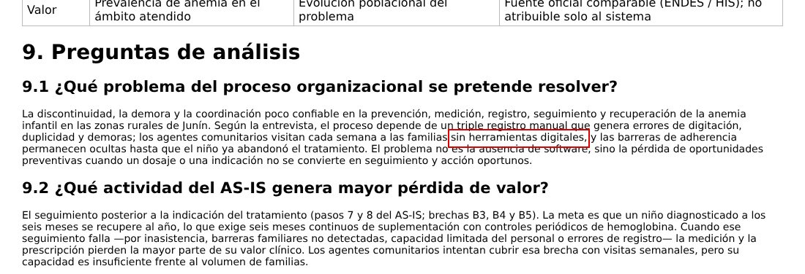
- **Corrección aplicada:** Se separó lo que dice la entrevista de lo que es diagnóstico del equipo («según el diagnóstico del equipo, …»), sin cambiar el contenido.
- **Evidencia después:** 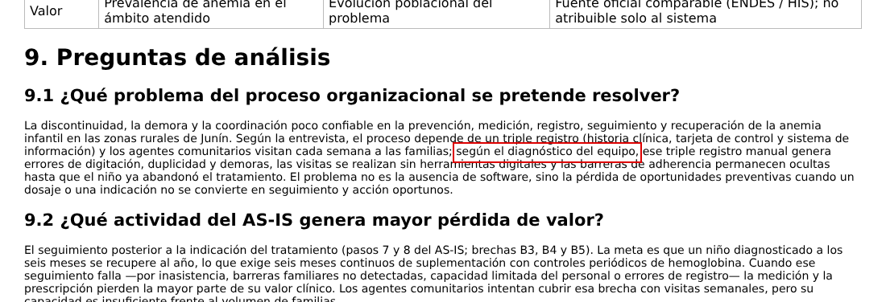
- **Estado:** Cerrado

### H-002 · media · Tabla 10 imprecisa sobre la correspondencia M1-M6 con INC-1 a INC-6
- **Archivo y ubicación:** `entregables/semana-01/Entregable_Semana1_Anemia_Junin.md` §10, Tabla 10 (línea 300)
- **Requisito afectado:** coherencia interna (Tabla 4) y con S2 Tabla 9
- **Descripción:** Decía que M1-M6 «se convierten» en INC-1 a INC-6 con la lista registro, agenda, offline, WhatsApp, modelo, tablero. Según la Tabla 4, M4 es visita priorizada y M6 es registro sin conexión e indicadores; esa lista no corresponde uno a uno con M1-M6.
- **Evidencia antes:** 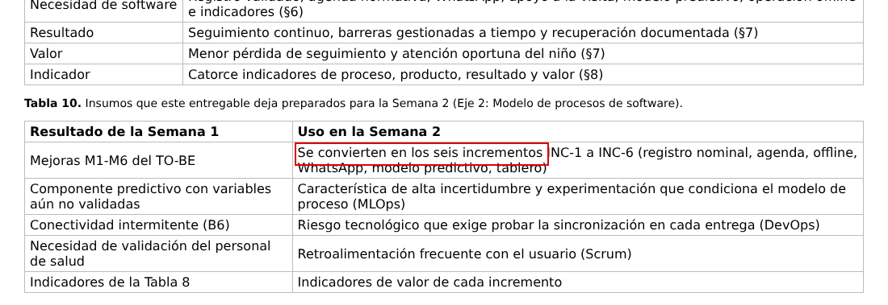
- **Corrección aplicada:** Se explicitó la correspondencia con los datos de la Tabla 4 y de la Tabla 9 de S2 (B4 y B6 en INC-3; B6 en INC-6): M1→INC-1, M2→INC-2, M3→INC-4, M4 y la parte sin conexión de M6→INC-3, M5→INC-5, indicadores de M6→INC-6.
- **Evidencia después:** 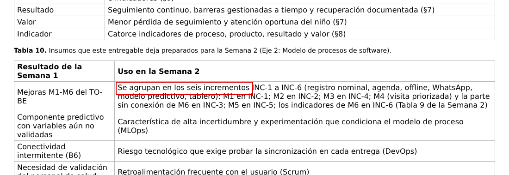
- **Estado:** Cerrado

### H-003 · baja · Carátula sin la unidad del sílabo
- **Archivo y ubicación:** `entregables/semana-01/Entregable_Semana1_Anemia_Junin.md` carátula (línea 5)
- **Requisito afectado:** S-1 (sílabo §3 y §7); D-03
- **Descripción:** Solo figuraba el título de la guía, sin la unidad del sílabo.
- **Evidencia antes:** 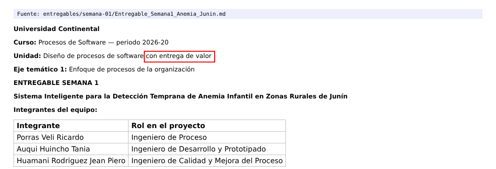
- **Corrección aplicada:** Se añadió «Unidad del sílabo: Unidad I — Fundamentos de procesos de software».
- **Evidencia después:** 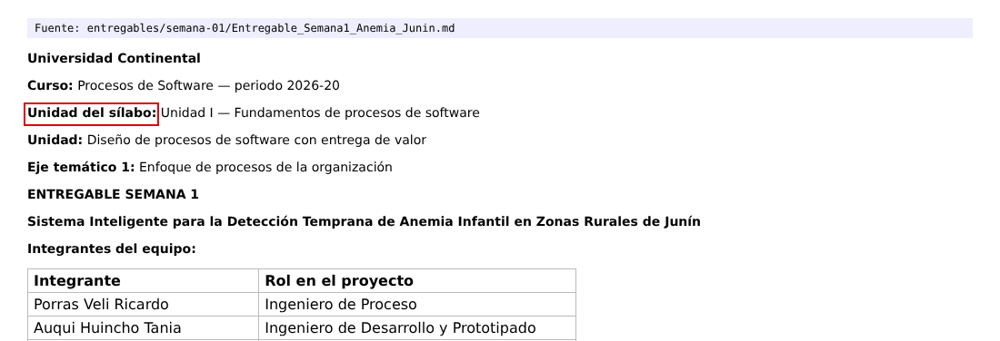
- **Estado:** Cerrado

### H-004 · baja · Comentarios HTML «DIAG-00x pendiente» con los SVG ya existentes
- **Archivo y ubicación:** `entregables/semana-01/Entregable_Semana1_Anemia_Junin.md` líneas 87, 151, 204, 431 y 436
- **Requisito afectado:** residuos de plantilla
- **Descripción:** Cinco comentarios ocultos indicaban diagramas pendientes aunque los SVG existen y están insertados.
- **Evidencia antes:** 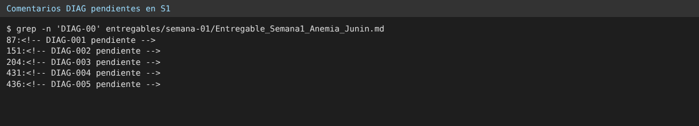
- **Corrección aplicada:** Se eliminaron los cinco comentarios.
- **Evidencia después:** 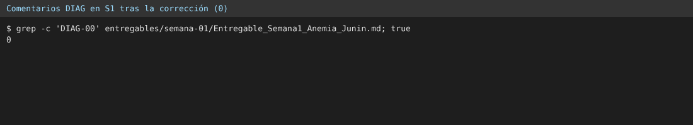
- **Estado:** Cerrado

### H-005 · baja · La Figura 2 (AS-IS) no tiene un nodo rotulado «Fin»
- **Archivo y ubicación:** `entregables/semana-01/Entregable_Semana1_Anemia_Junin.md` §3, Figura 2; `.claude/diagramas/svg/10_s1_proceso_as_is.svg`
- **Requisito afectado:** R-05 (guía §5: inicio y fin del proceso)
- **Descripción:** El texto del §3 declara el «Fin», pero el SVG termina en «Registra recuperación y cierra el caso» y no tiene rótulo «Fin». El SVG está fuera del alcance de esta corrección.
- **Evidencia antes:** 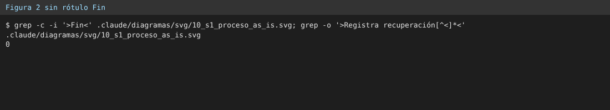
- **Corrección aplicada:** —
- **Evidencia después:** — (pendiente)
- **Estado:** Pendiente justificado: decide el equipo (rol diagramación, solicitud DIAG) si rotula el nodo final como «Fin»; falta editar el SVG, que queda fuera de los archivos de esta semana.

### H-006 · media · El entregable no vincula el trabajo con el proyecto aplicado en la empresa
- **Archivo y ubicación:** `entregables/semana-01/Entregable_Semana1_Anemia_Junin.md` carátula y Anexo C
- **Requisito afectado:** S-2 (sílabo §7)
- **Descripción:** No se declara que el entregable forme parte del proyecto aplicado en la empresa ni se nombra la organización o su equivalente (la posta rural omite su nombre por privacidad).
- **Evidencia antes:** 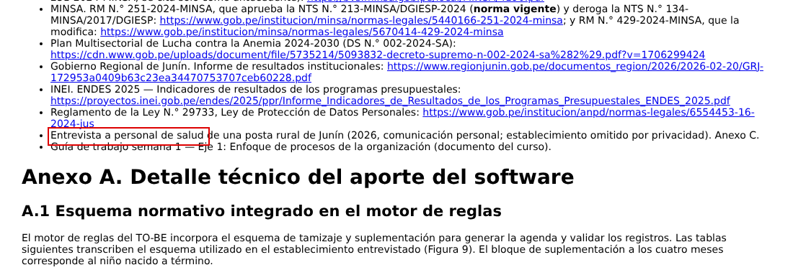
- **Corrección aplicada:** —
- **Evidencia después:** — (pendiente)
- **Estado:** Pendiente justificado: decide el docente (si acepta «Proyecto aplicado: posta rural de Junín, nombre omitido por privacidad») y el equipo; falta esa confirmación para no inventar un dato.

### H-007 · baja · Extensión superior a «documento breve»
- **Archivo y ubicación:** `entregables/semana-01/Entregable_Semana1_Anemia_Junin.md` (441 líneas, §1 a §12 y Anexos A a C)
- **Requisito afectado:** R-14 (guía §11)
- **Descripción:** La guía pide un documento breve; el entregable contiene 11 secciones, 3 anexos y 16 tablas.
- **Evidencia antes:** 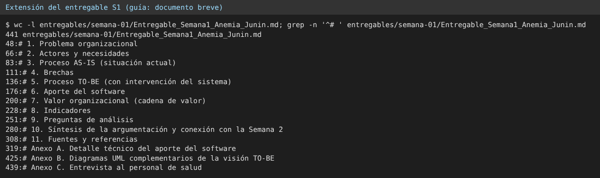
- **Corrección aplicada:** —
- **Evidencia después:** — (pendiente)
- **Estado:** Pendiente justificado: decide el equipo (con el docente) qué trasladar a anexos; es un cambio de fondo que no corresponde a esta revisión.

### Candidatos descartados
| Candidato (archivo:línea) | Motivo |
| --- | --- |
| S01.md:306 «Estado de implementación … anemia_junin/» | D-01: instantánea de la entrega (25/09/2026); `pmv_fastapi/` con INC-2 a INC-4 es posterior (commits del 30/10/2026). |
| S01.md:52 pérdida de datos, retrasos y escasa visibilidad | El texto no atribuye esas consecuencias a la entrevista (la atribución explícita es solo la de la oración anterior); es análisis del equipo. |
| S01.md:105, 121, 122 reporte en papel, barreras, carga manual | No se atribuyen a la entrevista; son descripción del equipo. |
| S01.md:316 y :441 (proyecto aplicado) | Ya recogido como H-006. |
| S01.md:5 y :7 unidad sin número | Ya recogido como H-003 (D-03). |
| `entregables/semana-01/img/` imágenes sin referenciar | Regla de no eliminar material; observación sin defecto. |

