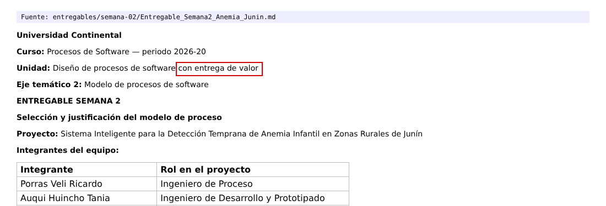
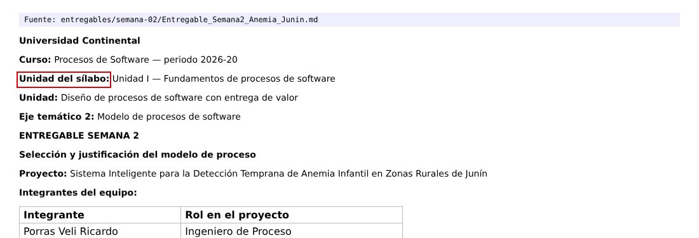
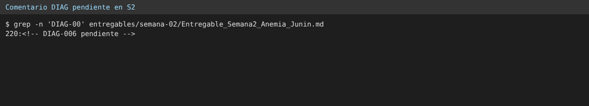
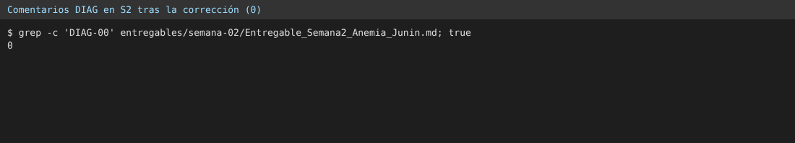
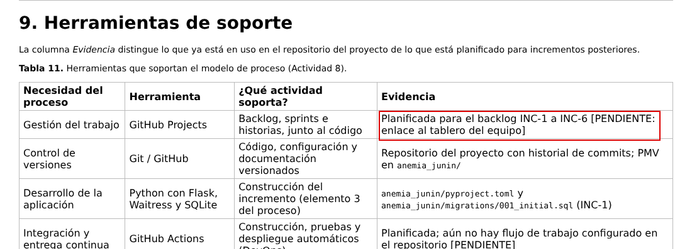
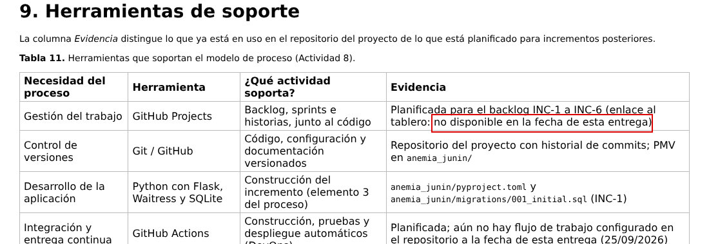
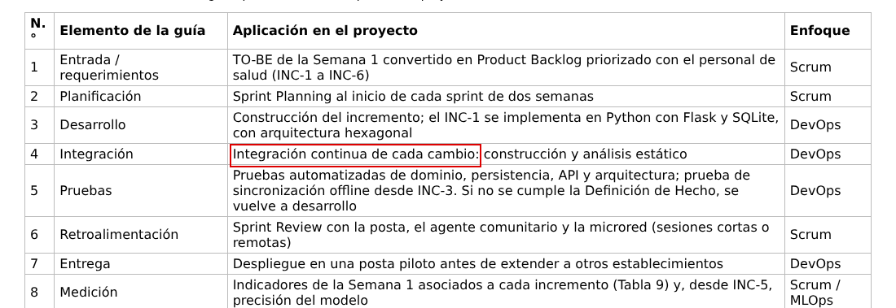
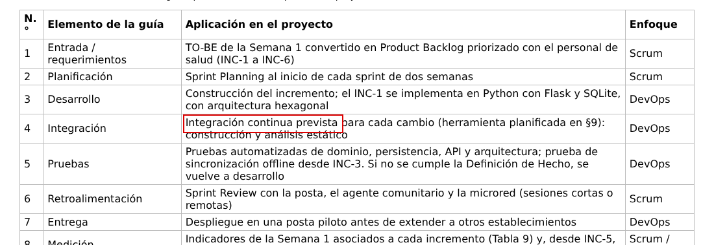
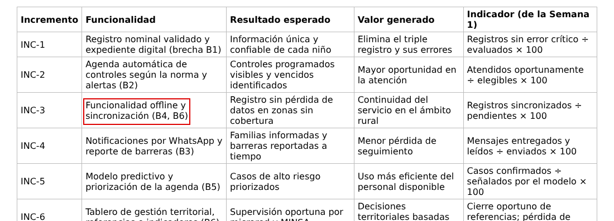
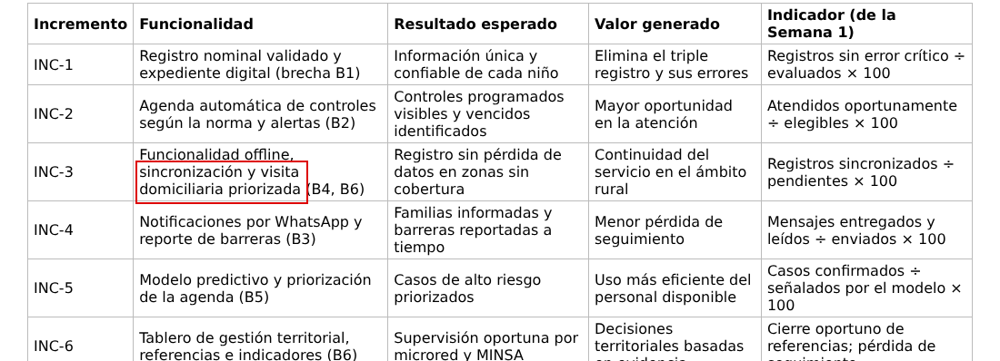

## S02
### H-020 · baja · Carátula sin la unidad del sílabo
- **Archivo y ubicación:** `entregables/semana-02/Entregable_Semana2_Anemia_Junin.md` carátula (línea 5)
- **Requisito afectado:** S-1 (sílabo §3 y §7); D-03
- **Descripción:** Solo figuraba el título de la guía, sin la unidad del sílabo.
- **Evidencia antes:** 
- **Corrección aplicada:** Se añadió «Unidad del sílabo: Unidad I — Fundamentos de procesos de software».
- **Evidencia después:** 
- **Estado:** Cerrado

### H-021 · baja · Comentario HTML «DIAG-006 pendiente» con el SVG existente
- **Archivo y ubicación:** `entregables/semana-02/Entregable_Semana2_Anemia_Junin.md` §6 (línea 220)
- **Requisito afectado:** residuos de plantilla
- **Descripción:** El comentario indicaba el diagrama pendiente aunque el SVG 15 existe y está insertado.
- **Evidencia antes:** 
- **Corrección aplicada:** Se eliminó el comentario.
- **Evidencia después:** 
- **Estado:** Cerrado

### H-022 · media · Marcadores «[PENDIENTE…]» visibles en la Tabla 11
- **Archivo y ubicación:** `entregables/semana-02/Entregable_Semana2_Anemia_Junin.md` §9, Tabla 11 (líneas 279, 282 y 289)
- **Requisito afectado:** R-16 (guía §12)
- **Descripción:** Tres marcadores visibles (tablero, CI y prototipos). No hay en el repositorio un enlace verificable a GitHub Projects ni a Figma (el único registro es una lista de capturas pendientes).
- **Evidencia antes:** 
- **Corrección aplicada:** Se reemplazaron por «no disponible en la fecha de esta entrega» (sin inventar enlaces); en la fila de CI se fechó el estado: «aún no hay flujo de trabajo configurado … a la fecha de esta entrega (25/09/2026)», verdadero en esa fecha (el `ci.yml` es de octubre-noviembre de 2026).
- **Evidencia después:** 
- **Estado:** Cerrado

### H-023 · media · Tabla 8 describe la integración continua en presente mientras §9 y la Tabla 16 la presentan como planificada
- **Archivo y ubicación:** `entregables/semana-02/Entregable_Semana2_Anemia_Junin.md` §6, Tabla 8, elemento 4 (línea 230)
- **Requisito afectado:** coherencia interna
- **Descripción:** La Tabla 8 decía «Integración continua de cada cambio» y la Tabla 11 y la Tabla 16 la dan por planificada.
- **Evidencia antes:** 
- **Corrección aplicada:** Se redactó «Integración continua prevista para cada cambio (herramienta planificada en §9)».
- **Evidencia después:** 
- **Estado:** Cerrado

### H-024 · baja · La visita domiciliaria priorizada (M4) no aparece en la Tabla 9
- **Archivo y ubicación:** `entregables/semana-02/Entregable_Semana2_Anemia_Junin.md` §7, Tabla 9, INC-3 (línea 250)
- **Requisito afectado:** R-14 (guía §10); coherencia con S1 Tabla 4
- **Descripción:** INC-3 cubre la brecha B4 (visita domiciliaria) pero la funcionalidad solo mencionaba offline y sincronización.
- **Evidencia antes:** 
- **Corrección aplicada:** Se añadió «visita domiciliaria priorizada» a la funcionalidad de INC-3 (coincide con B4 de la propia fila y con el alcance de la versión 3.0-Inc3 del repositorio, commit c870a7e).
- **Evidencia después:** 
- **Estado:** Cerrado

### Candidatos descartados
| Candidato (archivo:línea) | Motivo |
| --- | --- |
| S02.md:282 y :470 CI «planificada», sin flujo | D-01: `ci.yml` se creó después de la entrega (25/09/2026); el primer commit de `.github/workflows/ci.yml` en el historial es posterior (30/10/2026 o después). |
| S02.md:280, 281, 284, 287, 484 estado y rutas en `anemia_junin/` | D-01: instantánea de la entrega; INC-2 a INC-4 en `pmv_fastapi/` son posteriores. |
| S02.md:65-76 doce factores en «Alto» | Cumple formalmente la guía (matriz con nivel y evidencia); la graduación es juicio del equipo. |
| S02.md:250-253 M4 sin incremento | Resuelto como H-024. |
| S02.md:5 y :7 unidad sin número | Ya recogido como H-020 (D-03). |
| `entregables/semana-02/img/image1.png` sin referenciar | Regla de no eliminar material; observación sin defecto. |

### Nota para el coordinador
- Los cinco diagramas SVG viven en `.claude/diagramas/svg/`, fuera de mi alcance (H-005).
