## S03-04
### H-040 · alta · Cadena normativa incompleta (falta la RM 251-2024-MINSA)
- **Archivo y ubicación:** `entregables/semana-03-04/Entregable_Semana3y4_Anemia_Junin.md` §8.4 (l.447) y Referencias (l.1051)
- **Requisito afectado:** coherencia con `anemia_junin/config/normativa_v1.json` (l.4-6)
- **Descripción:** La cadena normativa omitía la RM 251-2024-MINSA, que aprueba la NTS 213 y deroga la NTS 134, y dejaba un marcador pendiente hacia la investigación documental.
- **Evidencia antes:** 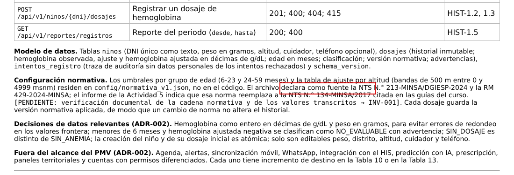
- **Corrección aplicada:** Cadena completa (NTS 213 aprobada por RM 251-2024, modificada por RM 429-2024), referencia a la investigación documental del 25/09 y dos referencias bibliográficas separadas. Se mantiene la nota de que los valores son de referencia académica.
- **Evidencia después:** 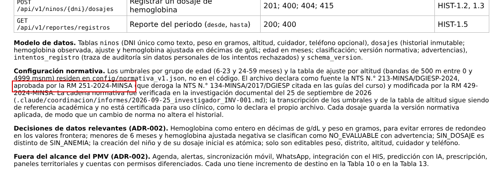
- **Estado:** Cerrado

### H-041 · media · Marcadores pendientes contradichos por la evidencia del mismo corte (25/09)
- **Archivo y ubicación:** `entregables/semana-03-04/Entregable_Semana3y4_Anemia_Junin.md` Tablas 25 y 28 (l.652-706)
- **Requisito afectado:** R-28, R-29 (coherencia interna con S5)
- **Descripción:** Las Tablas 25 y 28 dejaban «[PENDIENTE: T-008]» el reporte de pruebas y la cobertura, pero `anemia_junin/docs/evidencias/pytest_cierre.txt` (25/09/2026) registra 266 pruebas aprobadas y 96,69 %.
- **Evidencia antes:** 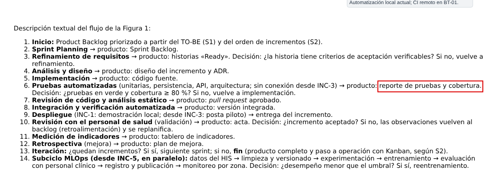
- **Corrección aplicada:** Se citan los resultados del cierre del 25/09 y la ruta de la evidencia. No se cambia el resto del estado de la instantánea (D-01).
- **Evidencia después:** 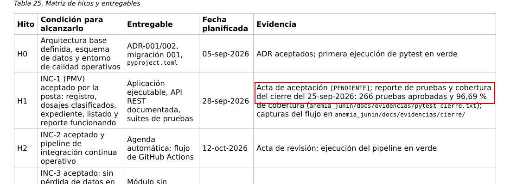
- **Estado:** Cerrado

### H-042 · media · Códigos internos de coordinación y comentarios HTML en un entregable académico
- **Archivo y ubicación:** `entregables/semana-03-04/Entregable_Semana3y4_Anemia_Junin.md` l.177, 333, 386-392, 397, 602, 620, 641, 687, 706, 822, 1003, 1069
- **Requisito afectado:** forma / residuos de plantilla
- **Descripción:** Comentarios `<!-- DIAG-10x pendiente -->` y códigos T-008, DEV-1xx y DIAG-100 a DIAG-105 en el texto.
- **Evidencia antes:** 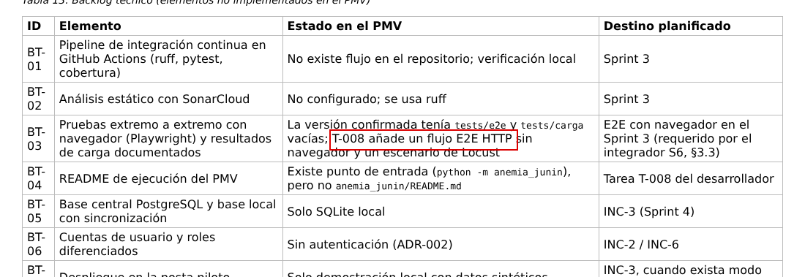
- **Corrección aplicada:** Seis comentarios retirados y códigos sustituidos por texto explicativo con el commit de referencia.
- **Evidencia después:** 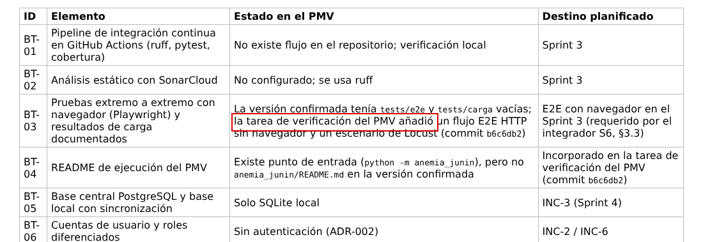
- **Estado:** Cerrado

### H-043 · media · «Todavía no confirmados en git» sin commit de referencia
- **Archivo y ubicación:** `entregables/semana-03-04/Entregable_Semana3y4_Anemia_Junin.md` §8.4 (l.397) y Tabla 13 (BT-03, BT-04, BT-09)
- **Requisito afectado:** R-07 / coherencia con Git
- **Descripción:** Se describían ajustes del árbol de trabajo sin citar commit. Hoy existen: `b6c6db2` (README, E2E, Locust, advertencia de altitud) y `4e7135a` (cierre, 25/09/2026). BT-04 afirmaba la ausencia de `anemia_junin/README.md`, que `b6c6db2` incorpora.
- **Evidencia antes:** 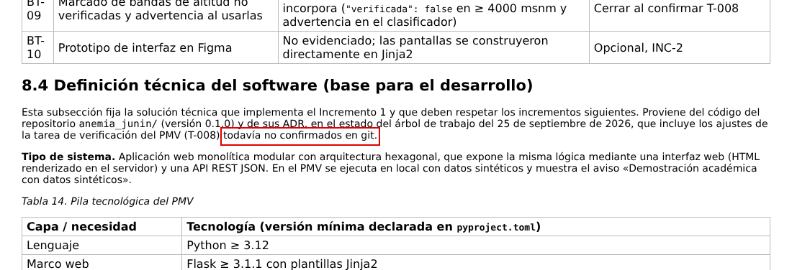
- **Corrección aplicada:** Se cita cada commit, se precisa que BT-04 se refería a la versión confirmada previa y se marca BT-09 como cerrado en `b6c6db2`. Se conserva la afirmación fechada (D-01).
- **Evidencia después:** 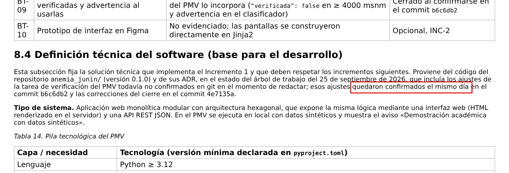
- **Estado:** Cerrado

### H-044 · baja · Falta la unidad del sílabo en la carátula
- **Archivo y ubicación:** `entregables/semana-03-04/Entregable_Semana3y4_Anemia_Junin.md` carátula (l.7)
- **Requisito afectado:** R-51 (sílabo §7, D-03)
- **Descripción:** La carátula solo traía el nombre de la unidad de la guía.
- **Evidencia antes:** 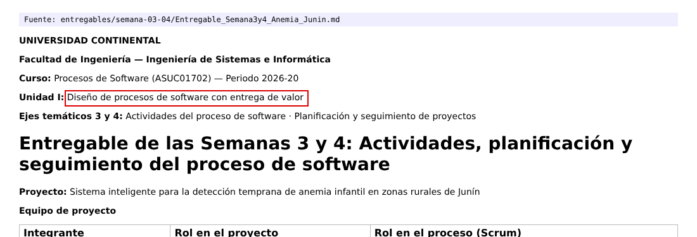
- **Corrección aplicada:** Línea «Unidad del sílabo: Unidad I — Fundamentos de procesos de software».
- **Evidencia después:** 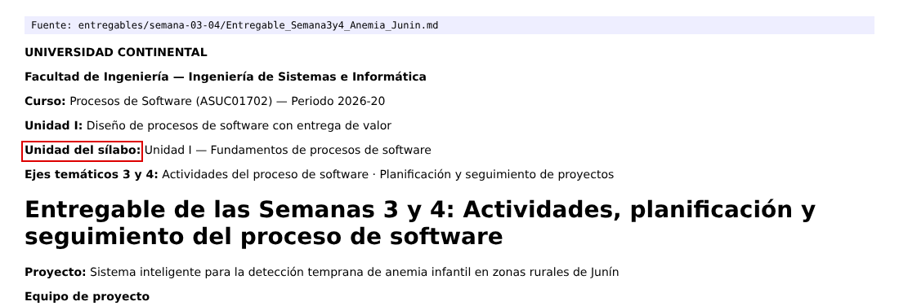
- **Estado:** Cerrado

### H-045 · media · Acta de aceptación H1, meta del indicador de calidad y horas reales sin registrar
- **Archivo y ubicación:** `entregables/semana-03-04/Entregable_Semana3y4_Anemia_Junin.md` Tabla 25 (l.655), Tabla 28 (horas reales) y Tabla 30 (l.774)
- **Requisito afectado:** R-28, R-29, R-13, R-50
- **Descripción:** Siguen `[PENDIENTE]` el acta de aceptación de H1, la meta de «Valor: calidad del registro» y el registro de horas reales. No existe evidencia en el repositorio; no se inventan.
- **Evidencia antes:** 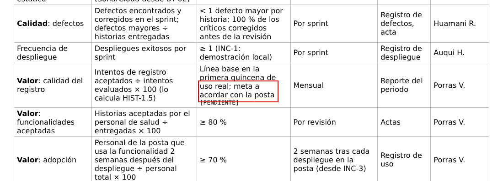
- **Corrección aplicada:** —
- **Evidencia después:** — (pendiente)
- **Estado:** Pendiente justificado: el equipo debe aportar el acta del Product Owner , acordar la meta con la posta y entregar el registro de horas ; decide el docente si se exige antes de la calificación.

### H-046 · media · La desviación de +6 h de la Tabla 27 no figura en la matriz de control (Tabla 33)
- **Archivo y ubicación:** `entregables/semana-03-04/Entregable_Semana3y4_Anemia_Junin.md` Tablas 27 (l.696) y 33 (l.816-825)
- **Requisito afectado:** R-14, R-31
- **Descripción:** La fila de horas del escenario simulado muestra +6 h (+8,7 %) y la Tabla 33 no la recoge. Añadirla exige asignar un responsable y una nueva fecha que el documento no define.
- **Evidencia antes:** 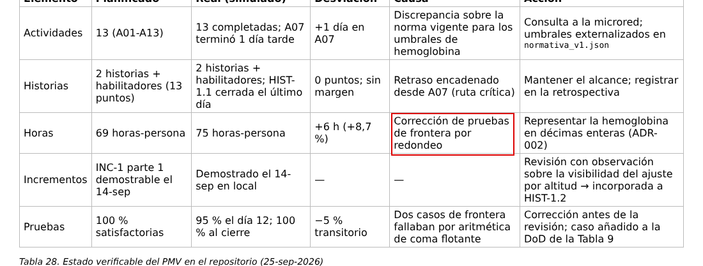
- **Corrección aplicada:** —
- **Evidencia después:** — (pendiente)
- **Estado:** Pendiente justificado: decide el equipo  el responsable y la fecha de la fila; el escenario es simulado y la Tabla 27 lo declara.

### H-047 · media · No se declara el proyecto aplicado en la empresa ni la modalidad
- **Archivo y ubicación:** `entregables/semana-03-04/Entregable_Semana3y4_Anemia_Junin.md` carátula (l.1-25)
- **Requisito afectado:** R-52 (sílabo §7)
- **Descripción:** El sílabo no fija la modalidad; el documento menciona la posta piloto pero no la declara como proyecto aplicado.
- **Evidencia antes:** 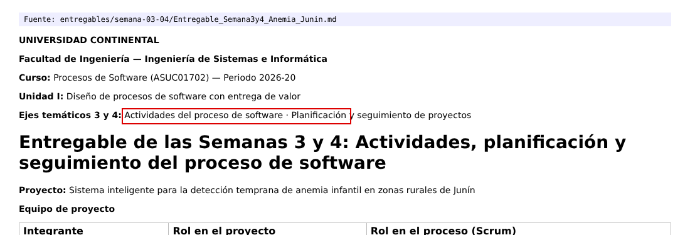
- **Corrección aplicada:** —
- **Evidencia después:** — (pendiente)
- **Estado:** Pendiente justificado: debe confirmarlo el docente (Guevara Jimenez, Jorge Alfredo) y luego el equipo añade la línea.

### Candidatos descartados
| Candidato (archivo:línea) | Motivo |
| --- | --- |
| S03-04.md:652-661 y 25-sep: hitos H2 a H4 «vencidos» sin estado | D-01: el documento es la planificación del 25/09; los hitos aún no habían vencido. |
| S03-04.md:692, 698-702: columna «Real» simulada | El documento ya lo declara en la l.692 y en los títulos de la Tabla 27 («Real (simulado)»); no hay nada que aclarar. Los datos reales son pendiente del equipo (H-045). |
| S03-04.md:384: BT-01 «No existe flujo en el repositorio» | D-01: cierto el 25/09; `ci.yml` es posterior y apunta a `pmv_fastapi/`. |
| S03-04.md:1-25: «fecha de corte» y columna de estado en Tabla 25 | D-01: la fecha de la versión (25/09) ya es el corte. |

#### Nota para el coordinador
- La Tabla 33 (H-046) y la modalidad (H-047) necesitan al equipo y al docente.
- La rama de trabajo no se modificó fuera de los archivos de la semana.
