## S05
### H-060 · alta · Marcador «CARGA_CIERRE» en lugar de la tabla de carga
- **Archivo y ubicación:** `entregables/semana-05/Entregable_Semana5_Anemia_Junin.md` §4, «Resultados de carga» (l.107) y EV-09 (l.100)
- **Requisito afectado:** R-13 (Act. 4, rúbrica «Pruebas»)
- **Descripción:** El marcador sustituía la tabla y EV-09 remitía a ella.
- **Evidencia antes:** 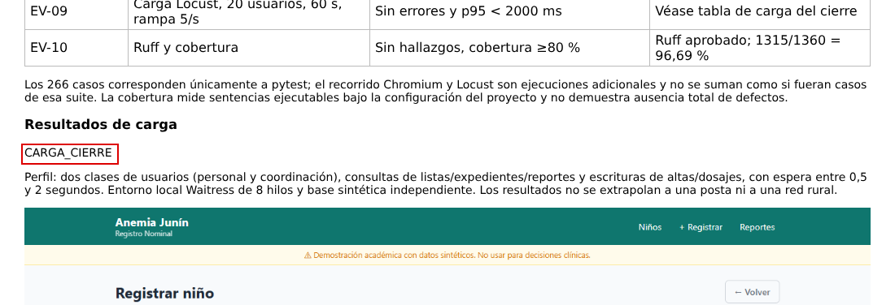
- **Corrección aplicada:** Tabla con las cifras de `anemia_junin/docs/evidencias/carga_locust_20u_60s.txt` (1011 solicitudes, 0 fallos, p95 53 ms, 17,04 req/s) y EV-09 completada. Exportado regenerado.
- **Evidencia después:** 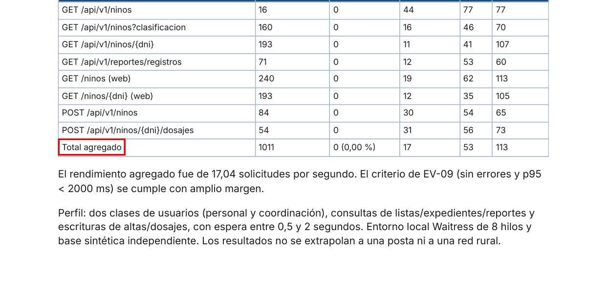
- **Estado:** Cerrado

### H-061 · alta · Carátula con [PENDIENTE] y sin unidad del sílabo
- **Archivo y ubicación:** `entregables/semana-05/Entregable_Semana5_Anemia_Junin.md` carátula (l.1-13)
- **Requisito afectado:** R-16, R-25 (D-02, D-03)
- **Descripción:** Códigos, docente y fecha estaban pendientes y no constaba la unidad.
- **Evidencia antes:** 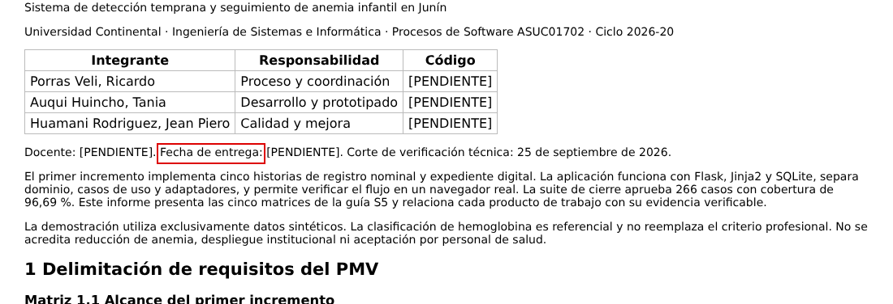
- **Corrección aplicada:** Códigos y docente tomados del integrador S6 (Tabla 1); «Unidad II — Implementación del proceso de software». La fecha de entrega no figura en el repositorio y queda «no registrada».
- **Evidencia después:** 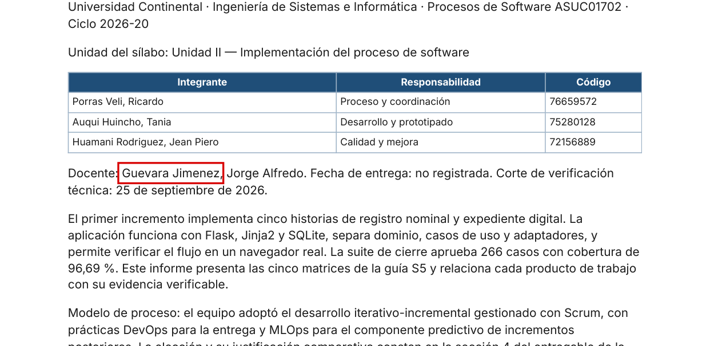
- **Estado:** Cerrado (la fecha de entrega la aportará el equipo si se desea; no consta en el repositorio)

### H-062 · media · Ramas citadas que ya no existen
- **Archivo y ubicación:** `entregables/semana-05/Entregable_Semana5_Anemia_Junin.md` Matriz 3.1 y l.80
- **Requisito afectado:** R-09
- **Descripción:** `desarrollo-anemia` (PR #1, merge 67f2c01) fue una rama de la época, ya eliminada; `codex/<tema>` era un nombre de herramienta de IA.
- **Evidencia antes:** 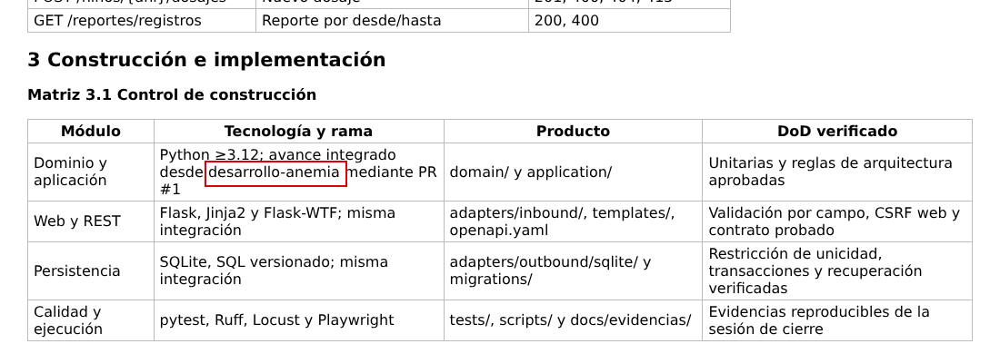
- **Corrección aplicada:** Se aclara que `desarrollo-anemia` es una rama de la época, ya eliminada del remoto. La propuesta de la época (`codex/<tema>`) se conserva tal cual (D-01; revisión del coordinador). No se inventa una estrategia por módulo.
- **Evidencia después:** 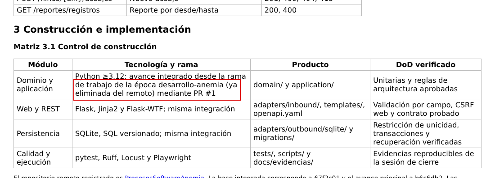
- **Estado:** Cerrado (la estrategia de ramificación por módulo, columna propia, queda como pendiente del equipo, R-09)

### H-063 · media · «Todavía no constituyen un commit» frente al historial
- **Archivo y ubicación:** `entregables/semana-05/Entregable_Semana5_Anemia_Junin.md` l.80
- **Requisito afectado:** R-03
- **Descripción:** Las correcciones de la sesión de cierre (validadores, pruebas, evidencias) están en el commit `4e7135a` del 25/09/2026.
- **Evidencia antes:** 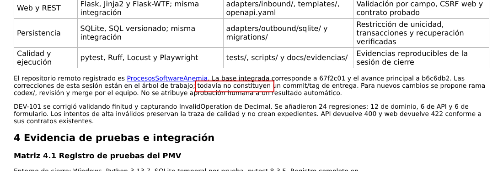
- **Corrección aplicada:** Se cita el commit y se aclara que no hay tag.
- **Evidencia después:** 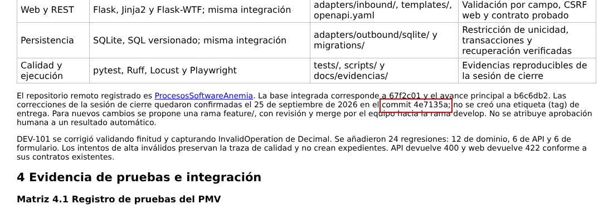
- **Estado:** Cerrado

### H-064 · alta · Sin modelo de ciclo de vida declarado
- **Archivo y ubicación:** `entregables/semana-05/Entregable_Semana5_Anemia_Junin.md` introducción
- **Requisito afectado:** R-26 (sílabo §7, U2)
- **Descripción:** El documento no declaraba el modelo.
- **Evidencia antes:** 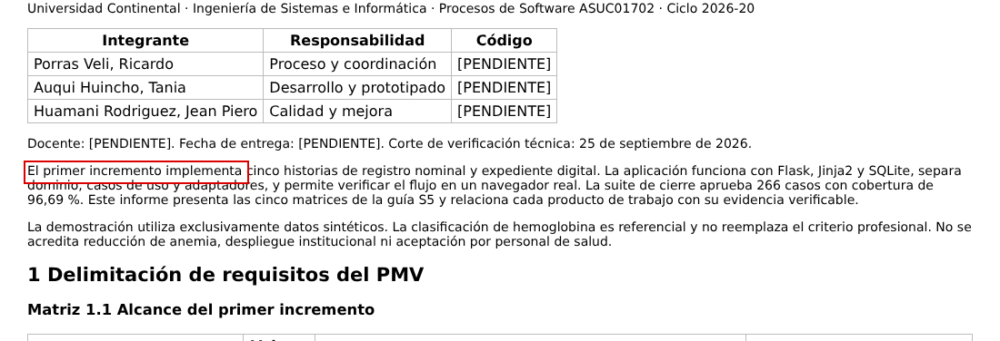
- **Corrección aplicada:** Párrafo «Modelo de proceso» que remite a la sección 4 del entregable S2 y a la Tabla 2 de S3-4. No se añade justificación nueva.
- **Evidencia después:** 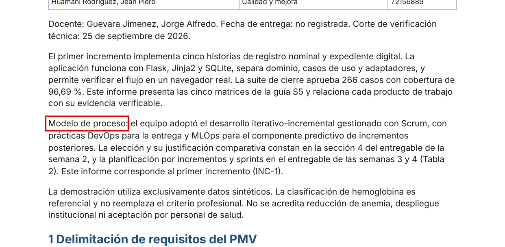
- **Estado:** Cerrado

### H-065 · alta · PDF de Actividad 5 con cifras de la versión anterior frente al .md vigente
- **Archivo y ubicación:** `exportados/semana-05/Informe_Actividad5_PMV_AnemiaJunin.pdf` págs. 5-6, 11-12 vs `entregables/semana-05/Entregable_Semana5_Anemia_Junin.md`
- **Requisito afectado:** coherencia fuente↔exportado (D-04)
- **Descripción:** El PDF original entregado decía 49 pruebas (unittest), 95,8 %, `run.py`, `pmv_anemia/`; el .md reconstruido da 266 pruebas (pytest), 96,69 %, `python -m anemia_junin`.
- **Evidencia antes:** 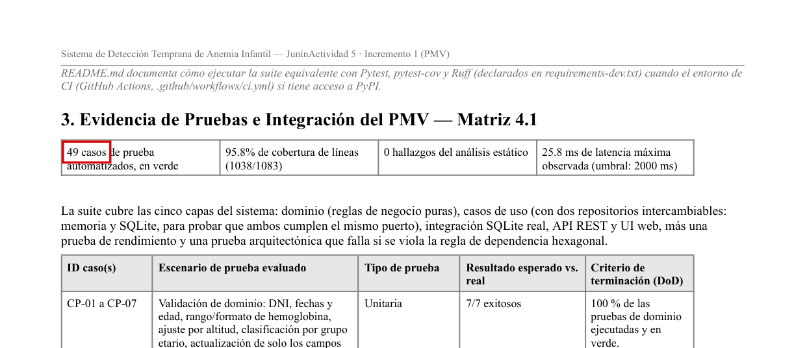
- **Corrección aplicada:** El PDF original NO se toca. Se generó el derivado `exportados/semana-05/Entregable_Semana5_Anemia_Junin.pdf` (y `.docx`) desde el .md con `exportar_md.py` (13 páginas, 266 casos y cifras verificadas con pdftotext) y el .md remite a ambos.
- **Evidencia después:** 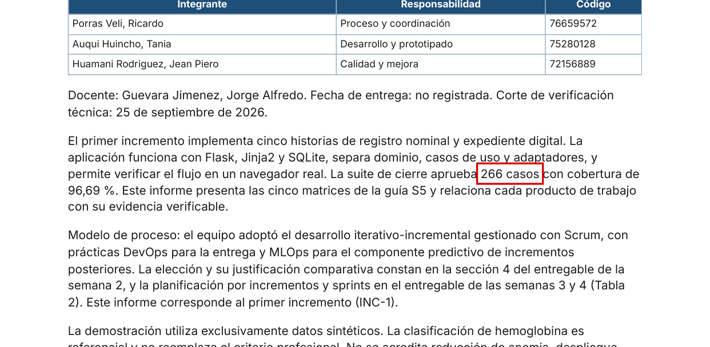
- **Estado:** Cerrado

### H-066 · media · Defectos críticos abiertos y registro de casos sin documentar
- **Archivo y ubicación:** `entregables/semana-05/Entregable_Semana5_Anemia_Junin.md` Matriz 4.1 (l.90-101)
- **Requisito afectado:** R-04, R-11, R-24
- **Descripción:** No hay registro de defectos ni lista de casos CP-xx; el repositorio solo tiene totales por tipo.
- **Evidencia antes:** 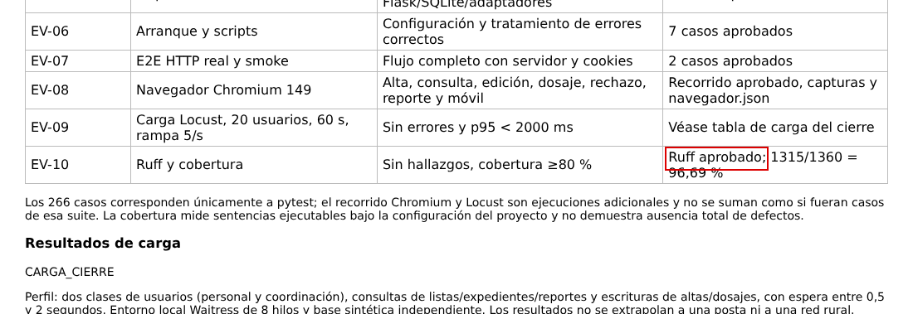
- **Corrección aplicada:** —
- **Evidencia después:** — (pendiente)
- **Estado:** Pendiente justificado: el equipo (rol de calidad) debe aportar el registro de defectos abiertos y, si lo exige el docente, la tabla de casos.

### H-067 · baja · Uso de herramientas modernas (CI, gestión de proyecto) sin justificar
- **Archivo y ubicación:** `entregables/semana-05/Entregable_Semana5_Anemia_Junin.md` Matriz 3.1
- **Requisito afectado:** R-28
- **Descripción:** Se nombran las herramientas sin justificar su uso; `anemia_junin/` no tiene CI propia.
- **Evidencia antes:** 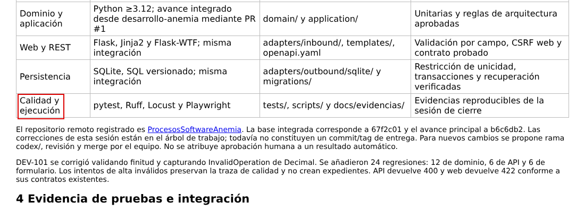
- **Corrección aplicada:** —
- **Evidencia después:** — (pendiente)
- **Estado:** Pendiente justificado: redacción de fondo a cargo del equipo; la CI vigente es de `pmv_fastapi/` y no se toca.

### H-068 · baja · La norma del clasificador no se citaba
- **Archivo y ubicación:** `entregables/semana-05/Entregable_Semana5_Anemia_Junin.md` §6 (l.168)
- **Requisito afectado:** coherencia con S3-4 (H-040)
- **Descripción:** El .md no citaba el marco normativo.
- **Evidencia antes:** 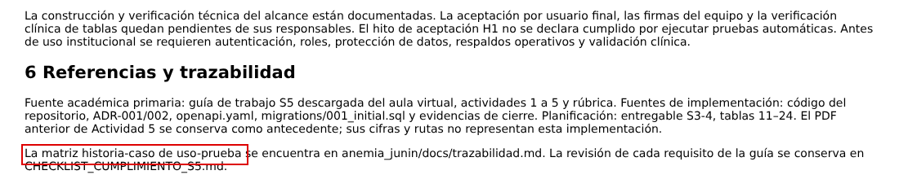
- **Corrección aplicada:** Se cita la cadena RM 251-2024, NTS 213, RM 429-2024 y `config/normativa_v1.json`.
- **Evidencia después:** 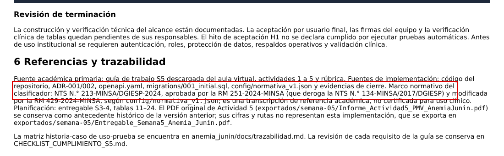
- **Estado:** Cerrado

### Candidatos descartados
| Candidato (archivo:línea) | Motivo |
| --- | --- |
| S05.md:80: enlace a la cuenta `woshtsu` | Es la organización propietaria del repositorio del equipo (`origin`); no es dato sensible. |
| S05.md:15, 99: recorrido Chromium el mismo día que S3-4 lo marca pendiente | Se resolvió en S3-4 (H-041, H-043): ambas son instantáneas del 25/09 y se citan los commits. |

#### Nota para el coordinador
- `exportados/README.md` debe explicar que `Informe_Actividad5_PMV_AnemiaJunin.pdf` es el original histórico (versión anterior: 49 pruebas, unittest) y que el vigente es `Entregable_Semana5_Anemia_Junin.pdf`/`.docx`.
- Residuo no corregido: el código interno DEV-101 sigue en la Matriz 1.1 y en §3 de S5.
