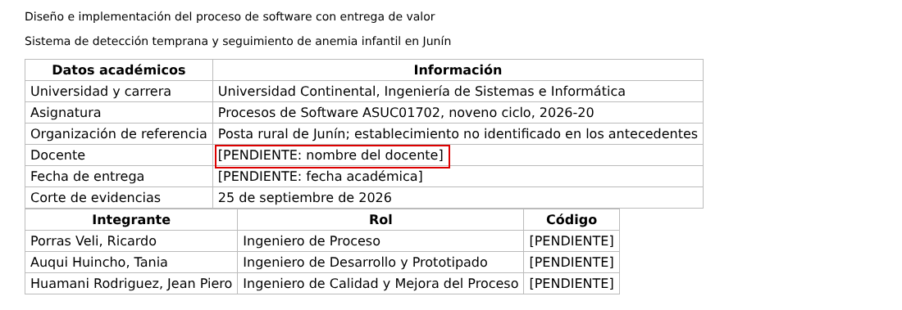
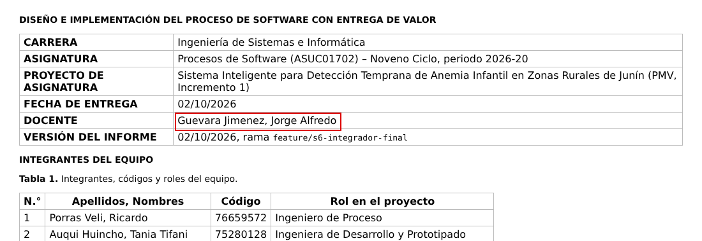
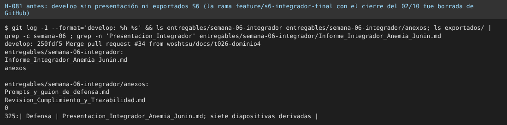
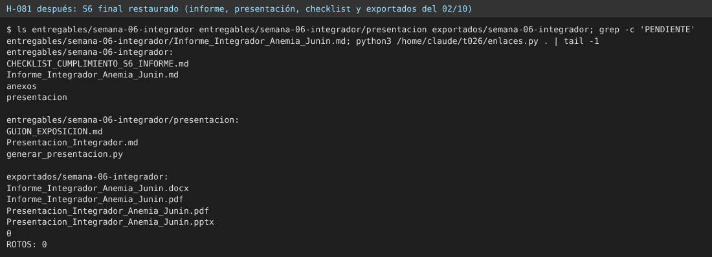

## S06 — Restauración del cierre del 02/10 (registrados por el coordinador)

### H-080 · alta · El integrador S6 de develop era el borrador del 25/09
- **Archivo y ubicación:** `entregables/semana-06-integrador/Informe_Integrador_Anemia_Junin.md`, carátula (líneas 12-20 de la versión de develop)
- **Requisito afectado:** guía S6 §II (carátula con docente, fecha y códigos) y, en general, todo el cotejo S6
- **Descripción:** develop contenía el borrador del 25/09 con «[PENDIENTE: nombre del docente]», «[PENDIENTE: fecha académica]» y los códigos en «[PENDIENTE]». La versión entregada el 02/10 («0 COMPLETAR», commit 6547196) estaba en la rama `feature/s6-integrador-final`, que nunca se integró y se borró de GitHub en T-025 (solo quedaba en la copia local del revisor).
- **Evidencia antes:** 
- **Corrección aplicada:** se restauró la versión final del informe (con rutas de figuras adaptadas a `.claude/diagramas/`) y su checklist. El borrador quedó en `.claude/archivo/versiones-anteriores/semana-06-integrador/Informe_Integrador_version_develop_2026-09-25.md`.
- **Evidencia después:** 
- **Estado:** Cerrado (commit dbf9cd5)

### H-081 · alta · Faltaban la presentación de 7 diapositivas, los exportados y las figuras 50-68 de S6
- **Archivo y ubicación:** `entregables/semana-06-integrador/` y `exportados/` (sin carpeta de S6); el informe citaba `Presentacion_Integrador_Anemia_Junin.md` (línea 325 de develop)
- **Requisito afectado:** guía S6 §I.2 (informe en PDF y presentación de siete diapositivas)
- **Descripción:** en develop no existían la presentación, el PDF/DOCX del informe ni las 26 figuras `50_s6_*` a `68_s6_*` que usa la versión final.
- **Evidencia antes:** 
- **Corrección aplicada:** restaurados desde 6547196: `presentacion/` (Presentacion_Integrador.md, GUION_EXPOSICION.md, generar_presentacion.py con la salida ajustada a `exportados/semana-06-integrador/`), `exportados/semana-06-integrador/` (Informe .pdf/.docx y Presentación .pdf/.pptx), figuras en `.claude/diagramas/{src,png,svg}/`, y `REQUISITOS_S6.md` e `INSPECCION_S6.md` en `.claude/archivo/semana-06-integrador/`. Los anexos superados (`Prompts_y_guion_de_defensa.md`, `Revision_Cumplimiento_y_Trazabilidad.md`) se movieron con `git mv` a `.claude/archivo/versiones-anteriores/semana-06-integrador/`, como en la rama original. 0 enlaces rotos.
- **Evidencia después:** 
- **Estado:** Cerrado (commit dbf9cd5)
