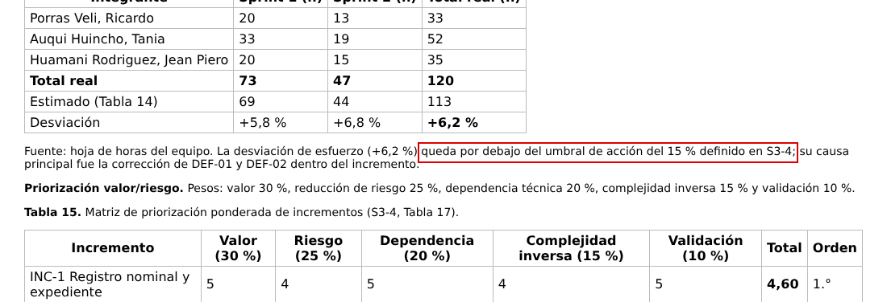
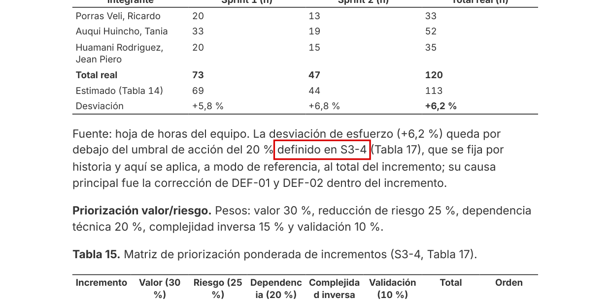
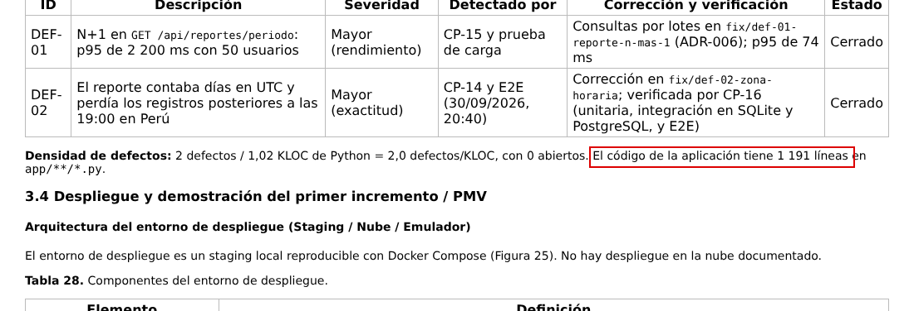
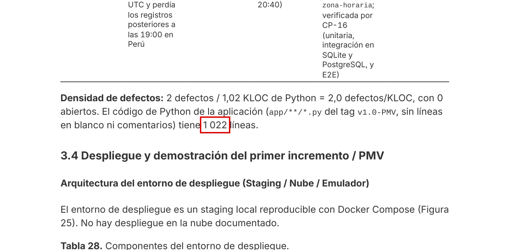
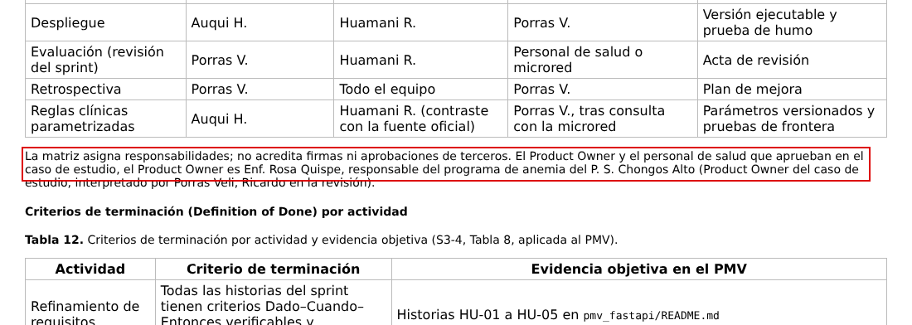
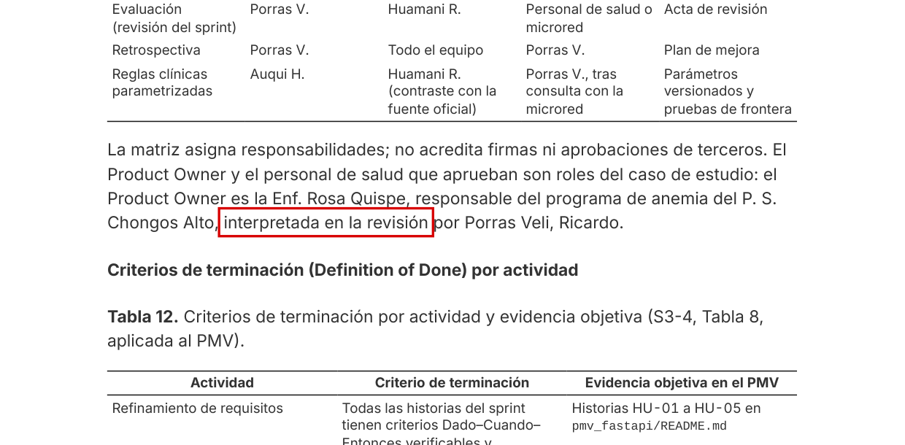
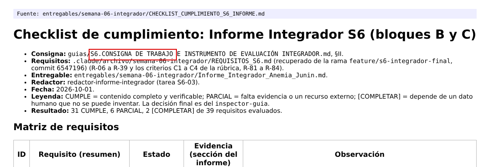
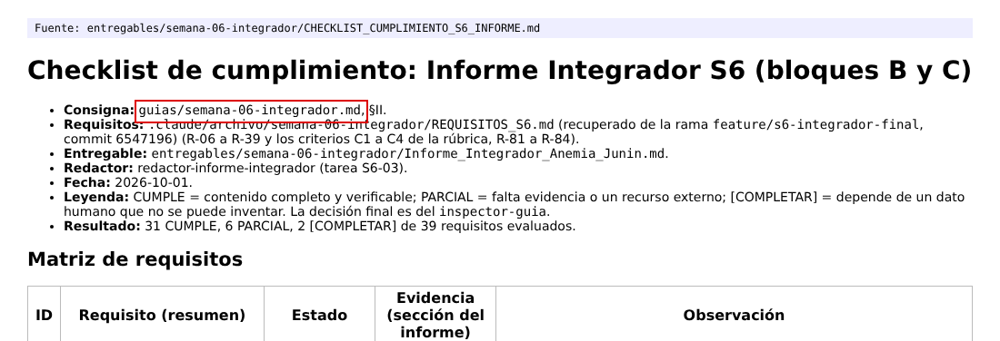
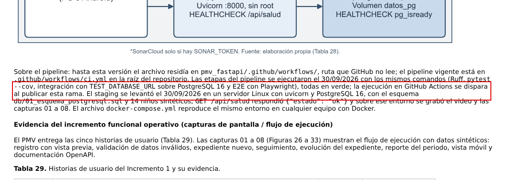
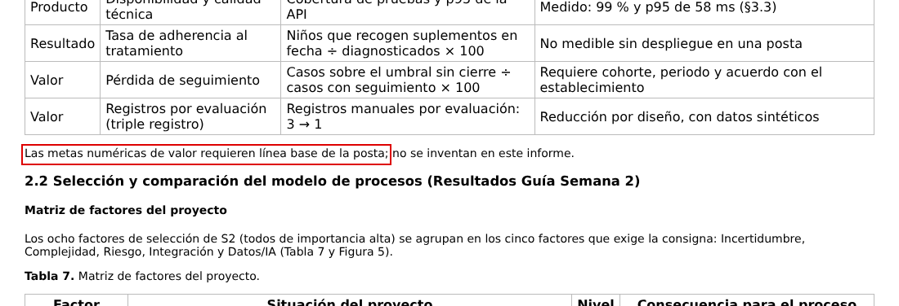

## S06
Registrados por el coordinador (no se reescriben aquí): **H-080** (carátula con [PENDIENTE] en develop) y **H-081** (faltaban la presentación y los exportados). Ambos se resolvieron al restaurar la versión final del 02/10/2026 (commit 6547196). Este fragmento cubre el re-cotejo sobre esa versión final.

Política especial de S6: los exportados del 02/10 se generaron con herramientas que no están en el repositorio. Se regeneró el PDF del informe con `exportar_md.py` para probarlo; el resultado quedó peor que el original (43 páginas frente a 52, sin portada propia con índice, tablas y tipografía distintas), por lo que se revirtió con `git checkout -- exportados/semana-06-integrador/`. Los PDF y DOCX vigentes son los originales del 02/10. El informe no tiene tabla de control de cambios (D-08 no aplica).

### H-082 · media · Umbral de esfuerzo atribuido a S3-4 con un valor que S3-4 no define
- **Archivo y ubicación:** `entregables/semana-06-integrador/Informe_Integrador_Anemia_Junin.md` §2.3, nota de la Tabla 14b (línea 336)
- **Requisito afectado:** R-19 / R-20 (guía §2.3), coherencia interna
- **Descripción:** la nota decía que la desviación de esfuerzo (+6,2 %) «queda por debajo del umbral de acción del 15 % definido en S3-4». S3-4 (Tabla 32) define 20 % por historia, y la Tabla 17 del propio informe lo repite como «Más de 20 %». El 15 % no existe en S3-4 como umbral de esfuerzo. Las horas de la Tabla 14b (73 + 47 = 120; 120/113 = +6,2 %) sí son coherentes.
- **Evidencia antes:** 
- **Corrección aplicada:** «20 % definido en S3-4 (Tabla 17), que se fija por historia y aquí se aplica, a modo de referencia, al total del incremento». Sin otro cambio.
- **Evidencia después:**  (PDF regenerado; el DOCX también contiene el texto corregido)
- **Estado:** Cerrado. Fuente corregida y PDF/DOCX regenerados con el exportador original del equipo, recuperado de `feature/s6-integrador-final` y adaptado (`.claude/herramientas/conversion/exportar_s6.py`; 53 páginas frente a 52 del original por la diferencia de fuentes).

### H-083 · media · Densidad de defectos con dos cifras de código incompatibles
- **Archivo y ubicación:** `Informe_Integrador_Anemia_Junin.md` §3.3, «Densidad de defectos» (línea 575)
- **Requisito afectado:** R-28 (guía §3.3), coherencia con `registro_defectos.md`
- **Descripción:** la frase calculaba 2 / 1,02 KLOC = 2,0 defectos/KLOC y a continuación decía que `app/**/*.py` «tiene 1 191 líneas», lo que daría 1,68 defectos/KLOC. En el tag `v1.0-PMV`, `app/**/*.py` suma 1 246 líneas, 1 034 sin líneas en blanco y 1 022 sin blancos ni comentarios, que concuerda con 1,02 KLOC y con `pmv_fastapi/docs/evidencias/registro_defectos.md`. La cifra 1 191 no se reproduce con ningún criterio.
- **Evidencia antes:** 
- **Corrección aplicada:** «El código de Python de la aplicación (`app/**/*.py` del tag `v1.0-PMV`, sin líneas en blanco ni comentarios) tiene 1 022 líneas.»
- **Evidencia después:**  (PDF regenerado; el DOCX también contiene el texto corregido)
- **Estado:** Cerrado. Fuente corregida y PDF/DOCX regenerados con el exportador original del equipo, recuperado de `feature/s6-integrador-final` y adaptado (`.claude/herramientas/conversion/exportar_s6.py`; 53 páginas frente a 52 del original por la diferencia de fuentes).

### H-084 · baja · Frases con residuo de sustitución en la descripción del Product Owner
- **Archivo y ubicación:** `Informe_Integrador_Anemia_Junin.md` §2.3 tras la Tabla 11 (línea 263) y §3.4 «Aceptación del usuario» (línea 630)
- **Requisito afectado:** R-16 (guía §2.3), redacción
- **Descripción:** la frase de §2.3 mezclaba dos construcciones («…que aprueban en el caso de estudio, el Product Owner es… (Product Owner del caso de estudio, interpretado por…)») y en §3.4 el paréntesis estaba anidado y repetía «Product Owner del caso de estudio». Los hechos no cambian (el nombre de la Enf. Rosa Quispe es el usuario de demostración de la PWA, y el rol lo interpretó Porras V.). En el Anexo A la formulación es legible y no se tocó.
- **Evidencia antes:** 
- **Corrección aplicada:** «…son roles del caso de estudio: el Product Owner es la Enf. Rosa Quispe, responsable del programa de anemia del P. S. Chongos Alto, interpretada en la revisión por Porras Veli, Ricardo.»; en §3.4, paréntesis único.
- **Evidencia después:**  (PDF regenerado; el DOCX también contiene el texto corregido)
- **Estado:** Cerrado. Fuente corregida y PDF/DOCX regenerados con el exportador original del equipo, recuperado de `feature/s6-integrador-final` y adaptado (`.claude/herramientas/conversion/exportar_s6.py`; 53 páginas frente a 52 del original por la diferencia de fuentes).

### H-085 · baja · El checklist cita una consigna con un nombre de archivo que no existe
- **Archivo y ubicación:** `entregables/semana-06-integrador/CHECKLIST_CUMPLIMIENTO_S6_INFORME.md`, línea 3
- **Requisito afectado:** referencia errónea
- **Descripción:** citaba `guias/S6.CONSIGNA DE TRABAJO E INSTRUMENTO DE EVALUACIÓN INTEGRADOR.md`; en el repositorio la consigna es `guias/semana-06-integrador.md`.
- **Evidencia antes:** 
- **Corrección aplicada:** ruta cambiada a `guias/semana-06-integrador.md`. El resto del checklist es una instantánea del 01/10/2026 y no se actualiza (D-01).
- **Evidencia después:** 
- **Estado:** Cerrado (el checklist no tiene exportado)

### H-086 · baja · Sin captura de una ejecución del pipeline en GitHub Actions
- **Archivo y ubicación:** `Informe_Integrador_Anemia_Junin.md` §2.3 (Tabla 12, fila «Integración») y §3.4 (nota sobre el pipeline)
- **Requisito afectado:** S-02 (sílabo §7: herramientas modernas con evidencia, incluida la CI)
- **Descripción:** el informe declara con honestidad que las etapas se ejecutaron el 30/09/2026 con los mismos comandos y que la corrida en GitHub Actions se dispara al publicar la rama, pero no incluye captura ni enlace de una corrida en verde. El defecto no es de redacción y no se puede corregir sin consultar GitHub.
- **Evidencia antes:** 
- **Corrección aplicada:** —
- **Evidencia después:** — (pendiente)
- **Estado:** Pendiente justificado: el equipo (o el Leader, con acceso a GitHub Actions) debe aportar el enlace o la captura de la corrida; no se inventa. El informe es una instantánea del 02/10 (D-01).

### H-087 · baja · Valor organizacional sin medir en el tablero de indicadores
- **Archivo y ubicación:** `Informe_Integrador_Anemia_Junin.md` §2.1 (Tabla 6), §2.3 (Figura 14) y §4
- **Requisito afectado:** R-35 (guía §III, diapositiva 6; criterio 4 de la rúbrica)
- **Descripción:** proceso y producto tienen valores medidos; del valor solo se mide 3 → 1 registros por evaluación (por diseño, datos sintéticos). Las metas y mediciones de resultado y valor requieren una posta, una línea base y seguimiento, y el informe lo declara en lugar de inventar cifras.
- **Evidencia antes:** 
- **Corrección aplicada:** —
- **Evidencia después:** — (pendiente)
- **Estado:** Pendiente justificado: decide el docente si la declaración honesta basta para el criterio; la medición real depende del equipo y de un piloto (INC-2 en adelante).

### Candidatos descartados
| Candidato (archivo:línea del cotejo anterior) | Motivo |
| --- | --- |
| Informe:325, presentación de 7 diapositivas inexistente | Descartado: resuelto en la versión final restaurada, ver H-081 (hay `Presentacion_Integrador.md`, PDF y PPTX de 7 diapositivas) |
| Informe:260, token «CARGA_CIERRE» suelto | Descartado: resuelto en la versión final restaurada, ver H-080/H-081 (no aparece en el informe final) |
| Informe:262, carga sin p95 ni RPS | Descartado: resuelto en la versión final (Tabla 26 con p95, p99 y solicitudes/s; cifras coinciden con `carga/*.csv`) |
| Guion de defensa:30, cobertura 95,8 % frente a 96,69 % | Descartado: el guion del borrador está archivado; el `GUION_EXPOSICION.md` final usa 99 % y 99,07 %, coherentes con el informe |
| Informe:209-211 y 289-293, «ADR-002» repetido | Descartado: resuelto en la versión final restaurada, ver H-080/H-081 (ADR-001 a ADR-006 distintos) |
| Informe:321, tag `v1.0-PMV` pendiente y ausente en el clon | Descartado: resuelto en la versión final; el tag existe (`git tag -l`; objeto 6a17c63 → commit 9ce90c3) y §6 lo documenta |
| Informe:256 y 320, versión 67f2c01 con cambios locales | Descartado: resuelto en la versión final (se cita el tag y el commit 9ce90c3) |
| Informe:12-13 y 18-20, carátula con PENDIENTE | Descartado: resuelto en la versión final restaurada, ver H-080 |
| Informe:102, «pipeline remoto pendiente» sin evidencia de CI | Parcialmente vigente: ver H-086 |
| Informe:287-295, trazabilidad sin ocho columnas | Descartado: resuelto en la versión final (Tabla 30 con las ocho columnas) |
| Anexos/Revision_Cumplimiento_y_Trazabilidad.md:5 y 25-36 | Descartado: archivo superado y archivado en `.claude/archivo/versiones-anteriores/semana-06-integrador/` |
| Informe:52-54, AS-IS y TO-BE en una sola figura | Descartado: resuelto en la versión final (Figura 2 AS-IS y Figura 3 TO-BE propias) |
| Informe:195 y 16-20, tres integrantes frente a cuatro roles | Descartado: resuelto en la versión final (Tabla 2 con la correspondencia) |
| Informe:309-311, ninguna lección sobre la adaptación del ciclo de vida | Descartado: resuelto en la versión final (lección 3) |
| Informe:323, rutas sin `anemia_junin/` | Descartado: resuelto en la versión final (rutas `pmv_fastapi/…` completas) |
| Consigna §III, tiempos de pitch (10,0 min) frente a 7 min | Descartado: decisión de criterio ya resuelta y documentada en `GUION_EXPOSICION.md` (reducción al 70 %: 7:00); si el docente prefiere otro reparto, es decisión suya |
| «Enf. Rosa Quispe» como dato de tercero | Descartado: es el usuario de demostración de la PWA (`pmv_fastapi/app/web/index.html`) y rol interpretado por un integrante (D-02 en lo que respecta a nombres de carátula) |
| `CHECKLIST_CUMPLIMIENTO_S6_INFORME.md` con [COMPLETAR] y 31/39 | Descartado: instantánea del 01/10/2026 (D-01), anterior al informe final del 02/10; el informe final completó esos datos |

### Nota para el coordinador
- H-082 a H-084 quedan corregidos en el .md pero el PDF y el DOCX de `exportados/semana-06-integrador/` siguen siendo los originales del 02/10 (no coinciden en tres puntos: nota de la Tabla 14b, densidad de defectos y redacción del Product Owner). Reexportar con la herramienta original del equipo. Si prefiere regenerar con `exportar_md.py`, el PDF actual sale en 43 páginas sin la portada con índice del original.
- `exportados/semana-12/` aparece con archivos nuevos sin versionar en el árbol; no los generé yo.
