## S09

### H-100 · alta · `num_doc` del CSV de la DIRESA y afirmación «sin DNI utilizables»
- **Archivo y ubicación:** `pmv_fastapi/datos/Niños_menores_de_36_meses_con_dx_de_anemia_en_la_Región_ Junín.csv` (columna `num_doc`); md Anexo B (párrafo tras los comandos de publicación)
- **Requisito afectado:** datos personales
- **Descripción:** La columna `num_doc` (12 486 filas, 8 754 valores distintos, todos en notación científica con seis cifras significativas) puede ser un fragmento de documento de identidad; no se verificó y no se copian valores. El md decía «sin nombres ni DNI utilizables», afirmación no comprobable.
- **Evidencia antes:** 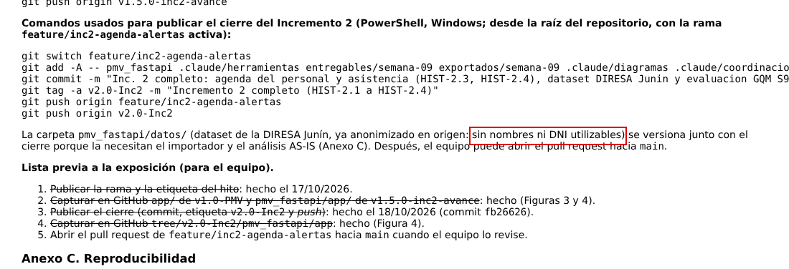
- **Corrección aplicada:** En el md se matizó la frase: `num_doc` viene truncada, no sirve como identificador y su origen no está verificado; el equipo no ha confirmado las condiciones de uso con la DIRESA. El CSV no se tocó (D-07). Evidencia adicional: 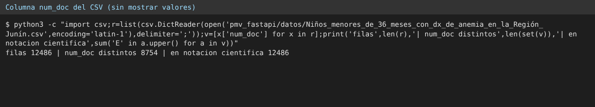
- **Evidencia después:** 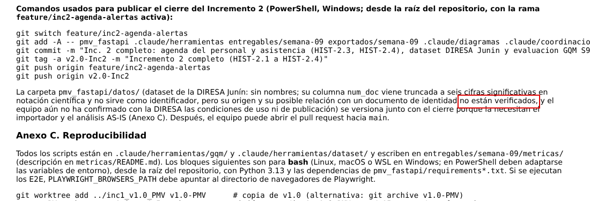
- **Estado:** Pendiente justificado: decisión del Leader (propietario de `pmv_fastapi/`) con el docente/DIRESA: retirar o truncar la columna `num_doc` del CSV versionado o confirmar por escrito que es publicable.

### H-101 · media · Nota de la adenda v4.0 ausente en PDF y DOCX
- **Archivo y ubicación:** md L3; PDF p. 1; DOCX
- **Requisito afectado:** coherencia fuente↔exportado (D-04)
- **Descripción:** La nota de versión del md no estaba en los exportados (anteriores al md).
- **Evidencia antes:** 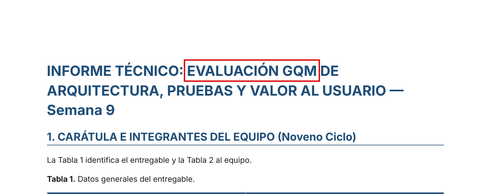 Nota del coordinador: el corrector sobrescribió por error esta captura «antes» durante la preparación; la evidencia válida del estado anterior es 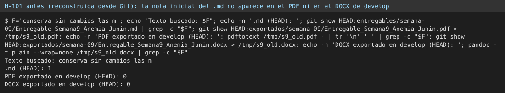, obtenida de los exportados de develop (`git show HEAD:…`).
- **Corrección aplicada:** Se regeneraron PDF y DOCX con `exportar_s9.py`; ambos incluyen la nota.
- **Evidencia después:** 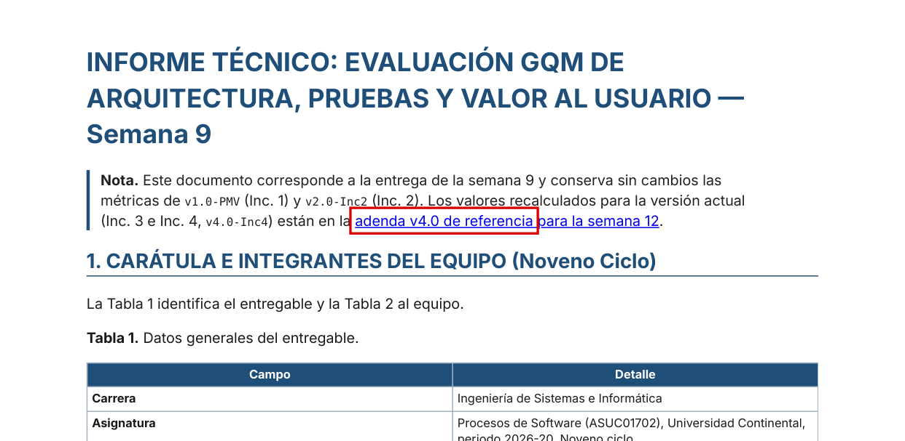
- **Estado:** Cerrado

### H-102 · media · Pies de las Figuras 51 a 55 ausentes en el PDF
- **Archivo y ubicación:** PDF pp. 92-93 (Tabla 44, Anexo G.1); `exportar_s9.py`
- **Requisito afectado:** coherencia fuente↔exportado
- **Descripción:** Las imágenes van dentro de celdas de tabla y pandoc no genera pie para imágenes en línea; el PDF solo mostraba la imagen.
- **Evidencia antes:** 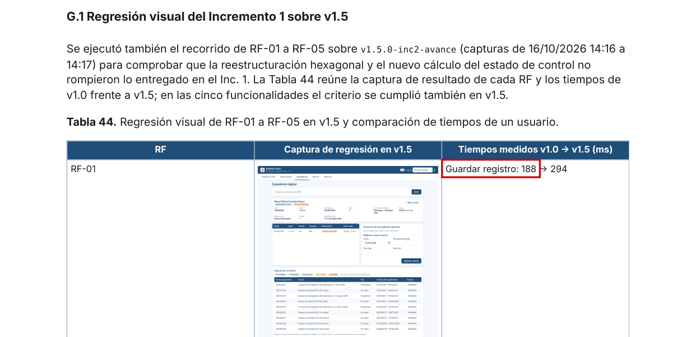
- **Corrección aplicada:** En `.claude/herramientas/conversion/exportar_s9.py` se repite el texto alternativo «Figura NN. …» bajo cada imagen en celdas de tabla; se regeneró (5 pies en el PDF y en el DOCX).
- **Evidencia después:** 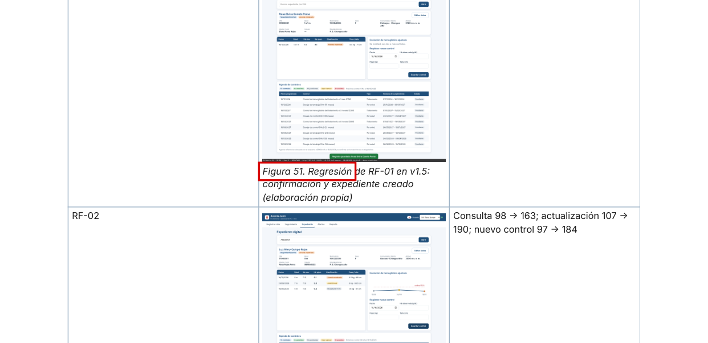
- **Estado:** Cerrado

### H-103 · media · Enlaces de PDF/DOCX a la rama `feature/inc2-agenda-alertas` (borrada)
- **Archivo y ubicación:** `exportar_s9.py` (variable `base`); PDF y DOCX
- **Requisito afectado:** coherencia fuente↔exportado
- **Descripción:** El script generaba URL `blob/feature/inc2-agenda-alertas/…`; la rama ya no existe, por lo que los enlaces estaban rotos.
- **Evidencia antes:** 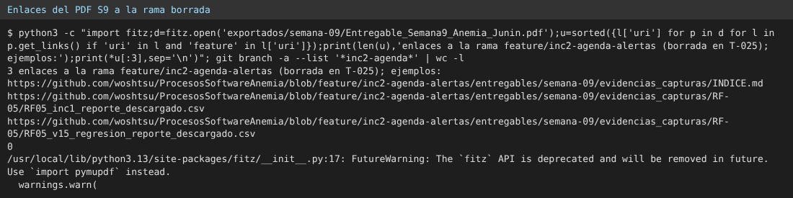
- **Corrección aplicada:** Base cambiada a `blob/main/` (rutas vigentes tras T-024) y exportados regenerados: 0 enlaces a la rama borrada. Las menciones textuales de la rama en el md son históricas (D-01).
- **Evidencia después:** 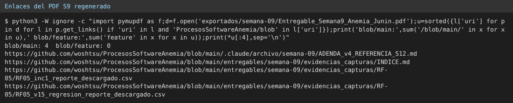
- **Estado:** Cerrado

### H-104 · media · Unidad de 12 486: niños frente a diagnósticos/filas
- **Archivo y ubicación:** md carátula (Nota sobre los datos) y §3 Propósito; Tabla 33
- **Requisito afectado:** R-21 / coherencia interna
- **Descripción:** El md llamaba «12 486 niños» a lo que son 12 486 diagnósticos (filas); con `num_doc` inutilizable no se pueden contar niños únicos y el importador crea un registro por fila (ADR-009).
- **Evidencia antes:** 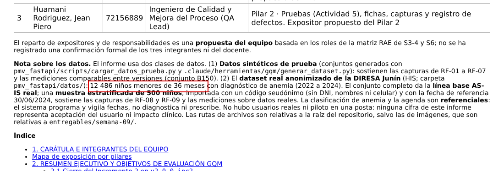
- **Corrección aplicada:** Se reescribió como «12 486 diagnósticos (filas)», se explicó que las cifras del sistema con «niños» (500 y 11 686) cuentan registros y se renombró la fila de la Tabla 33.
- **Evidencia después:** 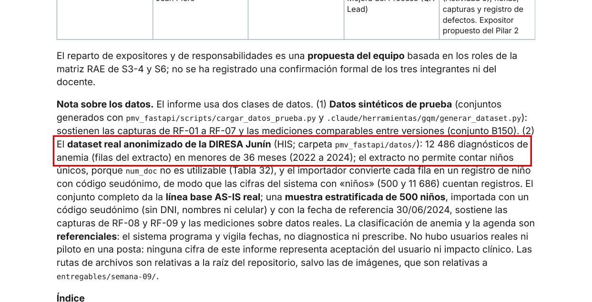
- **Estado:** Cerrado

### H-105 · baja · «44 capturas PNG» frente a 45
- **Archivo y ubicación:** md Anexo A
- **Requisito afectado:** R-23
- **Descripción:** En disco hay 45 PNG (32 fichas, 5 regresión, 5 arquitectura, 3 datos reales; coincide con la Tabla 42).
- **Evidencia antes:** 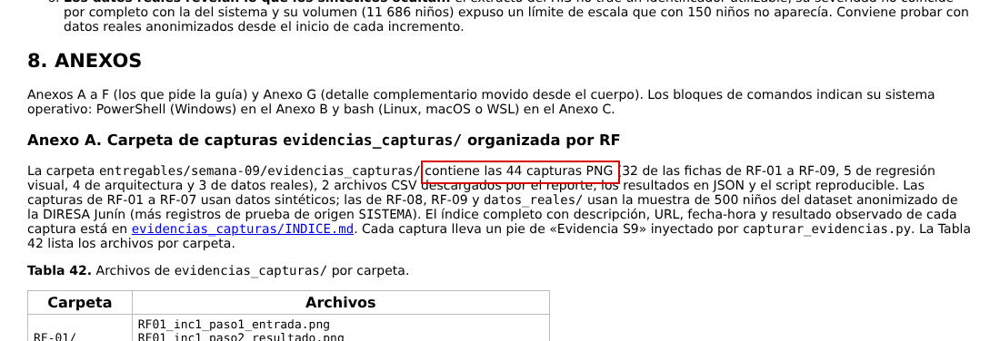
- **Corrección aplicada:** Corregido a 45 y 5 de arquitectura; exportados regenerados.
- **Evidencia después:** 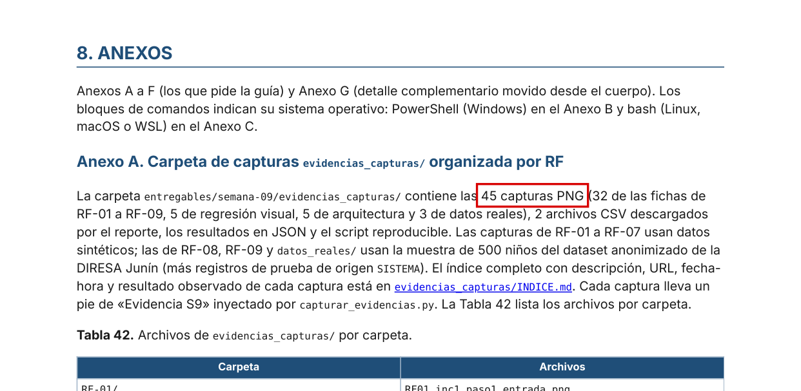
- **Verificación:** Segunda corrección tras la verificación independiente: la Tabla 4 (línea 110) aún decía «44 capturas»; se cambió a 45 y se regeneraron PDF y DOCX: 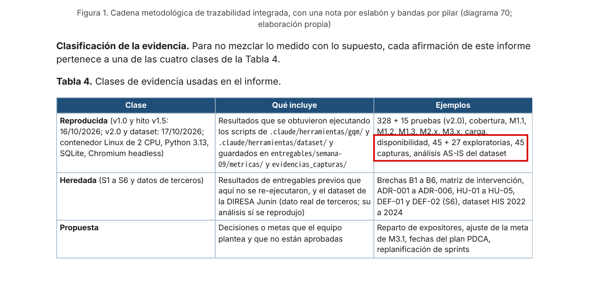
- **Estado:** Cerrado

### H-106 · baja · «856 de 856 sondas en las tres versiones»
- **Archivo y ubicación:** md §6.4 Disponibilidad (V5)
- **Requisito afectado:** coherencia con `m32_disponibilidad.json`
- **Descripción:** El JSON da 856 sondas por versión.
- **Evidencia antes:** 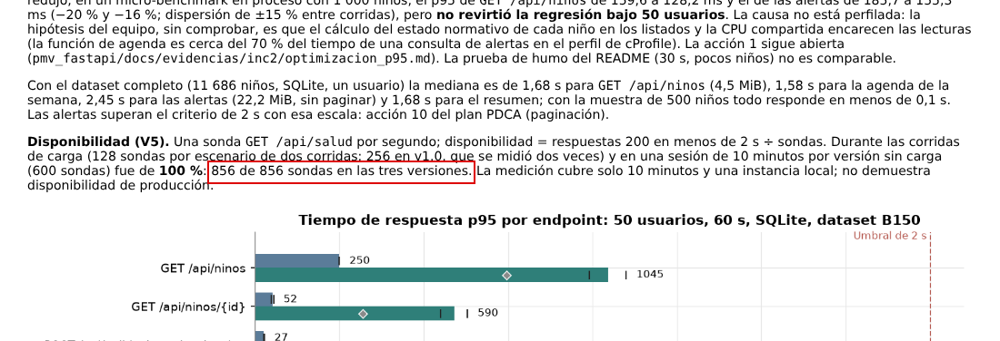
- **Corrección aplicada:** «856 de 856 sondas en cada una de las tres versiones».
- **Evidencia después:** 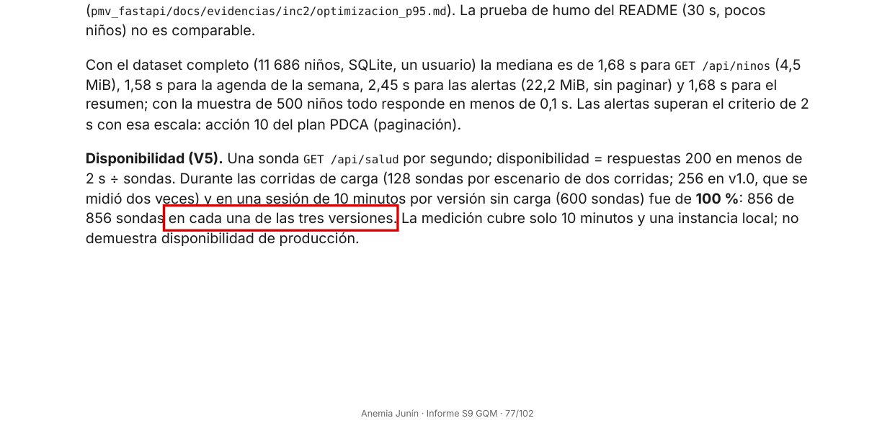
- **Estado:** Cerrado

### H-107 · media · Unidad del sílabo no declarada
- **Archivo y ubicación:** md Tabla 1 (carátula)
- **Requisito afectado:** S-01 (D-03)
- **Descripción:** La carátula no indicaba la unidad.
- **Evidencia antes:** 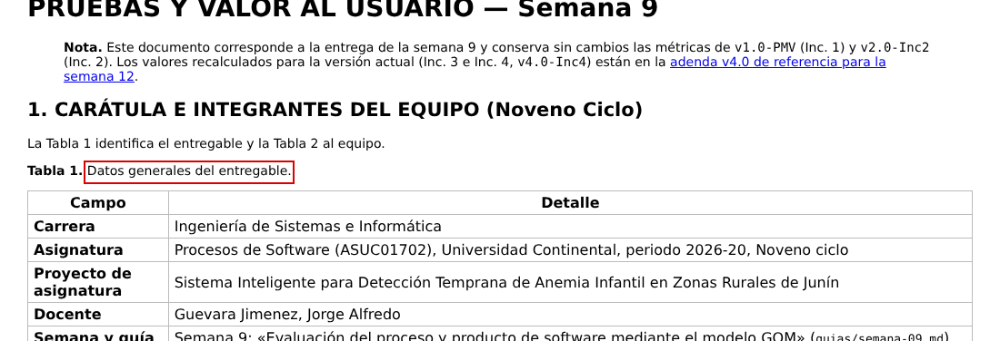
- **Corrección aplicada:** Fila «Unidad del sílabo: Unidad III — Evolución de los procesos y actividades de software».
- **Evidencia después:** 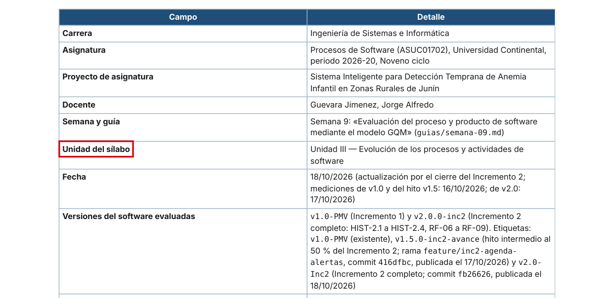
- **Estado:** Cerrado

### H-108 · baja · Referencia de p95 de v1.0 sin sesión en la Tabla 40
- **Archivo y ubicación:** md Tabla 40 (V4)
- **Requisito afectado:** R-18
- **Descripción:** La repetición de v1.0 del 17/10 dio 155 ms (`m32_carga.json`); con ella la variación sería +425,8 %. El texto de §6.4 lo explica, la tabla no.
- **Evidencia antes:** 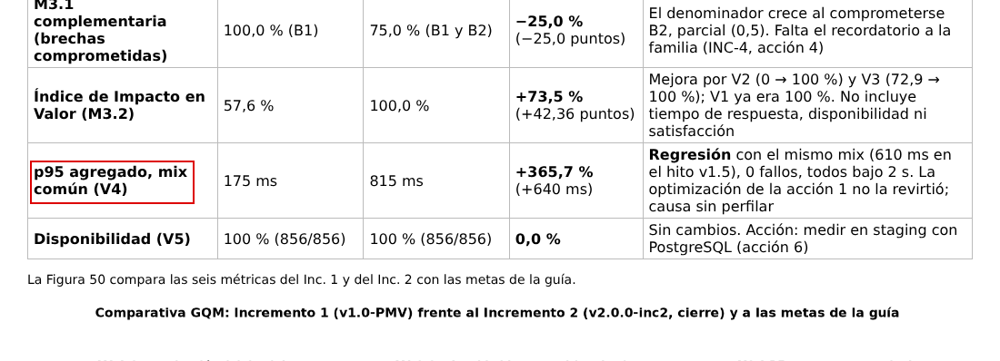
- **Corrección aplicada:** Se indicó en la tabla la sesión de referencia (16/10, 175 ms) y la alternativa (155 ms; +425,8 %).
- **Evidencia después:** 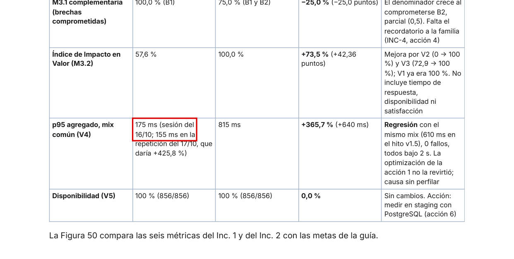
- **Estado:** Cerrado

### H-109 · baja · Lista de trabajo «Lista previa a la exposición» dentro del entregable
- **Archivo y ubicación:** md Anexo B
- **Requisito afectado:** R-24
- **Descripción:** Nota interna con ítems tachados y una tarea sobre una rama ya borrada.
- **Evidencia antes:** 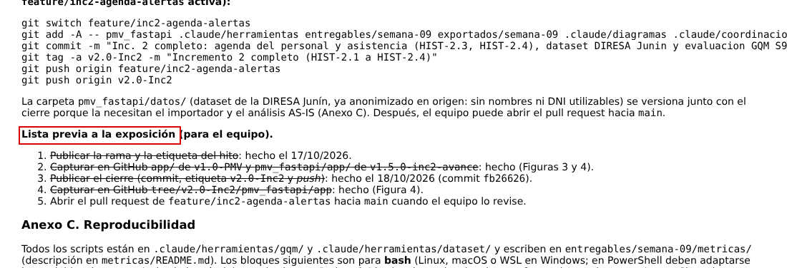
- **Corrección aplicada:** Se retiró la lista; exportados regenerados.
- **Evidencia después:** 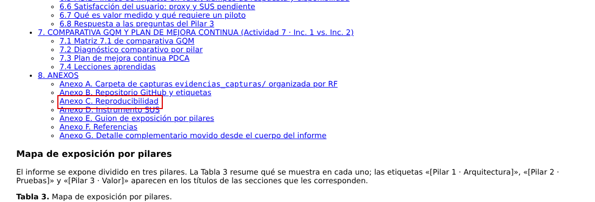
- **Estado:** Cerrado

### H-110 · baja · Cuenta confusa de las 18 pruebas de arquitectura
- **Archivo y ubicación:** md §4.2 Vigilancia automática
- **Requisito afectado:** R-09
- **Descripción:** La frase no se entendía. Verificado en `v2.0-Inc2`: 7 reglas CP-37 a CP-43 + 6 casos parametrizados + 1 de prefijo + 4 nuevas (CP-176 a CP-179) = 18.
- **Evidencia antes:** 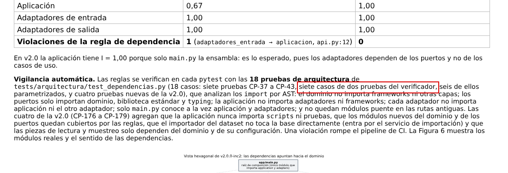
- **Corrección aplicada:** Frase reescrita con esa cuenta.
- **Evidencia después:** 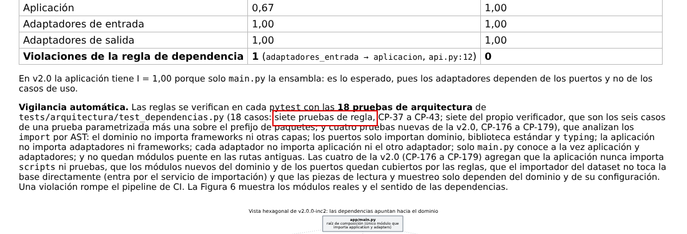
- **Estado:** Cerrado

### H-111 · baja · Metadatos del DOCX sin título ni autor
- **Archivo y ubicación:** `exportar_s9.py`; DOCX
- **Requisito afectado:** coherencia fuente↔exportado
- **Descripción:** El DOCX no tenía título ni autor en `core.xml`.
- **Evidencia antes:** 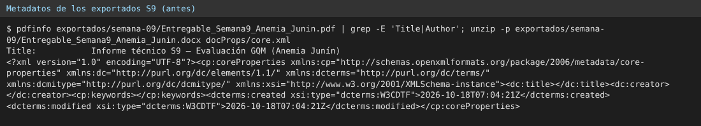
- **Corrección aplicada:** El script fija título y autor («Equipo Anemia Junín», genérico) tras pandoc; el PDF ya tenía título.
- **Evidencia después:** 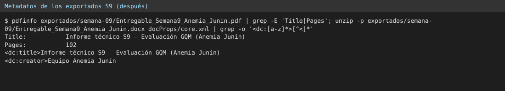
- **Estado:** Cerrado

### H-112 · media · Modelo de evaluación de procesos no nombrado
- **Archivo y ubicación:** md §3 Propósito
- **Requisito afectado:** S-02
- **Descripción:** El documento no decía qué modelo de evaluación aplica.
- **Evidencia antes:** 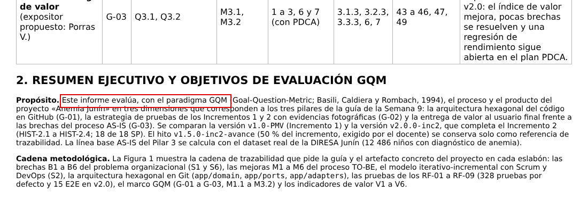
- **Corrección aplicada:** Se añadió: GQM es el modelo de evaluación basado en medición aplicado, la mejora se propone con PDCA (§7.3) y el modelo de capacidad CMMI-DEV corresponde a S11 (existe `entregables/semana-11`). No se inventó ningún resultado.
- **Evidencia después:** 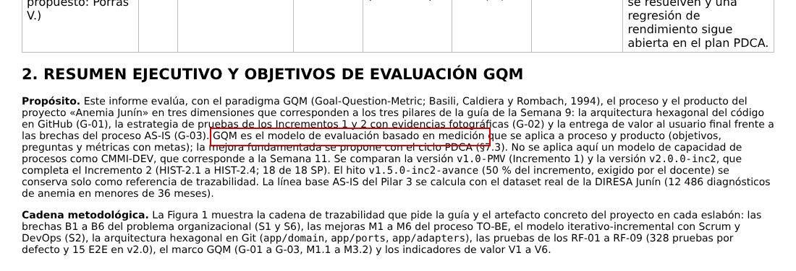
- **Estado:** Cerrado

### H-113 · media · Satisfacción del usuario sin medir (SUS)
- **Archivo y ubicación:** md §6.6, §6.8
- **Requisito afectado:** R-17
- **Descripción:** El SUS no se aplicó; solo hay proxy V6 y el instrumento (Anexo D). El informe lo declara.
- **Evidencia antes:** 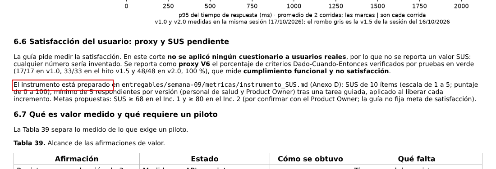
- **Corrección aplicada:** —
- **Evidencia después:** — (pendiente)
- **Estado:** Pendiente justificado: equipo y Product Owner deben aplicar el SUS a usuarios reales; no se inventan valores.

### H-114 · media · Valor demostrado como capacidad, no como impacto
- **Archivo y ubicación:** md §6.2 a §6.8 (Tabla 31, M3.1 = 33,3 %)
- **Requisito afectado:** R-16
- **Descripción:** El informe lo declara (§6.8: visibilidad, no acción); M3.1 queda por debajo de la meta.
- **Evidencia antes:** 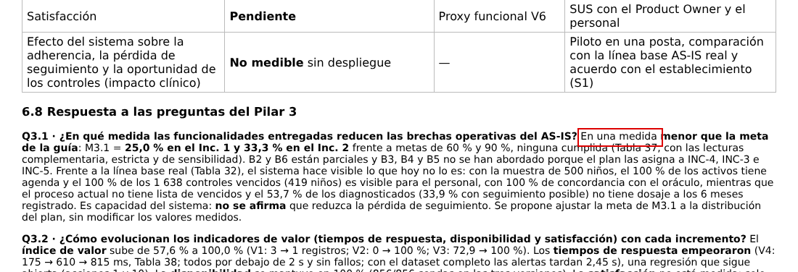
- **Corrección aplicada:** —
- **Evidencia después:** — (pendiente)
- **Estado:** Pendiente justificado: equipo; requiere INC-3/INC-4 (recordatorios, barreras) y un piloto con usuarios, que no existen en S9 (ver la adenda v4.0).

### Candidatos descartados
| Candidato (archivo:línea) | Motivo |
| --- | --- |
| Captura `DJ_expediente_DJ-04505.png` (fecha de nacimiento de un menor) | Registro con código seudónimo `DJ-NNNNN` (número de fila; ADR-009), sin DNI, nombre ni tutor; dataset anonimizado en origen (`asis_dataset_diresa.md`). No hay identificador real; no se editan imágenes de evidencia. |
| Códigos de estudiante en la carátula (md:26-28) | D-02. |
| R-13 capturas parcialmente revisadas | Se revisaron las 45 en hojas de contacto: legibles, con pie «Evidencia S9». Pasa a Cumple. |
| Cambios de `v2.0.0-inc2` frente a `v2.0-Inc2` | La Tabla 1 ya define versión y etiquetas. |
| 55 archivos/18 archivos y KLOC (md §7) | Verificado en los tags locales: 18 y 55 archivos `.py` en `app/`; KLOC de `m22_defectos.json` (1,022 y 2,782). |
| Bibliografía (Sommerville 2011, Pressman 7.ª) | Ediciones citadas por las láminas del curso, declarado en el texto; juicio del equipo. |
| «Enf. Rosa Quispe» en las capturas | Usuario de demostración fijo en `pmv_fastapi/app/web/index.html`. |
| Columna `num_doc`/cuestión de PD en commit de cierre | Incluido en H-100. |

**Nota para el coordinador:** `exportar_s9.py` (en `.claude/herramientas/conversion/`) fue corregido (base `blob/main/`, pies de figura en tablas, metadatos DOCX); Los exportados se regeneraron con Chrome en Linux (102 páginas).
