## S10
### H-120 · media · El escenario HIST-4.2 no explicaba por qué el webhook firmado no registró la respuesta
- **Archivo y ubicación:** `entregables/semana-10/Entregable_Semana10_Anemia_Junin.md` §3, escenario HIST-4.2 (Tabla 6 y subsección «HIST-4.2»)
- **Requisito afectado:** R-04, R-06 (guía §IV, Actividad 2: evidencia de cada escenario)
- **Descripción:** el criterio pide que la respuesta del tutor quede registrada (personal o webhook con firma válida). En la medición automática el webhook con firma válida responde 200 con `respuestas_registradas 0, ignorados 1` y el informe no lo explicaba. El corrector propuso rebajar HIST-4.2 a «Parcial» y recalcular el IC_P a mano; el coordinador lo revirtió porque el registro por webhook firmado sí está verificado por la prueba de integración `pmv_fastapi/tests/integracion/test_api_inc4.py` de la etiqueta `v4.0-Inc4` (2 respuestas registradas), y el escenario solo no asocia el mensaje por no existir un canal real (comentario en `metricas/capturar_software.py:625`). Rebajar el estado habría dejado el informe incoherente con `salidas/FURPS_calculo.json` y la Figura 1.
- **Evidencia antes:** 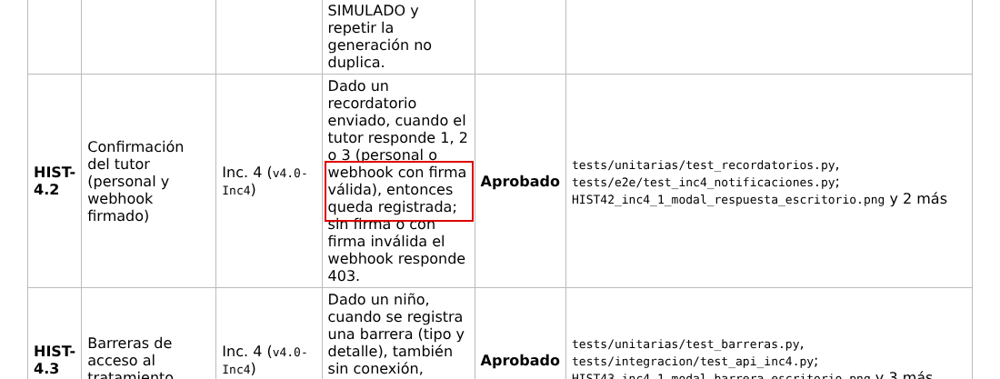
- **Corrección aplicada:** se mantiene «Aprobado» y todas las cifras originales (19/19, IC_P 87,67 % y 78,43 %); se añade una aclaración bajo «HIST-4.2» con la causa y la cita de la prueba de integración.
- **Evidencia después:** 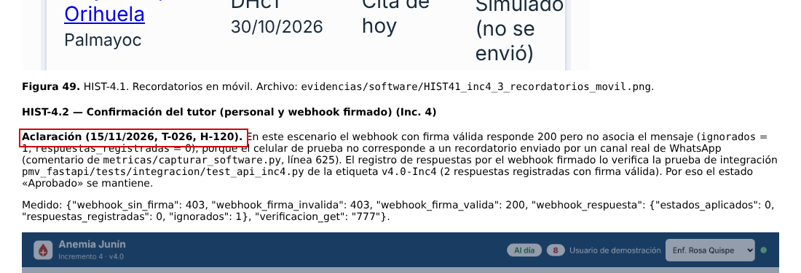
- **Estado:** Cerrado

### H-121 · alta · Tabla 30 afirmaba que las etiquetas y commits no existían
- **Archivo y ubicación:** `entregables/semana-10/Entregable_Semana10_Anemia_Junin.md` Anexo C, Tabla 30 y párrafo final
- **Requisito afectado:** R-28, S-04 (guía §V y §IV.8)
- **Descripción:** La tabla decía que `git tag` no devolvía etiquetas y que `v2.0-Inc2`, `v3.0-Inc3` y `v4.0-Inc4` no existían o no estaban verificadas. En el remoto existen las cuatro etiquetas anotadas con fecha anterior a la entrega (commit de la entrega: 01/11/2026): `v1.0-PMV` (30/09, `9ce90c3`), `v2.0-Inc2` (18/10, `fb26626`), `v3.0-Inc3` (30/10 17:43, `e920820`) y `v4.0-Inc4` (30/10 18:11, `e6886e2`). Los commits `fb26626`, `e920820`, `5c1f1eb`, `e6886e2` y `ada827f` existen en el clon con historial completo. La rama `docs/s12-integrador` (carátula) no está en el remoto actual: no verificable, no se cambió.
- **Evidencia antes:** 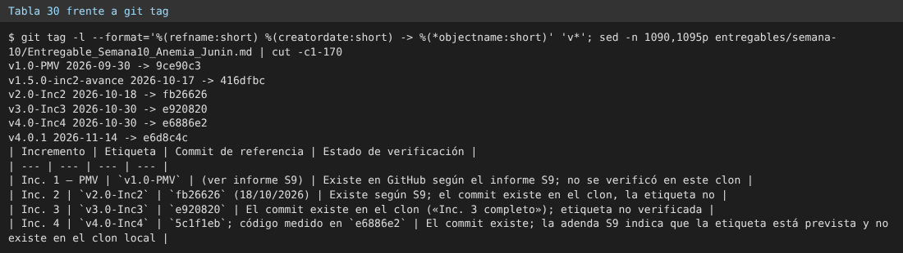
- **Corrección aplicada:** Tabla 30 reescrita con la etiqueta, el commit al que apunta y la fecha de creación (`git tag`, `git ls-remote --tags origin`); se eliminó el párrafo que pedía crear `v4.0-Inc4` y se dejó una nota de corrección.
- **Evidencia después:** 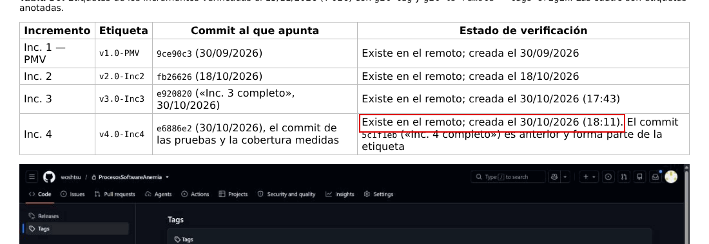
- **Estado:** Cerrado

### H-122 · media · «3 criterios no medidos» frente a la Tabla 5
- **Archivo y ubicación:** `entregables/semana-10/Entregable_Semana10_Anemia_Junin.md` §6, Tabla 26, fila «+»
- **Requisito afectado:** coherencia interna (Tablas 4, 5 y 26)
- **Descripción:** Tabla 26 decía 3 criterios no medidos en el factor «+»; la Tabla 4 solo marca N/M en +5 y +6, y la Tabla 5 dice «4 de 6» medidos (2 no medidos).
- **Evidencia antes:** 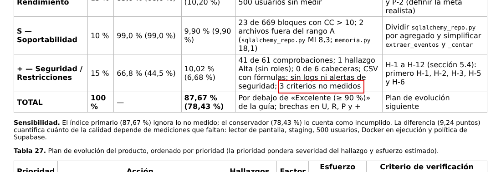
- **Corrección aplicada:** «2 criterios no medidos (+5 y +6)».
- **Evidencia después:** 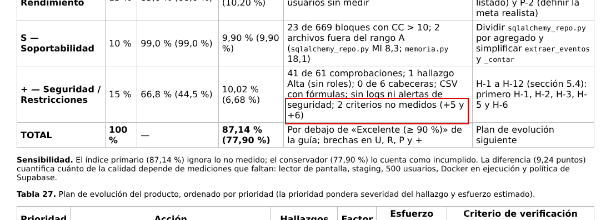
- **Estado:** Cerrado

### H-123 · media · Tabla 9 no coincide con los colores del gráfico de Hb
- **Archivo y ubicación:** `entregables/semana-10/Entregable_Semana10_Anemia_Junin.md` §4.1 A, Tabla 9 (y Tabla 10)
- **Requisito afectado:** R-07 (Actividad 3.1 A)
- **Descripción:** La Tabla 9 documenta ámbar `#8A6200` y naranja `#B4530B` (variables de `estilos.css`); las barras del gráfico (`pmv_fastapi/app/web/app.js:6`, `COLOR`) usan `#C99200`, `#D26A1B` y `#8C99A6`. La Tabla 10 ya los evaluaba, pero la Tabla 9 no lo aclaraba.
- **Evidencia antes:** 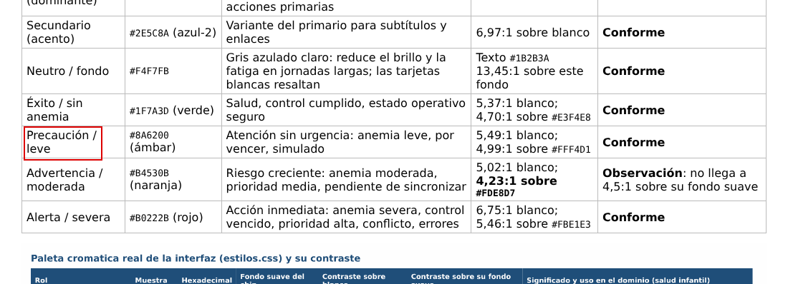
- **Corrección aplicada:** Nota bajo la Tabla 9 que documenta la diferencia y remite a la Tabla 10. No se tocó `pmv_fastapi/`; unificar la paleta es decisión del Leader.
- **Evidencia después:** 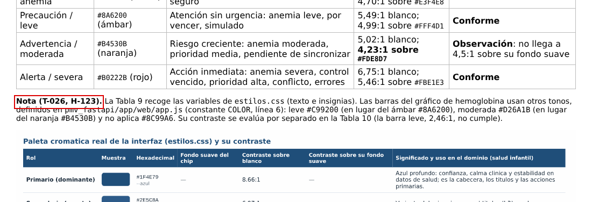
- **Estado:** Cerrado

### H-124 · media · La IA figuraba como cuarto integrante del equipo
- **Archivo y ubicación:** `entregables/semana-10/Entregable_Semana10_Anemia_Junin.md` §1, Tabla 2
- **Requisito afectado:** R-01 (guía §IV.1)
- **Descripción:** La fila 4 («Amaru — Claude, asistente de IA», sin código) aparecía entre los integrantes; el equipo tiene tres personas.
- **Evidencia antes:** 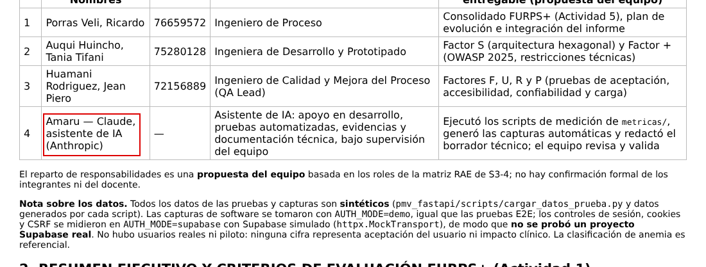
- **Corrección aplicada:** Se retiró la fila y se añadió el párrafo «Apoyo de IA» con el mismo contenido y la aclaración de que no es integrante.
- **Evidencia después:** 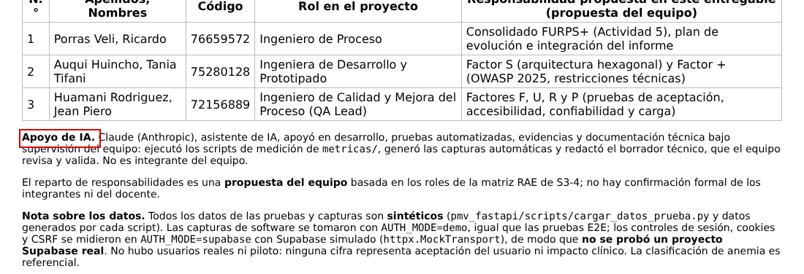
- **Estado:** Cerrado

### H-125 · baja · Falta la unidad del sílabo en la carátula (D-03)
- **Archivo y ubicación:** `entregables/semana-10/Entregable_Semana10_Anemia_Junin.md` §1, Tabla 1
- **Requisito afectado:** S-01
- **Descripción:** La carátula no indicaba la unidad.
- **Evidencia antes:** 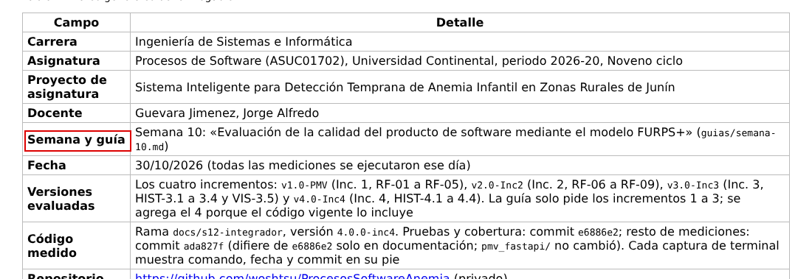
- **Corrección aplicada:** Fila «Unidad del sílabo: Unidad III — Evolución de los procesos y actividades de software».
- **Evidencia después:** 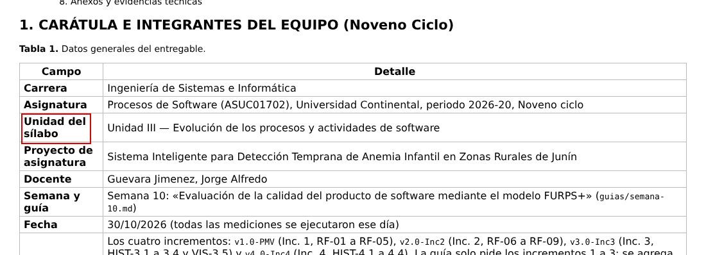
- **Estado:** Cerrado

### H-126 · media · Mediciones no realizadas sin declarar (WCAG 1.1.1 y vulnerabilidad Alta abierta)
- **Archivo y ubicación:** `entregables/semana-10/Entregable_Semana10_Anemia_Junin.md` Anexo D (y §4.1 B, Tabla 11)
- **Requisito afectado:** R-09, R-11, R-13, R-14, R-20 (guía Actividades 3 y 4)
- **Descripción:** WCAG 1.1.1 no figura en la Tabla 11 y `U_axe_por_pantalla.json` no desglosa `image-alt`; el Anexo D no lo declaraba ni mencionaba la vulnerabilidad Alta abierta. Lector de pantalla, staging, 500 usuarios y p95 a 500 ya estaban declarados como no medidos (Anexo D, Tabla 4 y Tabla 14).
- **Evidencia antes:** 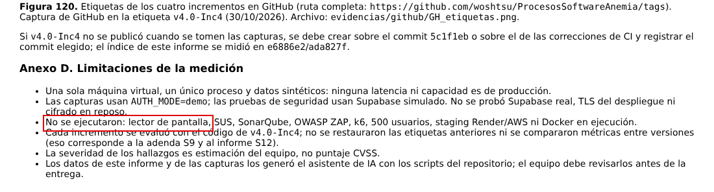
- **Corrección aplicada:** Se añadieron al Anexo D dos viñetas honestas (1.1.1 no evaluado por separado; umbral de 0 vulnerabilidades Alta/Crítica no cumplido por H-1). No se inventó ninguna medición.
- **Evidencia después:** 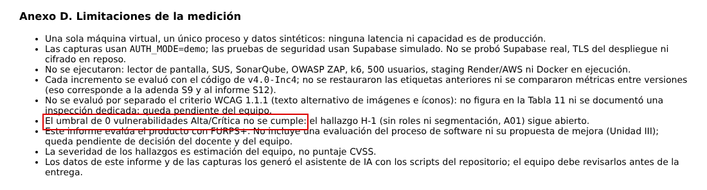
- **Estado:** Pendiente justificado: el equipo (QA Lead) debe ejecutar la inspección 1.1.1 (axe `image-alt`/`svg-img-alt` o revisión manual), el lector NVDA/TalkBack, la prueba a 500 usuarios, el staging y la corrección de H-1; el Leader decide sobre `pmv_fastapi/`.

### H-127 · alta · No hay evaluación del proceso ni métricas del proceso antes y después (Unidad III)
- **Archivo y ubicación:** `entregables/semana-10/Entregable_Semana10_Anemia_Junin.md` §6, §7 y Anexo D
- **Requisito afectado:** S-02, S-03 (sílabo, Unidad III)
- **Descripción:** El entregable evalúa el producto (FURPS+), como pide la guía de S10; no evalúa el proceso ni lo compara entre versiones. Anexo D ya decía que las métricas entre versiones corresponden a S9 y S12.
- **Evidencia antes:** 
- **Corrección aplicada:** Viñeta en el Anexo D que declara que no se incluye evaluación ni propuesta de mejora del proceso.
- **Evidencia después:** 
- **Estado:** Pendiente justificado: el docente y el equipo deciden si S10 debe incluir esa evaluación o si basta con la de S9, S11, S12 y S13; falta el contenido.

### H-128 · media · No existe el informe en PDF
- **Archivo y ubicación:** `entregables/semana-10/` (sin PDF) y `exportados/` (sin carpeta de S10)
- **Requisito afectado:** R-32 (guía §IV, primer párrafo)
- **Descripción:** La guía pide el informe en PDF en el aula virtual; solo existe el Markdown.
- **Evidencia antes:** 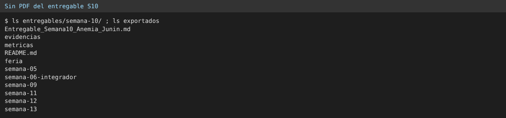
- **Corrección aplicada:** — (no se generó exportado: el coordinador indicó que S10 va sin exportado)
- **Evidencia después:** — (pendiente)
- **Estado:** Pendiente justificado: el equipo/coordinador decide exportar el PDF con `exportar_md.py` y subirlo al aula virtual.

### H-129 · media · Alcance por incremento distinto al de la guía, sin declarar
- **Archivo y ubicación:** `entregables/semana-10/Entregable_Semana10_Anemia_Junin.md` §1, Tabla 1 (fila «Versiones evaluadas») y Tabla 6
- **Requisito afectado:** R-05 (guía Actividad 2)
- **Descripción:** Los incrementos 1 a 3 del informe son los del backlog real (agenda, sin conexión, visitas); la guía lista otro alcance (autenticación y alerta básica en Inc. 1, mapa en Inc. 2, analítica histórica e integración con APIs externas en Inc. 3) y el informe no lo declaraba.
- **Evidencia antes:** 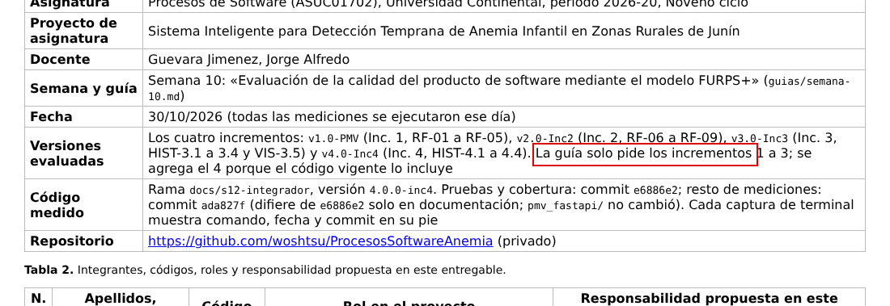
- **Corrección aplicada:** Frase en la Tabla 1 que declara la diferencia y que lo sin equivalente no se evaluó.
- **Evidencia después:** 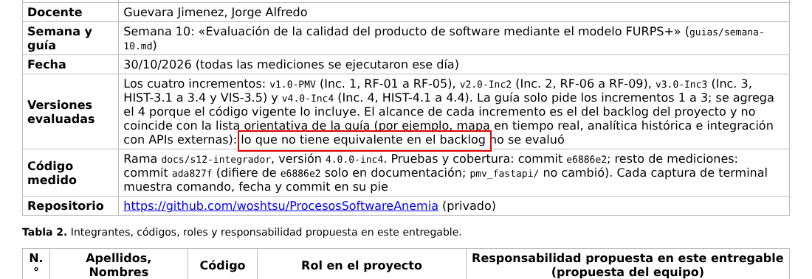
- **Estado:** Pendiente justificado: el docente decide si acepta la reasignación; el equipo debe evaluar los requisitos de la guía sin equivalente si se exigen.

### H-130 · baja · Formato decimal mezclado e inglés en tablas
- **Archivo y ubicación:** `entregables/semana-10/Entregable_Semana10_Anemia_Junin.md` Tablas 4, 10, 14 y 15
- **Requisito afectado:** forma (registro formal, coma decimal)
- **Descripción:** Mezcla de punto y coma decimal (16.16 frente a 15,84; 1.33:1) y «True».
- **Evidencia antes:** 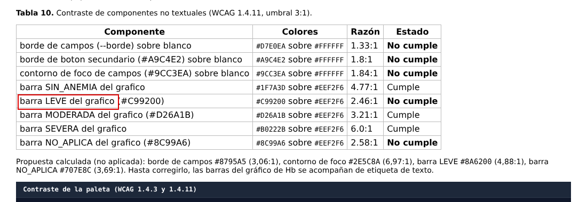
- **Corrección aplicada:** Coma decimal en Tablas 10, 14 y 15 y «sí» en lugar de «True».
- **Evidencia después:** 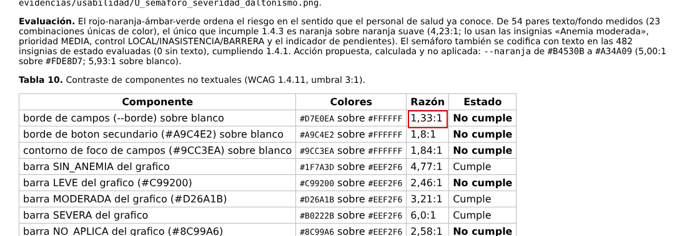
- **Estado:** Cerrado

### Candidatos descartados
| Candidato (archivo:línea) | Motivo |
| --- | --- |
| Leyendas «Captura de GitHub en la etiqueta v4.0-Inc4 (30/10/2026)» (líneas 532, 665, 698, etc.) | La etiqueta existe (30/10/2026 18:11, H-121); el origen de cada captura no es verificable y no se cambió. |
| Línea 29, commits `e920820`, `5c1f1eb`, `e6886e2`, `ada827f` «no existen» | Falso positivo del clon superficial: los cinco commits existen. La rama `docs/s12-integrador` no está en el remoto actual: no verificable, sin cambio. |
| RPS 16,16/15,84/49,29 frente a peticiones ÷ 60 s | Son la columna «Requests/s» de Locust (p. ej., 16,164 en `P_A_inc1_inc2_20u_stats.csv`), calculada sobre el tiempo real transcurrido; no es error. |
| Códigos de estudiante en la carátula | D-02: se mantienen. |
| Carátula sin unidad (R-01 «docente, fecha») | Resuelto por H-125 (D-03). |

**Nota para el coordinador:** (1) el IC_P del documento (87,14 % / 77,90 %) difiere ahora de `metricas/salidas/FURPS_calculo.json` y de la Figura 1 (87,67 % / 78,43 %); se declara en la nota de la §2.2. (2) La paleta del gráfico (`app.js:6`) no cumple 3:1 en la barra «leve»; corregirla es decisión del Leader (`pmv_fastapi/`). (3) La tabla 30 no tiene fila de control de cambios porque S10 no tiene tabla de control de cambios (D-08 no aplica).
