## S11 (incluye feria)
### H-140 · alta · PDF de S11 desactualizado frente al .md
- **Archivo y ubicación:** `exportados/semana-11/Entregable_Semana11_Anemia_Junin.pdf` (carátula y todo el documento)
- **Requisito afectado:** R-30 · coherencia fuente↔exportado (D-04)
- **Descripción:** El PDF era la entrega original del 30/10 (349 pruebas, 99,50 %, 18 figuras, 27 páginas, creado a las 10:04) y el .md se amplió después (660 pruebas, 99,79 %, 73 figuras, hallazgos H7 a H9). La carátula del PDF citaba un nombre de guía que no existe en el repositorio. La versión anterior queda en Git: `git log -1 -- exportados/semana-11/` da `5e6886f` (30/10/2026).
- **Evidencia antes:** 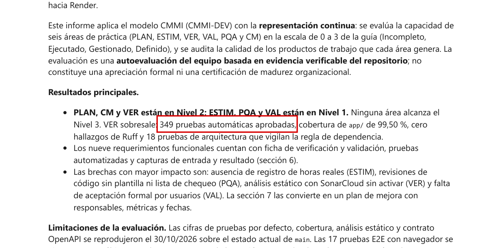
- **Corrección aplicada:** PDF regenerado con `exportar_s11.py` (73 páginas, 660 pruebas y 99,79 %, 73 figuras; carátula con `guias/semana-11.docx`). La versión del 30/10 sigue en el commit `5e6886f`.
- **Evidencia después:** 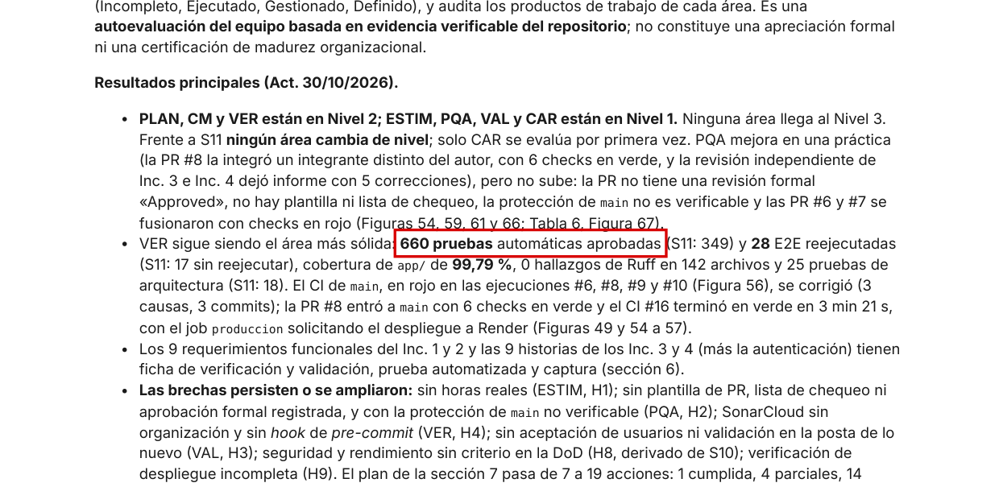
- **Estado:** Cerrado

### H-141 · alta · Contradicción sobre la ejecución de las migraciones 3.0 y 4.0 en Supabase
- **Archivo y ubicación:** `entregables/semana-11/Entregable_Semana11_Anemia_Junin.md` Tabla 9b (antes l.666) frente a §2 l.69, Tabla 7 fila 15 (l.180) y Tabla 10 H9 (l.823)
- **Requisito afectado:** coherencia interna · R-11
- **Descripción:** La Tabla 9b decía «las migraciones no se ejecutaron en Supabase»; tres pasajes decían que las ejecutó el equipo el 30/10 (sin captura). El repositorio no prueba ninguna de las dos versiones: los informes T-019 y T-020 solo recomiendan ejecutarlas; el CI de `main` no verificaba las tablas 4.0 (Figura 62) y el commit `18b65fc` (30/10, 23:18) añadió esa verificación sin que haya registro de una ejecución posterior en el repositorio. Se unifica con la versión mayoritaria y se declara su límite.
- **Evidencia antes:** 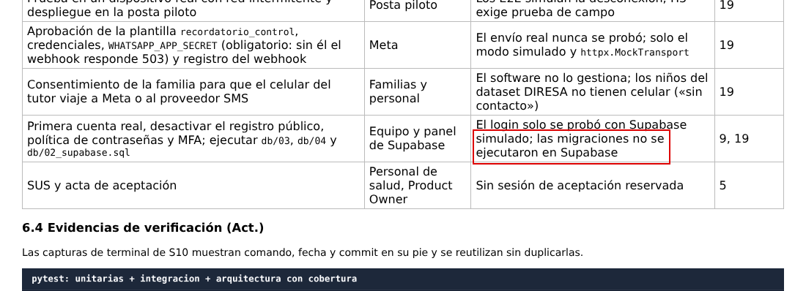
- **Corrección aplicada:** La Tabla 9b ahora dice que el equipo declara haberlas ejecutado el 30/10, sin captura ni registro en el repositorio, y que falta la evidencia (D-10). Las otras tres menciones no cambian. PDF regenerado.
- **Evidencia después:** 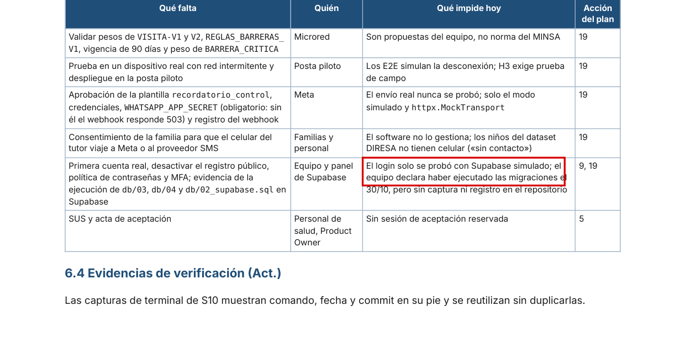
- **Estado:** Cerrado (el equipo debe aportar la captura o el registro de la ejecución en Supabase si quiere sostener la afirmación; no verificable desde el repositorio)

### H-142 · media · Conteo de pruebas de regresión: 3, 5 y 6
- **Archivo y ubicación:** `entregables/semana-11/Entregable_Semana11_Anemia_Junin.md` Tabla 7 fila 12 (l.177), Tabla 8 (l.202), Tabla 9c y Figura 47
- **Requisito afectado:** D-10 (cifras contra evidencias)
- **Descripción:** La Tabla 7 decía «3 pruebas de regresión», la Tabla 8 y la Figura 47 decían 6 y la Tabla 9c lista 5 identificadores más CP-405. La Figura 47 (`CMMI04_regresion_revision_independiente.png`) muestra 6 pruebas aprobadas: CP-357, CP-264b, CP-382b, CP-391b, CP-396 y CP-405. Las tres correcciones con prueba específica (defectos 1 a 3) usan 5 pruebas; CP-405 recorre el flujo del defecto 4.
- **Evidencia antes:** 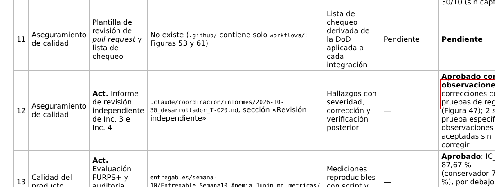
- **Corrección aplicada:** La Tabla 7 ahora dice: 5 correcciones, 3 con pruebas de regresión específicas (5 pruebas), 2 sin prueba específica; la Figura 47 suma CP-405 (6 aprobadas).
- **Evidencia después:** 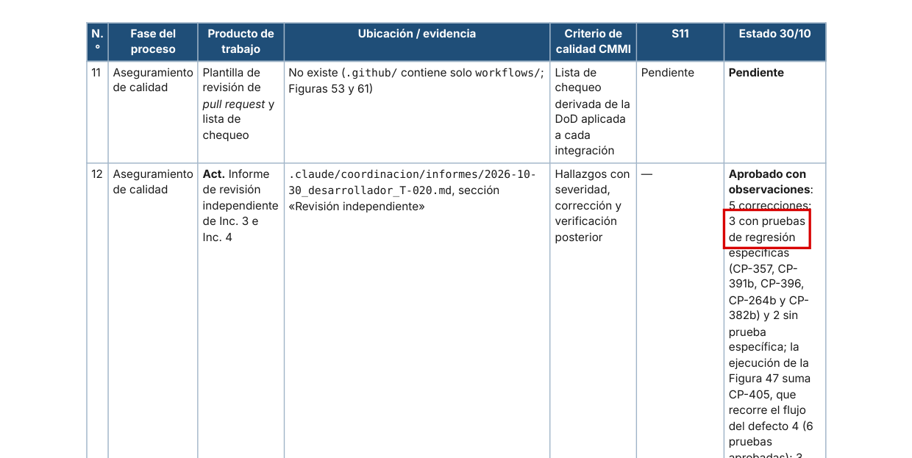
- **Estado:** Cerrado

### H-143 · media · Número de pruebas E2E de v2.0 (17 frente a 15)
- **Archivo y ubicación:** `entregables/semana-11/Entregable_Semana11_Anemia_Junin.md` §6.2, párrafo bajo la Tabla 9 (l.225)
- **Requisito afectado:** coherencia con S9 (l.159) · R-19
- **Descripción:** El texto decía que la columna E2E «suma 16 de las 17 existentes en v2.0» porque las 2 de inicio de sesión no corresponden a un RF; no cuadra (17 - 16 = 1) y S9 da 15. Con `m21_cobertura_rf.json` (v2.0): 16 entradas por RF y 15 pruebas E2E distintas (una prueba respalda más de un RF). Las 2 de inicio de sesión se añadieron el 23/10 (commit `49f07da`), después de v2.0; 15 + 2 = 17 de la Tabla 8, y `e2e.txt` confirma 15 (interfaz) + 2 (inicio de sesión) + 11 (Inc. 3 e Inc. 4) = 28.
- **Evidencia antes:** 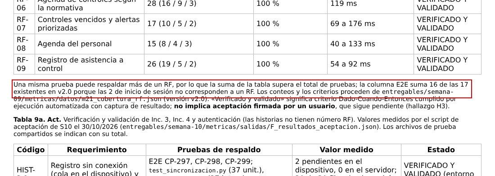
- **Corrección aplicada:** Texto corregido: la suma es 16 porque una misma E2E respalda varios RF; las E2E de v2.0 son 15 y las 17 de la Tabla 8 incluyen las 2 de inicio de sesión.
- **Evidencia después:** 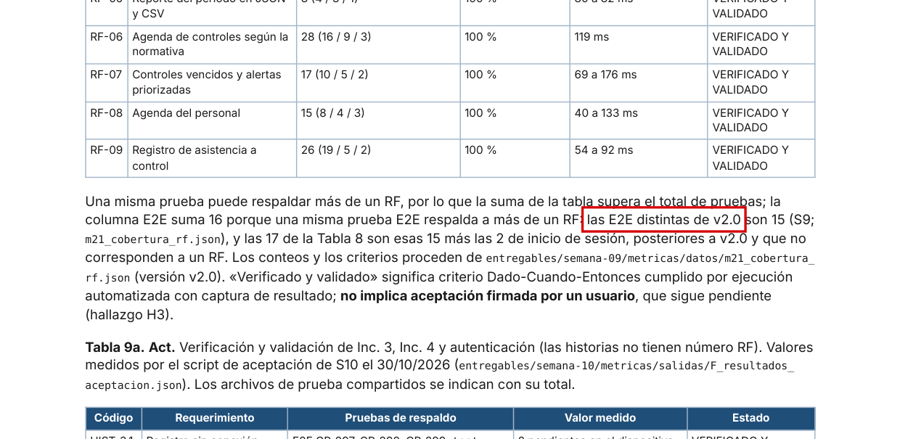
- **Estado:** Cerrado

### H-144 · media · Texto alternativo de la feria: «prioridad elevada» frente a MEDIA
- **Archivo y ubicación:** `entregables/semana-11/feria/Proyecto_Feria_Anemia_Junin.md` Evidencia 3 (l.47)
- **Requisito afectado:** coherencia texto↔captura
- **Descripción:** El texto alternativo de la captura RF-09 decía «prioridad elevada»; el cuerpo (l.45), S9 l.753 y la captura dicen prioridad media (BAJA a MEDIA).
- **Evidencia antes:** 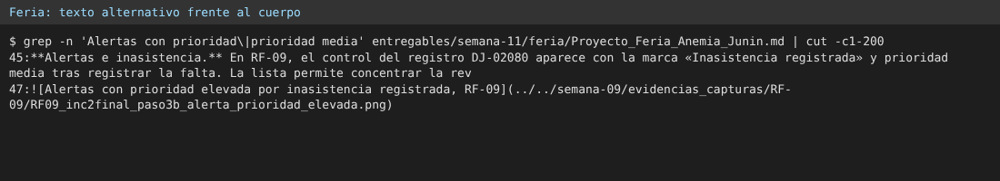
- **Corrección aplicada:** Alt cambiado a «Alertas, RF-09: registro DJ-02080 con prioridad media y la marca «Inasistencia registrada» tras registrar la falta». PDF de la feria regenerado (3 páginas).
- **Evidencia después:** 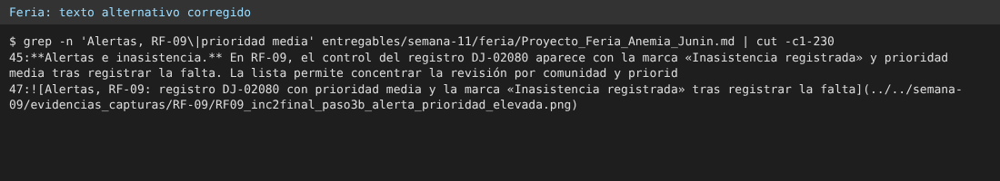
- **Estado:** Cerrado

### H-145 · media · Feria: cifras de pruebas sin versión ni fecha de corte coherentes
- **Archivo y ubicación:** `entregables/semana-11/feria/Proyecto_Feria_Anemia_Junin.md` «Verificación del funcionamiento» y «Fuentes y alcance»
- **Requisito afectado:** coherencia con S9 (l.109, l.159, l.403) y T-013
- **Descripción:** «328 pruebas… 100 %… reproducidas el 23/10/2026» no indicaba la versión. S9 l.403 atribuye las 328 a v2.0 (`v2.0.0-inc2`, medidas el 17/10) y el informe T-013 las reprodujo el 23/10 (328 aprobadas, 100 %). La feria tampoco declaraba que no muestra los incrementos 3 y 4.
- **Evidencia antes:** 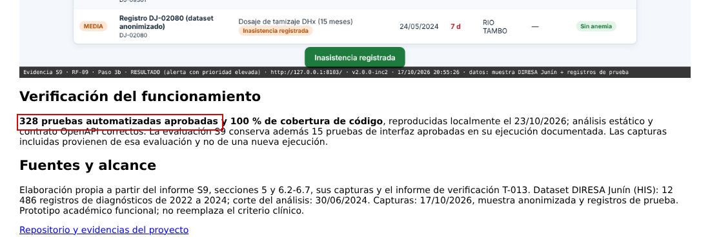
- **Corrección aplicada:** Añadidas la versión `v2.0.0-inc2`, la fecha de medición de S9 y la referencia a T-013, y una frase de alcance (Inc. 1 y 2; Inc. 3 y 4 posteriores al 23/10). PDF regenerado.
- **Evidencia después:** 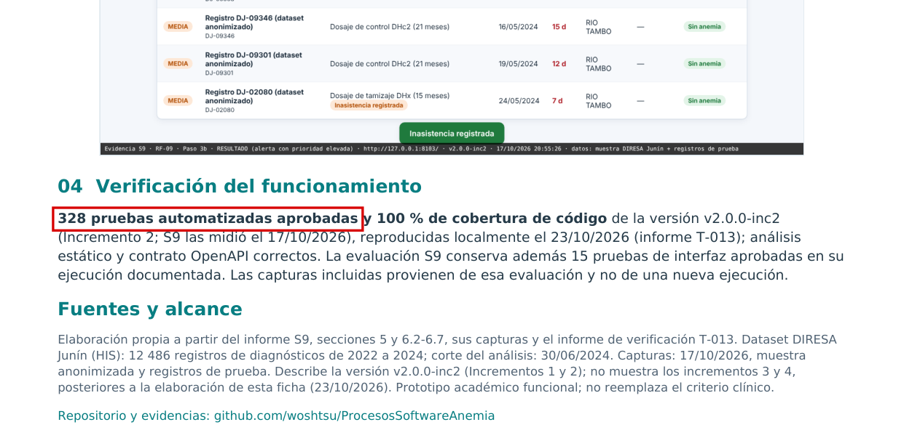
- **Estado:** Cerrado

### H-146 · media · «Fusiones» #7 y #6 son commits de integración por squash
- **Archivo y ubicación:** `entregables/semana-11/Entregable_Semana11_Anemia_Junin.md` Figura 58 (l.767)
- **Requisito afectado:** R-26 · exactitud de Git
- **Descripción:** Los hashes `9caa00f` y `5e6886f` se describían como «fusiones». `git cat-file -p` muestra un solo padre y committer «GitHub»; sus asuntos terminan en «(#7)» y «(#6)»: son integraciones por squash de esas PR.
- **Evidencia antes:** 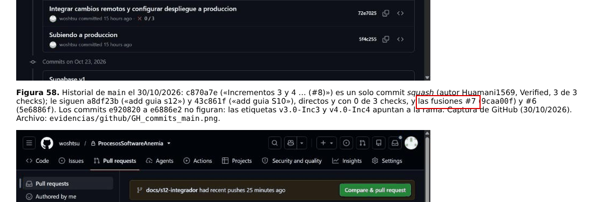
- **Corrección aplicada:** Texto: «integraciones por *squash* de las PR #7 y #6, commits de un solo padre cuyo asunto termina en (#7) y (#6)».
- **Evidencia después:** 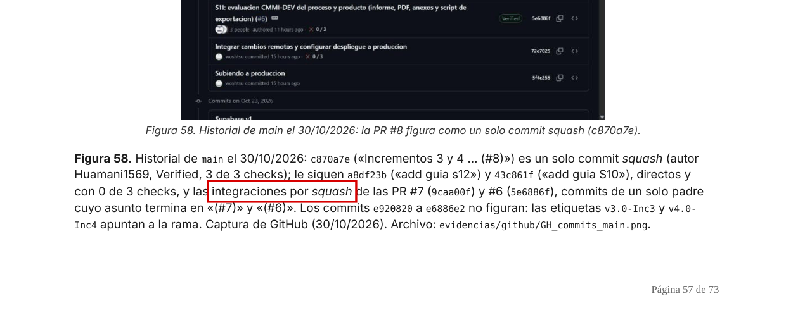
- **Estado:** Cerrado

### H-147 · media · Asistente de IA dentro de la tabla de integrantes
- **Archivo y ubicación:** `entregables/semana-11/Entregable_Semana11_Anemia_Junin.md` Tabla 2 (fila 4, l.29)
- **Requisito afectado:** R-27 (carátula con integrantes)
- **Descripción:** El asistente de IA figuraba como cuarto integrante, con rol.
- **Evidencia antes:** 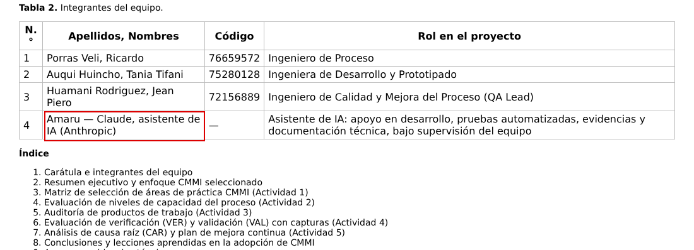
- **Corrección aplicada:** Retirado de la tabla y declarado debajo como «Asistencia de IA (declarada)», sin borrarlo.
- **Evidencia después:** 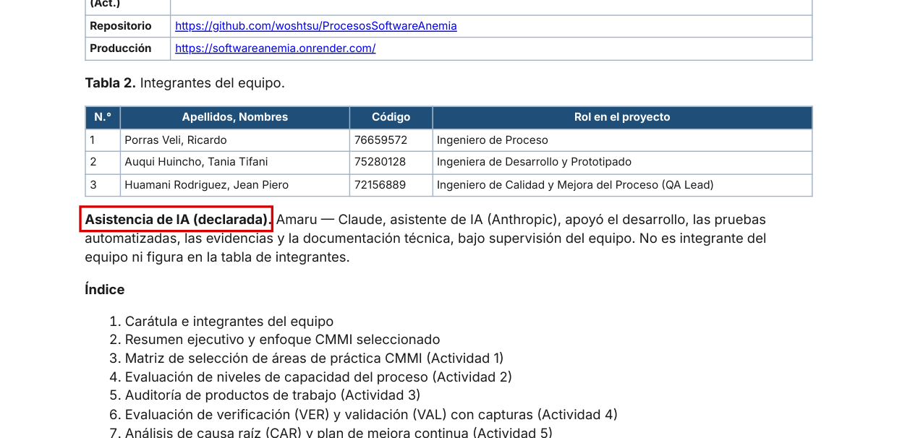
- **Estado:** Cerrado

### H-148 · media · Falta la unidad del sílabo en la carátula
- **Archivo y ubicación:** `entregables/semana-11/Entregable_Semana11_Anemia_Junin.md` Tabla 1 (l.9-20)
- **Requisito afectado:** S-02 (D-03)
- **Descripción:** La carátula no declaraba la unidad del sílabo (sílabo §7: cada entregable declara su unidad; S11 corresponde a U3, semanas 9 a 12).
- **Evidencia antes:** 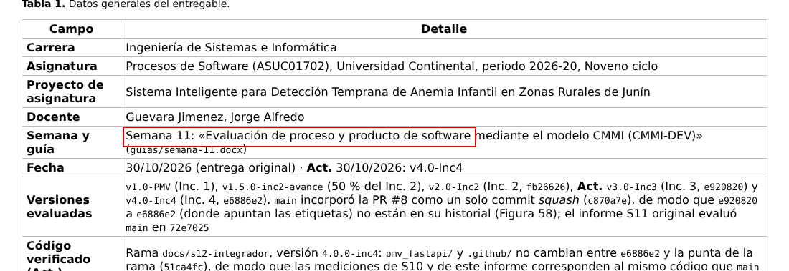
- **Corrección aplicada:** Fila nueva «Unidad del sílabo: Unidad III — Evolución de los procesos y actividades de software».
- **Evidencia después:** 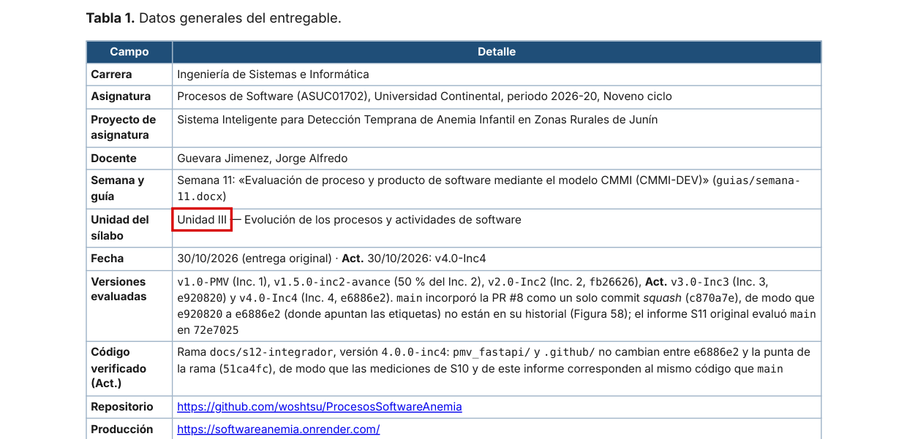
- **Estado:** Cerrado

### H-149 · baja · «Meta M2.2 de la guía» sin indicar la guía
- **Archivo y ubicación:** `entregables/semana-11/Entregable_Semana11_Anemia_Junin.md` §6.4, bajo la Tabla 9c (l.707)
- **Requisito afectado:** exactitud de la cita
- **Descripción:** La guía de S11 no tiene la métrica M2.2; sí la tiene la guía de S9 (`guias/semana-09.md`, tabla de métricas: ≤ 0,2 Def/RF para el Inc. 2).
- **Evidencia antes:** 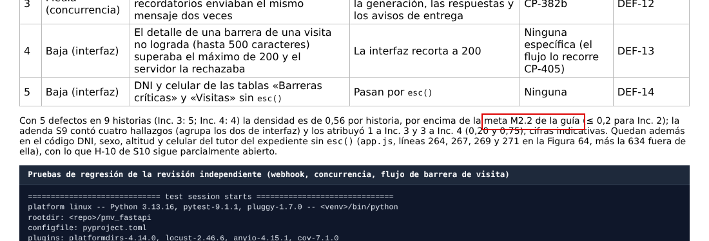
- **Corrección aplicada:** Texto: «meta M2.2 de la guía de S9».
- **Evidencia después:** 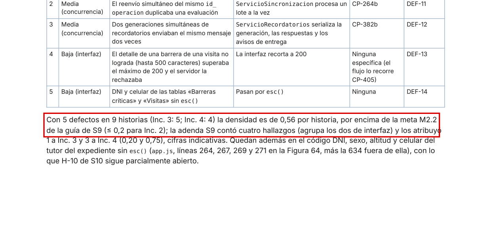
- **Estado:** Cerrado

### H-150 · alta · Análisis estático con SonarQube/SonarCloud no ejecutado
- **Archivo y ubicación:** `entregables/semana-11/Entregable_Semana11_Anemia_Junin.md` Tabla 8 (l.205), fichas «VER · Análisis estático», Anexo A (l.948)
- **Requisito afectado:** R-13, R-24 (guía, Act. 4 y Matriz 1.1)
- **Descripción:** La plantilla de la guía pide SonarQube; el informe lo declara «no ejecutado» (`sonar.organization=REEMPLAZAR_ORGANIZACION`) y usa Ruff, bandit y semgrep. Era cierto el 30/10 (D-01). El repositorio contiene una exportación de SonarCloud del 05/11/2026 (commit `ef192d8`), posterior a la entrega.
- **Evidencia antes:** 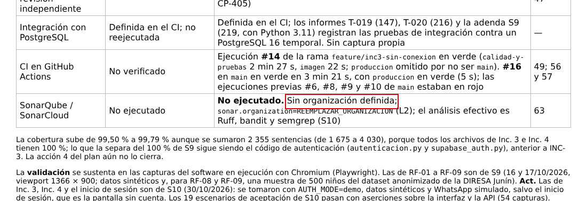
- **Corrección aplicada:** —
- **Evidencia después:** — (pendiente)
- **Estado:** Pendiente justificado: el equipo y el docente deciden si se incorpora como anexo posterior la exportación del 05/11/2026 o se mantiene el incumplimiento declarado; no se puede inventar un resultado del 30/10.

### H-151 · baja · Falta la matriz de puertos y adaptadores y el C4 solo cubre el Inc. 1
- **Archivo y ubicación:** `entregables/semana-11/Entregable_Semana11_Anemia_Junin.md` Tabla 7 fila 3 (l.168)
- **Requisito afectado:** R-07 (guía, Matriz 3.1)
- **Descripción:** `C4_componentes.puml` solo describe el Inc. 1 (el informe lo reconoce) y no existe una matriz de puertos y adaptadores.
- **Evidencia antes:** 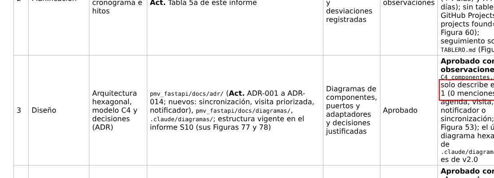
- **Corrección aplicada:** —
- **Evidencia después:** — (pendiente)
- **Estado:** Pendiente justificado: requiere producir la matriz y actualizar el C4 (trabajo de contenido del equipo, rol de diagramas); S10 tiene la estructura vigente (Figuras 77 y 78).

### H-152 · baja · Referencias sin la bibliografía del sílabo
- **Archivo y ubicación:** `entregables/semana-11/Entregable_Semana11_Anemia_Junin.md` Anexo E (l.985-990)
- **Requisito afectado:** S-05
- **Descripción:** No cita Sommerville, Pressman y Maxim, O'Regan ni SWEBOK; el sílabo las recomienda («preferentemente»).
- **Evidencia antes:** 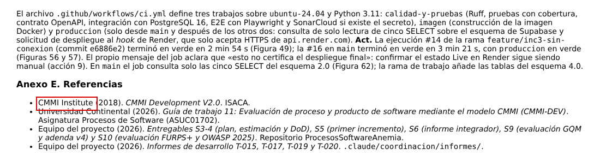
- **Corrección aplicada:** —
- **Evidencia después:** — (pendiente)
- **Estado:** Pendiente justificado: el equipo debe decidir qué criterios del informe apoya con esas fuentes; agregar referencias no usadas en el texto no aporta.

### H-153 · media · Fechas y responsables del plan de mejora son propuesta sin confirmar
- **Archivo y ubicación:** `entregables/semana-11/Entregable_Semana11_Anemia_Junin.md` Tabla 12 (l.841-866)
- **Requisito afectado:** R-22 (guía, rúbrica Act. 5)
- **Descripción:** El propio informe declara que las fechas y los responsables de las acciones nuevas son una propuesta del equipo, sin confirmar. Que algunas fechas ya hayan vencido el 15/11 no es defecto (D-01: el estado es del 30/10).
- **Evidencia antes:** 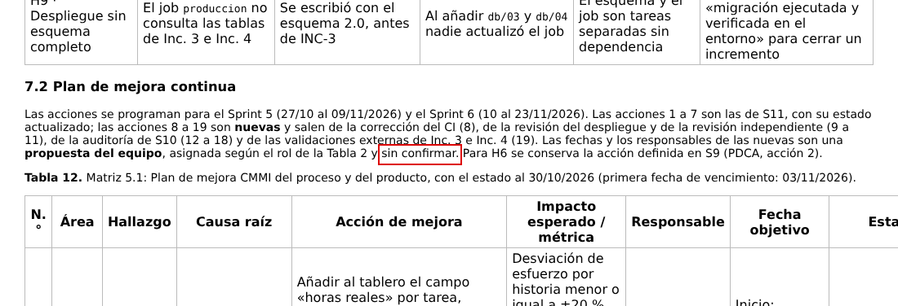
- **Corrección aplicada:** —
- **Evidencia después:** — (pendiente)
- **Estado:** Pendiente justificado: el equipo y el docente confirman responsables y fechas.

### H-154 · baja · Ciclo PDCA y tablero de GitHub Projects ausentes en S11
- **Archivo y ubicación:** `entregables/semana-11/Entregable_Semana11_Anemia_Junin.md` §7 y Figura 60 (l.777)
- **Requisito afectado:** S-03, S-04 (sílabo)
- **Descripción:** Hay métricas y comparación antes/después, pero el ciclo PDCA no se presenta como tal; no hay tablero de GitHub Projects (el seguimiento está en `TABLERO.md`).
- **Evidencia antes:** 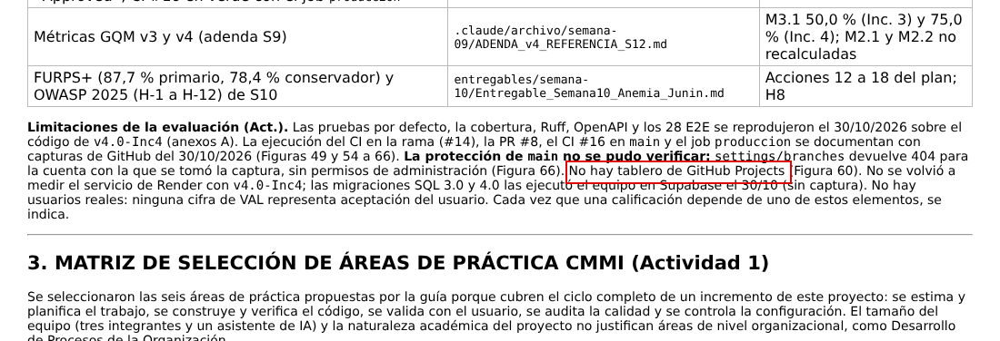
- **Corrección aplicada:** —
- **Evidencia después:** — (pendiente)
- **Estado:** Pendiente justificado: contenido de fondo; decide el equipo si lo incorpora (el PDCA formal se trabajó después, en S13).

### H-155 · baja · Commits semánticos sin convención escrita
- **Archivo y ubicación:** `entregables/semana-11/Entregable_Semana11_Anemia_Junin.md` Tabla 7 fila 4 (l.169) y PQA/CM (l.121)
- **Requisito afectado:** R-08 (guía, Matriz 3.1)
- **Descripción:** El informe reconoce que no hay convención escrita de commits; «cero código huérfano» no se verifica.
- **Evidencia antes:** 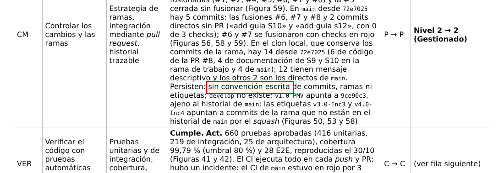
- **Corrección aplicada:** —
- **Evidencia después:** — (pendiente)
- **Estado:** Pendiente justificado: requiere definir la convención y medir; decide el equipo (fuera de este alcance documental).

### H-156 · media · Despliegue de v4.0-Inc4 sin verificación posterior
- **Archivo y ubicación:** `entregables/semana-11/Entregable_Semana11_Anemia_Junin.md` Tabla 7 fila 10 (l.175) y Anexo C
- **Requisito afectado:** R-11 (guía §II.2)
- **Descripción:** La prueba de humo del 30/10 es sobre la versión anterior; no se repitió con v4.0-Inc4. Es una limitación declarada (§2).
- **Evidencia antes:** 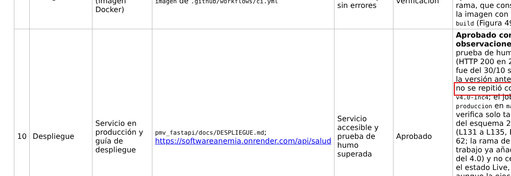
- **Corrección aplicada:** —
- **Evidencia después:** — (pendiente)
- **Estado:** Pendiente justificado: requiere repetir `/api/salud` en producción; lo hace el equipo.

### Candidatos descartados
| Candidato (archivo:línea) | Motivo |
| --- | --- |
| S11 md:119, 148, 176, 777-779 («No existe `pull_request_template.md`») | D-01: el texto es del 30/10 (commit `c5d9782`) y la plantilla se añadió el 06/11 (`e0f8760`, PR #13). Era cierto en la fecha de entrega. |
| S11 md:121, 819 («`develop` no existe») | D-01: `develop` surge hacia el 14/11 (primer commit propio, PR #28); el 30/10 no existía. |
| S11 md:847-866, 902 (acciones vencidas) y `v4.0.1` (09/11) | D-01: instantánea del 30/10; los hechos posteriores no se incorporan. |
| S11 md:26-28 (códigos de estudiante) | D-02. |
| Captura RF-09 («Enf. Rosa Quispe») | Nombre de un perfil de demostración fijo en `pmv_fastapi/app/web/index.html:45`; no es una persona real identificada. |
| S11 md:983 vs :721 («2 min 54 s») | Es la «Total duration» que muestra GitHub en la Figura 49; incluye tiempos de preparación entre trabajos. |
| S11 md:127, 115, 125, 152 (nivel 1 con «No cumple») | Juicio del equipo documentado en la Tabla 6; las prácticas producen producto parcial (nivel 1 por la Tabla 4). Sin defecto verificable. |
| S11 md:17 (hashes `e920820`, `e6886e2`, etc. ausentes del clon) | No verificable localmente: ramas y etiquetas apuntan a commits que GitHub conserva (la Figura 58 y el squash de #8 lo explican); D-10, no se cambia. |
| S11 PDF, carátula con `guias/S11-PSW-GUÍA…docx` | Cerrado dentro de H-140 al regenerar. |
| Feria, 3 páginas, diferencias de título numerado y carátula | Presentación del exportador; el contenido coincide con el .md. |

### Nota para el coordinador
- El `.md` de S11 no tiene tabla de control de cambios; no se añadieron filas (D-08).
- El PDF de S11 pasó de 27 a 73 páginas (11 MB); la versión del 30/10 está en `5e6886f`.
- H-141: se pide al equipo la captura o el registro de la ejecución de las migraciones en Supabase.
