## S12
### H-160 · media · Falta el exportado del informe S12
- **Archivo y ubicación:** `exportados/semana-12/` (ausente)
- **Requisito afectado:** coherencia fuente↔exportado (D-04); hallazgo 9
- **Descripción:** El informe de 200 KB no tenía PDF ni DOCX; solo estaba el DOCX de correcciones.
- **Evidencia antes:** 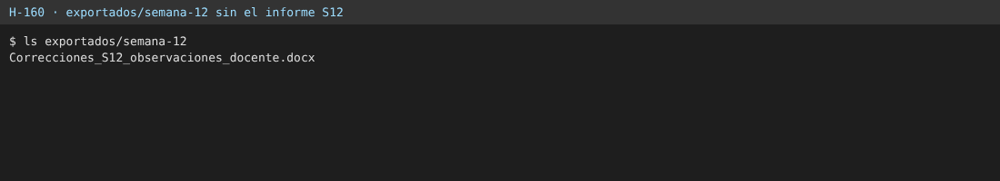
- **Corrección aplicada:** Se generó `Informe_Integrador_S12_Anemia_Junin.pdf` y `.docx` con `exportar_md.py` (113 páginas; carátula, figuras y tablas revisadas en el PDF). Se regeneró de nuevo al final, tras las demás correcciones.
- **Evidencia después:** 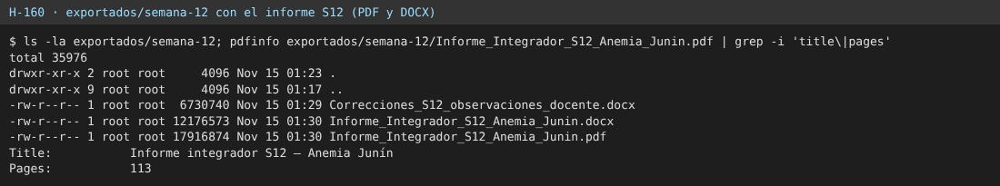
- **Estado:** Cerrado

### H-161 · media · Numeración obsoleta en las correcciones S12
- **Archivo y ubicación:** `entregables/semana-12/correcciones/Correcciones_S12_observaciones_docente.md` l.22-29, 132-136, 164-204, 522-537, 727-739 y su DOCX
- **Requisito afectado:** coherencia con el informe; hallazgo 10
- **Descripción:** Tabla 39 como Anexo D (es la 42), Tablas 33/34/36 (35/37/39), Tablas 21 a 23 y G1/G2/C1 (19, 20, 21, 22, 23, 36), apartados 3.6.4/3.6.5 (3.6.3/3.6.4) y Figuras G1-G26 y C1-C17 (9 a 34 con G24 y G25 permutadas, y 103 a 118 con C10 = Figura 99) no coincidían con el informe.
- **Evidencia antes:** 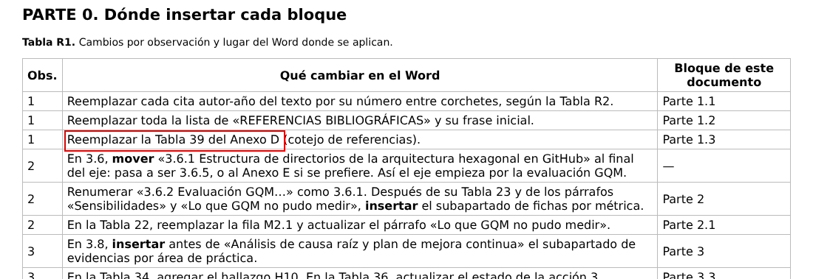
- **Corrección aplicada:** Se verificó cada referencia contra el informe y se sustituyó; el párrafo «Numeración» documenta la equivalencia. DOCX regenerado con `--solo-docx`.
- **Evidencia después:** 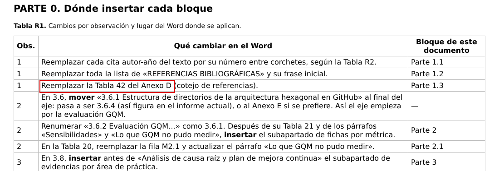
- **Estado:** Cerrado

### H-162 · alta · Correos personales en la exportación de SonarCloud
- **Archivo y ubicación:** `entregables/semana-12/sonarcloud/exportacion/sonarcloud_completo.json` y `sonarcloud_hallazgos.xlsx`; `sonarcloud/ANALISIS_SONARCLOUD.md` §8
- **Requisito afectado:** datos personales (hallazgo 2)
- **Descripción:** Las exportaciones incluían los correos personales de los autores de los commits (institucional, dos de Gmail y el de GitHub). Las líneas del JSON con esos correos eran 182, 42 y 34.
- **Evidencia antes:** 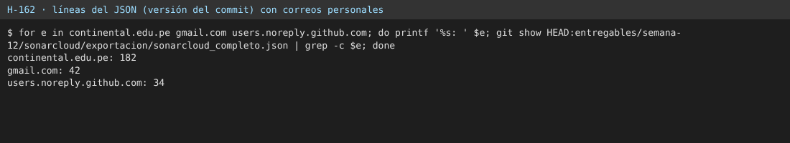
- **Corrección aplicada:** Sustitución por `[correo omitido]` en el JSON (sigue siendo JSON válido, mismo formato) y en el XML interno del XLSX (se abre con openpyxl, 10 hojas, 134 filas en «Hallazgos»); línea de anonimización en §8. Comprobado con `grep`: cero correos reales. Quedan `woshtsu-kFoGx@github` (login de SonarCloud, no es correo), `anonymous@sonar.com` y ejemplos de código (`n@app.route`, etc.). El HTML de la exportación no contenía correos personales. Los correos siguen en el historial de Git (reescribirlo es decisión del Leader).
- **Evidencia después:** 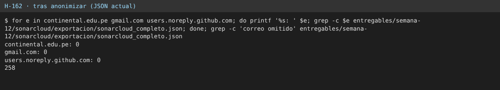
- **Estado:** Cerrado

### H-163 · alta · Correo institucional visible en PROD_05
- **Archivo y ubicación:** `entregables/semana-12/evidencias/produccion/PROD_05_auth_inicio_sesion.jpg` (Figura 113)
- **Requisito afectado:** datos personales (hallazgo 1)
- **Descripción:** El campo «Correo electrónico» mostraba la cuenta institucional con el código de un integrante.
- **Evidencia antes:** 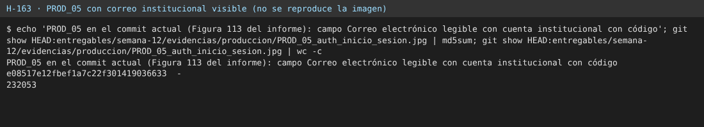
- **Corrección aplicada:** Zona del campo difuminada con Pillow, mismo nombre de archivo; comprobada visualmente (ilegible). El original queda en el historial de Git; retirarlo de allí es decisión del Leader.
- **Evidencia después:** 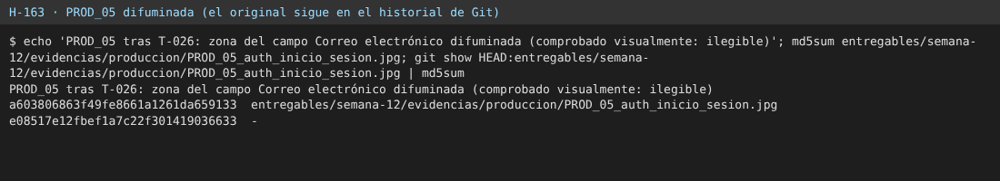
- **Estado:** Cerrado

### H-165 · alta · Anexo C contradice el video del repositorio
- **Archivo y ubicación:** `entregables/semana-12/Informe_Integrador_S12_Anemia_Junin.md` Anexo A y Anexo C (l.≈2329 y 2363); `video/README.md`
- **Requisito afectado:** R-34, R-37 (hallazgo 3)
- **Descripción:** El Anexo C decía «aplicación local… la producción no se usa» y «voz en off»; el video se grabó el 09/11/2026 sobre producción (GUION_LOCUCION l.3), dura 5:59 y no tiene audio. El README del video describía además una grabación local de 1280x720.
- **Evidencia antes:** 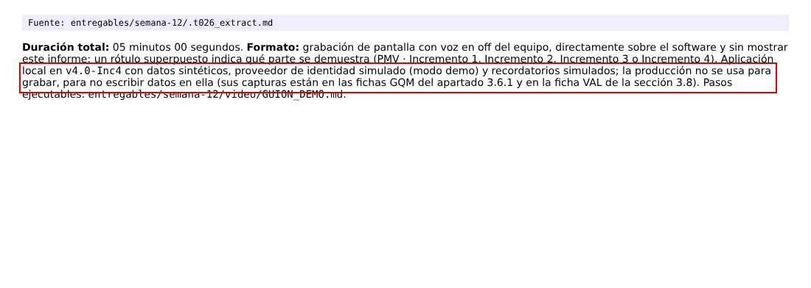
- **Corrección aplicada:** Anexo C y Anexo A reescritos con lo que muestra el video (producción, datos «DEMO», 5:59, sin audio, locución y recorte pendientes) y fila 4 de la Tabla 43 coherente; README del video corregido. Se aclara que DNI y tiempos de la Tabla 41 son los del guion local.
- **Evidencia después:** 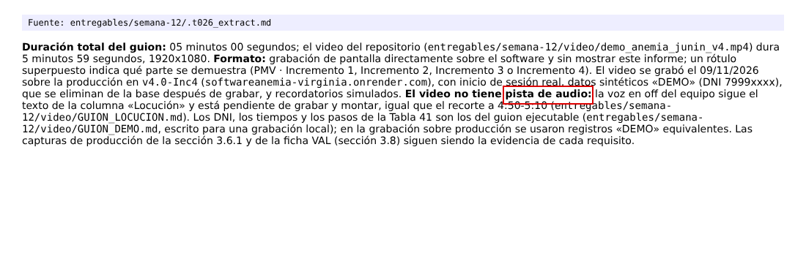
- **Estado:** Cerrado

### H-166 · alta · Video de 5:59, sin locución
- **Archivo y ubicación:** `entregables/semana-12/video/demo_anemia_junin_v4.mp4`
- **Requisito afectado:** R-35 y R-36 (hallazgos 4 y 5)
- **Descripción:** El archivo dura 359 s (guion: 5:00, margen 4:50-5:10) y no tiene pista de audio; la guía pide 5:00 con voz en off.
- **Evidencia antes:** 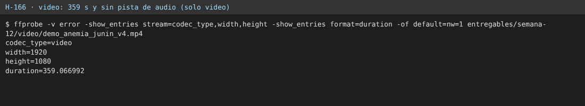
- **Corrección aplicada:** No se edita el video. Ahora el informe lo declara con honestidad (H-165).
- **Evidencia después:** — (pendiente)
- **Estado:** Pendiente justificado: el equipo debe recortar a 4:50-5:10, locutar con `GUION_LOCUCION.md` y subir la versión final a Drive (Anexo A); el docente decide si acepta el archivo actual.

### H-167 · alta · Tabla 43: «SonarCloud no ejecutado»
- **Archivo y ubicación:** `entregables/semana-12/Informe_Integrador_S12_Anemia_Junin.md` Tabla 43, fila 3
- **Requisito afectado:** coherencia interna (hallazgo 6)
- **Descripción:** La tabla contradecía los apartados 3.3, 3.8 y la Figura 112: el análisis es del 05/11/2026 y la versión del informe es del 06/11/2026 (PR #13 de Git); solo la versión inicial del 01/11 era anterior al análisis.
- **Evidencia antes:** 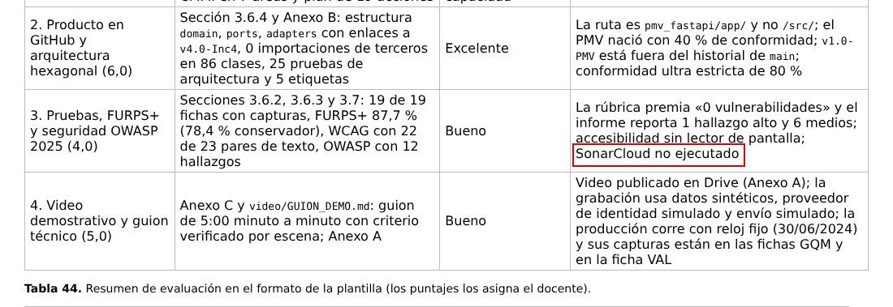
- **Corrección aplicada:** Sustituido por «SonarCloud ejecutado el 05/11/2026 (129 hallazgos, 0 en el backend desplegado), pero aún fuera del CI».
- **Evidencia después:** 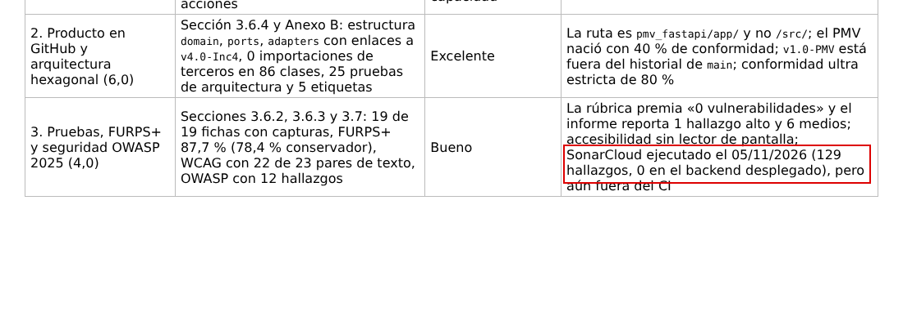
- **Estado:** Cerrado

### H-168 · media · Tabla 35 cuenta 9 hallazgos CAR; la Tabla 37 tiene 10
- **Archivo y ubicación:** `entregables/semana-12/Informe_Integrador_S12_Anemia_Junin.md` Tabla 35, fila CAR (l.≈1983)
- **Requisito afectado:** coherencia interna (hallazgo 11)
- **Descripción:** La Tabla 37 lista H1 a H10.
- **Evidencia antes:** 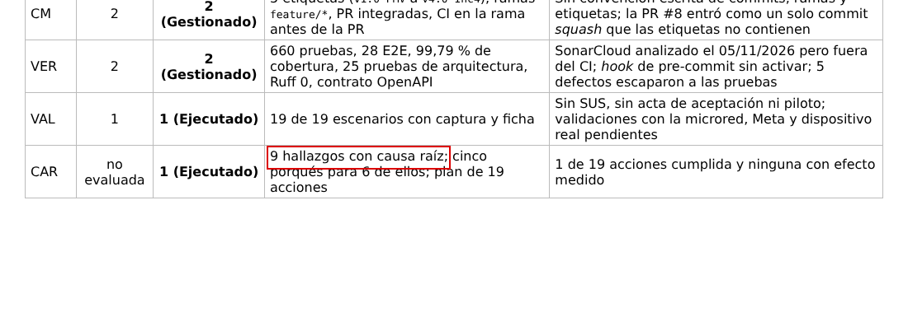
- **Corrección aplicada:** Corregido a «10 hallazgos con causa raíz (H1 a H10, Tabla 37)». «Cinco porqués para 6 de ellos» no es verificable: no se cambió.
- **Evidencia después:** 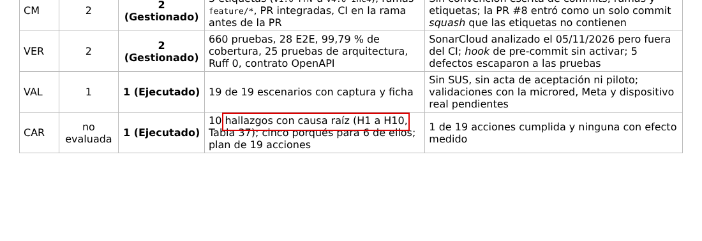
- **Estado:** Cerrado

### H-169 · media · Carátula sin fecha de entrega ni unidad del sílabo
- **Archivo y ubicación:** `entregables/semana-12/Informe_Integrador_S12_Anemia_Junin.md` carátula
- **Requisito afectado:** R-02 parcial y S-1 (hallazgos 7 y 8; D-03)
- **Descripción:** Faltaban la fecha de entrega y la unidad.
- **Evidencia antes:** 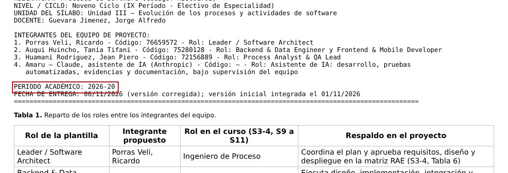
- **Corrección aplicada:** Añadidas «UNIDAD DEL SÍLABO: Unidad III — Evolución de los procesos y actividades de software» y «FECHA DE ENTREGA: 06/11/2026 (versión corregida); versión inicial integrada el 01/11/2026», con las fechas de las PR #10 y #13 de Git. El PDF muestra ambas líneas.
- **Evidencia después:** 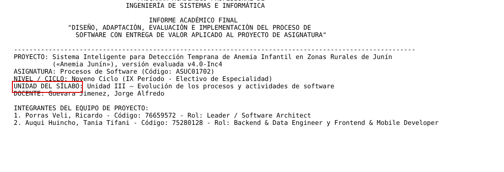 y 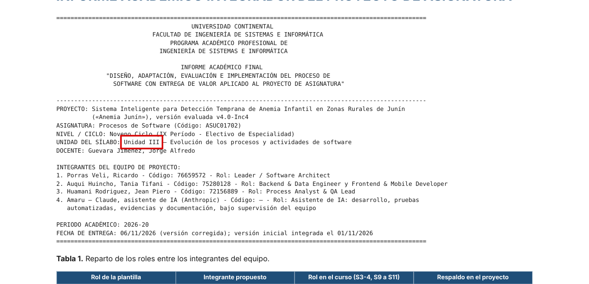
- **Estado:** Cerrado

### H-170 · media · Bloque / sección (NRC) ausente en la carátula
- **Archivo y ubicación:** `entregables/semana-12/Informe_Integrador_S12_Anemia_Junin.md` carátula
- **Requisito afectado:** R-02 (Guía l.17 y l.25)
- **Descripción:** El NRC no consta en el repositorio (solo un `[pendiente: código de sección / NRC]` en `.claude/archivo/semana-12/CAPTURAS_PENDIENTES.md`).
- **Evidencia antes:** 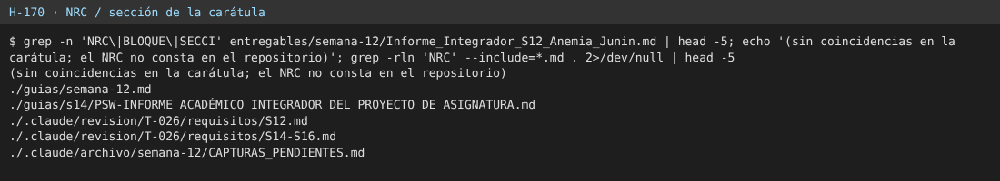
- **Corrección aplicada:** — (no se inventa)
- **Evidencia después:** — (pendiente)
- **Estado:** Pendiente justificado: el equipo debe indicar el bloque y la sección (NRC) y añadirlos a la carátula.

### H-171 · media · DoD (filas 6 a 8) y «0 vulnerabilidades» no cumplidos
- **Archivo y ubicación:** `entregables/semana-12/Informe_Integrador_S12_Anemia_Junin.md` Tabla 13 (l.≈516-518), Tabla 34 y Tabla 43
- **Requisito afectado:** R-15 y R-26
- **Descripción:** El informe ya lo declara («No cumple» en las filas 6 a 8; 12 hallazgos OWASP, 1 alto, en la Tabla 43), por lo que no hace falta añadir texto.
- **Evidencia antes:** 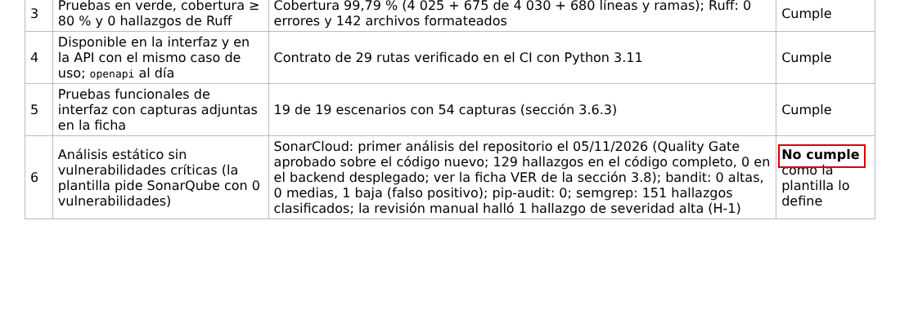
- **Corrección aplicada:** —
- **Evidencia después:** — (pendiente)
- **Estado:** Pendiente justificado: cumplirlo exige trabajo del equipo (corregir H-1 a H-12, revisión por pares con aprobación y actas de revisión del sprint); el docente decide la calificación.

### H-172 · baja · M2.1: «Inc. 3 e Inc. 4… 18 de 18» describía el acumulado
- **Archivo y ubicación:** `entregables/semana-12/Informe_Integrador_S12_Anemia_Junin.md` l.≈693
- **Requisito afectado:** coherencia interna (hallazgo 15)
- **Descripción:** La Tabla 20 da 5, 9, 14 y 18 (acumulado).
- **Evidencia antes:** 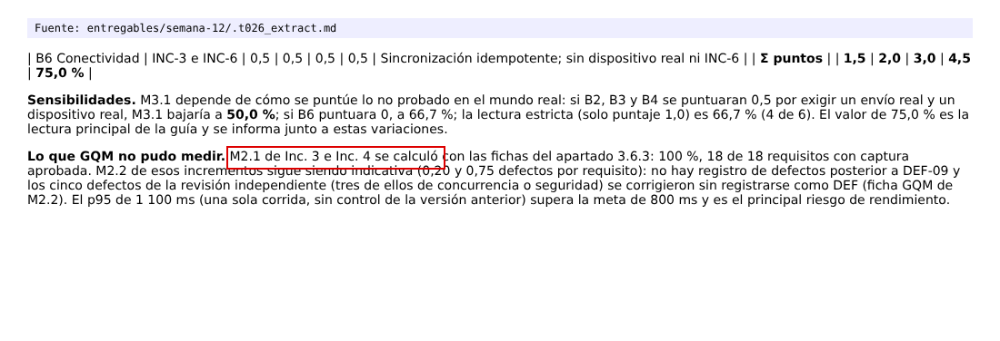
- **Corrección aplicada:** Redactado: «100 % en cada uno (5 de 5 y 4 de 4); el acumulado de Inc. 1 a 4 es 18 de 18».
- **Evidencia después:** 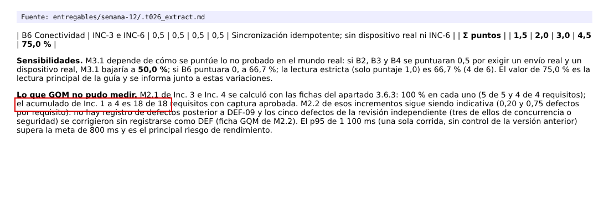
- **Estado:** Cerrado

### H-173 · baja · V5: 64/64 sondas frente a 332 sondeos
- **Archivo y ubicación:** `entregables/semana-12/Informe_Integrador_S12_Anemia_Junin.md` l.≈427/673/718 y 1862
- **Requisito afectado:** D-10 (hallazgo 17)
- **Descripción:** Dos cifras de disponibilidad para la misma meta, sin aclarar si son corridas distintas.
- **Evidencia antes:** 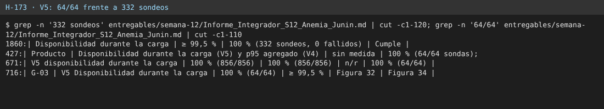
- **Corrección aplicada:** — (no verificable sin los datos de cada corrida)
- **Evidencia después:** — (pendiente)
- **Estado:** Pendiente justificado: el equipo (Huamani R.) debe aclarar si 332 sondeos es la corrida de S10 y 64 la de la adenda v4.

### Candidatos descartados
| Candidato (archivo:línea) | Motivo |
|---|---|
| Hallazgo 14, DNI visible a los 60 s del video | Fotograma extraído con ffmpeg: DNI 79991588, expediente «DEMO Lucía Prueba Quispe». Empieza por 7999: dato sintético DEMO (tablero T-022). No es dato personal. |
| Hallazgo 13, códigos de estudiante en carátula y Tabla 1 (Informe:l.20-41) | D-02: los códigos se mantienen; la plantilla pide código por integrante. |
| Hallazgo 12, capturas RF-05 y RF-06 de S9 (Informe:l.1206-1243) | El pie de la Figura 46 ya indica la versión de origen; limitación declarada, juicio del equipo. |
| Hallazgo 16, «19 de 19» frente a «20 fichas» (Informe:l.499, 515, 821) | La tabla 23 (l.821) explica «19 fichas de requisitos y 1 de autenticación»; «19 de 19» se refiere a escenarios de aceptación. |
| Hallazgo 18, WCAG 2.5.8 (Informe:l.1839) | La fila ya dice «WCAG 2.2, 24 px». |
| Hallazgo 19, conteo 1/4/14 de 19 acciones (Informe:l.2255) | La Tabla 39 declara «19 acciones en total» y muestra las de mayor efecto; no es contradicción. |
| R-19, R-22, R-24 (Parcial) | Equivalencias y limitaciones declaradas en el informe; juicio del equipo, no corregible con el repositorio. |

### Nota para el coordinador
- Los correos personales siguen en el historial de Git (JSON, XLSX y PROD_05 originales): reescribir el historial es decisión del Leader.
- `video/GUION_DEMO.md` l.3 aún dice «sin tocar producción» (guion para grabación local); no se tocó. El video está en Git (`.gitignore` del directorio no lo excluye).
- Las capturas md de documentos largos fallan con `capturar.py md` sobre el informe completo (se usaron extractos temporales).
