## S13

### H-180 · alta · Lab «reglas requeridas por la guía» con un ruleset sin checks obligatorios
- **Archivo y ubicación:** `entregables/semana-13/laboratorio-scm/Informe_SCM_Lab13.html` §4.1
- **Requisito afectado:** R-L09 (guía Paso 2.1, punto 3)
- **Descripción:** El texto decía que el ruleset `ownermerge` tenía «las reglas requeridas por la guía», pero `cli_a2_ruleset` solo lista `deletion`, `non_fast_forward` y `pull_request`; falta `required_status_checks`.
- **Evidencia antes:** 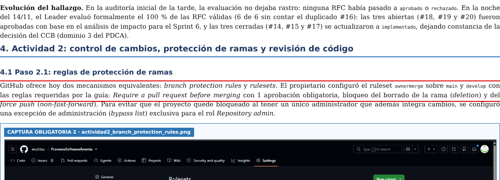
- **Corrección aplicada:** Se reescribió la frase («parte de las reglas del Paso 2.1») y se declaró la desviación y que el CI aún no bloquea la fusión. Añadir la regla en GitHub se registra en H-181. Lab regenerado (PDF).
- **Evidencia después:** 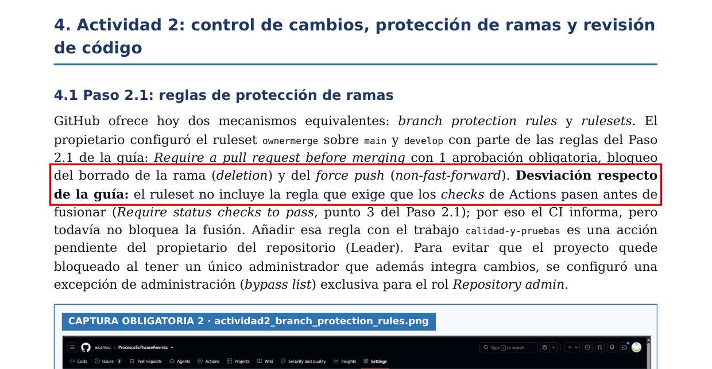
- **Estado:** Cerrado

### H-181 · alta · Falta la regla Require status checks en el ruleset de GitHub
- **Archivo y ubicación:** GitHub (Settings → Rulesets); `salidas_cli.json` cli_a2_ruleset
- **Requisito afectado:** R-L09, R-L23 (guía Paso 2.1 punto 3; Eje 3-4)
- **Descripción:** El ruleset no exige que `calidad-y-pruebas` pase antes de fusionar; las PR #6, #7 y #13 se integraron con CI o SonarCloud en rojo.
- **Evidencia antes:** 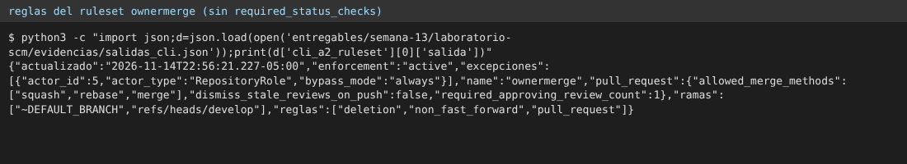
- **Corrección aplicada:** — (el texto ya declara la desviación, H-180).
- **Evidencia después:** — (pendiente)
- **Estado:** Pendiente justificado: decide y ejecuta el Leader (propietario del repositorio): añadir la regla de status checks al ruleset `ownermerge`, capturarla y actualizar la Figura 8. No es un cambio de documentos.

### H-182 · alta · Tabla 5: PR #8 con «revisión independiente documentada» frente a la auditoría
- **Archivo y ubicación:** `entregables/semana-13/laboratorio-scm/Informe_SCM_Lab13.html` §8, Tabla 5
- **Requisito afectado:** coherencia interna (JSON cli_a2_auditoria_pr)
- **Descripción:** La Tabla 5 decía «revisión independiente documentada», pero la auditoría da `REVIEW_REQUIRED` para la PR #8 y el informe integrador dice que se integró sin revisión «Approved».
- **Evidencia antes:** 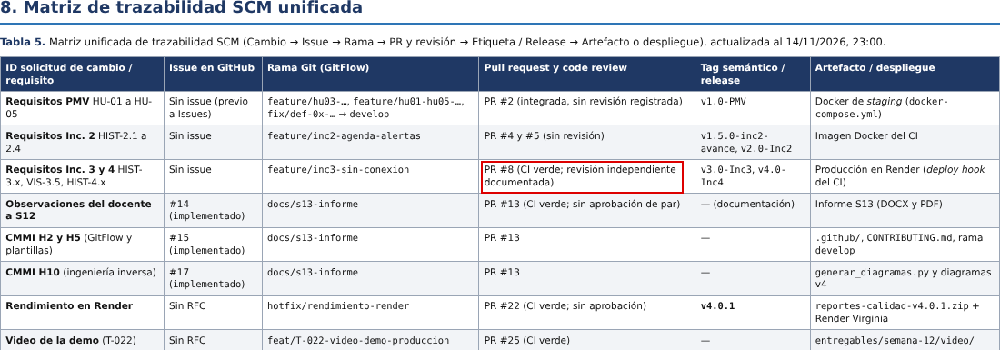
- **Corrección aplicada:** Se cambió a «sin aprobación de par: REVIEW_REQUIRED». Lab regenerado.
- **Evidencia después:** 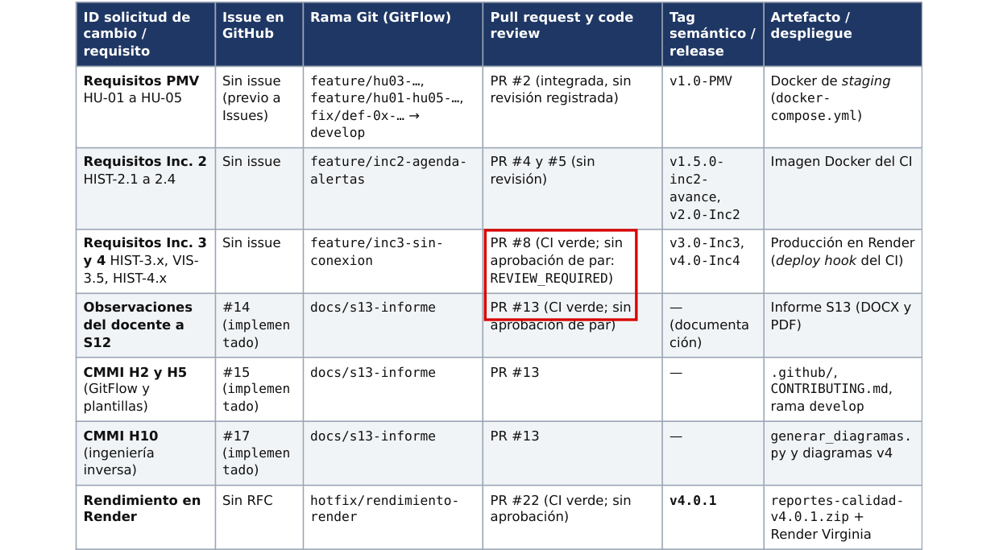
- **Estado:** Cerrado

### H-183 · media · Informe S13: «Unidad III» en la portada
- **Archivo y ubicación:** `entregables/semana-13/Informe_Integrador_S13_Anemia_Junin.md` L13
- **Requisito afectado:** D-03 / sílabo (semana 13 = Unidad IV)
- **Descripción:** El sílabo resumido ubica la semana 13 en la Unidad IV (evaluación presencial U4, sem. 13-15) y la guía del laboratorio es «Unidad IV»; las lecturas S13 son de U3, pero el informe entrega el trabajo de SCM y PDCA.
- **Evidencia antes:** 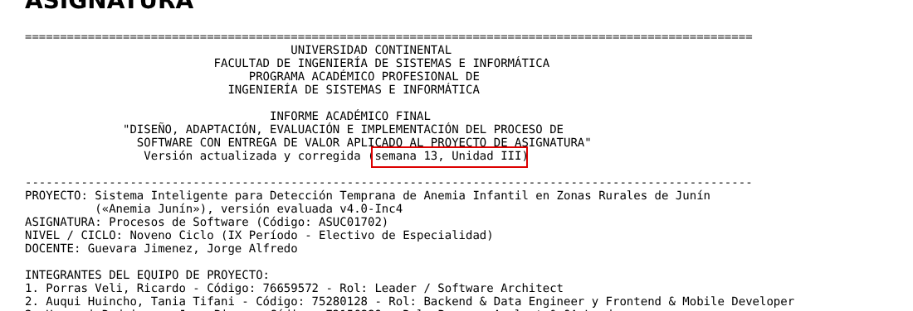
- **Corrección aplicada:** Se cambió a «Unidad IV» en md, DOCX y PDF y se añadió la fila 9 al control de cambios (D-08).
- **Evidencia después:** 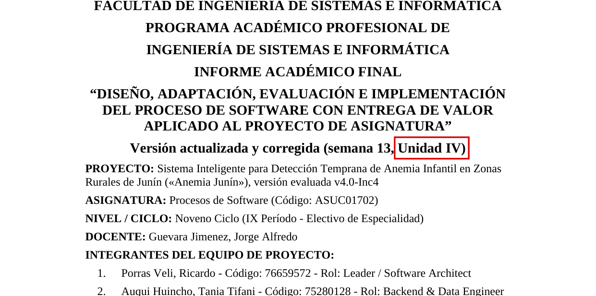
- **Estado:** Cerrado

### H-184 · media · Informe S13: SonarCloud «fuera del CI» / «aún no se ejecuta desde el CI»
- **Archivo y ubicación:** `entregables/semana-13/Informe_Integrador_S13_Anemia_Junin.md` §3.8 (Tablas de backlog técnico, ficha VER, plan de mejora y autoevaluación)
- **Requisito afectado:** coherencia con `.github/workflows/ci.yml`
- **Descripción:** `git log -S SONAR -- .github/workflows/ci.yml` muestra que el paso «Análisis SonarCloud» entró el 30/10/2026 (5f4c255), anterior al 13/11; estaba condicionado a `SONAR_TOKEN`. El análisis del 05/11 fue el automático de SonarCloud (`ANALISIS_SONARCLOUD.md`: «no recibe coverage.xml»). Decir «fuera del CI» era inexacto; también «SonarCloud no ejecutado» en la autoevaluación.
- **Evidencia antes:** 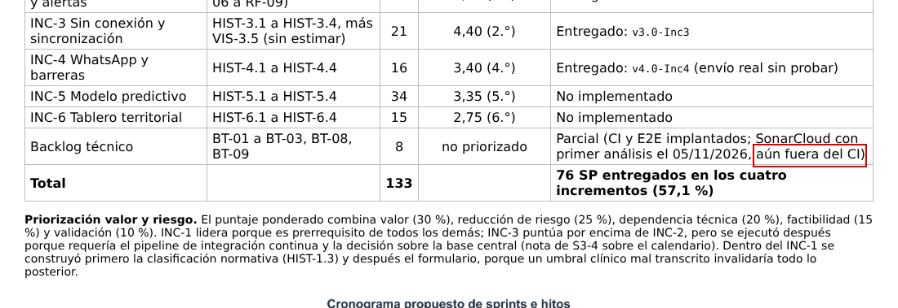
- **Corrección aplicada:** Se reemplazó por: análisis automático el 05/11, el paso existe en ci.yml desde el 30/10 condicionado a SONAR_TOKEN, sin ejecución comprobada en el informe. 7 frases en md y DOCX; PDF regenerado con LibreOffice; fila 10 en el control de cambios.
- **Evidencia después:** 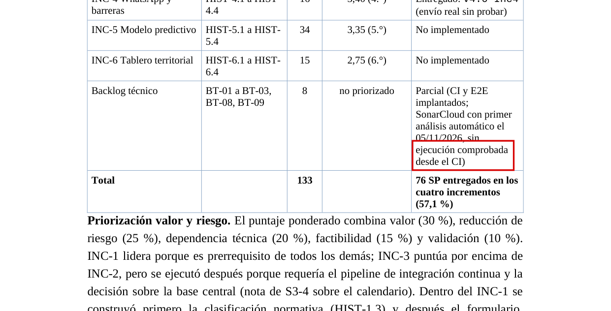
- **Estado:** Cerrado

### H-185 · media · PDCA dominio 9: «dependencias Node.js a versión 24»
- **Archivo y ubicación:** `entregables/semana-13/pdca/PDCA_gestion_configuracion.html` dom. 9, columna DO
- **Requisito afectado:** coherencia (el proyecto usa Python)
- **Descripción:** El CI no usa Node.js; Node 24 es el runtime forzado de GitHub Actions (aviso en `cli_a4_jobs`).
- **Evidencia antes:** 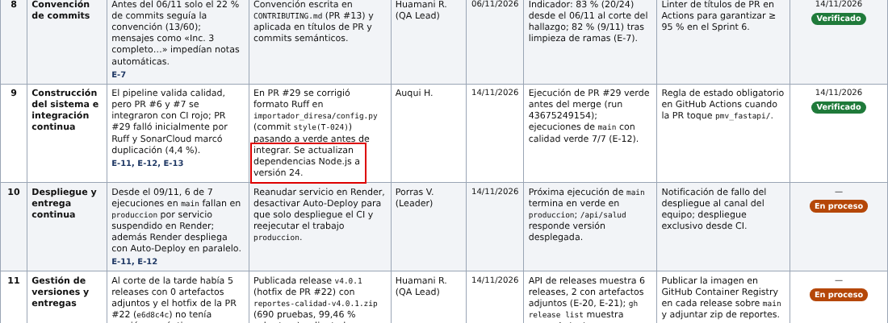
- **Corrección aplicada:** Se sustituyó por una aclaración: los avisos «Node.js 20 está obsoleto» se refieren al entorno de GitHub Actions, no al proyecto. PDF regenerado.
- **Evidencia después:** 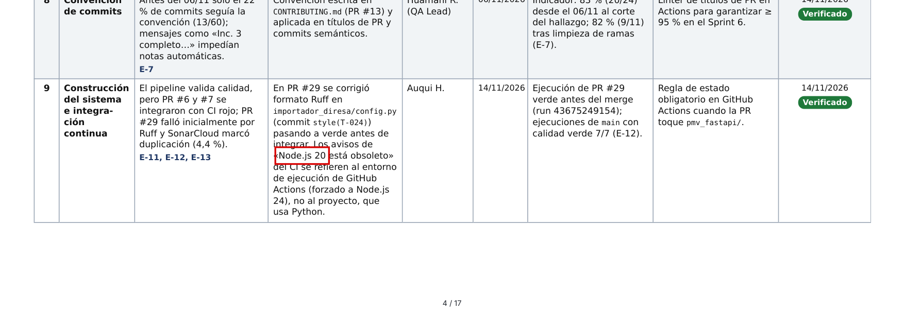
- **Estado:** Cerrado

### H-186 · media · Indicador de commits: la columna «noche» usa los valores de la tarde
- **Archivo y ubicación:** `entregables/semana-13/laboratorio-scm/Informe_SCM_Lab13.html` §9 Tabla 6; `entregables/semana-13/pdca/PDCA_gestion_configuracion.html` §1 tabla y nota
- **Requisito afectado:** coherencia con `salidas_cli.json`
- **Descripción:** La columna «Al 14/11 (noche)» daba 20/24 y la nota de PDCA afirmaba que todo se reproduce con `salidas_cli.json`, que da 9/11 (82 %) y 13/53 (25 %); 20/24 y 13/60 solo están en `antes_2026-11-14_tarde/salidas_cli.json`. (Solo se tocó la fila de commits de la Tabla 6; no la de revisión por pares.)
- **Evidencia antes:** 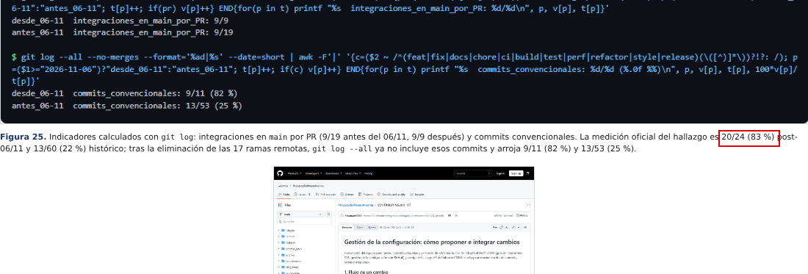
- **Corrección aplicada:** Columna de la noche = 9/11 (82 %); notas reescritas (la tarde da 20/24 y 13/60; tras borrar 17 ramas, 9/11 y 13/53); PDCA cita cada JSON para su corte. PDF de ambos regenerados.
- **Evidencia después:** 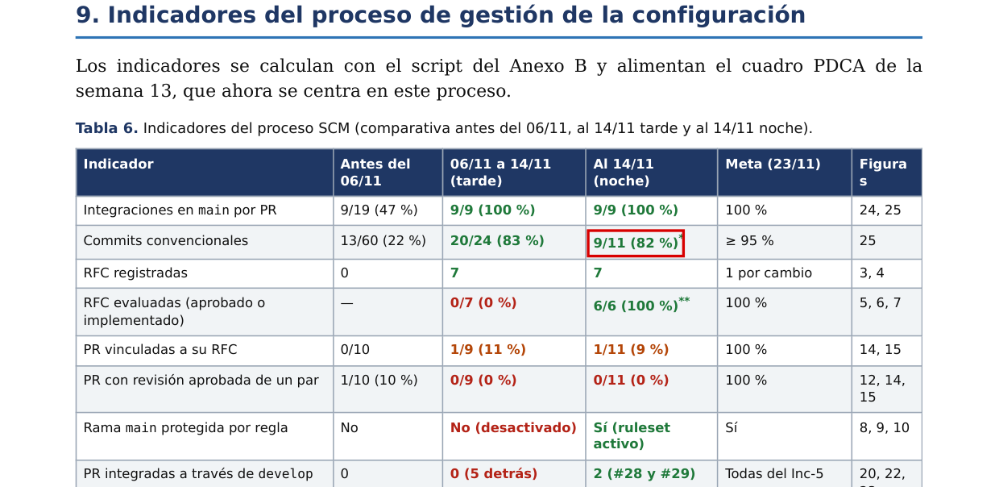
- **Estado:** Cerrado

### H-187 · media · Cobertura de v4.0-Inc4: 99,88 % frente a 99,79 %
- **Archivo y ubicación:** `entregables/semana-13/laboratorio-scm/Informe_SCM_Lab13.html` §7 Tabla 4; `entregables/semana-13/pdca/PDCA_gestion_configuracion.html` dom. 11
- **Requisito afectado:** coherencia con el informe y con S10
- **Descripción:** `entregables/semana-10/metricas/salidas/R01_pytest_cobertura.txt`: 4 025/4 030 líneas = 99,88 %; el total con ramas que reporta pytest es 99,79 %. El informe usa 99,79 %.
- **Evidencia antes:** 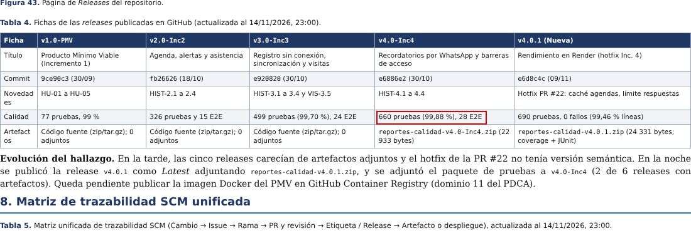
- **Corrección aplicada:** Se declaró la métrica: «99,88 % de líneas; 99,79 % con ramas» en ambos documentos. PDF regenerados. (El zip `reportes-calidad-v4.0-Inc4.zip` no está en el repositorio.)
- **Evidencia después:** 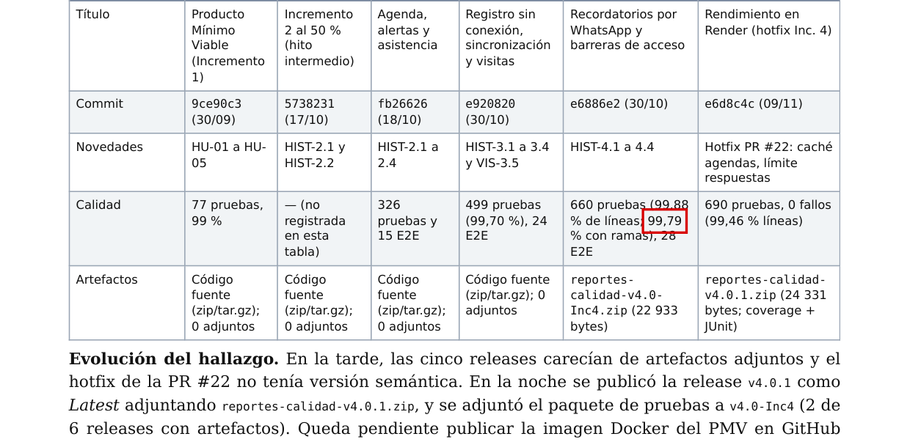
- **Estado:** Cerrado

### H-188 · media · RFC #14, #15 y #17: evaluación presentada como formal sin precisar que fue retroactiva
- **Archivo y ubicación:** `entregables/semana-13/laboratorio-scm/Informe_SCM_Lab13.html` §3 «Evolución del hallazgo»
- **Requisito afectado:** R-L07; coherencia con PDCA dom. 3
- **Descripción:** Las tres RFC se cerraron con la PR #13 (06/11) sin aprobación registrada y se etiquetaron `implementado` el 14/11 (`cli_m_rfc_evaluadas`).
- **Evidencia antes:** 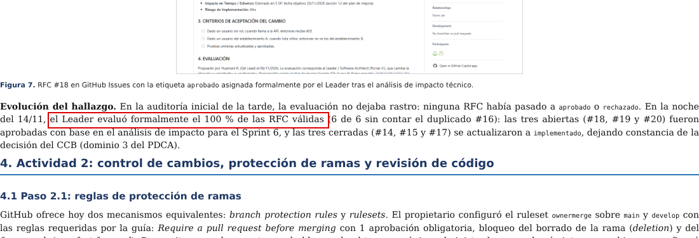
- **Corrección aplicada:** Texto precisado: #18 a #20 aprobadas el 14/11; #14, #15 y #17 evaluadas de forma retroactiva con etiqueta del 14/11. PDF regenerado.
- **Evidencia después:** 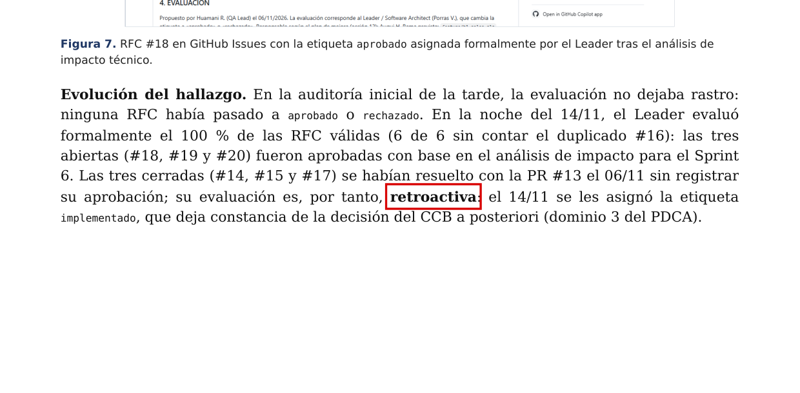
- **Estado:** Cerrado

### H-189 · media · Tabla 4: 5 fichas frente a 6 releases
- **Archivo y ubicación:** `entregables/semana-13/laboratorio-scm/Informe_SCM_Lab13.html` §7 Tabla 4
- **Requisito afectado:** R-L20; coherencia con la cifra de 6
- **Descripción:** Faltaba la ficha del pre-release `v1.5.0-inc2-avance` (JSON cli_a5_releases; commit 5738231, 17/10).
- **Evidencia antes:** 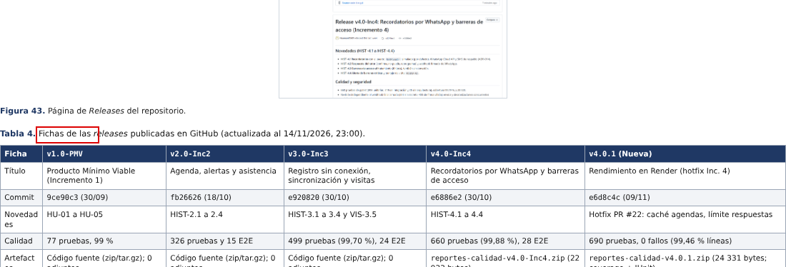
- **Corrección aplicada:** Se añadió la columna con título, commit, novedades (HIST-2.1 y 2.2, de la descripción de la etiqueta), 0 adjuntos; la calidad se marca «no registrada» por no existir dato en el repositorio. PDF regenerado.
- **Evidencia después:** 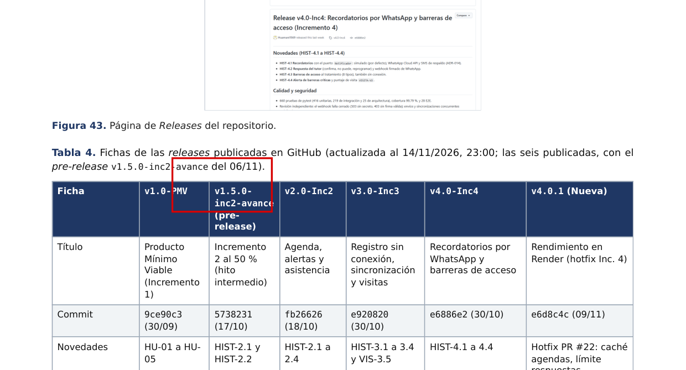
- **Estado:** Cerrado

### H-190 · media · Ramas `release/*` afirmadas en el informe y sin desviación declarada en el laboratorio
- **Archivo y ubicación:** `entregables/semana-13/laboratorio-scm/Informe_SCM_Lab13.html` §5.3; `entregables/semana-13/Informe_Integrador_S13_Anemia_Junin.md` L2248
- **Requisito afectado:** R-L15, R-L16 (guía Eje 2)
- **Descripción:** No existe ni existió ninguna rama `release/*` (`git ls-remote`, listado previo a la limpieza, historial); `main` recibió ramas feature/docs/hotfix/chore. El informe decía «Las ramas siguen GitFlow (… `release/*` …)».
- **Evidencia antes:** 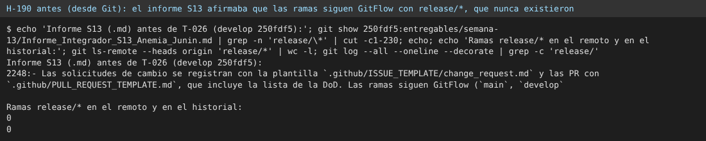 (reconstruida por el coordinador desde Git: el corrector no llegó a tomarla antes de editar)
- **Corrección aplicada:** Lab: párrafo «Desviación declarada». Informe: «siguen la convención GitFlow (…; hasta el 13/11 no se creó ninguna rama release/*)» en md y DOCX; PDF regenerado; fila 11 del control de cambios. Los requisitos R-L15/R-L16 siguen sin cumplirse (desviación declarada).
- **Evidencia después:** 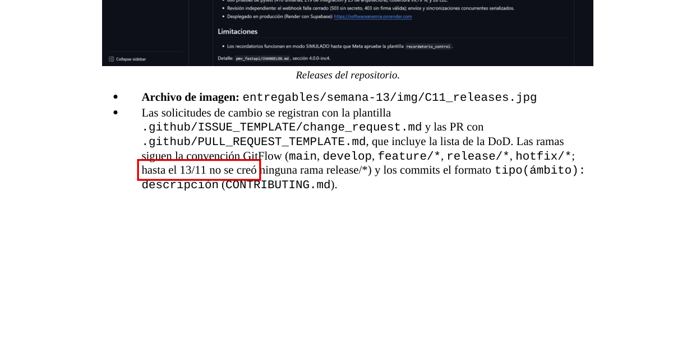
- **Estado:** Cerrado

### H-191 · baja · PDCA dom. 4: «1 de 21 PR» en el diagnóstico de la tarde
- **Archivo y ubicación:** `entregables/semana-13/pdca/PDCA_gestion_configuracion.html` dom. 4
- **Requisito afectado:** coherencia (E-3, Fig. 14)
- **Descripción:** La auditoría de la tarde cuenta 19 PR; 21 es el total de la noche.
- **Evidencia antes:** 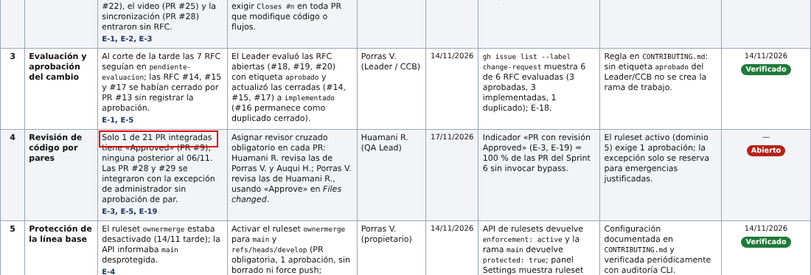
- **Corrección aplicada:** «1 de 19 PR integradas al corte de la tarde … (en la auditoría de la noche, 1 de 21)». No se tocó el resto del dominio 4. PDF regenerado.
- **Evidencia después:** 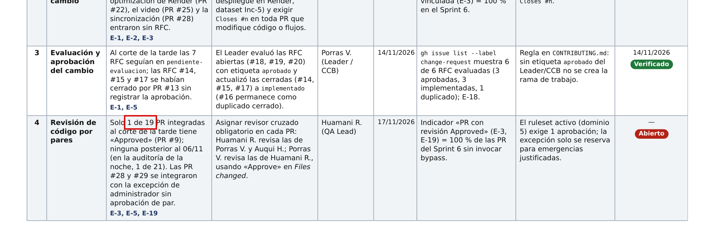
- **Estado:** Cerrado

### H-192 · baja · Anexo B: «20 páginas» y «14 grupos» del script
- **Archivo y ubicación:** `entregables/semana-13/laboratorio-scm/Informe_SCM_Lab13.html` Anexo B
- **Requisito afectado:** coherencia con `capturar_evidencias_scm.py`
- **Descripción:** El script define 26 páginas web (lista `WEB`) y 17 grupos CLI (lista `CLI`, 17 claves del JSON). La captura 27 (`web_a2_settings_rulesets.png`) es manual del propietario.
- **Evidencia antes:** 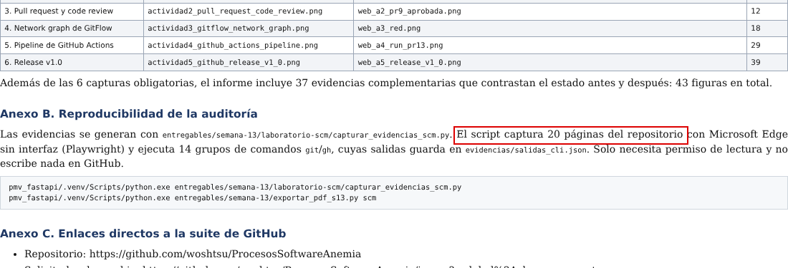
- **Corrección aplicada:** Texto: 26 páginas, 17 grupos y aclaración de la captura manual. No se ejecutó el script. PDF regenerado.
- **Evidencia después:** 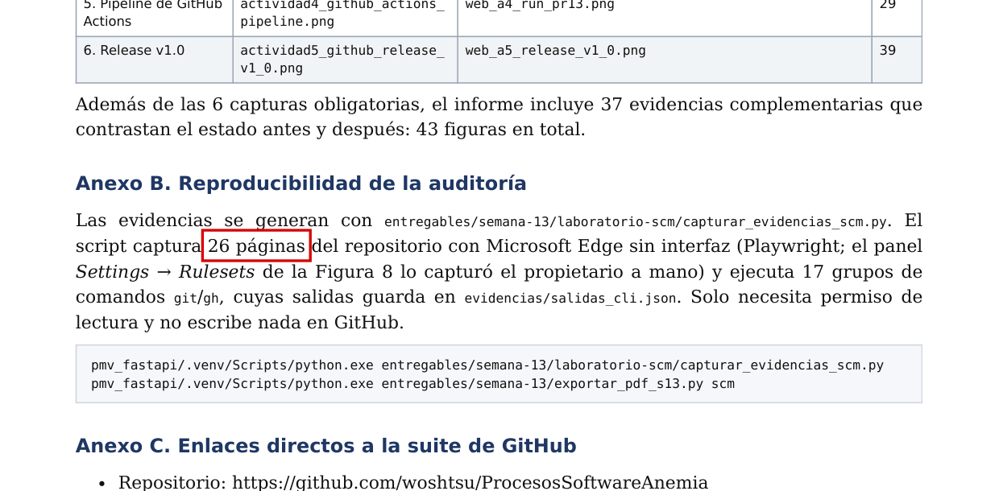
- **Estado:** Cerrado

### H-193 · baja · Tabla 3: filtro `paths` de `ci.yml` no declarado
- **Archivo y ubicación:** `entregables/semana-13/laboratorio-scm/Informe_SCM_Lab13.html` §6 Tabla 3
- **Requisito afectado:** R-L21
- **Descripción:** `ci.yml` L6 y L9 filtran por `pmv_fastapi/**` y `ci.yml` (en `push` y `pull_request`).
- **Evidencia antes:** 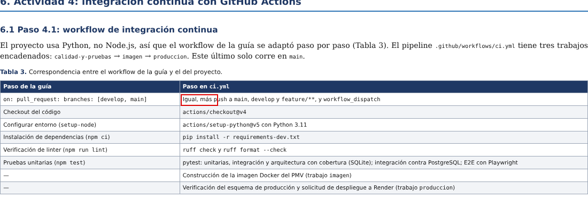
- **Corrección aplicada:** Se declaró el filtro en la fila de disparadores. PDF regenerado.
- **Evidencia después:** 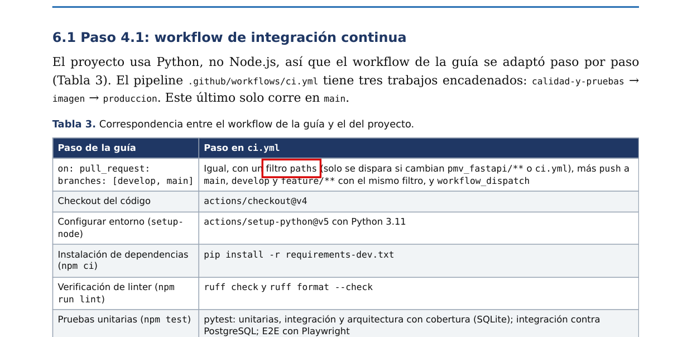
- **Estado:** Cerrado

### H-194 · media · Autoevaluación: criterio 4 «Excelente» con 1 de 11 PR vinculadas
- **Archivo y ubicación:** `entregables/semana-13/laboratorio-scm/Informe_SCM_Lab13.html` §10 (criterio 4)
- **Requisito afectado:** R-L29 (guía §6)
- **Descripción:** La evidencia (1/11 PR vinculadas, 7 de 14 filas de la matriz sin Issue o RFC) no sostiene «Excelente».
- **Evidencia antes:** 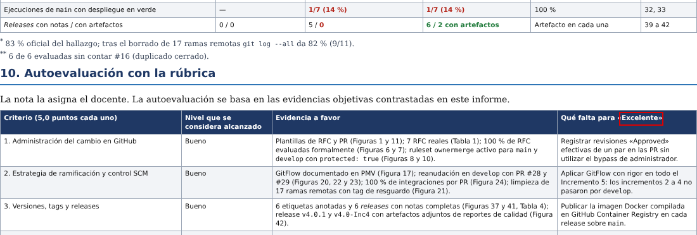
- **Corrección aplicada:** —
- **Evidencia después:** — (pendiente)
- **Estado:** Pendiente justificado: decide el equipo (Huamani R. y Porras V.); la autoevaluación es de la rúbrica y no se cambia en esta revisión. Se sugiere «Bueno» o justificar.

### H-195 · media · v1.0-PMV y otras releases sin archivos adjuntos
- **Archivo y ubicación:** `entregables/semana-13/laboratorio-scm/Informe_SCM_Lab13.html` Fig. 39, Tabla 4
- **Requisito afectado:** R-L19 (guía Paso 5.2 / Captura 6)
- **Descripción:** `cli_a5_releases`: `v1.0-PMV`, `v1.5.0-inc2-avance`, `v2.0-Inc2` y `v3.0-Inc3` con 0 adjuntos; la guía pide compilados o imagen Docker. El texto ya lo declara (Tabla 4 y «Evolución del hallazgo»), no hay afirmación falsa.
- **Evidencia antes:** 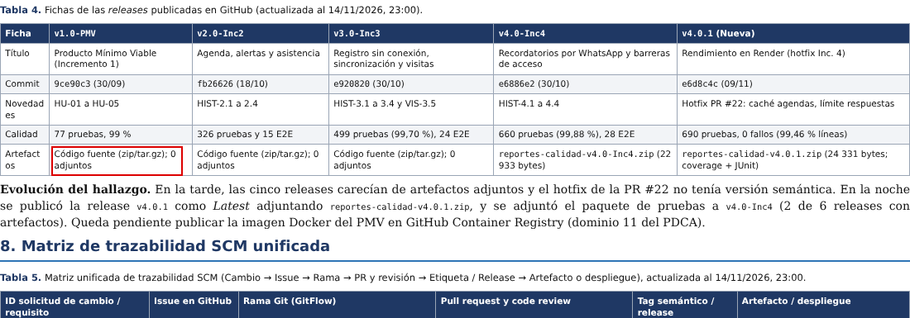
- **Corrección aplicada:** —
- **Evidencia después:** — (pendiente)
- **Estado:** Pendiente justificado: Leader/QA Lead: adjuntar un paquete o imagen Docker a las releases (o la imagen en GHCR); acción ya prevista en el dominio 11 del PDCA.

### H-196 · media · Captura obligatoria 3: ninguna PR reúne aprobación, checks y vínculo a Issue
- **Archivo y ubicación:** `entregables/semana-13/laboratorio-scm/Informe_SCM_Lab13.html` §4.3 (Figs. 12 y 13)
- **Requisito afectado:** R-L11 (guía Captura 3)
- **Descripción:** La PR #9 tiene aprobación y checks sin vínculo; la #13 tiene vínculo sin aprobación (`cli_a2_auditoria_pr`).
- **Evidencia antes:** 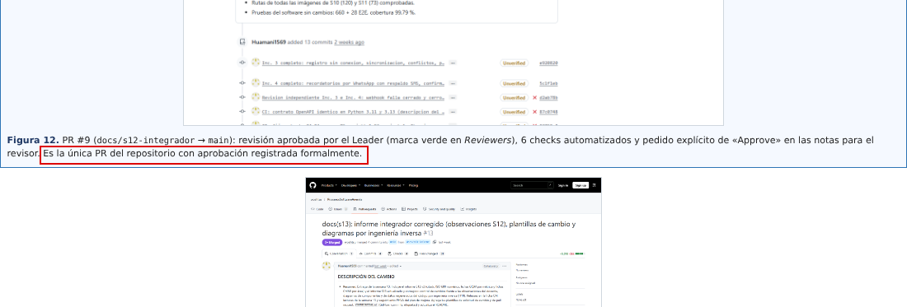
- **Corrección aplicada:** — (la sección 4.3 se excluye de esta revisión por indicación del coordinador).
- **Evidencia después:** — (pendiente)
- **Estado:** Pendiente justificado: se resuelve en el Paso final (primera PR con `Closes #n` y aprobación de par); decide el Leader.

### H-197 · baja · SemVer sin parche y etiquetas no firmadas, sin declarar
- **Archivo y ubicación:** `entregables/semana-13/laboratorio-scm/Informe_SCM_Lab13.html` §7.1
- **Requisito afectado:** R-L17, R-L18 (guía Paso 5.1)
- **Descripción:** `v1.0-PMV`, `v2.0-Inc2`, `v3.0-Inc3` y `v4.0-Inc4` no llevan PATCH; ninguna etiqueta tiene firma PGP (`git cat-file -p`), son anotadas.
- **Evidencia antes:** 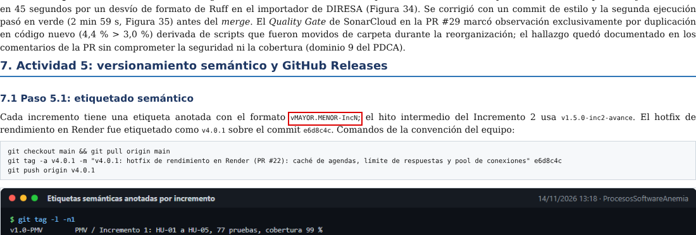
- **Corrección aplicada:** Se añadió la desviación respecto de `vMAJOR.MINOR.PATCH` y que las etiquetas son anotadas, no firmadas con GPG. PDF regenerado.
- **Evidencia después:** 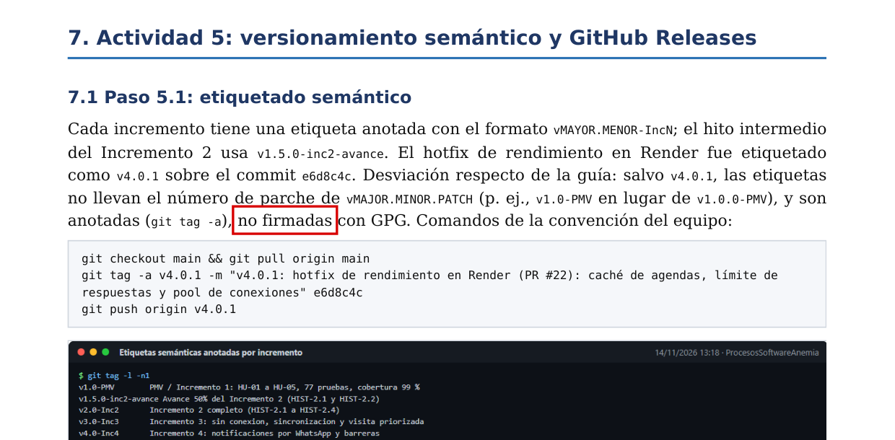
- **Estado:** Cerrado

### H-198 · baja · PDCA: escala de seguimiento con descripciones distintas a las de la guía, sin declararlo
- **Archivo y ubicación:** `entregables/semana-13/pdca/PDCA_gestion_configuracion.html` §4
- **Requisito afectado:** R-P16
- **Descripción:** Las descripciones añaden condiciones (p. ej., «Cerrado» exige regla o flujo automático).
- **Evidencia antes:** 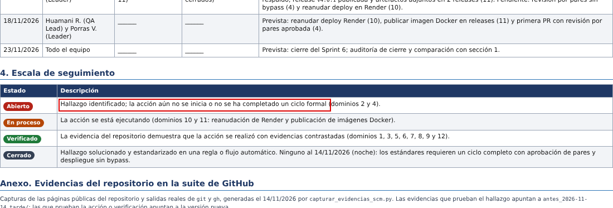
- **Corrección aplicada:** Nota «Adaptación declarada» bajo la tabla. PDF regenerado.
- **Evidencia después:** 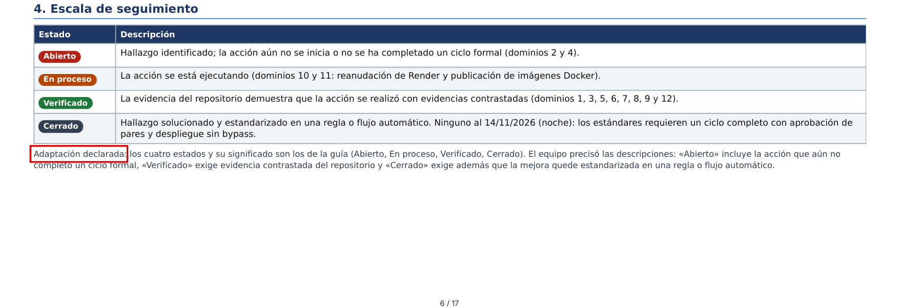
- **Estado:** Cerrado

### H-199 · baja · `ci.yml`: `pytest --cov` sin `--cov-fail-under=80`
- **Archivo y ubicación:** .github/workflows/ci.yml L55
- **Requisito afectado:** R-L24 (DoD cobertura ≥ 80 %), R-L23
- **Descripción:** El CI no falla por debajo del 80 % (el umbral se comprueba a mano en la DoD).
- **Evidencia antes:** 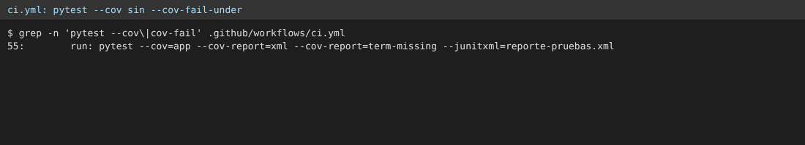
- **Corrección aplicada:** —
- **Evidencia después:** — (pendiente)
- **Estado:** Pendiente justificado: `.github/` está fuera del alcance de esta revisión; decide el Leader añadir `--cov-fail-under=80`.

### H-200 · baja · Gráfico de red sin ramas `feature/*`
- **Archivo y ubicación:** `entregables/semana-13/laboratorio-scm/Informe_SCM_Lab13.html` §5.2 Fig. 18
- **Requisito afectado:** R-L14 (guía Captura 4)
- **Descripción:** `web_a3_red.png` muestra `docs/*`, `fix/*` y `chore/*`; las ramas feature están borradas. La nota técnica de la Fig. 18 ya lo explica.
- **Evidencia antes:** 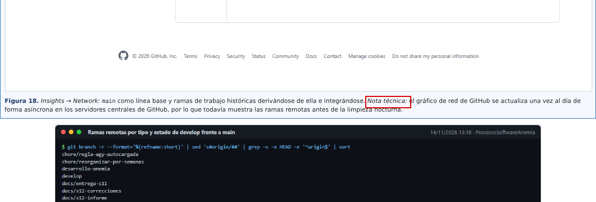
- **Corrección aplicada:** —
- **Evidencia después:** — (pendiente)
- **Estado:** Pendiente justificado: requiere nuevas ramas `feature/*` (Incremento 5) y una captura posterior; decide el equipo.

### Candidatos descartados
| Candidato (archivo:línea) | Motivo |
| --- | --- |
| A1: PDCA §2, 12 dominios de la guía sustituidos por dominios SCM (R-P01 a R-P12) | D-05: la sustitución la pidió el docente (T-025). |
| A3: Informe L2023, «protección de `main` no verificable»; sin `v4.0.1`, ruleset, PR #28 y #29 | D-01: instantánea del 13/11; el ruleset se activó el 14/11 y la PR #28 y #29 son posteriores. |
| M1 (parte): informe L17 «versión evaluada v4.0-Inc4» | D-01: era la versión del 13/11; `v4.0.1` es del 14/11. (La parte «Unidad III» es H-183.) |
| M6: laboratorio L166 frente a informe L2434 (PR #2 y `v1.0-PMV`) | Verificado: `9ce90c3` no es ancestro de `origin/main` y la PR #2 entró como un solo commit (`0c9e302`, *squash*); ambos textos son ciertos. |
| M8 (parte): informe «cinco etiquetas» / «5 releases» (L274, L2243, L2419) | D-01: el 13/11 eran 5 etiquetas y 5 releases (`antes_2026-11-14_tarde/salidas_cli.json`); la sexta es del 14/11. |
| M13: códigos de estudiante (Lab L57, Informe L23-25) | D-02. |
| B5: repositorio en la cuenta personal `woshtsu` | La guía pide «repositorio institucional» sin precisar tipo de cuenta; es juicio del docente. |
| R-P10 (README y documentación sin dominio propio en el PDCA) y R-P02 a R-P09, R-P11, R-P12 | D-05 (dominios SCM aceptados por el docente). |
| R-L12 y dominio 4 / indicador «PR con revisión aprobada» / sección 4.3 / sección 9 (fila de revisión) / criterio 1 / conclusión de revisión por pares | D-06: se actualizan en el Paso final tras aprobar la PR. |

**Nota para el coordinador.** (1) `ci.yml` sin `--cov-fail-under` y sin status checks obligatorios en el ruleset: H-199 y H-181, pendientes del Leader. (2) Se regeneraron los PDF de PDCA y laboratorio (páginas: PDCA 16 a 17; laboratorio 34 a 37, por la nueva columna de la Tabla 4 y los párrafos de desviación) y el DOCX/PDF del informe S13 (168 páginas, LibreOffice 24.2). (3) La fila de commits de la Tabla 6 (sección 9) se corrigió porque era una cifra, no la revisión por pares; las filas de revisión de pares no se tocaron. (4) Las rutas de `capturar_evidencias_scm.py` no se ejecutaron.
