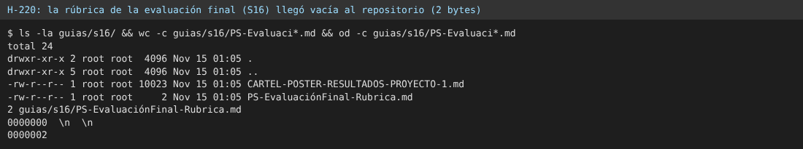
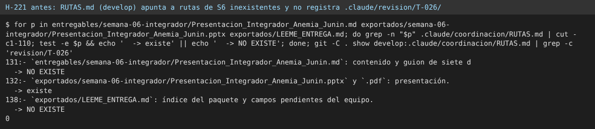
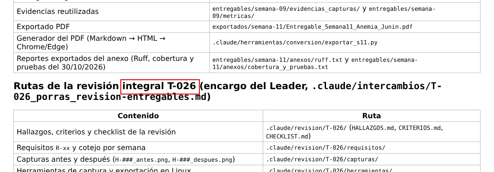
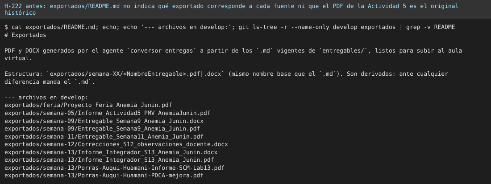
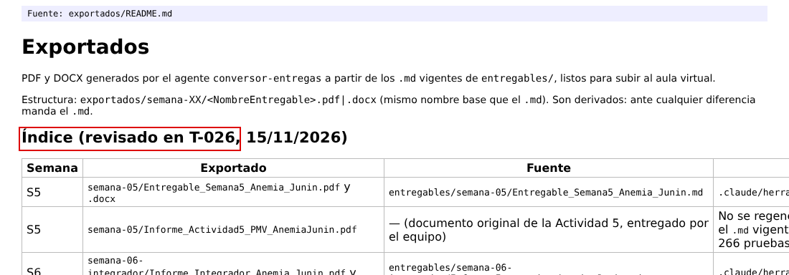
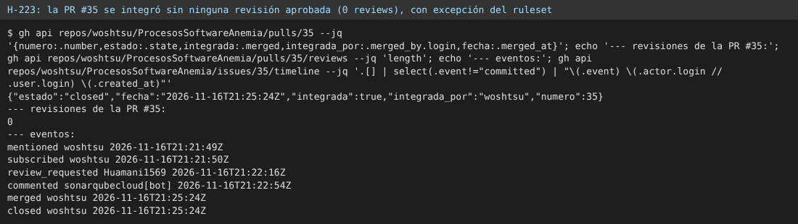

## Transversales y S14-S16 (registrados por el coordinador)

### H-220 · alta · La rúbrica de la evaluación final (S16) está vacía en el repositorio
- **Archivo y ubicación:** `guias/s16/PS-EvaluaciónFinal-Rubrica.md` (2 bytes; llegó así en la PR #32, commit d1e303a)
- **Requisito afectado:** sílabo §5 (EF, 40 %, «rúbrica») y guías S16; sin rúbrica no se pueden cotejar los criterios de la evaluación final
- **Descripción:** el archivo solo contiene un salto de línea. La conversión de la rúbrica del aula virtual a Markdown falló o se subió vacía. Además, `guias/s16/CARTEL-POSTER-RESULTADOS-PROYECTO-1.md` es el artículo de Lozano-Sánchez (2012) sobre pósteres, no el enunciado de la actividad (ver `requisitos/S14-S16.md`).
- **Evidencia antes:** 
- **Corrección aplicada:** — (las guías son insumos del docente de solo lectura, D-07)
- **Evidencia después:** — (pendiente)
- **Estado:** Pendiente justificado: el Leader debe volver a convertir la rúbrica desde el aula virtual (o pedírsela al docente) y versionarla en `guias/s16/`.

### H-221 · baja · RUTAS.md apuntaba a rutas de S6 que no existían y no registraba la carpeta de la revisión
- **Archivo y ubicación:** `.claude/coordinacion/RUTAS.md`, «Rutas de cierre autorizadas mediante ORQ-002» (líneas 131, 132 y 138)
- **Requisito afectado:** AGENTS.md («RUTAS.md es el mapa canónico») y coherencia de enlaces
- **Descripción:** citaba `entregables/semana-06-integrador/Presentacion_Integrador_Anemia_Junin.md` y `exportados/LEEME_ENTREGA.md`, que nunca existieron en develop, y no registraba `.claude/revision/T-026/` (ruta fijada por el encargo del Leader).
- **Evidencia antes:** 
- **Corrección aplicada:** rutas de S6 actualizadas a las restauradas (H-081), `LEEME_ENTREGA.md` sustituido por `exportados/README.md` y nueva sección «Rutas de la revisión integral T-026».
- **Evidencia después:** 
- **Estado:** Cerrado

### H-222 · media · El índice de exportados no decía de qué fuente sale cada archivo
- **Archivo y ubicación:** `exportados/README.md`
- **Requisito afectado:** coherencia fuente ↔ exportado (encargo, método 3)
- **Descripción:** el README solo describía la estructura. No advertía que `semana-05/Informe_Actividad5_PMV_AnemiaJunin.pdf` es el documento original de la Actividad 5 (no derivado del `.md`), ni cómo se regenera cada exportado.
- **Evidencia antes:** 
- **Corrección aplicada:** tabla índice con exportado, fuente y generador de cada semana, y nota sobre el PDF histórico de S5.
- **Evidencia después:** 
- **Estado:** Cerrado

### H-223 · alta · La PR #35 de esta revisión se integró sin revisión aprobada
- **Archivo y ubicación:** GitHub, PR #35 (`docs/t026-revision` → `develop`), integrada el 16/11/2026 a las 16:25 (hora de Lima) por woshtsu (commit cdf7e04)
- **Requisito afectado:** encargo T-026, «Paso final» y dominio 4 del PDCA (revisión por pares); guía del laboratorio SCM (protección de ramas con aprobación obligatoria)
- **Descripción:** la PR tenía revisión pedida a woshtsu, pero se integró sin ninguna revisión «Approved» (la API devuelve 0 revisiones), usando la excepción del ruleset de `develop`. Por eso no existe todavía la evidencia de una PR aprobada por un par que el encargo pide capturar.
- **Evidencia antes:** 
- **Corrección aplicada:** se abre la PR de continuación `docs/t026-paso-final` → `develop` con revisión pedida a Porras V. Cuando la apruebe con «Review changes → Approve», en esa misma PR se suben las capturas de la aprobación, el dominio 4 del PDCA, el informe del laboratorio 13 y sus PDF, y después se integra sin excepción de administrador.
- **Evidencia después:** — (pendiente de la aprobación)
- **Estado:** Pendiente justificado: aprobación de la PR de continuación por Porras V.

### S14 y S16: análisis de brechas (sin entregable que corregir)

El encargo pide listar qué falta, sin crear los entregables. El detalle está en [`requisitos/S14-S16.md`](../requisitos/S14-S16.md): S14 cubre por completo 15 de 43 requisitos (15 en parte, 13 faltan) y S16 cubre 2 de 15 (7 en parte). No se registran como hallazgos porque son trabajo futuro, no defectos.
