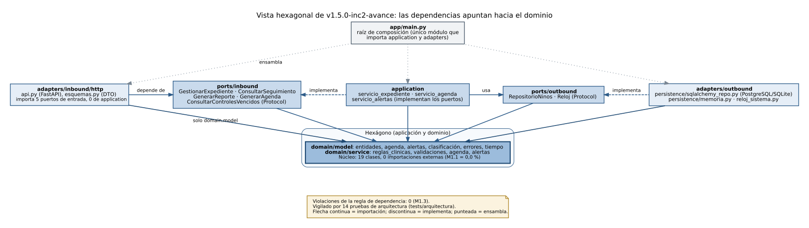

# INFORME TÉCNICO: EVALUACIÓN GQM DE ARQUITECTURA, PRUEBAS Y VALOR AL USUARIO — Semana 9

## 1. CARÁTULA E INTEGRANTES DEL EQUIPO (Noveno Ciclo)

La Tabla 1 identifica el entregable y la Tabla 2 al equipo.

**Tabla 1.** Datos generales del entregable.

| Campo | Detalle |
| --- | --- |
| **Carrera** | Ingeniería de Sistemas e Informática |
| **Asignatura** | Procesos de Software (ASUC01702), Universidad Continental, periodo 2026-20, Noveno ciclo |
| **Proyecto de asignatura** | Sistema Inteligente para Detección Temprana de Anemia Infantil en Zonas Rurales de Junín |
| **Docente** | Guevara Jimenez, Jorge Alfredo |
| **Semana y guía** | Semana 9: «Evaluación del proceso y producto de software mediante el modelo GQM» (`guias/S9-PSW-GUÍA DE TRABAJO.md`) |
| **Fecha** | 16/10/2026 |
| **Versiones del software evaluadas** | `v1.0-PMV` (Incremento 1, tag existente) y `v1.5.0-inc2-avance` (avance del 50 % del Incremento 2, en el árbol de trabajo; rama `feature/inc2-agenda-alertas` y etiqueta por publicar) |
| **Repositorio** | <https://github.com/woshtsu/ProcesosSoftwareAnemia> |

**Tabla 2.** Integrantes, códigos, roles y responsabilidad propuesta en este entregable.

| N.° | Apellidos, Nombres | Código | Rol en el proyecto | Responsabilidad propuesta en este entregable (propuesta del equipo) |
| --- | --- | --- | --- | --- |
| 1 | Porras Veli, Ricardo | 76659572 | Ingeniero de Proceso | Pilar 3 · Valor (Actividad 6), comparativa y plan PDCA (Actividad 7), integración del informe. Expositor propuesto del Pilar 3 |
| 2 | Auqui Huincho, Tania Tifani | 75280128 | Ingeniera de Desarrollo y Prototipado | Pilar 1 · Arquitectura (Actividad 4), implementación del Inc. 2 y de la estructura hexagonal (ADR-007 y ADR-008). Expositora propuesta del Pilar 1 |
| 3 | Huamani Rodriguez, Jean Piero | 72156889 | Ingeniero de Calidad y Mejora del Proceso (QA Lead) | Pilar 2 · Pruebas (Actividad 5), fichas, capturas y registro de defectos. Expositor propuesto del Pilar 2 |

El reparto de expositores y de responsabilidades es una **propuesta del equipo** basada en los roles de la matriz RAE de S3-4 y S6; no se ha registrado una confirmación formal de los tres integrantes ni del docente.

**Nota sobre los datos.** Todos los datos de niños, DNI, celulares y evaluaciones son **100 % sintéticos** (conjuntos generados con `pmv_fastapi/scripts/cargar_datos_prueba.py` y `herramientas/gqm/generar_dataset.py`). La clasificación de anemia y la agenda son **referenciales**: el sistema programa y vigila fechas, no diagnostica ni prescribe. No hubo usuarios reales ni piloto en una posta: ninguna cifra de este informe representa aceptación del usuario ni impacto clínico. Las rutas de archivos son relativas a la raíz del repositorio, salvo las de imágenes, que son relativas a `entregables/semana-09/`.

**Índice**

- [1. CARÁTULA E INTEGRANTES DEL EQUIPO](#1-carátula-e-integrantes-del-equipo-noveno-ciclo)
- [Mapa de exposición por pilares](#mapa-de-exposición-por-pilares)
- [2. RESUMEN EJECUTIVO Y OBJETIVOS DE EVALUACIÓN GQM](#2-resumen-ejecutivo-y-objetivos-de-evaluación-gqm)
    - [2.1 Avance del 50 % del Incremento 2 realizado antes de la evaluación](#21-avance-del-50--del-incremento-2-realizado-antes-de-la-evaluación)
    - [2.2 Resultados clave](#22-resultados-clave)
- [3. MATRIZ DE OBJETIVOS, PREGUNTAS Y MÉTRICAS GQM](#3-matriz-de-objetivos-preguntas-y-métricas-gqm-actividades-1-2-y-3)
    - [3.1 Actividad 1 — Formulación de objetivos de medición (nivel G)](#31-actividad-1--formulación-de-objetivos-de-medición-nivel-g)
    - [3.2 Actividad 2 — Árbol de preguntas de evaluación (nivel Q)](#32-actividad-2--árbol-de-preguntas-de-evaluación-nivel-q)
    - [3.3 Actividad 3 — Matriz operativa de métricas e indicadores (nivel M)](#33-actividad-3--matriz-operativa-de-métricas-e-indicadores-nivel-m)
- [4. AUDITORÍA DE ARQUITECTURA HEXAGONAL EN GITHUB (Actividad 4)](#4-auditoría-de-arquitectura-hexagonal-en-github-actividad-4-pilar-1--arquitectura)
    - [4.1 Estructura de carpetas y equivalencia con la guía](#41-estructura-de-carpetas-y-equivalencia-con-la-guía)
    - [4.2 Matriz 4.1 de auditoría arquitectónica](#42-matriz-41-de-auditoría-arquitectónica)
    - [4.3 Reporte de desacoplamiento del dominio](#43-reporte-de-desacoplamiento-del-dominio)
    - [4.4 Decisiones de arquitectura ADR-007 y ADR-008](#44-decisiones-de-arquitectura-adr-007-y-adr-008)
    - [4.5 Respuesta a las preguntas del Pilar 1](#45-respuesta-a-las-preguntas-del-pilar-1)
- [5. FICHAS DE PRUEBAS FUNCIONALES CON CAPTURAS DE PANTALLA (Actividad 5)](#5-fichas-de-pruebas-funcionales-con-capturas-de-pantalla-actividad-5-pilar-2--pruebas)
    - [5.0 Estrategia de pruebas y entorno](#50-estrategia-de-pruebas-y-entorno)
    - [5.1 Fichas de prueba funcional por requerimiento](#51-fichas-de-prueba-funcional-por-requerimiento)
    - [5.2 Matriz 5.2 de trazabilidad de pruebas funcionales e incrementos](#52-matriz-52-de-trazabilidad-de-pruebas-funcionales-e-incrementos)
    - [5.3 Regresión visual del Incremento 1 sobre v1.5](#53-regresión-visual-del-incremento-1-sobre-v15)
    - [5.4 Registro de ejecución de pruebas](#54-registro-de-ejecución-de-pruebas)
    - [5.5 Gestión de defectos y respuesta a las preguntas del Pilar 2](#55-gestión-de-defectos-y-respuesta-a-las-preguntas-del-pilar-2)
- [6. EVALUACIÓN DE ENTREGA DE VALOR AL USUARIO FINAL (Actividad 6)](#6-evaluación-de-entrega-de-valor-al-usuario-final-actividad-6-pilar-3--valor)
    - [6.1 Matriz 6.1 de trazabilidad proceso, producto y valor](#61-matriz-61-de-trazabilidad-proceso-producto-y-valor)
    - [6.2 Indicadores de valor V1 a V6](#62-indicadores-de-valor-v1-a-v6)
    - [6.3 M3.1 · Cobertura de brechas resueltas](#63-m31--cobertura-de-brechas-resueltas)
    - [6.4 M3.2 · Índice de impacto en valor, tiempos de respuesta y disponibilidad](#64-m32--índice-de-impacto-en-valor-tiempos-de-respuesta-y-disponibilidad)
    - [6.5 Satisfacción del usuario: proxy y SUS pendiente](#65-satisfacción-del-usuario-proxy-y-sus-pendiente)
    - [6.6 Qué es valor medido y qué requiere un piloto](#66-qué-es-valor-medido-y-qué-requiere-un-piloto)
    - [6.7 Respuesta a las preguntas del Pilar 3](#67-respuesta-a-las-preguntas-del-pilar-3)
- [7. COMPARATIVA GQM Y PLAN DE MEJORA CONTINUA (Actividad 7 · Inc. 1 vs. Inc. 2)](#7-comparativa-gqm-y-plan-de-mejora-continua-actividad-7--inc-1-vs-inc-2)
    - [7.1 Matriz 7.1 de comparativa GQM](#71-matriz-71-de-comparativa-gqm)
    - [7.2 Diagnóstico comparativo por pilar](#72-diagnóstico-comparativo-por-pilar)
    - [7.3 Plan de mejora continua PDCA](#73-plan-de-mejora-continua-pdca)
    - [7.4 Lecciones aprendidas](#74-lecciones-aprendidas)
- [8. ANEXOS](#8-anexos)
    - [Anexo A. Carpeta de capturas `evidencias_capturas/` organizada por RF](#anexo-a-carpeta-de-capturas-evidencias_capturas-organizada-por-rf)
    - [Anexo B. Repositorio GitHub y etiquetas](#anexo-b-repositorio-github-y-etiquetas)
    - [Anexo C. Reproducibilidad](#anexo-c-reproducibilidad)
    - [Anexo D. Instrumento SUS](#anexo-d-instrumento-sus)
    - [Anexo E. Guion de exposición por pilares](#anexo-e-guion-de-exposición-por-pilares)
    - [Anexo F. Referencias](#anexo-f-referencias)
    - [Anexo G. Detalle complementario movido desde el cuerpo del informe](#anexo-g-detalle-complementario-movido-desde-el-cuerpo-del-informe)

### Mapa de exposición por pilares

El informe se expone dividido en tres pilares. La Tabla 3 resume qué se muestra en cada uno; las etiquetas «[Pilar 1 · Arquitectura]», «[Pilar 2 · Pruebas]» y «[Pilar 3 · Valor]» aparecen en los títulos de las secciones que les corresponden.

**Tabla 3.** Mapa de exposición por pilares.

| Pilar | Goal | Preguntas | Métricas | Actividades | Secciones del informe | Figuras clave | Mensaje central |
| --- | --- | --- | --- | --- | --- | --- | --- |
| **Pilar 1 · Arquitectura hexagonal** (expositora propuesta: Auqui H.) | G-01 | Q1.1, Q1.2 (y Q1.3 complementaria) | M1.1, M1.2 (y M1.3) | 1 a 4 y 7 | 3.1.1, 3.2.1, 3.3.1, 4, 7.2.1 | 6, 5, 4 | Dominio aislado y estructura hexagonal de 2/5 a 5/5 componentes conformes, vigilada por 14 pruebas automáticas. |
| **Pilar 2 · Pruebas de los Incrementos 1 y 2** (expositor propuesto: Huamani R.) | G-02 | Q2.1, Q2.2 | M2.1, M2.2 | 1 a 3, 5 y 7 | 3.1.2, 3.2.2, 3.3.2, 5, 7.2.2 | Figuras 7 a 30 (capturas por RF) y Figura 31 (defectos) | Los 7 RF entregados tienen ficha, captura y pruebas aprobadas; los defectos del Inc. 1 están corregidos con regresión. |
| **Pilar 3 · Entrega de valor** (expositor propuesto: Porras V.) | G-03 | Q3.1, Q3.2 | M3.1, M3.2 | 1 a 3, 6 y 7 (con PDCA) | 3.1.3, 3.2.3, 3.3.3, 6, 7 | 32, 33, 34 | Valor medido con datos sintéticos, real pero parcial: mejora del índice de valor, pocas brechas resueltas y una regresión de rendimiento que el plan PDCA corrige. |

<div style="page-break-after: always;"></div>

## 2. RESUMEN EJECUTIVO Y OBJETIVOS DE EVALUACIÓN GQM

**Propósito.** Este informe evalúa, con el paradigma GQM (Goal-Question-Metric; Basili, Caldiera y Rombach, 1994), el proceso y el producto del proyecto «Anemia Junín» en tres dimensiones que corresponden a los tres pilares de la guía de la Semana 9: la arquitectura hexagonal del código en GitHub (G-01), la estrategia de pruebas de los Incrementos 1 y 2 con evidencias fotográficas (G-02) y la entrega de valor al usuario final frente a las brechas del proceso AS-IS (G-03). Se comparan la versión `v1.0-PMV` (Incremento 1) y la versión `v1.5.0-inc2-avance`, que contiene el 50 % del Incremento 2 exigido por el docente antes de esta evaluación.

**Cadena metodológica.** La Figura 1 muestra la cadena de trazabilidad que pide la guía y el artefacto concreto del proyecto en cada eslabón: las brechas B1 a B6 del problema organizacional (S1 y S6), las mejoras M1 a M6 del proceso TO-BE, el modelo iterativo-incremental con Scrum y DevOps (S2), la arquitectura hexagonal en Git (`app/domain`, `app/ports`, `app/adapters`), las pruebas de los RF-01 a RF-07 (228 pruebas por defecto y 8 E2E en v1.5), el marco GQM (G-01 a G-03, M1.1 a M3.2) y los indicadores de valor V1 a V6.


**Clasificación de la evidencia.** Para no mezclar lo medido con lo supuesto, cada afirmación de este informe pertenece a una de las cuatro clases de la Tabla 4.

**Tabla 4.** Clases de evidencia usadas en el informe.

| Clase | Qué incluye | Ejemplos |
| --- | --- | --- |
| **Reproducida** (16/10/2026, contenedor Linux de 2 CPU, Python 3.13, SQLite, Chromium headless) | Resultados que se obtuvieron ejecutando los scripts de `herramientas/gqm/` y guardados en `entregables/semana-09/metricas/` y `evidencias_capturas/` | 228 + 8 pruebas, cobertura, M1.1, M1.2, M1.3, M2.x, M3.x, carga, disponibilidad, 45 exploratorias, 31 capturas |
| **Heredada** (S1 a S6) | Resultados de entregables previos que aquí no se re-ejecutaron | Brechas B1 a B6, matriz de intervención, ADR-001 a ADR-006, HU-01 a HU-05, DEF-01 y DEF-02 (S6) |
| **Propuesta** | Decisiones o metas que el equipo plantea y que no están aprobadas | Reparto de expositores, ajuste de la meta de M3.1, fechas del plan PDCA, replanificación de sprints |
| **Pendiente** | Lo que aún no existe o no se ha hecho | Publicación de la rama `feature/inc2-agenda-alertas` y del tag `v1.5.0-inc2-avance` (por publicar), tag `v2.0-Inc2` (se creará al cierre del Inc. 2), HIST-2.3 y HIST-2.4, SUS con usuarios, piloto en posta, análisis de SonarCloud, captura directa de la interfaz de GitHub |

### 2.1 Avance del 50 % del Incremento 2 realizado antes de la evaluación

El docente pidió llegar a la evaluación con al menos la mitad del Incremento 2. La Tabla 5 muestra el estado de las cuatro historias del INC-2 (S3-4, Tabla 11) y de los 18 puntos de historia (SP) estimados en S3-4 (Tabla 19).

**Tabla 5.** Avance de las historias del Incremento 2 al 16/10/2026.

| Historia | Descripción | SP | Estado | RF | Endpoints e interfaz | Evidencia |
| --- | --- | --- | --- | --- | --- | --- |
| HIST-2.1 | Generar agenda de controles según la normativa | 5 | **Entregada** | RF-06 | `GET /api/ninos/{id}/agenda`; sección «Agenda de controles» en el expediente | 23 pruebas automatizadas (2 E2E), captura de 3 pasos, ADR-007 |
| HIST-2.2 | Identificar controles vencidos y alertas internas priorizadas | 5 | **Entregada** | RF-07 | `GET /api/alertas/controles-vencidos`, `GET /api/alertas/resumen`; pestaña «Alertas» | 17 pruebas automatizadas (2 E2E), captura de 3 pasos, ADR-007 |
| HIST-2.3 | Visualizar agenda del personal | 5 | Pendiente | RF-08 | Sin implementar | Fuera del avance del 50 % |
| HIST-2.4 | Registrar asistencia a control | 3 | Pendiente | RF-09 | Sin implementar | Fuera del avance del 50 % |
| **Total** | | **18** | **2/4 historias (50,0 %); 10/18 SP (55,6 %)** | | | |

Además de las dos historias, el avance incluye un **habilitador técnico**: la reestructuración del código a puertos y adaptadores (ADR-008), que no se cuenta en los 18 SP. La API de v1.5 suma tres endpoints respecto de v1.0 (12 rutas frente a 9) y `GET /api/ninos` cambia el significado de `control_atrasado`: ahora indica «tiene al menos un control vencido de la agenda normativa» en lugar de la heurística de 30 días sin control del Inc. 1. Las reglas de la agenda y de las alertas (esquema `ESQUEMA_AGENDA_V1`, parámetros referenciales por confirmar con la microred) están en el Anexo G.5 (Tabla 42).

**Desviación de calendario.** El plan de S3-4 (Tabla 23) asignó el INC-2 completo al Sprint 3 (29/09 al 12/10/2026), con el hito H2 el 12/10/2026. Al 16/10/2026 el avance es 50 % de las historias (55,6 % de los SP). La Tabla 6 registra la desviación, su causa y la acción propuesta.

**Tabla 6.** Desviación de calendario del Incremento 2.

| Elemento | Plan (S3-4) | Real al 16/10/2026 | Causa declarada por el equipo (sin registro de horas del Sprint 3) | Acción propuesta |
| --- | --- | --- | --- | --- |
| Alcance del INC-2 | 18 SP (HIST-2.1 a 2.4) en el Sprint 3 | 10 SP entregados (HIST-2.1 y 2.2); 8 SP pendientes (HIST-2.3 y 2.4) | El cierre del informe integrador de S6 (02/10/2026) habría consumido capacidad del Sprint 3; además se dedicó esfuerzo a la reestructuración a puertos y adaptadores (ADR-008); el 16/10/2026 se corrigieron DEF-03 a DEF-08 | Cerrar HIST-2.3 y HIST-2.4 en el Sprint 4 (13 al 26/10/2026), antes de crear la etiqueta `v2.0-Inc2` (al cierre del Inc. 2; mientras tanto el avance se identifica con `v1.5.0-inc2-avance`) |
| Hito H2 | 12/10/2026 | No alcanzado para el 100 % del incremento; alcanzado el 50 % exigido por el docente | Ídem | Reprogramar H2 al cierre del Sprint 4 (propuesta) |
| Efecto en el plan | INC-3 en el Sprint 4 | INC-3 sin iniciar | El Sprint 4 absorbe el resto del INC-2 y la mejora PDCA | Propuesta de replanificación: INC-3 inicia en el Sprint 5 y los incrementos siguientes se desplazan un sprint; el calendario revisado se presentará al docente (no está aprobado) |

### 2.2 Resultados clave

La Tabla 7 resume las seis métricas GQM de la guía con la meta de cada incremento y añade, fuera de las métricas, el p95 de rendimiento para no ocultar su regresión. Las filas M2.2 y M3.2 deben leerse con las salvedades de las conclusiones 2 a 4.

**Tabla 7.** Resumen de las seis métricas GQM y del p95 (valores de `metricas/datos/resumen_gqm.json` y `m32_carga.json`).

| Métrica | Inc. 1 (v1.0-PMV) | Inc. 2 (v1.5, avance) | Meta Inc. 1 / Inc. 2 | ¿Cumple? Inc. 1 / Inc. 2 |
| --- | --- | --- | --- | --- |
| M1.1 Índice de contaminación del dominio | 0,0 % (0/8 clases) | 0,0 % (0/19 clases) | 0,0 % / 0,0 % | Sí / Sí |
| M1.2 Conformidad estructural hexagonal (criterio estricto) | 40,0 % (2/5); criterio laxo 60,0 % | 100,0 % (5/5) | 100 % / 100 % | **No** / Sí |
| M2.1 RF con captura aprobada | 100,0 % (5/5) | 100,0 % (2/2 entregados); 50,0 % (2/4) sobre el alcance total del Inc. 2 | 100 % / 100 % | Sí / Sí sobre lo entregado |
| M2.2 Defectos funcionales por RF | 1,4 Def/RF (7/5) | 0,0 Def/RF (0/2) con atribución al incremento de origen; 0,86 (6/7) si se cuentan los hallados en el ciclo del Inc. 2 | ≤ 1,0 / ≤ 0,2 | **No** / Sí por atribución; **No** por hallazgo |
| M3.1 Cobertura de brechas AS-IS resueltas (de 6) | 25,0 % | 33,3 % | ≥ 60 % / ≥ 90 % | **No** / **No** |
| M3.2 Índice de impacto en valor (solo V1 a V3) | 57,6 % | 100,0 % | mejora ≥ 50 % / ≥ 80 % | Sí / Sí |
| V4 p95 agregado (fuera del índice M3.2 y sin meta en la guía) | 175 ms | 610 ms (**empeora**) | n/a | n/a |

Cuatro conclusiones sintetizan los resultados.

1. **Arquitectura.** El dominio estuvo aislado desde el Inc. 1 (M1.1 = 0,0 %), pero la estructura del PMV cumplía 2 de los 5 componentes de la guía (M1.2 = 40,0 %); el ADR-008 la llevó a 5/5 y eliminó la única violación de la regla de dependencia. **Reserva:** la evidencia de v1.5 es un árbol local; la rama `feature/inc2-agenda-alertas`, la etiqueta `v1.5.0-inc2-avance` y la captura de la interfaz de GitHub están por publicar (acción 8 del plan PDCA y lista previa a la exposición del Anexo B). `v2.0-Inc2` se creará al cierre del Inc. 2; mientras tanto el avance se identifica con `v1.5.0-inc2-avance`.
2. **Pruebas.** Los 7 RF entregados tienen ficha, captura aprobada y pruebas en verde (228 por defecto y 8 E2E; cobertura de 100 %). La meta del Inc. 1 no se cumplió (1,4 Def/RF): 6 de 7 defectos escaparon del PMV y se hallaron en el ciclo del Inc. 2; todos están corregidos con regresión. La meta del Inc. 2 se cumple solo por atribución de esos defectos al incremento de origen (0/2); contados sobre los 7 RF vigentes serían 0,86 y no cumpliría (Tabla 7).
3. **Valor.** M3.2 pasa de 57,6 % a 100,0 %, pero mide solo V1 a V3 (no incluye tiempo de respuesta, disponibilidad ni satisfacción). M3.1 queda en 33,3 % frente a una meta de 90 %: la guía supone cerrar casi todas las brechas en dos incrementos y el plan las reparte en seis (sección 6.3).
4. **Hallazgo adverso.** Con el mismo mix de carga el p95 agregado (V4) pasó de 175 ms a 610 ms, sin fallos y por debajo de 2 s. El 100,0 % de M3.2 no lo contradice porque V4 queda fuera del índice. La causa no está perfilada; es la acción 1 del plan PDCA (sección 7.3).

<div style="page-break-after: always;"></div>

## 3. MATRIZ DE OBJETIVOS, PREGUNTAS Y MÉTRICAS GQM (Actividades 1, 2 y 3)

### 3.1 Actividad 1 — Formulación de objetivos de medición (nivel G)

La Tabla 8 reproduce la Matriz 1.1 de la guía. Cada goal se redacta además con la plantilla formal de Basili de cinco elementos (objeto, propósito, enfoque de calidad, punto de vista y contexto) en las subsecciones siguientes. La plantilla («Analizar… con el propósito de… con respecto a… desde el punto de vista de… en el contexto de…») y el formato de la matriz GQM provienen de las láminas de la sesión de la Semana 9 «Meta – definir», «Meta – Pregunta – Métrica» y «Formato a utilizar en el proyecto», que citan el caso de Sánchez-Seco et al. (2015) y el enfoque de Basili et al. (2010) (`ArchivosComplementarios/Semana09_S1.pdf`; Anexo F).

**Tabla 8.** Matriz 1.1: Objetivos de medición GQM del proyecto.

| Código Goal | Dimensión Evaluada | Objeto a Evaluar | Propósito de Medición | Enfoque de Calidad / Atributo | Punto de Vista | Contexto de Aplicación |
| --- | --- | --- | --- | --- | --- | --- |
| **G-01** | **Producto (Arquitectura)** | Estructura de código en el repositorio GitHub (`v1.0-PMV` y `v1.5.0-inc2-avance`) | Evaluar el nivel de desacoplamiento | Mantenibilidad e independencia tecnológica | Arquitecto de Software | Estructura de carpetas de Arquitectura Hexagonal (`app/domain`, `app/ports`, `app/adapters`) |
| **G-02** | **Producto (Pruebas)** | Incremento 1 (PMV) e Incremento 2 (avance del 50 %) | Verificar la estabilidad funcional | Cobertura de pruebas y tasa de fallas | Responsable de QA / Testers | Pruebas unitarias, de integración y E2E con capturas de evidencia |
| **G-03** | **Proceso y Producto (Valor)** | Proceso de software y entregables funcionales | Evaluar la efectividad del proceso | Generación de valor organizacional e impacto | Usuario Final / Product Owner | Operación del software frente al proceso TO-BE (datos sintéticos; sin piloto) |

El punto de vista «Usuario Final / Product Owner» es **simulado** en este caso académico (la aceptación del Product Owner de S6 es simulada): no hubo usuarios reales que validaran los resultados.

#### 3.1.1 [Pilar 1 · Arquitectura] Goal G-01 en forma de Basili

> **Analizar** la estructura de código del repositorio GitHub del proyecto (`v1.0-PMV` y `v1.5.0-inc2-avance`) **con el propósito de** evaluar el nivel de desacoplamiento del núcleo de dominio respecto de frameworks y de infraestructura **con respecto a** la mantenibilidad y la independencia tecnológica **desde el punto de vista del** Arquitecto de Software **en el contexto de** la estructura de carpetas de Arquitectura Hexagonal (puertos y adaptadores) de la aplicación FastAPI del Sistema de Detección Temprana de Anemia Infantil.

#### 3.1.2 [Pilar 2 · Pruebas] Goal G-02 en forma de Basili

> **Analizar** el Incremento 1 (PMV) y el avance del Incremento 2 (RF-01 a RF-07) **con el propósito de** verificar la estabilidad funcional **con respecto a** la cobertura de pruebas y la tasa de fallas **desde el punto de vista del** Responsable de QA y los Testers **en el contexto de** pruebas unitarias, de integración y E2E con capturas de pantalla como evidencia, ejecutadas con datos sintéticos.

#### 3.1.3 [Pilar 3 · Valor] Goal G-03 en forma de Basili

> **Analizar** el proceso de software y los entregables funcionales de los Incrementos 1 y 2 **con el propósito de** evaluar la efectividad del proceso **con respecto a** la generación de valor organizacional y su impacto sobre las brechas AS-IS **desde el punto de vista del** Usuario Final y el Product Owner (simulado) **en el contexto de** la operación del software frente al proceso TO-BE, medida con datos sintéticos y sin piloto en una posta.

### 3.2 Actividad 2 — Árbol de preguntas de evaluación (nivel Q)

La Figura 2 muestra el árbol completo. Las preguntas Q1.1 a Q3.2 son las de la guía; Q1.3 es una pregunta **complementaria** que el equipo añade para cubrir la regla de dependencia (que las dependencias apunten hacia el núcleo), que M1.1 y M1.2 no miden por sí solas.


#### 3.2.1 [Pilar 1 · Arquitectura] Preguntas de G-01

La Tabla 9 lista las preguntas del Pilar 1.

**Tabla 9.** Preguntas del Pilar 1 y su métrica.

| Código | Pregunta (texto de la guía) | Por qué importa en este proyecto | Métrica que la responde |
| --- | --- | --- | --- |
| **Q1.1** | ¿El núcleo de dominio (*Domain Core*) se encuentra aislado de marcos de trabajo (*frameworks*) y librerías externas en la estructura de directorios? | Las reglas clínicas y la agenda normativa son lo que más cambia; si dependieran de FastAPI o SQLAlchemy, cada cambio de tecnología obligaría a reprobarlas. | M1.1 |
| **Q1.2** | ¿Los Puertos de Entrada/Salida (*Ports*) y Adaptadores (*Adapters*) están organizados correctamente en módulos independientes de GitHub? | Los incrementos 3 a 5 agregarán adaptadores; solo es barato si cada puerto y adaptador vive en un módulo propio. | M1.2 |
| **Q1.3** (complementaria) | ¿Las dependencias entre capas apuntan hacia el núcleo (regla de dependencia)? | Lo que desacopla es la dirección de las importaciones, no el nombre de la carpeta. | M1.3 |

#### 3.2.2 [Pilar 2 · Pruebas] Preguntas de G-02

La Tabla 10 lista las preguntas del Pilar 2.

**Tabla 10.** Preguntas del Pilar 2 y su métrica.

| Código | Pregunta (texto de la guía) | Por qué importa en este proyecto | Métrica que la responde |
| --- | --- | --- | --- |
| **Q2.1** | ¿Qué porcentaje de Requerimientos Funcionales del Incremento 1 y 2 cuenta con evidencias fotográficas aprobadas? | El personal valida el sistema viendo pantallas; sin captura aprobada un RF no puede mostrarse. | M2.1 |
| **Q2.2** | ¿Cuál es la densidad de defectos funcionales detectados entre la entrega del PMV (Inc. 1) y el Incremento 2? | Un defecto en el registro o la clasificación afecta datos de niños; interesa cuántos escaparon del PMV. | M2.2 |

#### 3.2.3 [Pilar 3 · Valor] Preguntas de G-03

La Tabla 11 lista las preguntas del Pilar 3.

**Tabla 11.** Preguntas del Pilar 3 y su métrica.

| Código | Pregunta (texto de la guía) | Por qué importa en este proyecto | Métrica que la responde |
| --- | --- | --- | --- |
| **Q3.1** | ¿En qué medida las funcionalidades entregadas en los incrementos reducen las brechas operativas identificadas en el proceso AS-IS? | El proyecto existe para cerrar las brechas B1 a B6. | M3.1 |
| **Q3.2** | ¿Cómo evolucionan los indicadores de valor del usuario (tiempos de respuesta, disponibilidad y satisfacción) con cada incremento liberado? | Una agenda lenta o no disponible en la posta no se usa; además hay que medir la satisfacción. | M3.2 (V1 a V3 en el índice; V4 a V6 como calidad de servicio) |

### 3.3 Actividad 3 — Matriz operativa de métricas e indicadores (nivel M)

La Tabla 12 reproduce la Matriz 3.1 de la guía con la **fórmula explícita**, el **método de extracción real** (script de `herramientas/gqm/` que la calcula), la **fuente de datos real** y las metas de la guía.

**Tabla 12.** Matriz 3.1: Definición de métricas GQM.

| Cód. Goal | Cód. Preg. | Cód. Mét. | Nombre de la Métrica | Fórmula / Método de Extracción | Fuente de Datos | Valor Meta (Inc. 1) | Valor Meta (Inc. 2) |
| --- | --- | --- | --- | --- | --- | --- | --- |
| **G-01** | **Q1.1** | **M1.1** | Índice de Contaminación del Dominio | Importaciones externas en `domain` ÷ clases de `domain` × 100 (AST; `m11_contaminacion.py`; nota a) | `app/domain` (v1.0) y `app/domain/model` y `service` (v1.5) → `datos/m11_contaminacion.json` | 0,0 % | 0,0 % |
| **G-01** | **Q1.2** | **M1.2** | Cohesión de Módulos Hexagonales (conformidad estructural) | Componentes conformes ÷ 5 × 100 (`m12_conformidad.py`; nota b) | Árbol de cada versión → `datos/m12_conformidad.json` | 100 % de conformidad | 100 % de conformidad |
| **G-01** | **Q1.3** (compl.) | **M1.3** | Acoplamiento por capa y violaciones de la regla de dependencia | I = Ce ÷ (Ca + Ce) por capa y conteo de importaciones que violan el sentido hacia el núcleo (`m13_acoplamiento.py`) | Repositorio → `datos/m13_acoplamiento.json` | Sin meta en la guía (propuesta: 0 violaciones) | Sin meta en la guía (propuesta: 0 violaciones) |
| **G-02** | **Q2.1** | **M2.1** | Cobertura Funcional con Capturas | RF con captura de resultado aprobada ÷ RF del incremento × 100 (`capturar_evidencias.py`, `m21_cobertura_rf.py`) | `evidencias_capturas/INDICE.md` y `resultados_*.json` → `datos/m21_cobertura_rf.json` | 100 % | 100 % |
| **G-02** | **Q2.2** | **M2.2** | Tasa de Defectos Funcionales | Defectos funcionales atribuibles ÷ RF del incremento, en Def/RF (`m22_defectos.py`) | `registro_defectos.md` y `registro_defectos_inc2.md` → `datos/m22_defectos.json` (nota c) | ≤ 1,0 Def/RF | ≤ 0,2 Def/RF |
| **G-03** | **Q3.1** | **M3.1** | Cobertura de Brechas Resueltas | (Σ puntajes de B1 a B6 ÷ 6) × 100 (`m31_brechas.py`; nota d) | Matriz de intervención del informe integrador de S6 (su Tabla 5), código y mediciones → `datos/m31_brechas.json` | ≥ 60 % | ≥ 90 % |
| **G-03** | **Q3.2** | **M3.2** | Índice de Impacto en Valor | Promedio simple de las mejoras de V1, V2 y V3 frente a la línea base AS-IS (Tabla 48); **no incluye tiempo de respuesta, disponibilidad ni satisfacción (Q3.2); se informan aparte en la Tabla 31** | `datos/m32_*.json` → `datos/m32_indice_valor.json` (`m32_valor.py`, `m32_indice_valor.py`) | Mejora ≥ 50 % | Mejora ≥ 80 % |

Notas a la Tabla 12.

- **a) M1.1.** La guía define «librerías de frameworks importadas en el dominio ÷ total de clases del dominio»; el script cuenta las importaciones externas (ni biblioteca estándar ni internas, por AST) del dominio ÷ clases del dominio × 100.
- **b) M1.2.** Conforme = ubicación (paquete propio) **y** contenido (pureza y dirección de las importaciones); es el criterio estricto, y se informan también el laxo y el ultra estricto (sección 4.2).
- **c) M2.2.** La guía cita GitHub Issues; el equipo usa los registros de defectos del repositorio (DEF-01 a DEF-08).
- **d) M3.1.** Puntaje 1 (completo, operativo y probado), 0,5 (parcial) o 0; complementaria: puntos de las brechas comprometidas ÷ n.º de brechas comprometidas × 100; lectura estricta (solo puntaje 1,0) en la Tabla 33.

Las metas son las de la guía. S1 recomienda no fijar metas numéricas sin línea base medida; por eso se informa también cuáles no se cumplen y por qué (secciones 4, 5, 6 y 7) y se propone un ajuste de M3.1 (sección 6.3).

#### 3.3.1 [Pilar 1 · Arquitectura] Definición operacional de M1.1, M1.2 y M1.3

Unidad, escala, frecuencia, responsable (propuesto) y umbral de acción de M1.1, M1.2 y M1.3: Tabla 44 (Anexo G.7).

#### 3.3.2 [Pilar 2 · Pruebas] Definición operacional de M2.1 y M2.2

Unidad, escala, frecuencia, responsable (propuesto) y umbral de acción de M2.1 y M2.2: Tabla 45 (Anexo G.7).

#### 3.3.3 [Pilar 3 · Valor] Definición operacional de M3.1 y M3.2, y especificación de M3.2

Unidad, escala, frecuencia, responsable (propuesto) y umbral de acción de M3.1 y M3.2: Tabla 46 (Anexo G.7).

**Especificación de M3.2.** El índice usa tres indicadores con **línea base AS-IS** y un sentido claro de mejora: V1 (registros por evaluación), V2 (niños activos con agenda normativa) y V3 (detección de controles vencidos, F1). Los otros tres (V4 tiempo de respuesta, V5 disponibilidad y V6 satisfacción, proxy) se informan como calidad de servicio y **no entran al promedio**; sus fórmulas y líneas base están en la Tabla 48 (Anexo G.9).

V4 a V6 quedan fuera del promedio (por eso el 100,0 % de M3.2 mide únicamente la mejora de V1 a V3 y no contradice la regresión de V4): (a) no tienen línea base AS-IS comparable; (b) V4 mejora cuando baja y V5 y V6 saturan en 100 %, de modo que promediarlas con V1 a V3 mezclaría sentidos y unidades distintos; (c) V6 es un proxy funcional y el SUS real está pendiente (sección 6.5). Las líneas base de V2 y V3 son **cero por definición del proceso manual** (S1 y S6), no una medición en una posta. El oráculo de V3 lo escribió el propio equipo a partir de la misma especificación (ADR-007): V3 mide fidelidad a esa especificación, no a la realidad clínica.

<div style="page-break-after: always;"></div>

## 4. AUDITORÍA DE ARQUITECTURA HEXAGONAL EN GITHUB (Actividad 4) [Pilar 1 · Arquitectura]

**Objetivo del pilar.** Responder Q1.1 y Q1.2 con evidencia verificable en la estructura de carpetas y en las importaciones de cada versión, y mostrar cómo evolucionó el desacoplamiento del Incremento 1 al avance del Incremento 2.

### 4.1 Estructura de carpetas y equivalencia con la guía

La guía describe la estructura con nombres de un proyecto Java (`/src/domain/model`, `JPA`, `Spring Boot`). El proyecto es una aplicación Python con FastAPI y SQLAlchemy, de modo que la **equivalencia** es la de la Tabla 13: los puertos son `typing.Protocol` (interfaces estructurales) y los adaptadores concretos son FastAPI (entrada) y SQLAlchemy o memoria (salida).

**Tabla 13.** Equivalencia entre la estructura de la guía y la de `app/`.

| Estructura de la guía | `v1.0-PMV` (Inc. 1) | `v1.5.0-inc2-avance` (Inc. 2) |
| --- | --- | --- |
| `/src/domain/model/` | `app/domain/` (`entidades.py`, `errores.py`, `reglas_clinicas.py`; sin separar modelo y servicio) | `app/domain/model/` (entidades, agenda, alertas, clasificación, errores, tiempo) |
| `/src/domain/service/` | Mezclado en `app/domain/` (`reglas_clinicas.py`) | `app/domain/service/` (reglas clínicas, validaciones, agenda, alertas) |
| `/src/ports/inbound/` | No existe | `app/ports/inbound/` (5 puertos `Protocol`) |
| `/src/ports/outbound/` | `app/application/puertos.py` (módulo dentro de `application`) | `app/ports/outbound/` (`RepositorioNinos`, `Reloj`) |
| *(casos de uso)* | `app/application/casos_uso.py` | `app/application/` (3 servicios que implementan los puertos de entrada) |
| `/src/adapters/inbound/rest/` | `app/adapters/entrada/http/` | `app/adapters/inbound/http/` |
| `/src/adapters/outbound/persistence/` | `app/adapters/salida/persistencia/` | `app/adapters/outbound/persistence/` (+ `reloj_sistema.py`) |
| *(raíz de composición)* | `app/main.py` | `app/main.py` |

En el tag `v1.0-PMV` la carpeta `app/` está en la raíz del repositorio (<https://github.com/woshtsu/ProcesosSoftwareAnemia/tree/v1.0-PMV/app>). La versión v1.5 vive en `pmv_fastapi/app/` del árbol de trabajo; su ruta en GitHub será la de la rama `feature/inc2-agenda-alertas` y la etiqueta `v1.5.0-inc2-avance` (<https://github.com/woshtsu/ProcesosSoftwareAnemia/tree/v1.5.0-inc2-avance/pmv_fastapi/app>, **por publicar**). Los árboles de carpetas se muestran en las Figuras 3 y 4 (versión en texto en el Anexo G.2).


**Limitación de la evidencia.** Las dos capturas son del árbol local (copia con contenido idéntico al tag `v1.0-PMV` y árbol de trabajo de v1.5), generadas el 16/10/2026 18:46. El intento automatizado de capturar la página de GitHub del tag respondió HTTP 403 (el entorno no tiene acceso al repositorio) y no se pueden crear commits ni etiquetas desde este entorno. Por tanto, **la rama `feature/inc2-agenda-alertas`, la etiqueta `v1.5.0-inc2-avance` y la captura de la interfaz de GitHub están por publicar**: el equipo las realizará antes de la exposición con la lista del Anexo B. La auditoría de v1.0 se apoya en un tag que sí existe en GitHub; la de v1.5, en el árbol local. La etiqueta `v2.0-Inc2` se creará al cierre del Inc. 2 y mientras tanto el avance se identifica con `v1.5.0-inc2-avance`.

### 4.2 Matriz 4.1 de auditoría arquitectónica

Las Tablas 14 y 15 son la Matriz 4.1 de la guía aplicada a cada versión. El estado es el del criterio **estricto** de `m12_conformidad.py`: un componente es conforme solo si su ubicación (paquete propio) y su contenido (pureza, dirección de importaciones) cumplen. Cada hallazgo cita archivo y línea.

**Tabla 14.** Matriz 4.1 para `v1.0-PMV` (Incremento 1).

| Componente Hexagonal | Ruta en Repositorio GitHub | Estado (Conforme / No Conforme) | Evidencia de Desacoplamiento / Hallazgo |
| --- | --- | --- | --- |
| **Núcleo de Dominio** | [`app/domain/`](https://github.com/woshtsu/ProcesosSoftwareAnemia/tree/v1.0-PMV/app/domain) (equivale a `/src/domain/model/`) | **Conforme** | 0 importaciones externas: 9 importaciones, 7 de la biblioteca estándar y 2 internas del dominio; 8 clases (m11). |
| **Puertos de Entrada** | `app/ports/inbound/` (no existe en el tag) | **No Conforme** | No hay puertos de entrada: ningún caso de uso se define como interfaz; el adaptador HTTP invoca una clase concreta. |
| **Puertos de Salida** | [`app/application/puertos.py`](https://github.com/woshtsu/ProcesosSoftwareAnemia/blob/v1.0-PMV/app/application/puertos.py) | **No Conforme** (conforme con criterio laxo) | Dos interfaces puras (`RepositorioNinos`, línea 13, con 9 métodos sin lógica; `Reloj`, línea 33), 0 violaciones de pureza, pero ubicadas dentro del paquete `application`, que también aloja `casos_uso.py`. Además `app/application/casos_uso.py:207` define `RelojSistema`, una implementación de un puerto fuera de los adaptadores. |
| **Adaptadores Entrada** | [`app/adapters/entrada/`](https://github.com/woshtsu/ProcesosSoftwareAnemia/tree/v1.0-PMV/app/adapters/entrada) | **No Conforme** | `app/adapters/entrada/http/api.py:12`: `from app.application.casos_uso import ServicioExpediente`. Importa 0 puertos de entrada y 1 módulo de aplicación (clase concreta): viola la regla de dependencia. |
| **Adaptadores Salida** | [`app/adapters/salida/persistencia/`](https://github.com/woshtsu/ProcesosSoftwareAnemia/tree/v1.0-PMV/app/adapters/salida/persistencia) | **Conforme** | Dos clases implementan `RepositorioNinos` (`memoria.py:9`, `sqlalchemy_repo.py:149`); SQLAlchemy queda confinado a `sqlalchemy_repo.py` (líneas 6 y 18); 0 importaciones de aplicación o de adaptadores de entrada. |

Resultado: 2 de 5 componentes conformes, **M1.2 = 40,0 %** (60,0 % con el criterio laxo; 20,0 % con el ultra estricto). El criterio **ultra estricto** exige, además, que todos los puertos de salida (incluido `Reloj`) tengan su implementación dentro del paquete de adaptadores de salida; en v1.0 `RelojSistema` está en `app/application/casos_uso.py:207`.

**Tabla 15.** Matriz 4.1 para `v1.5.0-inc2-avance` (avance del Incremento 2). Las rutas serán las de la rama `feature/inc2-agenda-alertas` y la etiqueta `v1.5.0-inc2-avance` (base: <https://github.com/woshtsu/ProcesosSoftwareAnemia/tree/v1.5.0-inc2-avance/pmv_fastapi/app>), **por publicar**; hoy corresponden al árbol de trabajo local.

| Componente Hexagonal | Ruta en Repositorio GitHub | Estado (Conforme / No Conforme) | Evidencia de Desacoplamiento / Hallazgo |
| --- | --- | --- | --- |
| **Núcleo de Dominio** | `pmv_fastapi/app/domain/model/` y `pmv_fastapi/app/domain/service/` *(por publicar)* | **Conforme** | 0 importaciones externas: 35 importaciones, 17 de la biblioteca estándar y 18 internas; 19 clases (m11). 0 importaciones de otras capas. |
| **Puertos de Entrada** | `pmv_fastapi/app/ports/inbound/` *(por publicar)* | **Conforme** | 5 interfaces `Protocol` sin lógica: `GenerarAgenda` (`agenda.py:8`), `ConsultarControlesVencidos` (`alertas.py:8`), `GestionarExpediente` (`expediente.py:9`), `GenerarReporte` (`reportes.py:7`), `ConsultarSeguimiento` (`seguimiento.py:6`). |
| **Puertos de Salida** | `pmv_fastapi/app/ports/outbound/` *(por publicar)* | **Conforme** | `Reloj` (`reloj.py:7`) y `RepositorioNinos` (`repositorio_ninos.py:13`, 9 métodos sin lógica); 0 violaciones de pureza ni importaciones de infraestructura. |
| **Adaptadores Entrada** | `pmv_fastapi/app/adapters/inbound/http/` *(por publicar)* | **Conforme** | `api.py:17` a `api.py:21` importan los 5 puertos de entrada; 0 módulos de aplicación y 0 adaptadores de salida. |
| **Adaptadores Salida** | `pmv_fastapi/app/adapters/outbound/persistence/` *(por publicar)* | **Conforme** | `RepositorioEnMemoria` (`memoria.py:11`) y `RepositorioSQLAlchemy` (`sqlalchemy_repo.py:159`) heredan de `RepositorioNinos`; SQLAlchemy solo en `sqlalchemy_repo.py` (líneas 6, 18 y 19); 0 importaciones de aplicación o de adaptadores de entrada. |

Resultado: 5 de 5 componentes conformes, **M1.2 = 100,0 %** con los tres criterios. La Figura 5 compara la conformidad por componente.


### 4.3 Reporte de desacoplamiento del dominio

**Contaminación del dominio (M1.1).** El script `m11_contaminacion.py` recorre el árbol sintáctico de cada archivo y clasifica cada importación como de la biblioteca estándar, interna del proyecto o externa (de terceros). La Tabla 16 muestra el resultado por capa. En ambas versiones el dominio no importa ningún framework (FastAPI, Pydantic, SQLAlchemy, etc.): **M1.1 = 0 ÷ 8 = 0,0 % en v1.0 y 0 ÷ 19 = 0,0 % en v1.5**.

**Tabla 16.** Importaciones por capa (m11): clases e importaciones estándar, internas y externas.

| Versión | Capa | Archivos `.py` analizados | Clases | Importaciones totales | Estándar | Internas | Externas |
| --- | --- | --- | --- | --- | --- | --- | --- |
| v1.0 | Dominio (`app/domain`) | 4 | 8 | 9 | 7 | 2 | **0** |
| v1.0 | Puertos de entrada | 0 | 0 | 0 | 0 | 0 | 0 |
| v1.0 | Puertos de salida (`application/puertos.py`) | 1 | 2 | 3 | 2 | 1 | 0 |
| v1.0 | Aplicación (`application/casos_uso.py`) | 1 | 2 | 7 | 3 | 4 | 0 |
| v1.5 | Dominio (`domain/model` y `domain/service`) | 12 | 19 | 35 | 17 | 18 | **0** |
| v1.5 | Puertos de entrada | 6 | 5 | 10 | 7 | 3 | 0 |
| v1.5 | Puertos de salida | 3 | 2 | 5 | 4 | 1 | 0 |
| v1.5 | Aplicación | 4 | 3 | 30 | 3 | 27 | 0 |

**Violaciones de la regla de dependencia y acoplamiento (M1.3).** El script `m13_acoplamiento.py` calcula, por capa, el acoplamiento eferente (Ce, a cuántas capas depende), el aferente (Ca, cuántas dependen de ella) y la inestabilidad I = Ce ÷ (Ca + Ce): 0 indica una capa estable de la que todos dependen y que no depende de nadie. El núcleo tiene I = 0,00 en ambas versiones. La Tabla 17 resume las demás capas.

**Tabla 17.** Inestabilidad por capa (M1.3) y violaciones de la regla de dependencia.

| Capa | I en v1.0 | I en v1.5 |
| --- | --- | --- |
| Dominio | 0,00 | 0,00 |
| Puertos de entrada | (no existe) | 0,33 |
| Puertos de salida | 0,50 | 0,33 |
| Aplicación | 0,67 | 1,00 |
| Adaptadores de entrada | 1,00 | 1,00 |
| Adaptadores de salida | 1,00 | 1,00 |
| **Violaciones de la regla de dependencia** | **1** (`adaptadores_entrada → aplicacion`, `api.py:12`) | **0** |

En v1.5 la aplicación tiene I = 1,00 porque solo `main.py` la ensambla: es lo esperado, pues los adaptadores dependen de los puertos y no de los casos de uso.

**Vigilancia automática.** Las reglas se verifican en cada `pytest` con las **14 pruebas de arquitectura** de `tests/arquitectura/test_dependencias.py` (14 casos: siete pruebas CP-37 a CP-43 y siete casos de dos pruebas del verificador, seis de ellos parametrizados), que analizan los `import` por AST: el dominio no importa frameworks ni otras capas; los puertos solo importan dominio, biblioteca estándar y `typing`; la aplicación no importa adaptadores ni frameworks; cada adaptador no importa aplicación ni el otro adaptador; solo `main.py` conoce a la vez aplicación y adaptadores; y no quedan módulos puente en las rutas antiguas. Una violación rompe el pipeline de CI. La Figura 6 muestra los módulos reales y el sentido de las dependencias.



### 4.4 Decisiones de arquitectura ADR-007 y ADR-008

El **ADR-007** fija que la agenda se calcula en línea en el dominio (`ESQUEMA_AGENDA_V1`), sin tabla ni migración; el **ADR-008** fija la estructura hexagonal explícita con siete reglas de dependencia verificadas por pruebas y `main.py` como raíz de composición. Contexto, decisión y consecuencias de ambos están en la Tabla 47 (Anexo G.8).

El criterio de revisión de ADR-007 (p95 de alertas mayor que 300 ms) se supera bajo el perfil de carga de este informe (Tabla 34, 50 usuarios simultáneos), aunque con un solo usuario el p95 es de 68,4 ms. Debe confirmarse con perfilado antes de decidir si se materializa la agenda (acción 1 del plan PDCA).

### 4.5 Respuesta a las preguntas del Pilar 1

**Q1.1 · ¿El núcleo de dominio está aislado de frameworks y librerías externas en la estructura de directorios?** **Sí, en ambos incrementos.** El dominio tiene 0 importaciones externas en `v1.0-PMV` (0 de 8 clases) y en `v1.5.0-inc2-avance` (0 de 19 clases): M1.1 = 0,0 % cumple ambas metas, y el dominio creció de 8 a 19 clases sin incorporar ninguna dependencia externa. La guía propone como ejemplo un 12 % de contaminación en el Inc. 1; el valor real fue 0,0 % y no hay mejora que atribuir a este indicador.

**Q1.2 · ¿Los puertos y adaptadores están organizados correctamente en módulos independientes de GitHub?** **En el Inc. 1 solo parcialmente; en el avance del Inc. 2, sí.** La meta del Inc. 1 **no se cumplió** (M1.2 = 40,0 %; 60,0 % con el criterio laxo): faltaban los puertos de entrada, el puerto de salida vivía dentro de `application` y el adaptador HTTP importaba la clase concreta. La causa es de diseño: ADR-001 definió puertos de salida pero invocaba los casos de uso directamente, y la estructura de la guía es posterior al PMV. El ADR-008 llevó M1.2 a 100 % (5/5), eliminó la violación y dejó 14 pruebas que impiden retroceder. La evidencia son el árbol de carpetas y las importaciones citadas con archivo y línea; la rama, la etiqueta y la captura de GitHub de v1.5 siguen por publicar (sección 4.1).

<div style="page-break-after: always;"></div>

## 5. FICHAS DE PRUEBAS FUNCIONALES CON CAPTURAS DE PANTALLA (Actividad 5) [Pilar 2 · Pruebas]

**Objetivo del pilar.** Verificar la estabilidad funcional de los Incrementos 1 y 2 con una ficha por requerimiento (RF-01 a RF-07), capturas de entrada y de resultado del software en ejecución, pruebas automatizadas que respaldan cada RF y un registro de defectos, para responder Q2.1 y Q2.2.

### 5.0 Estrategia de pruebas y entorno

La estrategia sigue la pirámide de pruebas de S6 (Tabla 23): la mayoría de las validaciones están en el dominio sin base de datos ni HTTP, la API y la persistencia se verifican en el nivel intermedio y las pruebas E2E cubren los recorridos completos de la interfaz. En v1.5 se agrega un nivel de **pruebas de arquitectura** que vigila la regla de dependencia (sección 4.3). La Tabla 18 compara las dos versiones con las salidas crudas de `pytest` guardadas en `metricas/salidas/`.

**Tabla 18.** Pirámide de pruebas de v1.0-PMV frente a v1.5.0-inc2-avance (ejecución del 16/10/2026).

| Nivel | v1.0-PMV (Inc. 1) | v1.5.0-inc2-avance (Inc. 2) | Alcance |
| --- | --- | --- | --- |
| Unitarias | 62 | 174 | Dominio y casos de uso con el repositorio en memoria |
| Integración y API (SQLite) | 11 | 40 | API REST con persistencia SQLAlchemy |
| Arquitectura (AST) | 0 | 14 | Reglas de dependencia entre capas |
| **Suite por defecto (pytest)** | **73 pruebas** | **228 pruebas** | Tiempo: 1,97 s frente a 5,01 s |
| E2E de interfaz (Playwright, Chromium) | 4 | 8 | Registro, datos inválidos, seguimiento y reporte; v1.5 suma agenda, casos especiales, pestaña de alertas y vista móvil |
| **Total con E2E** | **77** | **236** | Las 77 pruebas de v1.0 coinciden con las declaradas en S6 (73 + 4) |
| Cobertura de `app/` | 99,19 % (641 sentencias, 2 sin cubrir; 98 ramas) | 100 % (1 046 sentencias; 158 ramas) | Umbral de la DoD: 80 % |
| Análisis estático (ruff) | 0 hallazgos; 33 archivos con formato correcto | 0 hallazgos; 64 archivos con formato correcto | Reglas E, F, W, I, B, UP, S y complejidad ≤ 12 |

**Entorno de las capturas.** Chromium headless con Playwright (viewport 1366 × 900), servidor FastAPI real (uvicorn) con SQLite y **datos 100 % sintéticos** (conjunto semilla de 14 niños en v1.0 y 27 en v1.5; tras registrar a 72000001 en RF-01 las pantallas muestran 15 y 28 niños). El script `capturar_evidencias.py` inyecta en cada captura un **pie de «Evidencia S9»** con el RF, el paso, la URL, la versión y la fecha-hora de Perú; el pie no altera la funcionalidad. Los tiempos de cada ficha son de un usuario y no sustituyen la prueba de carga de la sección 6; el umbral «menos de 2 s» sale del criterio de aceptación modelo de la guía.

**Notas sobre las capturas.** (1) Los campos de fecha nativos de Chromium headless muestran el formato mm/dd/aaaa por la configuración regional del Chromium de prueba; la aplicación muestra y almacena las fechas en dd/mm/aaaa o ISO (por eso una misma fecha puede verse como 09/10/2025 en un campo de fecha y como 10/09/2025 en el expediente). Acción menor para la próxima captura: fijar la configuración regional es-PE. (2) Las capturas de v1.5 se tomaron el 16/10/2026 entre las 14:16 y las 14:17, antes de la corrección de DEF-08 (18:02), que no cambia la interfaz; las pruebas y las métricas corresponden al código final.

### 5.1 Fichas de prueba funcional por requerimiento

Cada ficha sigue el formato de la guía (proyecto, incremento, código de requerimiento, criterio Dado-Cuando-Entonces, especificación del caso de prueba, evidencias, evaluación). Las capturas de entrada y de resultado se incrustan con su descripción, la referencia a su figura y la ruta del archivo; las pruebas automatizadas que respaldan cada RF están en la Tabla 43 (Anexo G.6); la evaluación **APROBADO** significa que el criterio se cumplió en la ejecución automatizada y que las pruebas que lo respaldan están en verde; **no** equivale a aceptación de un usuario real.

#### FICHA 5.1 — RF-01 / HU-01

La Tabla 19 y las Figuras 7 y 8 documentan RF-01.

**Tabla 19.** Ficha de prueba funcional con evidencia fotográfica: RF-01.

| Campo | Detalle |
| --- | --- |
| **PROYECTO** | Sistema Inteligente para Detección Temprana de Anemia Infantil en Zonas Rurales de Junín |
| **INCREMENTO** | Incremento 1 (PMV) |
| **CÓDIGO REQUERIMIENTO** | RF-01 / HU-01 |
| **NOMBRE DEL REQUERIMIENTO** | Registrar niño con evaluación inicial (`POST /api/ninos`) |
| **CRITERIO DE ACEPTACIÓN (Given-When-Then)** | **Dado que** el personal completa el formulario «Registrar niño y evaluación inicial» con datos válidos, **cuando** presiona «Guardar registro», **entonces** el sistema almacena el registro, muestra la confirmación y abre el expediente en menos de 2 segundos. |
| **ID Caso de Prueba** | CP-RF01-01 |
| **Tipo de Prueba** | Prueba funcional de interfaz (E2E con Playwright) y de aceptación; verificación adicional por API de DNI repetido |
| **Resultado Esperado** | Registro exitoso persistido con una evaluación y notificación visual en pantalla; un DNI repetido responde 409 y no duplica el expediente. |
| **TIEMPOS MEDIDOS** | Clic en «Guardar registro» hasta confirmación visible y expediente: **188 ms** (v1.0); 294 ms sobre v1.5 (Anexo G.1). Umbral: menos de 2 s. |
| **RESULTADO OBSERVADO** | `GET /api/ninos/dni/72000001` responde 200 con 1 evaluación; confirmación en 188 ms; DNI repetido responde HTTP 409. |
| **EVALUACIÓN** | **[ APROBADO ]** |
| **FECHA** | 16/10/2026 |
| **EVALUADOR** | Huamani Rodriguez, Jean Piero (QA Lead) — ejecución automatizada reproducible con `capturar_evidencias.py`; firma pendiente |

**EVIDENCIAS FOTOGRÁFICAS (capturas del software en ejecución)**

*CAPTURA DE PANTALLA 1: DATOS DE ENTRADA.* Descripción: Formulario «Registrar niño y evaluación inicial» lleno con datos sintéticos (DNI 72000001, Hb 11,6 g/dL, 3 720 m s. n. m.); la vista previa ya muestra «Anemia moderada» (Figura 7). Archivo de imagen: `evidencias_capturas/RF-01/RF01_inc1_paso1_entrada.png`


*CAPTURA DE PANTALLA 2: CONFIRMACIÓN Y RESULTADO.* Descripción: Confirmación «Registro guardado: Rosa Elvira Ccente Poma» y expediente recién creado con su evaluación inicial (Figura 8). Archivo de imagen: `evidencias_capturas/RF-01/RF01_inc1_paso2_resultado.png`


#### FICHA 5.1 — RF-02 / HU-02

La Tabla 20 y las Figuras 9 a 14 documentan RF-02.

**Tabla 20.** Ficha de prueba funcional con evidencia fotográfica: RF-02.

| Campo | Detalle |
| --- | --- |
| **PROYECTO** | Sistema Inteligente para Detección Temprana de Anemia Infantil en Zonas Rurales de Junín |
| **INCREMENTO** | Incremento 1 (PMV) |
| **CÓDIGO REQUERIMIENTO** | RF-02 / HU-02 |
| **NOMBRE DEL REQUERIMIENTO** | Consultar y actualizar el expediente, incluido un nuevo control (`GET/PATCH /api/ninos/{id}`, `POST /api/ninos/{id}/evaluaciones`) |
| **CRITERIO DE ACEPTACIÓN (Given-When-Then)** | **Dado que** existe un expediente de un niño, **cuando** el personal lo consulta, actualiza campos permitidos (comunidad, celular) y registra un nuevo control, **entonces** los cambios persisten, el historial anterior se conserva y hay confirmación en menos de 2 segundos. |
| **ID Caso de Prueba** | CP-RF02-01 |
| **Tipo de Prueba** | Prueba funcional de interfaz (E2E con Playwright) y de aceptación |
| **Resultado Esperado** | Expediente con datos y evaluaciones; actualización persistida con confirmación; el historial pasa de 2 a 3 evaluaciones sin perder las anteriores. |
| **TIEMPOS MEDIDOS** | Consulta: **98 ms**; actualización (PATCH): **107 ms**; nuevo control (POST): **97 ms** (v1.0). En v1.5: 163, 190 y 184 ms. Umbral: menos de 2 s. |
| **RESULTADO OBSERVADO** | Expediente con 2 evaluaciones previas; comunidad y celular persistidos (verificado); nuevo control: evaluaciones 2 → 3. |
| **EVALUACIÓN** | **[ APROBADO ]** |
| **FECHA** | 16/10/2026 |
| **EVALUADOR** | Huamani Rodriguez, Jean Piero (QA Lead) — ejecución automatizada reproducible con `capturar_evidencias.py`; firma pendiente |

**EVIDENCIAS FOTOGRÁFICAS (capturas del software en ejecución)**

*CAPTURA DE PANTALLA 1: DATOS DE ENTRADA (consulta).* Descripción: Pestaña «Expediente» con el DNI 71000001 digitado, antes de pulsar «Abrir» (Figura 9). Archivo de imagen: `evidencias_capturas/RF-02/RF02_inc1_paso1_entrada.png`


*Captura 2: RESULTADO (consulta).* Descripción: Expediente de Luz Mery Quispe Rojas: datos, historial de evaluaciones, gráfico de Hb ajustada y formularios de edición y de nuevo control (Figura 10). Archivo de imagen: `evidencias_capturas/RF-02/RF02_inc1_paso2_resultado.png`


*Captura 3: ENTRADA (actualización).* Descripción: Formulario «Editar datos» con cambios de comunidad (Chongos Alto a Llacuas) y de celular (987654322), sin guardar (Figura 11). Archivo de imagen: `evidencias_capturas/RF-02/RF02_inc1_paso3_entrada_actualizacion.png`


*Captura 4: RESULTADO (actualización).* Descripción: Confirmación «Expediente actualizado»; el expediente muestra comunidad Llacuas y celular 987654322 (Figura 12). Archivo de imagen: `evidencias_capturas/RF-02/RF02_inc1_paso4_resultado_actualizacion.png`


*Captura 5: ENTRADA (nuevo control).* Descripción: Formulario «Registrar nuevo control» con fecha de hoy, Hb 11,5 g/dL, peso 8,2 kg y talla 69 cm (Figura 13). Archivo de imagen: `evidencias_capturas/RF-02/RF02_inc1_paso5_entrada_nuevo_control.png`


*CAPTURA DE PANTALLA 6: CONFIRMACIÓN Y RESULTADO (nuevo control).* Descripción: Confirmación «Control registrado»; el historial pasa de 2 a 3 evaluaciones sin perder las anteriores (Figura 14). Archivo de imagen: `evidencias_capturas/RF-02/RF02_inc1_paso6_resultado_nuevo_control.png`


#### FICHA 5.1 — RF-03 / HU-03

La Tabla 21 y las Figuras 15 a 17 documentan RF-03.

**Tabla 21.** Ficha de prueba funcional con evidencia fotográfica: RF-03.

| Campo | Detalle |
| --- | --- |
| **PROYECTO** | Sistema Inteligente para Detección Temprana de Anemia Infantil en Zonas Rurales de Junín |
| **INCREMENTO** | Incremento 1 (PMV) |
| **CÓDIGO REQUERIMIENTO** | RF-03 / HU-03 |
| **NOMBRE DEL REQUERIMIENTO** | Validar datos con reglas clínicas: vista previa y rechazo con mensajes por campo (`POST /api/validaciones/evaluacion`, 422) |
| **CRITERIO DE ACEPTACIÓN (Given-When-Then)** | **Dado que** el personal digita los datos clínicos de un control, **cuando** ingresa la hemoglobina (o intenta guardar con datos inválidos), **entonces** la vista previa muestra la Hb ajustada por altitud y la clasificación; y si los datos son inválidos, el sistema rechaza el registro con un mensaje comprensible por campo. |
| **ID Caso de Prueba** | CP-RF03-01 |
| **Tipo de Prueba** | Prueba funcional de interfaz (E2E con Playwright) y de aceptación; verificación adicional por API (HTTP 422) |
| **Resultado Esperado** | Vista previa con edad al control, ajuste por altitud, Hb ajustada y clasificación calculadas por el servidor; rechazo de datos fuera de rango sin guardar nada. |
| **TIEMPOS MEDIDOS** | Vista previa (digitar Hb hasta clasificación visible, incluye 350 ms de antirrebote): **830 ms**; rechazo: **55 ms** (v1.0). En v1.5: 863 y 80 ms. |
| **RESULTADO OBSERVADO** | Vista previa «Anemia moderada» con Hb ajustada 9,1 g/dL; rechazo con 2 campos marcados (DNI: «exactamente 8 dígitos»; Hb: «rango clínico válido»); `POST /api/validaciones/evaluacion` con Hb 25 responde HTTP 422. |
| **EVALUACIÓN** | **[ APROBADO ]** |
| **FECHA** | 16/10/2026 |
| **EVALUADOR** | Huamani Rodriguez, Jean Piero (QA Lead) — ejecución automatizada reproducible con `capturar_evidencias.py`; firma pendiente |

**EVIDENCIAS FOTOGRÁFICAS (capturas del software en ejecución)**

*CAPTURA DE PANTALLA 1: DATOS DE ENTRADA.* Descripción: Formulario con fecha de nacimiento, altitud (3 720 m) y demás datos, sin hemoglobina: la vista previa aún no valida (Figura 15). Archivo de imagen: `evidencias_capturas/RF-03/RF03_inc1_paso1_entrada.png`


*Captura 2: RESULTADO (vista previa).* Descripción: Vista previa del servidor: ajuste por altitud −2,5 g/dL, Hb ajustada 9,1 g/dL y «Anemia moderada» (Figura 16). Archivo de imagen: `evidencias_capturas/RF-03/RF03_inc1_paso2_resultado.png`


*CAPTURA DE PANTALLA 3: CONFIRMACIÓN Y RESULTADO (rechazo).* Descripción: Datos inválidos (DNI «123», Hb 25 g/dL): el sistema rechaza (HTTP 422) y marca cada campo con su mensaje (Figura 17). Archivo de imagen: `evidencias_capturas/RF-03/RF03_inc1_paso3_rechazo.png`


#### FICHA 5.1 — RF-04 / HU-04

La Tabla 22 y las Figuras 18 a 20 documentan RF-04.

**Tabla 22.** Ficha de prueba funcional con evidencia fotográfica: RF-04.

| Campo | Detalle |
| --- | --- |
| **PROYECTO** | Sistema Inteligente para Detección Temprana de Anemia Infantil en Zonas Rurales de Junín |
| **INCREMENTO** | Incremento 1 (PMV) |
| **CÓDIGO REQUERIMIENTO** | RF-04 / HU-04 |
| **NOMBRE DEL REQUERIMIENTO** | Listar niños en seguimiento con estado de control (`GET /api/ninos`) |
| **CRITERIO DE ACEPTACIÓN (Given-When-Then)** | **Dado que** existe un conjunto de niños en seguimiento, **cuando** el personal filtra por clasificación o busca por comunidad, **entonces** el listado respeta el filtro y muestra el estado de control de cada niño en menos de 2 segundos. |
| **ID Caso de Prueba** | CP-RF04-01 |
| **Tipo de Prueba** | Prueba funcional de interfaz (E2E con Playwright) y de aceptación |
| **Resultado Esperado** | Listado completo sin filtros; con el filtro «Anemia leve» solo aparecen niños de esa clasificación; la búsqueda por comunidad reduce el listado. |
| **TIEMPOS MEDIDOS** | Filtro por clasificación: **32 ms**; búsqueda «Palmayoc» (incluye 250 ms de antirrebote): **288 ms** (v1.0). En v1.5: 51 y 308 ms. |
| **RESULTADO OBSERVADO** | Filtro LEVE: 7 de 7 filas, coincide con `GET /api/ninos?clasificacion=LEVE`; búsqueda Palmayoc: 4 de 4 filas. En v1.5 el estado de control pasa a ser normativo (vencido según la agenda). |
| **EVALUACIÓN** | **[ APROBADO ]** |
| **FECHA** | 16/10/2026 |
| **EVALUADOR** | Huamani Rodriguez, Jean Piero (QA Lead) — ejecución automatizada reproducible con `capturar_evidencias.py`; firma pendiente |

**EVIDENCIAS FOTOGRÁFICAS (capturas del software en ejecución)**

*CAPTURA DE PANTALLA 1: DATOS DE ENTRADA.* Descripción: Pestaña «Seguimiento» sin filtros: listado completo de 15 niños (Figura 18). Archivo de imagen: `evidencias_capturas/RF-04/RF04_inc1_paso1_entrada.png`


*Captura 2: RESULTADO (filtro por clasificación).* Descripción: Filtro «Anemia leve»: 7 filas, todas «Anemia leve», con fecha y antigüedad del último control (Figura 19). Archivo de imagen: `evidencias_capturas/RF-04/RF04_inc1_paso2_resultado.png`


*CAPTURA DE PANTALLA 3: CONFIRMACIÓN Y RESULTADO (búsqueda por comunidad).* Descripción: Búsqueda por comunidad «Palmayoc»: el listado se reduce a 4 niños (Figura 20). Archivo de imagen: `evidencias_capturas/RF-04/RF04_inc1_paso3_busqueda_comunidad.png`


#### FICHA 5.1 — RF-05 / HU-05

La Tabla 23 y las Figuras 21 a 24 documentan RF-05.

**Tabla 23.** Ficha de prueba funcional con evidencia fotográfica: RF-05.

| Campo | Detalle |
| --- | --- |
| **PROYECTO** | Sistema Inteligente para Detección Temprana de Anemia Infantil en Zonas Rurales de Junín |
| **INCREMENTO** | Incremento 1 (PMV) |
| **CÓDIGO REQUERIMIENTO** | RF-05 / HU-05 |
| **NOMBRE DEL REQUERIMIENTO** | Reporte del periodo en JSON y CSV (`GET /api/reportes/periodo`) |
| **CRITERIO DE ACEPTACIÓN (Given-When-Then)** | **Dado que** se elige un periodo válido, **cuando** el personal pulsa «Generar» (y luego «Descargar CSV»), **entonces** se muestran los indicadores del periodo, se puede consultar el JSON y se descarga el mismo conjunto como CSV, en menos de 2 segundos. |
| **ID Caso de Prueba** | CP-RF05-01 |
| **Tipo de Prueba** | Prueba funcional de interfaz (E2E con Playwright) y de aceptación; verificación de la descarga y de la API |
| **Resultado Esperado** | Reporte en pantalla con KPI iguales a los de la API; respuesta JSON 200; archivo CSV con una fila por evaluación y cabecera de 12 columnas. |
| **TIEMPOS MEDIDOS** | Clic en «Generar» hasta reporte visible: **82 ms**; clic en «Descargar CSV» hasta archivo: **80 ms** (v1.0). En v1.5: 102 y 116 ms. |
| **RESULTADO OBSERVADO** | KPI en pantalla (15) igual al de la API (15); CSV con 15 filas igual a `evaluaciones_realizadas` (15); `Content-Type: text/csv; charset=utf-8`. Archivo descargado: [`RF-05/RF05_inc1_reporte_descargado.csv`](evidencias_capturas/RF-05/RF05_inc1_reporte_descargado.csv). |
| **EVALUACIÓN** | **[ APROBADO ]** |
| **FECHA** | 16/10/2026 |
| **EVALUADOR** | Huamani Rodriguez, Jean Piero (QA Lead) — ejecución automatizada reproducible con `capturar_evidencias.py`; firma pendiente |

**EVIDENCIAS FOTOGRÁFICAS (capturas del software en ejecución)**

*CAPTURA DE PANTALLA 1: DATOS DE ENTRADA.* Descripción: Pestaña «Reporte» con el periodo 2026-09-01 a 2026-10-16, antes de pulsar «Generar» (Figura 21). Archivo de imagen: `evidencias_capturas/RF-05/RF05_inc1_paso1_entrada.png`


*Captura 2: RESULTADO (reporte en pantalla).* Descripción: Reporte del periodo: indicadores, barras por clasificación y tabla por comunidad; 15 niños registrados (Figura 22). Archivo de imagen: `evidencias_capturas/RF-05/RF05_inc1_paso2_resultado.png`


*Captura 3: RESULTADO (JSON).* Descripción: Respuesta JSON de `GET /api/reportes/periodo`: HTTP 200, `ninos_registrados` = 15, `evaluaciones_realizadas` = 15 (Figura 23). Archivo de imagen: `evidencias_capturas/RF-05/RF05_inc1_paso3_json.png`


*CAPTURA DE PANTALLA 4: CONFIRMACIÓN Y RESULTADO (CSV descargado).* Descripción: Contenido del CSV descargado (`reporte_anemia_2026-09-01_2026-10-16.csv`; 15 filas, 12 columnas), renderizado en una página simple (Figura 24). Archivo de imagen: `evidencias_capturas/RF-05/RF05_inc1_paso4_csv.png`


#### FICHA 5.1 — RF-06 / HIST-2.1

La Tabla 24 y las Figuras 25 a 27 documentan RF-06.

**Tabla 24.** Ficha de prueba funcional con evidencia fotográfica: RF-06.

| Campo | Detalle |
| --- | --- |
| **PROYECTO** | Sistema Inteligente para Detección Temprana de Anemia Infantil en Zonas Rurales de Junín |
| **INCREMENTO** | Incremento 2 (avance del 50 %) |
| **CÓDIGO REQUERIMIENTO** | RF-06 / HIST-2.1 |
| **NOMBRE DEL REQUERIMIENTO** | Generar la agenda de controles según la normativa (`GET /api/ninos/{id}/agenda`; sección «Agenda de controles» del expediente) |
| **CRITERIO DE ACEPTACIÓN (Given-When-Then)** | **Dado que** existe un niño con anemia en tratamiento, **cuando** el personal abre su expediente, **entonces** el sistema muestra la agenda normativa de controles con el estado de cada uno (cumplido, pendiente, próximo a vencer, vencido) en menos de 2 segundos. |
| **ID Caso de Prueba** | CP-RF06-01 |
| **Tipo de Prueba** | Prueba funcional de interfaz (E2E con Playwright) y de aceptación; contraste interfaz frente a API |
| **Resultado Esperado** | Lista de controles por edad y de tratamiento con fecha programada, ventana de cumplimiento y estado; el resumen coincide con la API. |
| **TIEMPOS MEDIDOS** | Clic en el niño hasta expediente con agenda calculada: **119 ms**. Umbral: menos de 2 s. |
| **RESULTADO OBSERVADO** | DNI 71000022: 13 controles, estados {CUMPLIDO: 2, PENDIENTE: 9, VENCIDO: 2}, interfaz = API; DNI 71000003: 1 control próximo a vencer. Ningún niño sintético reúne los 4 estados a la vez, por eso se usan 2 niños. |
| **EVALUACIÓN** | **[ APROBADO ]** |
| **FECHA** | 16/10/2026 |
| **EVALUADOR** | Huamani Rodriguez, Jean Piero (QA Lead) — ejecución automatizada reproducible con `capturar_evidencias.py`; firma pendiente |

**EVIDENCIAS FOTOGRÁFICAS (capturas del software en ejecución)**

*CAPTURA DE PANTALLA 1: DATOS DE ENTRADA.* Descripción: Pestaña «Seguimiento» con el niño DNI 71000022 (anemia leve en tratamiento) localizado; se abrirá su expediente (Figura 25). Archivo de imagen: `evidencias_capturas/RF-06/RF06_inc2_paso1_entrada.png`


*Captura 2: RESULTADO (agenda del expediente).* Descripción: Sección «Agenda de controles»: 13 controles con fecha, ventana y estado; «2 cumplidos · 9 pendientes · 0 por vencer · 2 vencidos · Próximo control: DHc1 el 03/11/2026» (Figura 26). Archivo de imagen: `evidencias_capturas/RF-06/RF06_inc2_paso2_resultado.png`


*CAPTURA DE PANTALLA 3: CONFIRMACIÓN Y RESULTADO (control próximo a vencer).* Descripción: Agenda del niño DNI 71000003 con un control «Próximo a vencer» (ningún niño de prueba reúne los cuatro estados a la vez) (Figura 27). Archivo de imagen: `evidencias_capturas/RF-06/RF06_inc2_paso3_proximo_a_vencer.png`


#### FICHA 5.1 — RF-07 / HIST-2.2

La Tabla 25 y las Figuras 28 a 30 documentan RF-07.

**Tabla 25.** Ficha de prueba funcional con evidencia fotográfica: RF-07.

| Campo | Detalle |
| --- | --- |
| **PROYECTO** | Sistema Inteligente para Detección Temprana de Anemia Infantil en Zonas Rurales de Junín |
| **INCREMENTO** | Incremento 2 (avance del 50 %) |
| **CÓDIGO REQUERIMIENTO** | RF-07 / HIST-2.2 |
| **NOMBRE DEL REQUERIMIENTO** | Identificar controles vencidos y alertas internas priorizadas (`GET /api/alertas/controles-vencidos`, `GET /api/alertas/resumen`; pestaña «Alertas») |
| **CRITERIO DE ACEPTACIÓN (Given-When-Then)** | **Dado que** existe un conjunto de niños con controles, **cuando** el personal abre la pestaña «Alertas» y filtra por prioridad o comunidad, **entonces** se listan los controles vencidos priorizados con su resumen, en menos de 2 segundos. |
| **ID Caso de Prueba** | CP-RF07-01 |
| **Tipo de Prueba** | Prueba funcional de interfaz (E2E con Playwright) y de aceptación; contraste interfaz frente a API |
| **Resultado Esperado** | Resumen (vencidos, niños, prioridad alta, media y baja, por vencer en 7 días) y tabla ordenada por prioridad; los filtros reducen la tabla de forma coherente con la API. |
| **TIEMPOS MEDIDOS** | Clic en la pestaña «Alertas» hasta resumen y tabla: **176 ms**; filtro por prioridad: **69 ms**; filtro por comunidad: **70 ms**. Umbral: menos de 2 s. |
| **RESULTADO OBSERVADO** | Resumen de la interfaz igual al de la API (9 vencidos); filtro ALTA: 7 de 9 filas; comunidad Huaycha: 1 de 1 fila. |
| **EVALUACIÓN** | **[ APROBADO ]** |
| **FECHA** | 16/10/2026 |
| **EVALUADOR** | Huamani Rodriguez, Jean Piero (QA Lead) — ejecución automatizada reproducible con `capturar_evidencias.py`; firma pendiente |

**EVIDENCIAS FOTOGRÁFICAS (capturas del software en ejecución)**

*CAPTURA DE PANTALLA 1: DATOS DE ENTRADA (alertas sin filtro).* Descripción: Pestaña «Alertas» con resumen y tabla completa sin filtros; la insignia de la cabecera muestra 9 vencidos (Figura 28). Archivo de imagen: `evidencias_capturas/RF-07/RF07_inc2_paso1_entrada.png`


*Captura 2: RESULTADO (filtro por prioridad ALTA).* Descripción: Filtro «Prioridad: Alta»: 7 alertas ALTA de 9 (Figura 29). Archivo de imagen: `evidencias_capturas/RF-07/RF07_inc2_paso2_resultado_filtro_prioridad.png`


*CAPTURA DE PANTALLA 3: CONFIRMACIÓN Y RESULTADO (filtro por comunidad).* Descripción: Filtro «Comunidad: Huaycha»: 1 alerta de esa comunidad (Figura 30). Archivo de imagen: `evidencias_capturas/RF-07/RF07_inc2_paso3_resultado_filtro_comunidad.png`


#### 5.1.1 Fichas planificadas (no ejecutadas): RF-08 y RF-09

RF-08 y RF-09 completan el Incremento 2 (HIST-2.3 y HIST-2.4, 8 SP) y **no forman parte del avance del 50 %**. La Tabla 26 muestra el plan de prueba de ambos en el formato de la ficha; **no hay ejecución, resultado ni captura**, y no cuentan en M2.1 ni en otra métrica. Los criterios Dado-Cuando-Entonces son una **propuesta** derivada de la descripción de cada historia en S3-4 (Tabla 11), por confirmar con el Product Owner al refinar la historia; la interfaz y los endpoints se definirán en el Sprint 4.

**Tabla 26.** Fichas de prueba funcional planificadas: RF-08 y RF-09 (no ejecutadas).

| Campo | RF-08 / HIST-2.3 | RF-09 / HIST-2.4 |
| --- | --- | --- |
| **PROYECTO / INCREMENTO** | Sistema Inteligente para Detección Temprana de Anemia Infantil en Zonas Rurales de Junín; Incremento 2 (fuera del avance del 50 %) | Ídem |
| **NOMBRE DEL REQUERIMIENTO** | Visualizar la agenda del personal (controles programados de los niños activos, por fecha y comunidad) | Registrar asistencia a control (marcar un control de la agenda como atendido) |
| **CRITERIO DE ACEPTACIÓN (Given-When-Then)** | **Dado que** existen niños activos con controles programados, **cuando** el personal abre «Agenda del personal» y elige un rango de fechas o una comunidad, **entonces** el sistema lista los controles del rango, ordenados por fecha, con niño, tipo de control y estado, en menos de 2 segundos. | **Dado que** un niño tiene un control programado, **cuando** el personal registra su asistencia (fecha y observación), **entonces** el sistema guarda el registro, el control pasa a cumplido en la agenda, la alerta correspondiente desaparece y se confirma la operación en menos de 2 segundos. |
| **ID Caso de Prueba** | CP-RF08-01 (reservado) | CP-RF09-01 (reservado) |
| **Tipo de Prueba** | Funcional de interfaz (E2E con Playwright) y de aceptación; contraste interfaz frente a API | Funcional de interfaz (E2E con Playwright) y de aceptación; API con control inexistente o ya cumplido |
| **Resultado Esperado** | La lista coincide con la agenda calculada por el dominio (ADR-007) para el rango y la comunidad elegidos; un rango sin controles muestra un mensaje vacío. | El control queda cumplido y deja de figurar en «Alertas»; registrar dos veces el mismo control o uno inexistente da un error comprensible y no duplica datos. |
| **EVIDENCIAS FOTOGRÁFICAS** | Por generar: `evidencias_capturas/RF-08/RF08_inc2_paso1_entrada.png` (CAPTURA DE PANTALLA 1: DATOS DE ENTRADA) y `RF08_inc2_paso2_resultado.png` (CAPTURA DE PANTALLA 2: CONFIRMACIÓN Y RESULTADO) | Por generar: `evidencias_capturas/RF-09/RF09_inc2_paso1_entrada.png` y `RF09_inc2_paso2_resultado.png` (mismos rótulos) |
| **EVALUACIÓN** | **[ PLANIFICADA — NO EJECUTADA ]** | **[ PLANIFICADA — NO EJECUTADA ]** |
| **FECHA / EVALUADOR** | Por definir (cierre previsto del Sprint 4, 26/10/2026, propuesta); Huamani Rodriguez, Jean Piero (QA Lead), por ejecutar | Ídem |

### 5.2 Matriz 5.2 de trazabilidad de pruebas funcionales e incrementos

La Tabla 27 reproduce la Matriz 5.2 de la guía para los nueve RF del proyecto. Los **RF-08 y RF-09** pertenecen al Incremento 2 pero **no forman parte del avance del 50 %**: tienen ficha planificada (sección 5.1.1) con su caso de prueba reservado, pero no hay ejecución ni captura, y se declaran no ejecutados en lugar de simular evidencia. Los identificadores `CP-RF0X-01` son los de las fichas de este informe; cada uno agrupa las pruebas automatizadas del RF (numeradas CP-01 a CP-115 en los docstrings del código y listadas en `datos/m21_cobertura_rf.json`). Las rutas de captura son relativas a `evidencias_capturas/`.

**Tabla 27.** Matriz 5.2: Trazabilidad de pruebas funcionales e incrementos.

| Código RF | Descripción del Requerimiento | Incremento | ID Caso Prueba | Archivo de Captura de Pantalla | Estado |
| --- | --- | --- | --- | --- | --- |
| **RF-01** | *Registrar niño con evaluación inicial (HU-01).* | Inc. 1 (PMV) | CP-RF01-01 | `RF-01/RF01_inc1_paso2_resultado.png` | **Aprobado** |
| **RF-02** | *Consultar y actualizar el expediente, incluido un nuevo control (HU-02).* | Inc. 1 (PMV) | CP-RF02-01 | `RF-02/RF02_inc1_paso2_resultado.png`, `RF-02/RF02_inc1_paso4_resultado_actualizacion.png`, `RF-02/RF02_inc1_paso6_resultado_nuevo_control.png` | **Aprobado** |
| **RF-03** | *Validar datos con reglas clínicas: vista previa y rechazo por campo (HU-03).* | Inc. 1 (PMV) | CP-RF03-01 | `RF-03/RF03_inc1_paso2_resultado.png`, `RF-03/RF03_inc1_paso3_rechazo.png` | **Aprobado** |
| **RF-04** | *Listar niños en seguimiento con estado de control (HU-04).* | Inc. 1 (PMV) | CP-RF04-01 | `RF-04/RF04_inc1_paso2_resultado.png`, `RF-04/RF04_inc1_paso3_busqueda_comunidad.png` | **Aprobado** |
| **RF-05** | *Reporte del periodo en JSON y CSV (HU-05).* | Inc. 1 (PMV) | CP-RF05-01 | `RF-05/RF05_inc1_paso2_resultado.png`, `RF-05/RF05_inc1_paso3_json.png`, `RF-05/RF05_inc1_paso4_csv.png` | **Aprobado** |
| **RF-06** | *Generar la agenda de controles según la normativa (HIST-2.1).* | Inc. 2 (avance) | CP-RF06-01 | `RF-06/RF06_inc2_paso2_resultado.png`, `RF-06/RF06_inc2_paso3_proximo_a_vencer.png` | **Aprobado** |
| **RF-07** | *Identificar controles vencidos y alertas internas priorizadas (HIST-2.2).* | Inc. 2 (avance) | CP-RF07-01 | `RF-07/RF07_inc2_paso2_resultado_filtro_prioridad.png`, `RF-07/RF07_inc2_paso3_resultado_filtro_comunidad.png` | **Aprobado** |
| **RF-08** | *Visualizar la agenda del personal (HIST-2.3).* | Inc. 2 | CP-RF08-01 (reservado) | Por generar: `RF-08/RF08_inc2_paso2_resultado.png` | **Planificada — no ejecutada; fuera del avance del 50 %** |
| **RF-09** | *Registrar asistencia a control (HIST-2.4).* | Inc. 2 | CP-RF09-01 (reservado) | Por generar: `RF-09/RF09_inc2_paso2_resultado.png` | **Planificada — no ejecutada; fuera del avance del 50 %** |

«Aprobado» significa criterio Dado-Cuando-Entonces cumplido en la ejecución automatizada con captura de resultado y pruebas en verde.

### 5.3 Regresión visual del Incremento 1 sobre v1.5

El recorrido de RF-01 a RF-05 se ejecutó también sobre `v1.5.0-inc2-avance` (capturas del 16/10/2026, 14:16 a 14:17) y el criterio se cumplió en las cinco funcionalidades: la reestructuración hexagonal y el nuevo estado de control no rompieron lo entregado. Con un usuario, los tiempos de v1.5 fueron mayores en las cinco (todos muy por debajo de 2 s), sin probar la causa de la regresión de la sección 6.4. Capturas (Figuras 36 a 40) y tiempos: Anexo G.1 (Tabla 40).

### 5.4 Registro de ejecución de pruebas

El 16/10/2026 se ejecutaron ruff, la suite por defecto con cobertura y los E2E de ambas versiones (Tabla 18): 73 y 228 pruebas en verde, 4 y 8 E2E, cobertura de 99,19 % y 100 %, y 17/17 y 33/33 criterios Dado-Cuando-Entonces (m21). Se ejecutaron además **45 pruebas exploratorias** sobre la API de v1.5 (43 OK, 2 OBS, 0 FALLA; las OBS EX-17 y EX-40 no son defectos), que hallaron DEF-08. **No se ejecutaron** la integración en PostgreSQL de v1.5 (hay un job en CI) ni SonarCloud (acción 6 del PDCA). Registro completo: Anexo G.3 (Tabla 41); exploratorias y corridas: Anexo G.4.

### 5.5 Gestión de defectos y respuesta a las preguntas del Pilar 2

La Tabla 28 registra DEF-01 a DEF-08.

**Tabla 28.** Registro de defectos DEF-01 a DEF-08 (`registro_defectos.md` y `registro_defectos_inc2.md`; clasificación de `m22_defectos.py`).

| ID | Descripción corta | Tipo | RF | Momento | Estado |
| --- | --- | --- | --- | --- | --- |
| DEF-01 | Patrón N+1 en el reporte del periodo: p95 de 2 200 ms con 50 usuarios (corregido a 74 ms; ADR-006) | No funcional (rendimiento) | RF-05 | Detectado antes de liberar (Inc. 1) | Cerrado |
| DEF-02 | El reporte contaba días en UTC y perdía registros posteriores a las 19:00 de Perú | Funcional | RF-05 | Detectado antes de liberar (Inc. 1) | Cerrado |
| DEF-03 | `GET /api/reportes/periodo` respondía 500 con fechas extremas (9999-12-31); ahora 422 | Funcional | RF-05 | Escapado; hallado en el ciclo del Inc. 2 | Cerrado |
| DEF-04 | DNI y celular aceptaban dígitos Unicode y un salto de línea final | Funcional | RF-01 (y RF-02) | Escapado; hallado en el ciclo del Inc. 2 | Cerrado |
| DEF-05 | La vista previa aceptaba altitudes NaN o absurdas y fechas de nacimiento inválidas (clasificaba «SEVERA» sin sentido) | Funcional | RF-03 | Escapado; hallado en el ciclo del Inc. 2 | Cerrado |
| DEF-06 | Textos sin largo máximo (100 000 caracteres en columnas de 80) | Funcional | RF-01 (y RF-02) | Escapado; hallado en el ciclo del Inc. 2 | Cerrado |
| DEF-07 | La búsqueda trataba `%` y `_` como comodines de SQL | Funcional | RF-04 | Escapado; hallado en el ciclo del Inc. 2 | Cerrado |
| DEF-08 | Dos registros simultáneos con el mismo DNI: el segundo respondía 500 en lugar de 409 | Funcional | RF-01 | Escapado; hallado por la exploratoria EX-42 | Cerrado |

Los defectos DEF-03 a DEF-08 estaban en código **heredado del Inc. 1** y se hallaron al explorar entradas límite de la API durante el ciclo del Inc. 2; cada uno tiene prueba de regresión (CP-83 a CP-88, CP-102 a CP-106 y CP-115). El código nuevo (agenda y alertas) no presentó defectos funcionales en las pruebas ni en las 45 exploratorias. La Tabla 29 y la Figura 31 muestran la densidad, con la lectura de la meta (atribución al incremento de origen) y la alternativa.

**Tabla 29.** Densidad de defectos funcionales por RF y por KLOC (m22).

| Medida | Inc. 1 (v1.0-PMV, 5 RF) | Inc. 2 (avance, RF-06 y RF-07) |
| --- | --- | --- |
| Defectos funcionales atribuidos | 7 (DEF-02 a DEF-08) | 0 |
| **M2.2 (Def/RF)** | **1,4** (7/5) | **0,0** (0/2) |
| Variante: solo los detectados antes de liberar | 0,2 (1/5) | no aplica |
| Variante: sin DEF-08 (antes de la campaña exploratoria) | 1,2 (6/5) | no aplica |
| Variante: todos los defectos, incluido el no funcional DEF-01 | 1,6 (8/5) | no aplica |
| **Lectura alternativa:** hallados en el ciclo del Inc. 2 ÷ RF vigentes (7) | no aplica | **0,86** (6/7) |
| Densidad por KLOC (funcionales) | 6,85 Def/KLOC (KLOC de v1.0 = 1,022) | 0,0 Def/KLOC (KLOC de v1.5 = 1,688; código neto aproximado 0,666) |
| Densidad por KLOC (solo antes de liberar / todos) | 0,98 / 7,83 | 0,0 |


**Q2.1 · ¿Qué porcentaje de RF del Incremento 1 y 2 cuenta con evidencias fotográficas aprobadas?** **M2.1 = 100,0 % en el Inc. 1** (5 de 5 RF: RF-01 a RF-05) y **100,0 % en lo entregado del Inc. 2** (2 de 2 RF: RF-06 y RF-07). Sobre el **alcance total del Inc. 2** (RF-06 a RF-09) es **50,0 %** (2 de 4), porque RF-08 y RF-09 están pendientes (8 de los 18 SP); la meta de 100 % del Inc. 2 se cumple solo sobre lo entregado y **no sobre el alcance total**. Considerando los nueve RF del proyecto, 7 tienen captura aprobada (7 de 9, es decir 77,8 %, cálculo propio a partir de estos conteos). Las capturas son de la ejecución del 16/10/2026.

**Q2.2 · ¿Cuál es la densidad de defectos funcionales entre la entrega del PMV y el Incremento 2?** **M2.2 = 1,4 Def/RF en el Inc. 1** y **0,0 Def/RF en el avance del Inc. 2** (0/2, con los defectos hallados atribuidos al incremento de origen). La meta del Inc. 1 (≤ 1,0) **no se cumplió**; la del Inc. 2 (≤ 0,2) se cumple **por atribución** pero **no por hallazgo**: contando los 6 defectos hallados en el ciclo del Inc. 2 sobre los 7 RF vigentes, la lectura es 6/7 = 0,86 Def/RF (cálculo propio; Tabla 7). Causa raíz del valor del Inc. 1: solo 1 de los 7 defectos (DEF-02) se detectó antes de liberar; los otros 6 escaparon porque las pruebas del PMV cubrían valores nominales y los límites de las reglas clínicas, pero no entradas hostiles (NaN, dígitos Unicode, fechas extremas, textos enormes, comodines) ni concurrencia. Cautelas sobre el 0,0 del Inc. 2: se calcula sobre solo 2 RF, y la ausencia de defectos hallados no prueba su ausencia (39 de las 45 exploratorias recayeron en código nuevo y no hallaron fallas, pero las diseñó el mismo equipo).

<div style="page-break-after: always;"></div>

## 6. EVALUACIÓN DE ENTREGA DE VALOR AL USUARIO FINAL (Actividad 6) [Pilar 3 · Valor]

**Objetivo del pilar.** Demostrar, con trazabilidad e indicadores, qué brechas del proceso AS-IS resuelven las funcionalidades probadas (Q3.1) y cómo evolucionan los indicadores de valor con cada incremento (Q3.2), separando con claridad lo **medido con datos sintéticos** de lo que **requiere un piloto en una posta**.

### 6.1 Matriz 6.1 de trazabilidad proceso, producto y valor

Las brechas B1 a B6 son las de S1 y S6 (Tabla 4 del informe integrador de S6) y la intervención prevista por incremento es la matriz de intervención de S6 (Tabla 5 del informe integrador de S6). Los puntajes de resolución salen de `m31_brechas.py` y se justifican en la sección 6.3. La Tabla 30 es la Matriz 6.1 de la guía.

**Tabla 30.** Matriz 6.1: Trazabilidad Proceso–Producto–Valor al Usuario.

| Problema Organizacional (AS-IS) | Brecha Resuelta | Incremento / Funcionalidad Entregada | Indicador de Proceso / Producto | Valor Organizacional Generado |
| --- | --- | --- | --- | --- |
| *Triple registro manual por evaluación (historia clínica, tarjeta de control y HIS), con errores de digitación y duplicidad.* | **B1** · Falta de registro nominal único y validado. **Resuelta (1,0)** | **Inc. 1 (RF-01 a RF-05):** expediente digital único con DNI único (409 si se repite), validación clínica por campo, seguimiento y reporte | *V1, registros por evaluación:* 3 → 1 (mejora de 100 %); 1 escritura alimenta expediente, seguimiento y reporte (150 → 151 niños y 826 → 827 evaluaciones en la base de prueba) | Un registro único y confiable. Valor **por diseño con datos sintéticos**: no hay medición del tiempo de registro en una posta |
| *Agenda de controles calculada a mano; controles fuera de la ventana normativa y citas olvidadas.* | **B2** · No hay agenda normativa ni recordatorios. **Parcial (0,5):** agenda y vencidos resueltos; faltan recordatorios, agenda del personal y asistencia | **Inc. 2, avance (RF-06 y RF-07):** agenda normativa por niño, controles vencidos y alertas ALTA, MEDIA y BAJA | *V2, niños activos con agenda:* 0 % → 100 % (140/140). *V3, detección de vencidos (F1):* 0 % (AS-IS) → 72,9 % (heurística de 30 días del Inc. 1) → 100 % (93 verdaderos positivos, 0 falsos positivos, 0 falsos negativos; 476/476 controles coinciden con el oráculo) | El personal ve qué controles están vencidos y su prioridad (B150: 476 vencidos, 450 ALTA, 17 MEDIA y 9 BAJA, de 93 niños; 10 próximos a vencer en 7 días). Aún no se avisa a la familia |
| *Postas rurales con conectividad intermitente; información que se consolida tarde.* | **B6** · No se registra ni reporta en el momento. **Parcial (0,5)** | **Inc. 1 (RF-05):** reporte del periodo en JSON y CSV; el borrador del formulario se conserva en el dispositivo | *Reporte del periodo:* 82 ms y CSV en 80 ms (v1.0); sin cola de sincronización sin conexión | Información consolidada al instante con conexión. **No** resuelve la operación sin conexión (INC-3) ni el tablero territorial (INC-6) |
| *Barreras (transporte, economía, olvido) ocultas hasta que el niño abandona el tratamiento.* | **B3** · **No resuelta aún (0,0)** | Destino: **INC-4** (barreras y notificaciones) | Sin indicador: no hay rutas, campos ni pantallas de barreras | Sin valor generado todavía |
| *Visita domiciliaria en papel, sin conexión y con capacidad limitada.* | **B4** · **No resuelta aún (0,0)** | Destino: **INC-3** (registro sin conexión y visita priorizada) | Sin indicador: no existe ruta ni formulario de visita | Sin valor generado todavía |
| *El riesgo se identifica cuando el abandono ya ocurrió.* | **B5** · **No resuelta aún (0,0)** | Destino: **INC-5** (modelo predictivo) | Sin indicador: las alertas de v1.5 son reactivas (controles ya vencidos); «próximo a vencer» es de calendario, no una estimación de riesgo | Sin valor generado todavía |

### 6.2 Indicadores de valor V1 a V6

La Tabla 31 reúne los seis indicadores definidos en la Tabla 48 con sus valores reales y su fuente. Los datos provienen de un conjunto sintético común de 150 niños (140 activos y 10 con alta; 826 evaluaciones; semilla 20261016) cargado solo por la API pública en ambas versiones, para que la comparación sea justa.

**Tabla 31.** Indicadores V1 a V6 por versión.

| Indicador | AS-IS | v1.0-PMV (Inc. 1) | v1.5.0-inc2-avance (Inc. 2) | Fuente |
| --- | --- | --- | --- | --- |
| **V1** Registros por evaluación | 3 | 1 (mejora 100 %) | 1 (mejora 100 %) | `m32_v1.0_B150.json`, `m32_v1.5_B150.json` |
| **V2** Niños activos con agenda normativa | 0 % | 0 % (0/140; `GET .../agenda` responde 404 en 140/140) | 100 % (140/140; 135 de 140 con al menos un control, 96,4 %) | Ídem |
| **V3** Detección de vencidos (F1) | 0 % | 72,9 % (precisión 70,7 %; sensibilidad 75,3 %; TP 70, FP 29, FN 23, TN 18) | 100 % (TP 93, FP 0, FN 0, TN 47) | Ídem |
| **V4** p95 agregado, mix común (ms) | sin medida | 175 | 610 (750 con el mix ampliado de agenda y alertas) | `m32_carga.json` |
| **V5** Disponibilidad | sin medida | 100 % (728/728 sondas) | 100 % (856/856 sondas) | `m32_disponibilidad.json` |
| **V6** Criterios Dado-Cuando-Entonces en verde (proxy) | no aplica | 100 % (17/17) | 100 % (33/33) | `m21_cobertura_rf.json` |

V1 es idéntico en las dos versiones porque el registro nominal único existe desde el Inc. 1. La mejora de V3 en v1.0 (72,9 %) es la de la heurística de 30 días sin control (`control_atrasado`) frente a un oráculo normativo; no es la línea base del AS-IS, que es 0 % por no existir detección automática.

### 6.3 M3.1 · Cobertura de brechas resueltas

M3.1 tiene dos lecturas. La **principal** (denominador de 6 brechas, como pide la guía) y la **complementaria** (solo las brechas que el plan compromete hasta el incremento). La Tabla 32 muestra los puntajes y la Figura 32 los grafica.

**Tabla 32.** Puntaje de cada brecha por versión (`m31_brechas.json`).

| Brecha | Plan | v1.0 | v1.5 | Evidencia resumida |
| --- | --- | --- | --- | --- |
| B1 Triple registro manual | INC-1 | 1,0 | 1,0 | V1 = 1 escritura por evaluación; RF-01 a RF-05 con prueba automatizada y E2E |
| B2 Agenda manual sin recordatorios | INC-2 | 0,0 | 0,5 | v1.0 no tiene agenda (404 en 140/140); v1.5 tiene agenda y vencidos con F1 = 100 %; falta el recordatorio a la familia (0 ocurrencias en el código), la agenda del personal y la asistencia |
| B3 Barreras ocultas | INC-4 | 0,0 | 0,0 | 0 ocurrencias de «barrera» en `app/` |
| B4 Visita domiciliaria en papel | INC-3 | 0,0 | 0,0 | No existe ruta ni formulario de visita |
| B5 Riesgo identificado tarde | INC-5 | 0,0 | 0,0 | La lista de alertas es reactiva; 0 ocurrencias de «riesgo» o «abandono» |
| B6 Conectividad intermitente | INC-3 e INC-6 (en INC-1, parcial) | 0,5 | 0,5 | Reporte del periodo en el momento (RF-05); sin operación sin conexión ni sincronización |
| **Suma de puntos** | | **1,5** | **2,0** | |

**Tabla 33.** Resultado de M3.1: lectura principal y complementaria.

| Lectura | Inc. 1 (v1.0) | Inc. 2 (v1.5, avance) | Meta Inc. 1 / Inc. 2 | ¿Cumple? |
| --- | --- | --- | --- | --- |
| **Principal:** Σ puntos ÷ 6 × 100 | **25,0 %** (1,5/6) | **33,3 %** (2,0/6) | ≥ 60 % / ≥ 90 % | No / No |
| **Complementaria:** brechas comprometidas en el plan | **100,0 %** (B1: 1,0/1) | **75,0 %** (B1 y B2: 1,5/2) | ≥ 60 % / ≥ 90 % | Sí / No |
| Sensibilidad: si B6 puntuara 0 (se exigiera operación sin conexión) | 16,7 % | 25,0 % | | No / No |
| **Estricta** (solo brechas con puntaje 1,0) | 16,7 % (1/6) | 16,7 % (1/6); variación 0,0 % | ≥ 60 % / ≥ 90 % | No / No |


**Análisis de causa de la meta no cumplida.** La guía fija metas de 60 % y 90 % de brechas resueltas, lo que supone cerrar casi todas en dos incrementos. El plan de S3-4 y S6 las reparte en **seis incrementos** (B1 en INC-1, B2 en INC-2, B4 en INC-3, B3 en INC-4, B5 en INC-5 y B6 en INC-3 e INC-6): el valor medido es consistente con ese plan y no con la meta de la guía. Además, B2 puntúa 0,5 porque faltan los recordatorios a la familia (INC-4), la agenda del personal (HIST-2.3) y la asistencia (HIST-2.4); y B6 se acredita como parcial por el reporte del periodo, criterio discutible (con B6 en 0, M3.1 sería 16,7 % y 25,0 %). Con la lectura literal de la fórmula (solo brechas con puntaje 1,0), M3.1 es 1/6 = 16,7 % en **ambas** versiones, sin mejora entre incrementos (Tabla 33).

**Propuesta de ajuste de metas (no aprobada; el valor medido no cambia).** Se propone medir contra metas **acumuladas según el plan**, con cada brecha completa aportando 1 punto y B6 completándose en INC-6: INC-1, 16,7 %; INC-2, 33,3 %; INC-3, 50,0 %; INC-4, 66,7 %; INC-5, 83,3 %; INC-6, 100 %. Las metas de la guía (60 % y 90 %) se conservan como referencia del curso. Con ellas, el 33,3 % del Inc. 2 «cumpliría», pero solo por la suma de dos parciales (B2 y B6), no por dos brechas completas: la lectura honesta es que solo B1 está resuelta por completo. La propuesta debe presentarse al docente (acción 7 del plan PDCA).

### 6.4 M3.2 · Índice de impacto en valor, tiempos de respuesta y disponibilidad

**Índice (V1, V2 y V3).** M3.2 = promedio simple de las mejoras: **Inc. 1: (100,0 + 0,0 + 72,9) ÷ 3 = 57,6 %** (57,6389 sin redondear) y **Inc. 2: (100,0 + 100,0 + 100,0) ÷ 3 = 100,0 %**. Ambos cumplen las metas (≥ 50 % y ≥ 80 %). La mejora de 42,4 puntos porcentuales (+73,5 %) viene de V2 (0 → 100 %) y V3 (72,9 → 100 %). **Advertencia:** el 100 % mide solo la mejora de V1 a V3; no incluye tiempo de respuesta, disponibilidad ni satisfacción y por tanto no contradice la regresión de V4 que sigue; tampoco equivale al 100 % del alcance del Inc. 2 (avance de 2 de 4 historias). La Figura 33 muestra la matriz de confusión de V3 y las métricas de detección.


**Tiempos de respuesta (V4).** Se midió con Locust (50 usuarios, subida de 10 por segundo, 60 s), un proceso uvicorn, SQLite nueva por corrida, el conjunto B150 y 2 repeticiones por escenario, en una máquina de 2 CPU compartidas por el servidor, el generador de carga y la sonda: sirve para **comparar versiones bajo las mismas condiciones**, no como capacidad absoluta. La Tabla 34 da el p95 por endpoint (promedio de 2 corridas).

**Tabla 34.** Tiempo de respuesta p95 por endpoint (ms) bajo 50 usuarios; promedio de 2 corridas; 0 fallos en todos los escenarios.

| Endpoint | v1.0 (mix común) | v1.5 (mix común) | v1.5 (mix ampliado) |
| --- | --- | --- | --- |
| `GET /api/ninos` | 270 | 745 | 925 |
| `GET /api/ninos/{id}` | 59,5 | 320 | 460 |
| `POST /api/validaciones/evaluacion` | 31 | 71,5 | 80,5 |
| `POST /api/ninos` | 120 | 830 | 1 095 |
| `GET /api/reportes/periodo` | 175 | 680 | 875 |
| `GET /api/ninos/{id}/agenda` | no existe | no existe | 520 |
| `GET /api/alertas/controles-vencidos` | no existe | no existe | 780 |
| `GET /api/alertas/resumen` | no existe | no existe | 1 015 |
| **Agregado (V4)** | **175** (corridas 190 y 160) | **610** (corridas 660 y 560) | **750** (corridas 760 y 740) |
| Mediana / p99 agregados | 21 / 345 | 74,5 / 1 100 | 105,5 / 1 300 |
| Solicitudes por segundo | 38,88 | 35,23 | 33,9 |

Todos los p95 están por debajo del umbral de 2 s del criterio de la guía, pero **el p95 agregado subió de 175 a 610 ms con el mismo mix de carga** (+248,6 %), de forma consistente en las dos corridas de cada versión (máximo de v1.0: 190 ms; mínimo de v1.5: 560 ms) y también en endpoints heredados (`POST /api/ninos`, de 120 a 830 ms). La causa **no está perfilada**; la hipótesis del equipo, sin comprobar, es que el cálculo del estado normativo de cada niño en los listados y la CPU compartida encarecen las lecturas. Se registra como regresión y como acción 1 del plan PDCA. La prueba de humo del README de v1.5 (30 s, pocos niños; p95 de 140 ms) no es comparable.

**Disponibilidad (V5).** Una sonda `GET /api/salud` por segundo; disponibilidad = respuestas 200 en menos de 2 s ÷ sondas. Durante las corridas de carga (128 sondas por escenario) y en una sesión de 10 minutos por versión sin carga (600 sondas) fue de **100 %**: 728 de 728 sondas en v1.0 y 856 de 856 en v1.5. La medición cubre solo 10 minutos y una instancia local; no demuestra disponibilidad de producción.


### 6.5 Satisfacción del usuario: proxy y SUS pendiente

La guía pide medir la satisfacción. En este corte **no se aplicó ningún cuestionario a usuarios reales**, por lo que no se reporta un valor SUS: cualquier número sería inventado. Se reporta como **proxy V6** el porcentaje de criterios Dado-Cuando-Entonces verificados por pruebas en verde (17/17 en v1.0 y 33/33 en v1.5, 100 %), que mide **cumplimiento funcional y no satisfacción**.

El instrumento está preparado en `entregables/semana-09/metricas/instrumento_SUS.md` (Anexo D): SUS de 10 ítems (escala de 1 a 5; puntaje de 0 a 100), mínimo de 5 respondientes por versión (personal de salud y Product Owner) tras una tarea guiada, aplicado al cierre del hito del Inc. 2 y al liberar el incremento completo. Metas propuestas: SUS ≥ 68 en el Inc. 1 y ≥ 80 en el Inc. 2 (por confirmar con el Product Owner; la guía no fija meta de satisfacción).

### 6.6 Qué es valor medido y qué requiere un piloto

La Tabla 35 separa lo medido de lo que exige un piloto.

**Tabla 35.** Alcance de las afirmaciones de valor.

| Afirmación | Estado | Cómo se obtuvo | Qué falta |
| --- | --- | --- | --- |
| Registros por evaluación de 3 a 1 | Medido por API con datos sintéticos (valor por diseño) | `m32_valor.py` | Tiempo real de registro en una posta |
| Agenda para 140/140 niños activos y detección de vencidos con F1 = 100 % | Medido con datos sintéticos frente a un oráculo escrito por el equipo | `m32_valor.py`, `oraculo_agenda.py` | Confirmar los parámetros con la microred y validar con casos reales |
| Tiempos de respuesta y disponibilidad | Medido en un contenedor de 2 CPU | Locust y sonda | Medición en el despliegue de staging con PostgreSQL y conectividad rural |
| Satisfacción | **Pendiente** | Proxy funcional V6 | SUS con el Product Owner y el personal |
| Adherencia, pérdida de seguimiento, oportunidad de controles | **No medible** sin despliegue | — | Piloto en una posta, línea base y acuerdo con el establecimiento (S1) |

### 6.7 Respuesta a las preguntas del Pilar 3

**Q3.1 · ¿En qué medida las funcionalidades entregadas reducen las brechas operativas del AS-IS?** En una medida **menor que la meta de la guía**: M3.1 = **25,0 % en el Inc. 1 y 33,3 % en el Inc. 2** frente a metas de 60 % y 90 %, ninguna cumplida (Tabla 33, con las lecturas complementaria y estricta). B2 y B6 están parciales y B3, B4 y B5 no se han abordado porque el plan las asigna a INC-4, INC-3 e INC-5. Se propone ajustar la meta a la distribución del plan, sin modificar los valores medidos.

**Q3.2 · ¿Cómo evolucionan los indicadores de valor (tiempos de respuesta, disponibilidad y satisfacción) con cada incremento?** El **índice de valor** sube de 57,6 % a 100,0 % (V1: 3 → 1 registros; V2: 0 → 100 %; V3: 72,9 → 100 %). Los **tiempos de respuesta empeoraron** (V4, Tabla 34; todos por debajo de 2 s y sin fallos), una regresión por corregir. La **disponibilidad** se mantuvo en 100 % (728/728 y 856/856 sondas). La **satisfacción** no está medida: solo el proxy funcional (100 %) y el SUS pendiente.

<div style="page-break-after: always;"></div>

## 7. COMPARATIVA GQM Y PLAN DE MEJORA CONTINUA (Actividad 7 · Inc. 1 vs. Inc. 2)

### 7.1 Matriz 7.1 de comparativa GQM

La Tabla 36 compara todas las métricas del Inc. 1 (`v1.0-PMV`) y del avance del Inc. 2 (`v1.5.0-inc2-avance`). La variación porcentual es la de `resumen_gqm.json`; cuando la base es 0 se informa «n/a (base 0)» y la diferencia absoluta. Las filas de p95 y disponibilidad no son métricas GQM de la guía, pero se incluyen para no ocultar la regresión de rendimiento; la variación del p95 es un cálculo propio con los valores de `m32_carga.json`. Las filas «alternativa» de M2.2 y «estricta» de M3.1 muestran la lectura menos favorable de cada métrica.

**Tabla 36.** Matriz 7.1: Comparativa GQM y evolución del proceso (Inc. 1 vs. Inc. 2).

| Métrica GQM Evaluada | Incremento 1 (PMV) Real | Incremento 2 Real | Variación (%) | Causa Raíz / Acción de Mejora Aplicada |
| --- | --- | --- | --- | --- |
| **Contaminación del Dominio (M1.1)** | 0,0 % (0 de 8 clases con importaciones externas) | 0,0 % (0 de 19 clases) | **n/a (base 0)**; diferencia 0,0 puntos | Dominio aislado desde el Inc. 1 (ADR-001); se mantuvo al crecer de 8 a 19 clases; las pruebas de arquitectura lo vigilan |
| **Conformidad Hexagonal (M1.2)** | 40,0 % (2/5; laxo 60,0 %) | 100,0 % (5/5) | **+150,0 %** (+60,0 puntos) | Faltaban puertos de entrada, el puerto de salida estaba en `application` y el adaptador HTTP importaba una clase concreta. Acción aplicada: ADR-008 |
| **Acoplamiento: violaciones de la regla de dependencia (M1.3)** | 1 (`api.py:12`) | 0 | **−100,0 %** (−1) | El adaptador de entrada ahora depende de los puertos; 14 pruebas impiden la regresión |
| **Cobertura Funcional con Capturas (M2.1)** | 100,0 % (5/5 RF) | 100,0 % (2/2 entregados); **50,0 %** (2/4) del alcance total | **0,0 %** sobre lo entregado (0,0 puntos); −50,0 puntos sobre el alcance total | RF-08 y RF-09 pendientes (8 de 18 SP). Acción: completar HIST-2.3 y HIST-2.4 con ficha y captura antes de `v2.0-Inc2` |
| **Tasa de Defectos Funcionales (M2.2)** | 1,4 Def/RF (7/5) | 0,0 Def/RF (0/2) con atribución al incremento de origen | **−100,0 %** (−1,4) | 6 de 7 defectos escaparon del PMV por falta de pruebas de entradas límite y concurrencia; el 0,0 es por atribución al incremento de origen. Acción: exploración de entradas hostiles en la DoD; DEF-03 a DEF-08 corregidos con regresión |
| **M2.2 alternativa (hallados en el ciclo ÷ RF vigentes)** | 1,4 Def/RF (7/5) | 0,86 Def/RF (6/7) | **−38,8 %** (−0,54) | En esta lectura la meta del Inc. 2 (≤ 0,2) no se cumple. Misma acción |
| **Cobertura de Brechas Resueltas (M3.1)** | 25,0 % (1,5/6) | 33,3 % (2,0/6) | **+33,3 %** (+8,33 puntos) | Solo B2 progresó (0 → 0,5). El plan reparte las brechas en 6 incrementos: se propone ajustar la meta |
| **M3.1 estricta (solo brechas con puntaje 1,0)** | 16,7 % (1/6) | 16,7 % (1/6) | **0,0 %** (0,0 puntos) | Sin mejora: solo B1 está completa. Misma acción |
| **M3.1 complementaria (brechas comprometidas)** | 100,0 % (B1) | 75,0 % (B1 y B2) | **−25,0 %** (−25,0 puntos) | El denominador crece al comprometerse B2, parcial (0,5). Acción: INC-4, HIST-2.3 y HIST-2.4 |
| **Índice de Impacto en Valor (M3.2)** | 57,6 % | 100,0 % | **+73,5 %** (+42,36 puntos) | Mejora por V2 (0 → 100 %) y V3 (72,9 → 100 %); V1 ya era 100 % |
| **p95 agregado, mix común (V4)** | 175 ms | 610 ms | **+248,6 %** (+435 ms) | **Regresión** con el mismo mix, 0 fallos, todos bajo 2 s. Causa sin perfilar. Acción 1 del PDCA |
| **Disponibilidad (V5)** | 100 % (728/728) | 100 % (856/856) | **0,0 %** | Sin cambios. Acción: medir en staging con PostgreSQL |

La Figura 35 compara las seis métricas del Inc. 1 y del Inc. 2 con las metas de la guía.


La Figura 34 (sección 6.4) detalla el p95 por endpoint.

### 7.2 Diagnóstico comparativo por pilar

#### 7.2.1 [Pilar 1 · Arquitectura] Diagnóstico

La mejora estructural es real y verificable (Tabla 36); lo que no cambió es M1.1, porque el dominio ya estaba limpio. Aparece un costo: el Inc. 2 agregó 21 archivos de `app/` (de 18 a 39 analizados por `m22_defectos.py`) y 11 clases al dominio. Queda un riesgo de diseño: la regla 4 del ADR-008 es estricta (el adaptador de entrada solo puede usar `domain.model`), lo que obligará a que los casos de uso entreguen resultados ya resueltos. Además se supera bajo carga el criterio de revisión de ADR-007 (sección 4.4).

#### 7.2.2 [Pilar 2 · Pruebas] Diagnóstico

La suite creció de 73 a 228 pruebas por defecto con cobertura de 99,19 % a 100 %, pero **la cobertura de sentencias no detectó lo que sí halló la exploración de entradas límite**: 6 defectos funcionales escaparon de una suite con 99 % de cobertura. La acción de fondo es cambiar la Definición de Hecho (DoD) para incluir exploración de entradas límite y concurrencia. Persisten tres brechas de evidencia: la integración en PostgreSQL de v1.5 no se ejecutó, SonarCloud no se activó y la rama, el tag y la captura de GitHub de v1.5 están por publicar.

#### 7.2.3 [Pilar 3 · Valor] Diagnóstico

El valor entregado es el de **visibilidad** (qué controles están vencidos y con qué prioridad) y no todavía el de **acción** (avisar a la familia, visitar, anticipar el abandono), que llega con INC-3, INC-4 e INC-5; por eso M3.1 sigue lejos de la meta (Tabla 33) aunque el índice de valor llegue a 100 %. La regresión de rendimiento amenaza el valor ya entregado: una pestaña de alertas lenta bajo carga puede desalentar el uso. La satisfacción sigue sin medirse y todo el valor es con datos sintéticos; la validación en una posta es el siguiente paso de fondo.

### 7.3 Plan de mejora continua PDCA

Las acciones siguen el ciclo Plan-Do-Check-Act sobre los hallazgos de la comparativa. Los responsables y las fechas son una **propuesta del equipo** dentro del Sprint 4 (13 al 26/10/2026) y el Sprint 5 (27/10 al 09/11/2026), sujeta a la replanificación de la sección 2.1.

**Tabla 37.** Plan PDCA de mejora (Sprint 4 y Sprint 5).

| N.° | Pilar | Plan (hallazgo y acción) | Do (qué se hará) | Check: métrica que verifica y meta | Act (qué se estandariza) | Responsable (propuesto) | Fecha objetivo |
| --- | --- | --- | --- | --- | --- | --- | --- |
| 1 | P3 y P1 | Regresión de V4 con el mismo mix (Tabla 36); criterio de revisión de ADR-007 superado bajo carga | Perfilar los endpoints (cProfile o py-spy); medir el costo del estado normativo en `GET /api/ninos`; consulta por lotes y caché de agenda por niño; revisar la materialización de la agenda | V4: p95 agregado del mix común ≤ 300 ms (meta propuesta, a confirmar tras el perfilado), 0 fallos; repetir `ejecutar_carga.py` | Prueba de carga comparativa en la DoD; ADR | Auqui H. | Perfilado: 21/10/2026; optimización y nueva medición: 26/10/2026 (cierre del Sprint 4) |
| 2 | P2 | 6 defectos escaparon del PMV (DEF-03 a DEF-08) pese a 99 % de cobertura | Agregar a la DoD pruebas exploratorias y de entradas límite (NaN, Unicode, fechas extremas, textos enormes, comodines, concurrencia); usar `exploratorias_inc2.py` en cada historia | M2.2 ≤ 0,2 Def/RF por incremento; 0 defectos escapados en HIST-2.3 y 2.4 | Checklist de DoD versionado | Huamani R. | DoD: 19/10/2026; verificación: 26/10/2026 |
| 3 | P2 | Inc. 2 al 50 %: RF-08 y RF-09 sin evidencia | Completar HIST-2.3 (5 SP) y HIST-2.4 (3 SP) con ficha, captura y pruebas; luego crear la etiqueta `v2.0-Inc2` (Anexo B) | 18/18 SP; M2.1 sobre el alcance total = 100 % (4/4 RF); suite en verde con cobertura ≥ 80 % | Cerrar el incremento solo con etiqueta e informe de evidencias | Auqui H. (desarrollo) y Huamani R. (fichas) | 26/10/2026 (etiqueta solo si se cumple el Check) |
| 4 | P3 | B2 sigue parcial (0,5): faltan recordatorios a la familia | Diseñar el puerto de salida `Notificador` y estimar HIST-4.1 y HIST-4.2; implementar en INC-4 | ADR del puerto; al liberar INC-4, B2 de 0,5 a 1,0 (M3.1 +8,3 puntos) | Todo adaptador nuevo en `adapters/outbound` con su puerto | Porras V. y Auqui H. | Diseño y estimación: 09/11/2026 |
| 5 | P3 | La satisfacción no está medida | Aplicar el SUS (`instrumento_SUS.md`) con el Product Owner y el personal tras una tarea guiada | ≥ 5 respondientes por versión; SUS ≥ 68 (Inc. 1) y ≥ 80 (Inc. 2), metas por confirmar | SUS al cierre de cada incremento | Porras V. | 30/10/2026 |
| 6 | P2 | SonarCloud sin activar e integración en PostgreSQL de v1.5 sin ejecutar | Configurar `sonar.organization` y `SONAR_TOKEN`; ejecutar el job de PostgreSQL del CI sobre v1.5; guardar capturas | Análisis publicado y job en verde; 0 incidencias críticas | Quality gate en el pipeline | Huamani R. | 23/10/2026 |
| 7 | P3 | Metas de M3.1 de la guía (60 % y 90 %) incompatibles con el plan de seis incrementos | Presentar al docente las metas acumuladas (16,7 %, 33,3 %, 50,0 %, 66,7 %, 83,3 % y 100 %), conservando las de la guía como referencia | Metas acordadas por escrito; M3.1 con ambas lecturas | Reportar siempre ambas lecturas | Porras V. | 19/10/2026 |
| 8 | P1 | Rama, tag y capturas de GitHub de v1.5 por publicar | Crear `feature/inc2-agenda-alertas` y el tag `v1.5.0-inc2-avance` (Anexo B); capturar GitHub; actualizar las rutas de la Tabla 15 | Tag visible en GitHub; captura en el Anexo A | Una etiqueta por incremento liberado | Porras V. y Auqui H. | 19/10/2026 (antes de la exposición) |
| 9 | P2 | Observaciones EX-17 (Unicode NFC/NFD) y EX-40 (activos mayores de 59 meses con alertas) | Decidir y documentar la política (normalizar a NFC; alta automática o excepción) | 2 observaciones cerradas con decisión y prueba | ADR breve | Auqui H. | 09/11/2026 |

### 7.4 Lecciones aprendidas

1. **La cobertura alta no sustituye a la exploración:** una suite con 99 % de cobertura dejó escapar 6 defectos que halló la prueba de entradas hostiles; la DoD debe exigirla.
2. **Medir antes de afirmar:** dejar la regresión del p95 en el informe (Tabla 36) y distinguir la meta de la guía de la del plan (M3.1) evita presentar el 100 % del índice como si fuera el alcance completo.
3. **La arquitectura se protege con pruebas, no con documentos:** pasar de 2/5 a 5/5 costó una reestructuración; las 14 pruebas de arquitectura evitan volver atrás.
4. **Planificar con holgura:** asignar el INC-2 completo a un sprint que además cerraba el integrador de S6 fue optimista (causa declarada por el equipo, sin registro de horas del Sprint 3); la velocidad debe recalibrarse con los 10 SP reales más el habilitador.
5. **Separar lo medido de lo supuesto:** los datos sintéticos verifican el mecanismo, pero el valor para el niño y la familia exige el piloto en la posta.

<div style="page-break-after: always;"></div>

## 8. ANEXOS

Anexos A a F (los que pide la guía) y Anexo G (detalle complementario movido desde el cuerpo). Los bloques de comandos indican su sistema operativo: PowerShell (Windows) en el Anexo B y bash (Linux, macOS o WSL) en el Anexo C.

### Anexo A. Carpeta de capturas `evidencias_capturas/` organizada por RF

La carpeta `entregables/semana-09/evidencias_capturas/` contiene las 31 capturas PNG (24 de las fichas, 5 de regresión visual y 2 de arquitectura), dos archivos CSV descargados por el reporte, los resultados en JSON y el script reproducible. El índice completo con descripción, URL, fecha-hora y resultado observado de cada captura está en [`evidencias_capturas/INDICE.md`](evidencias_capturas/INDICE.md). Cada captura lleva un pie de «Evidencia S9» inyectado por `capturar_evidencias.py`. La Tabla 38 lista los archivos por carpeta.

**Tabla 38.** Archivos de `evidencias_capturas/` por carpeta.

| Carpeta | Archivos |
| --- | --- |
| `RF-01/` | `RF01_inc1_paso1_entrada.png`<br>`RF01_inc1_paso2_resultado.png`<br>`RF01_v15_regresion.png` |
| `RF-02/` | `RF02_inc1_paso1_entrada.png`<br>`RF02_inc1_paso2_resultado.png`<br>`RF02_inc1_paso3_entrada_actualizacion.png`<br>`RF02_inc1_paso4_resultado_actualizacion.png`<br>`RF02_inc1_paso5_entrada_nuevo_control.png`<br>`RF02_inc1_paso6_resultado_nuevo_control.png`<br>`RF02_v15_regresion.png` |
| `RF-03/` | `RF03_inc1_paso1_entrada.png`<br>`RF03_inc1_paso2_resultado.png`<br>`RF03_inc1_paso3_rechazo.png`<br>`RF03_v15_regresion.png` |
| `RF-04/` | `RF04_inc1_paso1_entrada.png`<br>`RF04_inc1_paso2_resultado.png`<br>`RF04_inc1_paso3_busqueda_comunidad.png`<br>`RF04_v15_regresion.png` |
| `RF-05/` | `RF05_inc1_paso1_entrada.png`<br>`RF05_inc1_paso2_resultado.png`<br>`RF05_inc1_paso3_json.png`<br>`RF05_inc1_paso4_csv.png`<br>`RF05_inc1_reporte_descargado.csv`<br>`RF05_v15_regresion.png`<br>`RF05_v15_regresion_reporte_descargado.csv` |
| `RF-06/` | `RF06_inc2_paso1_entrada.png`<br>`RF06_inc2_paso2_resultado.png`<br>`RF06_inc2_paso3_proximo_a_vencer.png` |
| `RF-07/` | `RF07_inc2_paso1_entrada.png`<br>`RF07_inc2_paso2_resultado_filtro_prioridad.png`<br>`RF07_inc2_paso3_resultado_filtro_comunidad.png` |
| `arquitectura/` | `arbol_v1.0.png`<br>`arbol_v1.5.png` |
| `(raíz)` | `INDICE.md`<br>`capturar_evidencias.py`<br>`resultados_arquitectura.json`<br>`resultados_github.json`<br>`resultados_inc1.json`<br>`resultados_inc2.json`<br>`resultados_regresion.json` |

Resultados de máquina: `resultados_inc1.json`, `resultados_inc2.json`, `resultados_regresion.json`, `resultados_arquitectura.json` y `resultados_github.json` (el intento de captura de GitHub falló con HTTP 403). Para regenerar las capturas: `python evidencias_capturas/capturar_evidencias.py` (ver Anexo C).

### Anexo B. Repositorio GitHub y etiquetas

- Repositorio: <https://github.com/woshtsu/ProcesosSoftwareAnemia>.
- Etiqueta **existente**: `v1.0-PMV` (Incremento 1; en el tag la carpeta `app/` está en la raíz): <https://github.com/woshtsu/ProcesosSoftwareAnemia/tree/v1.0-PMV/app>.
- Etiqueta **por publicar**: `v1.5.0-inc2-avance` (avance del 50 % del Incremento 2), en la rama `feature/inc2-agenda-alertas`. El avance está en el árbol de trabajo (`pmv_fastapi/`, versión 1.5.0-inc2-avance) y **aún no tiene commit, rama ni etiqueta**; el equipo debe crearlos con los comandos siguientes. La URL prevista es <https://github.com/woshtsu/ProcesosSoftwareAnemia/tree/v1.5.0-inc2-avance/pmv_fastapi/app>.
- Etiqueta **reservada**: `v2.0-Inc2` (la pide la guía). Se creará al cierre del Incremento 2, al completar HIST-2.3 y HIST-2.4 y cumplir el Check de la acción 3 del plan PDCA; mientras tanto el avance se identifica con `v1.5.0-inc2-avance`.

**Comandos propuestos (PowerShell, Windows; desde la raíz del repositorio).** Revise con `git status` qué archivos se incluyen y excluya bases de datos locales (`datos/*.db`) y entornos virtuales:

```powershell
git status
git switch -c feature/inc2-agenda-alertas
git add pmv_fastapi herramientas/gqm entregables/semana-09 diagramas ArchivosComplementarios/Semana09_S1.pdf
git commit -m "feat(inc2): avance 50 % (HIST-2.1 y HIST-2.2), estructura hexagonal (ADR-008) y evaluación GQM de la semana 9"
git push -u origin feature/inc2-agenda-alertas
git tag -a v1.5.0-inc2-avance -m "Incremento 2: avance del 50 % (HIST-2.1 y HIST-2.2)"
git push origin v1.5.0-inc2-avance
```

Al cierre del Incremento 2 (después de abrir y aprobar el pull request y fusionar en `main`):

```powershell
git switch main
git pull
git tag -a v2.0-Inc2 -m "Incremento 2 completo (HIST-2.1 a HIST-2.4)"
git push origin v2.0-Inc2
```

**Lista previa a la exposición (para el equipo).** Estas acciones no se pudieron realizar desde el entorno de redacción (sin acceso al repositorio ni permiso para crear commits o etiquetas):

1. Publicar la rama y la etiqueta con los comandos anteriores.
2. Abrir en GitHub el árbol `app/` de la etiqueta `v1.0-PMV` y el árbol `pmv_fastapi/app/` de la etiqueta `v1.5.0-inc2-avance`, y capturar ambas vistas con el navegador (la URL visible).
3. Guardar las capturas en `entregables/semana-09/evidencias_capturas/arquitectura/` (por ejemplo `github_v1.0-PMV_app.png` y `github_v1.5.0-inc2-avance_app.png`) e incorporarlas al Anexo A y a la sección 4.1 junto a las Figuras 3 y 4.
4. Cambiar «por publicar» por «publicada» en la Tabla 15 y en la sección 4.1, y comprobar que los enlaces abren.

### Anexo C. Reproducibilidad

Todos los scripts están en `herramientas/gqm/` y escriben en `entregables/semana-09/metricas/` (descripción en `metricas/README.md`). Los bloques siguientes son para **bash** (Linux, macOS o WSL en Windows; en PowerShell deben adaptarse las variables de entorno), desde la raíz del repositorio, con Python 3.13 y las dependencias de `pmv_fastapi/requirements*.txt`. Si se ejecutan los E2E, `PLAYWRIGHT_BROWSERS_PATH` debe apuntar al directorio de navegadores de Playwright.

```bash
git worktree add ../inc1_v1.0_PMV v1.0-PMV      # copia de v1.0 (alternativa: git archive v1.0-PMV)
export PY=python   # v1.0 se busca por omisión en ../inc1_v1.0_PMV; para otra ruta use GQM_RAIZ_V10="$(pwd)/ruta" (absoluta)
cd herramientas/gqm
bash ejecutar_pruebas.sh v1.0 && bash ejecutar_pruebas.sh v1.5     # ruff, pytest, cobertura, E2E -> salidas/v1.0 y v1.5
$PY m11_contaminacion.py     # M1.1 -> datos/m11_contaminacion.json
$PY m12_conformidad.py       # M1.2 -> datos/m12_conformidad.json
$PY m13_acoplamiento.py      # M1.3 -> datos/m13_acoplamiento.json
$PY m21_cobertura_rf.py      # M2.1 (RF y criterios DCE) -> datos/m21_cobertura_rf.json
$PY generar_dataset.py --n 150 --semilla 20261016 --salida ../../entregables/semana-09/metricas/datos/dataset_B150.json
# V1..V3 (m32_valor.py): requiere un servidor de cada versión con el dataset cargado (ver su cabecera y servidor.sh)
$PY ejecutar_carga.py --repeticiones 2                 # V4 y V5 durante la carga (≈ 8 min)
$PY ejecutar_carga.py --sesion-disponibilidad 10       # V5 sin carga, 10 min por versión
$PY exploratorias_inc2.py --base http://127.0.0.1:8321 --db <ruta.sqlite>    # 45 exploratorias
$PY m22_defectos.py; $PY m31_brechas.py; $PY m32_indice_valor.py            # M2.2, M3.1, M3.2
$PY resumen_gqm.py; $PY graficos_gqm.py                                      # consolidado y gráficos g1..g6
```

Capturas (con los servidores de v1.0 y v1.5 en marcha): `python entregables/semana-09/evidencias_capturas/capturar_evidencias.py` (bash o PowerShell). Diagramas 70 a 72: `dot -Tpng -Gdpi=150` y `dot -Tsvg` sobre `diagramas/src/7X_*.dot` (ver `diagramas/README.md`).

### Anexo D. Instrumento SUS

Archivo: `entregables/semana-09/metricas/instrumento_SUS.md`. Resumen: cuestionario de 10 ítems (5 positivos y 5 negativos alternados) en escala de 1 (totalmente en desacuerdo) a 5 (totalmente de acuerdo); puntaje individual = (Σ de (respuesta − 1) en ítems impares + Σ de (5 − respuesta) en ítems pares) × 2,5, con rango de 0 a 100; puntaje de la versión = promedio de los respondientes (con n, mínimo, máximo y desviación estándar); mínimo recomendado de 5 respondientes por versión (personal de salud y Product Owner) tras una tarea guiada (registrar un niño, abrir su expediente y su agenda, revisar «Alertas», generar el reporte); se aplica al cierre del hito del Inc. 2 y al liberar el incremento completo; datos del respondiente solo con rol, años de uso y fecha, sin nombres ni DNI. Lectura sugerida: menos de 51 deficiente; 51 a 67 por debajo del promedio; 68 promedio de la literatura; 69 a 80 buena; más de 80 excelente. **Estado: pendiente de aplicación; no se reporta ningún valor.**

### Anexo E. Guion de exposición por pilares

El equipo expondrá el informe en tres bloques de unos 5 minutos (15 minutos en total). El reparto de expositores es una propuesta del equipo.

La Tabla 39 resume el guion.

**Tabla 39.** Guion de exposición por pilar.

| Bloque | Mensaje | Figuras y datos a mostrar | Pregunta probable del docente y respuesta |
| --- | --- | --- | --- |
| **Pilar 1 · Arquitectura** (expositora propuesta: Auqui H.; ~5 min) | El dominio está aislado y la estructura hexagonal pasó de 2/5 a 5/5 componentes conformes, con una regla de dependencia vigilada por 14 pruebas | Figura 1 (30 s de contexto); Figura 4 y Tabla 15; Figura 6; Figura 5; M1.1 = 0,0 % (0/19), M1.2 = 100 % (5/5), 1 → 0 violaciones | *«Si el dominio estaba aislado desde el Inc. 1, ¿por qué M1.2 fue solo 40 %?»* M1.1 mide importaciones externas en el dominio (0 en ambos); M1.2 mide además la ubicación y la pureza de puertos y adaptadores: faltaban los puertos de entrada, el puerto de salida estaba dentro de `application` y el adaptador HTTP importaba una clase concreta (`api.py:12`). El ADR-008 lo corrigió |
| **Pilar 2 · Pruebas** (expositor propuesto: Huamani R.; ~5 min) | Los 7 RF entregados tienen ficha, captura y pruebas aprobadas; el Inc. 1 arrastraba defectos que hoy están corregidos con regresión | Tabla 27; una ficha completa (por ejemplo RF-06, Figuras 26 y 27); Tabla 18; Figura 31; 228 + 8 pruebas, 100 % de cobertura, M2.2 = 1,4 y 0,0 Def/RF | *«¿Por qué el Inc. 2 tiene 0,0 Def/RF si hallaron 6 defectos?»* Los 6 están en código heredado del Inc. 1 y se imputan a él (1,4 Def/RF, meta no cumplida). El 0,0 es sobre 2 RF; el código nuevo pasó 39 exploratorias sin fallas, pero las diseñó el mismo equipo. Contando los 6 sobre los 7 RF de v1.5 serían 0,86 Def/RF (Tabla 7) |
| **Pilar 3 · Entrega de valor** (expositor propuesto: Porras V.; ~5 min) | El valor medido con datos sintéticos es real pero parcial: visibilidad de controles vencidos sí, acción sobre la familia aún no | Tabla 30; Figura 32; Figura 33; Figura 34; Tabla 36; M3.2 = 57,6 → 100 %, M3.1 = 25,0 → 33,3 %, regresión del p95; plan PDCA (Tabla 37) | *«Su índice de valor es 100 %, pero M3.1 es 33,3 %. ¿Cuál es el valor real?»* El índice mide 3 indicadores con línea base (V1 a V3) y su 100 % no es el alcance del Inc. 2; M3.1 cuenta brechas y solo B1 está completa. Proponemos metas acumuladas por el plan (33,3 % en el INC-2) sin cambiar el valor medido. *Otra: «¿Por qué empeoró el p95?»* Es una regresión real y consistente (Tabla 36), sin perfilar; la acción 1 del PDCA la ataca con perfilado el 21/10 y nueva medición el 26/10, al cierre del INC-2 |

### Anexo F. Referencias

- Basili, V. R., Caldiera, G. y Rombach, H. D. (1994). The Goal Question Metric approach. En J. J. Marciniak (Ed.), *Encyclopedia of Software Engineering* (pp. 528-532). John Wiley & Sons.
- Basili, V. et al. (2010). *Linking Software Development and Business Strategy through Measurement* (citado en las láminas de la sesión de la Semana 9).
- Sánchez-Seco, J. et al. (2015). *Caso práctico: métricas para un proyecto de implantación de un core bancario* (citado en las láminas de la sesión de la Semana 9; origen del formato GQM de la plantilla).
- Hernández, J. et al. (2015). *Modelando con UML el proceso de evaluación de productos de software utilizando el enfoque GQM* (citado en las láminas de la sesión de la Semana 9).
- Sommerville, I. (2011). *Ingeniería de software* (9.ª ed.). Pearson Educación.
- Pressman, R. S. *Ingeniería del software: un enfoque práctico* (7.ª ed.). McGraw-Hill (edición citada en las láminas de la sesión de la Semana 9 para el modelo incremental).
- IEEE (2014). *Guide to the Software Engineering Body of Knowledge* (SWEBOK).
- Universidad Continental (2026). *Procesos de Software, Semana 09, sesión 01: Modelos de evaluación de procesos de software* (presentación de la sesión; `ArchivosComplementarios/Semana09_S1.pdf`).
- ISO/IEC 25010:2011. *Systems and software engineering: Systems and software Quality Requirements and Evaluation (SQuaRE): System and software quality models*.
- Ministerio de Salud del Perú. NTS N.° 213-MINSA/DGIESP-2024, aprobada por la RM N.° 251-2024-MINSA (modificada por la RM N.° 429-2024-MINSA).
- Cockburn, A. (2005). *Hexagonal architecture*. <https://alistair.cockburn.us/hexagonal-architecture/>.
- Universidad Continental (2026). *Guía de trabajo Semana 9: Evaluación del proceso y producto de software mediante el modelo GQM*, Procesos de Software (ASUC01702) (`guias/S9-PSW-GUÍA DE TRABAJO.md`).
- Entregables previos del proyecto: Entregable Semana 1 (brechas, indicadores, Anexo A), Entregable Semanas 3 y 4 (incrementos, WBS, estimación y calendario) e Informe integrador de S6 (ADR-001 a ADR-006, HU-01 a HU-05, DEF-01 y DEF-02).
- Registros de decisiones y evidencias del software: `pmv_fastapi/docs/adr/ADR-007-agenda-calculada-en-dominio.md`, `ADR-008-puertos-de-entrada-y-estructura-hexagonal.md`, `pmv_fastapi/docs/evidencias/registro_defectos.md` y `registro_defectos_inc2.md`.

<div style="page-break-after: always;"></div>

### Anexo G. Detalle complementario movido desde el cuerpo del informe

Este anexo reúne el material de apoyo que el cuerpo resume en pocas líneas: la regresión visual de RF-01 a RF-05 sobre v1.5 (G.1), los árboles de carpetas en texto (G.2), el registro completo de ejecución de pruebas (G.3), el detalle de las pruebas exploratorias (G.4), las reglas de la agenda (G.5), las pruebas que respaldan cada RF (G.6), la definición operacional de las métricas (G.7), los ADR del Incremento 2 (G.8) y la definición de los indicadores V1 a V6 (G.9). No agrega afirmaciones nuevas.

#### G.1 Regresión visual del Incremento 1 sobre v1.5

Se ejecutó también el recorrido de RF-01 a RF-05 sobre `v1.5.0-inc2-avance` (capturas de 16/10/2026 14:16 a 14:17) para comprobar que la reestructuración hexagonal y el nuevo cálculo del estado de control no rompieron lo entregado en el Inc. 1. La Tabla 40 reúne la captura de resultado de cada RF y los tiempos de v1.0 frente a v1.5; en las cinco funcionalidades el criterio se cumplió también en v1.5.

**Tabla 40.** Regresión visual de RF-01 a RF-05 en v1.5 y comparación de tiempos de un usuario.

| RF | Captura de regresión en v1.5 | Tiempos medidos v1.0 → v1.5 (ms) |
| --- | --- | --- |
| RF-01 |  | Guardar registro: 188 → 294 |
| RF-02 |  | Consulta 98 → 163; actualización 107 → 190; nuevo control 97 → 184 |
| RF-03 |  | Vista previa 830 → 863; rechazo 55 → 80 |
| RF-04 |  | Filtro 32 → 51; búsqueda 288 → 308 |
| RF-05 |  | Generar 82 → 102; CSV 80 → 116 |

Los conteos de las capturas de v1.5 difieren de los de v1.0 (por ejemplo 9 filas «Anemia leve» frente a 7, y 28 niños registrados frente a 15) porque el conjunto semilla de v1.5 tiene 27 niños y el de v1.0 tiene 14 (tras registrar a 72000001 en RF-01 las pantallas muestran 28 y 15); en ambos casos la interfaz coincide con la API. Los tiempos de v1.5 son mayores en las cinco funcionalidades (todos muy por debajo de 2 s); es coherente con la regresión de rendimiento medida bajo carga (sección 6.4), pero con un solo usuario y una sola medición por paso no es una prueba de la causa. En v1.5 el CSV del reporte también quedó guardado ([`RF05_v15_regresion_reporte_descargado.csv`](evidencias_capturas/RF-05/RF05_v15_regresion_reporte_descargado.csv)).

#### G.2 Árboles de carpetas de `app/` en texto

Los árboles de la sección 4.1 (Figuras 3 y 4) en forma de texto; se omiten los `__init__.py` y la carpeta `web/` (PWA estática).

**Árbol de `app/` en v1.0-PMV:**

```text
app/
├── adapters/
│   ├── entrada/
│   │   └── http/
│   │       ├── api.py
│   │       └── esquemas.py
│   └── salida/
│       └── persistencia/
│           ├── memoria.py
│           └── sqlalchemy_repo.py
├── application/
│   ├── casos_uso.py
│   └── puertos.py
├── domain/
│   ├── entidades.py
│   ├── errores.py
│   └── reglas_clinicas.py
└── main.py
```

**Árbol de `app/` en v1.5.0-inc2-avance:**

```text
app/
├── adapters/
│   ├── inbound/
│   │   └── http/
│   │       ├── api.py
│   │       └── esquemas.py
│   └── outbound/
│       ├── persistence/
│       │   ├── memoria.py
│       │   └── sqlalchemy_repo.py
│       └── reloj_sistema.py
├── application/
│   ├── servicio_agenda.py
│   ├── servicio_alertas.py
│   └── servicio_expediente.py
├── domain/
│   ├── model/
│   │   ├── agenda.py
│   │   ├── alertas.py
│   │   ├── clasificacion.py
│   │   ├── entidades.py
│   │   ├── errores.py
│   │   └── tiempo.py
│   └── service/
│       ├── agenda.py
│       ├── alertas.py
│       ├── reglas_clinicas.py
│       └── validaciones.py
├── main.py
└── ports/
    ├── inbound/
    │   ├── agenda.py
    │   ├── alertas.py
    │   ├── expediente.py
    │   ├── reportes.py
    │   └── seguimiento.py
    └── outbound/
        ├── reloj.py
        └── repositorio_ninos.py
```

#### G.3 Registro de ejecución de pruebas

**Tabla 41.** Registro de ejecución de pruebas del 16/10/2026 (salidas crudas en `metricas/salidas/v1.0/` y `v1.5/`).

| Nivel o control | v1.0-PMV | v1.5.0-inc2-avance | Evidencia |
| --- | --- | --- | --- |
| Unitarias | 62 | 174 | `pytest_por_carpeta.txt` |
| Integración y API (SQLite) | 11 | 40 | `pytest_por_carpeta.txt` |
| Arquitectura | 0 | 14 | `pytest_por_carpeta.txt` |
| Suite por defecto | **73 en verde** (1,97 s) | **228 en verde** (5,01 s) | `pytest_cov.txt` |
| E2E (Playwright, Chromium) | 4 en verde (9,56 s) | 8 en verde (11,08 s) | `pytest_e2e.txt` |
| Cobertura de `app/` | 99,19 % (641 sentencias, 2 sin cubrir; 98 ramas, 4 parciales) | 100,00 % (1 046 sentencias; 158 ramas) | `pytest_cov.txt`, `cobertura.xml` |
| ruff check / ruff format | 0 hallazgos / 33 archivos con formato | 0 hallazgos / 64 archivos con formato | `ruff_check.txt`, `ruff_format.txt` |
| Criterios Dado-Cuando-Entonces verificados (m21) | 17/17 (5 RF) | 33/33 (7 RF) | `m21_criterios_dce.txt` |
| Pruebas exploratorias de caja negra | No aplica | 45 casos: 43 OK, 2 OBS, 0 FALLA | `exploratorias_inc2_resultado.txt` |
| Integración en PostgreSQL | En verde según S6 (heredado) | **No ejecutada en este entorno** (hay un job en CI) | `.github/workflows/ci.yml` |
| SonarCloud | No ejecutado | No ejecutado | Pendiente (acción 6 del plan PDCA) |

La cobertura de v1.5 es la de las **sentencias y ramas de `app/`**; no mide la calidad de los casos de prueba. La suite por defecto de v1.0 (73) coincide con la que S6 reprodujo el 01/10/2026 en otro entorno (Windows, Python 3.14), con una cobertura del mismo porcentaje.

#### G.4 Pruebas exploratorias del Inc. 2: detalle

Las 45 pruebas exploratorias (`herramientas/gqm/exploratorias_inc2.py`, informe en `metricas/exploratorias_inc2.md`) se ejecutaron por HTTP contra la API real de v1.5, con resultados esperados derivados de ADR-007 y del README y no del código: 39 casos sobre código nuevo (agenda y alertas: 37 OK y 2 OBS) y 6 sobre código heredado (6 OK). Cubren agenda (9), alta y reactivación (4), identificadores (1), filtros (6), alertas (8), ventana de cumplimiento (6), entradas (3), consistencia (3), niños mayores (1), concurrencia (3) y volumen (1). Las dos observaciones (**OBS**) no son defectos: **EX-17**, un filtro de comunidad escrito en Unicode descompuesto (NFD) no coincide con el valor almacenado en forma compuesta (NFC), y **EX-40**, un niño ACTIVO que superó los 59 meses conserva alertas vencidas (decisión de diseño por documentar). La historia de corridas es: la corrida 1 tuvo 3 fallas, de las cuales EX-22 y EX-31 eran errores de diseño de los casos (corregidos) y EX-42 era un defecto real en código heredado (DEF-08, 10 registros simultáneos con el mismo DNI producían 500); en la corrida 2 apareció EX-43 (un `PATCH` con «database is locked» de SQLite con 8 escritores simultáneos), reclasificado como OBS por ser una limitación del motor de desarrollo (las lecturas de alertas, código nuevo, no fallaron); la corrida 3 (final, tras corregir DEF-08) dio 43 OK, 2 OBS y 0 FALLA.

#### G.5 Reglas de la agenda de controles y alertas (ESQUEMA_AGENDA_V1)

La agenda se calcula en línea en el dominio (`app/domain/service/agenda.py`, esquema `ESQUEMA_AGENDA_V1`, ADR-007), sin tabla nueva. La Tabla 42 resume las reglas y su fuente. Los parámetros son **referenciales**: provienen del esquema operativo del establecimiento descrito en S1 (Anexo A, Tablas A.3 y A.4), compatible con la NTS N.° 213-MINSA/DGIESP-2024, y deben ser confirmados por la microred antes de cualquier uso clínico; S1 aclara que el calendario no se contrastó fila por fila con el texto de la norma.

**Tabla 42.** Reglas de la agenda de controles y alertas (ESQUEMA_AGENDA_V1).

| Regla | Valor | Fuente |
| --- | --- | --- |
| Dosajes por edad | A los 6, 9, 12, 15, 18, 21, 24, 30, 36, 39, 48 y 51 meses; fecha = nacimiento + N meses (el día 31 pasa al último día del mes) | S1 Anexo A (Tablas A.3 y A.4); compatible con NTS 213-2024 |
| Controles de tratamiento | Una evaluación LEVE, MODERADA o SEVERA programa C1M, C3M y C6M a +1, +3 y +6 meses; la recuperación (SIN_ANEMIA) cierra los que aún no vencían | Seguimiento del tratamiento (NTS 213-2024), ADR-007 |
| Cumplimiento | Una evaluación entre 15 días antes y 30 días después de la fecha programada; cada evaluación cumple como máximo un control | Parámetro del esquema; por confirmar con la microred |
| Estados | CUMPLIDO, PENDIENTE (con `proximo` si vence en 7 días o menos), VENCIDO (hoy mayor que programada + 30 días), CERRADO_RECUPERADO | ADR-007 |
| Prioridad de alerta | ALTA si el control es de tratamiento, la última clasificación es MODERADA o SEVERA, o el atraso supera 30 días; MEDIA de 8 a 30 días; BAJA hasta 7 días | ADR-007; por confirmar |
| Población | Solo niños ACTIVO y controles con el niño menor de 60 meses | ADR-007 |

#### G.6 Pruebas automatizadas que respaldan cada RF (m21)

La Tabla 43 indica, por RF, cuántas pruebas automatizadas respaldan sus criterios Dado-Cuando-Entonces (de `datos/m21_cobertura_rf.json`); se retiró de las fichas para acortarlas.

**Tabla 43.** Pruebas automatizadas que respaldan cada RF.

| RF | Pruebas que respaldan el RF (v1.0 y v1.5) |
| --- | --- |
| RF-01 | v1.0: 10 pruebas (5 unitarias, 4 de integración, 1 E2E), 4 criterios Dado-Cuando-Entonces verificados en verde. v1.5: 13 pruebas (7, 5, 1) y 5 criterios (se suma la regresión de DEF-04, dígitos no ASCII). |
| RF-02 | v1.0: 7 pruebas (4 unitarias, 2 de integración, 1 E2E), 4 criterios en verde. v1.5: 7 pruebas (4, 2, 1) y 4 criterios. |
| RF-03 | v1.0: 11 pruebas (8 unitarias, 2 de integración, 1 E2E), 4 criterios en verde. v1.5: 14 pruebas (9, 4, 1) y 5 criterios (se suma la regresión de DEF-05, altitud NaN y fechas absurdas). |
| RF-04 | v1.0: 3 pruebas (1 unitaria, 1 de integración, 1 E2E), 2 criterios en verde. v1.5: 6 pruebas (2, 3, 1) y 4 criterios (se suman el estado normativo y la regresión de DEF-07, comodines de búsqueda). |
| RF-05 | v1.0: 6 pruebas (3 unitarias, 2 de integración, 1 E2E), 3 criterios en verde. v1.5: 8 pruebas (4, 3, 1) y 4 criterios (se suma la regresión de DEF-03, fechas extremas responden 422 y no 500). |
| RF-06 | v1.5: 23 pruebas (15 unitarias, 6 de integración, 2 E2E), 6 criterios en verde (generación, anemia C1M/C3M/C6M, fronteras de ventana, 404 o `aplica=false`, cumplimiento de un solo control, interfaz). |
| RF-07 | v1.5: 17 pruebas (10 unitarias, 5 de integración, 2 E2E), 5 criterios en verde (orden por prioridad y atraso, filtros y 422, resumen, niños con alta, interfaz). |

#### G.7 Definición operacional de las métricas

**Tabla 44.** Definición operacional de las métricas del Pilar 1.

| Métrica | Unidad | Escala | Frecuencia | Responsable (propuesto) | Umbral de acción |
| --- | --- | --- | --- | --- | --- |
| M1.1 | % de importaciones externas por clase de dominio | Razón, 0 a 100 | En cada pull request (las pruebas de arquitectura corren en CI) y al cierre de cada incremento | Auqui H. | Mayor que 0 %: bloquear la fusión y mover el código a un adaptador |
| M1.2 | % de componentes conformes (de 5) | Razón, 0 a 100 | Al cierre de cada incremento | Auqui H. | Menor que 100 %: refactorizar antes del siguiente incremento |
| M1.3 | Violaciones de la regla de dependencia (conteo) e inestabilidad I por capa (0 a 1) | Conteo; razón | En cada pull request | Auqui H. | Mayor que 0: corregir la importación antes de fusionar |

**Tabla 45.** Definición operacional de las métricas del Pilar 2.

| Métrica | Unidad | Escala | Frecuencia | Responsable (propuesto) | Umbral de acción |
| --- | --- | --- | --- | --- | --- |
| M2.1 | % de RF con captura aprobada | Razón, 0 a 100 (informar también sobre el alcance total del incremento) | Al cierre de cada historia y de cada incremento | Huamani R. | Menor que 100 % de los RF entregados: la historia no pasa a «Listo» |
| M2.2 | Defectos funcionales por RF (Def/RF); complemento: Def/KLOC | Razón, 0 o más | Al cierre de cada sprint y al cerrar el incremento | Huamani R. | Mayor que la meta (≤ 1,0 en Inc. 1; ≤ 0,2 en Inc. 2): análisis causal en la retrospectiva y ajuste de la DoD |

**Tabla 46.** Definición operacional de las métricas del Pilar 3.

| Métrica | Unidad | Escala | Frecuencia | Responsable (propuesto) | Umbral de acción |
| --- | --- | --- | --- | --- | --- |
| M3.1 | % (Σ puntajes ÷ 6) y % de brechas comprometidas | Razón, 0 a 100; puntaje por brecha ordinal 0, 0,5, 1 | Al liberar cada incremento | Porras V. | Menor que la meta acordada: revisar la priorización del backlog |
| M3.2 | % de mejora promedio de V1, V2 y V3 | Razón, 0 a 100 | Al liberar cada incremento | Porras V. | Menor que la meta: revisar qué indicador no mejora y su causa |

#### G.8 Decisiones de arquitectura ADR-007 y ADR-008

**Tabla 47.** ADR del Incremento 2 (`pmv_fastapi/docs/adr/`).

| ADR | Contexto | Decisión | Consecuencias |
| --- | --- | --- | --- |
| **ADR-007** Agenda calculada en el dominio, sin tabla propia | La brecha B2 es que la agenda se calcula a mano; los parámetros (meses de dosajes, tolerancias) los confirma la microred y pueden cambiar | La agenda se calcula en línea desde el expediente con una función pura (`domain/service/agenda.py::generar_agenda`); los parámetros están versionados en `ESQUEMA_AGENDA_V1`; no se crea tabla ni migración | (+) Una sola fuente de verdad y reglas probadas con valores frontera; (−) costo lineal en los niños activos: se midieron 185 ms con 1 000 niños en SQLite y se fijó el criterio de revisión «más de 2 000 niños activos o p95 de alertas mayor que 300 ms» para materializar la agenda |
| **ADR-008** Puertos de entrada y estructura hexagonal explícita | En el Inc. 1 el adaptador HTTP importaba la clase concreta `ServicioExpediente` y el dominio y los puertos vivían en archivos únicos | Estructura `domain/model`, `domain/service`, `ports/inbound`, `ports/outbound`, `application`, `adapters/inbound`, `adapters/outbound`; siete reglas de dependencia verificadas por pruebas de arquitectura; `main.py` es la raíz de composición | (+) Una violación rompe el pipeline; los casos de uso se prueban con repositorio en memoria y reloj fijo; agregar un adaptador es un paquete nuevo; (−) más archivos; la regla 4 es estricta (el adaptador de entrada solo usa `domain.model`) |

#### G.9 Indicadores de valor V1 a V6: definición y tratamiento en M3.2

**Tabla 48.** Indicadores de valor V1 a V6: definición y tratamiento en M3.2.

| Indicador | Definición y fórmula | Línea base AS-IS | ¿Entra al índice? |
| --- | --- | --- | --- |
| V1 Registros por evaluación | Escrituras manuales por evaluación; mejora = (3 − registros) ÷ (3 − 1) × 100 | 3 (historia clínica, tarjeta de control y HIS) | Sí |
| V2 Niños activos con agenda normativa | % de niños ACTIVO con `GET /api/ninos/{id}/agenda` = 200 y agenda generada | 0 % (la agenda se calcula a mano) | Sí |
| V3 Detección de controles vencidos | F1 × 100 de `control_atrasado` (`GET /api/ninos`) frente a un oráculo normativo independiente (`oraculo_agenda.py`) | 0 % (sin detección automática) | Sí |
| V4 Tiempo de respuesta | p95 agregado de Locust (50 usuarios, 60 s, mix común), promedio de 2 corridas, en ms | No existe medida comparable en papel | No |
| V5 Disponibilidad | Sondas `GET /api/salud` con 200 en menos de 2 s ÷ sondas × 100 (1 sonda por segundo) | No existe medida comparable en papel | No |
| V6 Satisfacción (proxy) | % de criterios Dado-Cuando-Entonces con su prueba automatizada en verde (m21); **no mide satisfacción**, solo cumplimiento funcional | No aplica | No |
