# INFORME TÉCNICO: EVALUACIÓN GQM DE ARQUITECTURA, PRUEBAS Y VALOR AL USUARIO — Semana 9

## 1. CARÁTULA E INTEGRANTES DEL EQUIPO (Noveno Ciclo)

La Tabla 1 identifica el entregable y la Tabla 2 al equipo.

**Tabla 1.** Datos generales del entregable.

| Campo | Detalle |
| --- | --- |
| **Carrera** | Ingeniería de Sistemas e Informática |
| **Asignatura** | Procesos de Software (ASUC01702), Universidad Continental, periodo 2026-20, Noveno ciclo |
| **Proyecto de asignatura** | Sistema Inteligente para Detección Temprana de Anemia Infantil en Zonas Rurales de Junín |
| **Docente** | Guevara Jimenez, Jorge Alfredo |
| **Semana y guía** | Semana 9: «Evaluación del proceso y producto de software mediante el modelo GQM» (`guias/S9-PSW-GUÍA DE TRABAJO.md`) |
| **Fecha** | 18/10/2026 (actualización por el cierre del Incremento 2; mediciones de v1.0 y del hito v1.5: 16/10/2026; de v2.0: 17/10/2026) |
| **Versiones del software evaluadas** | `v1.0-PMV` (Incremento 1) y `v2.0.0-inc2` (Incremento 2 completo: HIST-2.1 a HIST-2.4, RF-06 a RF-09). Etiquetas: `v1.0-PMV` (existente), `v1.5.0-inc2-avance` (hito intermedio al 50 % del Incremento 2; rama `feature/inc2-agenda-alertas`, commit `416dfbc`, publicada el 17/10/2026) y `v2.0-Inc2` (Incremento 2 completo; commit `fb26626`, publicada el 18/10/2026) |
| **Repositorio** | <https://github.com/woshtsu/ProcesosSoftwareAnemia> |

**Tabla 2.** Integrantes, códigos, roles y responsabilidad propuesta en este entregable.

| N.° | Apellidos, Nombres | Código | Rol en el proyecto | Responsabilidad propuesta en este entregable (propuesta del equipo) |
| --- | --- | --- | --- | --- |
| 1 | Porras Veli, Ricardo | 76659572 | Ingeniero de Proceso | Pilar 3 · Valor (Actividad 6), comparativa y plan PDCA (Actividad 7), integración del informe. Expositor propuesto del Pilar 3 |
| 2 | Auqui Huincho, Tania Tifani | 75280128 | Ingeniera de Desarrollo y Prototipado | Pilar 1 · Arquitectura (Actividad 4), implementación del Inc. 2 y de la estructura hexagonal (ADR-007 y ADR-008). Expositora propuesta del Pilar 1 |
| 3 | Huamani Rodriguez, Jean Piero | 72156889 | Ingeniero de Calidad y Mejora del Proceso (QA Lead) | Pilar 2 · Pruebas (Actividad 5), fichas, capturas y registro de defectos. Expositor propuesto del Pilar 2 |

El reparto de expositores y de responsabilidades es una **propuesta del equipo** basada en los roles de la matriz RAE de S3-4 y S6; no se ha registrado una confirmación formal de los tres integrantes ni del docente.

**Nota sobre los datos.** El informe usa dos clases de datos. (1) **Datos sintéticos de prueba** (conjuntos generados con `pmv_fastapi/scripts/cargar_datos_prueba.py` y `herramientas/gqm/generar_dataset.py`): sostienen las capturas de RF-01 a RF-07 y las mediciones comparables entre versiones (conjunto B150). (2) El **dataset real anonimizado de la DIRESA Junín** (HIS; carpeta `Dataset/`): 12 486 niños menores de 36 meses con diagnóstico de anemia (2022 a 2024). El conjunto completo da la **línea base AS-IS real**; una **muestra estratificada de 500 niños**, importada con un código seudónimo (sin DNI, nombres ni celular) y con la fecha de referencia 30/06/2024, sostiene las capturas de RF-08 y RF-09 y las mediciones sobre datos reales. La clasificación de anemia y la agenda son **referenciales**: el sistema programa y vigila fechas, no diagnostica ni prescribe. No hubo usuarios reales ni piloto en una posta: ninguna cifra de este informe representa aceptación del usuario ni impacto clínico. Las rutas de archivos son relativas a la raíz del repositorio, salvo las de imágenes, que son relativas a `entregables/semana-09/`.

**Índice**

- [1. CARÁTULA E INTEGRANTES DEL EQUIPO](#1-carátula-e-integrantes-del-equipo-noveno-ciclo)
- [Mapa de exposición por pilares](#mapa-de-exposición-por-pilares)
- [2. RESUMEN EJECUTIVO Y OBJETIVOS DE EVALUACIÓN GQM](#2-resumen-ejecutivo-y-objetivos-de-evaluación-gqm)
    - [2.1 Cierre del Incremento 2 en `v2.0.0-inc2`](#21-cierre-del-incremento-2-en-v200-inc2)
    - [2.2 Resultados clave](#22-resultados-clave)
- [3. MATRIZ DE OBJETIVOS, PREGUNTAS Y MÉTRICAS GQM](#3-matriz-de-objetivos-preguntas-y-métricas-gqm-actividades-1-2-y-3)
    - [3.1 Actividad 1 — Formulación de objetivos de medición (nivel G)](#31-actividad-1--formulación-de-objetivos-de-medición-nivel-g)
    - [3.2 Actividad 2 — Árbol de preguntas de evaluación (nivel Q)](#32-actividad-2--árbol-de-preguntas-de-evaluación-nivel-q)
    - [3.3 Actividad 3 — Matriz operativa de métricas e indicadores (nivel M)](#33-actividad-3--matriz-operativa-de-métricas-e-indicadores-nivel-m)
- [4. AUDITORÍA DE ARQUITECTURA HEXAGONAL EN GITHUB (Actividad 4)](#4-auditoría-de-arquitectura-hexagonal-en-github-actividad-4-pilar-1--arquitectura)
    - [4.1 Estructura de carpetas y equivalencia con la guía](#41-estructura-de-carpetas-y-equivalencia-con-la-guía)
    - [4.2 Matriz 4.1 de auditoría arquitectónica](#42-matriz-41-de-auditoría-arquitectónica)
    - [4.3 Reporte de desacoplamiento del dominio](#43-reporte-de-desacoplamiento-del-dominio)
    - [4.4 Decisiones de arquitectura ADR-007 a ADR-010](#44-decisiones-de-arquitectura-adr-007-a-adr-010)
    - [4.5 Respuesta a las preguntas del Pilar 1](#45-respuesta-a-las-preguntas-del-pilar-1)
- [5. FICHAS DE PRUEBAS FUNCIONALES CON CAPTURAS DE PANTALLA (Actividad 5)](#5-fichas-de-pruebas-funcionales-con-capturas-de-pantalla-actividad-5-pilar-2--pruebas)
    - [5.0 Estrategia de pruebas y entorno](#50-estrategia-de-pruebas-y-entorno)
    - [5.1 Fichas de prueba funcional por requerimiento](#51-fichas-de-prueba-funcional-por-requerimiento)
    - [5.2 Matriz 5.2 de trazabilidad de pruebas funcionales e incrementos](#52-matriz-52-de-trazabilidad-de-pruebas-funcionales-e-incrementos)
    - [5.3 Regresión visual del Incremento 1 sobre v1.5](#53-regresión-visual-del-incremento-1-sobre-v15)
    - [5.4 Registro de ejecución de pruebas](#54-registro-de-ejecución-de-pruebas)
    - [5.5 Gestión de defectos y respuesta a las preguntas del Pilar 2](#55-gestión-de-defectos-y-respuesta-a-las-preguntas-del-pilar-2)
- [6. EVALUACIÓN DE ENTREGA DE VALOR AL USUARIO FINAL (Actividad 6)](#6-evaluación-de-entrega-de-valor-al-usuario-final-actividad-6-pilar-3--valor)
    - [6.1 Matriz 6.1 de trazabilidad proceso, producto y valor](#61-matriz-61-de-trazabilidad-proceso-producto-y-valor)
    - [6.2 Línea base AS-IS real y capacidad del sistema (dataset DIRESA Junín)](#62-línea-base-as-is-real-y-capacidad-del-sistema-dataset-diresa-junín)
    - [6.3 Indicadores de valor V1 a V6](#63-indicadores-de-valor-v1-a-v6)
    - [6.4 M3.1 · Cobertura de brechas resueltas](#64-m31--cobertura-de-brechas-resueltas)
    - [6.5 M3.2 · Índice de impacto en valor, tiempos de respuesta y disponibilidad](#65-m32--índice-de-impacto-en-valor-tiempos-de-respuesta-y-disponibilidad)
    - [6.6 Satisfacción del usuario: proxy y SUS pendiente](#66-satisfacción-del-usuario-proxy-y-sus-pendiente)
    - [6.7 Qué es valor medido y qué requiere un piloto](#67-qué-es-valor-medido-y-qué-requiere-un-piloto)
    - [6.8 Respuesta a las preguntas del Pilar 3](#68-respuesta-a-las-preguntas-del-pilar-3)
- [7. COMPARATIVA GQM Y PLAN DE MEJORA CONTINUA (Actividad 7 · Inc. 1 vs. Inc. 2)](#7-comparativa-gqm-y-plan-de-mejora-continua-actividad-7--inc-1-vs-inc-2)
    - [7.1 Matriz 7.1 de comparativa GQM](#71-matriz-71-de-comparativa-gqm)
    - [7.2 Diagnóstico comparativo por pilar](#72-diagnóstico-comparativo-por-pilar)
    - [7.3 Plan de mejora continua PDCA](#73-plan-de-mejora-continua-pdca)
    - [7.4 Lecciones aprendidas](#74-lecciones-aprendidas)
- [8. ANEXOS](#8-anexos)
    - [Anexo A. Carpeta de capturas `evidencias_capturas/` organizada por RF](#anexo-a-carpeta-de-capturas-evidencias_capturas-organizada-por-rf)
    - [Anexo B. Repositorio GitHub y etiquetas](#anexo-b-repositorio-github-y-etiquetas)
    - [Anexo C. Reproducibilidad](#anexo-c-reproducibilidad)
    - [Anexo D. Instrumento SUS](#anexo-d-instrumento-sus)
    - [Anexo E. Guion de exposición por pilares](#anexo-e-guion-de-exposición-por-pilares)
    - [Anexo F. Referencias](#anexo-f-referencias)
    - [Anexo G. Detalle complementario movido desde el cuerpo del informe](#anexo-g-detalle-complementario-movido-desde-el-cuerpo-del-informe)

### Mapa de exposición por pilares

El informe se expone dividido en tres pilares. La Tabla 3 resume qué se muestra en cada uno; las etiquetas «[Pilar 1 · Arquitectura]», «[Pilar 2 · Pruebas]» y «[Pilar 3 · Valor]» aparecen en los títulos de las secciones que les corresponden.

**Tabla 3.** Mapa de exposición por pilares.

| Pilar | Goal | Preguntas | Métricas | Actividades | Secciones del informe | Figuras clave | Mensaje central |
| --- | --- | --- | --- | --- | --- | --- | --- |
| **Pilar 1 · Arquitectura hexagonal** (expositora propuesta: Auqui H.) | G-01 | Q1.1, Q1.2 (y Q1.3 complementaria) | M1.1, M1.2 (y M1.3) | 1 a 4 y 7 | 3.1.1, 3.2.1, 3.3.1, 4, 7.2.1 | 6, 5, 4 | Dominio aislado y estructura hexagonal de 2/5 a 5/5 componentes conformes, vigilada por 18 pruebas automáticas en la v2.0. |
| **Pilar 2 · Pruebas de los Incrementos 1 y 2** (expositor propuesto: Huamani R.) | G-02 | Q2.1, Q2.2 | M2.1, M2.2 | 1 a 3, 5 y 7 | 3.1.2, 3.2.2, 3.3.2, 5, 7.2.2 | Figuras 7 a 41 (capturas por RF y con datos reales) y Figura 42 (defectos) | Los 9 RF (RF-01 a RF-09) tienen ficha, captura y pruebas aprobadas; el Inc. 2 no cumple la meta de M2.2 (0,25 Def/RF) por un defecto hallado antes de liberar. |
| **Pilar 3 · Entrega de valor** (expositor propuesto: Porras V.) | G-03 | Q3.1, Q3.2 | M3.1, M3.2 | 1 a 3, 6 y 7 (con PDCA) | 3.1.3, 3.2.3, 3.3.3, 6, 7 | 43 a 46, 47, 49 | Línea base AS-IS real (DIRESA Junín) y capacidad medida de la v2.0: el índice de valor mejora, pocas brechas se resuelven y una regresión de rendimiento sigue abierta en el plan PDCA. |

<div style="page-break-after: always;"></div>

## 2. RESUMEN EJECUTIVO Y OBJETIVOS DE EVALUACIÓN GQM

**Propósito.** Este informe evalúa, con el paradigma GQM (Goal-Question-Metric; Basili, Caldiera y Rombach, 1994), el proceso y el producto del proyecto «Anemia Junín» en tres dimensiones que corresponden a los tres pilares de la guía de la Semana 9: la arquitectura hexagonal del código en GitHub (G-01), la estrategia de pruebas de los Incrementos 1 y 2 con evidencias fotográficas (G-02) y la entrega de valor al usuario final frente a las brechas del proceso AS-IS (G-03). Se comparan la versión `v1.0-PMV` (Incremento 1) y la versión `v2.0.0-inc2`, que completa el Incremento 2 (HIST-2.1 a HIST-2.4; 18 de 18 SP). El hito `v1.5.0-inc2-avance` (50 % del incremento, exigido por el docente) se conserva solo como referencia de trazabilidad. La línea base AS-IS del Pilar 3 se calcula con el dataset real de la DIRESA Junín (12 486 niños con diagnóstico de anemia).

**Cadena metodológica.** La Figura 1 muestra la cadena de trazabilidad que pide la guía y el artefacto concreto del proyecto en cada eslabón: las brechas B1 a B6 del problema organizacional (S1 y S6), las mejoras M1 a M6 del proceso TO-BE, el modelo iterativo-incremental con Scrum y DevOps (S2), la arquitectura hexagonal en Git (`app/domain`, `app/ports`, `app/adapters`), las pruebas de los RF-01 a RF-09 (328 pruebas por defecto y 15 E2E en v2.0), el marco GQM (G-01 a G-03, M1.1 a M3.2) y los indicadores de valor V1 a V6.

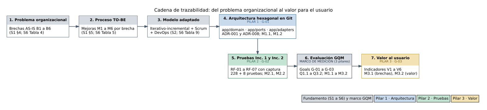

**Clasificación de la evidencia.** Para no mezclar lo medido con lo supuesto, cada afirmación de este informe pertenece a una de las cuatro clases de la Tabla 4.

**Tabla 4.** Clases de evidencia usadas en el informe.

| Clase | Qué incluye | Ejemplos |
| --- | --- | --- |
| **Reproducida** (v1.0 y hito v1.5: 16/10/2026; v2.0 y dataset: 17/10/2026; contenedor Linux de 2 CPU, Python 3.13, SQLite, Chromium headless) | Resultados que se obtuvieron ejecutando los scripts de `herramientas/gqm/` y `herramientas/dataset/` y guardados en `entregables/semana-09/metricas/` y `evidencias_capturas/` | 328 + 15 pruebas (v2.0), cobertura, M1.1, M1.2, M1.3, M2.x, M3.x, carga, disponibilidad, 45 + 27 exploratorias, 44 capturas, análisis AS-IS del dataset |
| **Heredada** (S1 a S6 y datos de terceros) | Resultados de entregables previos que aquí no se re-ejecutaron, y el dataset de la DIRESA Junín (dato real de terceros; su análisis sí se reprodujo) | Brechas B1 a B6, matriz de intervención, ADR-001 a ADR-006, HU-01 a HU-05, DEF-01 y DEF-02 (S6), dataset HIS 2022 a 2024 |
| **Propuesta** | Decisiones o metas que el equipo plantea y que no están aprobadas | Reparto de expositores, ajuste de la meta de M3.1, fechas del plan PDCA, replanificación de sprints |
| **Pendiente** | Lo que aún no existe o no se ha hecho | SUS con usuarios, piloto en posta, análisis de SonarCloud, validación de la concordancia HIS y sistema con la microred, recordatorios a la familia (INC-4) |

### 2.1 Cierre del Incremento 2 en `v2.0.0-inc2`

El docente pidió llegar a la evaluación con al menos la mitad del Incremento 2. El 16/10/2026 se alcanzó ese 50 % (hito `v1.5.0-inc2-avance`: HIST-2.1 y HIST-2.2) y el 17/10/2026 se completó el incremento (HIST-2.3 y HIST-2.4), de modo que esta evaluación se hace sobre la versión completa `v2.0.0-inc2`. La Tabla 5 muestra el estado de las cuatro historias del INC-2 (S3-4, Tabla 11) y de los 18 puntos de historia (SP) estimados en S3-4 (Tabla 19).

**Tabla 5.** Estado de las historias del Incremento 2 en `v2.0.0-inc2`.

| Historia | Descripción | SP | Estado | RF | Endpoints e interfaz | Evidencia |
| --- | --- | --- | --- | --- | --- | --- |
| HIST-2.1 | Generar agenda de controles según la normativa | 5 | **Entregada** (hito v1.5) | RF-06 | `GET /api/ninos/{id}/agenda`; sección «Agenda de controles» en el expediente | 28 pruebas automatizadas (3 E2E), captura de 3 pasos, ADR-007 |
| HIST-2.2 | Identificar controles vencidos y alertas internas priorizadas | 5 | **Entregada** (hito v1.5) | RF-07 | `GET /api/alertas/controles-vencidos`, `GET /api/alertas/resumen`; pestaña «Alertas» | 17 pruebas automatizadas (2 E2E), captura de 3 pasos, ADR-007 |
| HIST-2.3 | Visualizar agenda del personal | 5 | **Entregada** (v2.0) | RF-08 | `GET /api/agenda` (rango de hasta 31 días; filtros por establecimiento y comunidad); pestaña «Agenda» | 15 pruebas automatizadas (3 E2E), captura de 3 pasos, 12 exploratorias |
| HIST-2.4 | Registrar asistencia a control | 3 | **Entregada** (v2.0) | RF-09 | `POST /api/ninos/{id}/controles/{codigo}/asistencia`, `GET /api/ninos/{id}/asistencias`; botones «Asistió» y «No asistió» | 26 pruebas automatizadas (2 E2E), captura de 5 pasos, ADR-010, 15 exploratorias |
| **Total** | | **18** | **4/4 historias (100,0 %); 18/18 SP (100,0 %)** | | | |

Además de las cuatro historias, el cierre incluye el **habilitador técnico** de la estructura a puertos y adaptadores (ADR-008, desde el hito v1.5) y las decisiones para operar con datos reales: origen de los datos, importador del dataset y fecha de referencia (ADR-009) y asistencia persistida (ADR-010); ninguno se cuenta en los 18 SP. La API de v2.0 tiene 15 rutas (12 en el hito v1.5 y 9 en v1.0), y `GET /api/ninos` cambia el significado de `control_atrasado`: indica «tiene al menos un control vencido de la agenda normativa» en lugar de la heurística de 30 días sin control del Inc. 1. Las reglas de la agenda, las alertas, la asistencia y la agenda del personal (esquema `ESQUEMA_AGENDA_V1`, parámetros referenciales por confirmar con la microred) están en el Anexo G.5 (Tabla 46).

**Desviación de calendario.** El plan de S3-4 (Tabla 23) asignó el INC-2 completo al Sprint 3 (29/09 al 12/10/2026), con el hito H2 el 12/10/2026. El 16/10/2026 el avance era del 50 % de las historias (10 de 18 SP, hito `v1.5.0-inc2-avance`) y el incremento se completó el 17/10/2026, con cierre formal el 18/10/2026. La Tabla 6 registra la desviación, su causa y la acción propuesta.

**Tabla 6.** Desviación de calendario del Incremento 2.

| Elemento | Plan (S3-4) | Real | Causa declarada por el equipo (sin registro de horas del Sprint 3) | Acción propuesta |
| --- | --- | --- | --- | --- |
| Alcance del INC-2 | 18 SP (HIST-2.1 a 2.4) en el Sprint 3 | 10 SP al 16/10/2026 (hito v1.5, 50 %); 18/18 SP al 17/10/2026 (`v2.0.0-inc2`) | El cierre del informe integrador de S6 (02/10/2026) habría consumido capacidad del Sprint 3; además se dedicó esfuerzo a la reestructuración a puertos y adaptadores (ADR-008) y a la corrección de DEF-03 a DEF-08 | Hecho: HIST-2.3 y HIST-2.4 cerradas el 17/10/2026. Falta publicar la etiqueta `v2.0-Inc2` (Anexo B) |
| Hito H2 | 12/10/2026 | 50 % el 16/10/2026 (hito exigido por el docente); 100 % con cierre formal el 18/10/2026 (6 días después de lo planificado) | Ídem | Registrar el nuevo valor de H2 en el plan (propuesta) |
| Efecto en el plan | INC-3 en el Sprint 4 (13 al 26/10/2026) | INC-3 sin iniciar; el INC-2 se cerró dentro del Sprint 4 | El Sprint 4 absorbió el cierre del INC-2 y absorbe la mejora PDCA | Propuesta de replanificación: INC-3 inicia en el Sprint 5 (27/10 al 09/11/2026) y los incrementos siguientes se desplazan un sprint; el calendario revisado se presentará al docente (no está aprobado) |

### 2.2 Resultados clave

La Tabla 7 resume las seis métricas GQM de la guía con la meta de cada incremento, incluye el hito v1.5 como referencia y añade, fuera de las métricas, el p95 de rendimiento para no ocultar su regresión. Las filas M2.2 y M3.2 deben leerse con las salvedades de las conclusiones 2 a 4.

**Tabla 7.** Resumen de las seis métricas GQM y del p95 (valores de `metricas/datos/resumen_gqm.json` y `m32_carga.json`).

| Métrica | Inc. 1 (v1.0-PMV) | Hito v1.5 (50 %) | Inc. 2 (v2.0.0-inc2) | Meta Inc. 1 / Inc. 2 | ¿Cumple? Inc. 1 / Inc. 2 |
| --- | --- | --- | --- | --- | --- |
| M1.1 Índice de contaminación del dominio | 0,0 % (0/8 clases) | 0,0 % (0/19) | 0,0 % (0/32 clases) | 0,0 % / 0,0 % | Sí / Sí |
| M1.2 Conformidad estructural hexagonal (criterio estricto) | 40,0 % (2/5); laxo 60,0 % | 100,0 % (5/5) | 100,0 % (5/5) | 100 % / 100 % | **No** / Sí |
| M2.1 RF con captura aprobada | 100,0 % (5/5) | 100,0 % (2/2); 50,0 % (2/4) del alcance total | 100,0 % (4/4 RF del Inc. 2) | 100 % / 100 % | Sí / Sí |
| M2.2 Defectos funcionales por RF | 1,4 Def/RF (7/5) | 0,0 (0/2) | **0,25 Def/RF** (1/4: DEF-09, hallado por E2E antes de liberar); escapados a producción: 0,0 (0/4) | ≤ 1,0 / ≤ 0,2 | **No** / **No** |
| M3.1 Cobertura de brechas AS-IS resueltas (de 6) | 25,0 % | 33,3 % | 33,3 % | ≥ 60 % / ≥ 90 % | **No** / **No** |
| M3.2 Índice de impacto en valor (solo V1 a V3) | 57,6 % | 100,0 % | 100,0 % | mejora ≥ 50 % / ≥ 80 % | Sí / Sí |
| V4 p95 agregado (fuera del índice M3.2 y sin meta en la guía) | 175 ms | 610 ms | 815 ms (**empeora**) | n/a | n/a |

Cuatro conclusiones sintetizan los resultados.

1. **Arquitectura.** El dominio estuvo aislado desde el Inc. 1 (M1.1 = 0,0 %), pero la estructura del PMV cumplía 2 de los 5 componentes de la guía (M1.2 = 40,0 %); el ADR-008 la llevó a 5/5 en el hito v1.5 y la v2.0 la mantiene al crecer el dominio de 19 a 32 clases sin ninguna importación externa y con 0 violaciones de la regla de dependencia (18 pruebas de arquitectura). `v1.0-PMV`, `v1.5.0-inc2-avance` y `v2.0-Inc2` están publicadas en GitHub (rama `feature/inc2-agenda-alertas`; el cierre es el commit `fb26626`), con capturas de su interfaz en la sección 4.1.
2. **Pruebas.** Los 9 RF tienen ficha, captura aprobada y pruebas en verde (328 por defecto y 15 E2E; cobertura de 100 %; 48 de 48 criterios Dado-Cuando-Entonces; 27 exploratorias de RF-08 y RF-09 sin fallas). La meta del Inc. 1 no se cumplió (1,4 Def/RF): 6 de 7 defectos escaparon del PMV y se hallaron en el ciclo del Inc. 2; todos están corregidos con regresión. **La meta del Inc. 2 tampoco se cumple**: 0,25 Def/RF frente a ≤ 0,2, por DEF-09 (RF-08, código nuevo), que las E2E hallaron antes de liberar; ningún defecto escapó (0/4), lectura que se informa aparte porque no es la definición de M2.2 (Tabla 30).
3. **Valor.** M3.2 pasa de 57,6 % a 100,0 %, pero mide solo V1 a V3 (no incluye tiempo de respuesta, disponibilidad ni satisfacción). M3.1 queda en 33,3 % frente a una meta de 90 %: la guía supone cerrar casi todas las brechas en dos incrementos y el plan las reparte en seis (sección 6.4). Con el dataset real de la DIRESA Junín se midió la línea base AS-IS (control de hemoglobina registrado al mes, a los 3 y a los 6 meses: 67,1 %, 54,7 % y 46,3 %; pérdida de seguimiento a 6 meses: 53,7 %, o 33,9 % con seguimiento posible) y se verificó que, con una muestra de 500 niños, el sistema genera agenda para el 100 % y muestra 1 638 controles vencidos de 419 niños, con 100 % de concordancia con el oráculo (sección 6.2). Es capacidad del sistema, no mejora de resultados de salud: no se afirma impacto clínico.
4. **Hallazgo adverso.** Con el mismo mix de carga el p95 agregado (V4) pasó de 175 ms a 610 ms (hito v1.5) y a 815 ms (v2.0), sin fallos y por debajo de 2 s. La optimización aplicada (carga de niños por Core y suma de meses sin `calendar.monthrange`) redujo las medianas entre 12 % y 21 % en un micro-benchmark de 1 000 niños, pero no revirtió la regresión bajo carga. Con el dataset completo (11 686 niños) las alertas tardan 2,45 s y devuelven 22 MiB sin paginar. Siguen abiertas las acciones 1 y 10 del plan PDCA (sección 7.3).

<div style="page-break-after: always;"></div>

## 3. MATRIZ DE OBJETIVOS, PREGUNTAS Y MÉTRICAS GQM (Actividades 1, 2 y 3)

### 3.1 Actividad 1 — Formulación de objetivos de medición (nivel G)

La Tabla 8 reproduce la Matriz 1.1 de la guía. Cada goal se redacta además con la plantilla formal de Basili de cinco elementos (objeto, propósito, enfoque de calidad, punto de vista y contexto) en las subsecciones siguientes. La plantilla («Analizar… con el propósito de… con respecto a… desde el punto de vista de… en el contexto de…») y el formato de la matriz GQM provienen de las láminas de la sesión de la Semana 9 «Meta – definir», «Meta – Pregunta – Métrica» y «Formato a utilizar en el proyecto», que citan el caso de Sánchez-Seco et al. (2015) y el enfoque de Basili et al. (2010) (`ArchivosComplementarios/Semana09_S1.pdf`; Anexo F).

**Tabla 8.** Matriz 1.1: Objetivos de medición GQM del proyecto.

| Código Goal | Dimensión Evaluada | Objeto a Evaluar | Propósito de Medición | Enfoque de Calidad / Atributo | Punto de Vista | Contexto de Aplicación |
| --- | --- | --- | --- | --- | --- | --- |
| **G-01** | **Producto (Arquitectura)** | Estructura de código en el repositorio GitHub (`v1.0-PMV` y `v2.0.0-inc2`) | Evaluar el nivel de desacoplamiento | Mantenibilidad e independencia tecnológica | Arquitecto de Software | Estructura de carpetas de Arquitectura Hexagonal (`app/domain`, `app/ports`, `app/adapters`) |
| **G-02** | **Producto (Pruebas)** | Incremento 1 (PMV) e Incremento 2 completo (`v2.0.0-inc2`) | Verificar la estabilidad funcional | Cobertura de pruebas y tasa de fallas | Responsable de QA / Testers | Pruebas unitarias, de integración y E2E con capturas de evidencia |
| **G-03** | **Proceso y Producto (Valor)** | Proceso de software y entregables funcionales | Evaluar la efectividad del proceso | Generación de valor organizacional e impacto | Usuario Final / Product Owner | Operación del software frente al proceso TO-BE (datos sintéticos, línea base real de la DIRESA Junín; sin piloto) |

El punto de vista «Usuario Final / Product Owner» es **simulado** en este caso académico (la aceptación del Product Owner de S6 es simulada): no hubo usuarios reales que validaran los resultados.

#### 3.1.1 [Pilar 1 · Arquitectura] Goal G-01 en forma de Basili

> **Analizar** la estructura de código del repositorio GitHub del proyecto (`v1.0-PMV` y `v2.0.0-inc2`) **con el propósito de** evaluar el nivel de desacoplamiento del núcleo de dominio respecto de frameworks y de infraestructura **con respecto a** la mantenibilidad y la independencia tecnológica **desde el punto de vista del** Arquitecto de Software **en el contexto de** la estructura de carpetas de Arquitectura Hexagonal (puertos y adaptadores) de la aplicación FastAPI del Sistema de Detección Temprana de Anemia Infantil.

#### 3.1.2 [Pilar 2 · Pruebas] Goal G-02 en forma de Basili

> **Analizar** el Incremento 1 (PMV) y el Incremento 2 completo (RF-01 a RF-09) **con el propósito de** verificar la estabilidad funcional **con respecto a** la cobertura de pruebas y la tasa de fallas **desde el punto de vista del** Responsable de QA y los Testers **en el contexto de** pruebas unitarias, de integración y E2E con capturas de pantalla como evidencia, ejecutadas con datos sintéticos y con una muestra del dataset real anonimizado de la DIRESA Junín.

#### 3.1.3 [Pilar 3 · Valor] Goal G-03 en forma de Basili

> **Analizar** el proceso de software y los entregables funcionales de los Incrementos 1 y 2 **con el propósito de** evaluar la efectividad del proceso **con respecto a** la generación de valor organizacional y su impacto sobre las brechas AS-IS **desde el punto de vista del** Usuario Final y el Product Owner (simulado) **en el contexto de** la operación del software frente al proceso TO-BE, medida con datos sintéticos y con la línea base real de la DIRESA Junín, sin piloto en una posta.

### 3.2 Actividad 2 — Árbol de preguntas de evaluación (nivel Q)

La Figura 2 muestra el árbol completo. Las preguntas Q1.1 a Q3.2 son las de la guía; Q1.3 es una pregunta **complementaria** que el equipo añade para cubrir la regla de dependencia (que las dependencias apunten hacia el núcleo), que M1.1 y M1.2 no miden por sí solas.

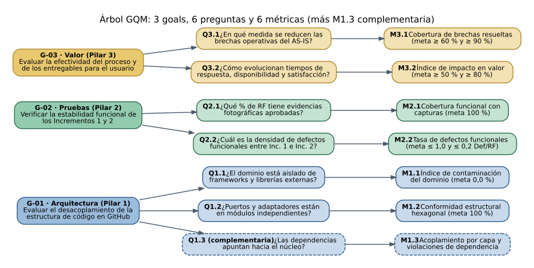

#### 3.2.1 [Pilar 1 · Arquitectura] Preguntas de G-01

La Tabla 9 lista las preguntas del Pilar 1.

**Tabla 9.** Preguntas del Pilar 1 y su métrica.

| Código | Pregunta (texto de la guía) | Por qué importa en este proyecto | Métrica que la responde |
| --- | --- | --- | --- |
| **Q1.1** | ¿El núcleo de dominio (*Domain Core*) se encuentra aislado de marcos de trabajo (*frameworks*) y librerías externas en la estructura de directorios? | Las reglas clínicas y la agenda normativa son lo que más cambia; si dependieran de FastAPI o SQLAlchemy, cada cambio de tecnología obligaría a reprobarlas. | M1.1 |
| **Q1.2** | ¿Los Puertos de Entrada/Salida (*Ports*) y Adaptadores (*Adapters*) están organizados correctamente en módulos independientes de GitHub? | Los incrementos 3 a 5 agregarán adaptadores; solo es barato si cada puerto y adaptador vive en un módulo propio. | M1.2 |
| **Q1.3** (complementaria) | ¿Las dependencias entre capas apuntan hacia el núcleo (regla de dependencia)? | Lo que desacopla es la dirección de las importaciones, no el nombre de la carpeta. | M1.3 |

#### 3.2.2 [Pilar 2 · Pruebas] Preguntas de G-02

La Tabla 10 lista las preguntas del Pilar 2.

**Tabla 10.** Preguntas del Pilar 2 y su métrica.

| Código | Pregunta (texto de la guía) | Por qué importa en este proyecto | Métrica que la responde |
| --- | --- | --- | --- |
| **Q2.1** | ¿Qué porcentaje de Requerimientos Funcionales del Incremento 1 y 2 cuenta con evidencias fotográficas aprobadas? | El personal valida el sistema viendo pantallas; sin captura aprobada un RF no puede mostrarse. | M2.1 |
| **Q2.2** | ¿Cuál es la densidad de defectos funcionales detectados entre la entrega del PMV (Inc. 1) y el Incremento 2? | Un defecto en el registro o la clasificación afecta datos de niños; interesa cuántos escaparon del PMV. | M2.2 |

#### 3.2.3 [Pilar 3 · Valor] Preguntas de G-03

La Tabla 11 lista las preguntas del Pilar 3.

**Tabla 11.** Preguntas del Pilar 3 y su métrica.

| Código | Pregunta (texto de la guía) | Por qué importa en este proyecto | Métrica que la responde |
| --- | --- | --- | --- |
| **Q3.1** | ¿En qué medida las funcionalidades entregadas en los incrementos reducen las brechas operativas identificadas en el proceso AS-IS? | El proyecto existe para cerrar las brechas B1 a B6. | M3.1 |
| **Q3.2** | ¿Cómo evolucionan los indicadores de valor del usuario (tiempos de respuesta, disponibilidad y satisfacción) con cada incremento liberado? | Una agenda lenta o no disponible en la posta no se usa; además hay que medir la satisfacción. | M3.2 (V1 a V3 en el índice; V4 a V6 como calidad de servicio) |

### 3.3 Actividad 3 — Matriz operativa de métricas e indicadores (nivel M)

La Tabla 12 reproduce la Matriz 3.1 de la guía con la **fórmula explícita**, el **método de extracción real** (script de `herramientas/gqm/` que la calcula), la **fuente de datos real** y las metas de la guía.

**Tabla 12.** Matriz 3.1: Definición de métricas GQM.

| Cód. Goal | Cód. Preg. | Cód. Mét. | Nombre de la Métrica | Fórmula / Método de Extracción | Fuente de Datos | Valor Meta (Inc. 1) | Valor Meta (Inc. 2) |
| --- | --- | --- | --- | --- | --- | --- | --- |
| **G-01** | **Q1.1** | **M1.1** | Índice de Contaminación del Dominio | Importaciones externas en `domain` ÷ clases de `domain` × 100 (AST; `m11_contaminacion.py`; nota a) | `app/domain` (v1.0) y `app/domain/model` y `service` (v1.5 y v2.0) → `datos/m11_contaminacion.json` | 0,0 % | 0,0 % |
| **G-01** | **Q1.2** | **M1.2** | Cohesión de Módulos Hexagonales (conformidad estructural) | Componentes conformes ÷ 5 × 100 (`m12_conformidad.py`; nota b) | Árbol de cada versión → `datos/m12_conformidad.json` | 100 % de conformidad | 100 % de conformidad |
| **G-01** | **Q1.3** (compl.) | **M1.3** | Acoplamiento por capa y violaciones de la regla de dependencia | I = Ce ÷ (Ca + Ce) por capa y conteo de importaciones que violan el sentido hacia el núcleo (`m13_acoplamiento.py`) | Repositorio → `datos/m13_acoplamiento.json` | Sin meta en la guía (propuesta: 0 violaciones) | Sin meta en la guía (propuesta: 0 violaciones) |
| **G-02** | **Q2.1** | **M2.1** | Cobertura Funcional con Capturas | RF con captura de resultado aprobada ÷ RF del incremento × 100 (`capturar_evidencias.py`, `m21_cobertura_rf.py`) | `evidencias_capturas/INDICE.md` y `resultados_*.json` → `datos/m21_cobertura_rf.json` | 100 % | 100 % |
| **G-02** | **Q2.2** | **M2.2** | Tasa de Defectos Funcionales | Defectos funcionales atribuibles ÷ RF del incremento, en Def/RF (`m22_defectos.py`) | `registro_defectos.md` y `registro_defectos_inc2.md` → `datos/m22_defectos.json` (nota c) | ≤ 1,0 Def/RF | ≤ 0,2 Def/RF |
| **G-03** | **Q3.1** | **M3.1** | Cobertura de Brechas Resueltas | (Σ puntajes de B1 a B6 ÷ 6) × 100 (`m31_brechas.py`; nota d) | Matriz de intervención del informe integrador de S6 (su Tabla 5), código y mediciones → `datos/m31_brechas.json` | ≥ 60 % | ≥ 90 % |
| **G-03** | **Q3.2** | **M3.2** | Índice de Impacto en Valor | Promedio simple de las mejoras de V1, V2 y V3 frente a la línea base AS-IS (Tabla 52); **no incluye tiempo de respuesta, disponibilidad ni satisfacción (Q3.2); se informan aparte en la Tabla 34** | `datos/m32_*.json` → `datos/m32_indice_valor.json` (`m32_valor.py`, `m32_indice_valor.py`) | Mejora ≥ 50 % | Mejora ≥ 80 % |

Notas a la Tabla 12.

- **a) M1.1.** La guía define «librerías de frameworks importadas en el dominio ÷ total de clases del dominio»; el script cuenta las importaciones externas (ni biblioteca estándar ni internas, por AST) del dominio ÷ clases del dominio × 100.
- **b) M1.2.** Conforme = ubicación (paquete propio) **y** contenido (pureza y dirección de las importaciones); es el criterio estricto, y se informan también el laxo y el ultra estricto (sección 4.2).
- **c) M2.2.** La guía cita GitHub Issues; el equipo usa los registros de defectos del repositorio (DEF-01 a DEF-09).
- **d) M3.1.** Puntaje 1 (completo, operativo y probado), 0,5 (parcial) o 0; complementaria: puntos de las brechas comprometidas ÷ n.º de brechas comprometidas × 100; lectura estricta (solo puntaje 1,0) en la Tabla 37.

Las metas son las de la guía. S1 recomienda no fijar metas numéricas sin línea base medida; por eso se informa también cuáles no se cumplen y por qué (secciones 4, 5, 6 y 7) y se propone un ajuste de M3.1 (sección 6.4).

#### 3.3.1 [Pilar 1 · Arquitectura] Definición operacional de M1.1, M1.2 y M1.3

Unidad, escala, frecuencia, responsable (propuesto) y umbral de acción de M1.1, M1.2 y M1.3: Tabla 48 (Anexo G.7).

#### 3.3.2 [Pilar 2 · Pruebas] Definición operacional de M2.1 y M2.2

Unidad, escala, frecuencia, responsable (propuesto) y umbral de acción de M2.1 y M2.2: Tabla 49 (Anexo G.7).

#### 3.3.3 [Pilar 3 · Valor] Definición operacional de M3.1 y M3.2, y especificación de M3.2

Unidad, escala, frecuencia, responsable (propuesto) y umbral de acción de M3.1 y M3.2: Tabla 50 (Anexo G.7).

**Especificación de M3.2.** El índice usa tres indicadores con **línea base AS-IS** y un sentido claro de mejora: V1 (registros por evaluación), V2 (niños activos con agenda normativa) y V3 (detección de controles vencidos, F1). Los otros tres (V4 tiempo de respuesta, V5 disponibilidad y V6 satisfacción, proxy) se informan como calidad de servicio y **no entran al promedio**; sus fórmulas y líneas base están en la Tabla 52 (Anexo G.9).

V4 a V6 quedan fuera del promedio (por eso el 100,0 % de M3.2 mide únicamente la mejora de V1 a V3 y no contradice la regresión de V4): (a) no tienen línea base AS-IS comparable; (b) V4 mejora cuando baja y V5 y V6 saturan en 100 %, de modo que promediarlas con V1 a V3 mezclaría sentidos y unidades distintos; (c) V6 es un proxy funcional y el SUS real está pendiente (sección 6.6). Las líneas base de V2 y V3 son **cero por definición del proceso manual** (S1 y S6), no una medición en una posta. El oráculo de V3 lo escribió el propio equipo a partir de la misma especificación (ADR-007): V3 mide fidelidad a esa especificación, no a la realidad clínica.

La **línea base real de la DIRESA Junín** (sección 6.2) describe el resultado del proceso actual (controles registrados en el HIS) y la capacidad del sistema para programarlos y mostrarlos; no se promedia con V1 a V3 ni entra al índice, porque mide otra cosa (resultado del proceso frente a capacidad del sistema).

<div style="page-break-after: always;"></div>

## 4. AUDITORÍA DE ARQUITECTURA HEXAGONAL EN GITHUB (Actividad 4) [Pilar 1 · Arquitectura]

**Objetivo del pilar.** Responder Q1.1 y Q1.2 con evidencia verificable en la estructura de carpetas y en las importaciones de cada versión, y mostrar cómo evolucionó el desacoplamiento del Incremento 1 al Incremento 2 completo (`v2.0.0-inc2`).

### 4.1 Estructura de carpetas y equivalencia con la guía

La guía describe la estructura con nombres de un proyecto Java (`/src/domain/model`, `JPA`, `Spring Boot`). El proyecto es una aplicación Python con FastAPI y SQLAlchemy, de modo que la **equivalencia** es la de la Tabla 13: los puertos son `typing.Protocol` (interfaces estructurales) y los adaptadores concretos son FastAPI (entrada) y SQLAlchemy o memoria (salida).

**Tabla 13.** Equivalencia entre la estructura de la guía y la de `app/`.

| Estructura de la guía | `v1.0-PMV` (Inc. 1) | `v2.0.0-inc2` (Inc. 2; estructura introducida en el hito v1.5 por el ADR-008) |
| --- | --- | --- |
| `/src/domain/model/` | `app/domain/` (`entidades.py`, `errores.py`, `reglas_clinicas.py`; sin separar modelo y servicio) | `app/domain/model/` (11 módulos: entidades, agenda, agenda del personal, alertas, asistencia, clasificación, contexto, errores, importación, origen, tiempo) |
| `/src/domain/service/` | Mezclado en `app/domain/` (`reglas_clinicas.py`) | `app/domain/service/` (6 módulos: reglas clínicas, validaciones, agenda, agenda del personal, alertas, asistencia) |
| `/src/ports/inbound/` | No existe | `app/ports/inbound/` (9 puertos `Protocol`; 5 en el hito v1.5) |
| `/src/ports/outbound/` | `app/application/puertos.py` (módulo dentro de `application`) | `app/ports/outbound/` (`RepositorioNinos`, `Reloj`) |
| *(casos de uso)* | `app/application/casos_uso.py` | `app/application/` (7 servicios que implementan los puertos de entrada) |
| `/src/adapters/inbound/rest/` | `app/adapters/entrada/http/` | `app/adapters/inbound/http/` |
| `/src/adapters/outbound/persistence/` | `app/adapters/salida/persistencia/` | `app/adapters/outbound/persistence/` (+ `reloj_sistema.py` y `reloj_fijo.py`) |
| *(raíz de composición)* | `app/main.py` | `app/main.py` |

En el tag `v1.0-PMV` la carpeta `app/` está en la raíz del repositorio (<https://github.com/woshtsu/ProcesosSoftwareAnemia/tree/v1.0-PMV/app>). La versión v2.0 vive en `pmv_fastapi/app/` del árbol de trabajo y conserva la estructura de carpetas del hito v1.5, publicado en GitHub en la rama `feature/inc2-agenda-alertas` y la etiqueta `v1.5.0-inc2-avance` (<https://github.com/woshtsu/ProcesosSoftwareAnemia/tree/v1.5.0-inc2-avance/pmv_fastapi/app>, 17/10/2026). La etiqueta `v2.0-Inc2` (cierre del incremento, commit `fb26626`) está publicada en <https://github.com/woshtsu/ProcesosSoftwareAnemia/tree/v2.0-Inc2/pmv_fastapi/app>. La Figura 3 es la vista en GitHub de `v1.0-PMV` y la Figura 4 la de `v2.0-Inc2`; la del hito `v1.5.0-inc2-avance` está en `evidencias_capturas/arquitectura/github_v1.5.0-inc2-avance_app.png`; el árbol completo de carpetas de v2.0 está en el Anexo G.2 y los de v1.0 y del hito v1.5 en `evidencias_capturas/arquitectura/arbol_v1.0.png` y `arbol_v1.5.png`.


**Evidencia en GitHub.** Las Figuras 3 y 4 son capturas del navegador sobre las etiquetas publicadas `v1.0-PMV` (17/10/2026) y `v2.0-Inc2` (18/10/2026; commit `fb26626`, rama `feature/inc2-agenda-alertas`). En v1.0 la carpeta `app/` no tiene `ports/`; en v2.0 aparece `ports/` junto a `adapters/`, `application/`, `domain/` y `web/`, que es la estructura que audita la Matriz 4.1. Esa estructura se introdujo en el hito `v1.5.0-inc2-avance` (también publicado; captura en `evidencias_capturas/arquitectura/`) y la v2.0 solo agrega módulos dentro de esas mismas carpetas.

### 4.2 Matriz 4.1 de auditoría arquitectónica

Las Tablas 14 y 15 son la Matriz 4.1 de la guía aplicada a cada versión. El estado es el del criterio **estricto** de `m12_conformidad.py`: un componente es conforme solo si su ubicación (paquete propio) y su contenido (pureza, dirección de importaciones) cumplen. Cada hallazgo cita archivo y línea.

**Tabla 14.** Matriz 4.1 para `v1.0-PMV` (Incremento 1).

| Componente Hexagonal | Ruta en Repositorio GitHub | Estado (Conforme / No Conforme) | Evidencia de Desacoplamiento / Hallazgo |
| --- | --- | --- | --- |
| **Núcleo de Dominio** | [`app/domain/`](https://github.com/woshtsu/ProcesosSoftwareAnemia/tree/v1.0-PMV/app/domain) (equivale a `/src/domain/model/`) | **Conforme** | 0 importaciones externas: 9 importaciones, 7 de la biblioteca estándar y 2 internas del dominio; 8 clases (m11). |
| **Puertos de Entrada** | `app/ports/inbound/` (no existe en el tag) | **No Conforme** | No hay puertos de entrada: ningún caso de uso se define como interfaz; el adaptador HTTP invoca una clase concreta. |
| **Puertos de Salida** | [`app/application/puertos.py`](https://github.com/woshtsu/ProcesosSoftwareAnemia/blob/v1.0-PMV/app/application/puertos.py) | **No Conforme** (conforme con criterio laxo) | Dos interfaces puras (`RepositorioNinos`, línea 13, con 9 métodos sin lógica; `Reloj`, línea 33), 0 violaciones de pureza, pero ubicadas dentro del paquete `application`, que también aloja `casos_uso.py`. Además `app/application/casos_uso.py:207` define `RelojSistema`, una implementación de un puerto fuera de los adaptadores. |
| **Adaptadores Entrada** | [`app/adapters/entrada/`](https://github.com/woshtsu/ProcesosSoftwareAnemia/tree/v1.0-PMV/app/adapters/entrada) | **No Conforme** | `app/adapters/entrada/http/api.py:12`: `from app.application.casos_uso import ServicioExpediente`. Importa 0 puertos de entrada y 1 módulo de aplicación (clase concreta): viola la regla de dependencia. |
| **Adaptadores Salida** | [`app/adapters/salida/persistencia/`](https://github.com/woshtsu/ProcesosSoftwareAnemia/tree/v1.0-PMV/app/adapters/salida/persistencia) | **Conforme** | Dos clases implementan `RepositorioNinos` (`memoria.py:9`, `sqlalchemy_repo.py:149`); SQLAlchemy queda confinado a `sqlalchemy_repo.py` (líneas 6 y 18); 0 importaciones de aplicación o de adaptadores de entrada. |

Resultado: 2 de 5 componentes conformes, **M1.2 = 40,0 %** (60,0 % con el criterio laxo; 20,0 % con el ultra estricto). El criterio **ultra estricto** exige, además, que todos los puertos de salida (incluido `Reloj`) tengan su implementación dentro del paquete de adaptadores de salida; en v1.0 `RelojSistema` está en `app/application/casos_uso.py:207`.

**Tabla 15.** Matriz 4.1 para `v2.0.0-inc2` (Incremento 2 completo). Las rutas son las del árbol de trabajo (`pmv_fastapi/app/`); la etiqueta `v2.0-Inc2` está publicada en GitHub (Figura 4).

| Componente Hexagonal | Ruta en Repositorio GitHub | Estado (Conforme / No Conforme) | Evidencia de Desacoplamiento / Hallazgo |
| --- | --- | --- | --- |
| **Núcleo de Dominio** | `pmv_fastapi/app/domain/model/` y `pmv_fastapi/app/domain/service/` | **Conforme** | 0 importaciones externas: 67 importaciones, 33 de la biblioteca estándar y 34 internas; 32 clases (m11). 0 importaciones de otras capas. |
| **Puertos de Entrada** | `pmv_fastapi/app/ports/inbound/` | **Conforme** | 9 interfaces `Protocol` sin lógica: `GenerarAgenda` (`agenda.py:8`), `ConsultarAgendaPersonal` (`agenda_personal.py:9`), `ConsultarControlesVencidos` (`alertas.py:8`), `RegistrarAsistencia` (`asistencia.py:8`), `ConsultarContexto` (`contexto.py:8`), `GestionarExpediente` (`expediente.py:9`), `ImportarDataset` (`importacion.py:9`), `GenerarReporte` (`reportes.py:7`), `ConsultarSeguimiento` (`seguimiento.py:6`). |
| **Puertos de Salida** | `pmv_fastapi/app/ports/outbound/` | **Conforme** | `Reloj` (`reloj.py:7`) y `RepositorioNinos` (`repositorio_ninos.py:14`, 13 métodos sin lógica); 0 violaciones de pureza ni importaciones de infraestructura. |
| **Adaptadores Entrada** | `pmv_fastapi/app/adapters/inbound/http/` | **Conforme** | `api.py:19` a `api.py:26` importan 8 de los 9 puertos de entrada (`ImportarDataset` lo usa el importador de línea de comandos, no HTTP); 0 módulos de aplicación y 0 adaptadores de salida. |
| **Adaptadores Salida** | `pmv_fastapi/app/adapters/outbound/` (con `persistence/`, `reloj_sistema.py` y `reloj_fijo.py`) | **Conforme** | `RepositorioEnMemoria` (`memoria.py:13`) y `RepositorioSQLAlchemy` (`sqlalchemy_repo.py:239`) heredan de `RepositorioNinos`; SQLAlchemy solo en `sqlalchemy_repo.py` (líneas 7, 24 y 25); 0 importaciones de aplicación o de adaptadores de entrada. `reloj_sistema.py` y `reloj_fijo.py` implementan `Reloj`. |

Resultado: 5 de 5 componentes conformes, **M1.2 = 100,0 %** con los tres criterios, igual que en el hito v1.5 (m12). La Figura 5 compara la conformidad por componente.

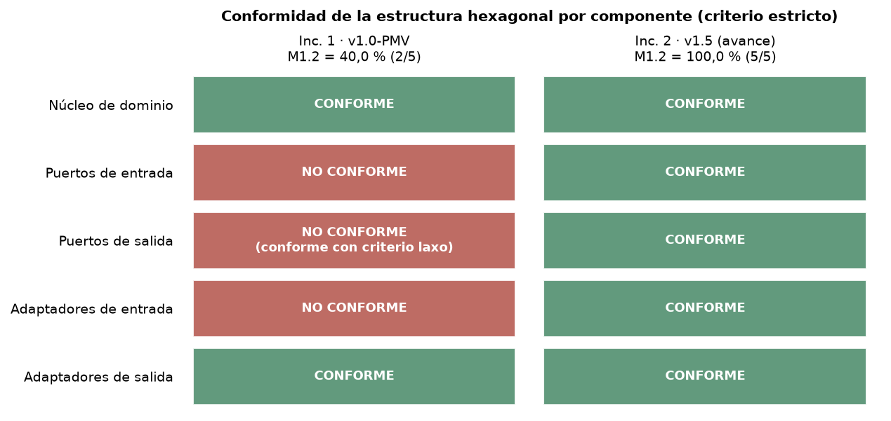

### 4.3 Reporte de desacoplamiento del dominio

**Contaminación del dominio (M1.1).** El script `m11_contaminacion.py` recorre el árbol sintáctico de cada archivo y clasifica cada importación como de la biblioteca estándar, interna del proyecto o externa (de terceros). La Tabla 16 muestra el resultado por capa. En todas las versiones el dominio no importa ningún framework (FastAPI, Pydantic, SQLAlchemy, etc.): **M1.1 = 0 ÷ 8 = 0,0 % en v1.0 y 0 ÷ 32 = 0,0 % en v2.0** (0 ÷ 19 en el hito v1.5).

**Tabla 16.** Importaciones por capa (m11): clases e importaciones estándar, internas y externas.

| Versión | Capa | Archivos `.py` analizados | Clases | Importaciones totales | Estándar | Internas | Externas |
| --- | --- | --- | --- | --- | --- | --- | --- |
| v1.0 | Dominio (`app/domain`) | 4 | 8 | 9 | 7 | 2 | **0** |
| v1.0 | Puertos de entrada | 0 | 0 | 0 | 0 | 0 | 0 |
| v1.0 | Puertos de salida (`application/puertos.py`) | 1 | 2 | 3 | 2 | 1 | 0 |
| v1.0 | Aplicación (`application/casos_uso.py`) | 1 | 2 | 7 | 3 | 4 | 0 |
| v2.0 | Dominio (`domain/model` y `domain/service`) | 19 | 32 | 67 | 33 | 34 | **0** |
| v2.0 | Puertos de entrada | 10 | 9 | 20 | 13 | 7 | 0 |
| v2.0 | Puertos de salida | 3 | 2 | 6 | 4 | 2 | 0 |
| v2.0 | Aplicación | 8 | 7 | 63 | 9 | 54 | 0 |

**Violaciones de la regla de dependencia y acoplamiento (M1.3).** El script `m13_acoplamiento.py` calcula, por capa, el acoplamiento eferente (Ce, a cuántas capas depende), el aferente (Ca, cuántas dependen de ella) y la inestabilidad I = Ce ÷ (Ca + Ce): 0 indica una capa estable de la que todos dependen y que no depende de nadie. El núcleo tiene I = 0,00 en todas las versiones. La Tabla 17 resume las demás capas.

**Tabla 17.** Inestabilidad por capa (M1.3) y violaciones de la regla de dependencia.

| Capa | I en v1.0 | I en v2.0 (igual en el hito v1.5) |
| --- | --- | --- |
| Dominio | 0,00 | 0,00 |
| Puertos de entrada | (no existe) | 0,33 |
| Puertos de salida | 0,50 | 0,33 |
| Aplicación | 0,67 | 1,00 |
| Adaptadores de entrada | 1,00 | 1,00 |
| Adaptadores de salida | 1,00 | 1,00 |
| **Violaciones de la regla de dependencia** | **1** (`adaptadores_entrada → aplicacion`, `api.py:12`) | **0** |

En v2.0 la aplicación tiene I = 1,00 porque solo `main.py` la ensambla: es lo esperado, pues los adaptadores dependen de los puertos y no de los casos de uso.

**Vigilancia automática.** Las reglas se verifican en cada `pytest` con las **18 pruebas de arquitectura** de `tests/arquitectura/test_dependencias.py` (18 casos: siete pruebas CP-37 a CP-43, siete casos de dos pruebas del verificador, seis de ellos parametrizados, y cuatro pruebas nuevas de la v2.0), que analizan los `import` por AST: el dominio no importa frameworks ni otras capas; los puertos solo importan dominio, biblioteca estándar y `typing`; la aplicación no importa adaptadores ni frameworks; cada adaptador no importa aplicación ni el otro adaptador; solo `main.py` conoce a la vez aplicación y adaptadores; y no quedan módulos puente en las rutas antiguas. Las cuatro de la v2.0 (CP-176 a CP-179) agregan que la aplicación nunca importa `scripts` ni pruebas, que los módulos nuevos del dominio y de los puertos quedan cubiertos por las reglas, que el importador del dataset no toca la base directamente (entra por el servicio de importación) y que las piezas de lectura y muestreo solo dependen del dominio y de su configuración. Una violación rompe el pipeline de CI. La Figura 6 muestra los módulos reales y el sentido de las dependencias.

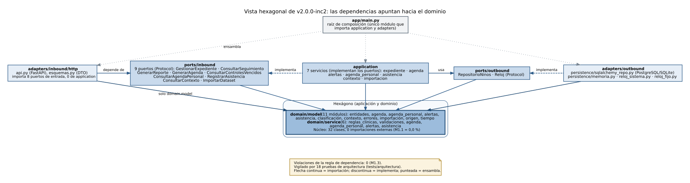

### 4.4 Decisiones de arquitectura ADR-007 a ADR-010

El **ADR-007** fija que la agenda se calcula en línea en el dominio (`ESQUEMA_AGENDA_V1`), sin tabla ni migración; el **ADR-008** fija la estructura hexagonal explícita con siete reglas de dependencia verificadas por pruebas y `main.py` como raíz de composición; el **ADR-009** define el origen de los datos (`SISTEMA` o `DATASET_DIRESA_JUNIN`), los registros seudónimos del dataset de la DIRESA Junín (sin DNI ni nombres; campos opcionales solo para ese origen), la altitud por capital de provincia con su fuente y el reloj fijo de referencia (`FECHA_REFERENCIA`); y el **ADR-010** persiste la asistencia a un control como hecho que no se deduce de las evaluaciones, sin tabla de controles (la agenda sigue calculada). Contexto, decisión y consecuencias están en la Tabla 51 (Anexo G.8).

El criterio de revisión de ADR-007 (p95 de alertas mayor que 300 ms o más de 2 000 niños activos) se supera bajo el perfil de carga de este informe (Tabla 38, 50 usuarios simultáneos), aunque con un solo usuario y 150 niños el p95 de las alertas es de 46,5 ms. Con el dataset completo (11 686 niños, casi seis veces el umbral de niños activos) las alertas tardan 2,45 s y devuelven 22 MiB sin paginar: queda como limitación documentada y como acciones 1 y 10 del plan PDCA (perfilado, paginación y, si hace falta, materializar la agenda).

### 4.5 Respuesta a las preguntas del Pilar 1

**Q1.1 · ¿El núcleo de dominio está aislado de frameworks y librerías externas en la estructura de directorios?** **Sí, en ambos incrementos.** El dominio tiene 0 importaciones externas en `v1.0-PMV` (0 de 8 clases) y en `v2.0.0-inc2` (0 de 32 clases; 0 de 19 en el hito v1.5): M1.1 = 0,0 % cumple ambas metas, y el dominio creció de 8 a 32 clases sin incorporar ninguna dependencia externa. La guía propone como ejemplo un 12 % de contaminación en el Inc. 1; el valor real fue 0,0 % y no hay mejora que atribuir a este indicador.

**Q1.2 · ¿Los puertos y adaptadores están organizados correctamente en módulos independientes de GitHub?** **En el Inc. 1 solo parcialmente; en el Inc. 2, sí.** La meta del Inc. 1 **no se cumplió** (M1.2 = 40,0 %; 60,0 % con el criterio laxo): faltaban los puertos de entrada, el puerto de salida vivía dentro de `application` y el adaptador HTTP importaba la clase concreta. La causa es de diseño: ADR-001 definió puertos de salida pero invocaba los casos de uso directamente, y la estructura de la guía es posterior al PMV. El ADR-008 llevó M1.2 a 100 % (5/5) en el hito v1.5, eliminó la violación y la v2.0 la mantiene al agregar cuatro puertos de entrada, un servicio de importación y un reloj fijo, con 18 pruebas que impiden retroceder. La evidencia son la vista de ambas etiquetas publicadas en GitHub (Figuras 3 y 4), el árbol de carpetas y las importaciones citadas con archivo y línea.

<div style="page-break-after: always;"></div>

## 5. FICHAS DE PRUEBAS FUNCIONALES CON CAPTURAS DE PANTALLA (Actividad 5) [Pilar 2 · Pruebas]

**Objetivo del pilar.** Verificar la estabilidad funcional de los Incrementos 1 y 2 con una ficha por requerimiento (RF-01 a RF-09), capturas de entrada y de resultado del software en ejecución, pruebas automatizadas que respaldan cada RF y un registro de defectos, para responder Q2.1 y Q2.2.

### 5.0 Estrategia de pruebas y entorno

La estrategia sigue la pirámide de pruebas de S6 (Tabla 23): la mayoría de las validaciones están en el dominio sin base de datos ni HTTP, la API y la persistencia se verifican en el nivel intermedio y las pruebas E2E cubren los recorridos completos de la interfaz. En v1.5 se agregó un nivel de **pruebas de arquitectura** que vigila la regla de dependencia (sección 4.3). La Tabla 18 compara las tres versiones con las salidas crudas de `pytest` guardadas en `metricas/salidas/`.

**Tabla 18.** Pirámide de pruebas de v1.0-PMV, del hito v1.5 y de v2.0.0-inc2 (ejecuciones del 16/10/2026 para v1.0 y v1.5 y del 17/10/2026 para v2.0).

| Nivel | v1.0-PMV (Inc. 1) | Hito v1.5 | v2.0.0-inc2 (Inc. 2) | Alcance |
| --- | --- | --- | --- | --- |
| Unitarias | 62 | 174 | 234 | Dominio y casos de uso con el repositorio en memoria |
| Integración y API (SQLite) | 11 | 40 | 76 | API REST con persistencia SQLAlchemy; en v2.0 incluye el importador del dataset (muestra de 20 filas con campos nulos) |
| Arquitectura (AST) | 0 | 14 | 18 | Reglas de dependencia entre capas |
| **Suite por defecto (pytest)** | **73 pruebas** | **228 pruebas** | **328 pruebas** | Tiempo: 1,97 s, 5,01 s y 9,15 s |
| E2E de interfaz (Playwright, Chromium) | 4 | 8 | 15 | Registro, datos inválidos, seguimiento y reporte; v1.5 suma agenda, casos especiales, pestaña de alertas y vista móvil; v2.0 suma 7 (agenda del personal, asistencia desde el expediente y desde la agenda, vista móvil de la agenda, aviso de fecha de referencia y registro con datos del dataset) |
| **Total con E2E** | **77** | **236** | **343** | Las 77 pruebas de v1.0 coinciden con las declaradas en S6 (73 + 4) |
| Cobertura de `app/` | 99,19 % (641 sentencias, 2 sin cubrir; 98 ramas) | 100 % (1 046 sentencias; 158 ramas) | 100 % (1 700 sentencias; 264 ramas) | Umbral de la DoD: 80 % |
| Análisis estático (ruff) | 0 hallazgos; 33 archivos con formato correcto | 0 hallazgos; 64 archivos | 0 hallazgos; 95 archivos | Reglas E, F, W, I, B, UP, S y complejidad ≤ 12 |

**Entorno de las capturas.** Chromium headless con Playwright (viewport 1366 × 900) y servidor FastAPI real (uvicorn) con SQLite. Las capturas de RF-01 a RF-07 usan **datos sintéticos de prueba** (conjunto semilla de 14 niños en v1.0 y 27 en v1.5; tras registrar a 72000001 en RF-01 las pantallas muestran 15 y 28 niños). Las de RF-08, RF-09 y de la galería de datos reales usan la **muestra estratificada de 500 niños del dataset de la DIRESA Junín** importada en la v2.0 (código seudónimo, sin DNI ni nombres; altitud de la capital de provincia, INEI 2014) y la fecha de referencia 30/06/2024, que el sistema muestra en un aviso de la cabecera. El script `capturar_evidencias.py` inyecta en cada captura un **pie de «Evidencia S9»** con el RF, el paso, la URL, la versión, la fecha-hora de Perú y la leyenda de los datos; el pie no altera la funcionalidad. Los tiempos de cada ficha son de un usuario y no sustituyen la prueba de carga de la sección 6; el umbral «menos de 2 s» sale del criterio de aceptación modelo de la guía.

**Notas sobre las capturas.** (1) Los campos de fecha nativos de Chromium headless muestran el formato mm/dd/aaaa por la configuración regional del Chromium de prueba; la aplicación muestra y almacena las fechas en dd/mm/aaaa o ISO (por eso una misma fecha puede verse como 09/10/2025 en un campo de fecha y como 10/09/2025 en el expediente). Acción menor para la próxima captura: fijar la configuración regional es-PE. (2) Las capturas de v1.5 se tomaron el 16/10/2026 entre las 14:16 y las 14:17, antes de la corrección de DEF-08 (18:02), que no cambia la interfaz; las de RF-08, RF-09 y datos reales, el 17/10/2026 a las 20:55, sobre el código final.

### 5.1 Fichas de prueba funcional por requerimiento

Cada ficha sigue el formato de la guía (proyecto, incremento, código de requerimiento, criterio Dado-Cuando-Entonces, especificación del caso de prueba, evidencias, evaluación). Las capturas de entrada y de resultado se incrustan con su descripción, la referencia a su figura y la ruta del archivo; las pruebas automatizadas que respaldan cada RF están en la Tabla 47 (Anexo G.6); la evaluación **APROBADO** significa que el criterio se cumplió en la ejecución automatizada y que las pruebas que lo respaldan están en verde; **no** equivale a aceptación de un usuario real.

#### FICHA 5.1 — RF-01 / HU-01

La Tabla 19 y las Figuras 7 y 8 documentan RF-01.

**Tabla 19.** Ficha de prueba funcional con evidencia fotográfica: RF-01.

| Campo | Detalle |
| --- | --- |
| **PROYECTO** | Sistema Inteligente para Detección Temprana de Anemia Infantil en Zonas Rurales de Junín |
| **INCREMENTO** | Incremento 1 (PMV) |
| **CÓDIGO REQUERIMIENTO** | RF-01 / HU-01 |
| **NOMBRE DEL REQUERIMIENTO** | Registrar niño con evaluación inicial (`POST /api/ninos`) |
| **CRITERIO DE ACEPTACIÓN (Given-When-Then)** | **Dado que** el personal completa el formulario «Registrar niño y evaluación inicial» con datos válidos, **cuando** presiona «Guardar registro», **entonces** el sistema almacena el registro, muestra la confirmación y abre el expediente en menos de 2 segundos. |
| **ID Caso de Prueba** | CP-RF01-01 |
| **Tipo de Prueba** | Prueba funcional de interfaz (E2E con Playwright) y de aceptación; verificación adicional por API de DNI repetido |
| **Resultado Esperado** | Registro exitoso persistido con una evaluación y notificación visual en pantalla; un DNI repetido responde 409 y no duplica el expediente. |
| **TIEMPOS MEDIDOS** | Clic en «Guardar registro» hasta confirmación visible y expediente: **188 ms** (v1.0); 294 ms sobre v1.5 (Anexo G.1). Umbral: menos de 2 s. |
| **RESULTADO OBSERVADO** | `GET /api/ninos/dni/72000001` responde 200 con 1 evaluación; confirmación en 188 ms; DNI repetido responde HTTP 409. |
| **EVALUACIÓN** | **[ APROBADO ]** |
| **FECHA** | 16/10/2026 |
| **EVALUADOR** | Huamani Rodriguez, Jean Piero (QA Lead) — ejecución automatizada reproducible con `capturar_evidencias.py`; firma pendiente |

**EVIDENCIAS FOTOGRÁFICAS (capturas del software en ejecución)**

*CAPTURA DE PANTALLA 1: DATOS DE ENTRADA.* Descripción: Formulario «Registrar niño y evaluación inicial» lleno con datos sintéticos (DNI 72000001, Hb 11,6 g/dL, 3 720 m s. n. m.); la vista previa ya muestra «Anemia moderada» (Figura 7). Archivo de imagen: `evidencias_capturas/RF-01/RF01_inc1_paso1_entrada.png`


*CAPTURA DE PANTALLA 2: CONFIRMACIÓN Y RESULTADO.* Descripción: Confirmación «Registro guardado: Rosa Elvira Ccente Poma» y expediente recién creado con su evaluación inicial (Figura 8). Archivo de imagen: `evidencias_capturas/RF-01/RF01_inc1_paso2_resultado.png`

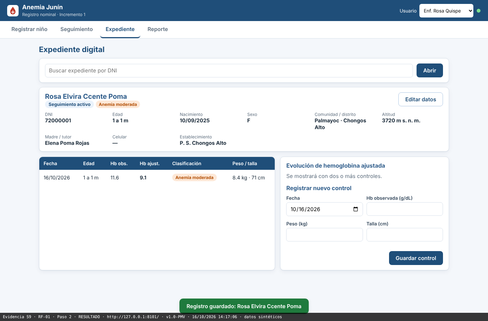

#### FICHA 5.1 — RF-02 / HU-02

La Tabla 20 y las Figuras 9 a 14 documentan RF-02.

**Tabla 20.** Ficha de prueba funcional con evidencia fotográfica: RF-02.

| Campo | Detalle |
| --- | --- |
| **PROYECTO** | Sistema Inteligente para Detección Temprana de Anemia Infantil en Zonas Rurales de Junín |
| **INCREMENTO** | Incremento 1 (PMV) |
| **CÓDIGO REQUERIMIENTO** | RF-02 / HU-02 |
| **NOMBRE DEL REQUERIMIENTO** | Consultar y actualizar el expediente, incluido un nuevo control (`GET/PATCH /api/ninos/{id}`, `POST /api/ninos/{id}/evaluaciones`) |
| **CRITERIO DE ACEPTACIÓN (Given-When-Then)** | **Dado que** existe un expediente de un niño, **cuando** el personal lo consulta, actualiza campos permitidos (comunidad, celular) y registra un nuevo control, **entonces** los cambios persisten, el historial anterior se conserva y hay confirmación en menos de 2 segundos. |
| **ID Caso de Prueba** | CP-RF02-01 |
| **Tipo de Prueba** | Prueba funcional de interfaz (E2E con Playwright) y de aceptación |
| **Resultado Esperado** | Expediente con datos y evaluaciones; actualización persistida con confirmación; el historial pasa de 2 a 3 evaluaciones sin perder las anteriores. |
| **TIEMPOS MEDIDOS** | Consulta: **98 ms**; actualización (PATCH): **107 ms**; nuevo control (POST): **97 ms** (v1.0). En v1.5: 163, 190 y 184 ms. Umbral: menos de 2 s. |
| **RESULTADO OBSERVADO** | Expediente con 2 evaluaciones previas; comunidad y celular persistidos (verificado); nuevo control: evaluaciones 2 → 3. |
| **EVALUACIÓN** | **[ APROBADO ]** |
| **FECHA** | 16/10/2026 |
| **EVALUADOR** | Huamani Rodriguez, Jean Piero (QA Lead) — ejecución automatizada reproducible con `capturar_evidencias.py`; firma pendiente |

**EVIDENCIAS FOTOGRÁFICAS (capturas del software en ejecución)**

*CAPTURA DE PANTALLA 1: DATOS DE ENTRADA (consulta).* Descripción: Pestaña «Expediente» con el DNI 71000001 digitado, antes de pulsar «Abrir» (Figura 9). Archivo de imagen: `evidencias_capturas/RF-02/RF02_inc1_paso1_entrada.png`

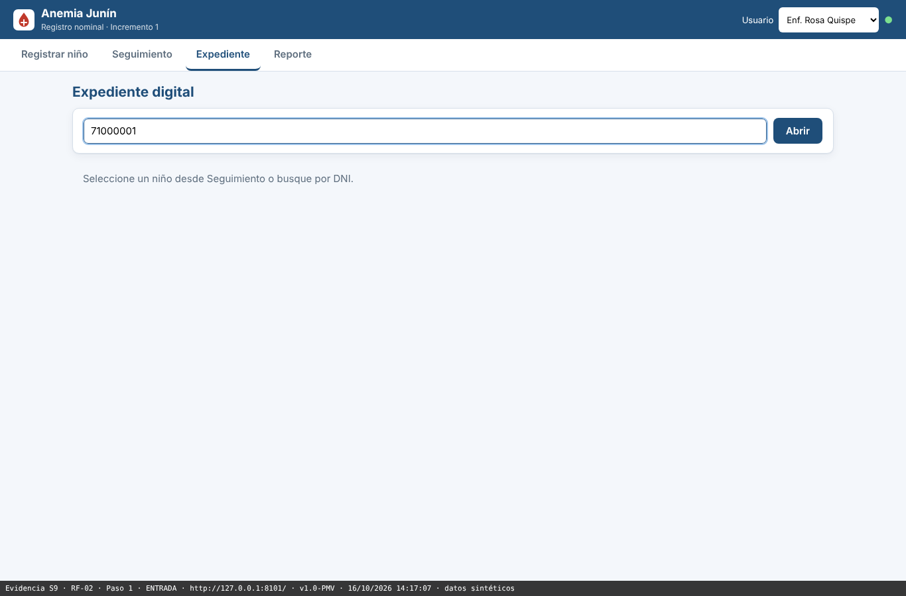

*Captura 2: RESULTADO (consulta).* Descripción: Expediente de Luz Mery Quispe Rojas: datos, historial de evaluaciones, gráfico de Hb ajustada y formularios de edición y de nuevo control (Figura 10). Archivo de imagen: `evidencias_capturas/RF-02/RF02_inc1_paso2_resultado.png`

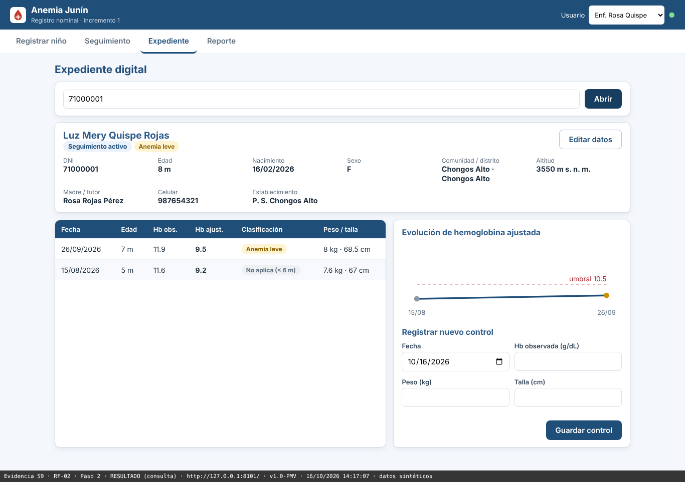

*Captura 3: ENTRADA (actualización).* Descripción: Formulario «Editar datos» con cambios de comunidad (Chongos Alto a Llacuas) y de celular (987654322), sin guardar (Figura 11). Archivo de imagen: `evidencias_capturas/RF-02/RF02_inc1_paso3_entrada_actualizacion.png`

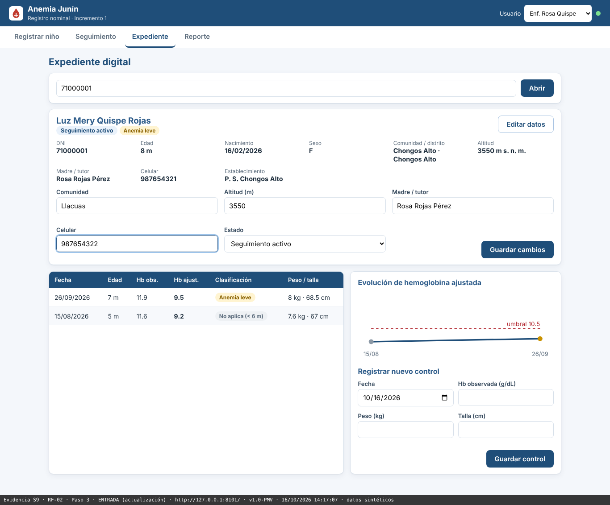

*Captura 4: RESULTADO (actualización).* Descripción: Confirmación «Expediente actualizado»; el expediente muestra comunidad Llacuas y celular 987654322 (Figura 12). Archivo de imagen: `evidencias_capturas/RF-02/RF02_inc1_paso4_resultado_actualizacion.png`

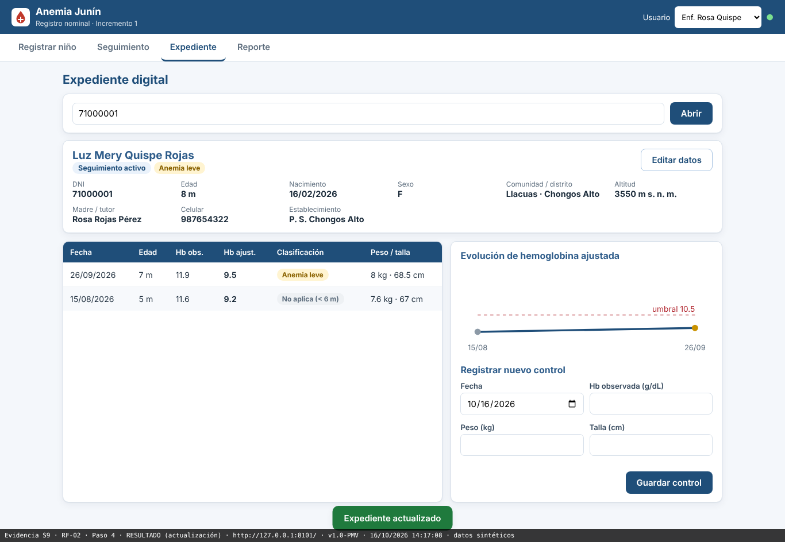

*Captura 5: ENTRADA (nuevo control).* Descripción: Formulario «Registrar nuevo control» con fecha de hoy, Hb 11,5 g/dL, peso 8,2 kg y talla 69 cm (Figura 13). Archivo de imagen: `evidencias_capturas/RF-02/RF02_inc1_paso5_entrada_nuevo_control.png`

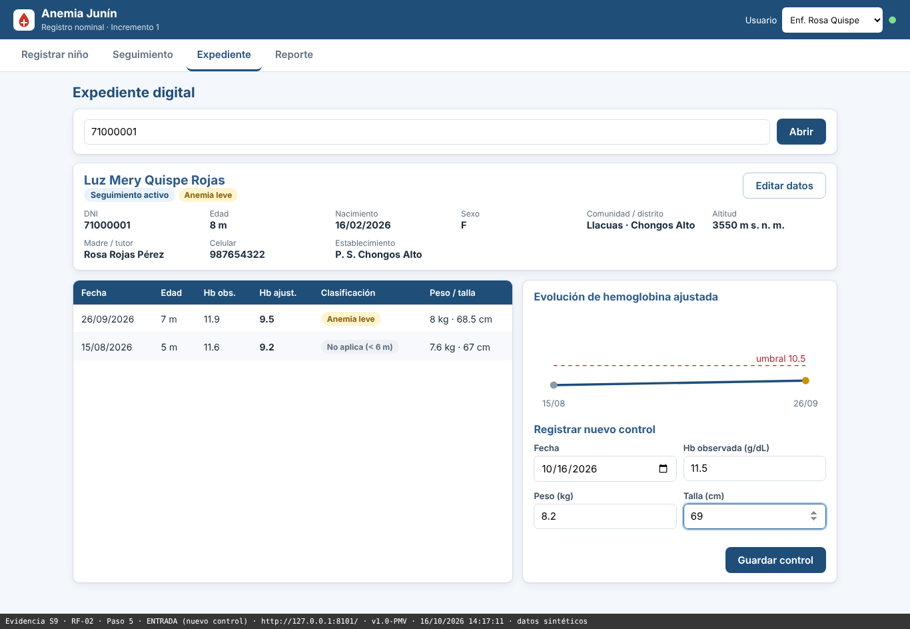

*CAPTURA DE PANTALLA 6: CONFIRMACIÓN Y RESULTADO (nuevo control).* Descripción: Confirmación «Control registrado»; el historial pasa de 2 a 3 evaluaciones sin perder las anteriores (Figura 14). Archivo de imagen: `evidencias_capturas/RF-02/RF02_inc1_paso6_resultado_nuevo_control.png`

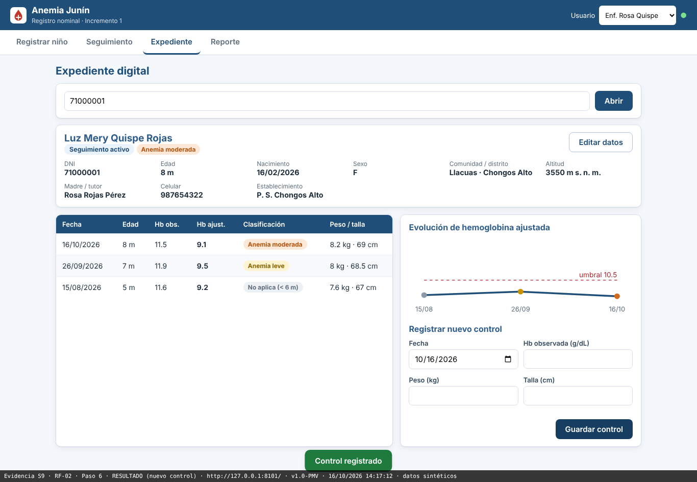

#### FICHA 5.1 — RF-03 / HU-03

La Tabla 21 y las Figuras 15 a 17 documentan RF-03.

**Tabla 21.** Ficha de prueba funcional con evidencia fotográfica: RF-03.

| Campo | Detalle |
| --- | --- |
| **PROYECTO** | Sistema Inteligente para Detección Temprana de Anemia Infantil en Zonas Rurales de Junín |
| **INCREMENTO** | Incremento 1 (PMV) |
| **CÓDIGO REQUERIMIENTO** | RF-03 / HU-03 |
| **NOMBRE DEL REQUERIMIENTO** | Validar datos con reglas clínicas: vista previa y rechazo con mensajes por campo (`POST /api/validaciones/evaluacion`, 422) |
| **CRITERIO DE ACEPTACIÓN (Given-When-Then)** | **Dado que** el personal digita los datos clínicos de un control, **cuando** ingresa la hemoglobina (o intenta guardar con datos inválidos), **entonces** la vista previa muestra la Hb ajustada por altitud y la clasificación; y si los datos son inválidos, el sistema rechaza el registro con un mensaje comprensible por campo. |
| **ID Caso de Prueba** | CP-RF03-01 |
| **Tipo de Prueba** | Prueba funcional de interfaz (E2E con Playwright) y de aceptación; verificación adicional por API (HTTP 422) |
| **Resultado Esperado** | Vista previa con edad al control, ajuste por altitud, Hb ajustada y clasificación calculadas por el servidor; rechazo de datos fuera de rango sin guardar nada. |
| **TIEMPOS MEDIDOS** | Vista previa (digitar Hb hasta clasificación visible, incluye 350 ms de antirrebote): **830 ms**; rechazo: **55 ms** (v1.0). En v1.5: 863 y 80 ms. |
| **RESULTADO OBSERVADO** | Vista previa «Anemia moderada» con Hb ajustada 9,1 g/dL; rechazo con 2 campos marcados (DNI: «exactamente 8 dígitos»; Hb: «rango clínico válido»); `POST /api/validaciones/evaluacion` con Hb 25 responde HTTP 422. |
| **EVALUACIÓN** | **[ APROBADO ]** |
| **FECHA** | 16/10/2026 |
| **EVALUADOR** | Huamani Rodriguez, Jean Piero (QA Lead) — ejecución automatizada reproducible con `capturar_evidencias.py`; firma pendiente |

**EVIDENCIAS FOTOGRÁFICAS (capturas del software en ejecución)**

*CAPTURA DE PANTALLA 1: DATOS DE ENTRADA.* Descripción: Formulario con fecha de nacimiento, altitud (3 720 m) y demás datos, sin hemoglobina: la vista previa aún no valida (Figura 15). Archivo de imagen: `evidencias_capturas/RF-03/RF03_inc1_paso1_entrada.png`

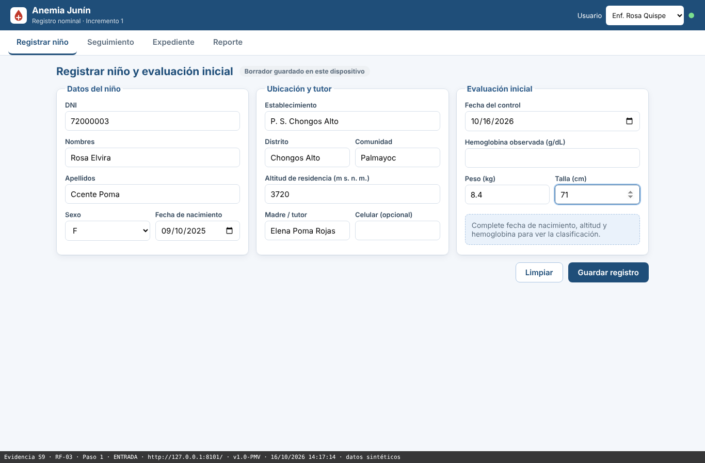

*Captura 2: RESULTADO (vista previa).* Descripción: Vista previa del servidor: ajuste por altitud −2,5 g/dL, Hb ajustada 9,1 g/dL y «Anemia moderada» (Figura 16). Archivo de imagen: `evidencias_capturas/RF-03/RF03_inc1_paso2_resultado.png`

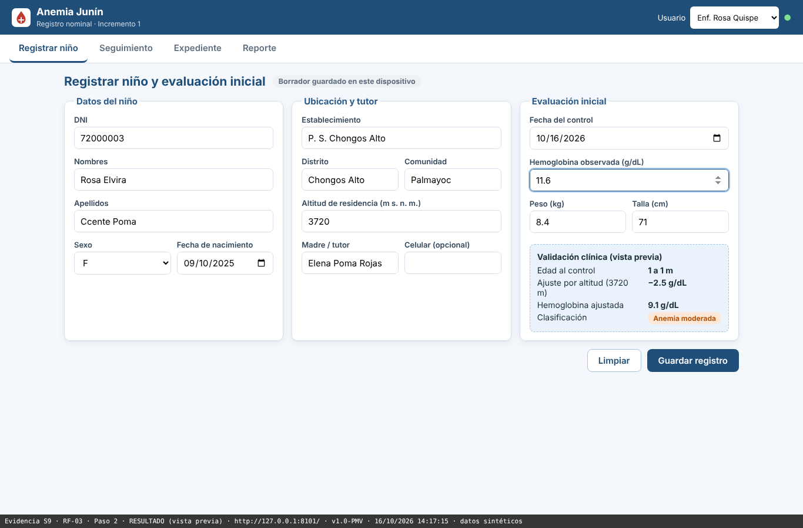

*CAPTURA DE PANTALLA 3: CONFIRMACIÓN Y RESULTADO (rechazo).* Descripción: Datos inválidos (DNI «123», Hb 25 g/dL): el sistema rechaza (HTTP 422) y marca cada campo con su mensaje (Figura 17). Archivo de imagen: `evidencias_capturas/RF-03/RF03_inc1_paso3_rechazo.png`

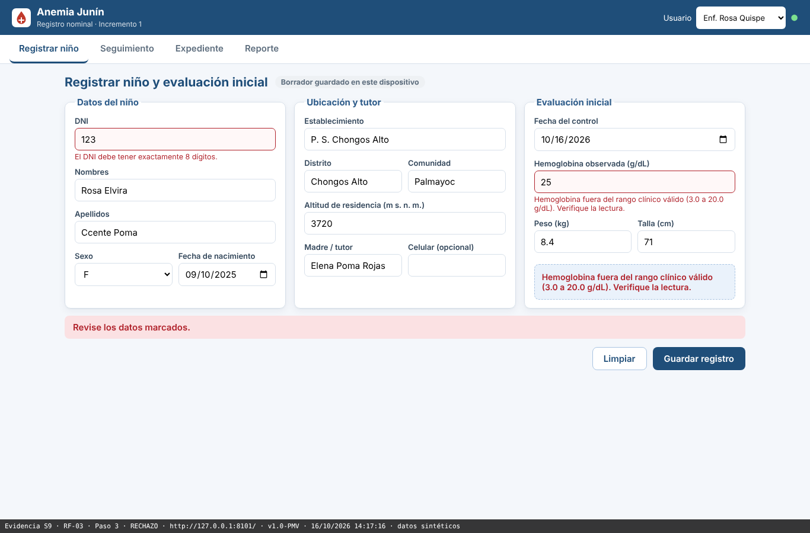

#### FICHA 5.1 — RF-04 / HU-04

La Tabla 22 y las Figuras 18 a 20 documentan RF-04.

**Tabla 22.** Ficha de prueba funcional con evidencia fotográfica: RF-04.

| Campo | Detalle |
| --- | --- |
| **PROYECTO** | Sistema Inteligente para Detección Temprana de Anemia Infantil en Zonas Rurales de Junín |
| **INCREMENTO** | Incremento 1 (PMV) |
| **CÓDIGO REQUERIMIENTO** | RF-04 / HU-04 |
| **NOMBRE DEL REQUERIMIENTO** | Listar niños en seguimiento con estado de control (`GET /api/ninos`) |
| **CRITERIO DE ACEPTACIÓN (Given-When-Then)** | **Dado que** existe un conjunto de niños en seguimiento, **cuando** el personal filtra por clasificación o busca por comunidad, **entonces** el listado respeta el filtro y muestra el estado de control de cada niño en menos de 2 segundos. |
| **ID Caso de Prueba** | CP-RF04-01 |
| **Tipo de Prueba** | Prueba funcional de interfaz (E2E con Playwright) y de aceptación |
| **Resultado Esperado** | Listado completo sin filtros; con el filtro «Anemia leve» solo aparecen niños de esa clasificación; la búsqueda por comunidad reduce el listado. |
| **TIEMPOS MEDIDOS** | Filtro por clasificación: **32 ms**; búsqueda «Palmayoc» (incluye 250 ms de antirrebote): **288 ms** (v1.0). En v1.5: 51 y 308 ms. |
| **RESULTADO OBSERVADO** | Filtro LEVE: 7 de 7 filas, coincide con `GET /api/ninos?clasificacion=LEVE`; búsqueda Palmayoc: 4 de 4 filas. En v1.5 el estado de control pasa a ser normativo (vencido según la agenda). |
| **EVALUACIÓN** | **[ APROBADO ]** |
| **FECHA** | 16/10/2026 |
| **EVALUADOR** | Huamani Rodriguez, Jean Piero (QA Lead) — ejecución automatizada reproducible con `capturar_evidencias.py`; firma pendiente |

**EVIDENCIAS FOTOGRÁFICAS (capturas del software en ejecución)**

*CAPTURA DE PANTALLA 1: DATOS DE ENTRADA.* Descripción: Pestaña «Seguimiento» sin filtros: listado completo de 15 niños (Figura 18). Archivo de imagen: `evidencias_capturas/RF-04/RF04_inc1_paso1_entrada.png`

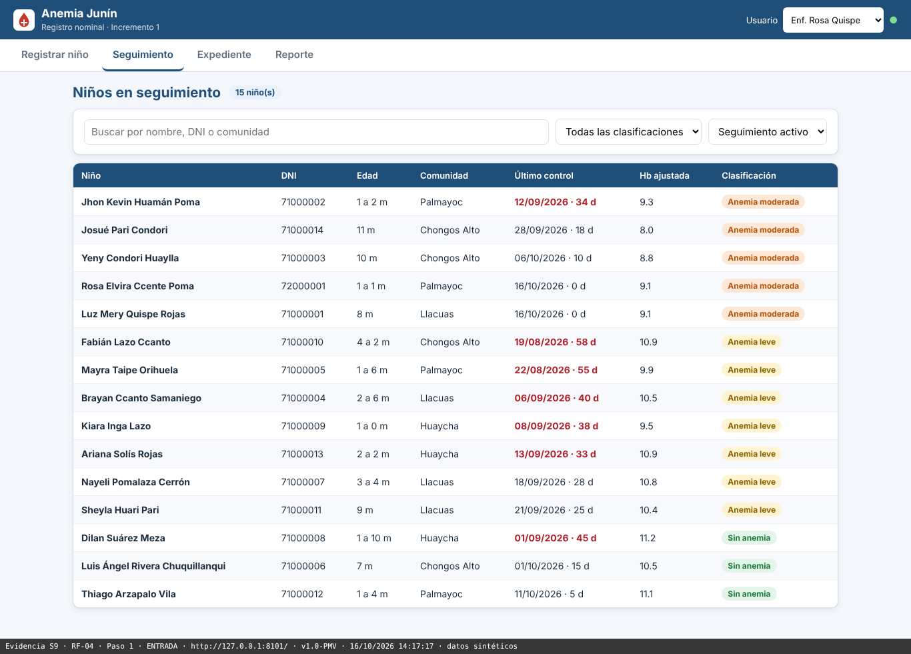

*Captura 2: RESULTADO (filtro por clasificación).* Descripción: Filtro «Anemia leve»: 7 filas, todas «Anemia leve», con fecha y antigüedad del último control (Figura 19). Archivo de imagen: `evidencias_capturas/RF-04/RF04_inc1_paso2_resultado.png`

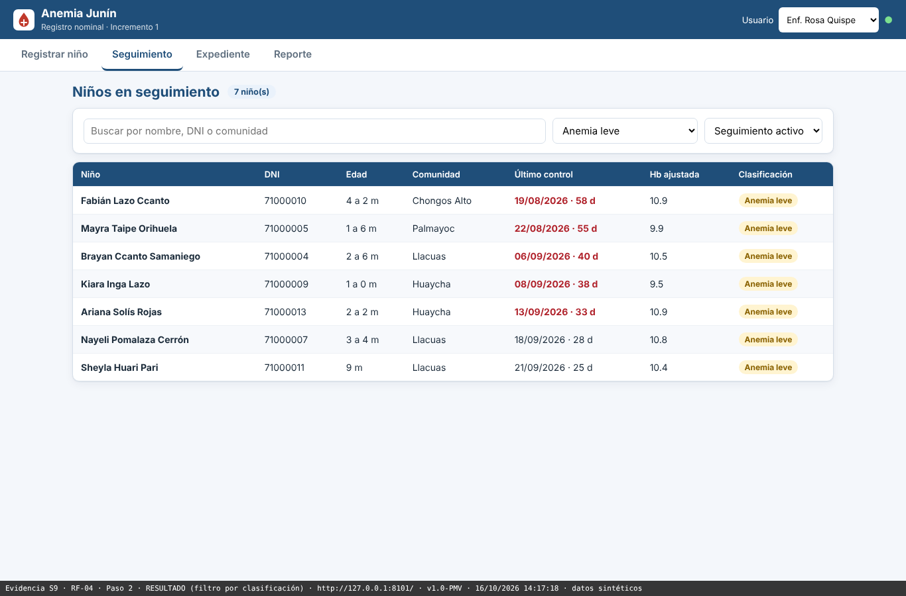

*CAPTURA DE PANTALLA 3: CONFIRMACIÓN Y RESULTADO (búsqueda por comunidad).* Descripción: Búsqueda por comunidad «Palmayoc»: el listado se reduce a 4 niños (Figura 20). Archivo de imagen: `evidencias_capturas/RF-04/RF04_inc1_paso3_busqueda_comunidad.png`

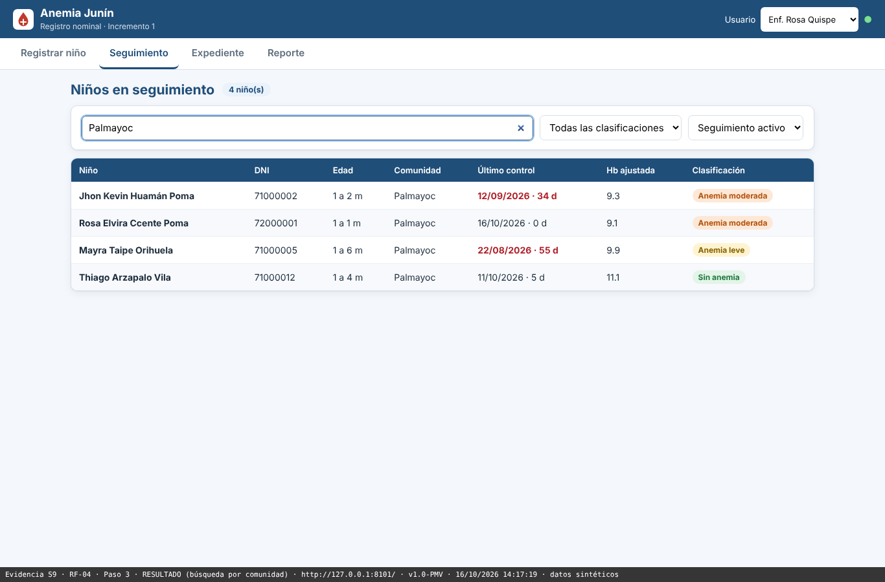

#### FICHA 5.1 — RF-05 / HU-05

La Tabla 23 y las Figuras 21 a 24 documentan RF-05.

**Tabla 23.** Ficha de prueba funcional con evidencia fotográfica: RF-05.

| Campo | Detalle |
| --- | --- |
| **PROYECTO** | Sistema Inteligente para Detección Temprana de Anemia Infantil en Zonas Rurales de Junín |
| **INCREMENTO** | Incremento 1 (PMV) |
| **CÓDIGO REQUERIMIENTO** | RF-05 / HU-05 |
| **NOMBRE DEL REQUERIMIENTO** | Reporte del periodo en JSON y CSV (`GET /api/reportes/periodo`) |
| **CRITERIO DE ACEPTACIÓN (Given-When-Then)** | **Dado que** se elige un periodo válido, **cuando** el personal pulsa «Generar» (y luego «Descargar CSV»), **entonces** se muestran los indicadores del periodo, se puede consultar el JSON y se descarga el mismo conjunto como CSV, en menos de 2 segundos. |
| **ID Caso de Prueba** | CP-RF05-01 |
| **Tipo de Prueba** | Prueba funcional de interfaz (E2E con Playwright) y de aceptación; verificación de la descarga y de la API |
| **Resultado Esperado** | Reporte en pantalla con KPI iguales a los de la API; respuesta JSON 200; archivo CSV con una fila por evaluación y cabecera de 12 columnas. |
| **TIEMPOS MEDIDOS** | Clic en «Generar» hasta reporte visible: **82 ms**; clic en «Descargar CSV» hasta archivo: **80 ms** (v1.0). En v1.5: 102 y 116 ms. |
| **RESULTADO OBSERVADO** | KPI en pantalla (15) igual al de la API (15); CSV con 15 filas igual a `evaluaciones_realizadas` (15); `Content-Type: text/csv; charset=utf-8`. Archivo descargado: [`RF-05/RF05_inc1_reporte_descargado.csv`](evidencias_capturas/RF-05/RF05_inc1_reporte_descargado.csv). |
| **EVALUACIÓN** | **[ APROBADO ]** |
| **FECHA** | 16/10/2026 |
| **EVALUADOR** | Huamani Rodriguez, Jean Piero (QA Lead) — ejecución automatizada reproducible con `capturar_evidencias.py`; firma pendiente |

**EVIDENCIAS FOTOGRÁFICAS (capturas del software en ejecución)**

*CAPTURA DE PANTALLA 1: DATOS DE ENTRADA.* Descripción: Pestaña «Reporte» con el periodo 2026-09-01 a 2026-10-16, antes de pulsar «Generar» (Figura 21). Archivo de imagen: `evidencias_capturas/RF-05/RF05_inc1_paso1_entrada.png`

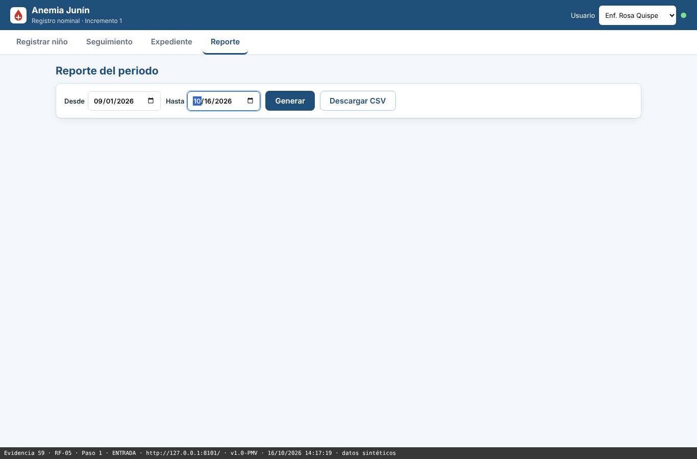

*Captura 2: RESULTADO (reporte en pantalla).* Descripción: Reporte del periodo: indicadores, barras por clasificación y tabla por comunidad; 15 niños registrados (Figura 22). Archivo de imagen: `evidencias_capturas/RF-05/RF05_inc1_paso2_resultado.png`

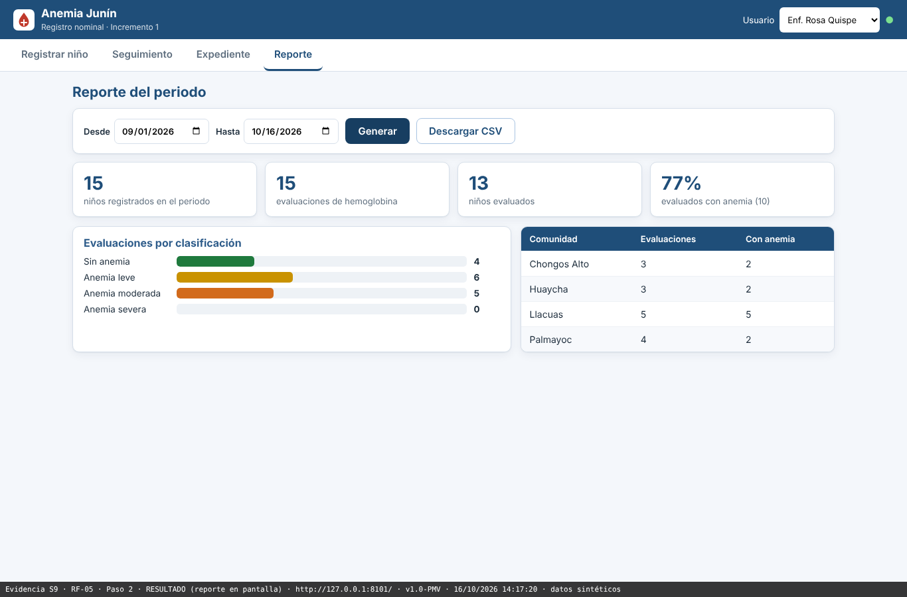

*Captura 3: RESULTADO (JSON).* Descripción: Respuesta JSON de `GET /api/reportes/periodo`: HTTP 200, `ninos_registrados` = 15, `evaluaciones_realizadas` = 15 (Figura 23). Archivo de imagen: `evidencias_capturas/RF-05/RF05_inc1_paso3_json.png`

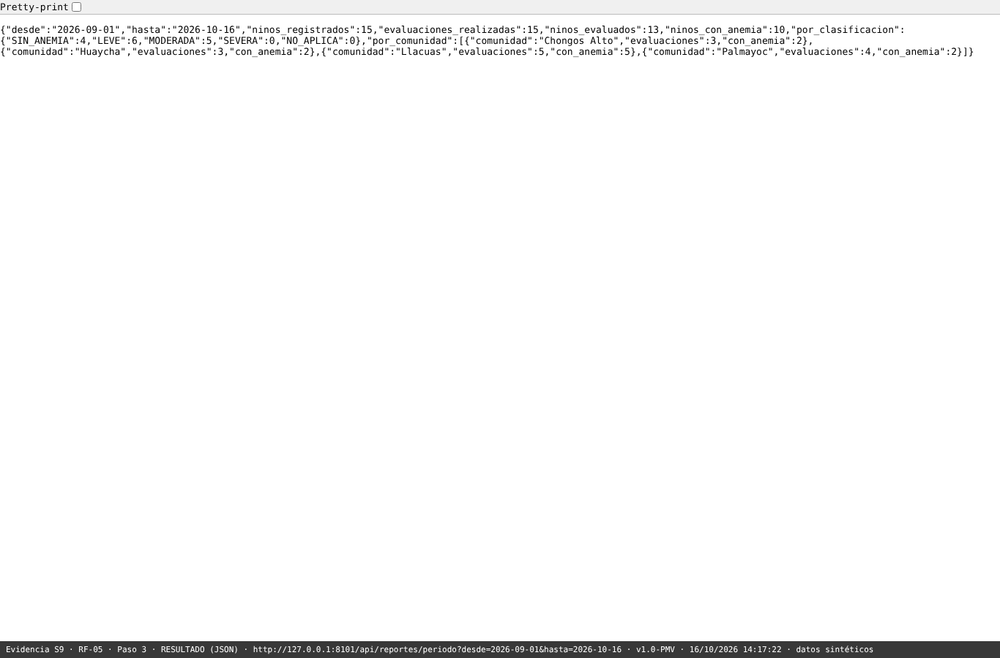

*CAPTURA DE PANTALLA 4: CONFIRMACIÓN Y RESULTADO (CSV descargado).* Descripción: Contenido del CSV descargado (`reporte_anemia_2026-09-01_2026-10-16.csv`; 15 filas, 12 columnas), renderizado en una página simple (Figura 24). Archivo de imagen: `evidencias_capturas/RF-05/RF05_inc1_paso4_csv.png`

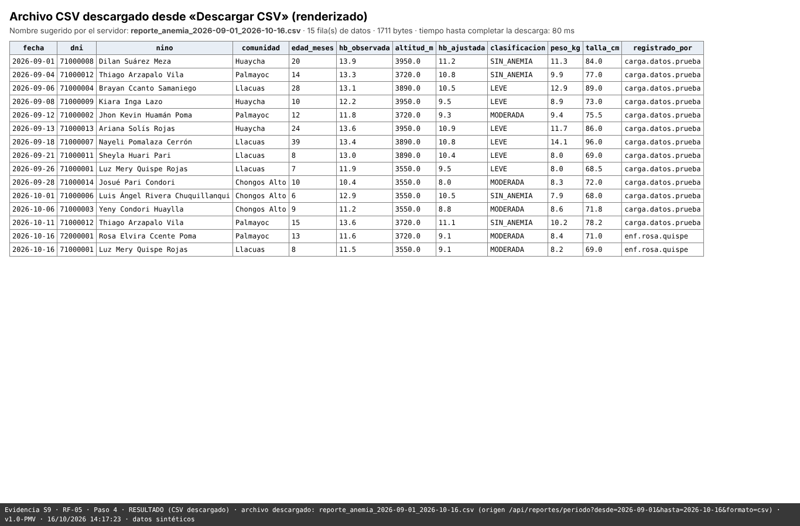

#### FICHA 5.1 — RF-06 / HIST-2.1

La Tabla 24 y las Figuras 25 a 27 documentan RF-06.

**Tabla 24.** Ficha de prueba funcional con evidencia fotográfica: RF-06.

| Campo | Detalle |
| --- | --- |
| **PROYECTO** | Sistema Inteligente para Detección Temprana de Anemia Infantil en Zonas Rurales de Junín |
| **INCREMENTO** | Incremento 2 (capturas del hito v1.5, 16/10/2026; el RF sigue vigente y con pruebas en verde en v2.0) |
| **CÓDIGO REQUERIMIENTO** | RF-06 / HIST-2.1 |
| **NOMBRE DEL REQUERIMIENTO** | Generar la agenda de controles según la normativa (`GET /api/ninos/{id}/agenda`; sección «Agenda de controles» del expediente) |
| **CRITERIO DE ACEPTACIÓN (Given-When-Then)** | **Dado que** existe un niño con anemia en tratamiento, **cuando** el personal abre su expediente, **entonces** el sistema muestra la agenda normativa de controles con el estado de cada uno (cumplido, pendiente, próximo a vencer, vencido) en menos de 2 segundos. |
| **ID Caso de Prueba** | CP-RF06-01 |
| **Tipo de Prueba** | Prueba funcional de interfaz (E2E con Playwright) y de aceptación; contraste interfaz frente a API |
| **Resultado Esperado** | Lista de controles por edad y de tratamiento con fecha programada, ventana de cumplimiento y estado; el resumen coincide con la API. |
| **TIEMPOS MEDIDOS** | Clic en el niño hasta expediente con agenda calculada: **119 ms**. Umbral: menos de 2 s. |
| **RESULTADO OBSERVADO** | DNI 71000022: 13 controles, estados {CUMPLIDO: 2, PENDIENTE: 9, VENCIDO: 2}, interfaz = API; DNI 71000003: 1 control próximo a vencer. Ningún niño sintético reúne los 4 estados a la vez, por eso se usan 2 niños. |
| **EVALUACIÓN** | **[ APROBADO ]** |
| **FECHA** | 16/10/2026 |
| **EVALUADOR** | Huamani Rodriguez, Jean Piero (QA Lead) — ejecución automatizada reproducible con `capturar_evidencias.py`; firma pendiente |

**EVIDENCIAS FOTOGRÁFICAS (capturas del software en ejecución)**

*CAPTURA DE PANTALLA 1: DATOS DE ENTRADA.* Descripción: Pestaña «Seguimiento» con el niño DNI 71000022 (anemia leve en tratamiento) localizado; se abrirá su expediente (Figura 25). Archivo de imagen: `evidencias_capturas/RF-06/RF06_inc2_paso1_entrada.png`

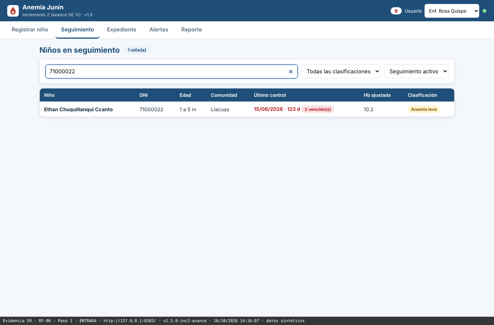

*Captura 2: RESULTADO (agenda del expediente).* Descripción: Sección «Agenda de controles»: 13 controles con fecha, ventana y estado; «2 cumplidos · 9 pendientes · 0 por vencer · 2 vencidos · Próximo control: DHc1 el 03/11/2026» (Figura 26). Archivo de imagen: `evidencias_capturas/RF-06/RF06_inc2_paso2_resultado.png`

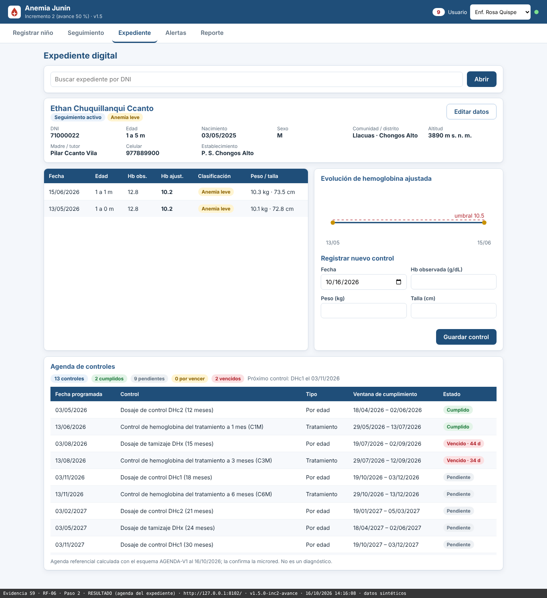

*CAPTURA DE PANTALLA 3: CONFIRMACIÓN Y RESULTADO (control próximo a vencer).* Descripción: Agenda del niño DNI 71000003 con un control «Próximo a vencer» (ningún niño de prueba reúne los cuatro estados a la vez) (Figura 27). Archivo de imagen: `evidencias_capturas/RF-06/RF06_inc2_paso3_proximo_a_vencer.png`


#### FICHA 5.1 — RF-07 / HIST-2.2

La Tabla 25 y las Figuras 28 a 30 documentan RF-07.

**Tabla 25.** Ficha de prueba funcional con evidencia fotográfica: RF-07.

| Campo | Detalle |
| --- | --- |
| **PROYECTO** | Sistema Inteligente para Detección Temprana de Anemia Infantil en Zonas Rurales de Junín |
| **INCREMENTO** | Incremento 2 (capturas del hito v1.5, 16/10/2026; el RF sigue vigente y con pruebas en verde en v2.0) |
| **CÓDIGO REQUERIMIENTO** | RF-07 / HIST-2.2 |
| **NOMBRE DEL REQUERIMIENTO** | Identificar controles vencidos y alertas internas priorizadas (`GET /api/alertas/controles-vencidos`, `GET /api/alertas/resumen`; pestaña «Alertas») |
| **CRITERIO DE ACEPTACIÓN (Given-When-Then)** | **Dado que** existe un conjunto de niños con controles, **cuando** el personal abre la pestaña «Alertas» y filtra por prioridad o comunidad, **entonces** se listan los controles vencidos priorizados con su resumen, en menos de 2 segundos. |
| **ID Caso de Prueba** | CP-RF07-01 |
| **Tipo de Prueba** | Prueba funcional de interfaz (E2E con Playwright) y de aceptación; contraste interfaz frente a API |
| **Resultado Esperado** | Resumen (vencidos, niños, prioridad alta, media y baja, por vencer en 7 días) y tabla ordenada por prioridad; los filtros reducen la tabla de forma coherente con la API. |
| **TIEMPOS MEDIDOS** | Clic en la pestaña «Alertas» hasta resumen y tabla: **176 ms**; filtro por prioridad: **69 ms**; filtro por comunidad: **70 ms**. Umbral: menos de 2 s. |
| **RESULTADO OBSERVADO** | Resumen de la interfaz igual al de la API (9 vencidos); filtro ALTA: 7 de 9 filas; comunidad Huaycha: 1 de 1 fila. |
| **EVALUACIÓN** | **[ APROBADO ]** |
| **FECHA** | 16/10/2026 |
| **EVALUADOR** | Huamani Rodriguez, Jean Piero (QA Lead) — ejecución automatizada reproducible con `capturar_evidencias.py`; firma pendiente |

**EVIDENCIAS FOTOGRÁFICAS (capturas del software en ejecución)**

*CAPTURA DE PANTALLA 1: DATOS DE ENTRADA (alertas sin filtro).* Descripción: Pestaña «Alertas» con resumen y tabla completa sin filtros; la insignia de la cabecera muestra 9 vencidos (Figura 28). Archivo de imagen: `evidencias_capturas/RF-07/RF07_inc2_paso1_entrada.png`

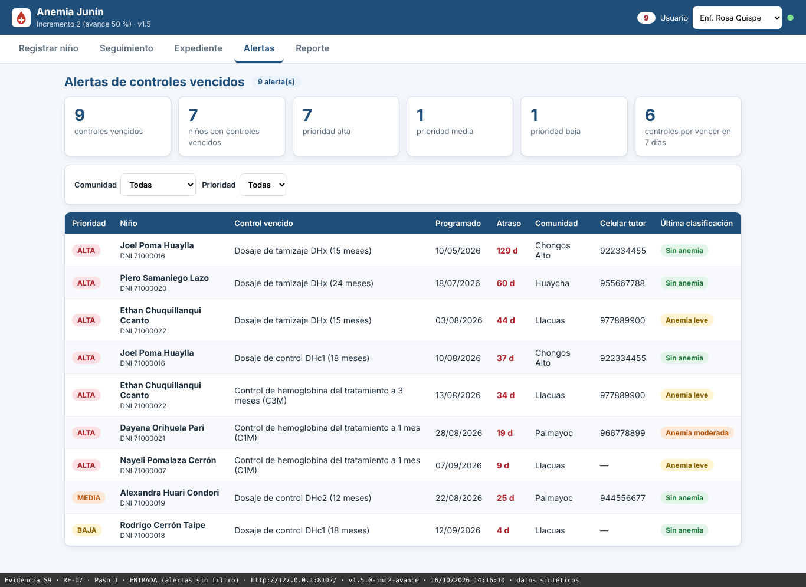

*Captura 2: RESULTADO (filtro por prioridad ALTA).* Descripción: Filtro «Prioridad: Alta»: 7 alertas ALTA de 9 (Figura 29). Archivo de imagen: `evidencias_capturas/RF-07/RF07_inc2_paso2_resultado_filtro_prioridad.png`

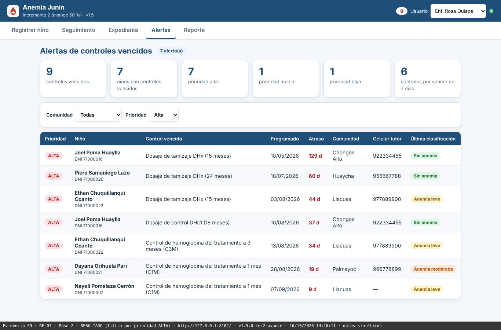

*CAPTURA DE PANTALLA 3: CONFIRMACIÓN Y RESULTADO (filtro por comunidad).* Descripción: Filtro «Comunidad: Huaycha»: 1 alerta de esa comunidad (Figura 30). Archivo de imagen: `evidencias_capturas/RF-07/RF07_inc2_paso3_resultado_filtro_comunidad.png`

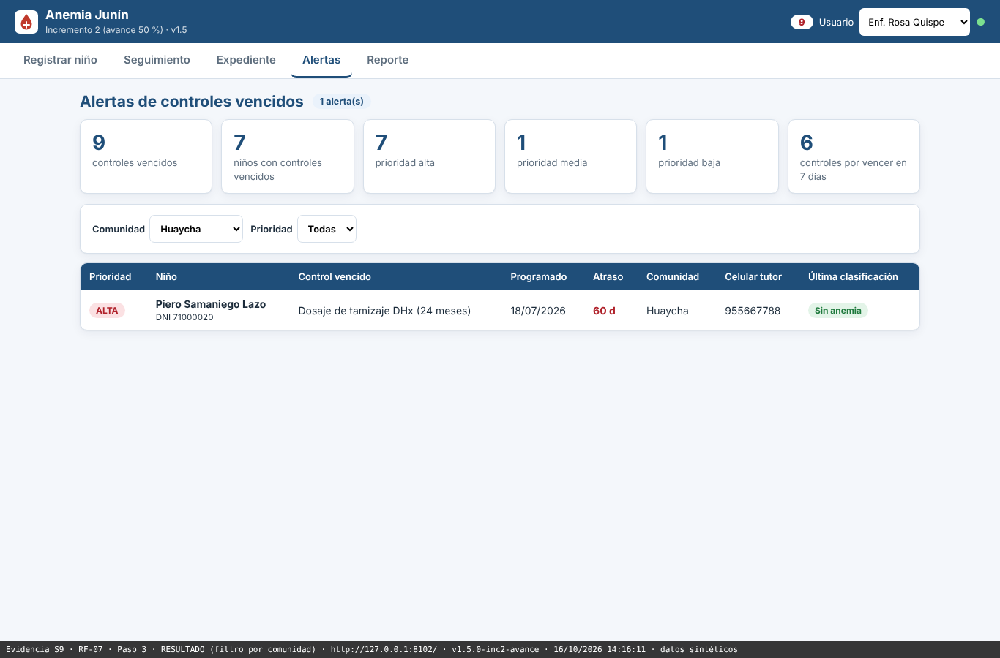

#### FICHA 5.1 — RF-08 / HIST-2.3

La Tabla 26 y las Figuras 31 a 33 documentan RF-08.

**Tabla 26.** Ficha de prueba funcional con evidencia fotográfica: RF-08.

| Campo | Detalle |
| --- | --- |
| **PROYECTO** | Sistema Inteligente para Detección Temprana de Anemia Infantil en Zonas Rurales de Junín |
| **INCREMENTO** | Incremento 2 (cierre, `v2.0.0-inc2`) |
| **CÓDIGO REQUERIMIENTO** | RF-08 / HIST-2.3 |
| **NOMBRE DEL REQUERIMIENTO** | Visualizar la agenda del personal por rango de fechas, con filtros por establecimiento y comunidad (`GET /api/agenda?desde=&hasta=&establecimiento=&comunidad=`; pestaña «Agenda») |
| **CRITERIO DE ACEPTACIÓN (Given-When-Then)** | **Dado que** existe un conjunto de controles programados, **cuando** el personal consulta la agenda de un rango (máximo 31 días) y filtra por establecimiento o comunidad, **entonces** se listan los controles por día con el total y el desglose por estado, coherentes con la API, en menos de 2 segundos. |
| **ID Caso de Prueba** | CP-RF08-01 |
| **Tipo de Prueba** | Prueba funcional de interfaz (E2E con Playwright) y de aceptación; contraste interfaz frente a API |
| **Resultado Esperado** | Resumen del rango y, por día, total y desglose por estado con la tabla de niños; el filtro «Establecimiento» recalcula los totales; los totales de la interfaz coinciden con los de la API. Un rango inválido o de más de 31 días se rechaza con un mensaje (verificado por prueba automática, sin captura). |
| **TIEMPOS MEDIDOS** | Clic en «Consultar» (rango 2024-05-30 a 2024-06-02) hasta la agenda por día: **133 ms**; filtro «Establecimiento»: **40 ms**. Umbral: menos de 2 s. |
| **RESULTADO OBSERVADO** | 19 controles de 17 niños en 4 días (7 cumplidos, 10 pendientes, 2 vencidos, 0 con inasistencia); interfaz = API (totales por día idénticos); filtro «LA ESPERANZA»: 4 de 19 filas, todas de ese establecimiento. Datos: muestra de 500 niños de la DIRESA Junín; fecha de referencia 30/06/2024. |
| **EVALUACIÓN** | **[ APROBADO ]** |
| **FECHA** | 17/10/2026 |
| **EVALUADOR** | Huamani Rodriguez, Jean Piero (QA Lead) — ejecución automatizada reproducible con `capturar_evidencias.py`; firma pendiente |

**EVIDENCIAS FOTOGRÁFICAS (capturas del software en ejecución)**

*CAPTURA DE PANTALLA 1: DATOS DE ENTRADA.* Descripción: Pestaña «Agenda» con el aviso «Fecha de referencia: 30/06/2024 (corte del dataset)» en la cabecera y el rango 2024-05-30 a 2024-06-02 (4 días; el máximo permitido es 31); filtros «Establecimiento» y «Comunidad» en «Todos/Todas», antes de pulsar «Consultar» (Figura 31). Archivo de imagen: `evidencias_capturas/RF-08/RF08_inc2final_paso1_entrada.png`

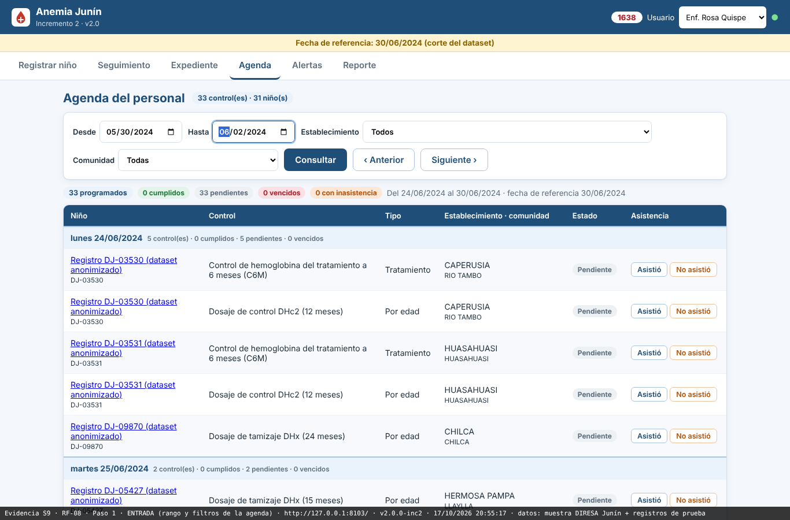

*Captura 2: RESULTADO (agenda por día con totales).* Descripción: Agenda del 2024-05-30 al 2024-06-02: resumen del rango (19 programados, 7 cumplidos, 10 pendientes, 2 vencidos) y, por día, el total y el desglose por estado, con la tabla de niños (código del registro, control, tipo, establecimiento, estado) (Figura 32). Archivo de imagen: `evidencias_capturas/RF-08/RF08_inc2final_paso2_resultado.png`

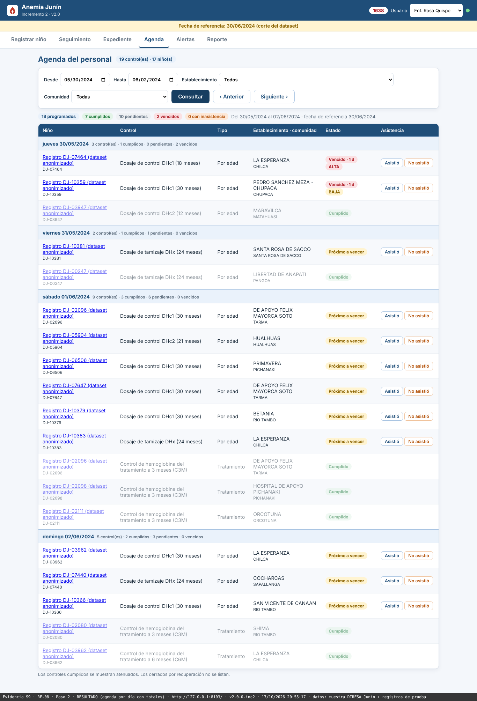

*CAPTURA DE PANTALLA 3: CONFIRMACIÓN Y RESULTADO (filtro por establecimiento).* Descripción: El mismo rango con «Establecimiento: LA ESPERANZA»: 4 controles de 3 niños y totales recalculados (Figura 33). Archivo de imagen: `evidencias_capturas/RF-08/RF08_inc2final_paso3_resultado_filtro_establecimiento.png`

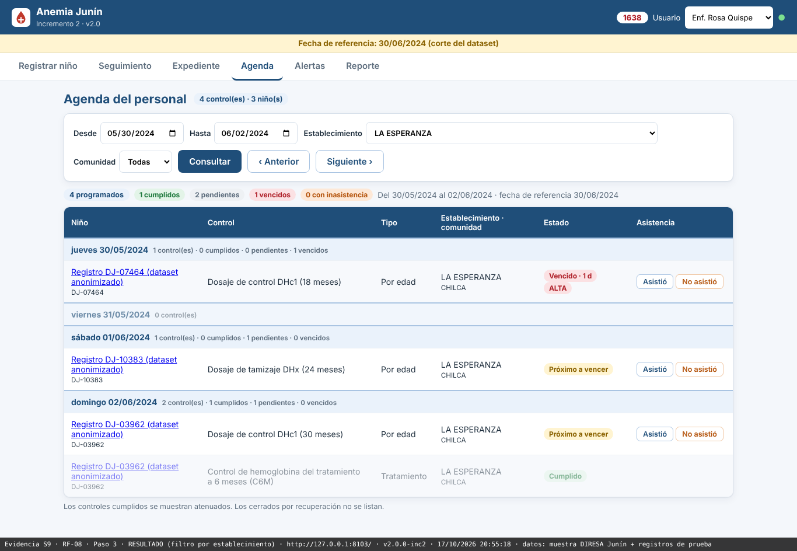

#### FICHA 5.1 — RF-09 / HIST-2.4

La Tabla 27 y las Figuras 34 a 38 documentan RF-09.

**Tabla 27.** Ficha de prueba funcional con evidencia fotográfica: RF-09.

| Campo | Detalle |
| --- | --- |
| **PROYECTO** | Sistema Inteligente para Detección Temprana de Anemia Infantil en Zonas Rurales de Junín |
| **INCREMENTO** | Incremento 2 (cierre, `v2.0.0-inc2`) |
| **CÓDIGO REQUERIMIENTO** | RF-09 / HIST-2.4 |
| **NOMBRE DEL REQUERIMIENTO** | Registrar la asistencia a un control, «Asistió» o «No asistió» con motivo (`POST /api/ninos/{id}/controles/{codigo}/asistencia`, `GET /api/ninos/{id}/asistencias`; botones en la agenda del expediente y en la pestaña «Agenda») |
| **CRITERIO DE ACEPTACIÓN (Given-When-Then)** | **Dado que** existe un control programado (fecha menor o igual que hoy) sin registro, **cuando** el personal registra «Asistió» o «No asistió» con motivo, **entonces** el control queda cumplido o marcado como inasistencia (con la alerta elevada un nivel) y un segundo registro del mismo control se rechaza con 409 y un mensaje claro, en menos de 2 segundos. |
| **ID Caso de Prueba** | CP-RF09-01 |
| **Tipo de Prueba** | Prueba funcional de interfaz (E2E con Playwright) y de aceptación; verificación por API del 409 con un registro repetido |
| **Resultado Esperado** | «Asistió»: el control pasa a cumplido y deja de figurar en «Alertas». «No asistió» con motivo: el control sigue vencido con la marca «Inasistencia registrada» y su alerta sube un nivel. Un segundo registro del mismo control responde 409 con mensaje y no duplica datos. |
| **TIEMPOS MEDIDOS** | «Asistió» y confirmar hasta el control cumplido: **90 ms**; «No asistió» con motivo hasta la marca: **92 ms**; segundo registro (409): **54 ms**. Umbral: menos de 2 s. |
| **RESULTADO OBSERVADO** | «Asistió»: PENDIENTE → CUMPLIDO, asistencia registrada en la API y sin alerta. «No asistió» (motivo «Enfermedad del niño: Fiebre desde hace 2 días»): el control sigue vencido y la prioridad pasa de BAJA a MEDIA. Segundo registro: 409 con el mensaje «El control DHx del 2024-05-24 ya tiene una asistencia registrada.»; un solo registro en la API; un POST directo repetido también responde 409. |
| **EVALUACIÓN** | **[ APROBADO ]** |
| **FECHA** | 17/10/2026 |
| **EVALUADOR** | Huamani Rodriguez, Jean Piero (QA Lead) — ejecución automatizada reproducible con `capturar_evidencias.py`; firma pendiente |

**EVIDENCIAS FOTOGRÁFICAS (capturas del software en ejecución)**

*CAPTURA DE PANTALLA 1: DATOS DE ENTRADA.* Descripción: Cuadro «Registrar asistencia» abierto desde la agenda del expediente de un registro del dataset (DJ-00481): control de hemoglobina del tratamiento a 1 mes (C1M), programado el 17/06/2024, con la opción de vincular una evaluación, antes de confirmar (Figura 34). Archivo de imagen: `evidencias_capturas/RF-09/RF09_inc2final_paso1_entrada.png`

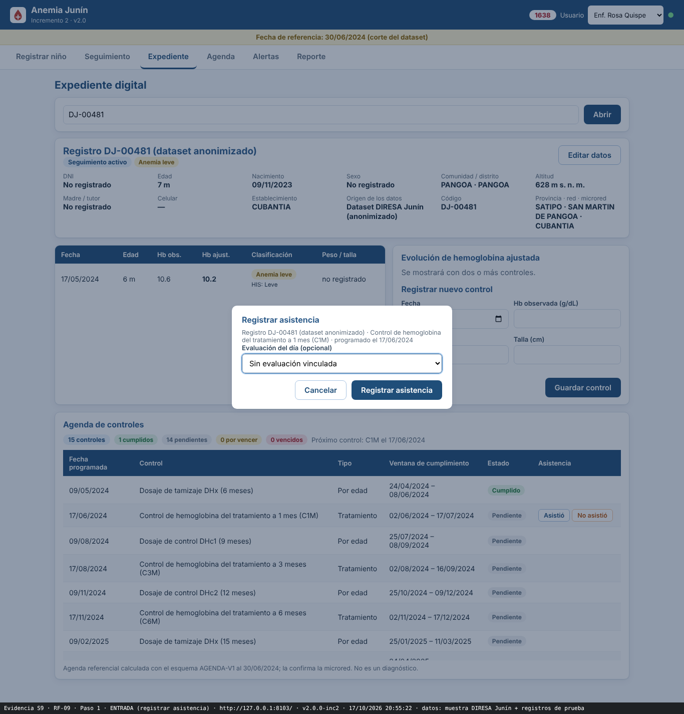

*Captura 2: RESULTADO («Asistió»).* Descripción: Tras confirmar, el control pasa a «Cumplido (asistió)», deja de ofrecer los botones de asistencia y el resumen de la agenda se actualiza (Figura 35). Archivo de imagen: `evidencias_capturas/RF-09/RF09_inc2final_paso2_asistio.png`

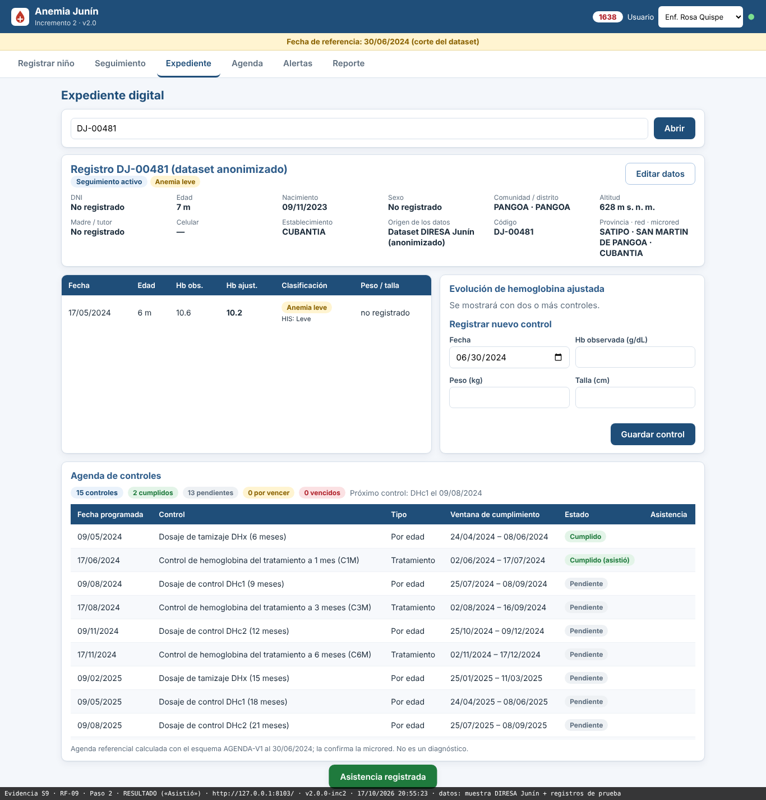

*Captura 3: RESULTADO («No asistió» con motivo).* Descripción: Control vencido marcado como «No asistió» con el motivo «Enfermedad del niño: Fiebre desde hace 2 días»: la fila muestra la marca «Inasistencia registrada» y el control sigue «Vencido» (Figura 36). Archivo de imagen: `evidencias_capturas/RF-09/RF09_inc2final_paso3_no_asistio.png`

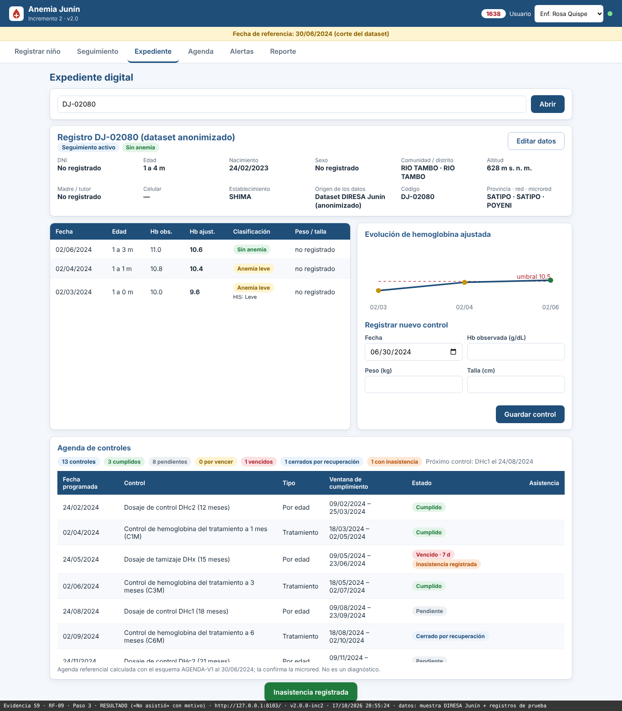

*Captura 3b: RESULTADO (alerta con prioridad elevada).* Descripción: Pestaña «Alertas» filtrada por prioridad MEDIA y comunidad RIO TAMBO: la alerta del control con inasistencia aparece con la marca «Inasistencia registrada» y la prioridad subida un nivel (BAJA a MEDIA) (Figura 37). Archivo de imagen: `evidencias_capturas/RF-09/RF09_inc2final_paso3b_alerta_prioridad_elevada.png`

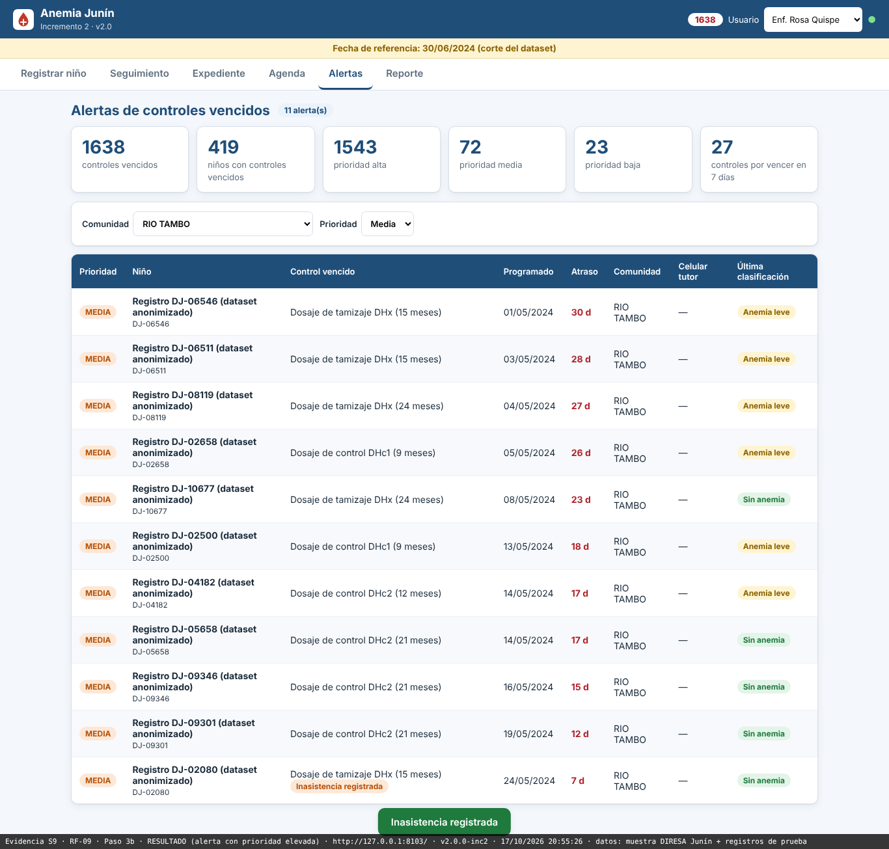

*CAPTURA DE PANTALLA 4: CONFIRMACIÓN Y RESULTADO (409 en un segundo registro).* Descripción: Dos personas del personal registran el mismo control; la segunda (esta pantalla) recibe el rechazo 409 con el mensaje «El control DHx del 2024-05-24 ya tiene una asistencia registrada.» dentro del cuadro, que sigue abierto; no se duplica el registro (Figura 38). Archivo de imagen: `evidencias_capturas/RF-09/RF09_inc2final_paso4_409_segundo_registro.png`

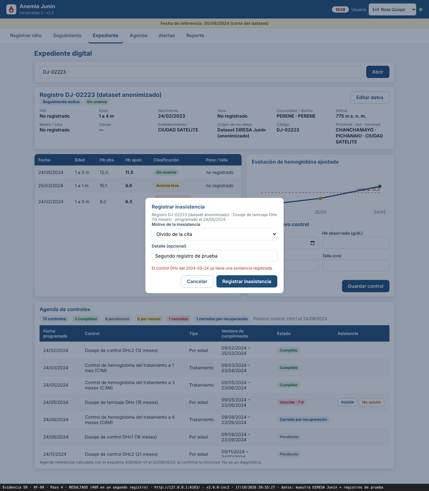

#### 5.1.1 Galería de datos reales (dataset DIRESA Junín)

Las Figuras 39 a 41 muestran la v2.0 con la muestra estratificada de 500 niños del dataset real de la DIRESA Junín (fecha de referencia 30/06/2024; captura del 17/10/2026). Criterio verificado en la ejecución automatizada (cumple): **dado que** el dataset anonimizado está importado, **cuando** el personal abre un registro o la pestaña «Alertas», **entonces** ve el registro sin datos personales, con la severidad del HIS junto a la clasificación del sistema, su agenda con estados y los controles vencidos de la muestra, en menos de 2 segundos. Observado: expediente de DJ-04505 en **202 ms** (2 evaluaciones; la severidad del HIS difiere de la del sistema en una; 13 controles con estados CUMPLIDO, PENDIENTE y VENCIDO) y pestaña «Alertas» en **562 ms** con 1 638 controles vencidos de 419 niños (ALTA 1 543, MEDIA 71, BAJA 24; interfaz = API).

*Expediente de un registro del dataset.* Descripción: «Registro DJ-04505 (dataset anonimizado)», sin DNI, nombres ni tutor, con su código seudónimo, el origen «Dataset DIRESA Junín (anonimizado)», la clasificación del sistema en cada evaluación y debajo la severidad del HIS, y su agenda calculada con la fecha de referencia (Figura 39). Archivo de imagen: `evidencias_capturas/datos_reales/DJ_expediente_DJ-04505.png`

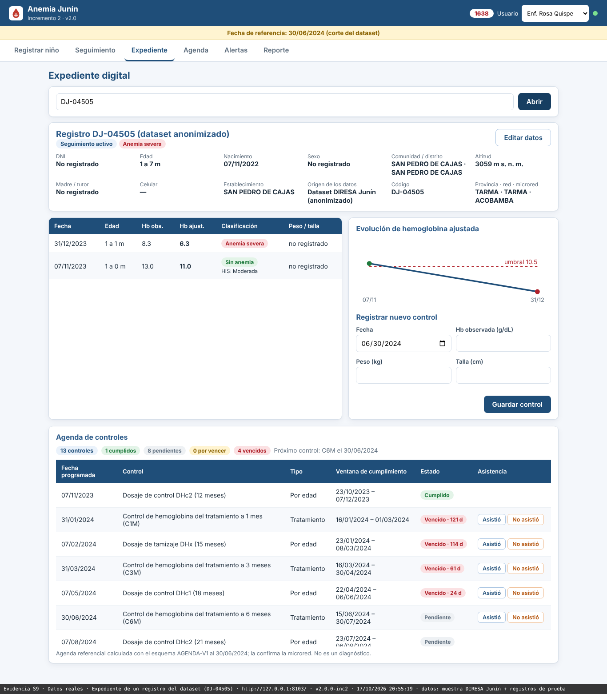

*Alertas con la muestra real.* Descripción: Pestaña «Alertas» con el resumen (1 638 vencidos, 419 niños, prioridad alta, media y baja, por vencer en 7 días) y las primeras alertas ordenadas por prioridad; los registros aparecen por su código «Registro DJ-xxxxx (dataset anonimizado)». Se muestra la parte superior de la tabla (la lista completa es larga) (Figura 40). Archivo de imagen: `evidencias_capturas/datos_reales/DJ_alertas_muestra_real.png`

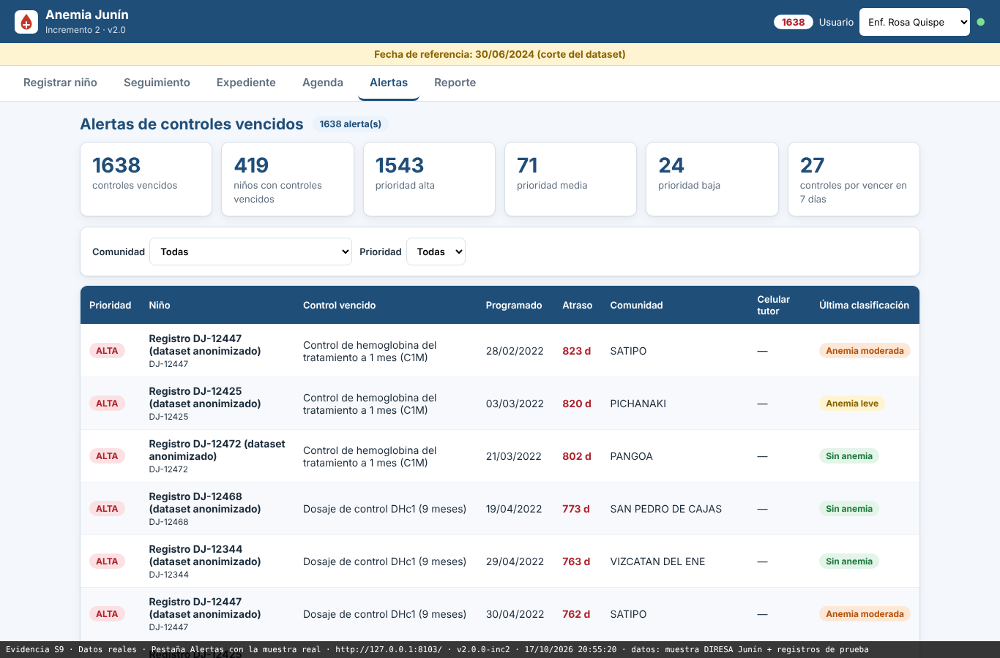

*Contraste con un registro creado desde el sistema.* Descripción: Expediente del registro de prueba SISTEMA con DNI 79000003 y nombre ficticio «PRUEBA DEL SISTEMA Registro 03»: sin severidad del HIS y con una agenda que solo tiene controles futuros respecto de la fecha de referencia (Figura 41). Archivo de imagen: `evidencias_capturas/datos_reales/SISTEMA_expediente_79000003.png`

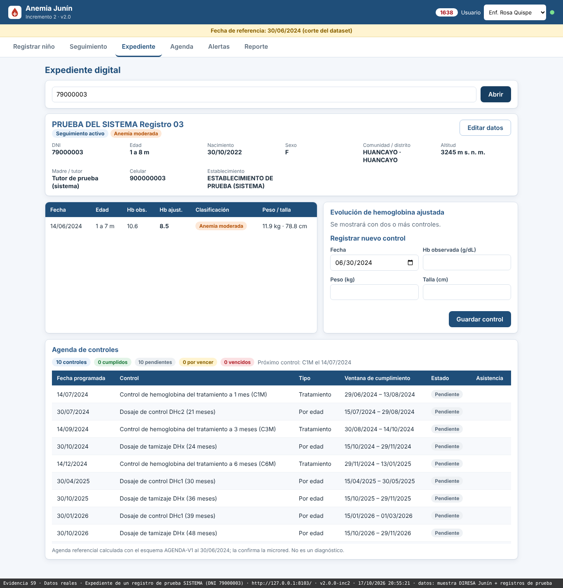

### 5.2 Matriz 5.2 de trazabilidad de pruebas funcionales e incrementos

La Tabla 28 reproduce la Matriz 5.2 de la guía para los nueve RF del proyecto, todos con ficha, captura de resultado y estado Aprobado. Las capturas de RF-06 y RF-07 se tomaron sobre el hito v1.5 (ambos RF siguen vigentes y con pruebas en verde en v2.0); las de RF-08 y RF-09, sobre la v2.0 con la muestra de la DIRESA Junín. Los identificadores `CP-RF0X-01` son los de las fichas de este informe; cada uno agrupa las pruebas automatizadas del RF (numeradas CP-01 a CP-187 en los docstrings del código y listadas en `datos/m21_cobertura_rf.json`). Las rutas de captura son relativas a `evidencias_capturas/`.

**Tabla 28.** Matriz 5.2: Trazabilidad de pruebas funcionales e incrementos.

| Código RF | Descripción del Requerimiento | Incremento | ID Caso Prueba | Archivo de Captura de Pantalla | Estado |
| --- | --- | --- | --- | --- | --- |
| **RF-01** | *Registrar niño con evaluación inicial (HU-01).* | Inc. 1 (PMV) | CP-RF01-01 | `RF-01/RF01_inc1_paso2_resultado.png` | **Aprobado** |
| **RF-02** | *Consultar y actualizar el expediente, incluido un nuevo control (HU-02).* | Inc. 1 (PMV) | CP-RF02-01 | `RF-02/RF02_inc1_paso2_resultado.png`, `RF-02/RF02_inc1_paso4_resultado_actualizacion.png`, `RF-02/RF02_inc1_paso6_resultado_nuevo_control.png` | **Aprobado** |
| **RF-03** | *Validar datos con reglas clínicas: vista previa y rechazo por campo (HU-03).* | Inc. 1 (PMV) | CP-RF03-01 | `RF-03/RF03_inc1_paso2_resultado.png`, `RF-03/RF03_inc1_paso3_rechazo.png` | **Aprobado** |
| **RF-04** | *Listar niños en seguimiento con estado de control (HU-04).* | Inc. 1 (PMV) | CP-RF04-01 | `RF-04/RF04_inc1_paso2_resultado.png`, `RF-04/RF04_inc1_paso3_busqueda_comunidad.png` | **Aprobado** |
| **RF-05** | *Reporte del periodo en JSON y CSV (HU-05).* | Inc. 1 (PMV) | CP-RF05-01 | `RF-05/RF05_inc1_paso2_resultado.png`, `RF-05/RF05_inc1_paso3_json.png`, `RF-05/RF05_inc1_paso4_csv.png` | **Aprobado** |
| **RF-06** | *Generar la agenda de controles según la normativa (HIST-2.1).* | Inc. 2 (capturas del hito v1.5) | CP-RF06-01 | `RF-06/RF06_inc2_paso2_resultado.png`, `RF-06/RF06_inc2_paso3_proximo_a_vencer.png` | **Aprobado** |
| **RF-07** | *Identificar controles vencidos y alertas internas priorizadas (HIST-2.2).* | Inc. 2 (capturas del hito v1.5) | CP-RF07-01 | `RF-07/RF07_inc2_paso2_resultado_filtro_prioridad.png`, `RF-07/RF07_inc2_paso3_resultado_filtro_comunidad.png` | **Aprobado** |
| **RF-08** | *Visualizar la agenda del personal (HIST-2.3).* | Inc. 2 (v2.0) | CP-RF08-01 | `RF-08/RF08_inc2final_paso2_resultado.png`, `RF-08/RF08_inc2final_paso3_resultado_filtro_establecimiento.png` | **Aprobado** |
| **RF-09** | *Registrar asistencia a control (HIST-2.4).* | Inc. 2 (v2.0) | CP-RF09-01 | `RF-09/RF09_inc2final_paso2_asistio.png`, `RF-09/RF09_inc2final_paso3_no_asistio.png`, `RF-09/RF09_inc2final_paso4_409_segundo_registro.png` | **Aprobado** |

«Aprobado» significa criterio Dado-Cuando-Entonces cumplido en la ejecución automatizada con captura de resultado y pruebas en verde.

### 5.3 Regresión visual del Incremento 1 sobre v1.5

El recorrido de RF-01 a RF-05 se ejecutó también sobre `v1.5.0-inc2-avance` (capturas del 16/10/2026, 14:16 a 14:17) y el criterio se cumplió en las cinco funcionalidades: la reestructuración hexagonal y el nuevo estado de control no rompieron lo entregado. Con un usuario, los tiempos de v1.5 fueron mayores en las cinco (todos muy por debajo de 2 s), sin probar la causa de la regresión de la sección 6.5. Capturas (Figuras 51 a 55) y tiempos: Anexo G.1 (Tabla 44). No se repitió el recorrido visual sobre v2.0: la ausencia de regresión de RF-01 a RF-07 en v2.0 se respalda con las 328 pruebas por defecto, los 15 E2E (que incluyen los 8 de v1.5) y los 48 criterios Dado-Cuando-Entonces en verde (m21).

### 5.4 Registro de ejecución de pruebas

Se ejecutaron ruff, la suite por defecto con cobertura y los E2E de cada versión (Tabla 18; v1.0 y v1.5 el 16/10/2026, v2.0 el 17/10/2026): 73, 228 y 328 pruebas en verde, 4, 8 y 15 E2E, cobertura de 99,19 %, 100 % y 100 %, y 17/17, 33/33 y 48/48 criterios Dado-Cuando-Entonces (m21). Se ejecutaron además **72 pruebas exploratorias** de caja negra sobre la API: 45 sobre v1.5 (43 OK, 2 OBS, 0 FALLA; las OBS EX-17 y EX-40 no son defectos), que hallaron DEF-08, y 27 sobre RF-08 y RF-09 en v2.0 (27 OK, 0 FALLA, 0 OBS). **No se re-ejecutaron** la integración en PostgreSQL (hay un job en CI; el CHANGELOG indica que la migración `db/02_migracion_v2_0.sql` se probó en PostgreSQL 16) ni SonarCloud (acción 6 del PDCA). Registro completo: Anexo G.3 (Tabla 45); exploratorias y corridas: Anexo G.4.

### 5.5 Gestión de defectos y respuesta a las preguntas del Pilar 2

La Tabla 29 registra DEF-01 a DEF-09.

**Tabla 29.** Registro de defectos DEF-01 a DEF-09 (`registro_defectos.md` y `registro_defectos_inc2.md`; clasificación de `m22_defectos.py`).

| ID | Descripción corta | Tipo | RF | Momento | Estado |
| --- | --- | --- | --- | --- | --- |
| DEF-01 | Patrón N+1 en el reporte del periodo: p95 de 2 200 ms con 50 usuarios (corregido a 74 ms; ADR-006) | No funcional (rendimiento) | RF-05 | Detectado antes de liberar (Inc. 1) | Cerrado |
| DEF-02 | El reporte contaba días en UTC y perdía registros posteriores a las 19:00 de Perú | Funcional | RF-05 | Detectado antes de liberar (Inc. 1) | Cerrado |
| DEF-03 | `GET /api/reportes/periodo` respondía 500 con fechas extremas (9999-12-31); ahora 422 | Funcional | RF-05 | Escapado; hallado en el ciclo del Inc. 2 | Cerrado |
| DEF-04 | DNI y celular aceptaban dígitos Unicode y un salto de línea final | Funcional | RF-01 (y RF-02) | Escapado; hallado en el ciclo del Inc. 2 | Cerrado |
| DEF-05 | La vista previa aceptaba altitudes NaN o absurdas y fechas de nacimiento inválidas (clasificaba «SEVERA» sin sentido) | Funcional | RF-03 | Escapado; hallado en el ciclo del Inc. 2 | Cerrado |
| DEF-06 | Textos sin largo máximo (100 000 caracteres en columnas de 80) | Funcional | RF-01 (y RF-02) | Escapado; hallado en el ciclo del Inc. 2 | Cerrado |
| DEF-07 | La búsqueda trataba `%` y `_` como comodines de SQL | Funcional | RF-04 | Escapado; hallado en el ciclo del Inc. 2 | Cerrado |
| DEF-08 | Dos registros simultáneos con el mismo DNI: el segundo respondía 500 en lugar de 409 | Funcional | RF-01 | Escapado; hallado por la exploratoria EX-42 | Cerrado |
| DEF-09 | En la pestaña «Agenda», la respuesta de la carga inicial sobrescribía las fechas que la persona acababa de escribir y «Consultar» pedía otro rango | Funcional | RF-08 | Detectado antes de liberar (Inc. 2, código nuevo); por las E2E CP-180, CP-183 y CP-186 | Cerrado |

Los defectos DEF-03 a DEF-08 estaban en código **heredado del Inc. 1** y se hallaron al explorar entradas límite de la API durante el ciclo del Inc. 2; cada uno tiene prueba de regresión (CP-83 a CP-88, CP-102 a CP-106 y CP-115). El código nuevo de RF-06 y RF-07 no presentó defectos funcionales; el de RF-08 presentó uno (DEF-09), hallado por las E2E antes de liberar la v2.0. Las 72 exploratorias no hallaron fallas en código nuevo. La Tabla 30 y la Figura 42 muestran la densidad, con las lecturas alternativas.

**Tabla 30.** Densidad de defectos funcionales por RF y por KLOC (m22).

| Medida | Inc. 1 (v1.0-PMV, 5 RF) | Hito v1.5 (RF-06 y RF-07) | Inc. 2 (v2.0.0-inc2, RF-06 a RF-09) |
| --- | --- | --- | --- |
| Defectos funcionales atribuidos | 7 (DEF-02 a DEF-08) | 0 | 1 (DEF-09) |
| **M2.2 (Def/RF)** | **1,4** (7/5) | **0,0** (0/2) | **0,25** (1/4) |
| Variante: solo los detectados antes de liberar | 0,2 (1/5) | no aplica | 0,25 (1/4; DEF-09 se detectó antes de liberar) |
| Variante: sin DEF-08 (antes de la campaña exploratoria) | 1,2 (6/5) | no aplica | no aplica |
| Variante: todos los defectos, incluido el no funcional DEF-01 | 1,6 (8/5) | no aplica | 0,25 (1/4) |
| Variante: defectos escapados a producción (la v2.0 aún no se libera) | no aplica | no aplica | 0,0 (0/4) |
| Densidad por KLOC (funcionales) | 6,85 Def/KLOC (KLOC de v1.0 = 1,022) | 0,0 Def/KLOC (KLOC de v1.5 = 1,688; código neto aproximado 0,666) | 0,36 Def/KLOC (KLOC de v2.0 = 2,782); 0,91 sobre el código agregado en el cierre (1,094 KLOC aproximados) |
| Densidad por KLOC (solo antes de liberar / todos) | 0,98 / 7,83 | 0,0 | 0,36 / 0,36 |

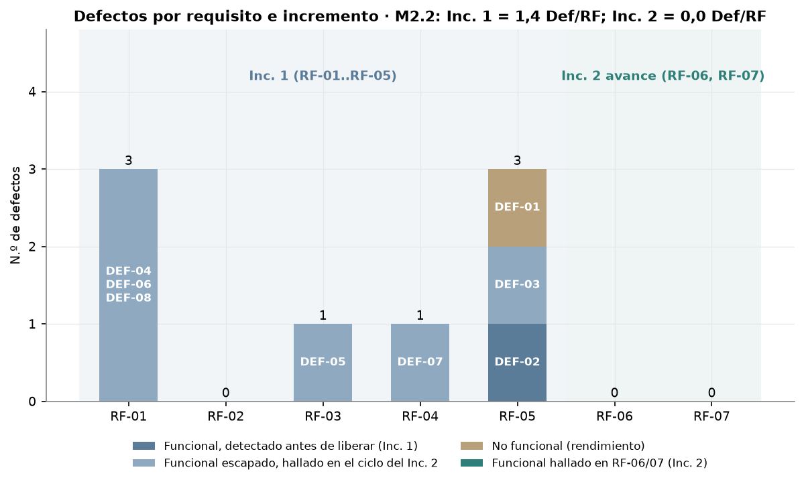

**Q2.1 · ¿Qué porcentaje de RF del Incremento 1 y 2 cuenta con evidencias fotográficas aprobadas?** **M2.1 = 100,0 % en el Inc. 1** (5 de 5 RF: RF-01 a RF-05) y **100,0 % en el Inc. 2** (4 de 4 RF: RF-06 y RF-07 con las capturas del hito v1.5; RF-08 y RF-09 con las de la v2.0). Los nueve RF del proyecto tienen captura aprobada (9 de 9). Ambas metas de 100 % se cumplen. Las capturas son de las ejecuciones del 16/10/2026 (RF-01 a RF-07) y del 17/10/2026 (RF-08 y RF-09).

**Q2.2 · ¿Cuál es la densidad de defectos funcionales entre la entrega del PMV y el Incremento 2?** **M2.2 = 1,4 Def/RF en el Inc. 1** y **0,25 Def/RF en el Inc. 2** (1/4: DEF-09 en RF-08; 0,0 en el hito v1.5, con 0/2). **Ninguna de las dos metas se cumple**: la del Inc. 1 (≤ 1,0) y la del Inc. 2 (≤ 0,2), aunque ningún defecto escapó a producción (0/4; la v2.0 aún no se libera). Contando los 6 defectos heredados hallados en el ciclo del Inc. 2 y DEF-09 sobre los 9 RF vigentes, la lectura sería 7/9 = 0,78 Def/RF (cálculo propio). Causa raíz del valor del Inc. 1: solo 1 de los 7 defectos (DEF-02) se detectó antes de liberar; los otros 6 escaparon porque las pruebas del PMV cubrían valores nominales y los límites de las reglas clínicas, pero no entradas hostiles (NaN, dígitos Unicode, fechas extremas, textos enormes, comodines) ni concurrencia. Causa de DEF-09: una condición de carrera de la interfaz (la respuesta de la carga inicial pisaba el rango escrito) que solo las E2E detectaron; la acción es incluir en la DoD E2E que escriban antes de que termine la carga inicial (acción 2 del PDCA). Cautelas: el valor se calcula sobre solo 4 RF, y la ausencia de fallas en las 72 exploratorias no prueba la ausencia de defectos, pues las diseñó el mismo equipo.

<div style="page-break-after: always;"></div>

## 6. EVALUACIÓN DE ENTREGA DE VALOR AL USUARIO FINAL (Actividad 6) [Pilar 3 · Valor]

**Objetivo del pilar.** Demostrar, con trazabilidad e indicadores, qué brechas del proceso AS-IS resuelven las funcionalidades probadas (Q3.1) y cómo evolucionan los indicadores de valor con cada incremento (Q3.2), separando con claridad lo **medido con datos sintéticos**, lo **medido con datos reales anonimizados de la DIRESA Junín** y lo que **requiere un piloto en una posta**.

### 6.1 Matriz 6.1 de trazabilidad proceso, producto y valor

Las brechas B1 a B6 son las de S1 y S6 (Tabla 4 del informe integrador de S6) y la intervención prevista por incremento es la matriz de intervención de S6 (Tabla 5 del informe integrador de S6). Los puntajes de resolución salen de `m31_brechas.py` y se justifican en la sección 6.4. La columna del problema AS-IS cita, cuando existe, la línea base real del dataset de la DIRESA Junín (sección 6.2). La Tabla 31 es la Matriz 6.1 de la guía.

**Tabla 31.** Matriz 6.1: Trazabilidad Proceso–Producto–Valor al Usuario.

| Problema Organizacional (AS-IS) | Brecha Resuelta | Incremento / Funcionalidad Entregada | Indicador de Proceso / Producto | Valor Organizacional Generado |
| --- | --- | --- | --- | --- |
| *Triple registro manual por evaluación (historia clínica, tarjeta de control y HIS), con errores de digitación y duplicidad.* En el extracto real del HIS el identificador del niño no es utilizable: `num_doc` tiene 8 754 valores distintos en 12 486 filas y el 49,4 % de las filas lo repite. | **B1** · Falta de registro nominal único y validado. **Resuelta (1,0)** | **Inc. 1 (RF-01 a RF-05):** expediente digital único con DNI único (409 si se repite), validación clínica por campo, seguimiento y reporte; en v2.0 el registro desde la aplicación sigue exigiendo todos los campos | *V1, registros por evaluación:* 3 → 1 (mejora de 100 %); 1 escritura alimenta expediente, seguimiento y reporte (150 → 151 niños y 826 → 827 evaluaciones en la base de prueba) | Un registro único y confiable. Valor **por diseño con datos sintéticos**: no hay medición del tiempo de registro en una posta |
| *Agenda de controles calculada a mano; controles fuera de la ventana normativa y citas olvidadas.* AS-IS real (12 486 diagnósticos): control de hemoglobina registrado al mes en 67,1 %, a los 3 meses en 54,7 % y a los 6 meses en 46,3 % (70,2 %, 63,8 % y 66,1 % con seguimiento posible). | **B2** · No hay agenda normativa ni recordatorios. **Parcial (0,5):** agenda, vencidos, agenda del personal y asistencia completos; faltan los recordatorios a la familia (INC-4) | **Inc. 2 (RF-06 a RF-09):** agenda normativa por niño, controles vencidos y alertas ALTA, MEDIA y BAJA, agenda del personal por rango y filtros, y registro de asistencia con motivo | *V2, niños activos con agenda:* 0 % → 100 % (140/140 en B150; 500/500 en la muestra real). *V3, detección de vencidos (F1):* 0 % (AS-IS) → 72,9 % (heurística de 30 días del Inc. 1) → 100 % (93 verdaderos positivos, 0 falsos positivos, 0 falsos negativos; 476/476 controles coinciden con el oráculo). *Muestra real:* 1 638 controles vencidos de 419 niños, 100 % visibles para el personal y coincidentes con el oráculo | El personal ve qué controles están vencidos, su prioridad y su día en la agenda, y registra asistencia o inasistencia (B150: 476 vencidos de 93 niños; muestra real: 1 638 de 419). Es capacidad medida del sistema, no mejora de la cobertura de controles. Aún no se avisa a la familia |
| *Postas rurales con conectividad intermitente; información que se consolida tarde.* | **B6** · No se registra ni reporta en el momento. **Parcial (0,5)** | **Inc. 1 (RF-05):** reporte del periodo en JSON y CSV; el borrador del formulario se conserva en el dispositivo | *Reporte del periodo:* 82 ms y CSV en 80 ms (v1.0); sin cola de sincronización sin conexión (la asistencia de v2.0 también se registra en línea) | Información consolidada al instante con conexión. **No** resuelve la operación sin conexión (INC-3) ni el tablero territorial (INC-6) |
| *Barreras (transporte, economía, olvido) ocultas hasta que el niño abandona el tratamiento.* El dataset no trae motivos de abandono ni barreras. | **B3** · **No resuelta aún (0,0)** | Destino: **INC-4** (barreras y notificaciones). El motivo de inasistencia de RF-09 (cinco opciones y un detalle libre) no es un registro ni un análisis de barreras | Sin indicador: no hay rutas, campos ni pantallas de barreras | Sin valor generado todavía |
| *Visita domiciliaria en papel, sin conexión y con capacidad limitada.* El dataset no incluye visitas ni referencias. | **B4** · **No resuelta aún (0,0)** | Destino: **INC-3** (registro sin conexión y visita priorizada) | Sin indicador: no existe ruta ni formulario de visita | Sin valor generado todavía |
| *El riesgo se identifica cuando el abandono ya ocurrió.* AS-IS real: sin dosaje a los 6 meses el 53,7 % (6 703/12 486) de los diagnosticados, o 33,9 % (2 894/8 540) con seguimiento posible; el 12,3 % no tiene ningún control. | **B5** · **No resuelta aún (0,0)** | Destino: **INC-5** (modelo predictivo) | Sin indicador: las alertas de v2.0 son reactivas (controles ya vencidos, con un nivel más si hubo inasistencia); «próximo a vencer» es de calendario, no una estimación de riesgo | Sin valor generado todavía |

### 6.2 Línea base AS-IS real y capacidad del sistema (dataset DIRESA Junín)

**Fuente y método.** El equipo obtuvo el dataset de la DIRESA Junín «Niños menores de 36 meses con dx de anemia en la Región Junín» (fuente HIS; 12 486 diagnósticos del 14/01/2022 al 21/06/2024; 9 provincias, 41 microredes y 443 establecimientos; carpeta `Dataset/`). El script `herramientas/dataset/analisis_asis.py` calcula los indicadores de proceso con fecha de corte 30/06/2024 (`metricas/asis_dataset_diresa.md` y `datos/asis_dataset_diresa.json`). Cada indicador se informa de dos maneras: **sobre todos los diagnosticados** (cifra bruta, penalizada porque los diagnósticos recientes aún no cumplían el plazo) y **con seguimiento posible** (solo quienes ya cumplieron el plazo del control más una holgura de 30 días antes del corte). La Tabla 32 resume los resultados y las Figuras 43 a 45 los grafican.

**Tabla 32.** Línea base AS-IS real: indicadores de proceso del seguimiento de anemia (dataset DIRESA Junín; corte 30/06/2024).

| Indicador | Sobre todos los diagnosticados (N = 12 486) | Con seguimiento posible |
| --- | --- | --- |
| Control de hemoglobina registrado al mes | 67,1 % (8 379/12 486) | 70,2 % (8 213/11 702) |
| Control registrado a los 3 meses | 54,7 % (6 836/12 486) | 63,8 % (6 652/10 419) |
| Control registrado a los 6 meses | 46,3 % (5 783/12 486) | 66,1 % (5 646/8 540) |
| Pérdida de seguimiento a 6 meses (sin dosaje a los 6 meses) | 53,7 % (6 703/12 486) | 33,9 % (2 894/8 540) |
| Ningún control (ni a 1, 3 ni 6 meses) | 17,9 % (2 237/12 486) | 12,3 % (1 050/8 540) |
| Recuperación documentada | 46,9 % (5 859/12 486) | 66,5 % (5 682/8 540) |
| Suplementación con 5 o más entregas registradas | 41,0 % (5 115/12 486) | 51,0 % (4 957/9 726) |
| Sin ninguna entrega registrada | 7,9 % (981/12 486) | no aplica |

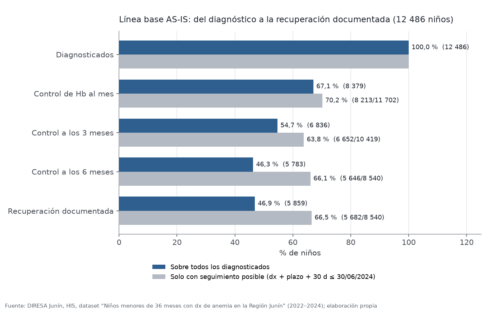

La brecha territorial es amplia. Con seguimiento posible, el control a los 6 meses va de 57,3 % en Huancayo (la provincia con más diagnósticos, 4 194) a 79,2 % en Tarma; Concepción (57,7 %) y Yauli (57,9 %) quedan cerca de Huancayo, y Chanchamayo (74,6 %), Jauja (73,6 %), Satipo (71,6 %) y Junín (72,1 %) por encima de 70 %.

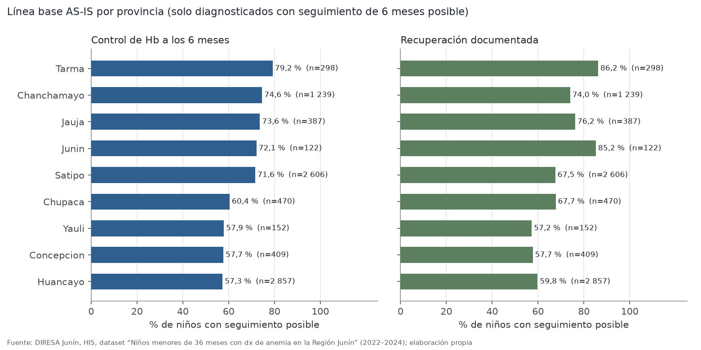

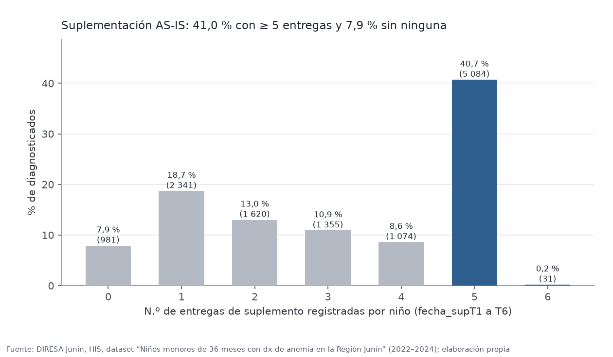

**Advertencias metodológicas.** (1) El dataset solo contiene niños **con** diagnóstico de anemia: no hay población total ni niños sanos, por lo que no permite calcular prevalencia ni cobertura de tamizaje. (2) Solo constan los dosajes dentro de la ventana de cada control (1.º: 29 a 58 días; 3.º: 87 a 119; 6.º: 178 a 209 desde el diagnóstico): un control fuera de ventana o no registrado aparece como «no realizado», de modo que el indicador mide control **registrado**, no asistencia real. (3) Hay censura por el corte: la cifra bruta subestima el desempeño y por eso se informa también el seguimiento posible; los plazos y la holgura de 30 días son supuestos operativos del análisis, por contrastar con la norma. (4) `num_doc` no es utilizable (notación científica en el 100 % de las filas, 8 754 valores distintos, 33 filas idénticas): no hay identificación del niño ni se intentó reidentificar a nadie, y puede haber repeticiones del mismo niño. (5) Una entrega no registrada puede ser entrega no hecha o dato faltante; `fecha_supT1` coincide con `fecha_dx` en el 100 % de los casos, y el dataset no incluye adherencia real, visitas, referencias ni motivos de abandono. (6) El 15,3 % no tiene `hb_dx`, y la severidad del HIS parece asignarse con hemoglobina ajustada por altitud mientras `hb_dx` es la observada.

**Importación a la v2.0 y concordancia de severidad.** El importador (`pmv_fastapi/scripts/importar_dataset_diresa.py`) entrega cada fila al servicio de importación por el puerto de entrada, con el código seudónimo `DJ-NNNNN`, sin DNI, nombres ni celular; asigna la altitud de la capital de provincia (INEI, *Perú: Compendio Estadístico 2014*, cuadro 1.12), no inventa peso ni talla, no altera ninguna fecha y descarta y cuenta lo inválido (ADR-009). La Tabla 33 resume las dos corridas reales.

**Tabla 33.** Importación del dataset de la DIRESA Junín a la v2.0 (`importacion_muestra500.json` e `importacion_completa.json`).

| Concepto | Muestra estratificada de 500 niños (semilla 2026) | Dataset completo |
| --- | --- | --- |
| Filas leídas | 12 486 | 12 486 |
| Niños importados | 500 | 11 686 (800 omitidos por no tener ninguna evaluación válida) |
| Evaluaciones importadas (diagnóstico / 1 mes / 3 meses / 6 meses) | 1 290 (453 / 309 / 286 / 242) | 29 712 (10 577 / 7 584 / 6 174 / 5 377) |
| Evaluaciones descartadas por falta de hemoglobina (mismo orden) | 47 / 26 / 18 / 15 | 1 909 / 794 / 662 / 405 (y 2 con hemoglobina fuera de rango) |
| Concordancia de la severidad HIS con la del sistema | 64,1 % (288/449) | 65,8 % (6 916/10 503) |
| Idem, sin contar los que el sistema clasifica «sin anemia» | 78,9 % | 79,3 % |
| Diagnósticos del HIS que el sistema clasifica «sin anemia» | 18,7 % (84) | 16,9 % (1 780) |

La concordancia de 64 % a 66 % **no es una medida de exactitud** de ninguno de los dos clasificadores: la severidad del HIS se conserva solo como dato de origen y la del sistema es la que rige. Entre las causas probables están que la altitud usada es la de la capital de provincia y no la del establecimiento; que el sistema aplica los puntos de corte y el ajuste por altitud de la NTS N.° 213-MINSA/DGIESP-2024 y de la OMS 2024, mientras que el HIS 2022 a 2024 pudo aplicar otros; y que `hb_dx` es la hemoglobina observada. Validarlo con la microred es la acción 11 del plan PDCA.

### 6.3 Indicadores de valor V1 a V6

La Tabla 34 reúne los seis indicadores definidos en la Tabla 52 con sus valores reales y su fuente. V1 a V3 provienen de un conjunto sintético común de 150 niños (140 activos y 10 con alta; 826 evaluaciones; semilla 20261016) cargado solo por la API pública en las tres versiones, para que la comparación sea justa; la v2.0 se mide además con la muestra real de 500 niños.

**Tabla 34.** Indicadores V1 a V6 por versión.

| Indicador | AS-IS | v1.0-PMV (Inc. 1) | Hito v1.5 | v2.0.0-inc2 (Inc. 2) | Fuente |
| --- | --- | --- | --- | --- | --- |
| **V1** Registros por evaluación | 3 | 1 (mejora 100 %) | 1 | 1 | `m32_v1.0_B150.json`, `m32_v1.5_B150.json`, `m32_v2.0_B150.json` |
| **V2** Niños activos con agenda normativa | 0 % | 0 % (0/140; `GET .../agenda` responde 404 en 140/140) | 100 % (140/140) | 100 % (140/140; 135 de 140 con al menos un control, 96,4 %); muestra real: 100 % (500/500) | Ídem; `m32_dataset_real.json` |
| **V3** Detección de vencidos (F1) | 0 % | 72,9 % (precisión 70,7 %; sensibilidad 75,3 %; TP 70, FP 29, FN 23, TN 18) | 100 % (TP 93, FP 0, FN 0, TN 47) | 100 % (TP 93, FP 0, FN 0, TN 47); muestra real: F1 = 100 % (TP 419, FP 0, FN 0, TN 81) | Ídem |
| **V4** p95 agregado, mix común (ms) | sin medida | 175 | 610 (750 con el mix ampliado) | 815 (815 con el mix ampliado) | `m32_carga.json` |
| **V5** Disponibilidad | sin medida | 100 % (856/856 sondas) | 100 % (856/856) | 100 % (856/856) | `m32_disponibilidad.json` |
| **V6** Criterios Dado-Cuando-Entonces en verde (proxy) | no aplica | 100 % (17/17) | 100 % (33/33) | 100 % (48/48) | `m21_cobertura_rf.json` |

V1 es idéntico en las tres versiones porque el registro nominal único existe desde el Inc. 1. La mejora de V3 en v1.0 (72,9 %) es la de la heurística de 30 días sin control (`control_atrasado`) frente a un oráculo normativo; no es la línea base del AS-IS, que es 0 % por no existir detección automática.

**Línea base real frente a capacidad del sistema.** La Tabla 35 y la Figura 46 ponen lado a lado lo que ocurre hoy en el proceso (controles registrados en el HIS) y lo que la v2.0 programa y muestra con la muestra de 500 niños. **No miden lo mismo** (resultado del proceso frente a capacidad del sistema): no se promedian, no entran al índice M3.2 y no demuestran mejora clínica ni de asistencia.

**Tabla 35.** Línea base AS-IS real frente a la capacidad de la v2.0 (muestra de 500 niños, fecha de referencia 30/06/2024).

| Indicador | AS-IS real (DIRESA Junín, 12 486 diagnósticos) | v2.0 con la muestra de 500 niños |
| --- | --- | --- |
| Niños activos con agenda normativa | 0 % (no existe agenda) | 100 % (500/500) |
| Controles vencidos visibles para el personal (agenda del personal y alertas) | 0 % (estructural: el cuaderno, la tarjeta y el HIS no listan vencidos) | 100 % (1 638/1 638) |
| Niños con al menos un control vencido | no medible | 419 de 500 (83,8 %); prioridad ALTA 1 543, MEDIA 71, BAJA 24; 27 controles por vencer en 7 días |
| Concordancia con el oráculo independiente de la agenda | no aplica | Por niño: F1 = 1,000 (TP 419, FP 0, FN 0, TN 81); por control: 1 638/1 638 (100 %) |
| Controles de tratamiento vencidos visibles (C1M / C3M / C6M) | Control registrado al mes, a 3 y a 6 meses: 67,1 % / 54,7 % / 46,3 % (70,2 % / 63,8 % / 66,1 % con seguimiento posible) | 182/182, 152/152 y 92/92 (100 %); 416 niños (83,2 %) con los controles de tratamiento programados |
| Tiempos de respuesta (un usuario) | no aplica | Agenda de la semana: mediana 68,0 ms (p95 73,6 ms); alertas: mediana 87,6 ms (p95 118,3 ms); listado: mediana 64,6 ms. Con los 11 686 niños: alertas 2,45 s (22 MiB) y agenda 1,6 s |

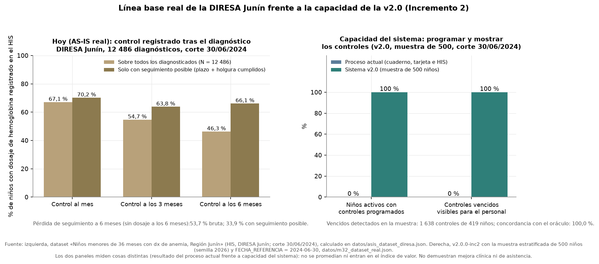

Lectura de la Tabla 35. De los 1 638 vencidos, 1 212 son dosajes por edad y 426 son controles de tratamiento; el extracto del HIS solo trae el diagnóstico y los dosajes al mes, a los 3 y a los 6 meses, de modo que un dosaje por edad (a los 6, 9 o 12 meses) sin registro en el extracto se muestra como vencido aunque haya podido hacerse: «vencido» significa «sin registro en la base importada», no «no realizado». El 16,8 % de los niños sin controles de tratamiento programados corresponde a diagnósticos que el sistema clasifica «sin anemia» (por la altitud de la capital de provincia) o a controles que caerían a los 60 meses o más. Entre los controles de tratamiento ya exigibles figuran cumplidos el 55,4 % (C1M), el 56,9 % (C3M) y el 60,9 % (C6M) de la muestra, frente a 70,2 %, 63,8 % y 66,1 % del AS-IS con seguimiento posible; la comparación es orientativa, porque la muestra es estratificada y la ventana del sistema (de −15 a +30 días) difiere de la del extracto.

### 6.4 M3.1 · Cobertura de brechas resueltas

M3.1 tiene dos lecturas. La **principal** (denominador de 6 brechas, como pide la guía) y la **complementaria** (solo las brechas que el plan compromete hasta el incremento). La Tabla 36 muestra los puntajes y la Figura 47 los grafica.

**Tabla 36.** Puntaje de cada brecha por versión (`m31_brechas.json`).

| Brecha | Plan | v1.0 | v1.5 | v2.0 | Evidencia resumida |
| --- | --- | --- | --- | --- | --- |
| B1 Triple registro manual | INC-1 | 1,0 | 1,0 | 1,0 | V1 = 1 escritura por evaluación; RF-01 a RF-09 con prueba automatizada y E2E (48/48 criterios en v2.0); el registro desde la aplicación sigue exigiendo todos los campos |
| B2 Agenda manual sin recordatorios | INC-2 | 0,0 | 0,5 | 0,5 | v1.0 no tiene agenda (404 en 140/140); v1.5 tiene agenda y vencidos con F1 = 100 %; v2.0 agrega la agenda del personal (RF-08) y la asistencia (RF-09), verificadas con B150 y con la muestra real (1 638/1 638 vencidos visibles); sigue parcial porque faltan los recordatorios a la familia (0 ocurrencias en el código) |
| B3 Barreras ocultas | INC-4 | 0,0 | 0,0 | 0,0 | 0 ocurrencias de «barrera» en `app/`; el motivo de inasistencia (RF-09) no es un registro ni un análisis de barreras |
| B4 Visita domiciliaria en papel | INC-3 | 0,0 | 0,0 | 0,0 | No existe ruta ni formulario de visita |
| B5 Riesgo identificado tarde | INC-5 | 0,0 | 0,0 | 0,0 | La lista de alertas es reactiva; 0 ocurrencias de «riesgo» o «abandono» |
| B6 Conectividad intermitente | INC-3 e INC-6 (en INC-1, parcial) | 0,5 | 0,5 | 0,5 | Reporte del periodo en el momento (RF-05); sin operación sin conexión ni sincronización; el Inc. 2 no toca B6 |
| **Suma de puntos** | | **1,5** | **2,0** | **2,0** | |

**Tabla 37.** Resultado de M3.1: lectura principal, complementaria y sensibilidades.

| Lectura | Inc. 1 (v1.0) | Hito v1.5 | Inc. 2 (v2.0) | Meta Inc. 1 / Inc. 2 | ¿Cumple? |
| --- | --- | --- | --- | --- | --- |
| **Principal:** Σ puntos ÷ 6 × 100 | **25,0 %** (1,5/6) | 33,3 % (2,0/6) | **33,3 %** (2,0/6) | ≥ 60 % / ≥ 90 % | No / No |
| **Complementaria:** brechas comprometidas en el plan | **100,0 %** (B1: 1,0/1) | 75,0 % (B1 y B2: 1,5/2) | **75,0 %** (B1 y B2: 1,5/2) | ≥ 60 % / ≥ 90 % | Sí / No |
| Sensibilidad: si B6 puntuara 0 (se exigiera operación sin conexión) | 16,7 % | 25,0 % | 25,0 % | | No / No |
| Sensibilidad: B2 limitada a lo comprometido en INC-2 (sin recordatorios; B2 = 1,0) | no aplica | no aplica | 41,7 % (100 % de las brechas comprometidas) | | No |
| Sensibilidad: motivo de inasistencia como registro parcial de barreras (B3 = 0,5) | no aplica | no aplica | 41,7 % (no se adopta) | | No |
| Sensibilidad: ambas | no aplica | no aplica | 50,0 % | | No |
| **Estricta** (solo brechas con puntaje 1,0) | 16,7 % (1/6) | 16,7 % (1/6) | 16,7 % (1/6); variación 0,0 % | ≥ 60 % / ≥ 90 % | No / No |

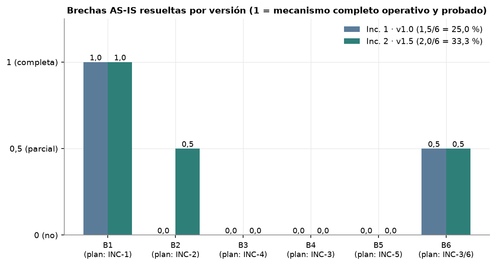

**Análisis de causa de la meta no cumplida.** La guía fija metas de 60 % y 90 % de brechas resueltas, lo que supone cerrar casi todas en dos incrementos. El plan de S3-4 y S6 las reparte en **seis incrementos** (B1 en INC-1, B2 en INC-2, B4 en INC-3, B3 en INC-4, B5 en INC-5 y B6 en INC-3 e INC-6): el valor medido es consistente con ese plan y no con la meta de la guía. Completar las cuatro historias del Inc. 2 no cambió M3.1 respecto del hito v1.5: B2 sigue en 0,5 porque el mecanismo TO-BE de B2 incluye los recordatorios a la familia (INC-4) y el sistema todavía no avisa a la familia, aunque el personal ya ve y vigila los controles. B6 se acredita como parcial por el reporte del periodo, criterio discutible (con B6 en 0, M3.1 sería 16,7 % y 25,0 %). Con la lectura literal de la fórmula (solo brechas con puntaje 1,0), M3.1 es 1/6 = 16,7 % en **todas** las versiones, sin mejora entre incrementos (Tabla 37).

**Propuesta de ajuste de metas (no aprobada; el valor medido no cambia).** Se propone medir contra metas **acumuladas según el plan**, con cada brecha completa aportando 1 punto y B6 completándose en INC-6: INC-1, 16,7 %; INC-2, 33,3 %; INC-3, 50,0 %; INC-4, 66,7 %; INC-5, 83,3 %; INC-6, 100 %. Las metas de la guía (60 % y 90 %) se conservan como referencia del curso. Con ellas, el 33,3 % del Inc. 2 «cumpliría», pero solo por la suma de dos parciales (B2 y B6), no por dos brechas completas: la lectura honesta es que solo B1 está resuelta por completo. La propuesta debe presentarse al docente (acción 7 del plan PDCA).

### 6.5 M3.2 · Índice de impacto en valor, tiempos de respuesta y disponibilidad

**Índice (V1, V2 y V3).** M3.2 = promedio simple de las mejoras: **Inc. 1: (100,0 + 0,0 + 72,9) ÷ 3 = 57,6 %** (57,6389 sin redondear) y **Inc. 2: (100,0 + 100,0 + 100,0) ÷ 3 = 100,0 %**, igual que en el hito v1.5. Ambos cumplen las metas (≥ 50 % y ≥ 80 %). La mejora de 42,4 puntos porcentuales (+73,5 %) viene de V2 (0 → 100 %) y V3 (72,9 → 100 %). **Advertencia:** el 100 % mide solo la mejora de V1 a V3; no incluye tiempo de respuesta, disponibilidad ni satisfacción y por tanto no contradice la regresión de V4 que sigue; tampoco equivale a haber resuelto las brechas del AS-IS (M3.1 = 33,3 %) ni a una mejora de resultados de salud. La Figura 48 muestra la matriz de confusión de V3 y las métricas de detección.

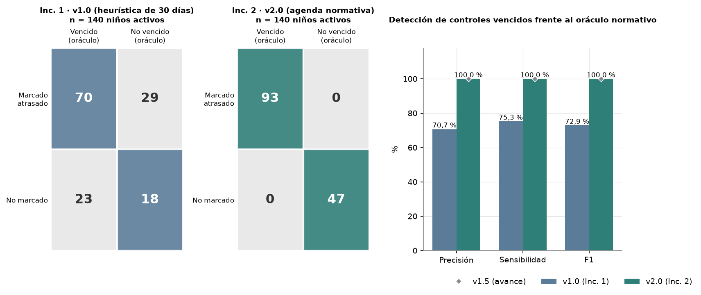

**Tiempos de respuesta (V4).** Se midió con Locust (50 usuarios, subida de 10 por segundo, 60 s), un proceso uvicorn, SQLite nueva por corrida, el conjunto B150 y 2 repeticiones por escenario, en una máquina de 2 CPU compartidas por el servidor, el generador de carga y la sonda: sirve para **comparar versiones bajo las mismas condiciones**, no como capacidad absoluta. La v1.0 se midió el 16/10/2026 y se repitió el 17/10/2026, junto con la v2.0. La Tabla 38 da el p95 por endpoint (promedio de 2 corridas).

**Tabla 38.** Tiempo de respuesta p95 por endpoint (ms) bajo 50 usuarios; promedio de 2 corridas; 0 fallos en todos los escenarios.

| Endpoint | v1.0 (16/10) | v1.5 (16/10) | v1.0 (17/10) | v2.0 (17/10) | v2.0, mix ampliado (17/10) |
| --- | --- | --- | --- | --- | --- |
| `GET /api/ninos` | 270 | 745 | 250 | 1 045 | 960 |
| `GET /api/ninos/{id}` | 59,5 | 320 | 52 | 590 | 450 |
| `POST /api/validaciones/evaluacion` | 31 | 71,5 | 27 | 125 | 85 |
| `POST /api/ninos` | 120 | 830 | 105 | 765 | 700 |
| `GET /api/reportes/periodo` | 175 | 680 | 145 | 895 | 615 |
| `GET /api/ninos/{id}/agenda` | no existe | — | no existe | — | 375 |
| `GET /api/alertas/controles-vencidos` | no existe | — | no existe | — | 910 |
| `GET /api/alertas/resumen` | no existe | — | no existe | — | 980 |
| `GET /api/agenda` | no existe | no existe | no existe | — | 915 |
| `GET /api/ninos/{id}/asistencias` | no existe | no existe | no existe | — | 575 |
| **Agregado (V4)** | **175** (corridas 190 y 160) | **610** (corridas 660 y 560) | **155** (corridas 150 y 160) | **815** (corridas 790 y 840) | **815** (corridas 780 y 850) |
| Mediana / p99 agregados | 21 / 345 | 74,5 / 1 100 | 19,5 / 315 | 75,5 / 1 250 | 120 / 1 150 |
| Solicitudes por segundo | 38,88 | 35,23 | 38,77 | 33,92 | 34,03 |

«—» indica un endpoint existente que no forma parte de ese mix. En el mix ampliado de v1.5 (16/10) el p95 fue 520 ms (agenda del niño), 780 (alertas), 1 015 (resumen) y 750 ms agregado.

Todos los p95 están por debajo del umbral de 2 s del criterio de la guía, pero **el p95 agregado subió de 175 ms (v1.0) a 610 ms (v1.5) y a 815 ms (v2.0) con el mismo mix de carga** (+365,7 %, +640 ms entre v1.0 y v2.0; +33,6 % entre v1.5 y v2.0), de forma consistente en las dos corridas de cada versión (máximo de v1.0: 190 ms; mínimo de v2.0: 790 ms) y también en endpoints heredados (`POST /api/ninos`, de 120 a 765 ms). La repetición de v1.0 en la misma sesión que v2.0 dio 155 ms, de modo que la diferencia no se explica por la sesión de medición. La **optimización de la acción 1 del PDCA** (carga de los niños por Core en tres consultas, sin N+1, y suma de meses sin `calendar.monthrange`) redujo, en un micro-benchmark en proceso con 1 000 niños, el p95 de `GET /api/ninos` de 159,6 a 128,2 ms y el de las alertas de 185,7 a 155,3 ms (−20 % y −16 %; dispersión de ±15 % entre corridas), pero **no revirtió la regresión bajo 50 usuarios**. La causa no está perfilada: la hipótesis del equipo, sin comprobar, es que el cálculo del estado normativo de cada niño en los listados y la CPU compartida encarecen las lecturas (la función de agenda es cerca del 70 % del tiempo de una consulta de alertas en el perfil de cProfile). La acción 1 sigue abierta (`pmv_fastapi/docs/evidencias/inc2/optimizacion_p95.md`). La prueba de humo del README (30 s, pocos niños) no es comparable.

Con el dataset completo (11 686 niños, SQLite, un usuario) la mediana es de 1,68 s para `GET /api/ninos` (4,5 MiB), 1,58 s para la agenda de la semana, 2,45 s para las alertas (22,2 MiB, sin paginar) y 1,68 s para el resumen; con la muestra de 500 niños todo responde en menos de 0,1 s. Las alertas superan el criterio de 2 s con esa escala: acción 10 del plan PDCA (paginación).

**Disponibilidad (V5).** Una sonda `GET /api/salud` por segundo; disponibilidad = respuestas 200 en menos de 2 s ÷ sondas. Durante las corridas de carga (128 sondas por escenario de dos corridas; 256 en v1.0, que se midió dos veces) y en una sesión de 10 minutos por versión sin carga (600 sondas) fue de **100 %**: 856 de 856 sondas en las tres versiones. La medición cubre solo 10 minutos y una instancia local; no demuestra disponibilidad de producción.

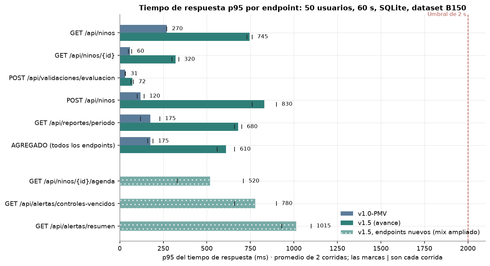

### 6.6 Satisfacción del usuario: proxy y SUS pendiente

La guía pide medir la satisfacción. En este corte **no se aplicó ningún cuestionario a usuarios reales**, por lo que no se reporta un valor SUS: cualquier número sería inventado. Se reporta como **proxy V6** el porcentaje de criterios Dado-Cuando-Entonces verificados por pruebas en verde (17/17 en v1.0, 33/33 en el hito v1.5 y 48/48 en v2.0, 100 %), que mide **cumplimiento funcional y no satisfacción**.

El instrumento está preparado en `entregables/semana-09/metricas/instrumento_SUS.md` (Anexo D): SUS de 10 ítems (escala de 1 a 5; puntaje de 0 a 100), mínimo de 5 respondientes por versión (personal de salud y Product Owner) tras una tarea guiada, aplicado al liberar cada incremento. Metas propuestas: SUS ≥ 68 en el Inc. 1 y ≥ 80 en el Inc. 2 (por confirmar con el Product Owner; la guía no fija meta de satisfacción).

### 6.7 Qué es valor medido y qué requiere un piloto

La Tabla 39 separa lo medido de lo que exige un piloto.

**Tabla 39.** Alcance de las afirmaciones de valor.

| Afirmación | Estado | Cómo se obtuvo | Qué falta |
| --- | --- | --- | --- |
| Registros por evaluación de 3 a 1 | Medido por API con datos sintéticos (valor por diseño) | `m32_valor.py` | Tiempo real de registro en una posta |
| Agenda para 140/140 niños activos y detección de vencidos con F1 = 100 % | Medido con datos sintéticos frente a un oráculo escrito por el equipo | `m32_valor.py`, `oraculo_agenda.py` | Confirmar los parámetros con la microred |
| Agenda para 500/500 niños y 1 638 controles vencidos visibles (419 niños) | Medido con datos reales anonimizados frente al mismo oráculo; verifica el cálculo de la agenda, no la importación del CSV | `m32_dataset_real.py` | Confirmar con la microred que «vencido» (sin registro en la base importada) corresponde a controles no realizados |
| Línea base AS-IS: control registrado 67,1 % / 54,7 % / 46,3 %; pérdida de seguimiento a 6 meses 53,7 % | Medido sobre el extracto completo del HIS (dato real de terceros); mide control registrado en ventana, no asistencia | `analisis_asis.py` | Población total (sin diagnóstico), asistencia real, adherencia |
| Concordancia de severidad HIS y sistema: 64,1 % (muestra) y 65,8 % (completo) | Medido; no es una medida de exactitud | Importador y `importacion_*.json` | Altitud del establecimiento y puntos de corte vigentes; validación con la microred |
| Tiempos de respuesta y disponibilidad | Medido en un contenedor de 2 CPU | Locust y sonda | Medición en el despliegue de staging con PostgreSQL y conectividad rural |
| Satisfacción | **Pendiente** | Proxy funcional V6 | SUS con el Product Owner y el personal |
| Efecto del sistema sobre la adherencia, la pérdida de seguimiento y la oportunidad de los controles (impacto clínico) | **No medible** sin despliegue | — | Piloto en una posta, comparación con la línea base AS-IS real y acuerdo con el establecimiento (S1) |

### 6.8 Respuesta a las preguntas del Pilar 3

**Q3.1 · ¿En qué medida las funcionalidades entregadas reducen las brechas operativas del AS-IS?** En una medida **menor que la meta de la guía**: M3.1 = **25,0 % en el Inc. 1 y 33,3 % en el Inc. 2** frente a metas de 60 % y 90 %, ninguna cumplida (Tabla 37, con las lecturas complementaria, estricta y de sensibilidad). B2 y B6 están parciales y B3, B4 y B5 no se han abordado porque el plan las asigna a INC-4, INC-3 e INC-5. Frente a la línea base real (Tabla 32), el sistema hace visible lo que hoy no lo es: con la muestra de 500 niños, el 100 % de los activos tiene agenda y el 100 % de los 1 638 controles vencidos (419 niños) es visible para el personal, con 100 % de concordancia con el oráculo, mientras que el proceso actual no tiene lista de vencidos y el 53,7 % de los diagnosticados (33,9 % con seguimiento posible) no tiene dosaje a los 6 meses registrado. Es capacidad del sistema: **no se afirma** que reduzca la pérdida de seguimiento. Se propone ajustar la meta de M3.1 a la distribución del plan, sin modificar los valores medidos.

**Q3.2 · ¿Cómo evolucionan los indicadores de valor (tiempos de respuesta, disponibilidad y satisfacción) con cada incremento?** El **índice de valor** sube de 57,6 % a 100,0 % (V1: 3 → 1 registros; V2: 0 → 100 %; V3: 72,9 → 100 %). Los **tiempos de respuesta empeoraron** (V4: 175 → 610 → 815 ms, Tabla 38; todos por debajo de 2 s y sin fallos; con el dataset completo las alertas tardan 2,45 s), una regresión que sigue abierta (acciones 1 y 10). La **disponibilidad** se mantuvo en 100 % (856/856 sondas en las tres versiones). La **satisfacción** no está medida: solo el proxy funcional (100 %, 48/48) y el SUS pendiente.

<div style="page-break-after: always;"></div>

## 7. COMPARATIVA GQM Y PLAN DE MEJORA CONTINUA (Actividad 7 · Inc. 1 vs. Inc. 2)

### 7.1 Matriz 7.1 de comparativa GQM

La Tabla 40 compara todas las métricas del Inc. 1 (`v1.0-PMV`) con las del Inc. 2 completo (`v2.0.0-inc2`); el hito intermedio `v1.5.0-inc2-avance` figura en la Tabla 7. La variación porcentual es la de `resumen_gqm.json`; cuando la base es 0 se informa «n/a (base 0)» y la diferencia absoluta. Las filas de p95 y disponibilidad no son métricas GQM de la guía, pero se incluyen para no ocultar la regresión de rendimiento; la variación del p95 es un cálculo propio con los valores de `m32_carga.json`. La fila «estricta» de M3.1 muestra la lectura menos favorable.

**Tabla 40.** Matriz 7.1: Comparativa GQM y evolución del proceso (Inc. 1 vs. Inc. 2).

| Métrica GQM Evaluada | Incremento 1 (PMV) Real | Incremento 2 Real | Variación (%) | Causa Raíz / Acción de Mejora Aplicada |
| --- | --- | --- | --- | --- |
| **Contaminación del Dominio (M1.1)** | 0,0 % (0 de 8 clases con importaciones externas) | 0,0 % (0 de 32 clases) | **n/a (base 0)**; diferencia 0,0 puntos | Dominio aislado desde el Inc. 1 (ADR-001); se mantuvo al crecer de 8 a 32 clases; las pruebas de arquitectura lo vigilan |
| **Conformidad Hexagonal (M1.2)** | 40,0 % (2/5; laxo 60,0 %) | 100,0 % (5/5) | **+150,0 %** (+60,0 puntos) | Faltaban puertos de entrada, el puerto de salida estaba en `application` y el adaptador HTTP importaba una clase concreta. Acción aplicada: ADR-008 (hito v1.5), mantenida en v2.0 |
| **Acoplamiento: violaciones de la regla de dependencia (M1.3)** | 1 (`api.py:12`) | 0 | **−100,0 %** (−1) | El adaptador de entrada depende de los puertos; 18 pruebas de arquitectura impiden la regresión (14 en el hito v1.5) |
| **Cobertura Funcional con Capturas (M2.1)** | 100,0 % (5/5 RF) | 100,0 % (4/4 RF) | **0,0 %** (0,0 puntos) | Los nueve RF tienen ficha y captura aprobada. RF-08 y RF-09 se completaron el 17/10/2026 con datos reales anonimizados |
| **Tasa de Defectos Funcionales (M2.2)** | 1,4 Def/RF (7/5) | 0,25 Def/RF (1/4: DEF-09, hallado por E2E antes de liberar) | **−82,1 %** (−1,15); **la meta del Inc. 2 (≤ 0,2) no se cumple** | 6 de 7 defectos escaparon del PMV por falta de pruebas de entradas límite y concurrencia; el Inc. 2 introdujo DEF-09 en código nuevo (RF-08). Ningún defecto escapó a producción (0/4). Acción: exploración de entradas hostiles en la DoD (acción 2) |
| **Cobertura de Brechas Resueltas (M3.1)** | 25,0 % (1,5/6) | 33,3 % (2,0/6) | **+33,3 %** (+8,33 puntos) | Solo B2 progresó (0 → 0,5), ya en el hito v1.5; completar RF-08 y RF-09 no la cambió. El plan reparte las brechas en 6 incrementos: se propone ajustar la meta (acción 7) |
| **M3.1 estricta (solo brechas con puntaje 1,0)** | 16,7 % (1/6) | 16,7 % (1/6) | **0,0 %** (0,0 puntos) | Sin mejora: solo B1 está completa. Misma acción |
| **M3.1 complementaria (brechas comprometidas)** | 100,0 % (B1) | 75,0 % (B1 y B2) | **−25,0 %** (−25,0 puntos) | El denominador crece al comprometerse B2, parcial (0,5). Falta el recordatorio a la familia (INC-4, acción 4) |
| **Índice de Impacto en Valor (M3.2)** | 57,6 % | 100,0 % | **+73,5 %** (+42,36 puntos) | Mejora por V2 (0 → 100 %) y V3 (72,9 → 100 %); V1 ya era 100 %. No incluye tiempo de respuesta, disponibilidad ni satisfacción |
| **p95 agregado, mix común (V4)** | 175 ms | 815 ms | **+365,7 %** (+640 ms) | **Regresión** con el mismo mix (610 ms en el hito v1.5), 0 fallos, todos bajo 2 s. La optimización de la acción 1 no la revirtió; causa sin perfilar |
| **Disponibilidad (V5)** | 100 % (856/856) | 100 % (856/856) | **0,0 %** | Sin cambios. Acción: medir en staging con PostgreSQL (acción 6) |

La Figura 50 compara las seis métricas del Inc. 1 y del Inc. 2 con las metas de la guía.

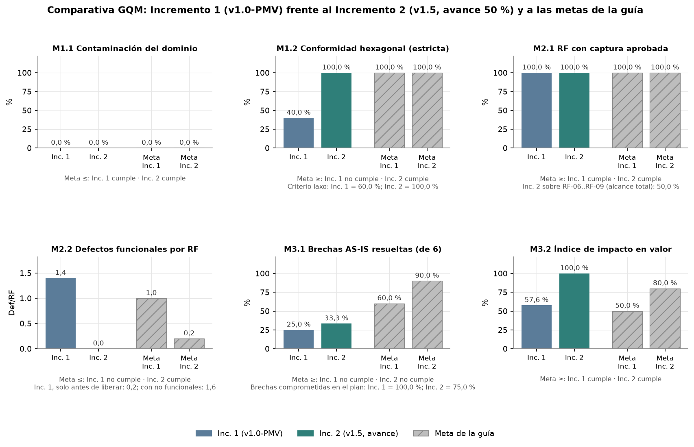

La Figura 49 (sección 6.5) detalla el p95 por endpoint.

### 7.2 Diagnóstico comparativo por pilar

#### 7.2.1 [Pilar 1 · Arquitectura] Diagnóstico

La mejora estructural es real y verificable (Tabla 40); lo que no cambió es M1.1, porque el dominio ya estaba limpio. Aparece un costo: la v2.0 tiene 55 archivos de `app/` frente a 18 de la v1.0 (1,022 a 2,782 KLOC) y 32 clases de dominio frente a 8. Queda un riesgo de diseño: la regla 4 del ADR-008 es estricta (el adaptador de entrada solo puede usar `domain.model`), lo que obliga a que los casos de uso entreguen resultados ya resueltos. El criterio de revisión de ADR-007 se supera bajo carga y con el dataset real completo (sección 4.4): la agenda calculada en línea no escala sin paginar o materializar.

#### 7.2.2 [Pilar 2 · Pruebas] Diagnóstico

La suite por defecto creció de 73 a 328 pruebas, con cobertura de 99,19 % a 100 %, pero **la cobertura de sentencias no detectó lo que sí halló la exploración de entradas límite**: 6 defectos funcionales escaparon de una suite con 99 % de cobertura. En el cierre del Inc. 2, las 27 exploratorias de RF-08 y RF-09 no hallaron fallas y DEF-09 lo halló una prueba E2E antes de liberar, de modo que la exploración parece estar funcionando, pero M2.2 sigue sobre la meta (0,25 frente a ≤ 0,2) por un solo defecto en cuatro RF. La acción de fondo es formalizar en la Definición de Hecho (DoD) la exploración de entradas límite y concurrencia. Persisten dos brechas de evidencia: la integración en PostgreSQL de v2.0 no se ejecutó y SonarCloud no se activó.

#### 7.2.3 [Pilar 3 · Valor] Diagnóstico

El valor entregado es el de **visibilidad** (qué controles están vencidos, con qué prioridad y en qué día, y si el niño asistió) y no todavía el de **acción** (avisar a la familia, visitar, anticipar el abandono), que llega con INC-3, INC-4 e INC-5; por eso M3.1 sigue en 33,3 % (Tabla 37) aunque el índice de valor llegue a 100 %. Con el dataset de la DIRESA Junín el pilar tiene ahora una línea base real (Tabla 32): el control de hemoglobina registrado cae de 67,1 % al mes a 46,3 % a los 6 meses y la brecha entre provincias es de 22 puntos; la capacidad de la v2.0 (Tabla 35) responde a esa necesidad de visibilidad, pero no se ha probado que cambie la asistencia. La regresión de rendimiento amenaza el valor ya entregado: una pestaña de alertas lenta bajo carga, o con 22 MiB de respuesta, puede desalentar el uso. La concordancia de severidad con el HIS (64 % a 66 %) exige validar con la microred la altitud y los puntos de corte. La satisfacción sigue sin medirse y no hubo piloto en una posta.

### 7.3 Plan de mejora continua PDCA

Las acciones siguen el ciclo Plan-Do-Check-Act sobre los hallazgos de la comparativa. Los responsables y las fechas son una **propuesta del equipo** dentro del Sprint 4 (13 al 26/10/2026) y el Sprint 5 (27/10 al 09/11/2026), sujeta a la replanificación de la sección 2.1. La numeración conserva la de la versión anterior del informe (acciones 1 a 9) y añade las acciones 10 a 12 surgidas del cierre del Inc. 2 y del uso de datos reales.

**Tabla 41.** Plan PDCA de mejora (Sprint 4 y Sprint 5).

| N.° | Pilar | Plan (hallazgo y acción) | Do (qué se hará) | Check: métrica que verifica y meta | Act (qué se estandariza) | Responsable (propuesto) | Fecha objetivo |
| --- | --- | --- | --- | --- | --- | --- | --- |
| 1 | P3 y P1 | **Abierta.** Regresión de V4 con el mismo mix (175, 610 y 815 ms; Tabla 40); la optimización aplicada (carga por Core y suma de meses) bajó 12 % a 21 % en un micro-benchmark pero no revirtió la regresión bajo 50 usuarios; criterio de revisión de ADR-007 superado | Perfilar los endpoints bajo carga (cProfile o py-spy); medir el costo del estado normativo en `GET /api/ninos`; caché de agenda por niño; revisar la materialización de la agenda | V4: p95 agregado del mix común ≤ 300 ms (meta propuesta, a confirmar tras el perfilado), 0 fallos; repetir `ejecutar_carga.py` | Prueba de carga comparativa en la DoD; ADR | Auqui H. | Perfilado: 21/10/2026; optimización y nueva medición: 26/10/2026 (cierre del Sprint 4) |
| 2 | P2 | 6 defectos escaparon del PMV (DEF-03 a DEF-08) pese a 99 % de cobertura; el Inc. 2 introdujo DEF-09 (M2.2 = 0,25) | Formalizar en la DoD las pruebas exploratorias y de entradas límite (NaN, Unicode, fechas extremas, textos enormes, comodines, concurrencia), ya usadas en las 27 exploratorias de RF-08 y RF-09; ejecutar `exploratorias_inc2.py` en cada historia | M2.2 ≤ 0,2 Def/RF por incremento; 0 defectos escapados en el INC-3 | Checklist de DoD versionado | Huamani R. | DoD: 19/10/2026; verificación: 26/10/2026 |
| 3 | P2 | **Hecha.** Inc. 2 al 50 % (16/10/2026): RF-08 y RF-09 sin evidencia | HIST-2.3 (5 SP) y HIST-2.4 (3 SP) completadas con ficha, captura y pruebas el 17/10/2026; etiqueta `v2.0-Inc2` publicada el 18/10/2026 | 18/18 SP; M2.1 = 100 % (4/4 RF); 328 pruebas y 15 E2E en verde con cobertura de 100 % | Cerrar el incremento solo con etiqueta e informe de evidencias | Auqui H. (desarrollo) y Huamani R. (fichas) | Hecho (17/10/2026); etiqueta publicada el 18/10/2026 |
| 4 | P3 | B2 sigue parcial (0,5): faltan recordatorios a la familia | Diseñar el puerto de salida `Notificador` y estimar HIST-4.1 y HIST-4.2; implementar en INC-4 | ADR del puerto; al liberar INC-4, B2 de 0,5 a 1,0 (M3.1 +8,3 puntos) | Todo adaptador nuevo en `adapters/outbound` con su puerto | Porras V. y Auqui H. | Diseño y estimación: 09/11/2026 |
| 5 | P3 | La satisfacción no está medida | Aplicar el SUS (`instrumento_SUS.md`) con el Product Owner y el personal tras una tarea guiada | ≥ 5 respondientes por versión; SUS ≥ 68 (Inc. 1) y ≥ 80 (Inc. 2), metas por confirmar | SUS al cierre de cada incremento | Porras V. | 30/10/2026 |
| 6 | P2 | SonarCloud sin activar e integración en PostgreSQL de v2.0 sin ejecutar | Configurar `sonar.organization` y `SONAR_TOKEN`; ejecutar el job de PostgreSQL del CI sobre v2.0; guardar capturas | Análisis publicado y job en verde; 0 incidencias críticas | Quality gate en el pipeline | Huamani R. | 23/10/2026 |
| 7 | P3 | Metas de M3.1 de la guía (60 % y 90 %) incompatibles con el plan de seis incrementos | Presentar al docente las metas acumuladas (16,7 %, 33,3 %, 50,0 %, 66,7 %, 83,3 % y 100 %), conservando las de la guía como referencia | Metas acordadas por escrito; M3.1 con ambas lecturas | Reportar siempre ambas lecturas | Porras V. | 19/10/2026 |
| 8 | P1 | Publicar cada versión evaluada en GitHub | `v1.0-PMV`, `v1.5.0-inc2-avance` y `v2.0-Inc2` publicadas (Figuras 3 y 4); falta abrir el pull request a `main` | Etiquetas visibles en GitHub (captura de `tree/v2.0-Inc2/pmv_fastapi/app`); pull request revisado | Una etiqueta por incremento liberado | Porras V. y Auqui H. | Etiquetas: hecho (17 y 18/10/2026); pull request: tras la revisión del equipo |
| 9 | P2 | Observaciones EX-17 (Unicode NFC/NFD) y EX-40 (activos mayores de 59 meses con alertas) | Decidir y documentar la política (normalizar a NFC; alta automática o excepción) | 2 observaciones cerradas con decisión y prueba | ADR breve | Auqui H. | 09/11/2026 |
| 10 | P3 y P1 | **Nueva.** Con el dataset completo (11 686 niños) las alertas tardan 2,45 s y devuelven 22 MiB sin paginar; la agenda y el listado tardan 1,6 s | Paginar `GET /api/alertas/controles-vencidos` (y el listado) por límite y desplazamiento; evaluar materializar la agenda (ADR-007) | Alertas con el dataset completo < 2 s y respuesta por página < 1 MiB; 0 fallos en la prueba de carga | Criterio de escala en la DoD; revisión de ADR-007 | Auqui H. | 09/11/2026 |
| 11 | P3 | **Nueva.** La severidad del HIS coincide con la del sistema en 64 % a 66 % por causas probables no verificadas (altitud de la capital de provincia, puntos de corte) y «vencido» significa «sin registro en la base importada» | Validar con la microred una muestra de niños: altitud del establecimiento, puntos de corte vigentes y si los vencidos corresponden a controles no realizados | Concordancia recalculada con la altitud del establecimiento; lista de discrepancias explicadas | Parámetros de la agenda y de la clasificación confirmados por la microred (ADR-004) | Porras V. y Huamani R. | 09/11/2026 |
| 12 | P2 | **Nueva.** La asistencia registrada no se puede anular ni corregir (ADR-010); no hay roles que digan quién puede hacerlo | Incluir en el backlog del INC-3 una historia de anulación o corrección con auditoría, junto con la autenticación por roles; estimarla | Historia redactada con criterios Dado-Cuando-Entonces y puntos de historia | Cambios sobre hechos registrados siempre con motivo y usuario | Porras V. | 09/11/2026 |

### 7.4 Lecciones aprendidas

1. **La cobertura alta no sustituye a la exploración:** una suite con 99 % de cobertura dejó escapar 6 defectos que halló la prueba de entradas hostiles; la DoD debe exigirla, y aun así DEF-09 apareció en código nuevo y lo detectó una E2E.
2. **Medir antes de afirmar y optimizar solo lo que se midió:** la regresión del p95 sigue en el informe (Tabla 40); optimizar sin perfilar redujo los tiempos de un solo usuario en un 12 % a 21 % pero no la regresión bajo carga. Distinguir la meta de la guía de la del plan (M3.1) evita presentar el 100 % del índice como si fuera el alcance completo.
3. **La arquitectura se protege con pruebas, no con documentos:** pasar de 2/5 a 5/5 costó una reestructuración; las 18 pruebas de arquitectura evitan volver atrás.
4. **Planificar con holgura:** asignar el INC-2 completo a un sprint que además cerraba el integrador de S6 fue optimista (causa declarada por el equipo, sin registro de horas del Sprint 3): el incremento se completó el 17/10, cinco días después del hito H2 planificado (12/10), y su cierre formal fue el 18/10; la velocidad debe recalibrarse con los 18 SP reales más el habilitador.
5. **Separar lo medido de lo supuesto:** los datos sintéticos verifican el mecanismo, pero el valor para el niño y la familia exige el piloto en la posta.
6. **Los datos reales revelan lo que los sintéticos ocultan:** el extracto del HIS no trae un identificador utilizable, su severidad no coincide por completo con la del sistema y su volumen (11 686 niños) expuso un límite de escala que con 150 niños no aparecía. Conviene probar con datos reales anonimizados desde el inicio de cada incremento.

<div style="page-break-after: always;"></div>

## 8. ANEXOS

Anexos A a F (los que pide la guía) y Anexo G (detalle complementario movido desde el cuerpo). Los bloques de comandos indican su sistema operativo: PowerShell (Windows) en el Anexo B y bash (Linux, macOS o WSL) en el Anexo C.

### Anexo A. Carpeta de capturas `evidencias_capturas/` organizada por RF

La carpeta `entregables/semana-09/evidencias_capturas/` contiene las 44 capturas PNG (32 de las fichas de RF-01 a RF-09, 5 de regresión visual, 4 de arquitectura y 3 de datos reales), 2 archivos CSV descargados por el reporte, los resultados en JSON y el script reproducible. Las capturas de RF-01 a RF-07 usan datos sintéticos; las de RF-08, RF-09 y `datos_reales/` usan la muestra de 500 niños del dataset anonimizado de la DIRESA Junín (más registros de prueba de origen `SISTEMA`). El índice completo con descripción, URL, fecha-hora y resultado observado de cada captura está en [`evidencias_capturas/INDICE.md`](evidencias_capturas/INDICE.md). Cada captura lleva un pie de «Evidencia S9» inyectado por `capturar_evidencias.py`. La Tabla 42 lista los archivos por carpeta.

**Tabla 42.** Archivos de `evidencias_capturas/` por carpeta.

| Carpeta | Archivos |
| --- | --- |
| `RF-01/` | `RF01_inc1_paso1_entrada.png`<br>`RF01_inc1_paso2_resultado.png`<br>`RF01_v15_regresion.png` |
| `RF-02/` | `RF02_inc1_paso1_entrada.png`<br>`RF02_inc1_paso2_resultado.png`<br>`RF02_inc1_paso3_entrada_actualizacion.png`<br>`RF02_inc1_paso4_resultado_actualizacion.png`<br>`RF02_inc1_paso5_entrada_nuevo_control.png`<br>`RF02_inc1_paso6_resultado_nuevo_control.png`<br>`RF02_v15_regresion.png` |
| `RF-03/` | `RF03_inc1_paso1_entrada.png`<br>`RF03_inc1_paso2_resultado.png`<br>`RF03_inc1_paso3_rechazo.png`<br>`RF03_v15_regresion.png` |
| `RF-04/` | `RF04_inc1_paso1_entrada.png`<br>`RF04_inc1_paso2_resultado.png`<br>`RF04_inc1_paso3_busqueda_comunidad.png`<br>`RF04_v15_regresion.png` |
| `RF-05/` | `RF05_inc1_paso1_entrada.png`<br>`RF05_inc1_paso2_resultado.png`<br>`RF05_inc1_paso3_json.png`<br>`RF05_inc1_paso4_csv.png`<br>`RF05_inc1_reporte_descargado.csv`<br>`RF05_v15_regresion.png`<br>`RF05_v15_regresion_reporte_descargado.csv` |
| `RF-06/` | `RF06_inc2_paso1_entrada.png`<br>`RF06_inc2_paso2_resultado.png`<br>`RF06_inc2_paso3_proximo_a_vencer.png` |
| `RF-07/` | `RF07_inc2_paso1_entrada.png`<br>`RF07_inc2_paso2_resultado_filtro_prioridad.png`<br>`RF07_inc2_paso3_resultado_filtro_comunidad.png` |
| `RF-08/` | `RF08_inc2final_paso1_entrada.png`<br>`RF08_inc2final_paso2_resultado.png`<br>`RF08_inc2final_paso3_resultado_filtro_establecimiento.png` |
| `RF-09/` | `RF09_inc2final_paso1_entrada.png`<br>`RF09_inc2final_paso2_asistio.png`<br>`RF09_inc2final_paso3_no_asistio.png`<br>`RF09_inc2final_paso3b_alerta_prioridad_elevada.png`<br>`RF09_inc2final_paso4_409_segundo_registro.png` |
| `arquitectura/` | `arbol_v1.0.png`<br>`arbol_v1.5.png`<br>`github_v1.0-PMV_app.png`<br>`github_v1.5.0-inc2-avance_app.png`<br>`github_v2.0-Inc2_app.png` |
| `datos_reales/` | `DJ_alertas_muestra_real.png`<br>`DJ_expediente_DJ-04505.png`<br>`SISTEMA_expediente_79000003.png` |
| `(raíz)` | `INDICE.md`<br>`capturar_evidencias.py`<br>`resultados_arquitectura.json`<br>`resultados_github.json`<br>`resultados_inc1.json`<br>`resultados_inc2.json`<br>`resultados_inc2final.json`<br>`resultados_regresion.json` |

Resultados de máquina: `resultados_inc1.json`, `resultados_inc2.json`, `resultados_inc2final.json` (RF-08, RF-09 y datos reales), `resultados_regresion.json`, `resultados_arquitectura.json` y `resultados_github.json` (intento automático de captura de GitHub; las Figuras 3 y 4 se tomaron después desde el navegador del equipo). Para regenerar las capturas: `python evidencias_capturas/capturar_evidencias.py` para RF-01 a RF-07 y `python evidencias_capturas/capturar_evidencias.py --modo inc2final` para RF-08, RF-09 y `datos_reales/` (ver Anexo C).

### Anexo B. Repositorio GitHub y etiquetas

- Repositorio: <https://github.com/woshtsu/ProcesosSoftwareAnemia>.
- Etiqueta **existente**: `v1.0-PMV` (Incremento 1; en el tag la carpeta `app/` está en la raíz): <https://github.com/woshtsu/ProcesosSoftwareAnemia/tree/v1.0-PMV/app>.
- Etiqueta **publicada**: `v1.5.0-inc2-avance` (hito intermedio al 50 % del Incremento 2, no el incremento evaluado), commit `416dfbc` en la rama `feature/inc2-agenda-alertas`, publicada el 17/10/2026: <https://github.com/woshtsu/ProcesosSoftwareAnemia/tree/v1.5.0-inc2-avance/pmv_fastapi/app>.
- Etiqueta **del cierre (publicada)**: `v2.0-Inc2` (la pide la guía) para la versión `v2.0.0-inc2` (Incremento 2 completo: HIST-2.1 a HIST-2.4), commit `fb26626` en la rama `feature/inc2-agenda-alertas`, publicada el 18/10/2026: <https://github.com/woshtsu/ProcesosSoftwareAnemia/tree/v2.0-Inc2/pmv_fastapi/app> (Figura 4).

**Comandos usados para publicar el hito intermedio (PowerShell, Windows; desde la raíz del repositorio):**

```powershell
git switch -c feature/inc2-agenda-alertas
git add -A -- pmv_fastapi herramientas entregables/semana-09 exportados/semana-09 diagramas coordinacion README.md
git commit -m "Inc. 2 avance 50%: agenda normativa y alertas (HIST-2.1, HIST-2.2), estructura hexagonal y evaluacion GQM S9"
git tag -a v1.5.0-inc2-avance -m "Avance 50% del Incremento 2 (HIST-2.1 y HIST-2.2)"
git push -u origin feature/inc2-agenda-alertas
git push origin v1.5.0-inc2-avance
```

**Comandos usados para publicar el cierre del Incremento 2 (PowerShell, Windows; desde la raíz del repositorio, con la rama `feature/inc2-agenda-alertas` activa):**

```powershell
git switch feature/inc2-agenda-alertas
git add -A -- pmv_fastapi herramientas entregables/semana-09 exportados/semana-09 diagramas coordinacion README.md Dataset
git commit -m "Inc. 2 completo: agenda del personal y asistencia (HIST-2.3, HIST-2.4), dataset DIRESA Junin y evaluacion GQM S9"
git tag -a v2.0-Inc2 -m "Incremento 2 completo (HIST-2.1 a HIST-2.4)"
git push origin feature/inc2-agenda-alertas
git push origin v2.0-Inc2
```

La carpeta `Dataset/` (dataset de la DIRESA Junín, ya anonimizado en origen: sin nombres ni DNI utilizables) se versiona junto con el cierre porque la necesitan el importador y el análisis AS-IS (Anexo C). Después, el equipo puede abrir el pull request hacia `main`.

**Lista previa a la exposición (para el equipo).**

1. ~~Publicar la rama y la etiqueta del hito~~: hecho el 17/10/2026.
2. ~~Capturar en GitHub `app/` de `v1.0-PMV` y `pmv_fastapi/app/` de `v1.5.0-inc2-avance`~~: hecho (Figuras 3 y 4).
3. ~~Publicar el cierre (commit, etiqueta `v2.0-Inc2` y *push*)~~: hecho el 18/10/2026 (commit `fb26626`).
4. ~~Capturar en GitHub `tree/v2.0-Inc2/pmv_fastapi/app`~~: hecho (Figura 4).
5. Abrir el pull request de `feature/inc2-agenda-alertas` hacia `main` cuando el equipo lo revise.

### Anexo C. Reproducibilidad

Todos los scripts están en `herramientas/gqm/` y `herramientas/dataset/` y escriben en `entregables/semana-09/metricas/` (descripción en `metricas/README.md`). Los bloques siguientes son para **bash** (Linux, macOS o WSL en Windows; en PowerShell deben adaptarse las variables de entorno), desde la raíz del repositorio, con Python 3.13 y las dependencias de `pmv_fastapi/requirements*.txt`. Si se ejecutan los E2E, `PLAYWRIGHT_BROWSERS_PATH` debe apuntar al directorio de navegadores de Playwright.

```bash
git worktree add ../inc1_v1.0_PMV v1.0-PMV      # copia de v1.0 (alternativa: git archive v1.0-PMV)
export PY=python   # v1.0 y v1.5 se buscan por omisión en ../inc1_v1.0_PMV y ../v15_export/pmv_fastapi; para otra ruta use una ruta ABSOLUTA, p. ej. export GQM_RAIZ_V10="$(cd .. && pwd)/inc1_v1.0_PMV"
mkdir -p ../v15_export && git archive v1.5.0-inc2-avance pmv_fastapi | tar -x -C ../v15_export    # copia del hito v1.5; GQM_RAIZ_V15=../v15_export/pmv_fastapi
cd herramientas/gqm
for v in v1.0 v1.5 v2.0; do bash ejecutar_pruebas.sh $v; done          # ruff, pytest, cobertura, E2E -> salidas/<v>/
$PY m11_contaminacion.py     # M1.1 -> datos/m11_contaminacion.json
$PY m12_conformidad.py       # M1.2 -> datos/m12_conformidad.json
$PY m13_acoplamiento.py      # M1.3 -> datos/m13_acoplamiento.json
$PY m21_cobertura_rf.py      # M2.1 (RF y criterios DCE) -> datos/m21_cobertura_rf.json
$PY generar_dataset.py --n 150 --semilla 20261016 --salida ../../entregables/semana-09/metricas/datos/dataset_B150.json
# V1..V3 (m32_valor.py): requiere un servidor de cada versión con el dataset cargado (ver su cabecera y servidor.sh; la v2.0 con FECHA_REFERENCIA=2026-10-16)
$PY ejecutar_carga.py --repeticiones 2                 # V4 y V5 durante la carga (≈ 15 min con las tres versiones)
$PY ejecutar_carga.py --sesion-disponibilidad 10 --versiones-sesion v2.0   # V5 sin carga, 10 min
$PY exploratorias_inc2.py --base http://127.0.0.1:8321 --db <ruta.sqlite>        # 45 exploratorias (agenda y alertas)
$PY exploratorias_inc2_final.py --base http://127.0.0.1:8322 --db <ruta.sqlite>  # 27 exploratorias (RF-08 y RF-09)
$PY m22_defectos.py; $PY m31_brechas.py; $PY m32_indice_valor.py            # M2.2, M3.1, M3.2
$PY resumen_gqm.py; $PY graficos_gqm.py                                      # consolidado y gráficos g1 a g6 y g10
```

**Dataset de la DIRESA Junín** (requiere la carpeta local `Dataset/` con el CSV del HIS; no se incluye en este informe):

```bash
python herramientas/dataset/analisis_asis.py                # línea base AS-IS -> metricas/asis_dataset_diresa.md y datos/asis_dataset_diresa.json; gráficos g7 a g9
cd pmv_fastapi
DATABASE_URL=sqlite:///<ruta.db> python -m scripts.importar_dataset_diresa --muestra 500 --semilla 2026 --reiniciar --con-registros-sistema 3 --reporte <ruta.json>   # o --completo
# servidor con FECHA_REFERENCIA=2024-06-30 y la base importada; luego, desde herramientas/gqm:
$PY m32_dataset_real.py --base http://127.0.0.1:8404 --reporte-importacion <ruta.json>    # -> datos/m32_dataset_real.json
```

Capturas (con los servidores en marcha): `python entregables/semana-09/evidencias_capturas/capturar_evidencias.py` para RF-01 a RF-07 y la regresión, `--modo inc2final` para RF-08, RF-09 y `datos_reales/`, y `--modo indice` para regenerar `INDICE.md` (bash o PowerShell). Diagramas 70 a 72: `dot -Tpng -Gdpi=150` y `dot -Tsvg` sobre `diagramas/src/7X_*.dot` (ver `diagramas/README.md`).

### Anexo D. Instrumento SUS

Archivo: `entregables/semana-09/metricas/instrumento_SUS.md`. Resumen: cuestionario de 10 ítems (5 positivos y 5 negativos alternados) en escala de 1 (totalmente en desacuerdo) a 5 (totalmente de acuerdo); puntaje individual = (Σ de (respuesta − 1) en ítems impares + Σ de (5 − respuesta) en ítems pares) × 2,5, con rango de 0 a 100; puntaje de la versión = promedio de los respondientes (con n, mínimo, máximo y desviación estándar); mínimo recomendado de 5 respondientes por versión (personal de salud y Product Owner) tras una tarea guiada (registrar un niño, abrir su expediente y su agenda, revisar «Alertas», consultar la «Agenda» del personal, registrar una asistencia, generar el reporte); se aplica al liberar cada incremento; datos del respondiente solo con rol, años de uso y fecha, sin nombres ni DNI. Lectura sugerida: menos de 51 deficiente; 51 a 67 por debajo del promedio; 68 promedio de la literatura; 69 a 80 buena; más de 80 excelente. **Estado: pendiente de aplicación; no se reporta ningún valor.**

### Anexo E. Guion de exposición por pilares

El equipo expondrá el informe en tres bloques de unos 5 minutos (15 minutos en total). El reparto de expositores es una propuesta del equipo.

La Tabla 43 resume el guion.

**Tabla 43.** Guion de exposición por pilar.

| Bloque | Mensaje | Figuras y datos a mostrar | Pregunta probable del docente y respuesta |
| --- | --- | --- | --- |
| **Pilar 1 · Arquitectura** (expositora propuesta: Auqui H.; ~5 min) | El dominio está aislado y la estructura hexagonal pasó de 2/5 a 5/5 componentes conformes en el hito v1.5 y se mantuvo en la v2.0, con la regla de dependencia vigilada por 18 pruebas | Figura 1 (30 s de contexto); Figuras 3 y 4 y Tabla 15; Figura 6; Figura 5; M1.1 = 0,0 % (0/32 clases), M1.2 = 100 % (5/5), 1 → 0 violaciones | *«Si el dominio estaba aislado desde el Inc. 1, ¿por qué M1.2 fue solo 40 %?»* M1.1 mide importaciones externas en el dominio (0 en ambos); M1.2 mide además la ubicación y la pureza de puertos y adaptadores: faltaban los puertos de entrada, el puerto de salida estaba dentro de `application` y el adaptador HTTP importaba una clase concreta (`api.py:12`). El ADR-008 lo corrigió |
| **Pilar 2 · Pruebas** (expositor propuesto: Huamani R.; ~5 min) | Los 9 RF tienen ficha, captura y pruebas aprobadas, con datos reales anonimizados en RF-08 y RF-09; el Inc. 2 no cumple la meta de defectos (0,25 frente a ≤ 0,2) | Tabla 28; una ficha completa (por ejemplo RF-09, Tabla 27 y Figuras 35 y 36) y la galería de datos reales (Figuras 39 a 41); Tabla 18; Figura 42; 328 pruebas por defecto y 15 E2E, 100 % de cobertura, M2.2 = 1,4 y 0,25 Def/RF | *«¿Por qué el Inc. 2 no cumple si ningún defecto llegó a producción?»* M2.2 cuenta los defectos hallados atribuibles al incremento: DEF-09 (RF-08, código nuevo) lo halló una prueba E2E antes de liberar, 1 sobre 4 RF = 0,25. La lectura de escapados a producción (0/4) se informa aparte porque no es la definición de la métrica. Los 6 defectos heredados (DEF-03 a DEF-08) se imputan al Inc. 1 (1,4 Def/RF, tampoco cumple); las 72 exploratorias las diseñó el mismo equipo |
| **Pilar 3 · Entrega de valor** (expositor propuesto: Porras V.; ~5 min) | Con el dataset real de la DIRESA Junín: el control registrado cae de 67,1 % al mes a 46,3 % a los 6 meses; la v2.0 hace visibles el 100 % de los 1 638 controles vencidos de la muestra, pero no se afirma impacto clínico | Tabla 32 y Figura 43; Tabla 35 y Figura 46; Tabla 31; Figura 47; Figura 49; Tabla 40; M3.2 = 57,6 → 100 %, M3.1 = 25,0 → 33,3 %, regresión del p95 (175, 610 y 815 ms); plan PDCA (Tabla 41) | *«Su índice de valor es 100 %, pero M3.1 es 33,3 %. ¿Cuál es el valor real?»* El índice mide 3 indicadores con línea base (V1 a V3) y su 100 % no es el alcance del plan; M3.1 cuenta brechas y solo B1 está completa. Proponemos metas acumuladas por el plan (33,3 % en el INC-2) sin cambiar el valor medido. *Otra: «¿Reduce el sistema la pérdida de seguimiento?»* No está probado: la línea base es real, pero la capacidad del sistema se midió con la muestra y el efecto sobre la asistencia exige un piloto. *Otra: «¿Por qué empeoró el p95?»* Es una regresión real y consistente (Tabla 40); la optimización aplicada no la revirtió y quedan las acciones 1 y 10 del PDCA |

### Anexo F. Referencias

- Basili, V. R., Caldiera, G. y Rombach, H. D. (1994). The Goal Question Metric approach. En J. J. Marciniak (Ed.), *Encyclopedia of Software Engineering* (pp. 528-532). John Wiley & Sons.
- Basili, V. et al. (2010). *Linking Software Development and Business Strategy through Measurement* (citado en las láminas de la sesión de la Semana 9).
- Sánchez-Seco, J. et al. (2015). *Caso práctico: métricas para un proyecto de implantación de un core bancario* (citado en las láminas de la sesión de la Semana 9; origen del formato GQM de la plantilla).
- Hernández, J. et al. (2015). *Modelando con UML el proceso de evaluación de productos de software utilizando el enfoque GQM* (citado en las láminas de la sesión de la Semana 9).
- Sommerville, I. (2011). *Ingeniería de software* (9.ª ed.). Pearson Educación.
- Pressman, R. S. *Ingeniería del software: un enfoque práctico* (7.ª ed.). McGraw-Hill (edición citada en las láminas de la sesión de la Semana 9 para el modelo incremental).
- IEEE (2014). *Guide to the Software Engineering Body of Knowledge* (SWEBOK).
- Universidad Continental (2026). *Procesos de Software, Semana 09, sesión 01: Modelos de evaluación de procesos de software* (presentación de la sesión; material del curso, no incluido en el repositorio).
- ISO/IEC 25010:2011. *Systems and software engineering: Systems and software Quality Requirements and Evaluation (SQuaRE): System and software quality models*.
- Ministerio de Salud del Perú. NTS N.° 213-MINSA/DGIESP-2024, aprobada por la RM N.° 251-2024-MINSA (modificada por la RM N.° 429-2024-MINSA).
- Dirección Regional de Salud (DIRESA) Junín. *Niños menores de 36 meses con diagnóstico de anemia en la Región Junín* (extracto del HIS, 12 486 diagnósticos del 14/01/2022 al 21/06/2024) y su diccionario de datos (carpeta `Dataset/` del repositorio; dataset anonimizado en origen; en el sistema cada registro usa un código seudónimo).
- Instituto Nacional de Estadística e Informática (INEI) (2014). *Perú: Compendio Estadístico 2014*, cuadro 1.12 «Superficie, población, densidad poblacional y altitud de la capital, según departamento y provincia, 2013», pp. 32-33 (altitud de la capital de cada provincia; <https://www.inei.gob.pe/media/MenuRecursivo/publicaciones_digitales/Est/Lib1173/cap01/cap01.pdf>).
- Cockburn, A. (2005). *Hexagonal architecture*. <https://alistair.cockburn.us/hexagonal-architecture/>.
- Universidad Continental (2026). *Guía de trabajo Semana 9: Evaluación del proceso y producto de software mediante el modelo GQM*, Procesos de Software (ASUC01702) (`guias/S9-PSW-GUÍA DE TRABAJO.md`).
- Entregables previos del proyecto: Entregable Semana 1 (brechas, indicadores, Anexo A), Entregable Semanas 3 y 4 (incrementos, WBS, estimación y calendario) e Informe integrador de S6 (ADR-001 a ADR-006, HU-01 a HU-05, DEF-01 y DEF-02).
- Registros de decisiones y evidencias del software: `pmv_fastapi/docs/adr/ADR-007-agenda-calculada-en-dominio.md`, `ADR-008-puertos-de-entrada-y-estructura-hexagonal.md`, `ADR-009-origen-de-datos-y-dataset-diresa.md`, `ADR-010-asistencia-a-control-persistida.md`, `pmv_fastapi/docs/evidencias/registro_defectos.md` y `registro_defectos_inc2.md`; evidencias de la importación en `pmv_fastapi/docs/evidencias/inc2/`.

<div style="page-break-after: always;"></div>

### Anexo G. Detalle complementario movido desde el cuerpo del informe

Este anexo reúne el material de apoyo que el cuerpo resume en pocas líneas: la regresión visual de RF-01 a RF-05 sobre v1.5 (G.1), los árboles de carpetas en texto (G.2), el registro completo de ejecución de pruebas (G.3), el detalle de las pruebas exploratorias (G.4), las reglas de la agenda, la asistencia y la importación (G.5), las pruebas que respaldan cada RF (G.6), la definición operacional de las métricas (G.7), los ADR-007 a ADR-010 del Incremento 2 (G.8) y la definición de los indicadores V1 a V6 (G.9). No agrega afirmaciones nuevas.

#### G.1 Regresión visual del Incremento 1 sobre v1.5

Se ejecutó también el recorrido de RF-01 a RF-05 sobre `v1.5.0-inc2-avance` (capturas de 16/10/2026 14:16 a 14:17) para comprobar que la reestructuración hexagonal y el nuevo cálculo del estado de control no rompieron lo entregado en el Inc. 1. La Tabla 44 reúne la captura de resultado de cada RF y los tiempos de v1.0 frente a v1.5; en las cinco funcionalidades el criterio se cumplió también en v1.5.

**Tabla 44.** Regresión visual de RF-01 a RF-05 en v1.5 y comparación de tiempos de un usuario.

| RF | Captura de regresión en v1.5 | Tiempos medidos v1.0 → v1.5 (ms) |
| --- | --- | --- |
| RF-01 | 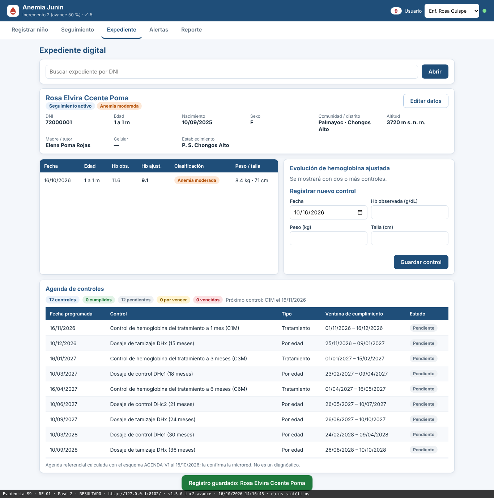 | Guardar registro: 188 → 294 |
| RF-02 | 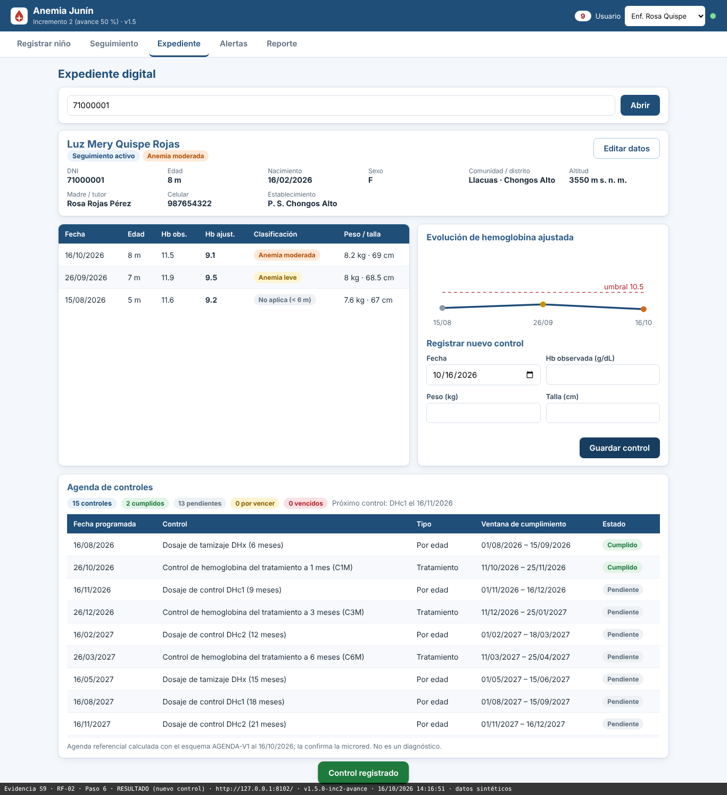 | Consulta 98 → 163; actualización 107 → 190; nuevo control 97 → 184 |
| RF-03 | 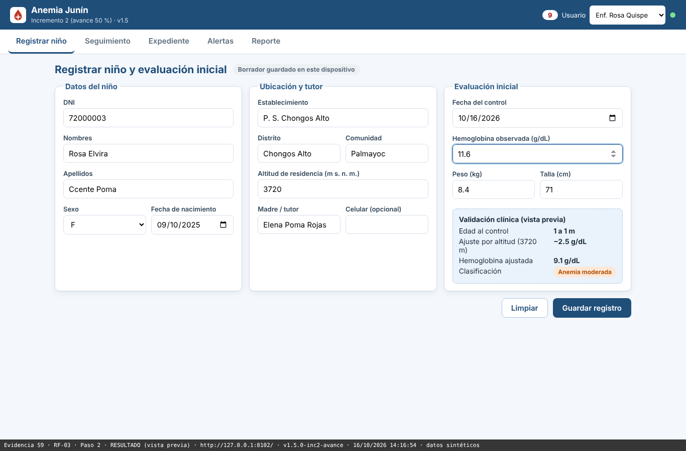 | Vista previa 830 → 863; rechazo 55 → 80 |
| RF-04 | 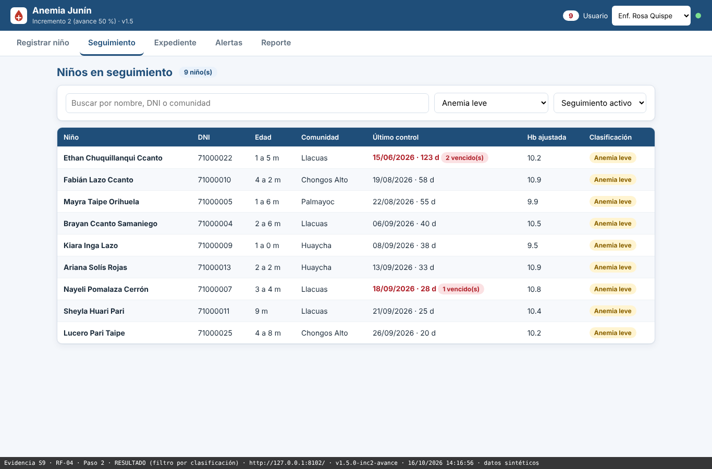 | Filtro 32 → 51; búsqueda 288 → 308 |
| RF-05 |  | Generar 82 → 102; CSV 80 → 116 |

Los conteos de las capturas de v1.5 difieren de los de v1.0 (por ejemplo 9 filas «Anemia leve» frente a 7, y 28 niños registrados frente a 15) porque el conjunto semilla de v1.5 tiene 27 niños y el de v1.0 tiene 14 (tras registrar a 72000001 en RF-01 las pantallas muestran 28 y 15); en ambos casos la interfaz coincide con la API. Los tiempos de v1.5 son mayores en las cinco funcionalidades (todos muy por debajo de 2 s); es coherente con la regresión de rendimiento medida bajo carga (sección 6.5), pero con un solo usuario y una sola medición por paso no es una prueba de la causa. En v1.5 el CSV del reporte también quedó guardado ([`RF05_v15_regresion_reporte_descargado.csv`](evidencias_capturas/RF-05/RF05_v15_regresion_reporte_descargado.csv)).

#### G.2 Árboles de carpetas de `app/` en texto

Los árboles de la sección 4.1 (Figuras 3 y 4) en forma de texto, más el de la v2.0; se omiten los `__init__.py` y la carpeta `web/` (PWA estática).

**Árbol de `app/` en v1.0-PMV:**

```text
app/
├── adapters/
│   ├── entrada/
│   │   └── http/
│   │       ├── api.py
│   │       └── esquemas.py
│   └── salida/
│       └── persistencia/
│           ├── memoria.py
│           └── sqlalchemy_repo.py
├── application/
│   ├── casos_uso.py
│   └── puertos.py
├── domain/
│   ├── entidades.py
│   ├── errores.py
│   └── reglas_clinicas.py
└── main.py
```

**Árbol de `app/` en v1.5.0-inc2-avance:**

```text
app/
├── adapters/
│   ├── inbound/
│   │   └── http/
│   │       ├── api.py
│   │       └── esquemas.py
│   └── outbound/
│       ├── persistence/
│       │   ├── memoria.py
│       │   └── sqlalchemy_repo.py
│       └── reloj_sistema.py
├── application/
│   ├── servicio_agenda.py
│   ├── servicio_alertas.py
│   └── servicio_expediente.py
├── domain/
│   ├── model/
│   │   ├── agenda.py
│   │   ├── alertas.py
│   │   ├── clasificacion.py
│   │   ├── entidades.py
│   │   ├── errores.py
│   │   └── tiempo.py
│   └── service/
│       ├── agenda.py
│       ├── alertas.py
│       ├── reglas_clinicas.py
│       └── validaciones.py
├── main.py
└── ports/
    ├── inbound/
    │   ├── agenda.py
    │   ├── alertas.py
    │   ├── expediente.py
    │   ├── reportes.py
    │   └── seguimiento.py
    └── outbound/
        ├── reloj.py
        └── repositorio_ninos.py
```

**Árbol de `pmv_fastapi/app/` en v2.0.0-inc2:**

```text
app/
├── adapters/
│   ├── inbound/
│   │   └── http/
│   │       ├── api.py
│   │       └── esquemas.py
│   └── outbound/
│       ├── persistence/
│       │   ├── memoria.py
│       │   └── sqlalchemy_repo.py
│       ├── reloj_fijo.py
│       └── reloj_sistema.py
├── application/
│   ├── servicio_agenda.py
│   ├── servicio_agenda_personal.py
│   ├── servicio_alertas.py
│   ├── servicio_asistencia.py
│   ├── servicio_contexto.py
│   ├── servicio_expediente.py
│   └── servicio_importacion.py
├── domain/
│   ├── model/
│   │   ├── agenda.py
│   │   ├── agenda_personal.py
│   │   ├── alertas.py
│   │   ├── asistencia.py
│   │   ├── clasificacion.py
│   │   ├── contexto.py
│   │   ├── entidades.py
│   │   ├── errores.py
│   │   ├── importacion.py
│   │   ├── origen.py
│   │   └── tiempo.py
│   └── service/
│       ├── agenda.py
│       ├── agenda_personal.py
│       ├── alertas.py
│       ├── asistencia.py
│       ├── reglas_clinicas.py
│       └── validaciones.py
├── main.py
└── ports/
    ├── inbound/
    │   ├── agenda.py
    │   ├── agenda_personal.py
    │   ├── alertas.py
    │   ├── asistencia.py
    │   ├── contexto.py
    │   ├── expediente.py
    │   ├── importacion.py
    │   ├── reportes.py
    │   └── seguimiento.py
    └── outbound/
        ├── reloj.py
        └── repositorio_ninos.py
```

#### G.3 Registro de ejecución de pruebas

**Tabla 45.** Registro de ejecución de pruebas (v1.0 y v1.5: 16/10/2026; v2.0: 17/10/2026; salidas crudas en `metricas/salidas/v1.0/`, `v1.5/` y `v2.0/`).

| Nivel o control | v1.0-PMV | v1.5.0-inc2-avance | v2.0.0-inc2 | Evidencia |
| --- | --- | --- | --- | --- |
| Unitarias | 62 | 174 | 234 | `pytest_por_carpeta.txt` |
| Integración y API (SQLite) | 11 | 40 | 76 | `pytest_por_carpeta.txt` |
| Arquitectura | 0 | 14 | 18 | `pytest_por_carpeta.txt` |
| Suite por defecto | **73 en verde** (1,97 s) | **228 en verde** (5,01 s) | **328 en verde** (9,15 s) | `pytest_cov.txt` |
| E2E (Playwright, Chromium) | 4 en verde (9,56 s) | 8 en verde (11,08 s) | 15 en verde (23,13 s) | `pytest_e2e.txt` |
| Cobertura de `app/` | 99,19 % (641 sentencias, 2 sin cubrir; 98 ramas, 4 parciales) | 100,00 % (1 046 sentencias; 158 ramas) | 100,00 % (1 700 sentencias; 264 ramas) | `pytest_cov.txt`, `cobertura.xml` |
| ruff check / ruff format | 0 hallazgos / 33 archivos con formato | 0 hallazgos / 64 archivos con formato | 0 hallazgos / 95 archivos con formato | `ruff_check.txt`, `ruff_format.txt` |
| Criterios Dado-Cuando-Entonces verificados (m21) | 17/17 (5 RF) | 33/33 (7 RF) | 48/48 (9 RF) | `m21_criterios_dce.txt` |
| Pruebas exploratorias de caja negra | No aplica | 45 casos: 43 OK, 2 OBS, 0 FALLA | 27 casos nuevos (RF-08 y RF-09): 27 OK, 0 FALLA; los 45 de v1.5 no se repitieron | `exploratorias_inc2_resultado.txt`, `exploratorias_inc2_final_resultado.txt` |
| Integración en PostgreSQL | En verde según S6 (heredado) | **No ejecutada en este entorno** (hay un job en CI) | **No ejecutada en este entorno** | `.github/workflows/ci.yml` |
| SonarCloud | No ejecutado | No ejecutado | No ejecutado | Pendiente (acción 6 del plan PDCA) |

La cobertura es la de las **sentencias y ramas de `app/`**; no mide la calidad de los casos de prueba. La suite por defecto de v1.0 (73) coincide con la que S6 reprodujo el 01/10/2026 en otro entorno (Windows, Python 3.14), con una cobertura del mismo porcentaje. Las cifras de la v2.0 incluyen 18 pruebas de arquitectura, de las cuales las CP-176 a CP-179 impiden que el importador use SQL o frameworks directamente (ADR-009).

#### G.4 Pruebas exploratorias del Inc. 2: detalle

**Sobre v1.5 (agenda y alertas).** Las 45 pruebas exploratorias (`herramientas/gqm/exploratorias_inc2.py`, informe en `metricas/exploratorias_inc2.md`) se ejecutaron por HTTP contra la API real de v1.5, con resultados esperados derivados de ADR-007 y del README y no del código: 39 casos sobre código nuevo (agenda y alertas: 37 OK y 2 OBS) y 6 sobre código heredado (6 OK). Cubren agenda (9), alta y reactivación (4), identificadores (1), filtros (6), alertas (8), ventana de cumplimiento (6), entradas (3), consistencia (3), niños mayores (1), concurrencia (3) y volumen (1). Las dos observaciones (**OBS**) no son defectos: **EX-17**, un filtro de comunidad escrito en Unicode descompuesto (NFD) no coincide con el valor almacenado en forma compuesta (NFC), y **EX-40**, un niño ACTIVO que superó los 59 meses conserva alertas vencidas (decisión de diseño por documentar). La historia de corridas es: la corrida 1 tuvo 3 fallas, de las cuales EX-22 y EX-31 eran errores de diseño de los casos (corregidos) y EX-42 era un defecto real en código heredado (DEF-08, 10 registros simultáneos con el mismo DNI producían 500); en la corrida 2 apareció EX-43 (un `PATCH` con «database is locked» de SQLite con 8 escritores simultáneos), reclasificado como OBS por ser una limitación del motor de desarrollo (las lecturas de alertas, código nuevo, no fallaron); la corrida 3 (final, tras corregir DEF-08) dio 43 OK, 2 OBS y 0 FALLA.

**Sobre v2.0 (agenda del personal y asistencia).** Las 27 pruebas exploratorias del cierre (`herramientas/gqm/exploratorias_inc2_final.py`, informe en `metricas/exploratorias_inc2_final.md`, ejecutadas el 17/10/2026) siguen el mismo método de caja negra por HTTP, con resultados esperados derivados del README, de ADR-010 y de las reglas de la agenda, y datos sintéticos: 12 casos de RF-08 (rangos y fechas inválidas, contenido, filtros con texto especial y rendimiento con 156 niños) y 15 de RF-09 (validación del estado y del motivo de 3 a 200 caracteres, controles inexistentes, fecha futura, duplicados, estados ya cumplidos o cerrados, evaluación vinculada, niño con alta, auditoría por encabezado y concurrencia). Resultado final: 27 OK, 0 FALLA, 0 OBS. Entre ellos, 8 solicitudes simultáneas sobre el mismo control dieron un 201 y siete 409 con una sola asistencia guardada, y 6 escrituras simultáneas mientras 6 hilos leían la agenda y las alertas dieron 6 respuestas 201 y 180 respuestas 200 sin ningún 5xx. La corrida 1 (25 OK y 2 errores de diseño de los casos, corregidos) se conserva en `salidas/exploratorias_inc2_final_resultado_corrida1.txt`. Como las pruebas las diseñó el mismo equipo, no sustituyen la verificación por un tercero.

#### G.5 Reglas de la agenda, la asistencia y la importación (ESQUEMA_AGENDA_V1)

La agenda se calcula en línea en el dominio (`app/domain/service/agenda.py`, esquema `ESQUEMA_AGENDA_V1`, ADR-007), sin tabla de controles; la asistencia (ADR-010) es el único hecho que se persiste aparte. La Tabla 46 resume las reglas y su fuente. Los parámetros son **referenciales**: provienen del esquema operativo del establecimiento descrito en S1 (Anexo A, Tablas A.3 y A.4), compatible con la NTS N.° 213-MINSA/DGIESP-2024, y deben ser confirmados por la microred antes de cualquier uso clínico; S1 aclara que el calendario no se contrastó fila por fila con el texto de la norma.

**Tabla 46.** Reglas de la agenda de controles, las alertas, la asistencia y la importación (ESQUEMA_AGENDA_V1).

| Regla | Valor | Fuente |
| --- | --- | --- |
| Dosajes por edad | A los 6, 9, 12, 15, 18, 21, 24, 30, 36, 39, 48 y 51 meses; fecha = nacimiento + N meses (el día 31 pasa al último día del mes) | S1 Anexo A (Tablas A.3 y A.4); compatible con NTS 213-2024 |
| Controles de tratamiento | Una evaluación LEVE, MODERADA o SEVERA programa C1M, C3M y C6M a +1, +3 y +6 meses; la recuperación (SIN_ANEMIA) cierra los que aún no vencían | Seguimiento del tratamiento (NTS 213-2024), ADR-007 |
| Cumplimiento | Una evaluación entre 15 días antes y 30 días después de la fecha programada; cada evaluación cumple como máximo un control | Parámetro del esquema; por confirmar con la microred |
| Estados | CUMPLIDO, PENDIENTE (con `proximo` si vence en 7 días o menos), VENCIDO (hoy mayor que programada + 30 días), CERRADO_RECUPERADO | ADR-007 |
| Prioridad de alerta | ALTA si el control es de tratamiento, la última clasificación es MODERADA o SEVERA, o el atraso supera 30 días; MEDIA de 8 a 30 días; BAJA hasta 7 días | ADR-007; por confirmar |
| Población | Solo niños ACTIVO y controles con el niño menor de 60 meses | ADR-007 |
| Agenda del personal (RF-08) | `GET /api/agenda`: rango de hasta 31 días (sin parámetros, la semana de lunes a domingo de la fecha de referencia); filtros por establecimiento y comunidad sin distinguir mayúsculas ni espacios; muestra los controles de los niños ACTIVO con su estado, día y totales | HIST-2.3; 12 exploratorias EXF-01 a EXF-12 |
| Asistencia (RF-09) | `ASISTIO` deja el control CUMPLIDO (por asistencia) y lo saca de las alertas; `NO_ASISTIO` exige motivo de 3 a 200 caracteres, mantiene el control vencido con la marca de inasistencia y sube la prioridad un nivel (BAJA a MEDIA, MEDIA a ALTA); solo para fechas programadas no futuras; un solo registro por control (409 si se repite, ya está cumplido o fue cerrado por recuperación); sin anulación ni corrección | ADR-010; EXF-20 a EXF-34 |
| Origen de los datos e importación | Cada niño tiene `origen` (`SISTEMA` o `DATASET_DIRESA_JUNIN`); los importados llevan el código `DJ-NNNNN`, sin DNI, nombres ni celular, y no se inventan peso ni talla; se conserva la severidad del HIS solo como dato de origen; altitud de la capital de provincia (INEI, *Compendio Estadístico 2014*, cuadro 1.12); lo inválido se descarta y se cuenta, sin corregir fechas | ADR-009 |
| Reloj de referencia | `FECHA_REFERENCIA` (AAAA-MM-DD) fija el «hoy» del sistema mediante el adaptador `RelojFijo`; para la demo con el dataset es 30/06/2024; sin ella rige el reloj real de Perú; una fecha mal escrita impide arrancar | ADR-009 |

#### G.6 Pruebas automatizadas que respaldan cada RF (m21)

La Tabla 47 indica, por RF, cuántas pruebas automatizadas respaldan sus criterios Dado-Cuando-Entonces (de `datos/m21_cobertura_rf.json`); se retiró de las fichas para acortarlas. Una misma prueba puede respaldar más de un RF, por lo que las cifras por RF no suman los totales de la Tabla 45.

**Tabla 47.** Pruebas automatizadas que respaldan cada RF.

| RF | Pruebas que respaldan el RF (v1.0, v1.5 y v2.0) |
| --- | --- |
| RF-01 | v1.0: 10 pruebas (5 unitarias, 4 de integración, 1 E2E), 4 criterios Dado-Cuando-Entonces verificados en verde. v1.5: 13 pruebas (7, 5, 1) y 5 criterios (se suma la regresión de DEF-04, dígitos no ASCII). v2.0: 17 pruebas (9, 7, 1) y 6 criterios. |
| RF-02 | v1.0: 7 pruebas (4 unitarias, 2 de integración, 1 E2E), 4 criterios en verde. v1.5: 7 pruebas (4, 2, 1) y 4 criterios. v2.0: 7 pruebas (4, 2, 1) y 4 criterios. |
| RF-03 | v1.0: 11 pruebas (8 unitarias, 2 de integración, 1 E2E), 4 criterios en verde. v1.5: 14 pruebas (9, 4, 1) y 5 criterios (se suma la regresión de DEF-05, altitud NaN y fechas absurdas). v2.0: 14 pruebas (9, 4, 1) y 5 criterios. |
| RF-04 | v1.0: 3 pruebas (1 unitaria, 1 de integración, 1 E2E), 2 criterios en verde. v1.5: 6 pruebas (2, 3, 1) y 4 criterios (se suman el estado normativo y la regresión de DEF-07, comodines de búsqueda). v2.0: 10 pruebas (4, 4, 2) y 5 criterios. |
| RF-05 | v1.0: 6 pruebas (3 unitarias, 2 de integración, 1 E2E), 3 criterios en verde. v1.5: 8 pruebas (4, 3, 1) y 4 criterios (se suma la regresión de DEF-03, fechas extremas responden 422 y no 500). v2.0: 8 pruebas (4, 3, 1) y 4 criterios. |
| RF-06 | v1.5: 23 pruebas (15 unitarias, 6 de integración, 2 E2E), 6 criterios en verde (generación, anemia C1M/C3M/C6M, fronteras de ventana, 404 o `aplica=false`, cumplimiento de un solo control, interfaz). v2.0: 28 pruebas (16, 9, 3) y 7 criterios. |
| RF-07 | v1.5: 17 pruebas (10 unitarias, 5 de integración, 2 E2E), 5 criterios en verde (orden por prioridad y atraso, filtros y 422, resumen, niños con alta, interfaz). v2.0: 17 pruebas (10, 5, 2) y 5 criterios. |
| RF-08 | v2.0: 15 pruebas (8 unitarias, 4 de integración, 3 E2E) y 6 criterios en verde. |
| RF-09 | v2.0: 26 pruebas (19 unitarias, 5 de integración, 2 E2E) y 6 criterios en verde. |

#### G.7 Definición operacional de las métricas

**Tabla 48.** Definición operacional de las métricas del Pilar 1.

| Métrica | Unidad | Escala | Frecuencia | Responsable (propuesto) | Umbral de acción |
| --- | --- | --- | --- | --- | --- |
| M1.1 | % de importaciones externas por clase de dominio | Razón, 0 a 100 | En cada pull request (las pruebas de arquitectura corren en CI) y al cierre de cada incremento | Auqui H. | Mayor que 0 %: bloquear la fusión y mover el código a un adaptador |
| M1.2 | % de componentes conformes (de 5) | Razón, 0 a 100 | Al cierre de cada incremento | Auqui H. | Menor que 100 %: refactorizar antes del siguiente incremento |
| M1.3 | Violaciones de la regla de dependencia (conteo) e inestabilidad I por capa (0 a 1) | Conteo; razón | En cada pull request | Auqui H. | Mayor que 0: corregir la importación antes de fusionar |

**Tabla 49.** Definición operacional de las métricas del Pilar 2.

| Métrica | Unidad | Escala | Frecuencia | Responsable (propuesto) | Umbral de acción |
| --- | --- | --- | --- | --- | --- |
| M2.1 | % de RF con captura aprobada | Razón, 0 a 100 (informar también sobre el alcance total del incremento) | Al cierre de cada historia y de cada incremento | Huamani R. | Menor que 100 % de los RF entregados: la historia no pasa a «Listo» |
| M2.2 | Defectos funcionales por RF (Def/RF); complemento: Def/KLOC | Razón, 0 o más | Al cierre de cada sprint y al cerrar el incremento | Huamani R. | Mayor que la meta (≤ 1,0 en Inc. 1; ≤ 0,2 en Inc. 2): análisis causal en la retrospectiva y ajuste de la DoD |

**Tabla 50.** Definición operacional de las métricas del Pilar 3.

| Métrica | Unidad | Escala | Frecuencia | Responsable (propuesto) | Umbral de acción |
| --- | --- | --- | --- | --- | --- |
| M3.1 | % (Σ puntajes ÷ 6) y % de brechas comprometidas | Razón, 0 a 100; puntaje por brecha ordinal 0, 0,5, 1 | Al liberar cada incremento | Porras V. | Menor que la meta acordada: revisar la priorización del backlog |
| M3.2 | % de mejora promedio de V1, V2 y V3 | Razón, 0 a 100 | Al liberar cada incremento | Porras V. | Menor que la meta: revisar qué indicador no mejora y su causa |

#### G.8 Decisiones de arquitectura ADR-007 a ADR-010

**Tabla 51.** ADR del Incremento 2 (`pmv_fastapi/docs/adr/`).

| ADR | Contexto | Decisión | Consecuencias |
| --- | --- | --- | --- |
| **ADR-007** Agenda calculada en el dominio, sin tabla propia | La brecha B2 es que la agenda se calcula a mano; los parámetros (meses de dosajes, tolerancias) los confirma la microred y pueden cambiar | La agenda se calcula en línea desde el expediente con una función pura (`domain/service/agenda.py::generar_agenda`); los parámetros están versionados en `ESQUEMA_AGENDA_V1`; no se crea tabla ni migración | (+) Una sola fuente de verdad y reglas probadas con valores frontera; (−) costo lineal en los niños activos: se midieron 185 ms con 1 000 niños en SQLite y se fijó el criterio de revisión «más de 2 000 niños activos o p95 de alertas mayor que 300 ms» para materializar la agenda |
| **ADR-008** Puertos de entrada y estructura hexagonal explícita | En el Inc. 1 el adaptador HTTP importaba la clase concreta `ServicioExpediente` y el dominio y los puertos vivían en archivos únicos | Estructura `domain/model`, `domain/service`, `ports/inbound`, `ports/outbound`, `application`, `adapters/inbound`, `adapters/outbound`; siete reglas de dependencia verificadas por pruebas de arquitectura; `main.py` es la raíz de composición | (+) Una violación rompe el pipeline; los casos de uso se prueban con repositorio en memoria y reloj fijo; agregar un adaptador es un paquete nuevo; (−) más archivos; la regla 4 es estricta (el adaptador de entrada solo usa `domain.model`) |
| **ADR-009** Origen de los datos, registros del dataset de la DIRESA Junín y reloj de referencia | El dataset real del HIS no trae lo que el sistema exige a un niño registrado (`num_doc` deformado y no único, sin nombres, tutor, peso, talla ni altitud) y termina en 2024, mientras el sistema usa la fecha de hoy | Atributo `origen` que el cliente no puede elegir; seudónimo `DJ-NNNNN` sin reidentificación; campos opcionales solo para el origen del dataset; severidad del HIS conservada solo como dato de origen; altitud por capital de provincia con fuente (INEI 2014); reloj de referencia `FECHA_REFERENCIA`; importación por la aplicación (puerto `ImportarDataset`), no por SQL | (+) Agenda, alertas y reportes se ejercitan con 500 u 11 686 niños reales sin alterar sus fechas; (+) el origen separa lo real de lo sintético; (−) migración de esquema (`02_migracion_v2_0.sql`); (−) la antropometría de los importados queda vacía; (−) la altitud aproximada puede mover la clasificación un nivel respecto del HIS; (−) el reloj fijo es global al proceso |
| **ADR-010** Asistencia a un control: evento persistido que complementa la agenda calculada | Una asistencia o inasistencia es un hecho que no se deduce de las evaluaciones; sin registrarla, una familia que acudió o avisó seguía como alerta vencida | Tabla `asistencia_control` con `UNIQUE (nino_id, codigo_control, fecha_programada)`; la agenda sigue calculada y consulta las asistencias; «asistió» cumple el control y «no asistió» lo mantiene vencido con prioridad elevada un nivel | (+) La agenda sigue sin tabla de controles; (+) la alerta distingue «vencido sin noticias» de «vencido con inasistencia»; (+) la restricción única evita duplicados aun con solicitudes simultáneas; (−) no hay anulación ni corrección (backlog del INC-3, acción 12 del PDCA) |

#### G.9 Indicadores de valor V1 a V6: definición y tratamiento en M3.2

**Tabla 52.** Indicadores de valor V1 a V6: definición y tratamiento en M3.2.

| Indicador | Definición y fórmula | Línea base AS-IS | ¿Entra al índice? |
| --- | --- | --- | --- |
| V1 Registros por evaluación | Escrituras manuales por evaluación; mejora = (3 − registros) ÷ (3 − 1) × 100 | 3 (historia clínica, tarjeta de control y HIS) | Sí |
| V2 Niños activos con agenda normativa | % de niños ACTIVO con `GET /api/ninos/{id}/agenda` = 200 y agenda generada (B150; la v2.0 también se mide con la muestra real de 500 niños, fuera del índice) | 0 % (la agenda se calcula a mano) | Sí |
| V3 Detección de controles vencidos | F1 × 100 de `control_atrasado` (`GET /api/ninos`) frente a un oráculo normativo independiente (`oraculo_agenda.py`) | 0 % (sin detección automática) | Sí |
| V4 Tiempo de respuesta | p95 agregado de Locust (50 usuarios, 60 s, mix común), promedio de 2 corridas, en ms | No existe medida comparable en papel | No |
| V5 Disponibilidad | Sondas `GET /api/salud` con 200 en menos de 2 s ÷ sondas × 100 (1 sonda por segundo) | No existe medida comparable en papel | No |
| V6 Satisfacción (proxy) | % de criterios Dado-Cuando-Entonces con su prueba automatizada en verde (m21); **no mide satisfacción**, solo cumplimiento funcional | No aplica | No |
