# INFORME TÉCNICO: EVALUACIÓN DEL PROCESO Y PRODUCTO MEDIANTE EL MODELO CMMI — Semana 11

> **Actualizado al 30/10/2026: v4.0-Inc4.** Este documento reevalúa el informe entregado con `v2.0-Inc2` y el inicio de sesión con Supabase, con la evidencia de los incrementos 3 y 4 (`v3.0-Inc3`, `v4.0-Inc4`), la corrección del CI de `main`, las métricas de S9 (adenda GQM v4) y la auditoría FURPS+ y OWASP 2025 de S10. Lo que sigue vigente no se reescribió; lo nuevo se reconoce por la marca **Act.**, por las columnas «S11» y «30/10» y por las filas nuevas. Las capturas de GitHub (Figuras 54 a 66) las tomó el equipo el 30/10/2026 y están en `evidencias/github/`.

## 1. CARÁTULA E INTEGRANTES DEL EQUIPO (Noveno Ciclo)

**Tabla 1.** Datos generales del entregable.

| Campo | Detalle |
| --- | --- |
| **Carrera** | Ingeniería de Sistemas e Informática |
| **Asignatura** | Procesos de Software (ASUC01702), Universidad Continental, periodo 2026-20, Noveno ciclo |
| **Proyecto de asignatura** | Sistema Inteligente para Detección Temprana de Anemia Infantil en Zonas Rurales de Junín |
| **Docente** | Guevara Jimenez, Jorge Alfredo |
| **Semana y guía** | Semana 11: «Evaluación de proceso y producto de software mediante el modelo CMMI (CMMI-DEV)» (`guias/semana-11.docx`) |
| **Fecha** | 30/10/2026 (entrega original) · **Act.** 30/10/2026: v4.0-Inc4 |
| **Versiones evaluadas** | `v1.0-PMV` (Inc. 1), `v1.5.0-inc2-avance` (50 % del Inc. 2), `v2.0-Inc2` (Inc. 2, `fb26626`), **Act.** `v3.0-Inc3` (Inc. 3, `e920820`) y `v4.0-Inc4` (Inc. 4, `e6886e2`). `main` incorporó la PR #8 como un solo commit *squash* (`c870a7e`), de modo que `e920820` a `e6886e2` (donde apuntan las etiquetas) no están en su historial (Figura 58); el informe S11 original evaluó `main` en `72e7025` |
| **Código verificado (Act.)** | Rama `docs/s12-integrador`, versión `4.0.0-inc4`: `pmv_fastapi/` y `.github/` no cambian entre `e6886e2` y la punta de la rama (`51ca4fc`), de modo que las mediciones de S10 y de este informe corresponden al mismo código que `main` |
| **Repositorio** | <https://github.com/woshtsu/ProcesosSoftwareAnemia> |
| **Producción** | <https://softwareanemia.onrender.com/> |

**Tabla 2.** Integrantes del equipo.

| N.° | Apellidos, Nombres | Código | Rol en el proyecto |
| --- | --- | --- | --- |
| 1 | Porras Veli, Ricardo | 76659572 | Ingeniero de Proceso |
| 2 | Auqui Huincho, Tania Tifani | 75280128 | Ingeniera de Desarrollo y Prototipado |
| 3 | Huamani Rodriguez, Jean Piero | 72156889 | Ingeniero de Calidad y Mejora del Proceso (QA Lead) |
| 4 | Amaru — Claude, asistente de IA (Anthropic) | — | Asistente de IA: apoyo en desarrollo, pruebas automatizadas, evidencias y documentación técnica, bajo supervisión del equipo |

**Índice**

1. Carátula e integrantes del equipo
2. Resumen ejecutivo y enfoque CMMI seleccionado
3. Matriz de selección de áreas de práctica CMMI (Actividad 1)
4. Evaluación de niveles de capacidad del proceso (Actividad 2)
5. Auditoría de productos de trabajo (Actividad 3)
6. Evaluación de verificación (VER) y validación (VAL) con capturas (Actividad 4)
7. Análisis de causa raíz (CAR) y plan de mejora continua (Actividad 5)
8. Conclusiones y lecciones aprendidas en la adopción de CMMI
9. Anexos y evidencias técnicas

---

## 2. RESUMEN EJECUTIVO Y ENFOQUE CMMI SELECCIONADO

El proyecto desarrolla un producto mínimo viable (PMV) para registrar y dar seguimiento a la anemia infantil en establecimientos de Junín. Está construido con FastAPI, una interfaz web PWA (HTML/CSS/JS) y arquitectura hexagonal; usa SQLite en desarrollo y PostgreSQL en producción. **Act.** Se entregó en cuatro incrementos: Inc. 1 (RF-01 a RF-05, `v1.0-PMV`), Inc. 2 (RF-06 a RF-09, `v2.0-Inc2`), Inc. 3 (HIST-3.1 a 3.4 y VIS-3.5: registro sin conexión, sincronización idempotente, conflictos, pendientes y visita priorizada, `v3.0-Inc3`) e Inc. 4 (HIST-4.1 a 4.4: recordatorios por WhatsApp con respaldo SMS en modo simulado, respuesta del tutor, barreras y alerta de barreras críticas, `v4.0-Inc4`). Además incorpora autenticación con Supabase Auth y un flujo de integración y despliegue continuos hacia Render.

Este informe aplica el modelo CMMI (CMMI-DEV) con la **representación continua**: evalúa la capacidad de seis áreas de práctica (PLAN, ESTIM, VER, VAL, PQA y CM) y, **Act.**, de CAR, en la escala de 0 a 3 de la guía (Incompleto, Ejecutado, Gestionado, Definido), y audita los productos de trabajo de cada área. Es una **autoevaluación del equipo basada en evidencia verificable del repositorio**; no constituye una apreciación formal ni una certificación de madurez organizacional.

**Resultados principales (Act. 30/10/2026).**

- **PLAN, CM y VER están en Nivel 2; ESTIM, PQA, VAL y CAR están en Nivel 1.** Ninguna área llega al Nivel 3. Frente a S11 **ningún área cambia de nivel**; solo CAR se evalúa por primera vez. PQA mejora en una práctica (la PR #8 la integró un integrante distinto del autor, con 6 checks en verde, y la revisión independiente de Inc. 3 e Inc. 4 dejó informe con 5 correcciones), pero no sube: la PR no tiene una revisión formal «Approved», no hay plantilla ni lista de chequeo, la protección de `main` no es verificable y las PR #6 y #7 se fusionaron con checks en rojo (Figuras 54, 59, 61 y 66; Tabla 6, Figura 67).
- VER sigue siendo el área más sólida: **660 pruebas** automáticas aprobadas (S11: 349) y **28** E2E reejecutadas (S11: 17 sin reejecutar), cobertura de `app/` de **99,79 %**, 0 hallazgos de Ruff en 142 archivos y 25 pruebas de arquitectura (S11: 18). El CI de `main`, en rojo en las ejecuciones #6, #8, #9 y #10 (Figura 56), se corrigió (3 causas, 3 commits); la PR #8 entró a `main` con 6 checks en verde y el CI #16 terminó en verde en 3 min 21 s, con el job `produccion` solicitando el despliegue a Render (Figuras 49 y 54 a 57).
- Los 9 requerimientos funcionales del Inc. 1 y 2 y las 9 historias de los Inc. 3 y 4 (más la autenticación) tienen ficha de verificación y validación, prueba automatizada y captura (sección 6).
- **Las brechas persisten o se ampliaron:** sin horas reales (ESTIM, H1); sin plantilla de PR, lista de chequeo ni aprobación formal registrada, y con la protección de `main` no verificable (PQA, H2); SonarCloud sin organización y sin *hook* de *pre-commit* (VER, H4); sin aceptación de usuarios ni validación en la posta de lo nuevo (VAL, H3); seguridad y rendimiento sin criterio en la DoD (H8, derivado de S10); verificación de despliegue incompleta (H9). El plan de la sección 7 pasa de 7 a 19 acciones: 1 cumplida, 4 parciales, 14 pendientes; ninguna venció todavía (la primera fecha es el 03/11/2026).

**Tabla 2a.** Qué cambió desde la entrega S11 (resumen de la actualización).

| Cambio | Evidencia | Efecto en la evaluación |
| --- | --- | --- |
| Inc. 3 (`v3.0-Inc3`, `e920820`, 30/10 13:38) | Informe T-019; Figuras 19 a 29 | +5 historias con ficha; H3 del plan (+4 días); ESTIM sin estimar VIS-3.5 |
| Inc. 4 (`v4.0-Inc4`, `5c1f1eb`, 30/10 14:20) | Informe T-020; Figuras 30 a 38 | +4 historias con ficha; H4 del plan (−10 días); envío real de WhatsApp no probado |
| Revisión independiente (`d2ab78b`): 5 defectos corregidos | Informe T-020; Figuras 47 y 48 | VER y PQA; H6 reincide; H8 (registro sin DEF-10 en adelante) |
| CI de `main` en rojo → corregido (`87c0748`, `03719c2`, `e6886e2`); PR #8 integrada por woshtsu como commit *squash* `c870a7e` con 6 checks en verde, sin revisión formal «Approved»; CI #16 en verde con el job `produccion` | Figuras 49 a 51 (CI #14 en la rama) y 54 a 58 | Ningún cambio de nivel (PQA sigue en 1); CM, VER; hallazgos H7 y H9 |
| Métricas GQM v3 y v4 (adenda S9) | `entregables/semana-09/ADENDA_v4_REFERENCIA_S12.md` | M3.1 50,0 % (Inc. 3) y 75,0 % (Inc. 4); M2.1 y M2.2 no recalculadas |
| FURPS+ (87,7 % primario, 78,4 % conservador) y OWASP 2025 (H-1 a H-12) de S10 | `entregables/semana-10/Entregable_Semana10_Anemia_Junin.md` | Acciones 12 a 18 del plan; H8 |

**Limitaciones de la evaluación (Act.).** Las pruebas por defecto, la cobertura, Ruff, OpenAPI y los 28 E2E se reprodujeron el 30/10/2026 sobre el código de `v4.0-Inc4` (anexos A). La ejecución del CI en la rama (#14), la PR #8, el CI #16 en `main` y el job `produccion` se documentan con capturas de GitHub del 30/10/2026 (Figuras 49 y 54 a 66). **La protección de `main` no se pudo verificar:** `settings/branches` devuelve 404 para la cuenta con la que se tomó la captura, sin permisos de administración (Figura 66). No hay tablero de GitHub Projects (Figura 60). No se volvió a medir el servicio de Render con `v4.0-Inc4`; las migraciones SQL 3.0 y 4.0 las ejecutó el equipo en Supabase el 30/10 (sin captura). No hay usuarios reales: ninguna cifra de VAL representa aceptación del usuario. Cada vez que una calificación depende de uno de estos elementos, se indica.

---

## 3. MATRIZ DE SELECCIÓN DE ÁREAS DE PRÁCTICA CMMI (Actividad 1)

Se seleccionaron las seis áreas de práctica propuestas por la guía porque cubren el ciclo completo de un incremento de este proyecto: se estima y planifica el trabajo, se construye y verifica el código, se valida con el usuario, se audita la calidad y se controla la configuración. El tamaño del equipo (tres integrantes y un asistente de IA) y la naturaleza académica del proyecto no justifican áreas de nivel organizacional, como Desarrollo de Procesos de la Organización.

**Tabla 3.** Matriz 1.1: Mapeo de áreas de práctica CMMI del proyecto (**Act.** en las celdas que cambian).

| Categoría CMMI | Área de práctica (PA) | Propósito de la evaluación en el proyecto | Productos de trabajo auditados |
| --- | --- | --- | --- |
| Gestión | ESTIM (Estimating) | Determinar si la estimación de tamaño y esfuerzo se registró con una técnica formal y se contrastó con lo real | Estimación del *backlog* en puntos de historia (133 SP; INC-1 = 21, INC-2 = 18, **Act.** INC-3 = 21, INC-4 = 16) y en horas-persona del Incremento 1 (S3-4, Tablas 19 y 20) |
| Gestión | PLAN (Planning) | Evaluar si el plan, los hitos y las dependencias se establecieron y se mantuvieron frente a las desviaciones | WBS, cronograma de sprints e hitos H1 a H4, red y ruta crítica (S3-4, Tablas 11 y 22 a 25); desviación del INC-2 (S9, Tabla 6); **Act.** hitos H3 y H4 frente a la fecha real y `coordinacion/TABLERO.md` |
| Ingeniería | VER (Verification) | Comprobar que el código y el diseño cumplen las especificaciones técnicas | Código fuente en `pmv_fastapi/app/`, **Act.** 660 pruebas y 28 E2E, cobertura, Ruff, 25 pruebas de arquitectura, contrato OpenAPI, CI en GitHub Actions |
| Ingeniería | VAL (Validation) | Comprobar que el software satisface la necesidad del usuario | Fichas por requerimiento con criterio Dado-Cuando-Entonces, capturas de pantalla, registro de defectos; **Act.** 19 escenarios de aceptación de S10 |
| Soporte | PQA (Process and Product Quality Assurance) | Auditar de forma objetiva el cumplimiento del proceso y de los productos | Definición de terminado (DoD, S3-4, Tabla 9), reglas de calidad del CI, revisiones por *pull request*; **Act.** informe de revisión independiente de Inc. 3 e Inc. 4 |
| Soporte | CM (Configuration Management) | Evaluar el control de versiones, ramas y entregas | Repositorio GitHub, etiquetas `v1.0-PMV`, `v1.5.0-inc2-avance`, `v2.0-Inc2`, **Act.** `v3.0-Inc3` y `v4.0-Inc4`; flujo de CI/CD (`.github/workflows/ci.yml`) |
| Soporte | CAR (Causal Analysis and Resolution) | **Act.** Evaluar si las causas raíz se identifican y si las acciones de mejora se ejecutan y se miden | Tablas 10 a 12 (hallazgos, cinco porqués y plan de mejora) con su estado al 30/10/2026 |

Antes de esta actualización CAR se aplicaba a los hallazgos de las seis áreas (sección 7) pero no se calificaba; el informe integrador S12 la incluye entre las áreas del Eje 8, de modo que ahora se califica con los mismos criterios (Tabla 5).

---

## 4. EVALUACIÓN DE NIVELES DE CAPACIDAD DEL PROCESO (Actividad 2)

### 4.1 Criterio de calificación

Para evitar asignaciones arbitrarias, cada nivel se otorgó con el siguiente criterio, aplicado a la evidencia del repositorio. **Act.** El criterio no cambia; el nivel de un área es el de su práctica más débil (regla ya aplicada en S11 y ahora explícita).

**Tabla 4.** Criterio de asignación del nivel de capacidad.

| Nivel | Condición exigida |
| --- | --- |
| 0 — Incompleto | Las prácticas específicas del área no se realizan o no dejan producto de trabajo |
| 1 — Ejecutado | Las prácticas se realizan y producen sus productos, pero sin registro sistemático, sin seguimiento frente a lo planificado o con cobertura parcial |
| 2 — Gestionado | Las prácticas están planificadas, tienen responsables, se contrastan con lo real y sus productos se controlan y revisan con evidencia verificable |
| 3 — Definido | Además del Nivel 2, existe un estándar documentado y adaptado al proyecto que se aplica de forma consistente en todos los incrementos, con plantillas o automatización que lo hacen exigible |

### 4.2 Auditoría de las prácticas específicas

**Tabla 5.** Matriz 2.1: Diagnóstico de capacidad CMMI por área de práctica, actualizado al 30/10/2026. La columna «S11 → 30/10» indica si la práctica cumplía y si cumple ahora (C = cumple, P = cumple parcialmente, N = no cumple).

| PA | Práctica específica | Criterio / evidencia requerida | Valor medido / estado al 30/10/2026 | S11 → 30/10 | Nivel de capacidad (S11 → 30/10) |
| --- | --- | --- | --- | --- | --- |
| ESTIM | Estimar el alcance y el tamaño del trabajo | Historias estimadas con técnica formal (Planning Poker, puntos de historia en Fibonacci) | **Cumple.** 133 SP para el proyecto; INC-1 = 21, INC-2 = 18, **Act.** INC-3 = 21 y INC-4 = 16 (S3-4, Tabla 19). Entregados 76 de 133 SP (57,1 %) en cuatro incrementos. VIS-3.5 se añadió al Inc. 3 sin figurar en esa tabla ni re-estimarse | C → C | (ver fila siguiente) |
| ESTIM | Estimar el esfuerzo en horas y contrastarlo con lo real | Horas planificadas frente a horas reales por sprint y recalibración de la velocidad | **No cumple.** Sin horas reales de ningún incremento: `coordinacion/TABLERO.md` no tiene campo de horas (0 coincidencias, Figura 53) y el INC-1 sigue con 113 horas-persona estimadas y ninguna real. **Act.** Los 37 SP de INC-3 + INC-4, planificados para el 13/10 al 09/11 (S3-4, Tabla 23), se entregaron el 30/10 (día 18 de 28); sin horas no se puede explicar la diferencia ni recalibrar la velocidad (20 SP por sprint) | N → N | **Nivel 1 → 1 (Ejecutado)** |
| PLAN | Establecer el plan, los hitos y las dependencias | WBS, cronograma de sprints, hitos, ruta crítica, responsables por rol | **Cumple.** S3-4 con WBS, Gantt, red y ruta crítica, hitos H0 a H7 y asignación por rol. **Act.** Las historias de Inc. 3 e Inc. 4 tienen criterios Dado-Cuando-Entonces en `coordinacion/TABLERO.md` y `pmv_fastapi/README.md` | C → C | (ver fila siguiente) |
| PLAN | Dar seguimiento y mantener el plan | Desviaciones medidas y plan replanificado | **Cumple parcialmente.** Desviaciones medidas en la Tabla 5a: H1 +2 d, H2 +5 d, H3 +4 d, H4 −10 d (Tabla 5a y Figura 52). **Act.** La replanificación propuesta en S9 (INC-3 al Sprint 5 y desplazar los siguientes) no se adoptó: el equipo recuperó el atraso y volvió al plan original el 30/10, con INC-3 e INC-4 entregados el mismo día. H3 exige además prueba de campo y despliegue en la posta, que no se hicieron. Seguimiento en `coordinacion/TABLERO.md` (T-019 y T-020 en revisión, con pendientes y fechas); no existe tablero de GitHub Projects («No projects found», Figura 60), de modo que el seguimiento está solo en `TABLERO.md` (Figura 65) | P → P | **Nivel 2 → 2 (Gestionado)** |
| PQA | Evaluar objetivamente los productos con criterios definidos | Definición de terminado (DoD) por actividad y por historia | **Cumple.** DoD de 13 actividades (S3-4, Tabla 8) y de 6 condiciones por historia (Tabla 9). **Act.** Además de la DoD, el CI aplica puertas automáticas (Ruff, pruebas con cobertura, contrato OpenAPI, integración con PostgreSQL, E2E, imagen Docker) y la revisión independiente de Inc. 3 e Inc. 4 dejó informe con veredicto (informe T-020) | C → C | (ver fila siguiente) |
| PQA | Aplicar lista de chequeo de revisión de código y registrar las desviaciones | Plantilla de *pull request*, aprobación de revisor y registro | **Cumple parcialmente (S11: no cumple).** **Act.** La PR #8 (`feature/inc3-sin-conexion` → `main`) la integró woshtsu, distinto del autor (Huamani1569), con 6 checks en verde; **la línea de tiempo no muestra ninguna revisión formal «Approved»** (Figura 54). Las PR #6 y #7 se fusionaron con checks en rojo (2 de 3 aprobados; Figura 59). La revisión independiente registró 5 correcciones y 3 observaciones (Figura 47). No existe `.github/pull_request_template.md` (`.github/` solo contiene `workflows/`; Figura 61) ni lista de chequeo, y la protección de `main` no es verificable: Settings devuelve 404 (Figura 66) | N → P | **Nivel 1 → 1 (Ejecutado)**: la práctica solo se cumple en el informe de revisión independiente; sin aprobación registrada, plantilla ni regla verificable no alcanza la revisión con evidencia verificable que exige el Nivel 2 (Tabla 4) |
| CM | Establecer la línea base y las etiquetas de versión | Etiquetas publicadas por incremento | **Cumple.** Cinco etiquetas en `origin`: `v1.0-PMV` (30/09), `v1.5.0-inc2-avance` (17/10), `v2.0-Inc2` (18/10), **Act.** `v3.0-Inc3` (`e920820`) y `v4.0-Inc4` (`e6886e2`) (Figura 50). `v3.0-Inc3` y `v4.0-Inc4` identifican commits de la rama; como la PR #8 entró a `main` como un solo commit *squash* (`c870a7e`), esos commits no están en el historial de `main` y ninguna etiqueta apunta a `c870a7e` (Figura 58): el hallazgo «ninguna etiqueta cubre `main`» de S11 sigue abierto | C → C | (ver fila siguiente) |
| CM | Controlar los cambios y las ramas | Estrategia de ramas, integración mediante *pull request*, historial trazable | **Cumple parcialmente.** **Act.** Inc. 3 e Inc. 4 se desarrollaron en la rama `feature/inc3-sin-conexion`, con CI en verde en la rama (#14, Figura 49) y se integraron por la PR #8, que entró a `main` como un solo commit *squash* (`c870a7e`, autor Huamani1569, Verified, 3 de 3 checks; Figura 58). El repositorio tiene 8 PR cerradas: 7 fusionadas (#1, #2, #4, #5, #6, #7 y #8) y la #3 cerrada sin fusionar (Figura 59). En `main` desde `72e7025` hay 5 commits: las fusiones #6, #7 y #8 y 2 commits directos sin PR («add guia S10» y «add guia s12», con 0 de 3 checks); #6 y #7 se fusionaron con checks en rojo (Figuras 56, 58 y 59). En el clon local, que conserva los commits de la rama, hay 14 desde `72e7025` (6 de código de la PR #8, 4 de documentación de S9 y S10 en la rama de trabajo y 4 de `main`); 12 tienen mensaje descriptivo y los otros 2 son los directos de `main`. Persisten: sin convención escrita de commits, ramas ni etiquetas; `develop` no existe; `v1.0-PMV` apunta a `9ce90c3`, ajeno al historial de `main`; las etiquetas `v3.0-Inc3` y `v4.0-Inc4` apuntan a commits de la rama que no están en el historial de `main` por el *squash* (Figuras 50, 53 y 58) | P → P | **Nivel 2 → 2 (Gestionado)** |
| VER | Verificar el código con pruebas automáticas antes de integrar | Pruebas unitarias y de integración, cobertura, ejecución en CI | **Cumple.** **Act.** 660 pruebas aprobadas (416 unitarias, 219 de integración, 25 de arquitectura), cobertura 99,79 % (umbral 80 %) y 28 E2E, reproducidas el 30/10 (Figuras 41 y 42). El CI ejecuta todo en cada *push* y PR; hubo un incidente: el CI de `main` estuvo en rojo por 3 causas ajenas al código funcional (H7) y se corrigió; CI #14 en verde en la rama (Figura 49) y #16 en `main` en verde, 3 min 21 s (Figura 56) | C → C | (ver fila siguiente) |
| VER | Analizar el código de forma estática y revisar la arquitectura | Linter o SonarQube, reglas de arquitectura | **Cumple parcialmente.** Ruff (E, F, W, I, B, UP, S, complejidad ≤ 12): 0 hallazgos en 142 archivos (S11: 103); 25 pruebas de arquitectura con 0 violaciones (S11: 18); S10: bandit 0 altas, pip-audit sin vulnerabilidades. SonarCloud sigue sin organización (`REEMPLAZAR_ORGANIZACION`, Figuras 53 y 63) y no hay *hook* de *pre-commit* (Figura 53). La revisión independiente halló 5 defectos que 660 pruebas y 99,79 % de cobertura no detectaron (H6 reincide) | P → P | **Nivel 2 → 2 (Gestionado)** |
| VAL | Validar el producto con criterios de aceptación y evidencia visual | Criterios Dado-Cuando-Entonces por RF y capturas | **Cumple.** 48 de 48 criterios verificados en 9 RF (v2.0). **Act.** Las 9 historias de Inc. 3 e Inc. 4 se validaron con 10 escenarios automatizados de aceptación (19 de 19 escenarios en total en S10, 54 capturas) y tienen ficha en la sección 6.2 | C → C | (ver fila siguiente) |
| VAL | Obtener la aceptación del usuario final | Acta de aceptación o instrumento de satisfacción aplicado | **No cumple.** El SUS no se aplicó; sin acta, sin piloto con usuarios reales. **Act.** Lo nuevo depende además de terceros: los pesos de la visita priorizada y las reglas de barreras sin validar con la microred, plantilla de WhatsApp sin aprobar por Meta, envío real nunca probado, sin prueba en dispositivo real con red intermitente y sin despliegue en la posta (informes T-019 y T-020). No consta una prueba del login con una cuenta real de Supabase (S10 usó Supabase simulado) | N → N | **Nivel 1 → 1 (Ejecutado)** |
| CAR | Identificar las causas raíz de los hallazgos | Análisis de causa raíz con técnica definida (cinco porqués) | **Cumple.** 9 hallazgos (H1 a H9) con síntoma y causa en proceso, cinco porqués para H1, H2, H3, H6, H7 y H8 (Tablas 10 y 11) | — → C | (ver fila siguiente) |
| CAR | Ejecutar las acciones de mejora y medir su efecto | Plan con responsable, fecha, métrica y verificación del resultado | **No cumple.** 19 acciones con responsable, métrica y fecha (Tabla 12): 1 cumplida (CI de `main`), 4 parciales, 14 pendientes; ninguna con el efecto medido todavía, y ninguna venció (la primera fecha es el 03/11). No existe el *hook* de *pre-commit* que el ejemplo de la guía S12 da por implantado | — → N | **Nivel — → 1 (Ejecutado)** |

**Tabla 5a.** **Act.** Plan frente a real por incremento (insumo de ESTIM y PLAN). La fecha real es la del commit o la etiqueta que entrega el software; «aceptación» es la condición del hito en S3-4 (Tabla 25).

| Incremento | SP (S3-4) | Hito | Fecha del plan | Entrega real | Desviación | Aceptación según el hito | Horas reales |
| --- | --- | --- | --- | --- | --- | --- | --- |
| INC-1 | 21 | H1 | 28/09/2026 | 30/09 (`v1.0-PMV`) | +2 días | Acta pendiente | No registradas (113 h estimadas) |
| INC-2 | 18 | H2 | 12/10/2026 | 17/10 (`fb26626` el 18/10) | +5 días | Sin acta de revisión registrada | No registradas |
| INC-3 | 21 (+ VIS-3.5 sin estimar) | H3 | 26/10/2026 | 30/10 (`e920820`, 13:38) | **+4 días** | **No:** sin prueba de campo ni despliegue en la posta | No registradas |
| INC-4 | 16 | H4 | 09/11/2026 | 30/10 (`5c1f1eb`, 14:20) | **−10 días** | **No:** envío real sin probar (modo simulado) | No registradas |

Gráfico de los hitos: Figura 52 (sección 6.5). Los datos son los de esta tabla; las fechas de commit se verifican en el historial de `main` (Figura 58), donde la PR #8 figura como un solo commit.

### 4.3 Resumen de capacidad

**Tabla 6.** Nivel de capacidad por área de práctica: S11 frente a 30/10/2026 (tabla reutilizable en el informe S12, Eje 8).

| PA | Nivel S11 | Nivel 30/10 | Nivel objetivo | Brecha | Evidencia clave del nivel actual | Acciones del plan (Tabla 12) |
| --- | --- | --- | --- | --- | --- | --- |
| ESTIM | 1 | **1** | 2 | 1 | 76 de 133 SP entregados; 0 horas reales en 4 incrementos; VIS-3.5 sin estimar (Tabla 5a, Figura 53) | 1, 7 |
| PLAN | 2 | **2** | 3 | 1 | Desviaciones medidas H1 a H4 (+2, +5, +4, −10 días); `TABLERO.md` con T-019 y T-020; H3 sin prueba de campo (Figura 52) | 7, 19 |
| PQA | 1 | **1** | 2 | 1 | PR #8 integrada por otro integrante con 6 checks en verde, sin revisión formal «Approved» (Figura 54); PR #6 y #7 fusionadas con checks en rojo (Figura 59); informe de revisión independiente con 5 correcciones (Figura 47); sin plantilla ni lista de chequeo (Figuras 53 y 61) | 2, 10, 11 |
| CM | 2 | **2** | 3 | 1 | 5 etiquetas, `v4.0-Inc4` = código de `main` (Figura 50); CI en rama (#14) antes de la PR; sin convención escrita (Figura 53) | 6, 8, 9, 17 |
| VER | 2 | **2** | 3 | 1 | 660 pruebas, 99,79 %, 28 E2E, 25 de arquitectura, Ruff 0 (Figuras 41 a 46); SonarCloud y *hook* sin activar; 5 defectos escapados | 3, 4, 9, 12 a 16, 18 |
| VAL | 1 | **1** | 2 | 1 | 19 de 19 escenarios y 19 fichas (9 RF, 9 historias y la autenticación), sin SUS ni acta; validación con la microred y la posta pendiente | 5, 19 |
| CAR | n/e | **1** | 2 | 1 | 9 hallazgos con causa raíz; 1 de 19 acciones cumplida y ninguna con efecto medido | 8 a 19 (seguimiento) |

El perfil resultante es de tres áreas en Nivel 2 (PLAN, CM y VER) y cuatro en Nivel 1 (ESTIM, PQA, VAL y CAR). La ingeniería (VER, CM) está respaldada por automatización y etiquetas; el aseguramiento de calidad (PQA) mejora en una práctica, pero sin aprobación registrada ni plantilla no sube; la estimación del esfuerzo, la aceptación del usuario y la ejecución medida de las mejoras siguen dependiendo del criterio individual. Ninguna práctica baja de nivel: lo que empeora en la auditoría de productos (sección 5) es la cobertura del registro de defectos, del diseño y del despliegue, no la capacidad de un área.

---

## 5. AUDITORÍA DE PRODUCTOS DE TRABAJO / WORK PRODUCTS (Actividad 3)

Cada producto se contrastó con su ubicación real en el repositorio. La columna «Estado» distingue **Aprobado** (cumple su criterio con evidencia verificada), **Aprobado con observaciones** (cumple, con una limitación identificada), **Pendiente de verificación** (el producto existe, pero no se pudo comprobar su criterio) y **Pendiente** (el producto no existe). **Act.** Se agregan la columna «S11» (estado del informe original) y cuatro productos nuevos (filas 12 a 15); varios productos bajan de «Aprobado» a «Aprobado con observaciones» porque la evidencia nueva muestra una limitación que antes no existía o no se había contrastado.

**Tabla 7.** Matriz 3.1: Lista de chequeo de productos de trabajo, al 30/10/2026.

| N.° | Fase del proceso | Producto de trabajo | Ubicación / evidencia | Criterio de calidad CMMI | S11 | Estado 30/10 |
| --- | --- | --- | --- | --- | --- | --- |
| 1 | Requisitos | *Backlog* priorizado e historias con criterios de aceptación | `entregables/semana-03-04/Entregable_Semana3y4_Anemia_Junin.md` (HIST-1.1 a HIST-2.4); 48 criterios D-C-E verificados en `entregables/semana-09/metricas/datos/m21_cobertura_rf.json`; **Act.** criterios de HIST-3.1 a 4.4 y VIS-3.5 en `coordinacion/TABLERO.md` y `pmv_fastapi/README.md` | Criterios en formato Dado-Cuando-Entonces trazables a una prueba | Aprobado | **Aprobado con observaciones**: VIS-3.5 no figura en el *backlog* de S3-4 (se añadió sin estimar) |
| 2 | Planificación | Estimación, WBS, cronograma e hitos | `entregables/semana-03-04/` (Tablas 11 y 19 a 25); **Act.** Tabla 5a de este informe | Plan estimado, con responsables y desviaciones registradas | Aprobado con observaciones | **Aprobado con observaciones**: sin horas reales; calendario no revisado formalmente tras H3 (+4 días) y H4 (−10 días); sin tablero de GitHub Projects («No projects found», Figura 60); seguimiento solo en `TABLERO.md` (Figura 65) |
| 3 | Diseño | Arquitectura hexagonal, modelo C4 y decisiones (ADR) | `pmv_fastapi/docs/adr/` (**Act.** ADR-001 a ADR-014; nuevos: sincronización, visita priorizada, notificador), `pmv_fastapi/docs/diagramas/`, `diagramas/`; estructura vigente en el informe S10 (sus Figuras 77 y 78) | Diagramas de componentes, puertos y adaptadores y decisiones justificadas | Aprobado | **Aprobado con observaciones**: `C4_componentes.puml` solo describe el Inc. 1 (0 menciones de agenda, visita, notificador o sincronización; Figura 53); el último diagrama hexagonal de `diagramas/png/` es de v2.0 |
| 4 | Construcción | Código fuente e historial de *commits* | `pmv_fastapi/app/` (dominio sin dependencias externas), 142 archivos Python formateados, 31 commits en el clon (S11: 17) | Estructura conforme a la arquitectura y mensajes de *commit* descriptivos | Aprobado con observaciones | **Aprobado con observaciones**: 25 pruebas de arquitectura en verde; 12 de 14 commits del clon desde S11 son descriptivos (en `main`, 3 de 5: los dos «add guia …» directos no lo son; Figura 58); sin convención escrita (Figura 53) |
| 5 | Verificación | Pruebas automáticas y cobertura | `pmv_fastapi/tests/` (**Act.** 416 unitarias, 219 de integración, 25 de arquitectura; 28 E2E) | Pruebas en verde y cobertura mayor o igual al 80 % | Aprobado | **Aprobado**: 660 + 28 aprobadas, 99,79 % (Figuras 41 y 42) |
| 6 | Validación | Evidencias funcionales por requerimiento e historia | `entregables/semana-09/evidencias_capturas/RF-01` a `RF-09`; **Act.** `entregables/semana-10/evidencias/software/` (54 capturas, 19 escenarios) | Captura de entrada y de salida para cada requerimiento | Aprobado | **Aprobado**: 9 de 9 RF y 10 de 10 escenarios de Inc. 3 e Inc. 4 |
| 7 | Gestión de defectos | Registro de defectos | `pmv_fastapi/docs/evidencias/registro_defectos.md` y `registro_defectos_inc2.md` (DEF-01 a DEF-09) | Defectos con causa, corrección y verificación | Aprobado | **Aprobado con observaciones**: los 5 defectos de la revisión independiente de Inc. 3 e Inc. 4 están corregidos pero no registrados; el último identificador sigue siendo DEF-09 (Figura 53) |
| 8 | Configuración | Etiquetas de versión | **Act.** `v1.0-PMV`, `v1.5.0-inc2-avance`, `v2.0-Inc2`, `v3.0-Inc3`, `v4.0-Inc4` en `origin` (Figura 50) | Una etiqueta por incremento liberado | Aprobado con observaciones | **Aprobado con observaciones**: `v1.0-PMV` apunta a `9ce90c3`, ajeno al historial de `main`; las etiquetas `v3.0-Inc3` y `v4.0-Inc4` apuntan a commits de la rama que no están en el historial de `main` (la PR #8 entró como un solo commit *squash*, `c870a7e`; Figura 58); nombres con dos formatos |
| 9 | Configuración | Artefacto de despliegue (imagen Docker) | `pmv_fastapi/Dockerfile`, `docker-compose.yml`, job `imagen` de `.github/workflows/ci.yml` | Imagen que se construye sin errores | Pendiente de verificación | **Aprobado**: el job `imagen` terminó en verde en 22 s en la ejecución #14 de la rama, que construyó la imagen con `docker build` (Figura 49) |
| 10 | Despliegue | Servicio en producción y guía de despliegue | `pmv_fastapi/docs/DESPLIEGUE.md`; <https://softwareanemia.onrender.com/api/salud> | Servicio accesible y prueba de humo superada | Aprobado | **Aprobado con observaciones**: la prueba de humo (HTTP 200 en 22,5 s) fue del 30/10 sobre la versión anterior y no se repitió con `v4.0-Inc4`; el job `produccion` en `main` verifica solo tablas del esquema 2.0 (L131 a L135, Figura 62; la rama de trabajo ya añade las del 4.0) y no certifica el estado Live, aunque la ejecución #16 solicitó el despliegue a Render (Figura 57); el equipo ejecutó las migraciones 3.0 y 4.0 en Supabase el 30/10 (sin captura) |
| 11 | Aseguramiento de calidad | Plantilla de revisión de *pull request* y lista de chequeo | No existe (`.github/` contiene solo `workflows/`; Figuras 53 y 61) | Lista de chequeo derivada de la DoD aplicada a cada integración | Pendiente | **Pendiente** |
| 12 | Aseguramiento de calidad | **Act.** Informe de revisión independiente de Inc. 3 e Inc. 4 | `coordinacion/informes/2026-10-30_desarrollador_T-020.md`, sección «Revisión independiente» | Hallazgos con severidad, corrección y verificación posterior | — | **Aprobado con observaciones**: 5 correcciones con 3 pruebas de regresión (Figura 47); 2 sin prueba específica; 3 observaciones aceptadas sin corregir |
| 13 | Calidad del producto | **Act.** Evaluación FURPS+ y auditoría OWASP 2025 (S10) | `entregables/semana-10/Entregable_Semana10_Anemia_Junin.md`, `metricas/` | Mediciones reproducibles con script y salida cruda | — | **Aprobado**: IC_P 87,67 % (conservador 78,43 %), por debajo del 90 % de la guía; 12 hallazgos sin corregir (H-1 a H-12 de S10) |
| 14 | Medición | **Act.** Métricas GQM v3 y v4 (adenda S9) | `entregables/semana-09/ADENDA_v4_REFERENCIA_S12.md` | Métricas con fórmula, fuente y comando | — | **Aprobado con observaciones**: M2.1 y M2.2 de Inc. 3 e Inc. 4 no recalculadas; p95 de una sola corrida (Figura 72) |
| 15 | Datos | **Act.** Migraciones SQL 3.0 y 4.0 | `pmv_fastapi/db/03_migracion_v3_0.sql`, `db/04_migracion_v4_0.sql`, `db/02_supabase.sql` | Migración repetible con esquema equivalente a la instalación limpia | — | **Aprobado con observaciones**: verificadas en un PostgreSQL 16 temporal (informes T-019 y T-020, sin captura propia); ejecutadas en Supabase por el equipo el 30/10 (sin captura), sin que el CI de `main` las verificara (Figura 62) |

**Síntesis de la auditoría (Act.).** De los quince productos auditados, cuatro están aprobados (5, 6, 9 y 13), diez aprobados con observaciones y uno pendiente (11). Sobre los once productos de S11: tres aprobados (antes seis), siete con observaciones (antes tres) y uno pendiente (antes un pendiente y uno por verificar). El único producto que mejora es la imagen Docker, ahora verificada por el CI; bajan requisitos, diseño, defectos y despliegue por limitaciones comprobadas en este informe, no por deterioro del código. Los productos de ingeniería (pruebas, evidencias, ADR) siguen completos y trazables; los de gestión (horas, tablero, convención) y de aseguramiento de calidad (plantilla, registro de defectos) son los menos desarrollados.

---

## 6. EVALUACIÓN DE VERIFICACIÓN (VER) Y VALIDACIÓN (VAL) CON CAPTURAS (Actividad 4)

### 6.1 Método y resultados globales de verificación

La **verificación** responde a si el software está bien construido; la **validación**, a si se construyó el software correcto. **Act.** Las comprobaciones del CI se reejecutaron el 30/10/2026 desde `pmv_fastapi/` sobre el código de `v4.0-Inc4` (Python 3.13.16 en esta verificación; el CI y el Dockerfile usan 3.11). Las capturas de terminal de S10 (commit `e6886e2`, mismo día) son las figuras de esta sección; las salidas completas de la reejecución están en `entregables/semana-11/anexos/`.

**Tabla 8.** Resultados de la verificación: S11 (`main` en `72e7025`) frente a 30/10/2026 (`v4.0-Inc4`).

| Comprobación | S11 | **Act.** 30/10/2026 | Figura |
| --- | --- | --- | --- |
| Pruebas por defecto (`pytest --cov=app`) | 349 aprobadas (234 unitarias, 97 de integración, 18 de arquitectura) | **660 aprobadas**, 0 fallidas (416 unitarias, 219 de integración, 25 de arquitectura) | 41 |
| Cobertura de `app/` (líneas y ramas) | 99,50 % (1 675 sentencias, 5 sin cubrir) | **99,79 %** (4 030 sentencias, 5 sin cubrir; 680 ramas, 5 parciales). 100 % en todos los archivos de Inc. 3 e Inc. 4; `autenticacion.py` 94 % (líneas 96, 110, 120, 140) y `supabase_auth.py` 97 % (línea 64). El JavaScript de `app/web/` no entra en la cobertura | 41 |
| Análisis estático (Ruff) | 0 hallazgos; 103 archivos con formato correcto | **0 hallazgos**; 142 archivos con formato correcto | 43, 44 |
| Contrato OpenAPI | `docs/openapi.json` al día | **Al día** (29 rutas) | 46 |
| Pruebas de arquitectura | 18, 0 violaciones | **25**, 0 violaciones; conformidad estricta 100 %, ultra estricta 80 % (adenda S9: `servicio_sesion.py` implementa un puerto dentro de la capa de aplicación) | 45 |
| Pruebas E2E (Playwright) | 17 identificadas, no reejecutadas (última ejecución del 23/10) | **28 aprobadas**, reejecutadas el 30/10: 7 de Inc. 3, 4 de Inc. 4, 15 de Inc. 1 y 2, 2 de inicio de sesión | 42 |
| Regresión de la revisión independiente | — | **6 pruebas aprobadas** (CP-357, CP-264b, CP-382b, CP-391b, CP-396, CP-405) | 47 |
| Integración con PostgreSQL | Definida en el CI; no reejecutada | Definida en el CI; los informes T-019 (147), T-020 (216) y la adenda S9 (219, con Python 3.11) registran las pruebas de integración contra un PostgreSQL 16 temporal. Sin captura propia | — |
| CI en GitHub Actions | No verificado | Ejecución **#14** de la rama `feature/inc3-sin-conexion` en verde (`calidad-y-pruebas` 2 min 27 s, `imagen` 22 s; `produccion` omitido por no ser `main`). **#16** en `main` en verde en 3 min 21 s, con `produccion` en verde (5 s); las ejecuciones previas #6, #8, #9 y #10 de `main` estaban en rojo | 49; 56 y 57 |
| SonarQube / SonarCloud | No ejecutado | **No ejecutado.** Sin organización definida; `sonar.organization=REEMPLAZAR_ORGANIZACION` (L2); el análisis efectivo es Ruff, bandit y semgrep (S10) | 63 |

La cobertura sube de 99,50 % a 99,79 % aunque se sumaron 2 355 sentencias (de 1 675 a 4 030), porque todos los archivos de Inc. 3 e Inc. 4 tienen 100 %; lo que la separa del 100 % de S9 sigue siendo el código de autenticación (`autenticacion.py` y `supabase_auth.py`), anterior a INC-3. La acción 4 del plan aún no lo cierra.

La **validación** se sustenta en las capturas del software en ejecución con Chromium (Playwright). Las de RF-01 a RF-09 son de S9 (16 y 17/10/2026, viewport 1366 × 900; datos sintéticos y, para RF-08 y RF-09, una muestra de 500 niños del dataset anonimizado de la DIRESA Junín). **Act.** Las de Inc. 3, Inc. 4 y el inicio de sesión son de S10 (30/10/2026): se tomaron con `AUTH_MODE=demo`, datos sintéticos y WhatsApp simulado, salvo el inicio de sesión, que es la pantalla sin cuenta. Los 19 escenarios de aceptación de S10 pasan con aserciones sobre la interfaz y la API (54 capturas).

**Tabla 9.** Resumen de verificación y validación por requerimiento (RF-01 a RF-09, versión v2.0; sin cambios frente a S11).

| RF | Requerimiento | Pruebas asociadas (unitarias / integración / E2E) | Criterios D-C-E verificados | Tiempo medido (umbral 2 s) | Estado |
| --- | --- | --- | --- | --- | --- |
| RF-01 | Registrar niño con evaluación inicial | 17 (9 / 7 / 1) | 100 % | 188 ms | VERIFICADO Y VALIDADO |
| RF-02 | Consultar y actualizar expediente; nuevo control | 7 (4 / 2 / 1) | 100 % | 97 a 107 ms | VERIFICADO Y VALIDADO |
| RF-03 | Validar datos con reglas clínicas | 14 (9 / 4 / 1) | 100 % | 830 ms (incluye 350 ms de antirrebote) | VERIFICADO Y VALIDADO |
| RF-04 | Listar niños en seguimiento | 10 (4 / 4 / 2) | 100 % | 32 a 288 ms | VERIFICADO Y VALIDADO |
| RF-05 | Reporte del periodo en JSON y CSV | 8 (4 / 3 / 1) | 100 % | 80 a 82 ms | VERIFICADO Y VALIDADO |
| RF-06 | Agenda de controles según la normativa | 28 (16 / 9 / 3) | 100 % | 119 ms | VERIFICADO Y VALIDADO |
| RF-07 | Controles vencidos y alertas priorizadas | 17 (10 / 5 / 2) | 100 % | 69 a 176 ms | VERIFICADO Y VALIDADO |
| RF-08 | Agenda del personal | 15 (8 / 4 / 3) | 100 % | 40 a 133 ms | VERIFICADO Y VALIDADO |
| RF-09 | Registro de asistencia a control | 26 (19 / 5 / 2) | 100 % | 54 a 92 ms | VERIFICADO Y VALIDADO |

Una misma prueba puede respaldar más de un RF, por lo que la suma de la tabla supera el total de pruebas; la columna E2E suma 16 de las 17 existentes en v2.0 porque las 2 de inicio de sesión no corresponden a un RF. Los conteos y los criterios proceden de `entregables/semana-09/metricas/datos/m21_cobertura_rf.json` (versión v2.0). «Verificado y validado» significa criterio Dado-Cuando-Entonces cumplido por ejecución automatizada con captura de resultado; **no implica aceptación firmada por un usuario**, que sigue pendiente (hallazgo H3).

**Tabla 9a.** **Act.** Verificación y validación de Inc. 3, Inc. 4 y autenticación (las historias no tienen número RF). Valores medidos por el script de aceptación de S10 el 30/10/2026 (`entregables/semana-10/metricas/salidas/F_resultados_aceptacion.json`). Los archivos de prueba compartidos se indican con su total.

| Código | Requerimiento | Pruebas de respaldo | Valor medido | Estado |
| --- | --- | --- | --- | --- |
| HIST-3.1 | Registro sin conexión (cola en el dispositivo) y apertura desde el caché | E2E CP-297, CP-298, CP-299; `test_sincronizacion.py` (37 unit.), `test_api_inc3.py` (37 integ.), `test_repositorio_inc3.py` (14) | 2 pendientes en el dispositivo, 0 en el servidor; 30 de 30 filas desde caché con el servidor detenido | VERIFICADO Y VALIDADO (entorno de pruebas) |
| HIST-3.2 | Sincronización idempotente al reconectar | E2E CP-297, CP-300; CP-264b (concurrencia) | 1.er envío APLICADA, 2.º DUPLICADA; 3 evaluaciones tras el reenvío | VERIFICADO Y VALIDADO |
| HIST-3.3 | Conflictos sin sobrescribir a ciegas | E2E CP-303; `test_conflictos.py` (26 unit.) | 1 conflicto detectado y resuelto | VERIFICADO Y VALIDADO |
| HIST-3.4 | Ver lo pendiente y desde cuándo | E2E CP-297, CP-300 | «1 pendiente(s)»; al sincronizar, panel al día | VERIFICADO Y VALIDADO |
| VIS-3.5 | Visita domiciliaria priorizada | E2E CP-301, CP-302; `test_visitas.py` (34 unit.) | 18 filas ordenadas, de 49,5 a 25,0 puntos con desglose | VERIFICADO Y VALIDADO (pesos sin validar con la microred) |
| HIST-4.1 | Recordatorio de control (canal simulado) | E2E CP-402; `test_recordatorios.py` (59), `test_notificadores.py` (17), CP-382b | 24 recordatorios simulados; la segunda generación no duplica | VERIFICADO Y VALIDADO (canal simulado) |
| HIST-4.2 | Confirmación del tutor (personal y webhook firmado) | E2E CP-402; CP-357, CP-391b, CP-396; `test_api_inc4.py` (41) | Webhook sin firma 403; firma inválida 403; firma válida 200 | VERIFICADO Y VALIDADO (canal simulado) |
| HIST-4.3 | Barreras de acceso al tratamiento | E2E CP-403, CP-404, CP-405; `test_barreras.py` (26 unit.), `test_repositorio_inc4.py` (13) | Barrera TRANSPORTE registrada sin conexión y sincronizada | VERIFICADO Y VALIDADO |
| HIST-4.4 | Alerta de barreras críticas y suma a la visita priorizada | E2E CP-402, CP-405 | Componente `BARRERA_CRITICA` en el puntaje (40,0) | VERIFICADO Y VALIDADO (reglas sin validar con la microred) |
| AUTH | Inicio de sesión con Supabase Auth | `test_autenticacion.py` (21 integ.), `test_login.py` (2 E2E: 1366 × 900 y 390 × 844) | Pantalla de acceso con 0 violaciones de axe; Supabase simulado | VERIFICADO; validación parcial (sin cuenta real) |

### 6.2 Fichas CMMI de verificación y validación por requerimiento

Todas las fichas pertenecen al proyecto «Sistema Inteligente para Detección Temprana de Anemia Infantil en Zonas Rurales de Junín». El estado «VERIFICADO Y VALIDADO» significa que el criterio de aceptación se cumplió en una ejecución automatizada con captura de resultado, revisada por el evaluador de calidad; la aceptación del usuario final está pendiente (sección 6.3). **Act.** Las fichas RF-01 a RF-09 conservan sus conteos de v2.0; solo se actualizaron la cobertura global (99,79 %) y las pruebas de arquitectura (25). Las fichas de HIST-3.1 a AUTH son nuevas.

#### FICHA CMMI — RF-01 / HIST-1.1 (HU-01) · Registrar niño con evaluación inicial

| Campo | Detalle |
| --- | --- |
| **VER · Pruebas** | Ejecutadas: SÍ · Aprobadas: SÍ (17 pruebas: 9 unitarias, 7 de integración, 1 E2E) |
| **VER · Cobertura** | `servicio_expediente.py`, `validaciones.py` y `api.py` en 100 %; cobertura global de `app/`: 99,79 % (herramienta: pytest-cov) |
| **VER · Análisis estático** | Ruff: 0 hallazgos (reglas de errores, seguridad y complejidad ≤ 12); SonarCloud no ejecutado |
| **VER · Estructura** | Conforme a la arquitectura hexagonal: 25 pruebas de arquitectura en verde |
| **VAL · Criterio de aceptación** | **Dado que** el personal completa el formulario con datos válidos, **cuando** presiona «Guardar registro», **entonces** el sistema almacena el registro, muestra la confirmación y abre el expediente en menos de 2 s |
| **VAL · Resultado** | Aprobado por el evaluador de calidad (ejecución automatizada); aceptación del usuario pendiente. Confirmación en 188 ms; un DNI repetido responde HTTP 409 y no duplica el expediente |
| **Fecha · Evaluador** | VER: 30/10/2026; VAL (captura): 16/10/2026 · QA Lead (Huamani Rodriguez, Jean Piero); firma pendiente |
| **Estado final CMMI** | **VERIFICADO Y VALIDADO** |


**Figura 1.** RF-01, captura 1: datos de entrada. Archivo: `../semana-09/evidencias_capturas/RF-01/RF01_inc1_paso1_entrada.png`.

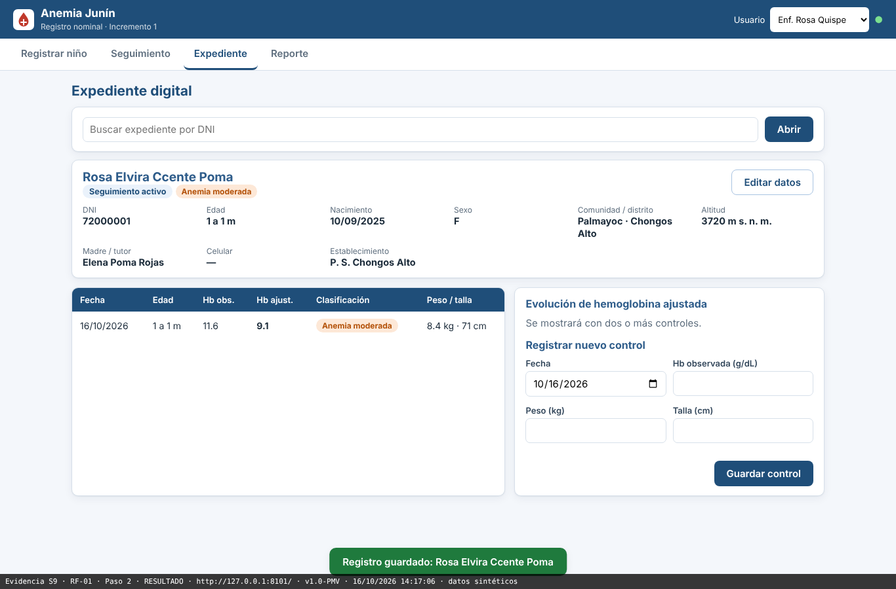

**Figura 2.** RF-01, captura 2: resultado en pantalla. Archivo: `../semana-09/evidencias_capturas/RF-01/RF01_inc1_paso2_resultado.png`.

#### FICHA CMMI — RF-02 / HIST-1.2 (HU-02) · Consultar y actualizar el expediente

| Campo | Detalle |
| --- | --- |
| **VER · Pruebas** | Ejecutadas: SÍ · Aprobadas: SÍ (7 pruebas: 4 unitarias, 2 de integración, 1 E2E) |
| **VER · Cobertura** | `servicio_expediente.py` y `api.py` en 100 %; cobertura global de `app/`: 99,79 % (herramienta: pytest-cov) |
| **VER · Análisis estático** | Ruff: 0 hallazgos (reglas de errores, seguridad y complejidad ≤ 12); SonarCloud no ejecutado |
| **VER · Estructura** | Conforme a la arquitectura hexagonal: 25 pruebas de arquitectura en verde |
| **VAL · Criterio de aceptación** | **Dado que** existe un expediente, **cuando** se consulta y se actualizan campos permitidos y se agrega un nuevo control, **entonces** los cambios persisten, el historial anterior se conserva y hay confirmación en menos de 2 s |
| **VAL · Resultado** | Aprobado por el evaluador de calidad (ejecución automatizada); aceptación del usuario pendiente. Consulta en 98 ms; actualización en 107 ms (comunidad y celular persistidos); nuevo control en 97 ms (evaluaciones de 2 a 3) |
| **Fecha · Evaluador** | VER: 30/10/2026; VAL (captura): 16/10/2026 · QA Lead (Huamani Rodriguez, Jean Piero); firma pendiente |
| **Estado final CMMI** | **VERIFICADO Y VALIDADO** |

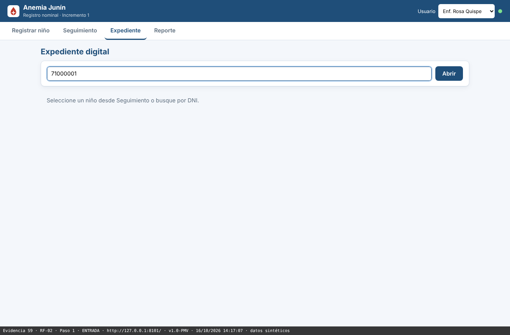

**Figura 3.** RF-02, captura 1: datos de entrada. Archivo: `../semana-09/evidencias_capturas/RF-02/RF02_inc1_paso1_entrada.png`.

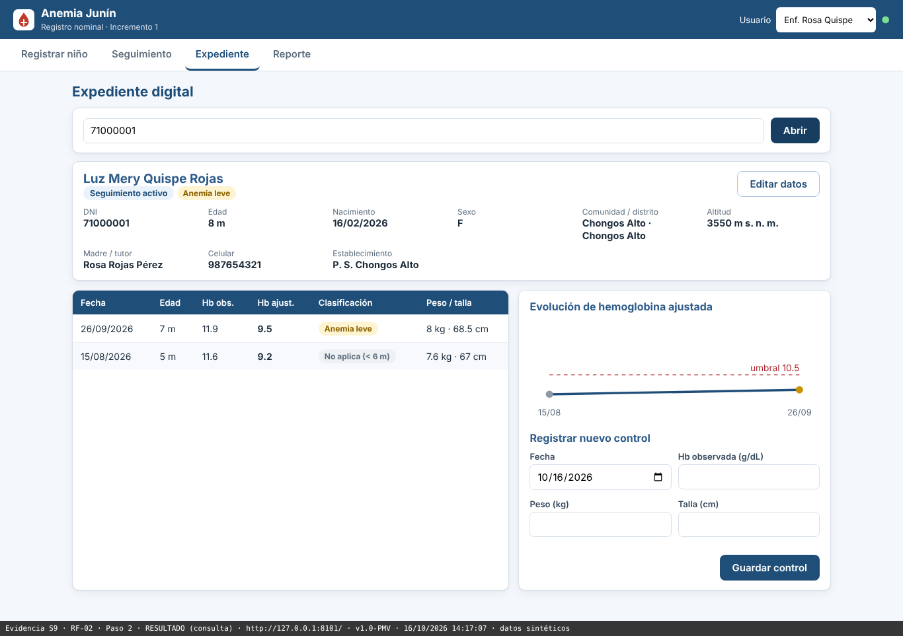

**Figura 4.** RF-02, captura 2: expediente consultado. Archivo: `../semana-09/evidencias_capturas/RF-02/RF02_inc1_paso2_resultado.png`.

#### FICHA CMMI — RF-03 / HIST-1.3 (HU-03) · Validar datos con reglas clínicas

| Campo | Detalle |
| --- | --- |
| **VER · Pruebas** | Ejecutadas: SÍ · Aprobadas: SÍ (14 pruebas: 9 unitarias, 4 de integración, 1 E2E), con valores frontera clínicos |
| **VER · Cobertura** | `validaciones.py`, `reglas_clinicas.py` y `clasificacion.py` en 100 %; cobertura global de `app/`: 99,79 % (herramienta: pytest-cov) |
| **VER · Análisis estático** | Ruff: 0 hallazgos (reglas de errores, seguridad y complejidad ≤ 12); SonarCloud no ejecutado |
| **VER · Estructura** | Conforme a la arquitectura hexagonal: 25 pruebas de arquitectura en verde |
| **VAL · Criterio de aceptación** | **Dado que** se digitan datos clínicos, **cuando** se ingresa la hemoglobina, **entonces** la vista previa muestra la hemoglobina ajustada y la clasificación; y si los datos son inválidos, se rechazan con un mensaje comprensible por campo |
| **VAL · Resultado** | Aprobado por el evaluador de calidad (ejecución automatizada); aceptación del usuario pendiente. Vista previa «Anemia moderada» (Hb ajustada 9,1 g/dL) en 830 ms; el rechazo marca 2 campos y responde HTTP 422 |
| **Fecha · Evaluador** | VER: 30/10/2026; VAL (captura): 16/10/2026 · QA Lead (Huamani Rodriguez, Jean Piero); firma pendiente |
| **Estado final CMMI** | **VERIFICADO Y VALIDADO** |

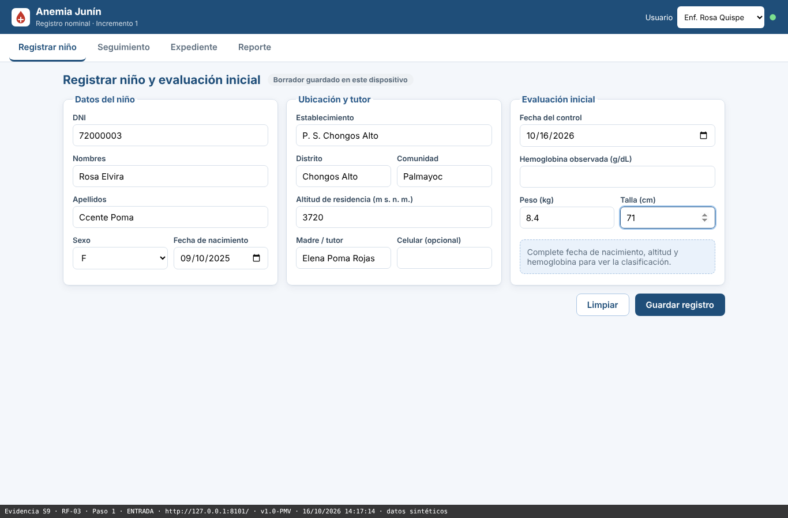

**Figura 5.** RF-03, captura 1: datos de entrada sin hemoglobina. Archivo: `../semana-09/evidencias_capturas/RF-03/RF03_inc1_paso1_entrada.png`.

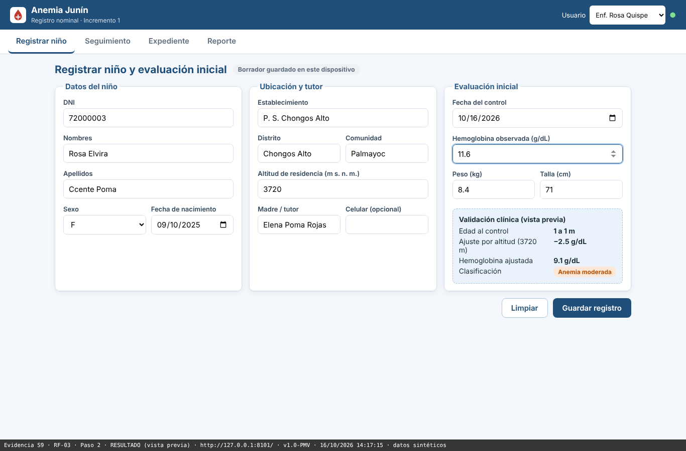

**Figura 6.** RF-03, captura 2: vista previa de la validación clínica. Archivo: `../semana-09/evidencias_capturas/RF-03/RF03_inc1_paso2_resultado.png`.

#### FICHA CMMI — RF-04 / HIST-1.4 (HU-04) · Listar niños en seguimiento

| Campo | Detalle |
| --- | --- |
| **VER · Pruebas** | Ejecutadas: SÍ · Aprobadas: SÍ (10 pruebas: 4 unitarias, 4 de integración, 2 E2E) |
| **VER · Cobertura** | `servicio_expediente.py` y `api.py` en 100 %; cobertura global de `app/`: 99,79 % (herramienta: pytest-cov) |
| **VER · Análisis estático** | Ruff: 0 hallazgos (reglas de errores, seguridad y complejidad ≤ 12); SonarCloud no ejecutado |
| **VER · Estructura** | Conforme a la arquitectura hexagonal: 25 pruebas de arquitectura en verde |
| **VAL · Criterio de aceptación** | **Dado que** hay niños en seguimiento, **cuando** se filtra por clasificación o se busca por comunidad, **entonces** el listado respeta el filtro y muestra el estado de control de cada niño en menos de 2 s |
| **VAL · Resultado** | Aprobado por el evaluador de calidad (ejecución automatizada); aceptación del usuario pendiente. Filtro «Anemia leve»: 7 de 7 filas en 32 ms; búsqueda «Palmayoc»: 4 de 4 filas en 288 ms |
| **Fecha · Evaluador** | VER: 30/10/2026; VAL (captura): 16/10/2026 · QA Lead (Huamani Rodriguez, Jean Piero); firma pendiente |
| **Estado final CMMI** | **VERIFICADO Y VALIDADO** |

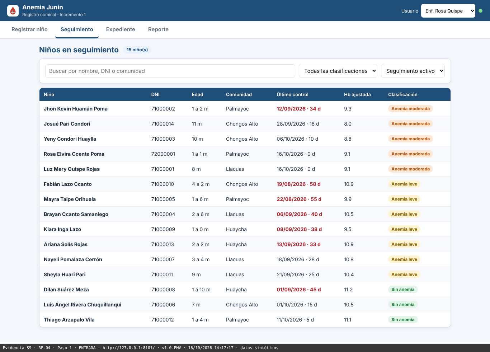

**Figura 7.** RF-04, captura 1: listado sin filtros. Archivo: `../semana-09/evidencias_capturas/RF-04/RF04_inc1_paso1_entrada.png`.

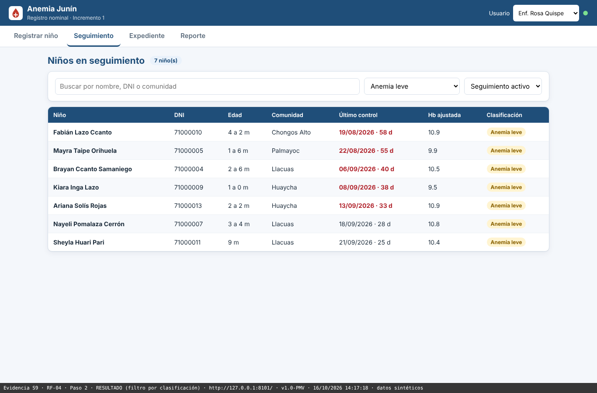

**Figura 8.** RF-04, captura 2: filtro por clasificación. Archivo: `../semana-09/evidencias_capturas/RF-04/RF04_inc1_paso2_resultado.png`.

#### FICHA CMMI — RF-05 / HIST-1.5 (HU-05) · Reporte del periodo

| Campo | Detalle |
| --- | --- |
| **VER · Pruebas** | Ejecutadas: SÍ · Aprobadas: SÍ (8 pruebas: 4 unitarias, 3 de integración, 1 E2E), incluida la regresión de la zona horaria y de fechas extremas |
| **VER · Cobertura** | `servicio_expediente.py` y `api.py` en 100 %; cobertura global de `app/`: 99,79 % (herramienta: pytest-cov) |
| **VER · Análisis estático** | Ruff: 0 hallazgos (reglas de errores, seguridad y complejidad ≤ 12); SonarCloud no ejecutado |
| **VER · Estructura** | Conforme a la arquitectura hexagonal: 25 pruebas de arquitectura en verde |
| **VAL · Criterio de aceptación** | **Dado que** se elige un periodo válido, **cuando** se pulsa «Generar», **entonces** se muestran los indicadores y el mismo conjunto puede descargarse como CSV, en menos de 2 s |
| **VAL · Resultado** | Aprobado por el evaluador de calidad (ejecución automatizada); aceptación del usuario pendiente. Reporte en 82 ms (15 niños registrados, igual al valor de la API); CSV en 80 ms con 15 filas |
| **Fecha · Evaluador** | VER: 30/10/2026; VAL (captura): 16/10/2026 · QA Lead (Huamani Rodriguez, Jean Piero); firma pendiente |
| **Estado final CMMI** | **VERIFICADO Y VALIDADO** |

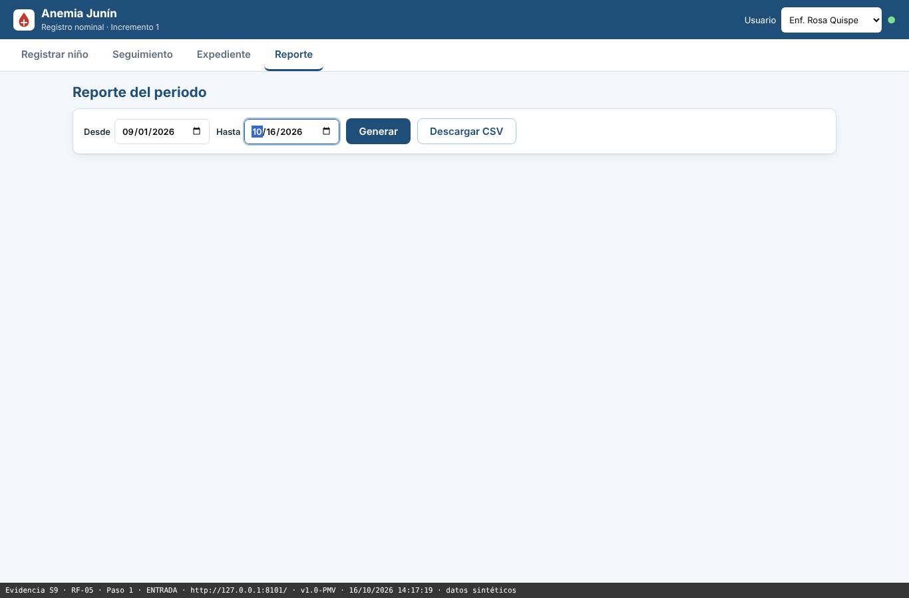

**Figura 9.** RF-05, captura 1: periodo seleccionado. Archivo: `../semana-09/evidencias_capturas/RF-05/RF05_inc1_paso1_entrada.png`.

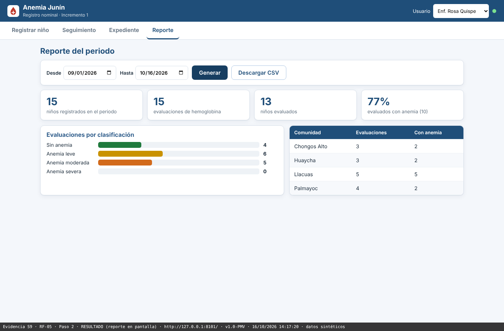

**Figura 10.** RF-05, captura 2: reporte generado. Archivo: `../semana-09/evidencias_capturas/RF-05/RF05_inc1_paso2_resultado.png`.

#### FICHA CMMI — RF-06 / HIST-2.1 · Agenda de controles según la normativa

| Campo | Detalle |
| --- | --- |
| **VER · Pruebas** | Ejecutadas: SÍ · Aprobadas: SÍ (28 pruebas: 16 unitarias, 9 de integración, 3 E2E), con valores frontera de la agenda |
| **VER · Cobertura** | `domain/service/agenda.py` (124 sentencias), `model/agenda.py` y `servicio_agenda.py` en 100 %; cobertura global de `app/`: 99,79 % (herramienta: pytest-cov) |
| **VER · Análisis estático** | Ruff: 0 hallazgos (reglas de errores, seguridad y complejidad ≤ 12); SonarCloud no ejecutado |
| **VER · Estructura** | Conforme a la arquitectura hexagonal: 25 pruebas de arquitectura en verde |
| **VAL · Criterio de aceptación** | **Dado que** existe un niño con anemia en tratamiento, **cuando** se abre su expediente, **entonces** se muestra la agenda normativa con el estado de cada control (cumplido, pendiente, próximo o vencido) en menos de 2 s |
| **VAL · Resultado** | Aprobado por el evaluador de calidad (ejecución automatizada); aceptación del usuario pendiente. Agenda de 13 controles (2 cumplidos, 9 pendientes y 2 vencidos) en 119 ms, igual a la API |
| **Fecha · Evaluador** | VER: 30/10/2026; VAL (captura): 16/10/2026 · QA Lead (Huamani Rodriguez, Jean Piero); firma pendiente |
| **Estado final CMMI** | **VERIFICADO Y VALIDADO** |

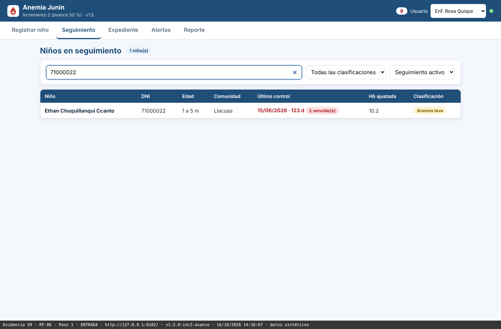

**Figura 11.** RF-06, captura 1: niño seleccionado en el seguimiento. Archivo: `../semana-09/evidencias_capturas/RF-06/RF06_inc2_paso1_entrada.png`.

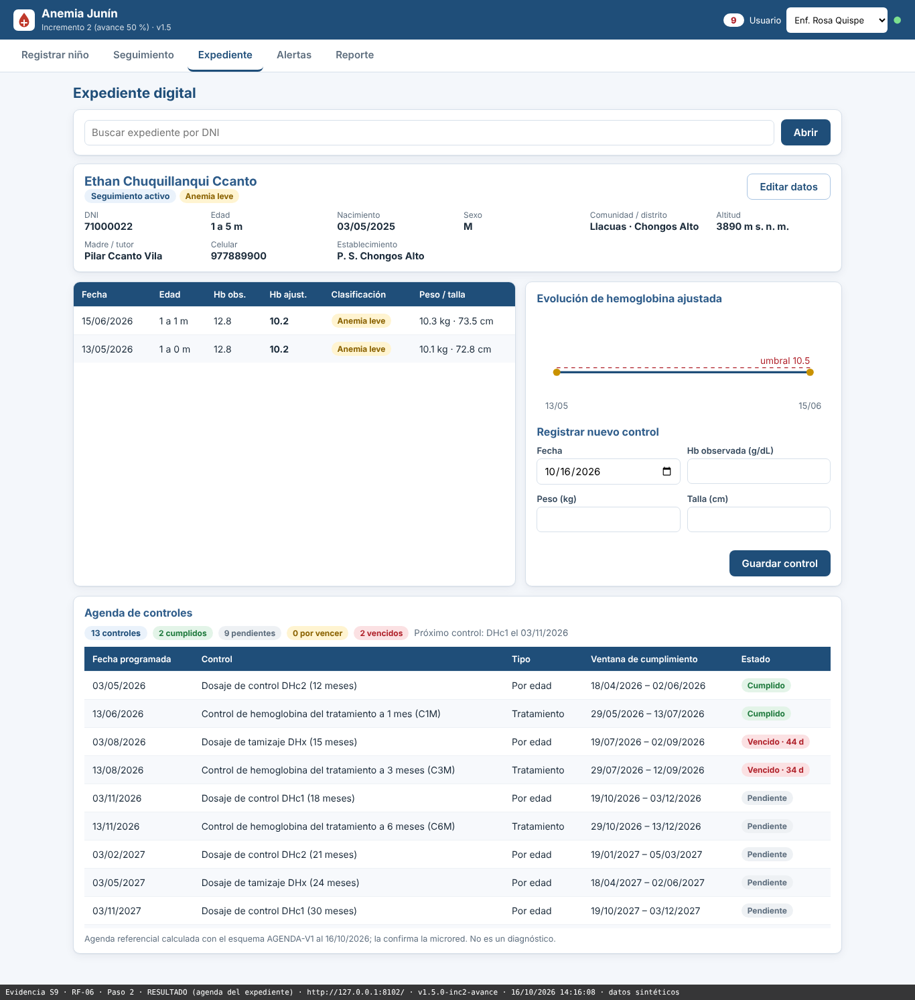

**Figura 12.** RF-06, captura 2: agenda de controles del expediente. Archivo: `../semana-09/evidencias_capturas/RF-06/RF06_inc2_paso2_resultado.png`.

#### FICHA CMMI — RF-07 / HIST-2.2 · Controles vencidos y alertas priorizadas

| Campo | Detalle |
| --- | --- |
| **VER · Pruebas** | Ejecutadas: SÍ · Aprobadas: SÍ (17 pruebas: 10 unitarias, 5 de integración, 2 E2E), con filtros por prioridad y comunidad |
| **VER · Cobertura** | `domain/service/alertas.py`, `model/alertas.py` y `servicio_alertas.py` en 100 %; cobertura global de `app/`: 99,79 % (herramienta: pytest-cov) |
| **VER · Análisis estático** | Ruff: 0 hallazgos (reglas de errores, seguridad y complejidad ≤ 12); SonarCloud no ejecutado |
| **VER · Estructura** | Conforme a la arquitectura hexagonal: 25 pruebas de arquitectura en verde |
| **VAL · Criterio de aceptación** | **Dado que** hay niños con controles, **cuando** se abre la pestaña «Alertas» y se filtra por prioridad o comunidad, **entonces** se listan los controles vencidos priorizados con su resumen en menos de 2 s |
| **VAL · Resultado** | Aprobado por el evaluador de calidad (ejecución automatizada); aceptación del usuario pendiente. Pestaña en 176 ms; filtro «Alta»: 7 filas en 69 ms; filtro «Huaycha»: 1 de 1 fila en 70 ms |
| **Fecha · Evaluador** | VER: 30/10/2026; VAL (captura): 16/10/2026 · QA Lead (Huamani Rodriguez, Jean Piero); firma pendiente |
| **Estado final CMMI** | **VERIFICADO Y VALIDADO** |

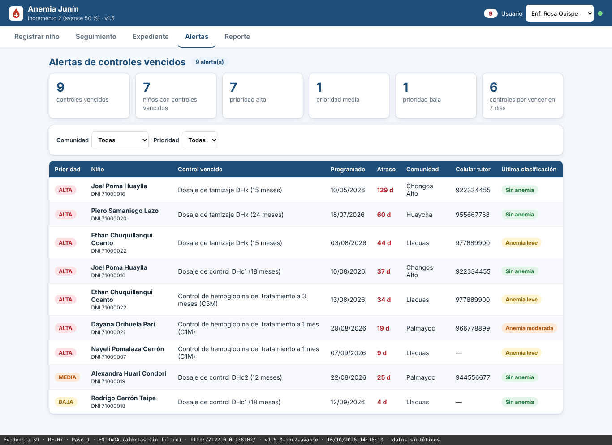

**Figura 13.** RF-07, captura 1: pestaña de alertas sin filtros. Archivo: `../semana-09/evidencias_capturas/RF-07/RF07_inc2_paso1_entrada.png`.

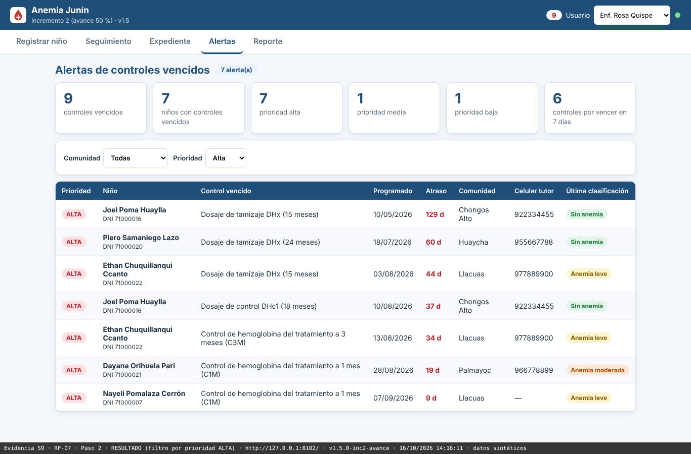

**Figura 14.** RF-07, captura 2: filtro por prioridad. Archivo: `../semana-09/evidencias_capturas/RF-07/RF07_inc2_paso2_resultado_filtro_prioridad.png`.

#### FICHA CMMI — RF-08 / HIST-2.3 · Agenda del personal

| Campo | Detalle |
| --- | --- |
| **VER · Pruebas** | Ejecutadas: SÍ · Aprobadas: SÍ (15 pruebas: 8 unitarias, 4 de integración, 3 E2E), incluida la vista móvil |
| **VER · Cobertura** | `domain/service/agenda_personal.py`, `model/agenda_personal.py` y `servicio_agenda_personal.py` en 100 %; cobertura global de `app/`: 99,79 % (herramienta: pytest-cov) |
| **VER · Análisis estático** | Ruff: 0 hallazgos (reglas de errores, seguridad y complejidad ≤ 12); SonarCloud no ejecutado |
| **VER · Estructura** | Conforme a la arquitectura hexagonal: 25 pruebas de arquitectura en verde |
| **VAL · Criterio de aceptación** | **Dado que** existen controles programados, **cuando** se consulta un rango de hasta 31 días y se filtra por establecimiento o comunidad, **entonces** se listan los controles por día con el total y el desglose por estado, coherentes con la API, en menos de 2 s |
| **VAL · Resultado** | Aprobado por el evaluador de calidad (ejecución automatizada); aceptación del usuario pendiente. Consulta del rango en 133 ms; filtro por establecimiento en 40 ms. Datos de la muestra DIRESA Junín |
| **Fecha · Evaluador** | VER: 30/10/2026; VAL (captura): 17/10/2026 · QA Lead (Huamani Rodriguez, Jean Piero); firma pendiente |
| **Estado final CMMI** | **VERIFICADO Y VALIDADO** |

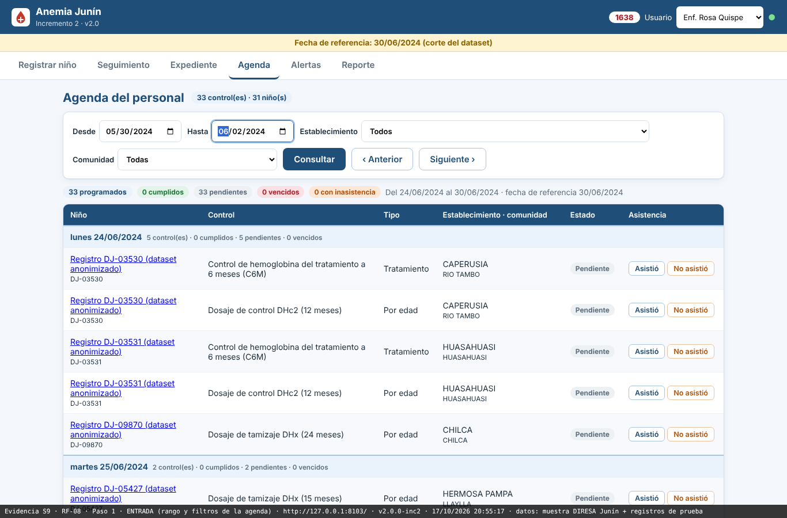

**Figura 15.** RF-08, captura 1: rango de fechas de entrada. Archivo: `../semana-09/evidencias_capturas/RF-08/RF08_inc2final_paso1_entrada.png`.

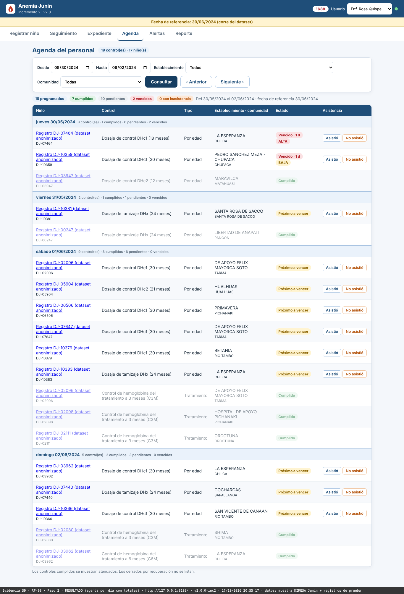

**Figura 16.** RF-08, captura 2: agenda del personal por día. Archivo: `../semana-09/evidencias_capturas/RF-08/RF08_inc2final_paso2_resultado.png`.

#### FICHA CMMI — RF-09 / HIST-2.4 · Registro de asistencia a control

| Campo | Detalle |
| --- | --- |
| **VER · Pruebas** | Ejecutadas: SÍ · Aprobadas: SÍ (26 pruebas: 19 unitarias, 5 de integración, 2 E2E), incluido el rechazo del segundo registro |
| **VER · Cobertura** | `domain/service/asistencia.py`, `model/asistencia.py` y `servicio_asistencia.py` en 100 %; cobertura global de `app/`: 99,79 % (herramienta: pytest-cov) |
| **VER · Análisis estático** | Ruff: 0 hallazgos (reglas de errores, seguridad y complejidad ≤ 12); SonarCloud no ejecutado |
| **VER · Estructura** | Conforme a la arquitectura hexagonal: 25 pruebas de arquitectura en verde |
| **VAL · Criterio de aceptación** | **Dado que** existe un control programado sin registro, **cuando** el personal registra «Asistió» o «No asistió» con motivo, **entonces** el control queda cumplido o marcado como inasistencia (con la alerta elevada un nivel) y un segundo registro se rechaza con HTTP 409, en menos de 2 s |
| **VAL · Resultado** | Aprobado por el evaluador de calidad (ejecución automatizada); aceptación del usuario pendiente. «Asistió» en 90 ms; «No asistió» en 92 ms; segundo registro rechazado en 54 ms |
| **Fecha · Evaluador** | VER: 30/10/2026; VAL (captura): 17/10/2026 · QA Lead (Huamani Rodriguez, Jean Piero); firma pendiente |
| **Estado final CMMI** | **VERIFICADO Y VALIDADO** |

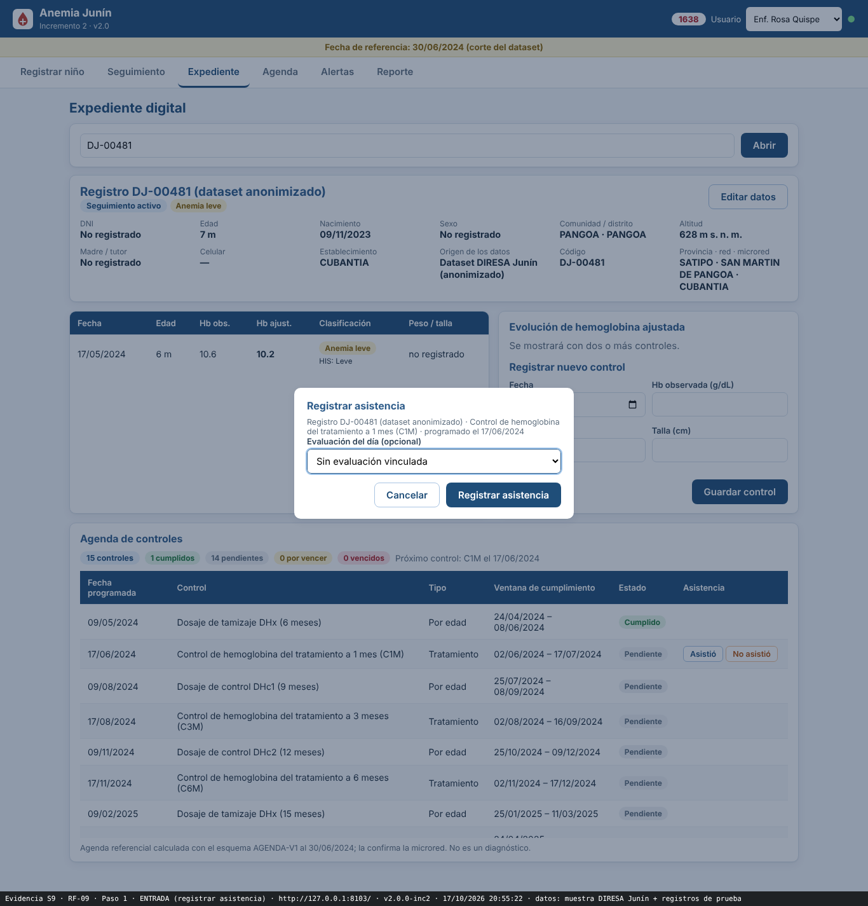

**Figura 17.** RF-09, captura 1: control sin registro de asistencia. Archivo: `../semana-09/evidencias_capturas/RF-09/RF09_inc2final_paso1_entrada.png`.

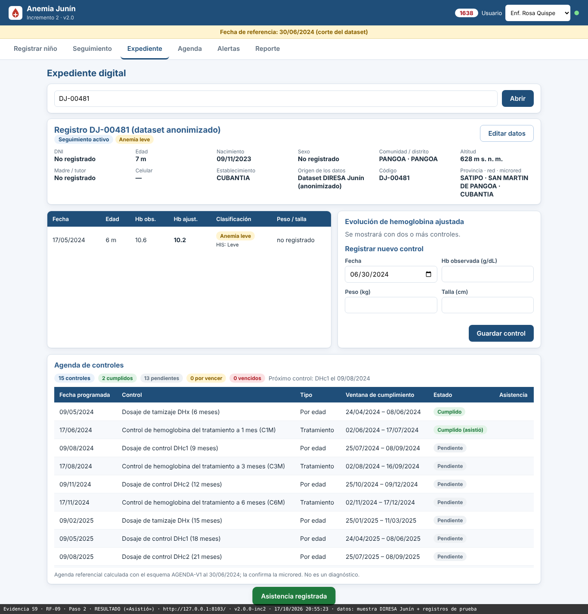

**Figura 18.** RF-09, captura 2: control registrado como «Asistió». Archivo: `../semana-09/evidencias_capturas/RF-09/RF09_inc2final_paso2_asistio.png`.

#### FICHA CMMI — HIST-3.1 / Inc. 3 · Registro sin conexión (cola en el dispositivo) y apertura desde el caché

| Campo | Detalle |
| --- | --- |
| **VER · Pruebas** | Ejecutadas: SÍ · Aprobadas: SÍ. E2E CP-297, CP-298 y CP-299 (desconexión simulada y, para la recarga, servidor detenido); `test_sincronizacion.py` (37), `test_api_inc3.py` (37) y `test_repositorio_inc3.py` (14) se comparten con HIST-3.2 a 3.4 |
| **VER · Cobertura** | `domain/model/sincronizacion.py`, `domain/service/operaciones.py` y `servicio_sincronizacion.py` en 100 %; global de `app/`: 99,79 %. El JavaScript de la cola (`cola.js`, `sync.js`) no entra en pytest-cov; lo cubren los E2E (herramienta: pytest-cov) |
| **VER · Análisis estático** | Ruff: 0 hallazgos (reglas de errores, seguridad y complejidad ≤ 12; 142 archivos); SonarCloud no ejecutado |
| **VER · Estructura** | Conforme a la arquitectura hexagonal: 25 pruebas de arquitectura en verde; 0 importaciones de terceros en el dominio (S10) |
| **VAL · Criterio de aceptación** | **Dado que** no hay conexión, **cuando** el personal registra un niño con su evaluación y una visita, **entonces** quedan guardados en el dispositivo con un indicador de pendientes y el servidor no los tiene; y con el servidor detenido la aplicación abre desde el caché con aviso |
| **VAL · Resultado** | Aprobado por el evaluador de calidad (ejecución automatizada); aceptación del usuario y prueba en un dispositivo real pendientes. 2 operaciones pendientes en el dispositivo y 0 en el servidor; 30 de 30 filas del seguimiento servidas desde el caché con el servidor detenido |
| **Fecha · Evaluador** | VER: 30/10/2026; VAL (captura): 30/10/2026 · QA Lead (Huamani Rodriguez, Jean Piero); firma pendiente |
| **Estado final CMMI** | **VERIFICADO Y VALIDADO (entorno de pruebas)** |

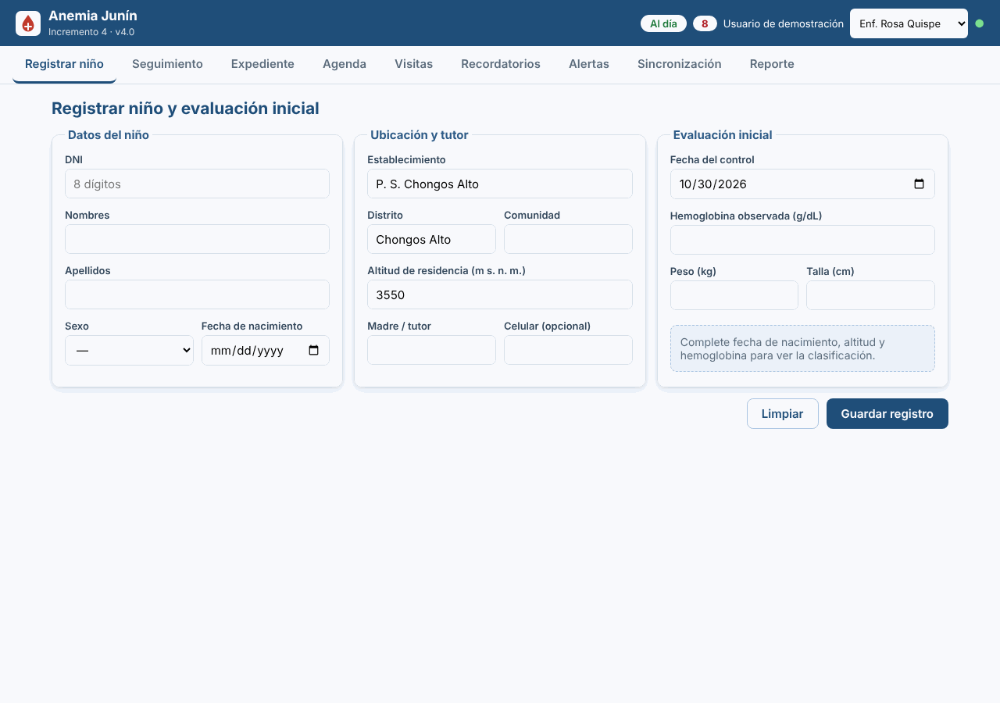

**Figura 19.** Aplicación en línea antes de perder la conexión. Archivo: `../semana-10/evidencias/software/HIST31_inc3_1_en_linea_escritorio.png`.

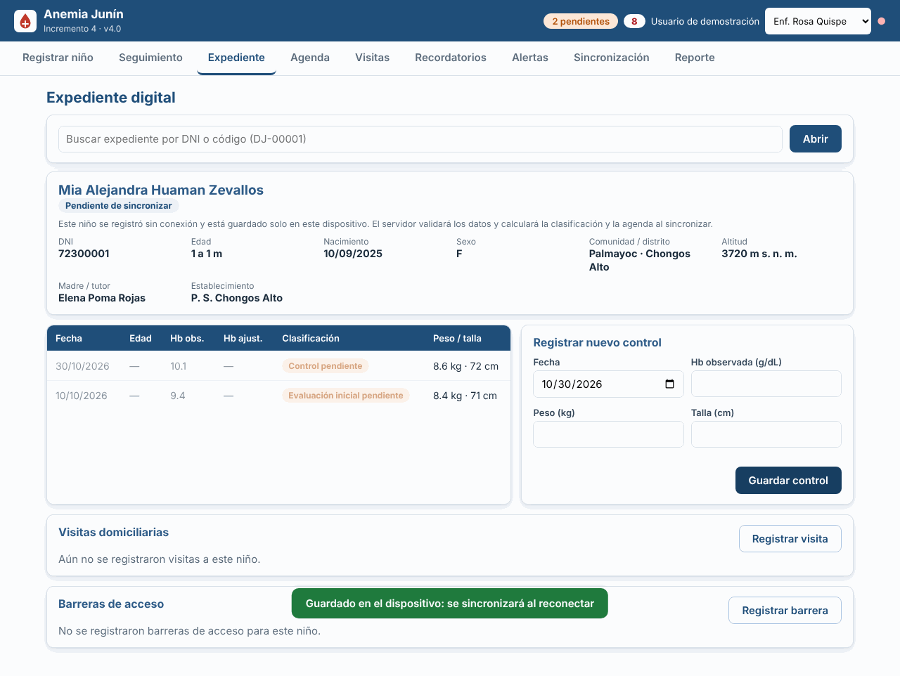

**Figura 20.** Sin conexión: 2 operaciones pendientes en el dispositivo. Archivo: `../semana-10/evidencias/software/HIST31_inc3_2_pendientes_sin_conexion_escritorio.png`.

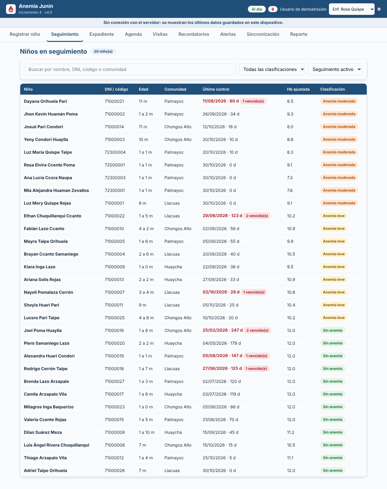

**Figura 21.** Recarga con el servidor detenido: abre desde el caché con aviso. Archivo: `../semana-10/evidencias/software/HIST31_inc3_3_recarga_sin_conexion_escritorio.png`.

#### FICHA CMMI — HIST-3.2 / Inc. 3 · Sincronización idempotente al reconectar

| Campo | Detalle |
| --- | --- |
| **VER · Pruebas** | Ejecutadas: SÍ · Aprobadas: SÍ. Integración de lote mixto e idempotencia en `test_api_inc3.py`; E2E CP-297 y CP-300; CP-264b (el mismo `id_operacion` enviado a la vez se aplica una sola vez, añadida por la revisión independiente) |
| **VER · Cobertura** | `servicio_sincronizacion.py` (217 sentencias), `domain/service/operaciones.py` y `repositorio_sincronizacion.py` en 100 %; global de `app/`: 99,79 % (herramienta: pytest-cov) |
| **VER · Análisis estático** | Ruff: 0 hallazgos (reglas de errores, seguridad y complejidad ≤ 12; 142 archivos); SonarCloud no ejecutado |
| **VER · Estructura** | Conforme a la arquitectura hexagonal: 25 pruebas de arquitectura en verde; 0 importaciones de terceros en el dominio (S10) |
| **VAL · Criterio de aceptación** | **Dado que** hay operaciones pendientes, **cuando** vuelve la red, **entonces** cada operación se aplica una sola vez (`APLICADA`), reenviar la misma no duplica (`DUPLICADA`) y el niño creado sin conexión conserva su identificador |
| **VAL · Resultado** | Aprobado por el evaluador de calidad (ejecución automatizada); aceptación del usuario pendiente. Primer envío `APLICADA`, segundo `DUPLICADA`; 3 evaluaciones tras el reenvío (sin duplicado) |
| **Fecha · Evaluador** | VER: 30/10/2026; VAL (captura): 30/10/2026 · QA Lead (Huamani Rodriguez, Jean Piero); firma pendiente |
| **Estado final CMMI** | **VERIFICADO Y VALIDADO** |

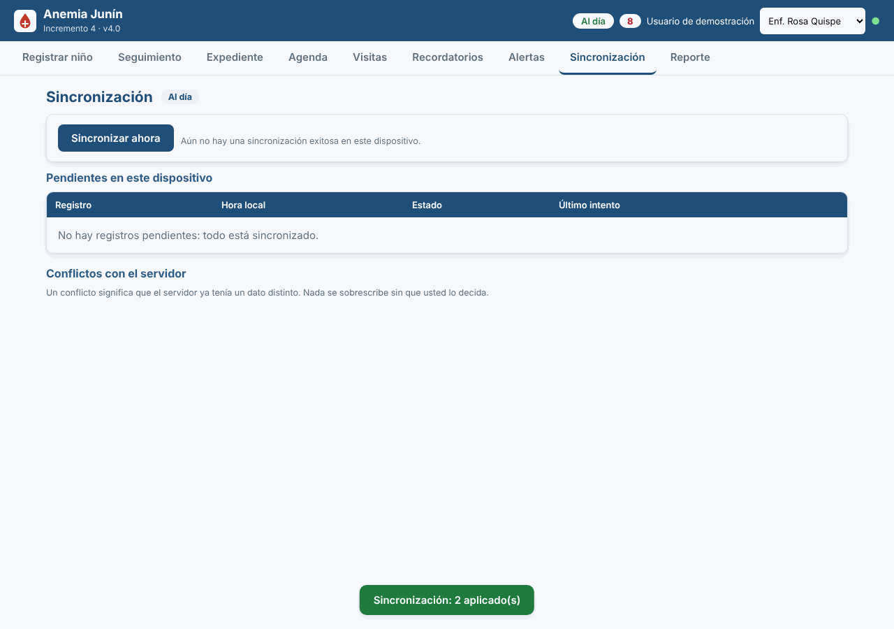

**Figura 22.** Panel con pendientes antes de sincronizar. Archivo: `../semana-10/evidencias/software/HIST32_inc3_1_panel_antes_de_sincronizar_escritorio.png`.

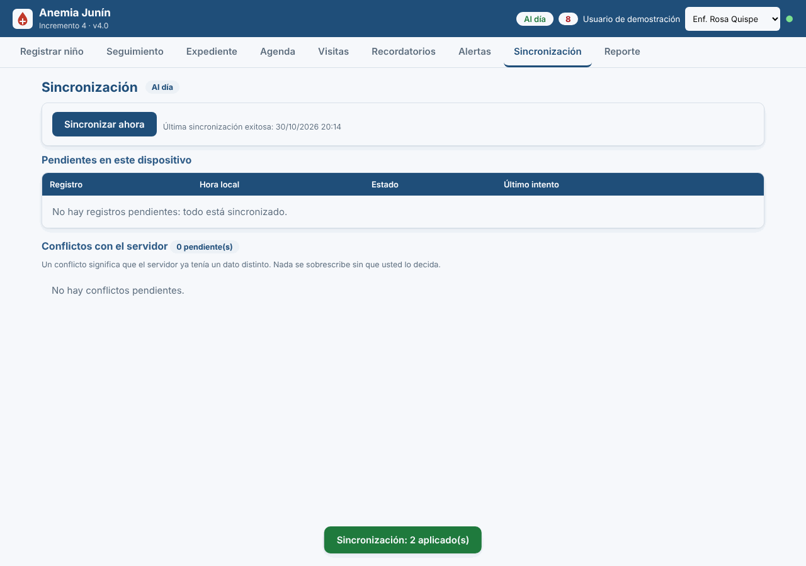

**Figura 23.** Panel tras sincronizar: operaciones aplicadas. Archivo: `../semana-10/evidencias/software/HIST32_inc3_2_sincronizado_escritorio.png`.

#### FICHA CMMI — HIST-3.3 / Inc. 3 · Resolución de conflictos sin sobrescribir a ciegas

| Campo | Detalle |
| --- | --- |
| **VER · Pruebas** | Ejecutadas: SÍ · Aprobadas: SÍ. `test_conflictos.py` (26 unitarias), integración en `test_api_inc3.py`, E2E CP-303 |
| **VER · Cobertura** | `domain/service/conflictos.py` (88 sentencias) y `servicio_sincronizacion.py` en 100 %; global de `app/`: 99,79 % (herramienta: pytest-cov) |
| **VER · Análisis estático** | Ruff: 0 hallazgos (reglas de errores, seguridad y complejidad ≤ 12; 142 archivos); SonarCloud no ejecutado |
| **VER · Estructura** | Conforme a la arquitectura hexagonal: 25 pruebas de arquitectura en verde; 0 importaciones de terceros en el dominio (S10) |
| **VAL · Criterio de aceptación** | **Dado que** el servidor tiene un dato distinto del que llega sin conexión, **cuando** se sincroniza, **entonces** queda un `CONFLICTO` pendiente y el personal decide (conservar el del servidor o aplicar el del cliente); nunca se sobrescribe a ciegas |
| **VAL · Resultado** | Aprobado por el evaluador de calidad (ejecución automatizada); aceptación del usuario pendiente. 1 conflicto detectado y resuelto con «conservar el del servidor» |
| **Fecha · Evaluador** | VER: 30/10/2026; VAL (captura): 30/10/2026 · QA Lead (Huamani Rodriguez, Jean Piero); firma pendiente |
| **Estado final CMMI** | **VERIFICADO Y VALIDADO** |

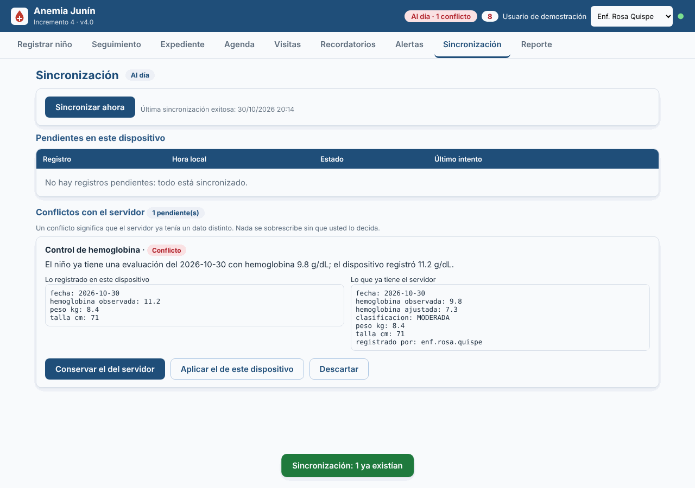

**Figura 24.** Conflicto de evaluación pendiente de decisión. Archivo: `../semana-10/evidencias/software/HIST33_inc3_1_conflicto_escritorio.png`.

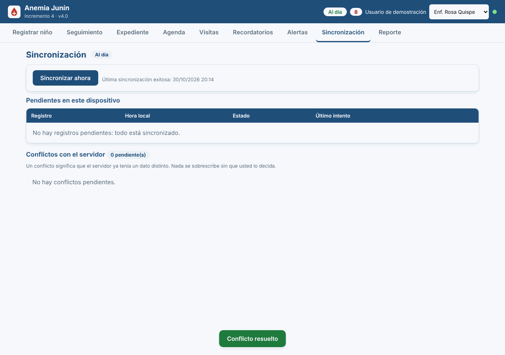

**Figura 25.** Conflicto resuelto. Archivo: `../semana-10/evidencias/software/HIST33_inc3_2_conflicto_resuelto_escritorio.png`.

#### FICHA CMMI — HIST-3.4 / Inc. 3 · Ver lo pendiente y desde cuándo

| Campo | Detalle |
| --- | --- |
| **VER · Pruebas** | Ejecutadas: SÍ · Aprobadas: SÍ. E2E CP-297 y CP-300 (indicador `indicador-sync` con `data-pendientes`) |
| **VER · Cobertura** | Lógica de pendientes en JavaScript (`cola.js`, `sync.js`), fuera de pytest-cov; la parte de servidor (`servicio_sincronizacion.py`) en 100 % (herramienta: pytest-cov) |
| **VER · Análisis estático** | Ruff: 0 hallazgos (reglas de errores, seguridad y complejidad ≤ 12; 142 archivos); SonarCloud no ejecutado |
| **VER · Estructura** | Conforme a la arquitectura hexagonal: 25 pruebas de arquitectura en verde; 0 importaciones de terceros en el dominio (S10) |
| **VAL · Criterio de aceptación** | **Dado que** el dispositivo tiene operaciones pendientes, **cuando** se mira la cabecera o la pestaña «Sincronización», **entonces** se ve cuántas hay y desde cuándo |
| **VAL · Resultado** | Aprobado por el evaluador de calidad (ejecución automatizada); aceptación del usuario pendiente. Resumen «1 pendiente(s)»; tras sincronizar, el panel queda al día |
| **Fecha · Evaluador** | VER: 30/10/2026; VAL (captura): 30/10/2026 · QA Lead (Huamani Rodriguez, Jean Piero); firma pendiente |
| **Estado final CMMI** | **VERIFICADO Y VALIDADO** |

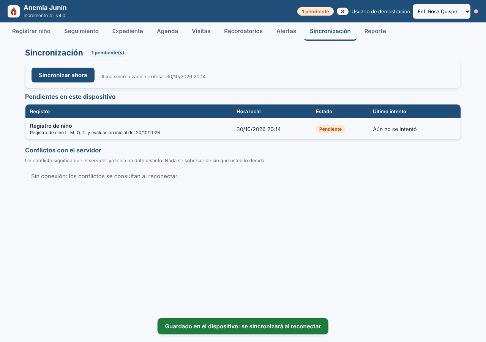

**Figura 26.** Pestaña «Sincronización» con 1 pendiente. Archivo: `../semana-10/evidencias/software/HIST34_inc3_1_panel_pendientes_escritorio.png`.

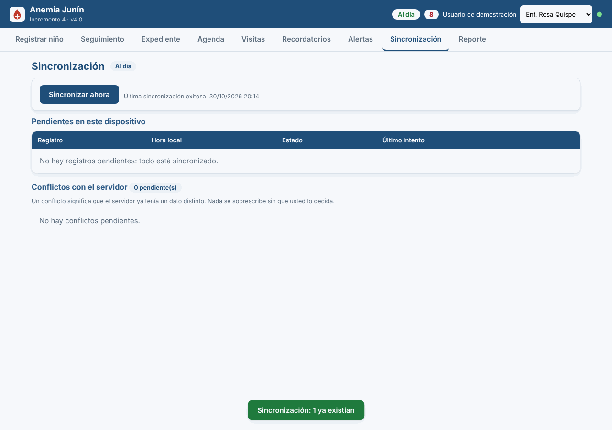

**Figura 27.** Panel al día tras sincronizar. Archivo: `../semana-10/evidencias/software/HIST34_inc3_2_panel_al_dia_escritorio.png`.

#### FICHA CMMI — VIS-3.5 / Inc. 3 · Visita domiciliaria priorizada

| Campo | Detalle |
| --- | --- |
| **VER · Pruebas** | Ejecutadas: SÍ · Aprobadas: SÍ. `test_visitas.py` (34 unitarias), integración en `test_api_inc3.py` y `test_repositorio_inc3.py`, E2E CP-301 y CP-302 (esta última sin conexión) |
| **VER · Cobertura** | `domain/service/visitas.py` (75 sentencias), `domain/model/visita.py` y `servicio_visitas.py` en 100 %; global de `app/`: 99,79 % (herramienta: pytest-cov) |
| **VER · Análisis estático** | Ruff: 0 hallazgos (reglas de errores, seguridad y complejidad ≤ 12; 142 archivos); SonarCloud no ejecutado |
| **VER · Estructura** | Conforme a la arquitectura hexagonal: 25 pruebas de arquitectura en verde; 0 importaciones de terceros en el dominio (S10) |
| **VAL · Criterio de aceptación** | **Dado que** hay niños en tratamiento, **cuando** se abre la pestaña «Visitas», **entonces** la lista va ordenada por un puntaje de 0 a 100 con su desglose (severidad, control vencido, inasistencias, días desde la última visita) y se puede registrar la visita |
| **VAL · Resultado** | Aprobado por el evaluador de calidad (ejecución automatizada); aceptación del usuario pendiente. 18 filas ordenadas de 49,5 a 25,0 puntos. Los pesos de `VISITA-V1` son una propuesta del equipo, no una norma del MINSA, y no se validaron con la microred |
| **Fecha · Evaluador** | VER: 30/10/2026; VAL (captura): 30/10/2026 · QA Lead (Huamani Rodriguez, Jean Piero); firma pendiente |
| **Estado final CMMI** | **VERIFICADO Y VALIDADO (pesos sin validar con la microred)** |

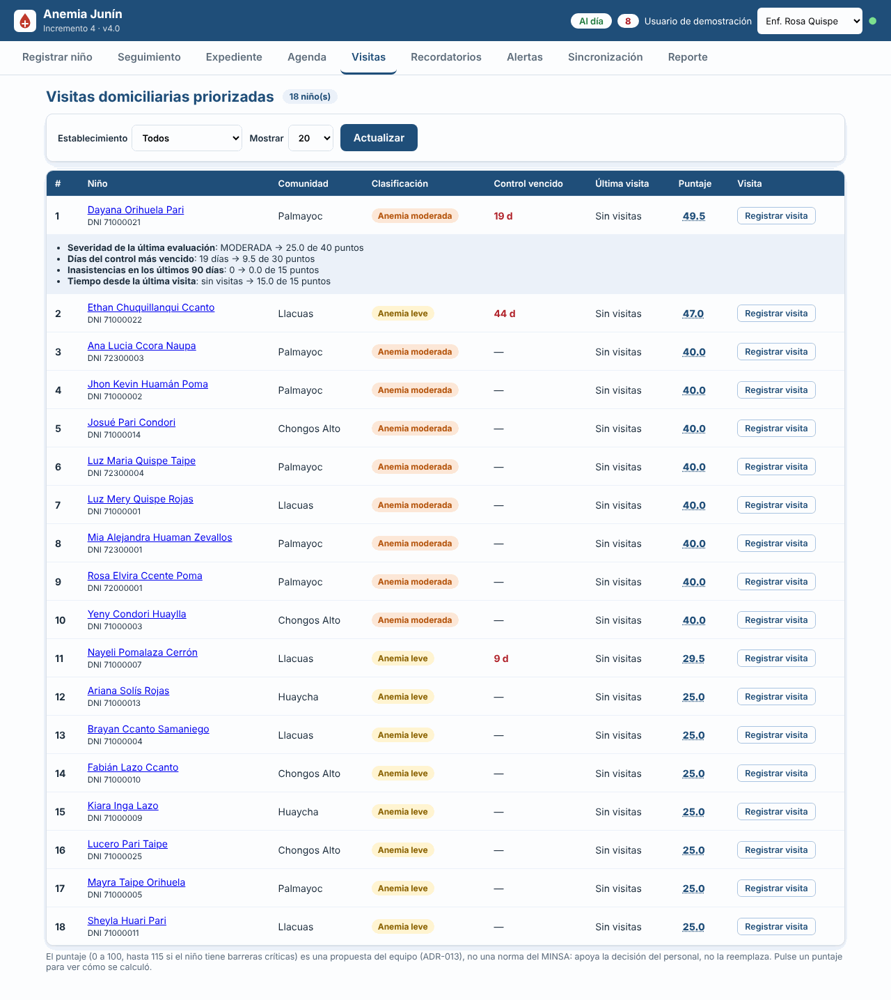

**Figura 28.** Lista priorizada con el desglose del puntaje. Archivo: `../semana-10/evidencias/software/VIS35_inc3_1_visitas_desglose_escritorio.png`.

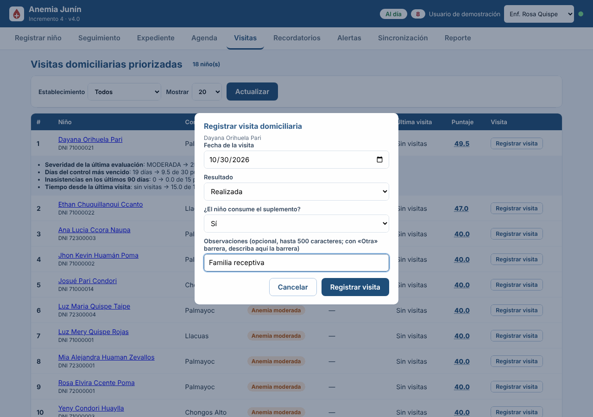

**Figura 29.** Registro de la visita. Archivo: `../semana-10/evidencias/software/VIS35_inc3_2_modal_visita_escritorio.png`.

#### FICHA CMMI — HIST-4.1 / Inc. 4 · Recordatorio de control (canal simulado)

| Campo | Detalle |
| --- | --- |
| **VER · Pruebas** | Ejecutadas: SÍ · Aprobadas: SÍ. `test_recordatorios.py` (59), `test_notificadores.py` (17, con `httpx.MockTransport`), `test_api_inc4.py` (41), `test_repositorio_inc4.py` (13), E2E CP-402 y CP-382b (dos generaciones simultáneas no envían dos veces) |
| **VER · Cobertura** | `adapters/outbound/notificaciones/*`, `domain/service/notificaciones.py` (163 sentencias) y `servicio_recordatorios.py` (163) en 100 %; global de `app/`: 99,79 % (herramienta: pytest-cov) |
| **VER · Análisis estático** | Ruff: 0 hallazgos (reglas de errores, seguridad y complejidad ≤ 12; 142 archivos); SonarCloud no ejecutado |
| **VER · Estructura** | Conforme a la arquitectura hexagonal: 25 pruebas de arquitectura en verde; 0 importaciones de terceros en el dominio (S10) |
| **VAL · Criterio de aceptación** | **Dado que** hay niños con un control hoy, en 3 días o menos, o vencido, **cuando** se generan los recordatorios, **entonces** cada mensaje sale por el canal configurado (rotulado SIMULADO en modo simulado) y repetir la generación no duplica |
| **VAL · Resultado** | Aprobado por el evaluador de calidad (ejecución automatizada); aceptación del usuario pendiente. 24 recordatorios, todos simulados; la segunda generación no duplica. **No se probó un envío real**: la plantilla `recordatorio_control` no está aprobada por Meta y el celular del tutor exige el consentimiento de la familia |
| **Fecha · Evaluador** | VER: 30/10/2026; VAL (captura): 30/10/2026 · QA Lead (Huamani Rodriguez, Jean Piero); firma pendiente |
| **Estado final CMMI** | **VERIFICADO Y VALIDADO (canal simulado)** |

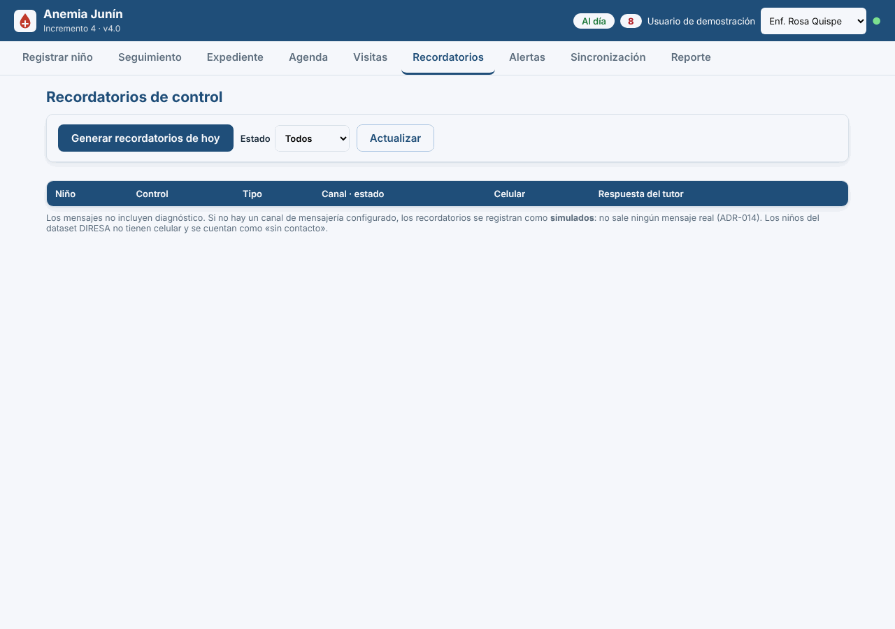

**Figura 30.** Pestaña «Recordatorios» antes de generar. Archivo: `../semana-10/evidencias/software/HIST41_inc4_1_recordatorios_antes_escritorio.png`.

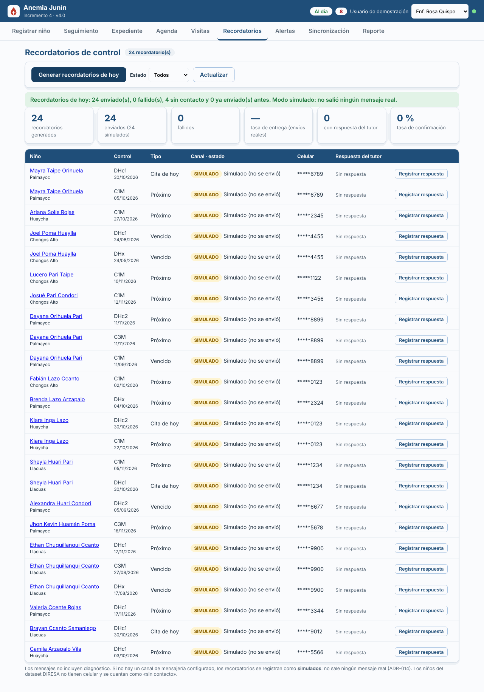

**Figura 31.** 24 recordatorios rotulados SIMULADO. Archivo: `../semana-10/evidencias/software/HIST41_inc4_2_recordatorios_simulados_escritorio.png`.

#### FICHA CMMI — HIST-4.2 / Inc. 4 · Confirmación del tutor (personal y webhook firmado)

| Campo | Detalle |
| --- | --- |
| **VER · Pruebas** | Ejecutadas: SÍ · Aprobadas: SÍ. Unitaria CP-357 (sin secreto, el webhook falla cerrado), integración CP-391b y CP-396 (webhook público sin sesión ni CSRF, pero con firma obligatoria), E2E CP-402 (respuesta «no puede») |
| **VER · Cobertura** | `domain/service/notificaciones.py` (firma HMAC-SHA256 y eventos del webhook) y `servicio_recordatorios.py` en 100 %; global de `app/`: 99,79 % (herramienta: pytest-cov) |
| **VER · Análisis estático** | Ruff: 0 hallazgos (reglas de errores, seguridad y complejidad ≤ 12; 142 archivos); SonarCloud no ejecutado |
| **VER · Estructura** | Conforme a la arquitectura hexagonal: 25 pruebas de arquitectura en verde; 0 importaciones de terceros en el dominio (S10) |
| **VAL · Criterio de aceptación** | **Dado que** hay un recordatorio enviado, **cuando** el tutor responde 1, 2 o 3 (por el personal o por el webhook con firma válida), **entonces** la respuesta queda registrada; sin firma o con firma inválida el webhook responde 403 y, sin secreto configurado, 503 |
| **VAL · Resultado** | Aprobado por el evaluador de calidad (ejecución automatizada); aceptación del usuario pendiente. Webhook sin firma: 403; firma inválida: 403; firma válida: 200. La corrección de «falla cerrado» salió de la revisión independiente (Figura 48) |
| **Fecha · Evaluador** | VER: 30/10/2026; VAL (captura): 30/10/2026 · QA Lead (Huamani Rodriguez, Jean Piero); firma pendiente |
| **Estado final CMMI** | **VERIFICADO Y VALIDADO (canal simulado)** |

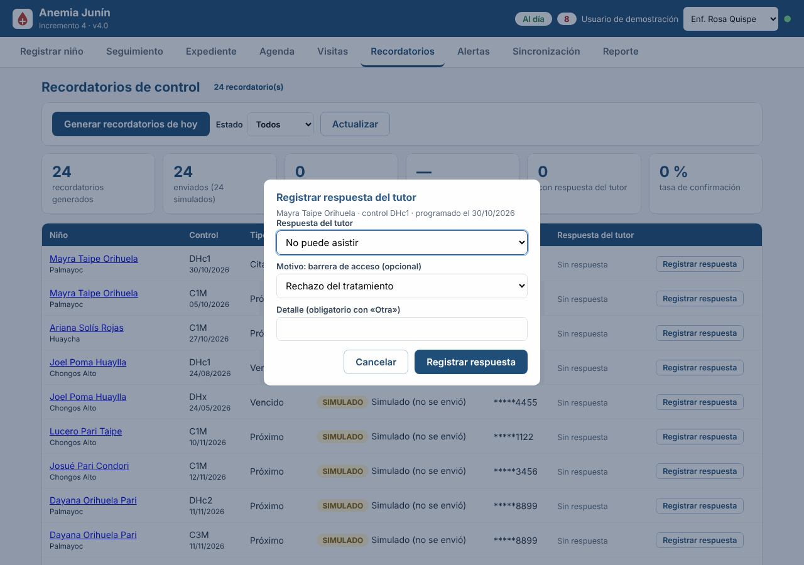

**Figura 32.** Modal de respuesta del tutor. Archivo: `../semana-10/evidencias/software/HIST42_inc4_1_modal_respuesta_escritorio.png`.

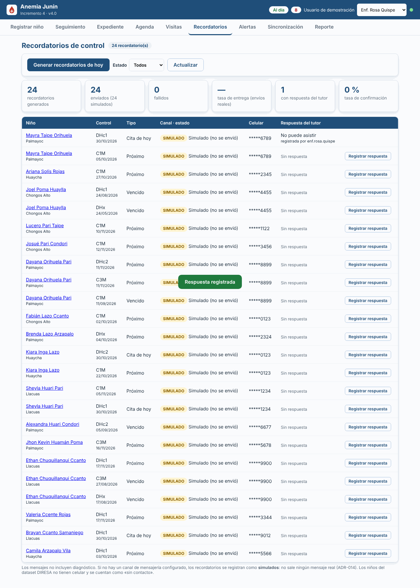

**Figura 33.** Respuesta registrada. Archivo: `../semana-10/evidencias/software/HIST42_inc4_2_respuesta_registrada_escritorio.png`.


**Figura 34.** Estado tras el webhook con firma válida. Archivo: `../semana-10/evidencias/software/HIST42_inc4_3_tras_webhook_escritorio.png`.

#### FICHA CMMI — HIST-4.3 / Inc. 4 · Barreras de acceso al tratamiento

| Campo | Detalle |
| --- | --- |
| **VER · Pruebas** | Ejecutadas: SÍ · Aprobadas: SÍ. `test_barreras.py` (26), integración de barreras y de su sincronización en `test_api_inc4.py` y `test_repositorio_inc4.py`, E2E CP-403 (sin conexión), CP-404 (desde una inasistencia) y CP-405 (desde una visita no lograda) |
| **VER · Cobertura** | `domain/model/barrera.py`, `domain/service/barreras.py` (82 sentencias) y `servicio_barreras.py` en 100 %; global de `app/`: 99,79 % (herramienta: pytest-cov) |
| **VER · Análisis estático** | Ruff: 0 hallazgos (reglas de errores, seguridad y complejidad ≤ 12; 142 archivos); SonarCloud no ejecutado |
| **VER · Estructura** | Conforme a la arquitectura hexagonal: 25 pruebas de arquitectura en verde; 0 importaciones de terceros en el dominio (S10) |
| **VAL · Criterio de aceptación** | **Dado que** existe un niño, **cuando** el personal registra una barrera (tipo y detalle) desde el expediente, la inasistencia, la visita no lograda o la respuesta «no puede», incluso sin conexión, **entonces** queda en el expediente con su fuente y se sincroniza sin duplicarse |
| **VAL · Resultado** | Aprobado por el evaluador de calidad (ejecución automatizada); aceptación del usuario pendiente. Barrera TRANSPORTE registrada, pendiente sin conexión y luego sincronizada en el expediente |
| **Fecha · Evaluador** | VER: 30/10/2026; VAL (captura): 30/10/2026 · QA Lead (Huamani Rodriguez, Jean Piero); firma pendiente |
| **Estado final CMMI** | **VERIFICADO Y VALIDADO** |

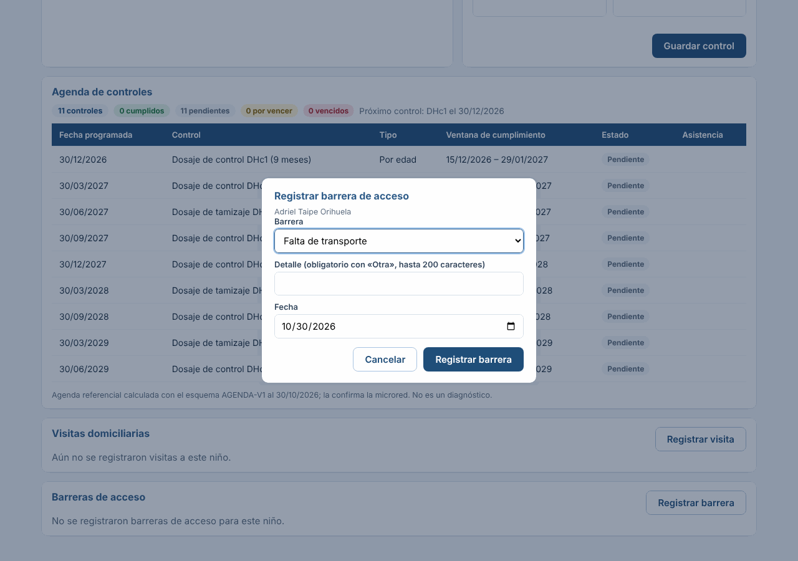

**Figura 35.** Modal de registro de barrera. Archivo: `../semana-10/evidencias/software/HIST43_inc4_1_modal_barrera_escritorio.png`.

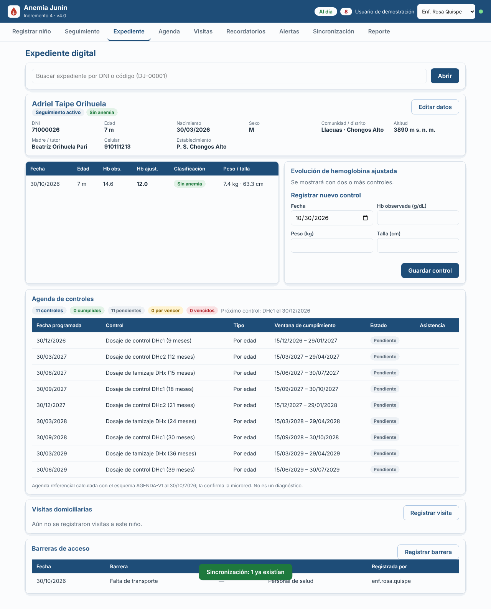

**Figura 36.** Barrera sincronizada en el expediente. Archivo: `../semana-10/evidencias/software/HIST43_inc4_3_barrera_sincronizada_escritorio.png`.

#### FICHA CMMI — HIST-4.4 / Inc. 4 · Alerta de barreras críticas y suma a la visita priorizada

| Campo | Detalle |
| --- | --- |
| **VER · Pruebas** | Ejecutadas: SÍ · Aprobadas: SÍ. `test_barreras.py` (reglas `REGLAS_BARRERAS_V1`), `test_api_inc4.py` (alertas), E2E CP-402 (alerta tras «no puede») y CP-405 (el componente suma al puntaje) |
| **VER · Cobertura** | `domain/service/barreras.py` y `domain/service/visitas.py` (`PESOS_V2`) en 100 %; global de `app/`: 99,79 % (herramienta: pytest-cov) |
| **VER · Análisis estático** | Ruff: 0 hallazgos (reglas de errores, seguridad y complejidad ≤ 12; 142 archivos); SonarCloud no ejecutado |
| **VER · Estructura** | Conforme a la arquitectura hexagonal: 25 pruebas de arquitectura en verde; 0 importaciones de terceros en el dominio (S10) |
| **VAL · Criterio de aceptación** | **Dado que** un niño tiene un rechazo del tratamiento o un efecto adverso vigente (90 días), dos o más barreras distintas en 60 días, o una barrera con anemia moderada o severa y un control vencido, **cuando** se abre «Alertas» o «Visitas», **entonces** hay una alerta (ALTA o MEDIA) y el puntaje incluye `BARRERA_CRITICA` (15 u 8 puntos) |
| **VAL · Resultado** | Aprobado por el evaluador de calidad (ejecución automatizada); aceptación del usuario pendiente. Puntaje de 40,0 con los componentes SEVERIDAD, CONTROL_VENCIDO, INASISTENCIAS, ULTIMA_VISITA y BARRERA_CRITICA. Reglas, vigencia de 90 días y peso propuestos por el equipo, sin validar con la microred |
| **Fecha · Evaluador** | VER: 30/10/2026; VAL (captura): 30/10/2026 · QA Lead (Huamani Rodriguez, Jean Piero); firma pendiente |
| **Estado final CMMI** | **VERIFICADO Y VALIDADO (reglas sin validar con la microred)** |

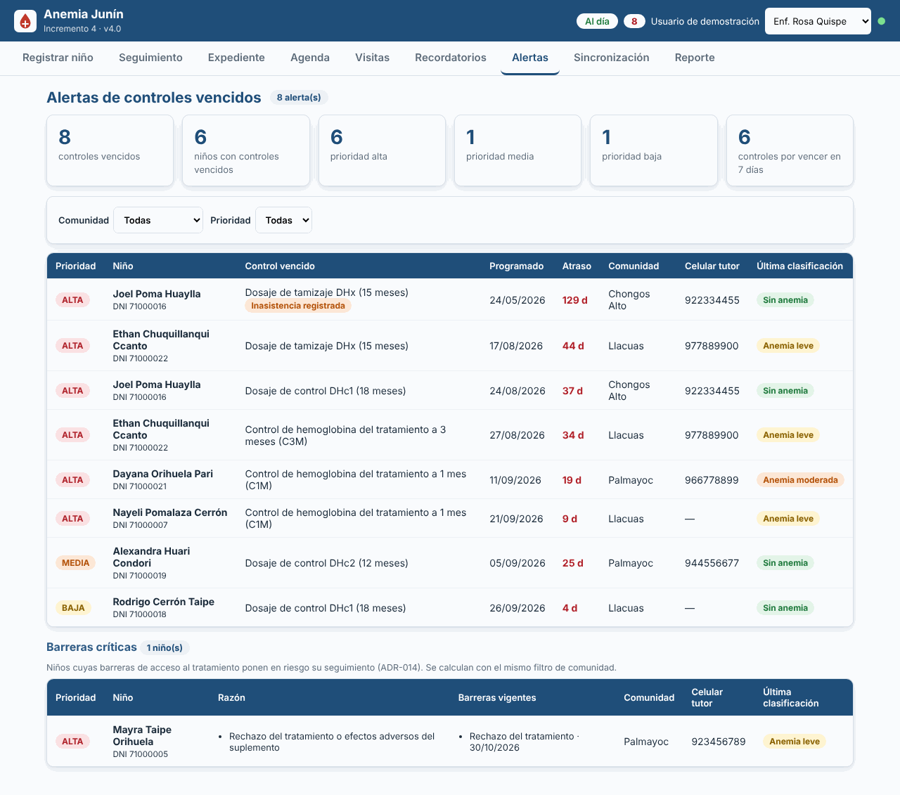

**Figura 37.** Alertas de barreras críticas. Archivo: `../semana-10/evidencias/software/HIST44_inc4_1_alertas_barreras_criticas_escritorio.png`.

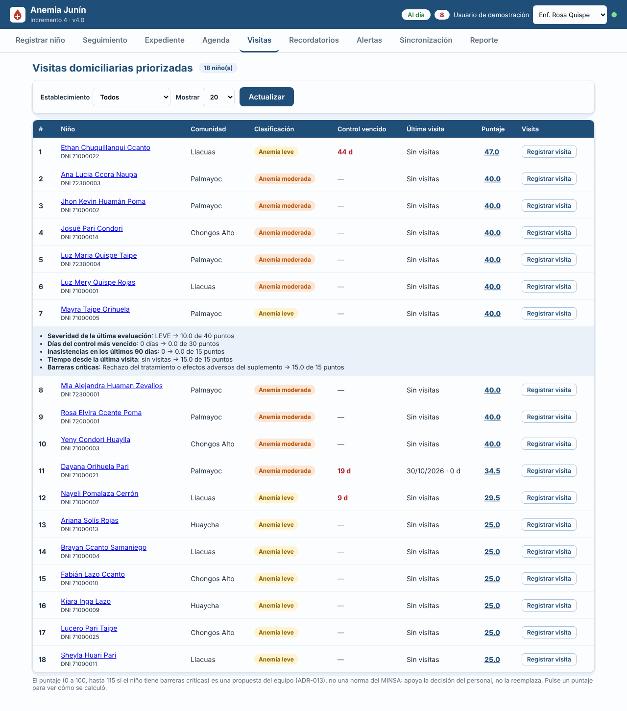

**Figura 38.** Visita priorizada con el componente BARRERA_CRITICA. Archivo: `../semana-10/evidencias/software/HIST44_inc4_2_visita_con_barrera_critica_escritorio.png`.

#### FICHA CMMI — AUTH / Autenticación · Inicio de sesión con Supabase Auth

| Campo | Detalle |
| --- | --- |
| **VER · Pruebas** | Ejecutadas: SÍ · Aprobadas: SÍ. `test_autenticacion.py` (21 de integración con Supabase simulado: acceso, cookies, CSRF, renovación, auditoría) y `test_login.py` (2 E2E: 1366 × 900 y 390 × 844) |
| **VER · Cobertura** | `servicio_sesion.py` en 100 %; **`adapters/inbound/http/autenticacion.py` en 94 %** (líneas 96, 110, 120, 140) **y `adapters/outbound/supabase_auth.py` en 97 %** (línea 64); global de `app/`: 99,79 % (herramienta: pytest-cov) |
| **VER · Análisis estático** | Ruff: 0 hallazgos (reglas de errores, seguridad y complejidad ≤ 12; 142 archivos); SonarCloud no ejecutado |
| **VER · Estructura** | Conforme a la arquitectura hexagonal: 25 pruebas de arquitectura en verde; 0 importaciones de terceros en el dominio (S10) |
| **VAL · Criterio de aceptación** | **Dado que** hay un usuario de Supabase, **cuando** inicia sesión con correo y contraseña, **entonces** la sesión queda en cookies HttpOnly con protección CSRF, la API clínica rechaza las peticiones sin sesión y cerrar la sesión la invalida; una credencial errónea muestra un mensaje de error |
| **VAL · Resultado** | Aprobado por el evaluador de calidad solo con Supabase simulado: **no consta una prueba con una cuenta real** (el 23/10, T-015, la primera cuenta estaba diferida por el usuario; S10 usó Supabase simulado). Pantalla de acceso con 0 violaciones de axe en escritorio y móvil (S10). Sin política de contraseñas, MFA ni desactivación del registro público verificadas (S10, H-12) |
| **Fecha · Evaluador** | VER: 30/10/2026; VAL (captura): 30/10/2026 · QA Lead (Huamani Rodriguez, Jean Piero); firma pendiente |
| **Estado final CMMI** | **VERIFICADO; VALIDADO PARCIALMENTE (sin cuenta real)** |

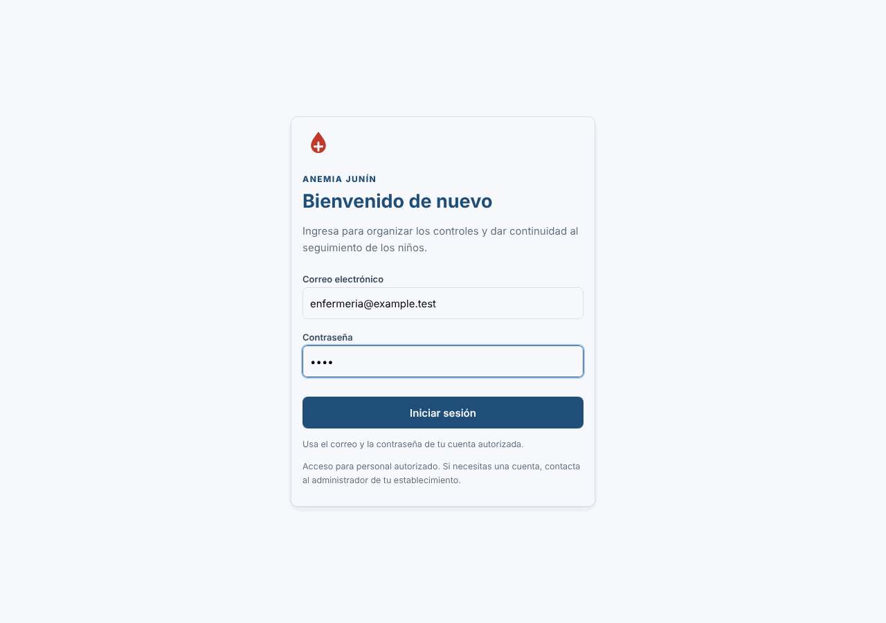

**Figura 39.** Pantalla de inicio de sesión, escritorio (axe: 0 violaciones). Archivo: `../semana-10/evidencias/usabilidad/U_login_escritorio.png`.

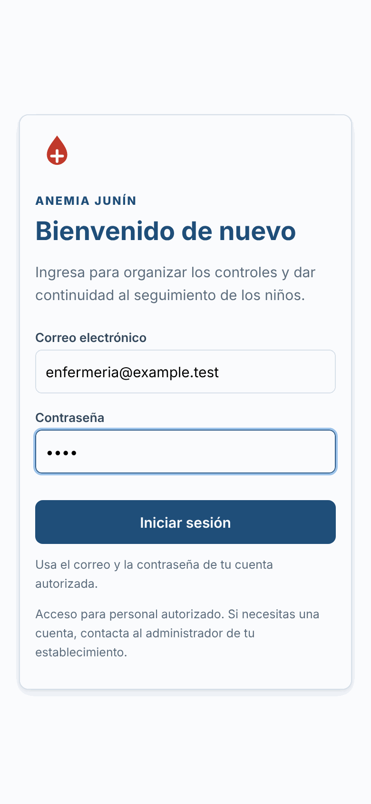

**Figura 40.** Pantalla de inicio de sesión, móvil (axe: 0 violaciones). Archivo: `../semana-10/evidencias/usabilidad/U_login_movil.png`.


### 6.3 Validación pendiente

La validación funcional se realizó con ejecuciones automatizadas y datos sintéticos o anonimizados. Queda pendiente la validación con usuarios reales: aplicar el instrumento SUS (`entregables/semana-09/metricas/instrumento_SUS.md`), obtener el acta de aceptación del Product Owner y las firmas de QA. **Act.** La autenticación con Supabase Auth ya tiene ficha (AUTH, Figuras 39 y 40); falta su cobertura al 100 % y la primera cuenta real. Los incrementos 3 y 4 añaden validaciones que dependen de terceros.

**Tabla 9b.** **Act.** Validaciones pendientes de Inc. 3 e Inc. 4 y quién las desbloquea (fuentes: informes T-019 y T-020, adenda S9, S10).

| Qué falta | Quién | Qué impide hoy | Acción del plan |
| --- | --- | --- | --- |
| Validar pesos de `VISITA-V1` y `V2`, `REGLAS_BARRERAS_V1`, vigencia de 90 días y peso de `BARRERA_CRITICA` | Microred | Son propuestas del equipo, no norma del MINSA | 19 |
| Prueba en un dispositivo real con red intermitente y despliegue en la posta piloto | Posta piloto | Los E2E simulan la desconexión; H3 exige prueba de campo | 19 |
| Aprobación de la plantilla `recordatorio_control`, credenciales, `WHATSAPP_APP_SECRET` (obligatorio: sin él el webhook responde 503) y registro del webhook | Meta | El envío real nunca se probó; solo el modo simulado y `httpx.MockTransport` | 19 |
| Consentimiento de la familia para que el celular del tutor viaje a Meta o al proveedor SMS | Familias y personal | El software no lo gestiona; los niños del dataset DIRESA no tienen celular («sin contacto») | 19 |
| Primera cuenta real, desactivar el registro público, política de contraseñas y MFA; ejecutar `db/03`, `db/04` y `db/02_supabase.sql` | Equipo y panel de Supabase | El login solo se probó con Supabase simulado; las migraciones no se ejecutaron en Supabase | 9, 19 |
| SUS y acta de aceptación | Personal de salud, Product Owner | Sin sesión de aceptación reservada | 5 |

### 6.4 Evidencias de verificación (Act.)

Las capturas de terminal de S10 muestran comando, fecha y commit en su pie y se reutilizan sin duplicarlas.

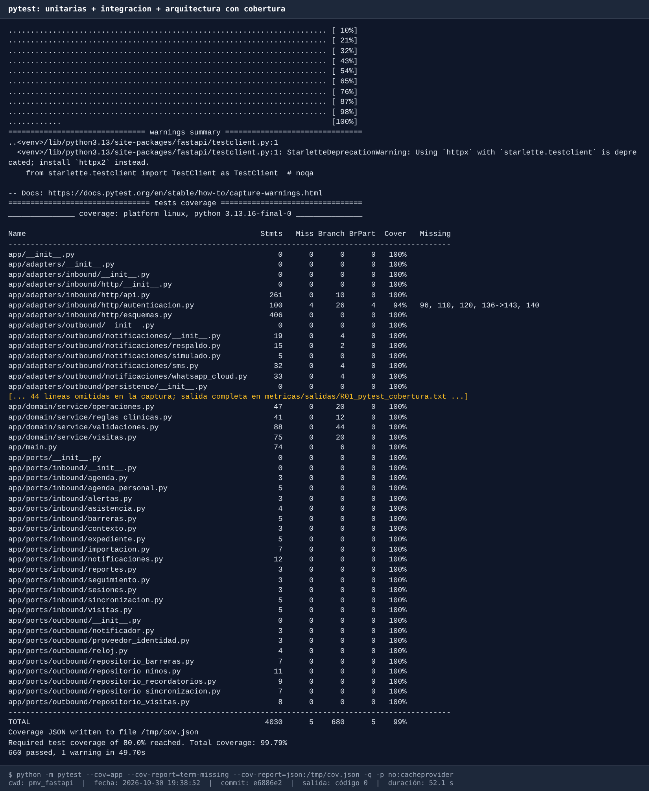

**Figura 41.** pytest con cobertura: 660 aprobadas y 99,79 % de cobertura (umbral del proyecto 80 %). Archivo: `../semana-10/evidencias/terminal/R01_pytest_cobertura.png`.

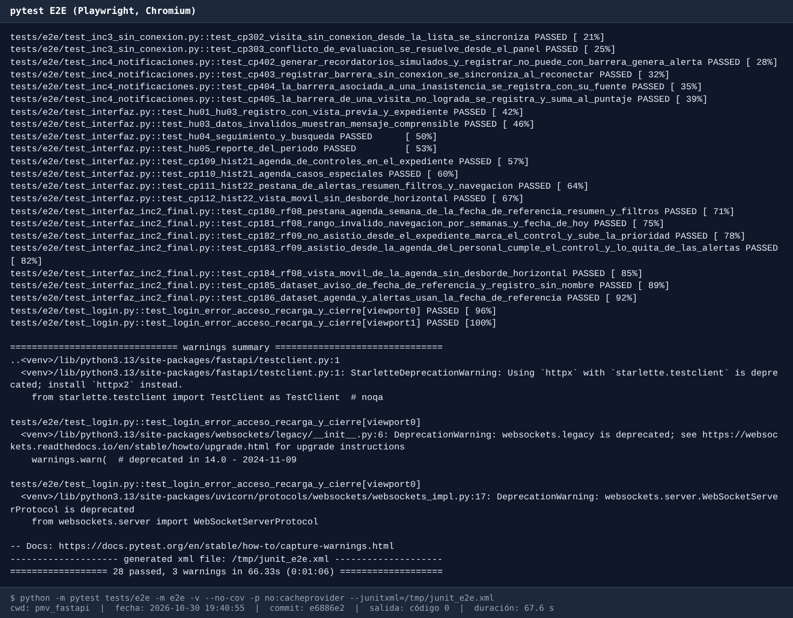

**Figura 42.** Pruebas E2E con Playwright: 28 aprobadas. Archivo: `../semana-10/evidencias/terminal/R03_e2e_playwright.png`.

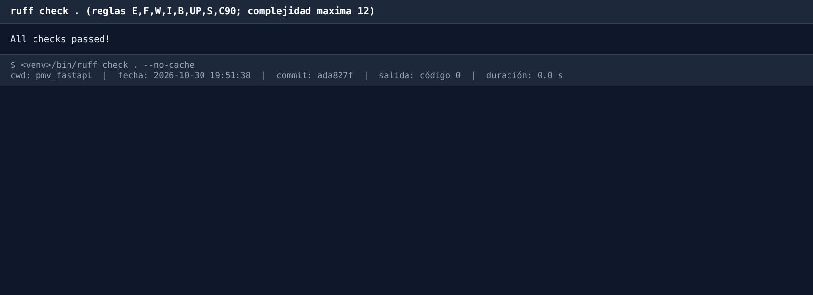

**Figura 43.** Ruff: «All checks passed!». Archivo: `../semana-10/evidencias/terminal/R04_ruff_check.png`.

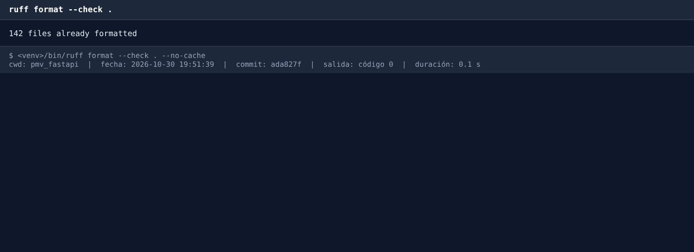

**Figura 44.** Ruff format: 142 archivos ya formateados. Archivo: `../semana-10/evidencias/terminal/R05_ruff_format.png`.

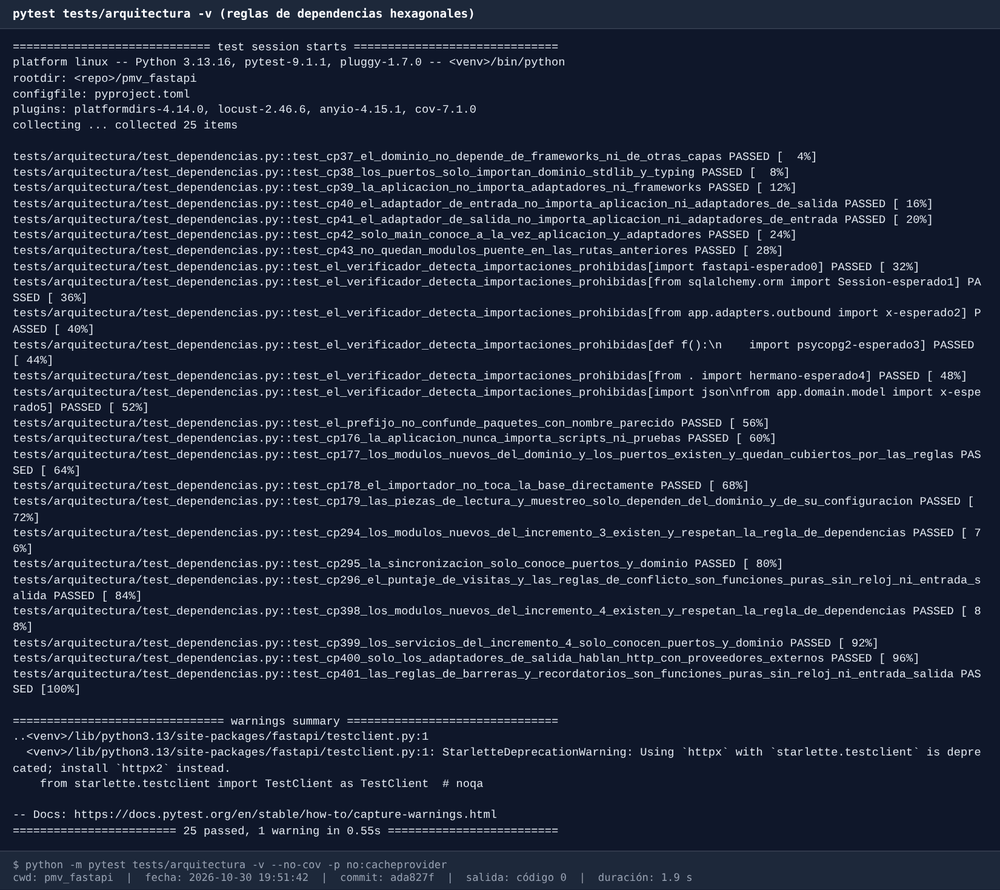

**Figura 45.** 25 pruebas de arquitectura (regla de dependencias): todas aprobadas. Archivo: `../semana-10/evidencias/terminal/R06_arquitectura.png`.


**Figura 46.** Contrato `docs/openapi.json` al día con el código. Archivo: `../semana-10/evidencias/terminal/R07_openapi.png`.

**Tabla 9c.** **Act.** Defectos hallados en la revisión independiente de Inc. 3 e Inc. 4 (informe T-020, commit `d2ab78b`). Ninguno consta en el registro de defectos (último identificador: DEF-09); los códigos DEF propuestos son de la acción 11 del plan.

| N.° | Severidad | Defecto | Corrección | Prueba de regresión | Registro propuesto |
| --- | --- | --- | --- | --- | --- |
| 1 | Alta (seguridad) | El webhook de WhatsApp aceptaba cuerpos sin firma si faltaba `WHATSAPP_APP_SECRET`; al ser una ruta pública, cualquiera podía registrar respuestas del tutor | Falla cerrado: 503 sin secreto; 403 con firma ausente o inválida | CP-357, CP-391b, CP-396 | DEF-10 |
| 2 | Media (concurrencia) | El reenvío simultáneo del mismo `id_operacion` duplicaba una evaluación | `ServicioSincronizacion` procesa un lote a la vez | CP-264b | DEF-11 |
| 3 | Media (concurrencia) | Dos generaciones simultáneas de recordatorios enviaban el mismo mensaje dos veces | `ServicioRecordatorios` serializa la generación, las respuestas y los avisos de entrega | CP-382b | DEF-12 |
| 4 | Baja (interfaz) | El detalle de una barrera de una visita no lograda (hasta 500 caracteres) superaba el máximo de 200 y el servidor la rechazaba | La interfaz recorta a 200 | Ninguna específica (el flujo lo recorre CP-405) | DEF-13 |
| 5 | Baja (interfaz) | DNI y celular de las tablas «Barreras críticas» y «Visitas» sin `esc()` | Pasan por `esc()` | Ninguna | DEF-14 |

Con 5 defectos en 9 historias (Inc. 3: 5; Inc. 4: 4) la densidad es de 0,56 por historia, por encima de la meta M2.2 de la guía (≤ 0,2 para Inc. 2); la adenda S9 contó cuatro hallazgos (agrupa los dos de interfaz) y los atribuyó 1 a Inc. 3 y 3 a Inc. 4 (0,20 y 0,75), cifras indicativas. Quedan además en el código DNI, sexo, altitud y celular del tutor del expediente sin `esc()` (`app.js`, líneas 264, 267, 269 y 271 en la Figura 64, más la 634 fuera de ella), con lo que H-10 de S10 sigue parcialmente abierto.

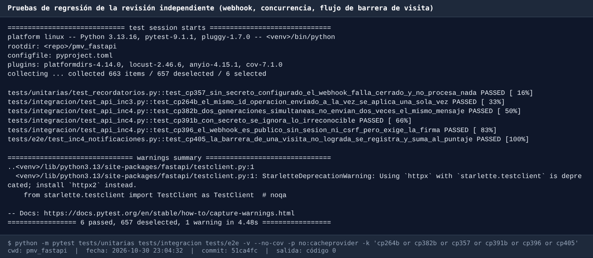

**Figura 47.** Pruebas de regresión de la revisión independiente: 6 aprobadas. Archivo: `evidencias/CMMI04_regresion_revision_independiente.png`. Captura nueva de terminal (comando, fecha y commit en el pie).

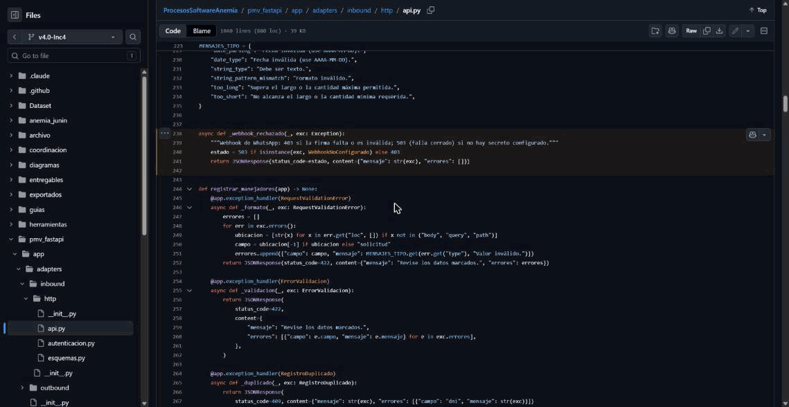

**Figura 48.** Manejador que responde 503 sin secreto configurado y 403 con firma inválida (corrección 1 de la Tabla 9c). Captura de GitHub en la etiqueta `v4.0-Inc4`. Archivo: `../semana-10/evidencias/github/GH_webhook_falla_cerrado.png`.

### 6.5 Evidencias de proceso: PLAN, PQA y CM (Act.)

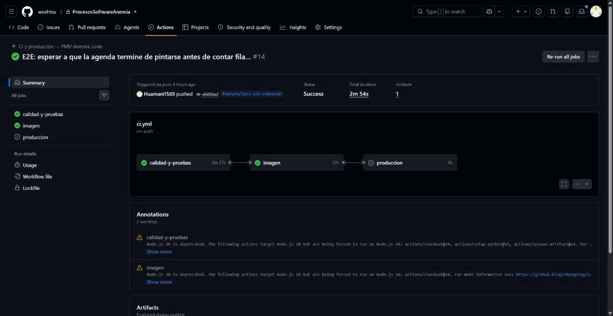

**Figura 49.** Ejecución #14 de GitHub Actions en la rama `feature/inc3-sin-conexion` (commit `e6886e2`): `calidad-y-pruebas` 2 min 27 s y `imagen` 22 s en verde; `produccion` omitido porque la rama no es `main`. Archivo: `../semana-10/evidencias/github/GH_actions_ejecucion_verde.png`.

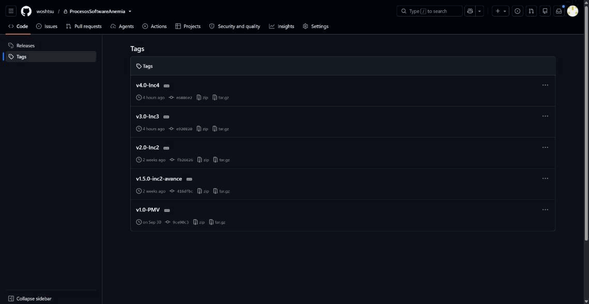

**Figura 50.** Etiquetas del repositorio: `v4.0-Inc4` (`e6886e2`), `v3.0-Inc3` (`e920820`), `v2.0-Inc2` (`fb26626`), `v1.5.0-inc2-avance` (`416dfbc`) y `v1.0-PMV` (`9ce90c3`). Archivo: `../semana-10/evidencias/github/GH_etiquetas.png`.

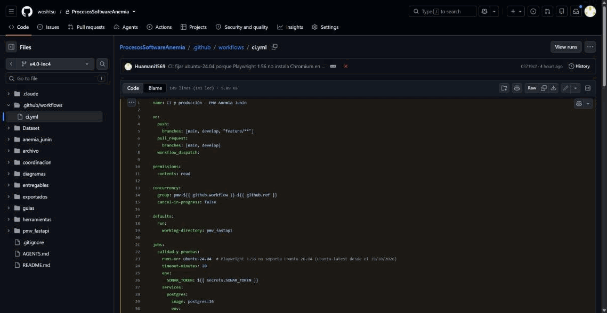

**Figura 51.** Flujo de CI/CD en la etiqueta `v4.0-Inc4`: el runner quedó fijado en `ubuntu-24.04` (línea 23). Archivo: `../semana-10/evidencias/github/GH_ci_workflow.png`.

**Tabla 9d.** **Act.** Incidente del CI de `main` el 30/10/2026: tres causas independientes, tres commits (adenda S9, sección 8; informe T-017).

| Causa | Síntoma | Corrección | Commit |
| --- | --- | --- | --- |
| Contrato OpenAPI distinto en Python 3.11 y 3.13: FastAPI toma la descripción del estado 422 de `http.HTTPStatus`, que cambió entre 3.12 y 3.13 | La comprobación `exportar_openapi --verificar` daba un contrato distinto según la versión de Python (3.11 en el CI, 3.13 en local) y el CI de `main` quedó en rojo | `scripts/exportar_openapi.py` normaliza la descripción; verificado en 3.11 con 660 pruebas, 219 de integración contra PostgreSQL 16 y 28 E2E | `87c0748` |
| `ubuntu-latest` pasó a Ubuntu 26.04 (19/10/2026) y Playwright 1.56 no instala Chromium | Falla del paso de instalación de Chromium | Los tres jobs fijan `runs-on: ubuntu-24.04` | `03719c2` |
| E2E CP-186 inestable: contaba filas antes de que la agenda terminara de pintarse | Fallo intermitente en el CI; en la reejecución local de la adenda S9 falló una vez, por tiempo de espera, otra prueba de agenda (CP-110) | Espera `data-cargando` y `to_have_count`; el service worker pasa a `v5` | `e6886e2` |

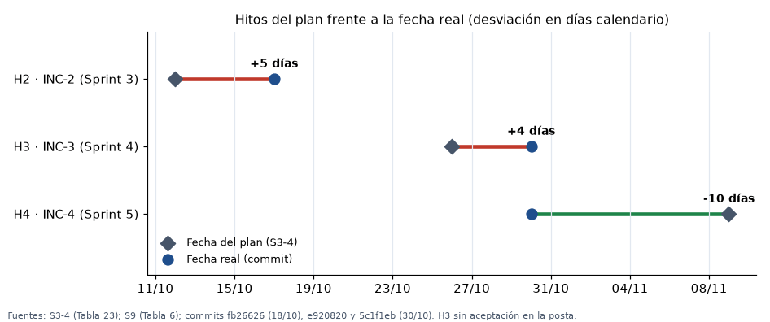

**Figura 52.** Hitos H2 a H4: fecha del plan frente a la fecha real (datos de la Tabla 5a; H3 y H4 sin aceptación, por lo que «real» es la entrega del software). Archivo: `evidencias/CMMI02_hitos_plan_vs_real.png`.

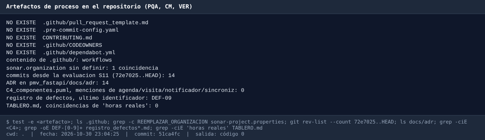

**Figura 53.** Artefactos de proceso en el repositorio (comprobación por comando sobre la rama `docs/s12-integrador`; `pmv_fastapi/` y `.github/` son idénticos a `main`). Archivo: `evidencias/CMMI03_higiene_repositorio.png`. Captura nueva de terminal.

Las figuras 54 a 66 son capturas de páginas de GitHub tomadas por el equipo el 30/10/2026, sin datos personales ni secretos. El registro de las capturas está en `entregables/semana-11/CAPTURAS_GITHUB_PENDIENTES.md` (estado: completadas).


**Figura 54.** PR #8 en estado Merged: «woshtsu merged commit `c870a7e` into `main`», 6 checks aprobados. **La línea de tiempo no muestra ninguna revisión formal «Approved».** Es la evidencia por la que PQA se mantiene en Nivel 1. Captura de GitHub (30/10/2026). Archivo: `evidencias/github/GH_pr8_conversacion.png`.


**Figura 55.** PR #8, pestaña Checks (6): el commit `e6886e2` en verde, con dos ejecuciones del flujo «CI y producción» (`push` y `pull_request`). Captura de GitHub (30/10/2026). Archivo: `evidencias/github/GH_pr8_checks.png`.


**Figura 56.** Ejecuciones del flujo en `main`: la #16 (`c870a7e`) en verde, 3 min 21 s; las previas #10 (`a8df23b`), #9 (`43c861f`), #8 (`9caa00f`) y #6 (`5e6886f`) en rojo. Captura de GitHub (30/10/2026). Archivo: `evidencias/github/GH_actions_run16_main.png`.


**Figura 57.** Ejecución #16, job `produccion` en verde (5 s): el paso «Verificar esquema sin modificar producción y solicitar despliegue» (1 s) termina con «Render aceptó la solicitud del commit probado. Confirmar estado Live en Render; esto no certifica el despliegue final.» Captura de GitHub (30/10/2026). Archivo: `evidencias/github/GH_actions_run16_produccion.png`.


**Figura 58.** Historial de `main` el 30/10/2026: `c870a7e` («Incrementos 3 y 4 … (#8)») es un solo commit *squash* (autor Huamani1569, Verified, 3 de 3 checks); le siguen `a8df23b` («add guia s12») y `43c861f` («add guia S10»), directos y con 0 de 3 checks, y las fusiones #7 (`9caa00f`) y #6 (`5e6886f`). Los commits `e920820` a `e6886e2` no figuran: las etiquetas `v3.0-Inc3` y `v4.0-Inc4` apuntan a la rama. Captura de GitHub (30/10/2026). Archivo: `evidencias/github/GH_commits_main.png`.


**Figura 59.** Pull requests cerradas: 8. Fusionadas: #1, #2, #4, #5, #6, #7 y #8; la #3 («Feature/s6 integrador final») cerrada sin fusionar. La #8 (Huamani1569) muestra 6 de 6 checks; la #6 y la #7 se fusionaron con 2 de 3. Captura de GitHub (30/10/2026). Archivo: `evidencias/github/GH_prs_cerradas.png`.


**Figura 60.** Pestaña Projects: «No projects found». El seguimiento de PLAN se apoya solo en `coordinacion/TABLERO.md`. Captura de GitHub (30/10/2026). Archivo: `evidencias/github/GH_projects.png`.


**Figura 61.** Contenido de `.github/` en `main`: solo `workflows/`, sin `pull_request_template.md`. Captura de GitHub (30/10/2026). Archivo: `evidencias/github/GH_dir_github_main.png`.


**Figura 62.** `ci.yml` en `main` (L114 a L149): las consultas de esquema (L131 a L135) cubren solo `nino`, `asistencia_control`, `evaluacion_hemoglobina` y `v_ultimo_control`; L148 aclara que no certifica el despliegue final. La rama de trabajo ya añade la verificación de las tablas del esquema 4.0 (acción 9); ese cambio aún no está en `main`. Captura de GitHub (30/10/2026). Archivo: `evidencias/github/GH_ci_produccion_lineas.png`.


**Figura 63.** `pmv_fastapi/sonar-project.properties` en `main`, L2: `sonar.organization=REEMPLAZAR_ORGANIZACION`; SonarCloud sigue sin organización. Captura de GitHub (30/10/2026). Archivo: `evidencias/github/GH_sonar_organizacion.png`.


**Figura 64.** `pmv_fastapi/app/web/app.js` en `main`, L264 a L271: `exp.dni` (L264), `exp.sexo` (L267), `exp.altitud_m` (L269) y `exp.tutor_celular` (L271) se interpolan sin `esc()`; los demás campos del bloque sí lo usan. H-10 de S10 sigue parcialmente abierto (falta también la L634, fuera de la captura). Captura de GitHub (30/10/2026). Archivo: `evidencias/github/GH_app_js_sin_esc.png`.


**Figura 65.** `coordinacion/TABLERO.md` en `main`, L30 y L31: filas T-019 (INC-3) y T-020 (INC-4); el estado y los pendientes quedan fuera del ancho de la captura y se verifican en el archivo. Captura de GitHub (30/10/2026). Archivo: `evidencias/github/GH_tablero_t019_t020.png`.


**Figura 66.** `settings/branches` devuelve 404 («This is not the web page you are looking for») para la cuenta con la que se tomó la captura, sin permisos de administración. **La protección de `main` no es verificable** (acción 2 del plan). Captura de GitHub (30/10/2026). Archivo: `evidencias/github/GH_proteccion_main.png`.


**Figura 67.** Nivel de capacidad CMMI por área: informe S11 frente a 30/10/2026. Archivo: `evidencias/CMMI01_niveles_antes_despues.png`. Ningún área cambia de nivel; CAR se evalúa por primera vez y PQA se mantiene en 1 (Figuras 54 y 59).

---

## 7. ANÁLISIS DE CAUSA RAÍZ (CAR) Y PLAN DE MEJORA CONTINUA (Actividad 5)

### 7.1 Hallazgos de la evaluación

**Tabla 10.** Hallazgos y análisis de causa raíz, con su estado al 30/10/2026. H1 a H6 son los de S11; H7 a H9 son nuevos (**Act.**).

| ID | Área | Hallazgo / brecha identificada | Síntoma observable | Causa raíz del proceso | Estado 30/10 |
| --- | --- | --- | --- | --- | --- |
| H1 | ESTIM | No se registra el esfuerzo real, por lo que la estimación no se contrasta ni se recalibra | El INC-1 tiene 113 horas-persona estimadas y ninguna real; **Act.** ninguno de los 4 incrementos tiene horas reales; H2 +5 días, H3 +4 días, H4 −10 días; VIS-3.5 sin estimar (Tabla 5a) | El tablero no tiene un campo de horas reales y la retrospectiva no incluye la revisión de la velocidad; el Sprint 3 compartió capacidad con el informe integrador sin holgura | **Abierto**, sin cambio |
| H2 | PQA | Las revisiones de código no son consistentes ni dejan evidencia | No existe plantilla de *pull request* ni lista de chequeo (Figuras 53 y 61). **Act.** La PR #8 la integró otro integrante con 6 checks en verde, pero sin revisión formal «Approved» (Figura 54); las PR #6 y #7 se fusionaron con checks en rojo (Figura 59); la protección de `main` no es verificable (Figura 66) | La DoD vive en un documento académico, no en la herramienta donde se integra el código | **Abierto**, con mejora parcial: informe de revisión independiente; sin aprobación formal, plantilla ni protección verificable |
| H3 | VAL | No existe aceptación del usuario ni medición de satisfacción | SUS sin aplicar; firmas de QA pendientes. **Act.** Inc. 3 e Inc. 4 suman validaciones de terceros pendientes (Tabla 9b) y los hitos H3 y H4 sin aceptación | La validación se planificó como evidencia automatizada y no se reservó tiempo del Product Owner en el cronograma | **Abierto**, ampliado |
| H4 | VER | El análisis estático efectivo es solo Ruff y el código de autenticación quedó fuera de las fichas | SonarCloud sin organización (Figura 63); `autenticacion.py` en 94 % y `supabase_auth.py` en 97 % (Figura 41). **Act.** La autenticación ya tiene ficha de VER y VAL (Figuras 39 y 40) | La autenticación se incorporó fuera de un incremento planificado y sin pasar por la DoD | **Parcialmente mitigado**: ficha hecha; SonarCloud y cobertura pendientes |
| H5 | CM | Historial y versiones poco trazables | Mensajes como «Supabase v1» y «Subiendo a produccion». **Act.** Las etiquetas `v3.0-Inc3` y `v4.0-Inc4` existen (Figura 50), pero apuntan a commits de la rama que no están en `main` por el *squash* de la PR #8 (Figura 58); 8 PR cerradas, 7 fusionadas (Figura 59) y 2 commits directos a `main`; 3 de 5 commits de `main` desde S11 son descriptivos; sin convención escrita, sin `develop`, `v1.0-PMV` fuera de `main` | No existe convención escrita de *commits*, ramas ni etiquetas | **Parcialmente mitigado** |
| H6 | VER | Defectos que escaparon pese a una cobertura cercana al 100 % | 6 de 7 defectos funcionales del Inc. 1 no se detectaron antes de liberar. **Act.** Reincide: la revisión independiente halló 5 defectos en Inc. 3 e Inc. 4 con 99,79 % de cobertura, uno de seguridad (Tabla 9c) | Las pruebas verificaban casos válidos y no entradas hostiles ni concurrencia; la DoD mide cuánto código se ejecuta y no la variedad de entradas | **Abierto**, reincidente |
| H7 | CM / VER | **Act.** El CI de `main` estuvo en rojo desde el 30/10 | Tres fallos independientes: contrato OpenAPI distinto en Python 3.11 y 3.13, Chromium sin instalar en Ubuntu 26.04 y E2E CP-186 inestable (Tabla 9d) | El flujo movido a la raíz (T-017, con la ejecución completa del CI pendiente) se fusionó sin haberse ejecutado antes en una rama, con versiones de Python y de runner sin fijar | **Mitigado**: corregido en 3 commits; CI #14 en la rama y #16 en `main` en verde (Figuras 49 y 56); la regla sigue sin protección verificable (Figura 66) |
| H8 | PQA / VER | **Act.** Seguridad, accesibilidad y rendimiento no forman parte de la DoD | S10: 0 de 6 cabeceras de seguridad, sin roles por establecimiento, CSV con fórmulas, sin limitación de tasa, 25 de 26 respuestas 500 con la BD caída, p95 de 2 000 ms con 100 usuarios, axe con violaciones en 26 de 28 vistas; IC_P 87,67 % (conservador 78,43 %), por debajo del 90 % | La DoD (S3-4, Tablas 8 y 9) pide pruebas, cobertura y revisión, y el CI no tiene una puerta no funcional (cabeceras, SAST, axe, p95) | **Abierto** |
| H9 | CM / VER | **Act.** El despliegue a producción no verifica el esquema completo ni el estado Live | El job `produccion` consulta solo tablas y columnas del esquema 2.0 (Figura 62); su mensaje final aclara que no certifica el despliegue; el CI no podía confirmar que las migraciones 3.0 y 4.0 (ejecutadas por el equipo en Supabase el 30/10) estuvieran aplicadas, y la producción no se midió con `v4.0-Inc4` | El job se escribió con el esquema 2.0 (T-017) y la ejecución de migraciones no es condición de cierre de un incremento | **Abierto** |

Se aplicó la técnica de los cinco porqués a los hallazgos de mayor impacto. En todos los casos la causa raíz se atribuye al último eslabón, una condición del proceso, y no a las personas.

**Tabla 11.** Cinco porqués de los hallazgos H1, H2, H3 y H6 (S11, sin cambios de fondo) y, **Act.**, de H7, H8 y H9.

| Hallazgo | Porqué 1 | Porqué 2 | Porqué 3 | Porqué 4 | Porqué 5 (causa raíz) |
| --- | --- | --- | --- | --- | --- |
| H1 · El INC-2 se cerró 5 días después del hito H2 | El Sprint 3 no alcanzó a terminarlo | Absorbió además el integrador de S6 y la reestructuración hexagonal (ADR-008) | La capacidad del sprint no se contrastó con datos reales | No hay horas reales registradas | El tablero y la retrospectiva no exigen registrar el esfuerzo |
| H2 · Revisiones de código sin evidencia | No se puede comprobar quién revisó cada cambio | La DoD pide un revisor, pero nada obliga a registrarlo | No hay lista de chequeo en el *pull request* | La plantilla de *pull request* no existe | La DoD vive en un documento y no en la herramienta de integración |
| H3 · Sin aceptación del usuario | No hay acta ni SUS | No se coordinó una sesión con el personal de salud | La validación se planificó como evidencia automatizada | El cronograma no reserva tiempo del Product Owner | La aceptación del usuario no figura como criterio de cierre del incremento |
| H6 · Defectos escapados con alta cobertura (**Act.** reincide en Inc. 3 e Inc. 4) | Las pruebas no incluían entradas hostiles ni concurrencia | Se verificaron los casos válidos y los límites esperados | La cobertura de líneas se tomó como indicador de calidad suficiente | La DoD no exigía pruebas exploratorias ni revisión independiente | La DoD mide cuánto código se ejecuta y no la variedad de entradas |
| H7 · CI de `main` en rojo | Fallaron el contrato OpenAPI, la instalación de Chromium y un E2E | El flujo del CI movido a la raíz no se había ejecutado completo (T-017) | Se fusionó sin ejecutarlo antes en una rama; el entorno local (Python 3.13) difiere del CI (3.11) y el runner `ubuntu-latest` cambió de versión | No hay versiones fijadas ni una matriz de Python en el CI | La regla «CI en verde en la rama antes de la PR» no está escrita ni protegida en `main` (acción 2; protección no verificable, Figura 66, y las PR #6 y #7 se fusionaron con checks en rojo, Figura 59) |
| H8 · Sin criterios no funcionales | Faltan cabeceras, roles, limitación de tasa y manejo de la BD caída, y hay un p95 de 2 000 ms con 100 usuarios | Ninguna historia los exigía | Los criterios de aceptación son funcionales | La DoD no incluye seguridad, accesibilidad ni rendimiento | El CI no tiene una puerta no funcional; los requisitos no funcionales se midieron recién en S10 |
| H9 · Despliegue sin esquema completo | El job `produccion` no consulta las tablas de Inc. 3 e Inc. 4 | Se escribió con el esquema 2.0, antes de INC-3 | Al añadir `db/03` y `db/04` nadie actualizó el job | El esquema y el job son tareas separadas sin dependencia | La DoD no exige «migración ejecutada y verificada en el entorno» para cerrar un incremento |

### 7.2 Plan de mejora continua

Las acciones se programan para el Sprint 5 (27/10 al 09/11/2026) y el Sprint 6 (10 al 23/11/2026). Las acciones 1 a 7 son las de S11, con su estado actualizado; las acciones 8 a 19 son **nuevas** y salen de la corrección del CI (8), de la revisión del despliegue y de la revisión independiente (9 a 11), de la auditoría de S10 (12 a 18) y de las validaciones externas de Inc. 3 e Inc. 4 (19). Las fechas y los responsables de las nuevas son una **propuesta del equipo**, asignada según el rol de la Tabla 2 y sin confirmar. Para H6 se conserva la acción definida en S9 (PDCA, acción 2).

**Tabla 12.** Matriz 5.1: Plan de mejora CMMI del proceso y del producto, con el estado al 30/10/2026 (primera fecha de vencimiento: 03/11/2026).

| N.° | Área | Hallazgo | Causa raíz | Acción de mejora | Impacto esperado / métrica | Responsable | Fecha objetivo | Estado 30/10 | Evidencia del estado |
| --- | --- | --- | --- | --- | --- | --- | --- | --- | --- |
| 1 | ESTIM | H1 | Sin registro de esfuerzo real ni recalibración | Añadir al tablero el campo «horas reales» por tarea, registrado al cerrarla; desagregar tareas a máximo 6 horas con Planning Poker; recalibrar la velocidad (20 SP por sprint) al cierre de cada sprint | Desviación de esfuerzo por historia menor o igual a ±20 % (umbral del S3-4), reducible a ±10 % con tres sprints de datos; 100 % de las tareas con horas reales | Porras V. | Inicio: 03/11/2026; primera recalibración: 09/11/2026 | **Pendiente** | `TABLERO.md` sin campo de horas (Figura 53); INC-3 e INC-4 cerrados sin horas (Tabla 5a) |
| 2 | PQA | H2 | La DoD no está en la herramienta de integración | Crear `.github/pull_request_template.md` con la lista de la DoD (Tabla 9 del S3-4) y activar la protección de `main` que exija un revisor aprobado | 100 % de los *pull requests* con lista de chequeo y aprobación registrada antes de integrar | Huamani R. | 06/11/2026 | **Pendiente** | Sin plantilla (Figuras 53 y 61); la PR #8 se integró con 6 checks en verde pero sin revisión formal «Approved» (Figura 54); #6 y #7 con checks en rojo (Figura 59); protección de `main` no verificable, Settings devuelve 404 (Figura 66) |
| 3 | VER | H4, H6 | Análisis estático parcial; pruebas sin entradas hostiles | Definir `sonar.organization` y el secreto `SONAR_TOKEN` para activar SonarCloud en el CI; incorporar a la DoD las pruebas de entradas límite; añadir un *hook* de `pre-commit` con Ruff y las pruebas rápidas | Reporte de SonarCloud publicado con 0 incidencias críticas; 0 defectos escapados por incremento; ejecución previa a la integración en el 100 % de los *commits* locales | Huamani R. | 06/11/2026 | **Parcial** | Los incrementos 3 y 4 incluyen pruebas de entradas inválidas y concurrencia, pero 5 defectos escaparon; sin SonarCloud (Figura 63) ni *hook* (Figura 53) |
| 4 | VER | H4 | Autenticación sin pasar por la DoD | Completar las pruebas de ramas de `autenticacion.py` (líneas 96, 110, 120 y 140) y de `supabase_auth.py` (línea 64) hasta el 100 % y redactar la ficha de VER y VAL del inicio y cierre de sesión | Cobertura global de 100 %; ficha de autenticación con capturas | Auqui H. | 09/11/2026 | **Parcial** | Ficha AUTH hecha (Figuras 39 y 40); cobertura 94 % y 97 %, global 99,79 % (Figura 41) |
| 5 | VAL | H3 | Sin tiempo reservado del Product Owner | Programar una sesión de aceptación con el personal de salud: tarea guiada, acta firmada y SUS con al menos cinco respondientes | SUS mayor o igual a 68 (Inc. 1) y 80 (Inc. 2), metas por confirmar; acta firmada por RF | Porras V. | 13/11/2026 | **Pendiente** | Sin SUS ni acta (sección 6.3) |
| 6 | CM | H5 | Sin convención de *commits*, ramas y etiquetas | Documentar la convención (mensajes con tipo y alcance, ramas `feature/*` y `develop`, etiquetas con versionado semántico) y etiquetar el estado desplegado en producción | 100 % de los *commits* nuevos con mensaje descriptivo; etiqueta que identifique la versión en producción | Auqui H. | 09/11/2026 | **Parcial** | Etiqueta `v4.0-Inc4` = código de `main` (Figura 50); 12 de 14 commits descriptivos; sin convención escrita (Figura 53) |
| 7 | PLAN | H1 | Capacidad compartida sin holgura | Reservar al menos 20 % de la capacidad de cada sprint para trabajo no planificado y registrar los cambios de alcance en el plan | Hitos con desviación menor a 3 días | Porras V. | Sprint 5 | **Pendiente** | Sin registro de reserva; H3 +4 días y H4 −10 días (Figura 52); VIS-3.5 se añadió sin registrar el cambio de alcance |
| 8 | CM / VER | H7 | Flujo sin ejecutar en rama; runner y versiones sin fijar | Corregir los tres fallos del CI de `main`; ejecutar el CI en la rama antes de la PR; añadir Python 3.13 a la matriz del CI | CI de `main` en verde; 0 fusiones con CI en rojo | Huamani R. | Corrección: 30/10/2026; matriz: 13/11/2026 | **Cumplida** (corrección); matriz pendiente | `87c0748`, `03719c2`, `e6886e2`; CI #14 en la rama (Figura 49); #16 en `main` (Figura 56) |
| 9 | VER / CM | H9 | Job `produccion` escrito para el esquema 2.0 | Ampliar la verificación del esquema a `visita_domiciliaria`, `operacion_sincronizada`, `conflicto_sincronizacion`, `recordatorio` y `barrera`; ejecutar `db/03`, `db/04` y `db/02_supabase.sql` en Supabase; confirmar el estado Live y repetir `/api/salud` | El job falla si falta una tabla del esquema 4.0; `/api/salud` responde 200 | Auqui H. | 06/11/2026 | **Parcial**: verificación del esquema 4.0 añadida al job (`.github/workflows/ci.yml`, 30/10/2026); falta confirmar el estado Live y `/api/salud` | Figura 62 (job en `main`: solo esquema 2.0) y Figura 57 (job de la ejecución #16); informes T-019 y T-020 |
| 10 | PQA | H8 | DoD sin criterios no funcionales | Añadir a la DoD y a la plantilla de PR (acción 2) una lista mínima: cabeceras de seguridad 6 de 6, 0 vulnerabilidades Alta/Crítica (bandit, pip-audit), axe sin violaciones críticas y p95 < 800 ms con 20 usuarios | 100 % de las PR con la lista; IC_P ≥ 90 % en la siguiente medición de S10 | Huamani R. | 13/11/2026 | **Pendiente** | DoD de S3-4 sin cambios |
| 11 | PQA / VER | H6, H8 | Revisión independiente fuera de la DoD; registro de defectos detenido en DEF-09 | Registrar DEF-10 a DEF-14 (Tabla 9c) con causa, corrección y prueba; añadir pruebas para los defectos 4 y 5; incluir la revisión independiente de cada incremento en la DoD | 5 de 5 defectos registrados; M2.2 oficial de Inc. 3 e Inc. 4 recalculada | Huamani R. | 06/11/2026 | **Pendiente** | Último identificador DEF-09 (Figura 53) |
| 12 | VER | H-1 (S10) | Sin roles ni segmentación por establecimiento | Definir roles (enfermería, coordinador, solo lectura), guardar el rol en el JWT y filtrar por establecimiento con políticas RLS | Un usuario sin rol recibe 403; E01 de S10 pasa a CUMPLE | Auqui H. | 20/11/2026 | **Pendiente** | Figura 69 |
| 13 | VER | H-2 y H-8 (S10) | Sin cabeceras HTTP de seguridad | Middleware con CSP, `X-Content-Type-Options`, `frame-ancestors`, `Referrer-Policy`, `Permissions-Policy` y HSTS; proteger `/docs` y ocultar `Server` | `seguridad_http.py` de S10: 6 de 6 cabeceras (hoy 0 de 6) | Auqui H. | 13/11/2026 | **Pendiente** | Figura 68 |
| 14 | VER | H-3 (S10) | El reporte CSV no neutraliza fórmulas | Anteponer `'` a las celdas que empiezan con `=`, `+`, `-` o `@` | T32 de S10 pasa a CUMPLE | Auqui H. | 06/11/2026 | **Pendiente** | Figura 68 |
| 15 | VER | H-4, H-5 y H-6 (S10) | Sin limitación de tasa, sin registro de eventos de seguridad, BD caída → 500 | Limitar intentos por IP y por correo (por ejemplo, 5 por minuto), registrar logins fallidos, 401/403 y firmas inválidas sin datos personales, y manejar `OperationalError` con 503 | T26 devuelve 429; 0 respuestas 500 con la BD caída (hoy 25 de 26) | Auqui H. | 13/11/2026 | **Pendiente** | Figuras 68 y 70 |
| 16 | VER | P1 y P2 (S10), adenda S9 | p95 por encima de la meta de 800 ms | Paginar alertas y listados, probar PostgreSQL con varios workers, añadir tareas de Locust para visitas, sincronización y recordatorios y repetir la medición con control de v1.0 | p95 < 800 ms: hoy 1 100 ms (50 usuarios, mezcla común, una corrida) y 2 000 ms (100 usuarios, Inc. 1 y 2); 98 ms con 20 usuarios (Inc. 3 y 4) | Auqui H. y Huamani R. | 20/11/2026 | **Pendiente** | Figuras 71 y 72 |
| 17 | CM / VER | H-7 (S10) | CI sin SAST ni auditoría de dependencias | Agregar `bandit` y `pip-audit` al CI, activar Dependabot y fijar las acciones por SHA | E09 a E12 y E25 de S10 pasan a CUMPLE; 0 vulnerabilidades Alta/Crítica | Huamani R. | 13/11/2026 | **Pendiente** | Sin `dependabot.yml` (Figura 53); `ci.yml` sin esos pasos (Figura 51) |
| 18 | VAL | U-1 a U-8 (S10) | Accesibilidad sin corregir | Agregar `role=tab`, etiquetas en selects y fechas, retención de foco en modales y ajustes de color; probar con NVDA y TalkBack | axe sin violaciones críticas (hoy 26 de 28 vistas con violaciones); 8 de 8 componentes con contraste ≥ 3:1 (hoy 3 de 8) | Auqui H. | 20/11/2026 | **Pendiente** | Figura 73 |
| 19 | VAL | H3 | Validaciones externas de Inc. 3 e Inc. 4 | Coordinar con la microred la validación de pesos y reglas, la prueba en dispositivo real con red intermitente y el despliegue en la posta (hito H3); gestionar con Meta la plantilla, las credenciales y el secreto del webhook; definir el consentimiento del tutor | Acta de la microred; prueba sin pérdida de datos en campo; un envío real de prueba | Porras V. | 20/11/2026 (depende de terceros) | **Pendiente** | Tabla 9b |


**Figura 68.** Pruebas dinámicas de seguridad de S10 (T01 a T32): cabeceras 0 de 6 (acción 13), limitación de tasa (acción 15) y CSV con fórmulas (acción 14). Archivo: `../semana-10/evidencias/terminal/O02_pruebas_http_owasp.png`.


**Figura 69.** Comprobaciones estáticas de S10 (E01 a E30): E01, sin roles ni segmentación por establecimiento (acción 12). Archivo: `../semana-10/evidencias/terminal/O04_estatico_owasp.png`.


**Figura 70.** Prueba de caos con PostgreSQL 16 temporal de S10: 25 de 26 peticiones respondidas con 500 durante la caída (acción 15). Archivo: `../semana-10/evidencias/terminal/R13_caos_postgres.png`.


**Figura 71.** Locust de S10 con 100 usuarios (Inc. 1 y 2, 60 s): p95 de 2 000 ms frente a la meta de 800 ms (acción 16). Archivo: `../semana-10/evidencias/rendimiento/P_locust_C_inc1_inc2_100u.png`.


**Figura 72.** Corrida de carga de la adenda S9 con el código de Inc. 4 (50 usuarios, 60 s, una sola corrida, sin control de v1.0): p95 agregado de 1 100 ms (acción 16). Archivo: `evidencias/CMMI05_carga_p95_v4.png`. Captura nueva de terminal a partir de `entregables/semana-09/metricas/salidas/m32_carga_v4.json`.


**Figura 73.** axe-core por pantalla y vista (S10): violaciones en 26 de 28 vistas (acción 18). Archivo: `../semana-10/evidencias/usabilidad/U_axe_resumen_pantallas.png`.

### 7.3 Seguimiento del plan y de la capacidad de CAR

**Tabla 13.** **Act.** Estado del plan al 30/10/2026 y próxima revisión.

| Concepto | Valor |
| --- | --- |
| Acciones | 19: 7 de S11 y 12 nuevas |
| Cumplidas | 1 (la 8, corrección del CI de `main`; su matriz de Python sigue pendiente) |
| Parciales | 4 (3, 4, 6 y 9) |
| Pendientes | 14 (1, 2, 5, 7 y 10 a 19) |
| Vencidas | 0: la primera fecha es el 03/11/2026 |
| Vencen hasta el 09/11/2026 | 9 (1, 2, 3, 4, 6, 7, 9, 11 y 14) |
| Nuevas por origen | 1 del incidente del CI (8), 3 de la revisión del despliegue y de la revisión independiente (9 a 11), 7 de S10 (12 a 18), 1 de las validaciones externas (19) |
| Nivel de CAR | 1 (Ejecutado): causas identificadas y acciones definidas; efecto aún no medido |
| Próxima reevaluación | Al cierre del Sprint 5 (09/11/2026) y del Sprint 6 (23/11/2026), con los criterios de la Tabla 4 y la columna «Estado» de la Tabla 12 |

---

## 8. CONCLUSIONES Y LECCIONES APRENDIDAS EN LA ADOPCIÓN DE CMMI

**Conclusiones (Act. 30/10/2026).**

1. La base de ingeniería se mantuvo al pasar de dos a cuatro incrementos: VER sigue en Nivel 2 con 660 pruebas y 28 E2E aprobadas, 99,79 % de cobertura, 0 hallazgos de Ruff en 142 archivos y 25 pruebas de arquitectura. Los 9 requerimientos funcionales, las 9 historias de Inc. 3 e Inc. 4 y la autenticación tienen ficha, criterio de aceptación, prueba automatizada y captura.
2. El perfil de capacidad es de tres áreas en Nivel 2 (PLAN, CM y VER) y cuatro en Nivel 1 (ESTIM, PQA, VAL y CAR). Ningún área cambia de nivel frente a S11; CAR se evalúa por primera vez. PQA mejora en una práctica (la PR #8 la integró otro integrante con 6 checks en verde y la revisión independiente dejó informe con 5 correcciones) pero no sube: no hay aprobación formal registrada, plantilla, lista de chequeo ni protección verificable de `main`, y las PR #6 y #7 se fusionaron con checks en rojo. Ninguna área llega al Nivel 3.
3. Las brechas de gestión y de aseguramiento de calidad no se cerraron: sin horas reales en los cuatro incrementos, sin SUS ni acta, sin plantilla de PR, sin SonarCloud ni *hook*. Se agregaron dos de proceso: la seguridad, la accesibilidad y el rendimiento no forman parte de la DoD (H8) y el despliegue no verifica el esquema completo (H9).
4. Inc. 3 e Inc. 4 se entregaron el 30/10, 4 días después del hito H3 y 10 días antes del H4, pero ninguno está aceptado según su hito: falta la prueba de campo y el despliegue en la posta (H3) y un envío real de WhatsApp (H4). El avance es de software, no de aceptación.
5. La auditoría de productos confirma la trazabilidad entre requisito, diseño, código, prueba y evidencia, con cuatro productos aprobados, diez con observaciones y uno pendiente. Las observaciones se concentran en el registro de defectos, en el diseño (C4 sin Inc. 2 a 4) y en el despliegue; no en el código.
6. El plan de mejora pasa de 7 a 19 acciones: 1 cumplida, 4 parciales y 14 pendientes, ninguna vencida; 9 vencen hasta el 09/11/2026. Ataca la causa raíz mediante cambios en la herramienta (campo de horas, plantilla de PR, SonarCloud, *hook*, puerta no funcional en la DoD) y no solo con recordatorios.

**Lecciones aprendidas.**

1. **Una cobertura alta no sustituye la verificación de casos hostiles.** Seis defectos del Incremento 1 escaparon con 99 % de cobertura y cinco más (uno de seguridad) con 99,79 % en los incrementos 3 y 4; el estándar debe exigir entradas límite y concurrencia.
2. **Lo que no se registra no se puede estimar mejor.** Cuatro incrementos sin horas reales impiden saber cuánto costó recuperar el atraso del INC-3 y estimar el INC-5; el registro debe formar parte del cierre de cada tarea.
3. **Los estándares deben vivir en la herramienta.** Una DoD escrita en un informe no se aplica por sí sola; una plantilla de *pull request* y una protección de rama la hacen exigible.
4. **Todo cambio posterior a un incremento debe pasar por el mismo proceso.** La autenticación se incorporó sin ficha de VER y VAL y quedó fuera de las métricas; recién ahora tiene ficha.
5. **Separar lo verificado de lo supuesto.** Distinguir una prueba automatizada de la aceptación de un usuario, y un archivo de configuración de un servicio ejecutado, evita sobrevalorar el nivel de capacidad. **Act.** El job `produccion` en verde no certifica que Render esté en la versión 4.0 ni que Supabase tenga las migraciones.
6. **Fusionar a `main` solo con el CI en verde en la rama.** El CI de `main` estuvo en rojo por tres causas del entorno (versión de Python, runner, espera en un E2E); la ejecución #14 en la rama de trabajo permitió llegar a la PR #8 con el CI ya en verde.
7. **Una revisión independiente encuentra lo que 660 pruebas no.** Debe formar parte de la DoD de cada incremento y sus hallazgos deben quedar registrados como defectos.
8. **Los requisitos no funcionales deben estar en la DoD antes de medirlos.** S10 halló 12 hallazgos de seguridad, accesibilidad y rendimiento que ninguna historia exigía.

---

## 9. ANEXOS Y EVIDENCIAS TÉCNICAS

### Anexo A. Reporte de pruebas, cobertura y análisis estático

Salidas reproducidas el 30/10/2026 (**Act.**) desde `pmv_fastapi/` con Python 3.13.16 y las dependencias de `requirements-dev.txt`, sobre el código de `v4.0-Inc4`. Los reportes completos están en `entregables/semana-11/anexos/ruff.txt`, `entregables/semana-11/anexos/cobertura_y_pruebas.txt` (cobertura por archivo con las líneas sin cubrir) y `entregables/semana-11/anexos/e2e.txt`. Resumen:

```text
ruff check .                                   -> All checks passed!
ruff format --check .                          -> 142 files already formatted
python -m scripts.exportar_openapi --verificar -> docs/openapi.json está al día
pytest --cov=app --cov-report=term-missing     -> 660 passed; Total coverage: 99.79 %
                                                  (umbral fail_under = 80)
pytest tests/e2e -m e2e -v --no-cov            -> 28 passed
```

Las salidas históricas de cada versión (v1.0, v1.5 y v2.0), las métricas y los gráficos están en `entregables/semana-09/metricas/` y `pmv_fastapi/docs/evidencias/`; las de v4.0 (GQM v3 y v4) están en `entregables/semana-09/metricas/salidas/` con sufijo `_v4`, y las de FURPS+ y OWASP en `entregables/semana-10/metricas/salidas/`. El análisis con SonarCloud no se ejecutó; la configuración está en `pmv_fastapi/sonar-project.properties`.

### Anexo B. Carpeta de capturas por requerimiento

Las capturas de RF-01 a RF-09 están en `entregables/semana-09/evidencias_capturas/` (`RF-01/` a `RF-09/`, con el índice `INDICE.md` y el script `capturar_evidencias.py`). **Act.** Las de Inc. 3, Inc. 4 y el inicio de sesión están en `entregables/semana-10/evidencias/software/` y `usabilidad/` (54 capturas de 19 escenarios, `metricas/capturar_software.py`); las capturas de terminal y de GitHub reutilizadas, en `entregables/semana-10/evidencias/terminal/` y `github/`. Las figuras nuevas de este informe están en `entregables/semana-11/evidencias/` (se regeneran con `anexos/generar_figuras_s11.py`) y las que faltan de GitHub se guardarán en `entregables/semana-11/evidencias/github/` (`CAPTURAS_GITHUB_PENDIENTES.md`). Los campos de fecha de algunas capturas de S9 muestran el formato mm/dd/aaaa porque el navegador de captura usó la configuración regional en-US; la aplicación almacena y muestra las fechas en dd/mm/aaaa.

**Tabla 15.** **Act.** Índice de figuras: origen y ubicación (73 figuras: 55 reutilizadas, 5 nuevas y 13 marcadores de GitHub).

| Figuras | Contenido | Origen | Ubicación |
| --- | --- | --- | --- |
| 1 a 18 | RF-01 a RF-09, dos capturas por RF | Reutilizadas (S9) | `../semana-09/evidencias_capturas/` |
| 19 a 38 | Historias de Inc. 3 e Inc. 4, por ficha | Reutilizadas (S10) | `../semana-10/evidencias/software/` |
| 39 y 40 | Inicio de sesión (escritorio y móvil) | Reutilizadas (S10) | `../semana-10/evidencias/usabilidad/` |
| 41 a 46 | pytest con cobertura, E2E, Ruff, arquitectura y OpenAPI | Reutilizadas (S10) | `../semana-10/evidencias/terminal/` |
| 47 | Regresión de la revisión independiente | **Nueva** | `evidencias/` |
| 48 a 51 | Webhook que falla cerrado, CI #14, etiquetas y workflow | Reutilizadas (S10, GitHub) | `../semana-10/evidencias/github/` |
| 52 y 53 | Hitos plan frente a real; artefactos de proceso del repositorio | **Nuevas** | `evidencias/` |
| 54 a 66 | PR #8, CI #16, job `produccion`, commits, PR cerradas, Projects, `.github/`, `ci.yml`, Sonar, `app.js`, `TABLERO.md`, protección de rama (404) | **Nuevas** (capturas de GitHub, 30/10/2026) | `evidencias/github/` |
| 67 | Niveles de capacidad S11 frente a 30/10 | **Nueva** | `evidencias/` |
| 68 a 71 y 73 | Seguridad, caos, carga y axe de S10 | Reutilizadas (S10) | `../semana-10/evidencias/terminal/`, `rendimiento/`, `usabilidad/` |
| 72 | p95 de la adenda S9 con el código de Inc. 4 | **Nueva** | `evidencias/` |

### Anexo C. Repositorio GitHub y etiquetas

- Repositorio: <https://github.com/woshtsu/ProcesosSoftwareAnemia>.
- `v1.0-PMV` (30/09/2026): Incremento 1, RF-01 a RF-05, commit `9ce90c3`, ajeno al historial de `main`.
- `v1.5.0-inc2-avance` (17/10/2026): hito al 50 % del Incremento 2, commit `416dfbc`.
- `v2.0-Inc2` (18/10/2026): Incremento 2 completo, commit `fb26626`; es la etiqueta de la versión `v2.0` que menciona la guía.
- **Act.** `v3.0-Inc3` (30/10/2026): Incremento 3, commit `e920820`.
- **Act.** `v4.0-Inc4` (30/10/2026): Incremento 4, commit `e6886e2`, último de la rama de la PR #8; en `main` esa PR entró como un solo commit *squash* (`c870a7e`), por lo que `e920820` a `e6886e2` no están en su historial (Figura 58). Las cinco etiquetas figuran en la Figura 50.
- Estado actual de `main` (30/10/2026): fusión de la PR #8 (`c870a7e`, commit *squash*) con el CI #16 en verde (Figuras 54 a 58). En S11, `main` estaba en `72e7025`.
- Producción: <https://softwareanemia.onrender.com/> (`/api/salud` respondió HTTP 200 el 30/10/2026 sobre la versión anterior; no se repitió con `v4.0-Inc4`).

### Anexo D. Flujo de integración continua

El archivo `.github/workflows/ci.yml` define tres trabajos sobre `ubuntu-24.04` y Python 3.11: `calidad-y-pruebas` (Ruff, pruebas con cobertura, contrato OpenAPI, integración con PostgreSQL 16, E2E con Playwright y SonarCloud si existe el secreto), `imagen` (construcción de la imagen Docker) y `produccion` (solo desde `main` y después de los otros dos: consulta de solo lectura de cinco SELECT sobre el esquema de Supabase y solicitud de despliegue al *hook* de Render, que solo acepta HTTPS de `api.render.com`). **Act.** La ejecución #14 de la rama `feature/inc3-sin-conexion` (commit `e6886e2`) terminó en verde en 2 min 54 s (Figura 49); la #16 en `main` terminó en verde en 3 min 21 s, con `produccion` en verde (Figuras 56 y 57). El propio mensaje del job aclara que «esto no certifica el despliegue final»: confirmar el estado Live en Render sigue siendo manual (acción 9). En `main` el job consulta solo las cinco SELECT del esquema 2.0 (Figura 62); la rama de trabajo añade las tablas del esquema 4.0.

### Anexo E. Referencias

- CMMI Institute (2018). *CMMI Development V2.0*. ISACA.
- Universidad Continental (2026). *Guía de trabajo 11: Evaluación de proceso y producto de software mediante el modelo CMMI (CMMI-DEV)*. Asignatura Procesos de Software (ASUC01702).
- Equipo del proyecto (2026). *Entregables S3-4 (plan, estimación y DoD), S5 (primer incremento), S6 (informe integrador), S9 (evaluación GQM y adenda v4) y S10 (evaluación FURPS+ y OWASP 2025)*. Repositorio ProcesosSoftwareAnemia.
- Equipo del proyecto (2026). *Informes de desarrollo T-015, T-017, T-019 y T-020*. `coordinacion/informes/`.
