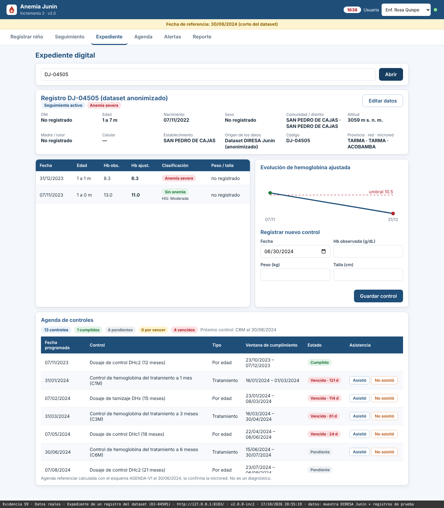
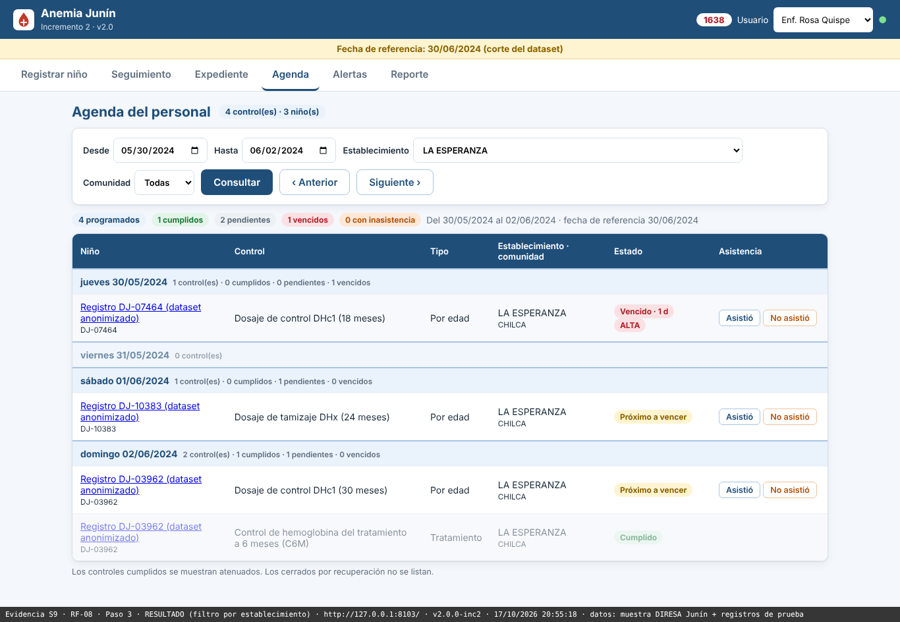
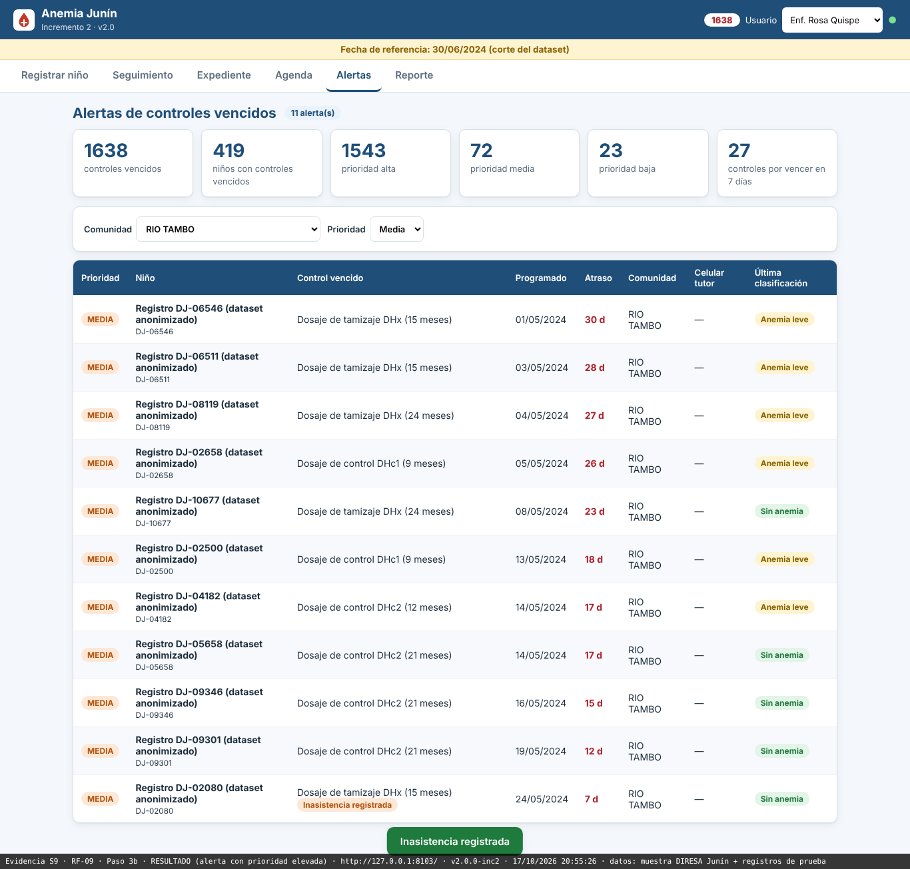

# Anemia Junín

Seguimiento oportuno de la anemia infantil en zonas rurales

Universidad Continental | Ingeniería de Sistemas e Informática | Feria de proyectos 2026

## Equipo

Ricardo Porras Veli · Tania Tifani Auqui Huincho · Jean Piero Huamani Rodriguez

## Problemática

En las zonas rurales de Junín, los registros dispersos y el cálculo manual de fechas dificultan saber qué niños necesitan un control y quiénes no regresaron. El personal de salud necesita información integrada para priorizar el seguimiento.

El análisis del dataset público de DIRESA Junín encontró que el **33,9 % (2 894 de 8 540)** de los niños que ya podían completar el seguimiento no tenía un dosaje de hemoglobina registrado a los seis meses. Esta ausencia de registro evidencia una brecha de trazabilidad; por sí sola no confirma inasistencia.

## Solución tecnológica

Una aplicación web para el personal de salud que reúne el registro del niño, su expediente y la evolución de hemoglobina. Genera la agenda de controles, prioriza los vencidos y permite registrar asistencia o inasistencia. Incluye filtros por establecimiento y comunidad, y reportes descargables.

El prototipo usa **Python, FastAPI y PostgreSQL/SQLite**, con arquitectura hexagonal para separar las reglas de negocio de la interfaz y la base de datos. Su clasificación y agenda son referenciales y apoyan el trabajo del profesional de salud.

## Evidencia 1

**Expediente digital.** El registro DJ-04505 reúne las evaluaciones y la evolución de hemoglobina de un niño del dataset anonimizado. Los datos ausentes se muestran como «no registrado». Se reproduce el detalle superior de la captura original.

## Evidencia 2

**Agenda del personal.** La consulta filtrada por el establecimiento «La Esperanza» muestra cuatro controles de tres niños, organizados por fecha y estado. Los botones permiten registrar la asistencia desde la propia agenda.

## Impacto demostrado

En la demostración con **500 niños** del dataset anonimizado se generó agenda para **500 de 500** y se hicieron visibles **1 638 controles vencidos**, correspondientes a **419 niños**, según las reglas del sistema y los registros importados. Son resultados documentados en la evaluación de la semana 9, con fecha de referencia 30/06/2024.

## Impacto esperado

La información centralizada puede reducir la redigitación; la agenda puede facilitar la planificación del establecimiento; y las alertas pueden ayudar a priorizar el contacto con las familias. La reducción del abandono y la mejora de la adherencia deberán medirse en un piloto con personal de salud. Aún no se ha realizado una evaluación clínica ni de satisfacción con usuarios reales.

## Evidencia 3

**Alertas e inasistencia.** En RF-09, el control del registro DJ-02080 aparece con la marca «Inasistencia registrada» y prioridad media tras registrar la falta. La lista permite concentrar la revisión por comunidad y prioridad.

## Verificación del funcionamiento

**328 pruebas automatizadas aprobadas y 100 % de cobertura de código**, reproducidas localmente el 23/10/2026; análisis estático y contrato OpenAPI correctos. La evaluación S9 conserva además 15 pruebas de interfaz aprobadas en su ejecución documentada. Las capturas incluidas provienen de esa evaluación y no de una nueva ejecución.

## Fuentes y alcance

Elaboración propia a partir del informe S9, secciones 5 y 6.2-6.7, sus capturas y el informe de verificación T-013. Dataset DIRESA Junín (HIS): 12 486 registros de diagnósticos de 2022 a 2024; corte del análisis: 30/06/2024. Capturas: 17/10/2026, muestra anonimizada y registros de prueba. Prototipo académico funcional; no reemplaza el criterio clínico.

[Repositorio y evidencias del proyecto](https://github.com/woshtsu/ProcesosSoftwareAnemia)
