# INFORME ACADÉMICO INTEGRADOR DEL PROYECTO DE ASIGNATURA

```text
========================================================================================================
                                      UNIVERSIDAD CONTINENTAL
                           FACULTAD DE INGENIERÍA DE SISTEMAS E INFORMÁTICA
                                PROGRAMA ACADÉMICO PROFESIONAL DE
                             INGENIERÍA DE SISTEMAS E INFORMÁTICA

                                   INFORME ACADÉMICO FINAL
              "DISEÑO, ADAPTACIÓN, EVALUACIÓN E IMPLEMENTACIÓN DEL PROCESO DE
                SOFTWARE CON ENTREGA DE VALOR APLICADO AL PROYECTO DE ASIGNATURA"

--------------------------------------------------------------------------------------------------------
PROYECTO: Sistema Inteligente para Detección Temprana de Anemia Infantil en Zonas Rurales de Junín
          («Anemia Junín»), versión evaluada v4.0-Inc4
ASIGNATURA: Procesos de Software (Código: ASUC01702)
NIVEL / CICLO: Noveno Ciclo (IX Período - Electivo de Especialidad)
DOCENTE: Guevara Jimenez, Jorge Alfredo
BLOQUE / SECCIÓN: [pendiente: código de sección / NRC]

INTEGRANTES DEL EQUIPO DE PROYECTO:
1. Porras Veli, Ricardo - Código: 76659572 - Rol: Leader / Software Architect
2. Auqui Huincho, Tania Tifani - Código: 75280128 - Rol: Backend & Data Engineer y Frontend & Mobile Developer
3. Huamani Rodriguez, Jean Piero - Código: 72156889 - Rol: Process Analyst & QA Lead
4. Amaru — Claude, asistente de IA (Anthropic) - Código: — - Rol: Asistente de IA: desarrollo, pruebas
   automatizadas, evidencias y documentación, bajo supervisión del equipo

FECHA DE ENTREGA: [pendiente: DD/MM/AAAA]
PERIODO ACADÉMICO: 2026-20
CORTE DE EVIDENCIAS: 30/10/2026 (código en la etiqueta v4.0-Inc4); producción verificada el 31/10/2026
========================================================================================================
```

Los datos <mark>[pendiente: código de sección / NRC]</mark> y <mark>[pendiente: DD/MM/AAAA]</mark> no constan en ninguna fuente del proyecto y los completa el equipo antes de la entrega.

**Nota sobre los roles.** La plantilla define cuatro roles y el equipo tiene tres integrantes humanos, de modo que el reparto es una **propuesta del equipo** (no hay confirmación formal de los integrantes ni del docente) basada en los roles del curso y en la matriz RAE de S3-4:

**Tabla 1.** Propuesta de reparto de los roles de la plantilla entre los integrantes del equipo.

| Rol de la plantilla | Integrante propuesto | Rol en el curso (S3-4, S9 a S11) | Respaldo en el proyecto |
| --- | --- | --- | --- |
| Leader / Software Architect | Porras Veli, Ricardo | Ingeniero de Proceso | Coordina el plan y aprueba requisitos, diseño y despliegue en la matriz RAE (S3-4, Tabla 6) |
| Backend & Data Engineer; Frontend & Mobile Developer | Auqui Huincho, Tania Tifani | Ingeniera de Desarrollo y Prototipado | Ejecuta diseño, implementación, integración y despliegue (S3-4); a cargo de la arquitectura hexagonal (S9) y de la seguridad (S10) |
| Process Analyst & QA Lead | Huamani Rodriguez, Jean Piero | Ingeniero de Calidad y Mejora del Proceso | Ejecuta las pruebas y revisa el código (S3-4); accesibilidad, confiabilidad y rendimiento (S10) |
| Apoyo (sin rol de la plantilla) | Amaru, asistente de IA | Desarrollo, pruebas automatizadas, evidencias y documentación | Trabaja bajo supervisión del equipo; el equipo valida sus entregas |

---

## ÍNDICE GENERAL

- RESUMEN EJECUTIVO / ABSTRACT
- 1. INTRODUCCIÓN
  - 1.1 Antecedentes del Proyecto
  - 1.2 Definición del Problema Organizacional
  - 1.3 Objetivos del Proyecto e Informe Académico
- 2. MARCO TEÓRICO
  - 2.1 Enfoque de Procesos Organizacionales (AS-IS y TO-BE)
  - 2.2 Modelos de Ciclo de Vida y Sastrería de Procesos (Tailoring)
  - 2.3 Categorización Normativa de Procesos de Software
  - 2.4 Arquitectura de Software Hexagonal (Puertos y Adaptadores)
  - 2.5 Modelos de Evaluación de Calidad y Procesos (GQM, FURPS+, OWASP 2025 y CMMI)
- 3. DESARROLLO DEL PROCESO Y PRODUCTO DE SOFTWARE (INTEGRACIÓN DE GUÍAS DE TRABAJO)
  - 3.1 EJE 1: Diagnóstico y Diseño del Proceso Organizacional (AS-IS / TO-BE)
  - 3.2 EJE 2: Selección y Adaptación del Modelo de Ciclo de Vida (Tailoring)
  - 3.3 EJE 3: Operatividad, Actividades, Responsabilidades RAE y DoD
  - 3.4 EJE 4: Planificación, WBS, Priorización Valor/Riesgo y Control de Desviaciones
  - 3.5 EJE 5: Ejecución de Procesos Principales del Primer Incremento (PMV)
  - 3.6 EJE 6: Evaluación GQM, Arquitectura Hexagonal en Git y Pruebas Funcionales
    - 3.6.1 Estructura de directorios de la arquitectura hexagonal en GitHub
    - 3.6.2 Evaluación GQM de arquitectura, pruebas y valor
    - 3.6.3 Estrategia de pruebas
    - 3.6.4 Fichas de prueba funcional con evidencia fotográfica
  - 3.7 EJE 7: Evaluación FURPS+, Psicología de Colores, WCAG 2.1 y OWASP 2025
    - 3.7.1 Índice de calidad FURPS+
    - 3.7.2 Factor U: psicología de colores y accesibilidad WCAG 2.1 AA
    - 3.7.3 Factores R y P: confiabilidad y rendimiento
    - 3.7.4 Factor +: auditoría de seguridad OWASP Top 10:2025
  - 3.8 EJE 8: Evaluación de Capacidad del Proceso según CMMI-DEV y Mejora Continua
- 4. CONCLUSIONES Y LECCIONES APRENDIDAS
  - 4.1 Conclusiones Técnicas del Proceso y Producto
  - 4.2 Lecciones Aprendidas en la Adaptación del Ciclo de Vida
- REFERENCIAS BIBLIOGRÁFICAS
- ANEXOS
  - ANEXO A: Enlace del Video Demostrativo del Software
  - ANEXO B: Enlace del Repositorio de Código en GitHub
  - ANEXO C: GUIÓN TÉCNICO Y NARRATIVO DEL VIDEO DE DEMOSTRACIÓN DEL SOFTWARE
  - ANEXO D: Cotejo de referencias
- RÚBRICA DE EVALUACIÓN CUANTITATIVA POR NIVELES DE DESEMPEÑO (SOBRE 20 PUNTOS)

## ÍNDICE DE TABLAS

- Tabla 1. Propuesta de reparto de los roles de la plantilla entre los integrantes del equipo.
- Tabla 2. Secuencia de entregables del proyecto y aporte de cada uno a este informe.
- Tabla 3. Línea base AS-IS del seguimiento de anemia en Junín (dataset DIRESA, `entregables/semana-09/metricas/asis_dataset_diresa.md`).
- Tabla 4. Objetivos específicos, indicador de logro y resultado al 30/10/2026.
- Tabla 5. Modelos de evaluación usados y su operacionalización en el proyecto.
- Tabla 6. Actores, necesidad operativa, decisión que toman en el proceso y soporte en `v4.0-Inc4` (S1, Tabla 2).
- Tabla 7. Brechas B1 a B6 con su línea base real, la mejora TO-BE y el estado medido con GQM en `v4.0-Inc4` (S1, Tablas 3 y 4; S9, Tabla 32; adenda S9, sección 3).
- Tabla 8. Indicadores por tipo: línea base AS-IS, valor en `v4.0-Inc4` y condición de la medición.
- Tabla 9. Factores de adaptación con su evidencia en el proyecto (S2, Tabla 1; doce factores evaluados, los ocho con mayor poder de decisión).
- Tabla 10. Matriz de decisión ponderada entre tres alternativas (S2, Tabla 6).
- Tabla 11. Prácticas del modelo seleccionado: lo planificado frente a lo ejecutado al 30/10/2026.
- Tabla 12. Categoría normativa, actividad, producto de trabajo y responsables (R: ejecuta, Rv: revisa, A: aprueba; S3-4, Tabla 6; S11, Tabla 12).
- Tabla 13. Verificación de la DoD en `v4.0-Inc4`.
- Tabla 14. Descomposición por incremento con estimación, prioridad y resultado al 30/10/2026 (S3-4, Tablas 10, 17 y 19; S11, Tabla 5a).
- Tabla 15. Plan frente a real por incremento. El porcentaje es el desvío en días sobre la duración planificada del sprint (cálculo propio); las fechas reales son las del...
- Tabla 16. Historias del Incremento 1 con su criterio de aceptación y el resultado medido en `v4.0-Inc4` (S3-4, S10 Tabla 6).
- Tabla 17. Resultado del Incremento 1 (`v1.0-PMV`) según las métricas GQM de S9 y la adenda.
- Tabla 18. Evolución del producto por incremento (adenda S9, sección 4; S11, Tabla 5a). Las pruebas son unitarias, de integración y de arquitectura; los E2E se cuentan aparte.
- Tabla 19. Equivalencia entre la estructura de la plantilla y la del proyecto, con archivos y líneas de código por capa (S10, Tabla 17; análisis AST; el conteo incluye...
- Tabla 20. Matriz de dependencias entre capas (conteo de importaciones; S10, Tabla 18). Ninguna importación prohibida.
- Tabla 21. Metas, preguntas y métricas GQM (S9, Tablas 8 y 12).
- Tabla 22. Valores GQM por incremento (adenda S9, sección 2). «n/r»: no recalculada.
- Tabla 23. Puntaje de M3.1 por brecha e incremento (1 = mecanismo completo, operativo y probado; 0,5 = parcial; 0 = no; adenda S9, sección 3).
- Tabla 24. Pruebas automáticas del repositorio en `v4.0-Inc4`, re-ejecutadas el 30/10/2026 (adenda S9, sección 4; S10, Tabla 8).
- Tabla 25. Resumen de las fichas por incremento (S10, Tabla 7).
- Tabla 26. Índice FURPS+ por factor (S10, Tabla 5).
- Tabla 27. Paleta real de la interfaz (`pmv_fastapi/app/web/estilos.css`), significado en salud infantil y contraste medido (S10, Tabla 9).
- Tabla 28. Criterios WCAG evaluados con axe-core 4.14.0, Playwright y cálculo propio (S10, Tabla 11).
- Tabla 29. Confiabilidad y rendimiento medidos (S10, Tablas 14 y 15; adenda S9, nota 4).
- Tabla 30. Estado por categoría OWASP Top 10:2025 en `v4.0-Inc4` (S10, Tabla 21).
- Tabla 31. Análisis estático y de dependencias (S10, Tablas 22 y 23).
- Tabla 32. Hallazgos de seguridad H-1 a H-12 con su acción propuesta (S10, Tabla 24). Ninguna acción está aplicada en el código; las acciones 12 a 18 del plan de mejora CMMI...
- Tabla 33. Nivel de capacidad por área de práctica al 30/10/2026 (S11, Tabla 6).
- Tabla 34. Hallazgos de la evaluación con su causa raíz de proceso y estado al 30/10/2026 (S11, Tabla 10).
- Tabla 35. Cinco porqués de H2 y H6 (S11, Tabla 11).
- Tabla 36. Plan de mejora continua: acciones con mayor efecto esperado y estado al 30/10/2026 (S11, Tabla 12; 19 acciones en total).
- Tabla 37. Etiquetas de versión del repositorio (S11, Anexo C y Figura 50).
- Tabla 38. Guion técnico minuto a minuto, por incremento.
- Tabla 39. Cotejo de referencias: referencia y secciones donde se cita.
- Tabla 40. Autoevaluación frente a los cuatro criterios de la rúbrica.
- Tabla 41. Resumen de evaluación en el formato de la plantilla (los puntajes los asigna el docente).

## ÍNDICE DE FIGURAS

- Figura 1. Cascada de seguimiento del AS-IS (dataset DIRESA Junín, corte 30/06/2024), sobre todos los diagnosticados y con seguimiento posible.
- Figura 2. Proceso AS-IS por carriles de actor con las notas de problema de cada actividad (S1).
- Figura 3. Proceso TO-BE con el carril «Sistema» y las mejoras M1 a M6 (S1). Las decisiones clínicas siguen siendo humanas.
- Figura 4. PR #8 (incrementos 3 y 4) en estado «Merged» con 6 verificaciones aprobadas; la línea de tiempo no muestra ninguna revisión «Approved» (captura de GitHub...
- Figura 5. WBS: Proyecto, entregables E1 a E3, incrementos INC-1 a INC-6, épicas, historias y tareas del Incremento 1 (S3-4).
- Figura 6. Cronograma planificado de ocho sprints con incrementos e hitos H0 a H7 (S3-4).
- Figura 7. Hitos H2 a H4, plan frente a real (elaboración propia a partir de S3-4 y de los commits).
- Figura 8. Carpeta `pmv_fastapi/app/` en GitHub con la etiqueta `v4.0-Inc4` seleccionada: `adapters`, `application`, `domain`, `ports` y `web`, y `main.py` (captura del...
- Figura 9. Árbol real de `pmv_fastapi/app/` generado recorriendo el sistema de archivos.
- Figura 10. Importaciones de una entidad del dominio: solo biblioteca estándar y módulos propios (GitHub, `v4.0-Inc4`).
- Figura 11. Ejemplo de puerto de salida (`Notificador`), implementado por cuatro adaptadores (simulado, WhatsApp Cloud, SMS y respaldo).
- Figura 12. `main.py` como única raíz de composición (GitHub, `v4.0-Inc4`).
- Figura 13. Matriz de importaciones por capa; no hay celdas de violación.
- Figura 14. Las 25 pruebas de arquitectura (`tests/arquitectura`) validan la regla de dependencia en cada ejecución del CI: todas aprobadas.
- Figura 15. Evolución de M3.1 frente a la meta acumulada propuesta en S9 (izquierda; no aprobada) y de las pruebas automáticas y la cobertura por incremento (derecha)....
- Figura 16. pytest con cobertura: 660 pruebas aprobadas y 99,79 % de cobertura (S10, 30/10/2026).
- Figura 17. 28 pruebas E2E con Playwright aprobadas.
- Figura 18. Ejecución #14 del CI en la rama de los incrementos 3 y 4: `calidad-y-pruebas` (2 min 27 s) e `imagen` (22 s) en verde; `produccion` se omite fuera de `main`.
- Figura 19. RF-01, captura 1. Formulario de registro con los datos sintéticos cargados antes de «Guardar registro»; la vista previa ya muestra Hb ajustada 9,1 g/dL y «Anemia...
- Figura 20. RF-01, captura 2. Confirmación y expediente creado tras «Guardar registro» (130 ms); el DNI repetido respondió HTTP 409.
- Figura 21. RF-02, captura 1. Expediente del DNI 71000001 recién consultado, con su historial de 2 evaluaciones y el formulario de nuevo control.
- Figura 22. RF-02, captura 2. Nuevo control agregado: el historial pasa de 2 a 3 evaluaciones (la edición de datos se registró en `RF02_inc1_2_edicion_escritorio.png`).
- Figura 23. RF-03, captura 1. Formulario con Hb 11,6 g/dL a 3 720 m: la vista previa muestra Hb ajustada 9,1 g/dL y «Anemia moderada».
- Figura 24. RF-03, captura 2. Datos inválidos (DNI «123», Hb 25 g/dL) rechazados con mensajes por campo (HTTP 422); no se guardó nada.
- Figura 25. RF-04, captura 1. Pestaña «Seguimiento» con el listado completo de niños, sin filtro.
- Figura 26. RF-04, captura 2. Filtro por clasificación «Moderada» aplicado: 6 niños de 27.
- Figura 27. RF-05, captura 1. Pestaña «Reporte» con el periodo cargado antes de pulsar «Generar» (captura de S9, `v1.0-PMV`; el pie de la imagen indica versión y fecha).
- Figura 28. RF-05, captura 2. Reporte generado: 15 niños registrados, 15 evaluaciones, 13 evaluados y 77 % con anemia. En `v4.0-Inc4` el mismo flujo dio 28 registrados y un CSV...
- Figura 29. RF-06, captura 1. Búsqueda del DNI 71000022 en «Seguimiento»: 1 niño con 2 controles vencidos (captura de S9, hito `v1.5.0-inc2-avance`).
- Figura 30. RF-06, captura 2. Expediente con la agenda de 13 controles (2 cumplidos, 9 pendientes, 2 vencidos) en `v4.0-Inc4`.
- Figura 31. RF-07, captura 1. Pestaña «Alertas» con los 9 controles vencidos priorizados (7 ALTA, 1 MEDIA, 1 BAJA).
- Figura 32. RF-07, captura 2. Lista filtrada por prioridad MEDIA.
- Figura 33. RF-08, captura 1. Pestaña «Agenda» con el rango de la semana cargado.
- Figura 34. RF-08, captura 2. Agenda de 30 días: 17 controles de 14 niños; el rango mayor de 31 días se rechaza (`RF08_inc2_3_rango_invalido_escritorio.png`).
- Figura 35. RF-09, captura 1. Modal «No asistió» con el motivo cargado antes de confirmar.
- Figura 36. RF-09, captura 2. Inasistencia registrada y prioridad actualizada; los vencidos sin registro pasan de 9 a 8.
- Figura 37. HIST-3.1, captura 1. Aplicación en línea (indicador «Al día») antes de cortar la conexión; los datos se digitan ya sin red.
- Figura 38. HIST-3.1, captura 2. Sin conexión: 2 operaciones pendientes en el dispositivo; el servidor responde 404 para ese DNI.
- Figura 39. HIST-3.1b, captura 1. Estado previo: aplicación en línea con el servidor activo, antes de detenerlo.
- Figura 40. HIST-3.1b, captura 2. Recarga con el servidor detenido: la aplicación abre desde el caché con el aviso de «sin conexión» y 30 de 30 filas servidas desde el caché.
- Figura 41. HIST-3.2, captura 1. Pestaña «Sincronización» con las operaciones pendientes, antes de volver la red.
- Figura 42. HIST-3.2, captura 2. Red restablecida: operaciones aplicadas, indicador «Al día»; el reenvío se marca DUPLICADA y no duplica datos.
- Figura 43. HIST-3.3, captura 1. Conflicto pendiente en «Sincronización»: el servidor tiene un dato distinto al del dispositivo.
- Figura 44. HIST-3.3, captura 2. Conflicto resuelto conservando el dato del servidor; aparece «sin conflictos».
- Figura 45. HIST-3.4, captura 1. Panel con «1 pendiente(s)» y desde cuándo, con el dispositivo sin conexión.
- Figura 46. HIST-3.4, captura 2. Tras reconectar y sincronizar, el panel queda «al día» sin pendientes.
- Figura 47. VIS-3.5, captura 1. Pestaña «Visitas»: 18 filas ordenadas por puntaje de 49,5 a 25,0, con desglose por componente.
- Figura 48. VIS-3.5, captura 2. Modal de registro de la visita con el resultado, el suplemento y las observaciones cargados; tras confirmar, el niño sale del primer lugar de la...
- Figura 49. HIST-4.1, captura 1. Pestaña «Recordatorios» antes de generar.
- Figura 50. HIST-4.1, captura 2. 24 recordatorios rotulados SIMULADO («no se envió»); repetir la generación no duplica.
- Figura 51. HIST-4.2, captura 1. Modal «Registrar respuesta» del tutor (1 confirmo, 2 no puedo, 3 reprogramar) con la opción cargada.
- Figura 52. HIST-4.2, captura 2. Respuesta «No puede asistir» registrada por el personal. El webhook sin firma o con firma inválida respondió 403 y con firma válida 200, pero...
- Figura 53. HIST-4.3, captura 1. Modal «Registrar barrera» con el tipo y el detalle cargados.
- Figura 54. HIST-4.3, captura 2. Barrera sincronizada y visible en el expediente (antes de reconectar figuraba como pendiente...
- Figura 55. HIST-4.4, captura 1. Pestaña «Alertas» con las alertas de barreras críticas.
- Figura 56. HIST-4.4, captura 2. Visita priorizada con el componente BARRERA_CRITICA (40,0 puntos) y alerta ALTA.
- Figura 57. AUTH, captura 1. Pantalla de acceso con el correo y la contraseña de prueba cargados antes de «Iniciar sesión» (axe: 0 violaciones).
- Figura 58. AUTH, captura 2. Acceso en móvil (390x844). No hay captura de la aplicación tras el ingreso: ese resultado se verificó por aserciones (aplicación visible, correo en...
- Figura 59. Salida de `furps_calculo.py` con el índice primario y el conservador (pie con comando, fecha y commit).
- Figura 60. Paleta real con muestras, hexadecimales, contraste y significado.
- Figura 61. Semáforo de severidad bajo simulación de deuteranopía, protanopía y escala de grises: los tonos moderada y severa se acercan, por eso el texto de cada estado...
- Figura 62. Resumen de axe-core por pantalla y vista (14 pantallas, 4 modales y el inicio de sesión).
- Figura 63. Foco visible al recorrer las pestañas con Tab.
- Figura 64. Locust, 20 usuarios, 60 s, incrementos 3 y 4 (sincronización, visitas y recordatorios): p95 de 98 ms.
- Figura 65. Locust, 100 usuarios, 60 s, incrementos 1 y 2: p95 de 2 000 ms, por encima del umbral de 800 ms.
- Figura 66. Caos con PostgreSQL 16 temporal: 25 de 26 peticiones respondieron 500 durante la caída y la aplicación se recuperó a los 0,2 s.
- Figura 67. semgrep: 554 reglas sobre 97 archivos, 151 hallazgos clasificados manualmente.
- Figura 68. Pruebas dinámicas T01 a T32 contra el servidor local (sesión, CSRF, cookies, cabeceras, inyección, webhook y errores).
- Figura 69. Comprobaciones estáticas E01 a E30 con su estado (CUMPLE, HALLAZGO, NO MEDIDO).
- Figura 70. XSS dinámico: cargas inyectadas en cuatro campos y revisadas en seis pantallas (0 ejecuciones).
- Figura 71. Manejador del webhook que responde 503 sin secreto y 403 con firma ausente o inválida, corregido en la revisión independiente (GitHub, `v4.0-Inc4`).
- Figura 72. Sesión en cookies `HttpOnly` con protección CSRF (GitHub, `v4.0-Inc4`).
- Figura 73. Código afectado por el hallazgo H-3: el CSV del reporte no neutraliza celdas que empiezan con `=`, `+`, `-` o `@` (GitHub, `v4.0-Inc4`).
- Figura 74. Nivel de capacidad CMMI por área, informe S11 frente al 30/10/2026: ninguna área cambia de nivel; CAR se evalúa por primera vez.
- Figura 75. Ejecuciones del flujo «CI y producción» en `main`: la #16 (`c870a7e`, PR #8) en verde y las #6, #8, #9 y #10 en rojo (GitHub, 30/10/2026).
- Figura 76. Pestaña Projects: «No projects found»; el seguimiento de PLAN se apoya solo en `coordinacion/TABLERO.md` (GitHub, 30/10/2026).
- Figura 77. `settings/branches` devuelve 404 para la cuenta que tomó la captura: la protección de `main` no es verificable (GitHub, 30/10/2026).
- Figura 78. Artefactos de proceso en el repositorio: la plantilla de PR, el *hook* de pre-commit, la convención de commits, `CODEOWNERS` y Dependabot no existen; SonarCloud sin...
- Figura 79. Pruebas de regresión de la revisión independiente: 6 aprobadas (CP-357, CP-264b, CP-382b, CP-391b, CP-396 y CP-405).
- Figura 80. Etiquetas del repositorio en GitHub: `v4.0-Inc4`, `v3.0-Inc3`, `v2.0-Inc2`, `v1.5.0-inc2-avance` y `v1.0-PMV`.
- Figura 81. Flujo de CI/CD (`.github/workflows/ci.yml`) en `v4.0-Inc4`: tres trabajos (`calidad-y-pruebas`, `imagen`, `produccion`) sobre `ubuntu-24.04` y Python 3.11.

---

## RESUMEN EJECUTIVO / ABSTRACT

**Resumen.** El informe integra las guías de trabajo del curso aplicadas a «Anemia Junín», un sistema web progresivo (PWA) con API FastAPI y arquitectura hexagonal que apoya a los establecimientos de salud de Junín en el seguimiento de la anemia infantil. El **AS-IS** se midió con el extracto real de la DIRESA Junín (12 486 niños menores de 36 meses con diagnóstico, 2022 a 2024): solo 46,3 % tiene dosaje de control a los 6 meses y la pérdida de seguimiento a 6 meses es 53,7 % (33,9 % cuando el seguimiento era posible). El **TO-BE** se materializó en cuatro incrementos etiquetados (`v1.0-PMV`, `v2.0-Inc2`, `v3.0-Inc3`, `v4.0-Inc4`) con un ciclo iterativo-incremental, Scrum y prácticas DevOps. Con el código de `v4.0-Inc4` pasan 660 pruebas automáticas y 28 E2E con 99,79 % de cobertura; 19 de 19 escenarios de aceptación tienen captura; el dominio importa 0 bibliotecas de terceros y las 25 pruebas de arquitectura no detectan violaciones. La métrica GQM de brechas resueltas (M3.1) sube de 25,0 % a 75,0 % entre el primer y el cuarto incremento; el índice FURPS+ es 87,7 % (solo criterios medidos) y 78,4 % (conservador); la auditoría OWASP Top 10:2025 deja 12 hallazgos (1 alta, 6 medias, 4 bajas y 1 no medido), de modo que **no se afirma ausencia de vulnerabilidades**; y la autoevaluación CMMI-DEV ubica PLAN, CM y VER en nivel 2 y ESTIM, PQA, VAL y CAR en nivel 1. Los resultados son de un entorno de pruebas con datos sintéticos o seudonimizados: no hubo piloto en una posta, aceptación de usuarios ni medición de impacto clínico.

**Palabras clave:** proceso de software, tailoring, arquitectura hexagonal, GQM, FURPS+, OWASP Top 10:2025, CMMI-DEV, anemia infantil.

**Abstract.** This report integrates the course work guides applied to "Anemia Junín", a progressive web application (PWA) with a FastAPI back end and hexagonal architecture that supports health facilities in Junín (Peru) in following up children with anemia. The AS-IS process was measured with the real DIRESA Junín extract (12,486 children under 36 months diagnosed in 2022–2024): only 46.3 % have a control hemoglobin test at 6 months and 6-month loss to follow-up is 53.7 % (33.9 % when follow-up was possible). The TO-BE was built in four tagged increments (`v1.0-PMV`, `v2.0-Inc2`, `v3.0-Inc3`, `v4.0-Inc4`) using an iterative-incremental life cycle, Scrum and DevOps practices. The `v4.0-Inc4` code passes 660 automated tests and 28 E2E tests with 99.79 % coverage; 19 of 19 acceptance scenarios have screenshots; the domain imports no third-party library and the 25 architecture tests report no dependency violation. The GQM gap-coverage metric (M3.1) rises from 25.0 % to 75.0 % between the first and fourth increments; the FURPS+ index is 87.7 % (measured criteria only) and 78.4 % (conservative); the OWASP Top 10:2025 audit leaves 12 findings (1 high, 6 medium, 4 low, 1 not measured), so **absence of vulnerabilities is not claimed**; and the CMMI-DEV self-assessment places PLAN, CM and VER at level 2 and ESTIM, PQA, VAL and CAR at level 1. Results come from a test environment with synthetic or pseudonymized data: there was no pilot at a health post, no user acceptance and no measurement of clinical impact.

**Keywords:** software process, tailoring, hexagonal architecture, GQM, FURPS+, OWASP Top 10:2025, CMMI-DEV, childhood anemia.

---

## 1. INTRODUCCIÓN

### 1.1 Antecedentes del Proyecto

La anemia infantil es un problema de salud pública en Junín: la ENDES 2025 estimó en 39,0 % la anemia en niñas y niños de 6 a 35 meses de la región (INEI, 2026; cifra de contexto, no atribuible al sistema). La NTS N.° 213-MINSA/DGIESP-2024 (aprobada por la RM N.° 251-2024-MINSA y modificada por la RM N.° 429-2024-MINSA; Ministerio de Salud del Perú [MINSA], 2024) exige tamizaje y controles de hemoglobina en fechas definidas, y el personal de las postas rurales debe cumplirlos con registros en papel y digitación posterior en el HIS.

El proyecto se desarrolló en el curso Procesos de Software (ASUC01702, 2026-20) siguiendo la secuencia de guías que se resume en la Tabla 2. El producto vigente es `pmv_fastapi/` (FastAPI, interfaz PWA en HTML/CSS/JS, SQLite en desarrollo y PostgreSQL en producción). El prototipo Flask de S5 y S6 (`anemia_junin/`: 266 pruebas, 96,69 % de cobertura) se conserva como antecedente; el PMV etiquetado `v1.0-PMV` (30/09/2026) ya es el producto FastAPI actual.

**Tabla 2.** Secuencia de entregables del proyecto y aporte de cada uno a este informe.

| Semana | Entregable | Aporte principal | Eje de este informe |
| --- | --- | --- | --- |
| S1 | Enfoque de procesos | Problema, 6 actores, AS-IS, brechas B1 a B6, TO-BE (mejoras M1 a M6), 14 indicadores | 3.1 |
| S2 | Modelo de proceso | Comparación de 7 enfoques; decisión iterativo-incremental + Scrum + DevOps (+ MLOps previsto); 6 incrementos | 3.2 |
| S3-4 | Actividades y planificación | WBS, matriz RAE, DoD, 133 puntos de historia, calendario de 8 sprints, riesgos y desviaciones | 3.3, 3.4 |
| S5-S6 | Primer incremento e integrador | PMV Flask (antecedente), arquitectura hexagonal, estrategia de pruebas | 3.5 |
| S9 | Evaluación GQM | Arquitectura, pruebas y valor: métricas M1.1 a M3.2; adenda con Inc. 3 e Inc. 4 | 3.6 |
| S10 | Evaluación FURPS+ | Índice de calidad, accesibilidad, rendimiento y auditoría OWASP 2025 | 3.7 |
| S11 | Evaluación CMMI-DEV | Nivel de capacidad por área de práctica y plan de mejora | 3.8 |

### 1.2 Definición del Problema Organizacional

El problema no es la falta de software sino que una oportunidad de dosaje, control o tratamiento no se convierta en seguimiento oportuno. El extracto de la DIRESA Junín (Dirección Regional de Salud Junín [DIRESA Junín], 2024; HIS; 12 486 diagnósticos del 14/01/2022 al 21/06/2024; corte 30/06/2024) cuantifica el AS-IS:

**Tabla 3.** Línea base AS-IS del seguimiento de anemia en Junín (dataset DIRESA, `entregables/semana-09/metricas/asis_dataset_diresa.md`).

| Indicador del AS-IS | Valor (n/N) | Lectura |
| --- | --- | --- |
| Dosaje de control al mes / a los 3 meses / a los 6 meses | 67,1 % (8 379/12 486) / 54,7 % (6 836/12 486) / 46,3 % (5 783/12 486) | El seguimiento decae con cada control |
| Pérdida de seguimiento a 6 meses | 53,7 % (6 703/12 486); 33,9 % (2 894/8 540) con seguimiento posible | Más de la mitad sin dosaje de cierre |
| Niños sin ningún dosaje de control | 17,9 % (2 237/12 486) | Abandono silencioso (brecha B3) |
| Los tres controles completos | 29,5 % (3 682/12 486) | Cumplimiento íntegro minoritario |
| Recuperación documentada | 46,9 % (5 859/12 486) | El cierre no siempre queda en el HIS |
| Suplementación con 5 o más entregas | 41,0 % (5 115/12 486) | Adherencia parcial |
| Registros con `num_doc` repetido | 49,4 % (6 167/12 486); 100 % en notación científica | El identificador no sirve para unir registros (brecha B1) |

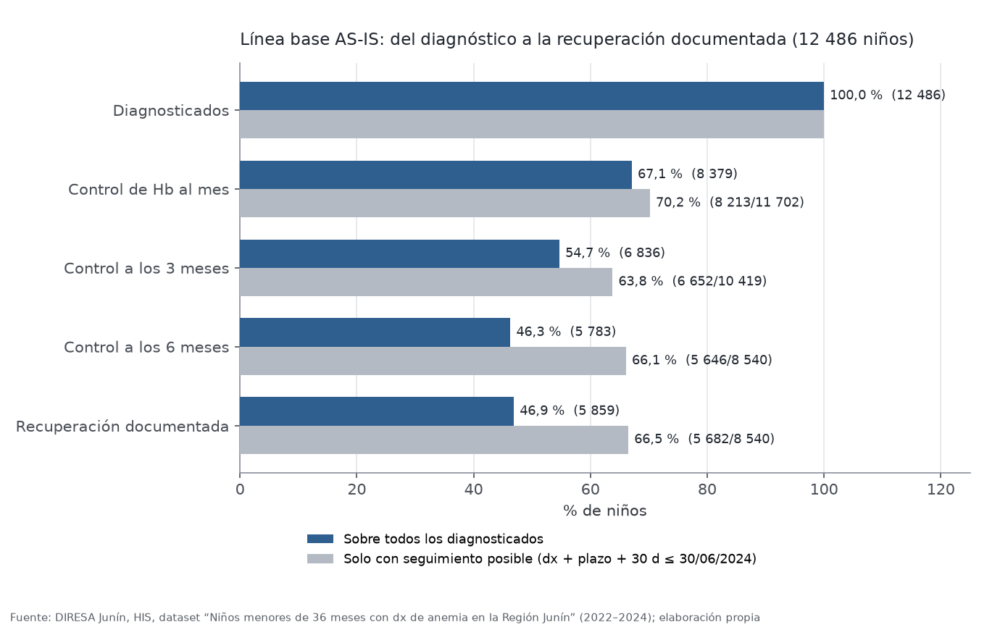

**Figura 1.** Cascada de seguimiento del AS-IS (dataset DIRESA Junín, corte 30/06/2024), sobre todos los diagnosticados y con seguimiento posible. Archivo: `../semana-09/metricas/graficos/g7_asis_cascada_seguimiento.png`.

El triple registro (historia clínica, tarjeta de control y HIS), la agenda calculada a mano, las barreras familiares invisibles hasta el abandono, la visita domiciliaria en papel, la identificación tardía del riesgo y la conectividad intermitente son las seis brechas B1 a B6 que guían el resto del informe (sección 3.1).

**Alcance y límites.** El sistema programa y vigila fechas y clasifica la hemoglobina con reglas referenciales: no diagnostica ni prescribe. Los datos son sintéticos (`scripts/cargar_datos_prueba.py`) o una muestra seudonimizada de la DIRESA (500 niños, sin DNI ni nombres). No hubo piloto en una posta, usuarios finales, ni validación de las reglas por la microred; el envío real de WhatsApp o SMS no se probó (modo simulado).

### 1.3 Objetivos del Proyecto e Informe Académico

- **Objetivo general:** diseñar, adaptar e implementar un proceso de software ejecutable y medible que soporte un sistema de seguimiento de anemia infantil alineado con las necesidades de la red de salud, y reportar con evidencia qué se logró y qué no.

**Tabla 4.** Objetivos específicos, indicador de logro y resultado al 30/10/2026.

| N.° | Objetivo específico | Indicador de logro | Resultado | Sección |
| --- | --- | --- | --- | --- |
| 1 | Diagnosticar el AS-IS y diseñar el TO-BE | Brechas con línea base real y mejora trazable por brecha | 6 brechas con línea base DIRESA; 4 resueltas con mecanismo probado (M3.1 = 75,0 %), 1 parcial (B6) y 1 sin implementar (B5) | 3.1 |
| 2 | Adaptar el ciclo de vida (*tailoring*) | Decisión sustentada con factores y ponderación; control de desviaciones | Alternativa elegida 4,75 de 5 frente a 3,85 y 2,95; desviaciones medidas de +2, +5, +4 y −10 días | 3.2, 3.3, 3.4 |
| 3 | Implementar la solución con arquitectura hexagonal en GitHub | Dominio sin frameworks y dependencias verificadas | 0 importaciones de terceros en dominio, puertos y aplicación; 25 pruebas de arquitectura; 5 etiquetas | 3.5, 3.6 |
| 4 | Evaluar producto y proceso con GQM, FURPS+, OWASP 2025 y CMMI-DEV | Métricas medidas con script y evidencia | M3.1 = 75,0 %; FURPS+ 87,7 % / 78,4 %; 12 hallazgos OWASP; CMMI nivel 2 en 3 áreas y nivel 1 en 4 | 3.6, 3.7, 3.8 |

---

## 2. MARCO TEÓRICO

### 2.1 Enfoque de Procesos Organizacionales (AS-IS y TO-BE)

El enfoque de procesos exige analizar primero el proceso de la organización (AS-IS), identificar sus brechas y diseñar el TO-BE; solo entonces se define cómo el software soporta cada actividad. Justificar una solución solo con «usaremos IA o microservicios» invierte esa regla (Universidad Continental, 2026a). La relación que guía el diseño es *actividad mejorada → mejor resultado → valor organizacional*, expresada como cadena Entrada → Actividad → Resultado → Decisión → Acción → Valor y medida con cuatro tipos de indicador: de **proceso** (p. ej. tiempos), de **producto** (p. ej. disponibilidad, precisión), de **resultado** y de **valor organizacional** (reducción de pérdidas o riesgos).

Sommerville (2016) define la mejora de procesos como comprender los procesos existentes y cambiarlos para elevar la calidad del producto o reducir costos y tiempos de desarrollo. Ese enfoque ordena la segunda mitad del informe (GQM, FURPS+, CMMI).

### 2.2 Modelos de Ciclo de Vida y Sastrería de Procesos (Tailoring)

El SWEBOK (IEEE Computer Society, 2014) organiza el área de procesos en definición, ciclos de vida, evaluación y mejora, medición y herramientas, e incluye la **adaptación del proceso** (*process adaptation*) como práctica explícita: el modelo se ajusta a los factores reales del proyecto en lugar de adoptarse por moda o por la herramienta disponible (Universidad Continental, 2026a). El modelo incremental entrega en cada incremento una funcionalidad operativa con las actividades de comunicación, planeación, modelado, construcción y despliegue (Pressman y Maxim, 2021). Los modelos clásicos (cascada, espiral, desarrollo rápido y ágil) son alternativas entre las que se elige según el proyecto (O'Regan, 2017). Sommerville (2016) distingue dos enfoques de mejora: el de **madurez** (buenas prácticas técnicas y de gestión, orientado a calidad y previsibilidad) y el **ágil** (entrega rápida de funcionalidad y respuesta al cambio). El proyecto combina ambos: iterativo-incremental como ciclo de vida, Scrum como marco de gestión y DevOps como prácticas de ingeniería (Schwaber y Sutherland, 2020; Kim et al., 2016).

### 2.3 Categorización Normativa de Procesos de Software

La norma ISO/IEC/IEEE 12207 (ISO/IEC/IEEE, 2017) agrupa los procesos del ciclo de vida del software en procesos de contrato, organizacionales, de proyecto y técnicos, además de procesos de implementación y soporte. El curso los simplifica en tres categorías que este informe adopta con fines pedagógicos, sin afirmar conformidad con la norma:

- **Principales:** requisitos, análisis y diseño, implementación, integración y pruebas, despliegue.
- **De soporte:** gestión de configuración, aseguramiento de calidad, verificación y validación.
- **De gestión y organizacionales:** planificación y seguimiento, gestión de riesgos, mejora continua.

Para repartir responsabilidades se usa la matriz RAE (quién ejecuta, quién revisa, quién aprueba) y los tres roles del curso: Ingeniero de Proceso, de Desarrollo y Prototipado, y de Calidad y Mejora (Universidad Continental, 2026b).

### 2.4 Arquitectura de Software Hexagonal (Puertos y Adaptadores)

Cockburn (2005) propone aislar la lógica de aplicación de sus actores externos mediante **puertos** (interfaces que expresan lo que la aplicación ofrece o necesita) y **adaptadores** (implementaciones que traducen entre un puerto y una tecnología concreta). Las dependencias apuntan siempre hacia el dominio, que puede probarse sin interfaz de usuario ni base de datos. La Tabla 19 (sección 3.6) traduce esas piezas a las carpetas del repositorio.

### 2.5 Modelos de Evaluación de Calidad y Procesos (GQM, FURPS+, OWASP 2025 y CMMI)

**Tabla 5.** Modelos de evaluación usados y su operacionalización en el proyecto.

| Modelo | Definición (fuente) | Cómo se usa aquí |
| --- | --- | --- |
| **GQM** | Cada **meta** se refina en **preguntas** y cada pregunta en **métricas**; las metas se redactan con objeto, propósito, enfoque de calidad, punto de vista y contexto (Basili et al., 1994) | 3 metas (arquitectura, pruebas, valor), 6 métricas con script en `herramientas/gqm/`, recalculadas para Inc. 1 a Inc. 4 |
| **FURPS+** | Funcionalidad, Usabilidad, Confiabilidad (*Reliability*), Rendimiento (*Performance*) y Soportabilidad, más restricciones de implementación, interfaz, operaciones, empaquetamiento y legales (Grady y Caswell, 1987; Larman, 2003) | Índice ponderado F 30 %, U 15 %, R 15 %, P 15 %, S 10 %, + 15 %; variables medidas con scripts |
| **WCAG 2.1 AA** | Contraste mínimo de 4,5:1 para texto (1.4.3) y 3:1 para componentes (1.4.11); el color no es el único canal (1.4.1); operable por teclado (2.1.1) (W3C, 2018) | Axe-core por pantalla y cálculo propio de contraste (factor U) |
| **OWASP Top 10:2025** | Diez categorías de riesgo de aplicaciones web, A01 Broken Access Control a A10 Mishandling of Exceptional Conditions (OWASP Foundation, 2025) | 30 comprobaciones estáticas, 32 dinámicas, SAST y SCA (factor +) |
| **CMMI-DEV** | Áreas de práctica agrupadas en gestión de procesos, gestión de proyectos, ingeniería y soporte (PP, PMC, REQM, CM, PPQA, VER, VAL, CAR…); niveles de madurez 1 a 5 en la representación escalonada (O'Regan, 2017) y niveles de capacidad por área en la continua (CMMI Institute, 2018) | Representación continua con niveles 0 a 3 por área: ESTIM, PLAN, PQA, CM, VER, VAL y CAR |


---

## 3. DESARROLLO DEL PROCESO Y PRODUCTO DE SOFTWARE (INTEGRACIÓN DE GUÍAS DE TRABAJO)

Los ocho ejes siguientes recorren el proyecto en el orden en que se ejecutó: primero el proceso (3.1 a 3.4), luego el primer incremento (3.5) y finalmente la evaluación del producto y del proceso con cuatro modelos (3.6 a 3.8). Toda cifra corresponde al código de la etiqueta `v4.0-Inc4` (commit `e6886e2`, 30/10/2026) y cada tabla indica su fuente. Lo que se midió con datos sintéticos, con el dataset real anonimizado de la DIRESA o no se midió se distingue en cada caso.

---

### 3.1 EJE 1: Diagnóstico y Diseño del Proceso Organizacional (AS-IS / TO-BE)

**Matriz 3.1.1: Identificación de actores y necesidades del sistema**

**Tabla 6.** Actores, necesidad operativa, decisión que toman en el proceso y soporte en `v4.0-Inc4` (S1, Tabla 2).

| Actor | Necesidad operativa | Decisión que debe tomar en el proceso | Soporte en `v4.0-Inc4` |
| --- | --- | --- | --- |
| Niña o niño menor de 5 años | Tamizaje, tratamiento y controles oportunos y continuos | Ninguna clínica; es el beneficiario final | Expediente único con agenda de controles |
| Familia o cuidador | Recordatorios de cita, canal de bajo costo para confirmar o reportar una barrera | Acudir al control, dar el suplemento en casa, comunicar barreras | Recordatorio con respuesta 1, 2 o 3 y registro de barreras (envío real no probado: modo SIMULADO) |
| Personal de salud | Registro nominal sin redundancia y alertas de niños en riesgo de abandono | Evaluar, indicar o ajustar el tratamiento y referir | Registro con clasificación por altitud, agenda normativa, alertas de vencidos y de barreras críticas |
| Agente comunitario | Herramienta utilizable sin conexión para visitas y barreras | A quién visitar primero y qué barrera escalar | Lista de visitas priorizada con puntaje explicable; cola local y sincronización idempotente |
| Gestión territorial (red y microred) | Información consolidada y oportuna | Dónde supervisar y asignar recursos | Reporte del periodo en JSON y CSV; el tablero territorial (INC-6) no se construyó |
| MINSA | Estadísticas fiables de cumplimiento | Supervisar el seguimiento | Sin integración con el HIS; solo el reporte del periodo |

El sistema solo distingue «usuario autenticado»: no hay roles por actor ni segmentación por establecimiento (hallazgo H-1 de la sección 3.7). Los seis actores son los de la visión del proceso; el software atiende en la práctica a personal de salud y agentes comunitarios.

**Matriz 3.1.2: Matriz de brechas operativas (AS-IS frente a TO-BE)**

**Tabla 7.** Brechas B1 a B6 con su línea base real, la mejora TO-BE y el estado medido con GQM en `v4.0-Inc4` (S1, Tablas 3 y 4; S9, Tabla 32; adenda S9, sección 3).

| ID | Proceso actual (AS-IS) | Brecha y línea base | Consecuencia | Proceso propuesto (TO-BE) | Puntaje M3.1 en `v4.0-Inc4` |
| --- | --- | --- | --- | --- | --- |
| B1 | Triple registro: historia clínica, tarjeta de control y digitación en el HIS | Sin registro nominal único; en el HIS `num_doc` se repite en 49,4 % de las filas (6 167 de 12 486) | Errores de digitación y estado real del niño poco confiable | M1: registro nominal único y validado | **1,0**: 3 registros por evaluación pasan a 1; DNI repetido responde 409 |
| B2 | Agenda calculada a mano, sin recordatorios | Dosaje de control registrado al mes 67,1 %, a los 3 meses 54,7 % y a los 6 meses 46,3 % | Controles fuera de ventana y citas olvidadas | M2: agenda normativa; M3: recordatorio a la familia | **1,0**: 140/140 niños activos con agenda, 1 638/1 638 controles vencidos visibles en la muestra real de 500 niños (Inc. 2); recordatorios solo en modo simulado |
| B3 | Barreras (transporte, economía, olvido) ocultas hasta el abandono | 17,9 % de los niños sin ningún control a 1, 3 o 6 meses; el HIS no registra barreras | Abandono silencioso | M3: respuesta del tutor y reporte de barreras que genera alerta | **1,0**: 8 tipos de barrera, alerta de barreras críticas; reglas sin validar con la microred |
| B4 | Visita domiciliaria semanal en papel y sin conexión | El HIS no registra visitas; no hay línea base | Cobertura insuficiente y demora en escalar barreras | M4: visitas priorizadas y formulario estructurado | **1,0**: puntaje explicable `VISITA-V1`/`V2` (0 a 115) y captura sin conexión; pesos sin validar |
| B5 | El riesgo se identifica cuando el abandono ya ocurrió | 53,7 % sin dosaje a 6 meses (33,9 % con seguimiento posible) | Intervención tardía | M5: score de riesgo de abandono | **0,0**: no hay modelo ni regla de riesgo; la visita priorizada es reactiva |
| B6 | Cobertura móvil intermitente y consolidación posterior | Sin medición en el HIS | Datos perdidos e indicadores tardíos | M6: registro sin conexión con sincronización | **0,5**: sincronización idempotente probada con E2E simulados; sin prueba en dispositivo real ni tablero INC-6 |

Resultado: **M3.1 = 4,5 / 6 = 75,0 %**. Cuatro brechas (B1 a B4) tienen mecanismo operativo y probado **en el entorno de pruebas**; ninguna se midió en una posta.

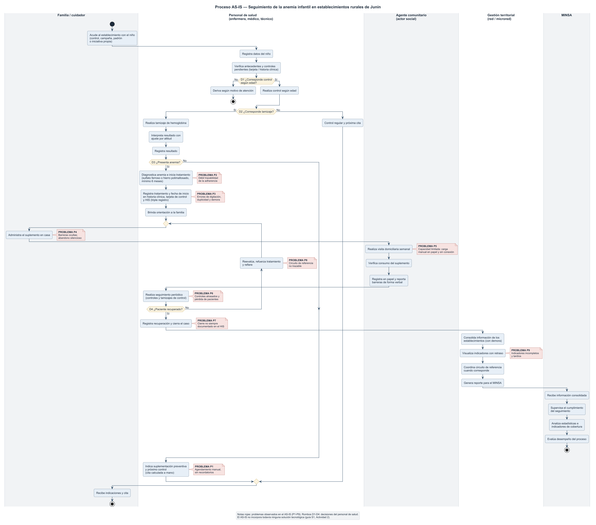

**Figura 2.** Proceso AS-IS por carriles de actor con las notas de problema de cada actividad (S1). Archivo: `../../diagramas/png/10_s1_proceso_as_is.png`.

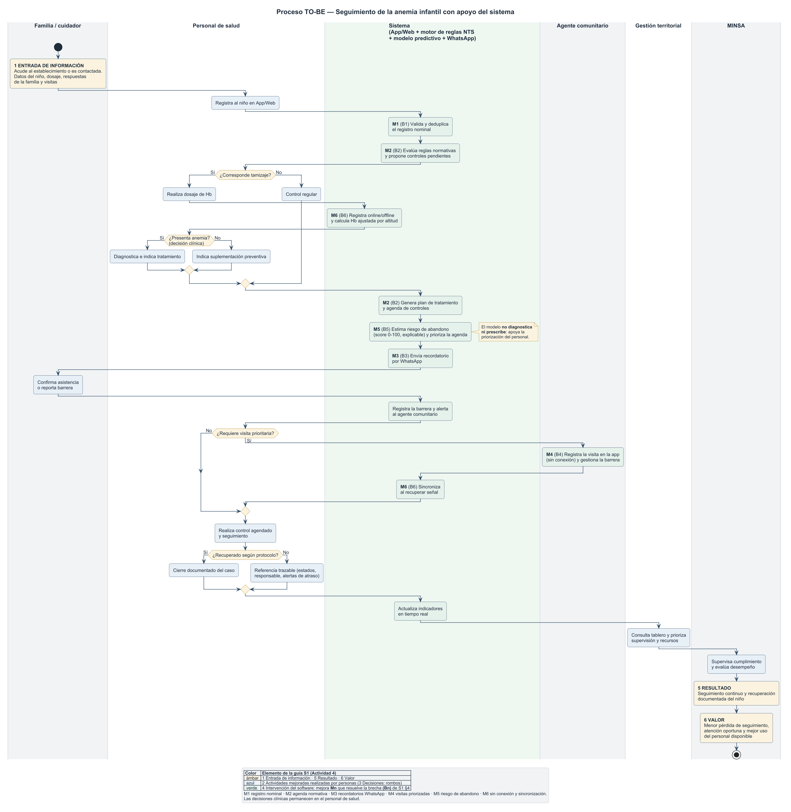

**Figura 3.** Proceso TO-BE con el carril «Sistema» y las mejoras M1 a M6 (S1). Las decisiones clínicas siguen siendo humanas. Archivo: `../../diagramas/png/11_s1_proceso_to_be.png`.

**Sistema de indicadores de gestión del proceso**

La guía de S1 fijó catorce indicadores sin metas numéricas, porque toda meta exige una línea base medida y aprobación institucional. Con la línea base DIRESA ya medida, la Tabla 8 muestra cuatro indicadores representativos, uno por tipo, con lo que se midió y lo que solo un piloto puede medir.

**Tabla 8.** Indicadores por tipo: línea base AS-IS, valor en `v4.0-Inc4` y condición de la medición.

| Tipo | Indicador | Línea base AS-IS | Valor en `v4.0-Inc4` | Meta de referencia | Lectura |
| --- | --- | --- | --- | --- | --- |
| Proceso | Registros por evaluación (V1) | 3 | 1 | 1 | Medido con datos sintéticos (150 niños) |
| Proceso | Controles vencidos visibles para el personal (V2, V3) | 0 % (no existe agenda) | 100 % (140/140 con agenda; F1 = 1,000, 476/476 controles) | 100 % | Medido contra un oráculo independiente, con datos sintéticos; el dataset real se midió en Inc. 2 (1 638/1 638) |
| Producto | Disponibilidad durante la carga (V5) y p95 agregado (V4) | sin medida | 100 % (64/64 sondas); p95 = 1 100 ms (una corrida, 50 usuarios, 2 CPU compartidas) | disponibilidad ≥ 99,5 %; p95 < 800 ms | La disponibilidad cumple; **el p95 no cumple la meta** y es un riesgo (S10, criterio P2: 2 000 ms con 100 usuarios) |
| Resultado | Pérdida de seguimiento a 6 meses | 53,7 % (6 703/12 486) | No medido | Sin meta aprobada | Exige un piloto con niños reales; el sistema no puede atribuirse esa mejora |
| Valor organizacional | Brechas resueltas (M3.1) | 0 de 6 | 4,5 de 6 = 75,0 % | 66,7 % acumulado propuesto para INC-4 (no aprobado) | Mecanismos probados en entorno de pruebas |

---

### 3.2 EJE 2: Selección y Adaptación del Modelo de Ciclo de Vida (Tailoring)

**Matriz 3.2.1: Análisis de factores de adaptación del proyecto**

**Tabla 9.** Factores de adaptación con su evidencia en el proyecto (S2, Tabla 1; doce factores evaluados, los ocho con mayor poder de decisión).

| Factor de adaptación | Situación real del proyecto | Nivel | Justificación técnica de la adaptación |
| --- | --- | :---: | --- |
| Incertidumbre de requisitos | Los criterios clínicos están acotados por la norma, pero la interacción por WhatsApp, el modo sin conexión y el componente predictivo no | **Alto** | Exige iteraciones cortas para validar cada incremento antes de construir el siguiente |
| Complejidad técnica | API REST, base relacional, cola local, autenticación externa, notificador y service worker | **Alto** | Exige desacoplamiento (arquitectura hexagonal): el dominio no puede depender de FastAPI ni de SQLAlchemy |
| Cambios esperados | Reglas de agenda, pesos de visita y reglas de barreras serán ajustados por la microred | **Alto** | Descarta Cascada: el costo de retrabajo de congelar requisitos es inaceptable |
| Riesgo tecnológico | Cobertura móvil intermitente y dependencia de la API de WhatsApp | **Alto** | Obliga a probar la sincronización y el notificador en cada incremento y a mantener un modo simulado |
| Necesidad de retroalimentación | El personal debe validar que las alertas coincidan con su criterio | **Alto** | Exige revisión formal del incremento con el usuario (Scrum) |
| Necesidad de integración | HIS, WhatsApp, SMS, autenticación y base gestionada | **Alto** | Requiere pruebas de integración automatizadas (219 contra PostgreSQL 16 en el CI) |
| Participación del usuario | Seis actores con decisiones propias | **Alto** | Entregas incrementales demostrables a cada actor |
| Criticidad del sistema | Apoya decisiones sobre salud infantil | **Alto** | Exige pruebas automatizadas, integración continua y reglas clínicas probadas en sus valores límite |

**Selección del modelo híbrido adaptado**

Se compararon siete enfoques con seis criterios (escala 1 a 5): Cascada 8, Incremental 18, Espiral 21, Kanban 21, DevOps 26, MLOps 26 y Scrum 27 puntos sobre 30. La puntuación más alta no decide por sí sola: ningún enfoque cubre la gestión iterativa con el usuario, la entrega automatizada y el gobierno del modelo a la vez. Por eso se evaluaron combinaciones con pesos que privilegian adaptabilidad, riesgos, entrega incremental y retroalimentación (15 % cada uno).

**Tabla 10.** Matriz de decisión ponderada entre tres alternativas (S2, Tabla 6).

| Criterio | Peso | Alt. 1: iterativo-incremental + Scrum + DevOps + MLOps | Alt. 2: Kanban + DevOps + DataOps | Alt. 3: Incremental + Espiral sin automatización |
| --- | :---: | :---: | :---: | :---: |
| Adaptabilidad | 15 % | 5 | 4 | 3 |
| Gestión de riesgos | 15 % | 4 | 3 | 4 |
| Entrega incremental | 15 % | 5 | 4 | 3 |
| Retroalimentación | 15 % | 5 | 4 | 3 |
| Integración | 10 % | 4 | 4 | 3 |
| Automatización | 10 % | 5 | 5 | 2 |
| Gestión de datos e IA | 10 % | 5 | 4 | 2 |
| Participación del usuario | 10 % | 5 | 3 | 3 |
| **Puntaje ponderado (de 5)** | **100 %** | **4,75** | **3,85** | **2,95** |

**Modelo seleccionado:** desarrollo iterativo e incremental, gestionado con Scrum (sprints de dos semanas), con prácticas DevOps para integración, pruebas y despliegue, y prácticas MLOps reservadas al INC-5. Cascada se descartó porque el componente de IA y las reglas de la microred impiden congelar requisitos; Scrum aislado no define cómo automatizar la entrega a postas dispersas, y DevOps aislado no organiza la retroalimentación con el personal de salud.

**Qué se aplicó realmente.** El modelo se contrastó con la ejecución:

**Tabla 11.** Prácticas del modelo seleccionado: lo planificado frente a lo ejecutado al 30/10/2026.

| Práctica | Planificado | Ejecutado (evidencia) | Brecha |
| --- | --- | --- | --- |
| Entrega incremental | 6 incrementos, 133 puntos de historia (SP) | 4 incrementos entregados (INC-1 a INC-4), 76 de 133 SP (57,1 %); cada uno con etiqueta (`v1.0-PMV`, `v2.0-Inc2`, `v3.0-Inc3`, `v4.0-Inc4`) | INC-5 (modelo predictivo) e INC-6 (tablero) sin construir |
| Scrum | Sprints de 2 semanas, backlog con estimación, revisión con la posta, retrospectiva | Backlog estimado con SP (S3-4); seguimiento en `coordinacion/TABLERO.md` | Sin actas de revisión con el personal de salud; sin tablero de GitHub Projects («No projects found»); sin horas reales registradas |
| DevOps | Integración continua, pruebas automáticas, despliegue automatizado | GitHub Actions con tres trabajos (`calidad-y-pruebas`, `imagen`, `produccion`); 660 pruebas y 28 E2E; despliegue a Render y Supabase desde `main`; producción verificada el 31/10/2026: `/openapi.json` declara `4.0.0-inc4` con 29 rutas | SAST y auditoría de dependencias fuera del CI; protección de `main` no verificable |
| MLOps | Pipeline de datos, experimentación y monitoreo del modelo | No ejecutado | Depende del INC-5 |

---


### 3.3 EJE 3: Operatividad, Actividades, Responsabilidades RAE y DoD

**Matriz 3.3.1: Categorización normativa, productos de trabajo y responsables RAE**

La categorización es la simplificación del curso (sección 2.3), sin afirmar conformidad con la ISO/IEC/IEEE 12207 (ISO/IEC/IEEE, 2017). Los roles de la plantilla se asignan según la Tabla 1. La aprobación del Product Owner corresponde a un rol que el equipo **simuló**: no hubo un representante de la posta que aprobara historias ni incrementos.

**Tabla 12.** Categoría normativa, actividad, producto de trabajo y responsables (R: ejecuta, Rv: revisa, A: aprueba; S3-4, Tabla 6; S11, Tabla 12).

| Categoría | Actividad específica del proyecto | Producto de trabajo | R | Rv | A | Evidencia en el repositorio |
| --- | --- | --- | --- | --- | --- | --- |
| Proceso principal | Refinamiento de requisitos e historias | Backlog priorizado con criterios Dado-Cuando-Entonces (48 verificados) | Porras V. | Huamani R. | Product Owner (simulado) | `entregables/semana-03-04/`; `semana-09/metricas/datos/m21_cobertura_rf.json` |
| Proceso principal | Diseño de la arquitectura hexagonal | 14 ADR, contrato OpenAPI (29 rutas), diagramas | Auqui H. | Huamani R. | Porras V. | `pmv_fastapi/docs/adr/`, `docs/openapi.json` |
| Proceso principal | Construcción del código | Módulos ejecutables en `pmv_fastapi/app/` (142 archivos Python) | Auqui H. | Huamani R. | Huamani R. | Repositorio, etiqueta `v4.0-Inc4` |
| Proceso principal | Pruebas | 660 pruebas pytest y 28 E2E con Playwright | Huamani R. | Porras V. | Huamani R. | `pmv_fastapi/tests/` |
| Proceso principal | Despliegue | Imagen Docker, Render y Supabase | Auqui H. | Huamani R. | Porras V. | `Dockerfile`, trabajo `produccion` de `ci.yml`; producción verificada el 31/10/2026 (Anexo B) |
| Proceso de soporte | Gestión de configuración | Repositorio Git con 5 etiquetas y ramas `feature/*` | Auqui H. | no definido en S3-4 | no definido en S3-4 | Etiquetas `v1.0-PMV` a `v4.0-Inc4` (Anexo B) |
| Proceso de soporte | Aseguramiento de calidad (PQA) | Ruff, informe de revisión independiente, defectos DEF-01 a DEF-09 | Huamani R. | Porras V. | Huamani R. | `registro_defectos*.md`, informe T-020 |
| Proceso de soporte | Verificación y validación | 19 fichas de prueba con capturas | Huamani R. | Auqui H. | firma pendiente | Sección 3.6.4 |
| Proceso de gestión | Planificación y control de desviaciones | Plan por sprint, plan frente a real | Porras V. | Huamani R. | Porras V. | `coordinacion/TABLERO.md`; Tabla 15 |
| Proceso de gestión | Retrospectiva y mejora | Plan de mejora CMMI con 19 acciones | Porras V. | Equipo | Porras V. | Sección 3.8 |

**Definición de terminado (DoD)**

La DoD vigente es la de S3-4 (Tablas 8 y 9). La Tabla 13 la verifica contra `v4.0-Inc4` e incluye el criterio de análisis estático que la plantilla fija con SonarQube y que en el proyecto se cubrió con otras herramientas.

**Tabla 13.** Verificación de la DoD en `v4.0-Inc4`.

| N.° | Criterio de terminado | Verificación en `v4.0-Inc4` | Estado |
| --- | --- | --- | --- |
| 1 | Todo criterio de aceptación se verifica con al menos una prueba automatizada | 416 unitarias, 219 de integración, 25 de arquitectura y 28 E2E, todas aprobadas | Cumple |
| 2 | La regla de negocio vive en el dominio o en la configuración normativa (ADR-001) | 0 importaciones de terceros en 86 clases del dominio; 25 pruebas de arquitectura | Cumple |
| 3 | Pruebas en verde, cobertura ≥ 80 % y 0 hallazgos de Ruff | Cobertura 99,79 % (4 025 + 675 de 4 030 + 680 líneas y ramas); Ruff: 0 errores y 142 archivos formateados | Cumple |
| 4 | Disponible en la interfaz y en la API con el mismo caso de uso; `openapi` al día | Contrato de 29 rutas verificado en el CI con Python 3.11 | Cumple |
| 5 | Pruebas funcionales de interfaz con capturas adjuntas en la ficha | 19 de 19 escenarios con 54 capturas (sección 3.6.4) | Cumple |
| 6 | Análisis estático sin vulnerabilidades críticas (la plantilla pide SonarQube con 0 vulnerabilidades) | SonarCloud **no se ejecutó** (sin organización ni token); bandit: 0 altas, 0 medias, 1 baja (falso positivo); pip-audit: 0; semgrep: 151 hallazgos clasificados; la revisión manual halló 1 hallazgo de severidad alta (H-1) | **No cumple** como la plantilla lo define |
| 7 | Código revisado por pares y aprobado en el *pull request* | La PR #8 se fusionó con 6 verificaciones en verde, sin revisión formal «Approved»; las PR #6 y #7 se fusionaron con verificaciones en rojo | **No cumple** |
| 8 | Demostrada en la revisión del sprint y aceptada | Sin actas de revisión con el personal de salud | **No cumple** |

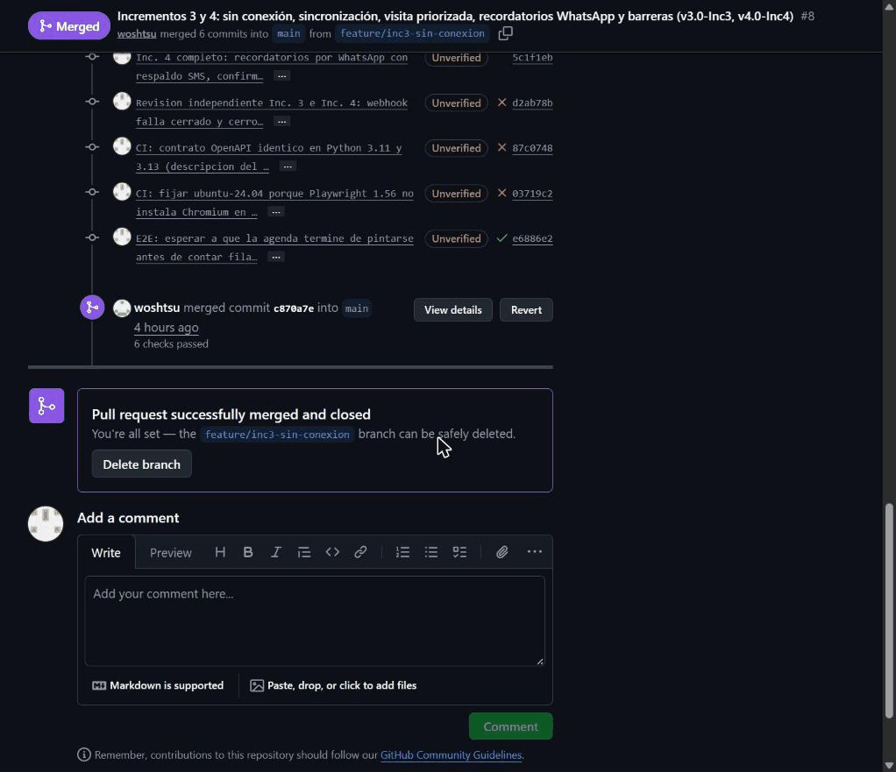

**Figura 4.** PR #8 (incrementos 3 y 4) en estado «Merged» con 6 verificaciones aprobadas; la línea de tiempo no muestra ninguna revisión «Approved» (captura de GitHub, 30/10/2026). Archivo: `../semana-11/evidencias/github/GH_pr8_conversacion.png`.

La DoD mide cuánto código se ejecuta y no la variedad de entradas: con 99,79 % de cobertura, la revisión independiente de los incrementos 3 y 4 todavía halló cinco defectos, uno de seguridad (sección 3.8). Seguridad, accesibilidad y rendimiento no forman parte de la DoD (hallazgo H8 de S11).

---

### 3.4 EJE 4: Planificación, WBS, Priorización Valor/Riesgo y Control de Desviaciones

**Estructura de descomposición del trabajo (WBS)**

```text
PROYECTO ANEMIA JUNÍN
├── INC-1 PMV · Registro nominal y expediente (21 SP) ........ v1.0-PMV
│   ├── HIST-1.1 / RF-01 Registro con evaluación inicial
│   ├── HIST-1.2 / RF-02 Expediente y nuevo control
│   ├── HIST-1.3 / RF-03 Validación con reglas clínicas
│   ├── HIST-1.4 / RF-04 Listado de seguimiento
│   └── HIST-1.5 / RF-05 Reporte del periodo
├── INC-2 Agenda automática y alertas (18 SP) ................ v2.0-Inc2
│   ├── HIST-2.1 / RF-06 Agenda normativa     ├── HIST-2.2 / RF-07 Alertas priorizadas
│   └── HIST-2.3 / RF-08 Agenda del personal  └── HIST-2.4 / RF-09 Asistencia a controles
├── INC-3 Sin conexión y sincronización (21 SP) .............. v3.0-Inc3
│   ├── HIST-3.1 a HIST-3.4 Cola local, sincronización, conflictos, pendientes
│   └── VIS-3.5 Visita domiciliaria priorizada
├── INC-4 WhatsApp y barreras (16 SP) ........................ v4.0-Inc4
│   └── HIST-4.1 a HIST-4.4 Recordatorios, respuesta del tutor, barreras, alertas críticas
├── INC-5 Modelo predictivo (34 SP) .......................... no implementado
└── INC-6 Tablero territorial (15 SP) ........................ no implementado
```

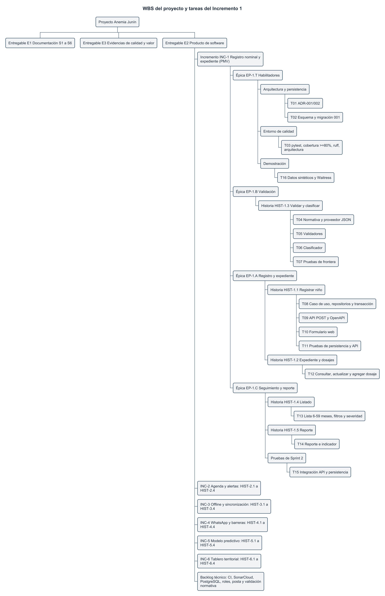

**Figura 5.** WBS: Proyecto, entregables E1 a E3, incrementos INC-1 a INC-6, épicas, historias y tareas del Incremento 1 (S3-4). Archivo: `../../diagramas/png/31_s34_wbs_proyecto.png`.

**Tabla 14.** Descomposición por incremento con estimación, prioridad y resultado al 30/10/2026 (S3-4, Tablas 10, 17 y 19; S11, Tabla 5a).

| Incremento | Historias | SP | Puntaje de priorización | Resultado |
| --- | --- | :---: | :---: | --- |
| INC-1 Registro nominal y expediente (PMV) | HIST-1.1 a HIST-1.5 (RF-01 a RF-05) | 21 | 4,60 (1.°) | Entregado: `v1.0-PMV` |
| INC-2 Agenda automática y alertas | HIST-2.1 a HIST-2.4 (RF-06 a RF-09) | 18 | 4,15 (3.°) | Entregado: `v2.0-Inc2` |
| INC-3 Sin conexión y sincronización | HIST-3.1 a HIST-3.4, más VIS-3.5 (sin estimar) | 21 | 4,40 (2.°) | Entregado: `v3.0-Inc3` |
| INC-4 WhatsApp y barreras | HIST-4.1 a HIST-4.4 | 16 | 3,40 (4.°) | Entregado: `v4.0-Inc4` (envío real sin probar) |
| INC-5 Modelo predictivo | HIST-5.1 a HIST-5.4 | 34 | 3,35 (5.°) | No implementado |
| INC-6 Tablero territorial | HIST-6.1 a HIST-6.4 | 15 | 2,75 (6.°) | No implementado |
| Backlog técnico | BT-01 a BT-03, BT-08, BT-09 | 8 | no priorizado | Parcial (CI y E2E implantados; SonarCloud sin activar) |
| **Total** | | **133** | | **76 SP entregados en los cuatro incrementos (57,1 %)** |

**Priorización valor y riesgo.** El puntaje ponderado combina valor (30 %), reducción de riesgo (25 %), dependencia técnica (20 %), factibilidad (15 %) y validación (10 %). INC-1 lidera porque es prerrequisito de todos los demás; INC-3 puntúa por encima de INC-2, pero se ejecutó después porque requería el pipeline de integración continua y la decisión sobre la base central (nota de S3-4 sobre el calendario). Dentro del INC-1 se construyó primero la clasificación normativa (HIST-1.3) y después el formulario, porque un umbral clínico mal transcrito invalidaría todo lo posterior.

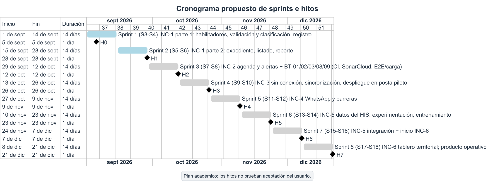

**Figura 6.** Cronograma planificado de ocho sprints con incrementos e hitos H0 a H7 (S3-4). Archivo: `../../diagramas/png/33_s34_cronograma_sprints_hitos.png`.

**Matriz de control de desviaciones del proyecto**

**Tabla 15.** Plan frente a real por incremento. El porcentaje es el desvío en días sobre la duración planificada del sprint (cálculo propio); las fechas reales son las del commit o la etiqueta que entrega el software (S11, Tabla 5a; S9, Tabla 6).

| Incremento (sprint) | Avance planificado | Avance real | Desviación | Causa raíz | Acción correctiva |
| --- | --- | --- | --- | --- | --- |
| INC-1 (sprints 1-2, 01-28/09) | 21 SP al hito H1, 28/09 | 21 SP, `v1.0-PMV` el 30/09 | +2 días (+7,1 % de 28 días) | Sin registro de horas; acta de aceptación pendiente | Registrar horas reales por tarea (acción 1 del plan) |
| INC-2 (sprint 3, 29/09-12/10) | 18 SP al hito H2, 12/10 | 10 SP al 16/10 (hito `v1.5.0-inc2-avance`); 18 SP el 17/10 | +5 días (+35,7 % de 14 días) | El sprint absorbió el informe integrador de S6 y la reestructuración hexagonal (ADR-008) sin holgura | Cerrar HIST-2.3 y HIST-2.4; reservar 20 % de capacidad por sprint (acción 7) |
| INC-3 (sprint 4, 13-26/10) | 21 SP al hito H3, 26/10 | 21 SP más VIS-3.5; `v3.0-Inc3` el 30/10 | +4 días (+28,6 % de 14 días) | Arrastre del atraso de INC-2 y alcance adicional (VIS-3.5) sin estimar; causa probable, sin registro de horas | La replanificación propuesta en S9 no se adoptó; el equipo recuperó el plan |
| INC-4 (sprint 5, 27/10-09/11) | 16 SP al hito H4, 09/11 | 16 SP; `v4.0-Inc4` el 30/10 | −10 días (−71,4 % de 14 días) | Se adelantó la entrega para recuperar el plan original | Pruebas de campo y envío real quedan pendientes |

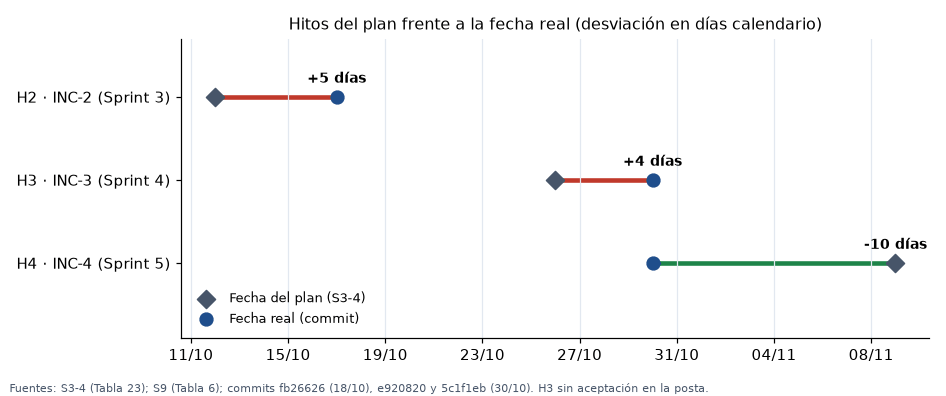

**Figura 7.** Hitos H2 a H4, plan frente a real (elaboración propia a partir de S3-4 y de los commits). Archivo: `../semana-11/evidencias/CMMI02_hitos_plan_vs_real.png`.

Ningún retraso superó el umbral de una semana que el plan fija para replanificar un hito. Lo que la matriz muestra es otra cosa: **el avance se midió en entrega de software, no en aceptación**. Los hitos H3 y H4 exigían prueba de campo y envío real, que no se hicieron, de modo que el desvío favorable de INC-4 (−10 días) no equivale a un incremento aceptado. Tampoco hay horas reales registradas en ningún incremento (113 h estimadas solo para INC-1), de modo que la estimación no se recalibró.

---


### 3.5 EJE 5: Ejecución de Procesos Principales del Primer Incremento (PMV)

El PMV (Incremento 1, etiqueta `v1.0-PMV`, 30/09/2026) cubre cinco historias que eliminan el triple registro (B1) y entregan el primer seguimiento: registro nominal con evaluación inicial, expediente, validación clínica, listado y reporte. Se ejecutó en dos sprints (01 al 28/09/2026) con 16 tareas (T01 a T16) y 113 horas-persona estimadas; las horas reales no se registraron.

**Especificación de historias de usuario del PMV**

**Tabla 16.** Historias del Incremento 1 con su criterio de aceptación y el resultado medido en `v4.0-Inc4` (S3-4, S10 Tabla 6).

| Código | Historia (Como / quiero / para) | Criterio de aceptación (Dado-Cuando-Entonces) | Resultado medido |
| --- | --- | --- | --- |
| HU-01 / RF-01 | **Como** personal de salud, **quiero** registrar al niño con su evaluación inicial, **para** tener un registro nominal único | **Dado** un formulario con datos válidos, **cuando** pulsa «Guardar registro», **entonces** se confirma y se abre el expediente en menos de 2 s; con un DNI ya registrado la API responde 409 | 130 ms; DNI repetido: HTTP 409 |
| HU-02 / RF-02 | **Como** personal de salud, **quiero** consultar y actualizar el expediente y agregar controles, **para** mantener el historial al día | **Dado** un expediente existente, **cuando** lo consulta, edita un campo permitido y agrega un control, **entonces** los cambios persisten y el historial pasa de 2 a 3 evaluaciones | 2 a 3 evaluaciones |
| HU-03 / RF-03 | **Como** personal de salud, **quiero** ver la clasificación de la hemoglobina al digitarla, **para** no depender del cálculo manual por altitud | **Dado** un formulario clínico, **cuando** digita la Hb, **entonces** se muestran la Hb ajustada por altitud y la clasificación; con datos inválidos se rechaza con mensajes por campo (HTTP 422) | Hb 11,6 g/dL a 3 720 m: Hb ajustada 9,1 g/dL, «Anemia moderada»; Hb 25 g/dL: 422 |
| HU-04 / RF-04 | **Como** personal de salud, **quiero** listar a los niños en seguimiento con filtros, **para** priorizar la atención | **Dado** un conjunto de niños, **cuando** filtra por clasificación o busca por comunidad, **entonces** el listado respeta el filtro | 27 niños; 6 con «Moderada» |
| HU-05 / RF-05 | **Como** coordinador, **quiero** un reporte del periodo en JSON y CSV, **para** consolidar la información | **Dado** un periodo válido, **cuando** pulsa «Generar», **entonces** se muestran los indicadores y se descarga el CSV en menos de 2 s | 28 registrados; CSV de 43 líneas en 86 ms |

La autenticación con Supabase (ADR-011) no formaba parte del PMV: se incorporó antes del Incremento 3 y tiene su propia ficha de prueba (sección 3.6.4).

**Resultado de la ejecución.** El PMV se midió con el mismo método que los incrementos posteriores, lo que permite ver sus debilidades:

**Tabla 17.** Resultado del Incremento 1 (`v1.0-PMV`) según las métricas GQM de S9 y la adenda.

| Aspecto | Valor en `v1.0-PMV` | Lectura |
| --- | --- | --- |
| Pruebas | 73 (unitarias, integración y arquitectura) y 4 E2E; cobertura 99 % | Verde, pero la cobertura no evitó defectos |
| Defectos funcionales (M2.2) | 7 defectos en 5 RF = 1,4 por RF; la meta de la guía es ≤ 1,0 | **No cumple**; 6 de los 7 no se detectaron antes de liberar (S11, H6) |
| Conformidad hexagonal (M1.2, criterio estricto) | 40,0 % (2 de 5 componentes); 1 violación de la regla de dependencia (el adaptador HTTP importaba un caso de uso concreto) | **No cumple**; se corrigió en el hito `v1.5.0-inc2-avance` con la estructura de puertos (ADR-008) |
| Brechas resueltas (M3.1) | 25,0 % (1,5/6) | Solo B1 completa; la meta de la guía (≥ 60 %) no se alcanzó |
| Latencia p95 agregada (V4, 50 usuarios) | 175 ms | Cumple la meta de 800 ms |

El PMV entregó el valor comprometido (registro único y clasificación probada en valores límite), pero la arquitectura nació con una dependencia invertida que solo se corrigió al iniciar el Incremento 2. Es la razón por la que la sección 3.6 mide la arquitectura en cada incremento y no solo al final.

**Tabla 18.** Evolución del producto por incremento (adenda S9, sección 4; S11, Tabla 5a). Las pruebas son unitarias, de integración y de arquitectura; los E2E se cuentan aparte.

| Incremento | Etiqueta | Historias | Pruebas | E2E | Cobertura de `app/` |
| --- | --- | --- | --- | :---: | :---: |
| Inc. 1 | `v1.0-PMV` | HU-01 a HU-05 | 73 | 4 | 99 % |
| Inc. 2 | `v2.0-Inc2` | HIST-2.1 a HIST-2.4 | 328 | 15 | 100 % |
| Inc. 3 | `v3.0-Inc3` | HIST-3.1 a HIST-3.4, VIS-3.5 | 499 | 24 | 99,70 % |
| Inc. 4 | `v4.0-Inc4` | HIST-4.1 a HIST-4.4 | 660 | 28 | 99,79 % |

---

### 3.6 EJE 6: Evaluación GQM, Arquitectura Hexagonal en Git y Pruebas Funcionales

#### 3.6.1 Estructura de directorios de la arquitectura hexagonal en GitHub

El código del producto está en `pmv_fastapi/app/` (<https://github.com/woshtsu/ProcesosSoftwareAnemia/tree/v4.0-Inc4/pmv_fastapi/app>). La plantilla de la guía usa nombres de un proyecto Java (`/src/domain|ports|adapters`, JPA); aquí el lenguaje es Python y los puertos son interfaces estructurales (`typing.Protocol`). La Tabla 19 traduce cada carpeta de la plantilla a la del repositorio, con su enlace en la etiqueta `v4.0-Inc4`.

```text
pmv_fastapi/app/
├── domain/        <-- NÚCLEO (solo biblioteca estándar y módulos del propio dominio)
│   ├── model/     entidades y reglas puras (16 módulos)
│   └── service/   reglas clínicas, agenda, alertas, conflictos, puntaje de visitas (11 módulos)
├── ports/         <-- PUERTOS (Protocol)
│   ├── inbound/   interfaces de casos de uso (14)
│   └── outbound/  repositorios, reloj, notificador, proveedor de identidad (8)
├── application/   casos de uso que implementan los puertos de entrada (12 servicios)
├── adapters/      <-- INFRAESTRUCTURA
│   ├── inbound/http/   FastAPI: rutas, esquemas Pydantic, sesión y CSRF
│   └── outbound/       SQLAlchemy y memoria, WhatsApp Cloud, SMS, simulado, Supabase Auth, relojes
├── web/           cliente PWA (JavaScript, service worker, cola IndexedDB); fuera del hexágono
└── main.py        raíz de composición: único módulo que conecta adaptadores con el núcleo
```

**Tabla 19.** Equivalencia entre la estructura de la plantilla y la del proyecto, con archivos y líneas de código por capa (S10, Tabla 17; análisis AST; el conteo incluye `__init__.py`).

| Plantilla (`/src/...`) | Proyecto (`pmv_fastapi/app/...`) | Contenido real | Archivos / LOC | Enlace en `v4.0-Inc4` |
| --- | --- | --- | :---: | --- |
| `domain/model/` | `domain/model/` | Entidades puras: niño, evaluación, agenda, barrera, visita, notificación, sincronización | 17 / 699 | [`domain/model`](https://github.com/woshtsu/ProcesosSoftwareAnemia/tree/v4.0-Inc4/pmv_fastapi/app/domain/model) |
| `domain/service/` | `domain/service/` | Reglas clínicas, agenda, alertas, validaciones, conflictos, puntaje de visitas (funciones puras) | 12 / 1 593 | [`domain/service`](https://github.com/woshtsu/ProcesosSoftwareAnemia/tree/v4.0-Inc4/pmv_fastapi/app/domain/service) |
| `ports/inbound/` | `ports/inbound/` | 14 interfaces de casos de uso | 15 / 156 | [`ports/inbound`](https://github.com/woshtsu/ProcesosSoftwareAnemia/tree/v4.0-Inc4/pmv_fastapi/app/ports/inbound) |
| `ports/outbound/` | `ports/outbound/` | 8 interfaces: repositorios, reloj, notificador, proveedor de identidad | 9 / 143 | [`ports/outbound`](https://github.com/woshtsu/ProcesosSoftwareAnemia/tree/v4.0-Inc4/pmv_fastapi/app/ports/outbound) |
| (la plantilla no la contempla) | `application/` | 12 servicios que implementan los puertos de entrada | 13 / 1 227 | [`application`](https://github.com/woshtsu/ProcesosSoftwareAnemia/tree/v4.0-Inc4/pmv_fastapi/app/application) |
| `adapters/inbound/` | `adapters/inbound/http/` | FastAPI: rutas, esquemas Pydantic, sesión y CSRF | 5 / 1 437 | [`adapters/inbound`](https://github.com/woshtsu/ProcesosSoftwareAnemia/tree/v4.0-Inc4/pmv_fastapi/app/adapters/inbound) |
| `adapters/outbound/` | `adapters/outbound/` | SQLAlchemy y memoria, WhatsApp Cloud, SMS, Supabase Auth, relojes | 12 / 1 359 | [`adapters/outbound`](https://github.com/woshtsu/ProcesosSoftwareAnemia/tree/v4.0-Inc4/pmv_fastapi/app/adapters/outbound) |
| (composición) | `main.py` | Conecta cada puerto con su adaptador; versión `4.0.0-inc4` | 1 | [`main.py`](https://github.com/woshtsu/ProcesosSoftwareAnemia/blob/v4.0-Inc4/pmv_fastapi/app/main.py) |

Dos diferencias respecto de la plantilla: se usa SQLAlchemy y no JPA, y no hay Redis; el caché y la cola viven en el navegador (service worker e IndexedDB). La carpeta `application/` se agregó porque separa los casos de uso de las reglas puras del dominio (ADR-001 y ADR-008).

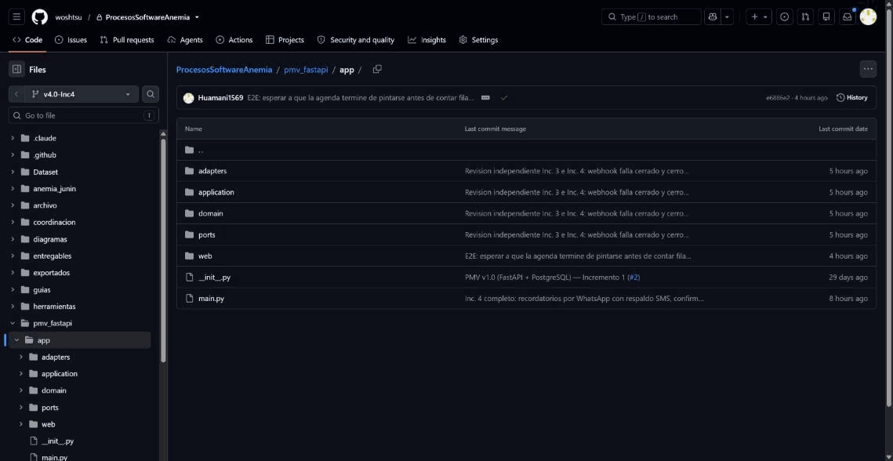

**Figura 8.** Carpeta `pmv_fastapi/app/` en GitHub con la etiqueta `v4.0-Inc4` seleccionada: `adapters`, `application`, `domain`, `ports` y `web`, y `main.py` (captura del 30/10/2026). Archivo: `../semana-10/evidencias/github/GH_arbol_app.png`.

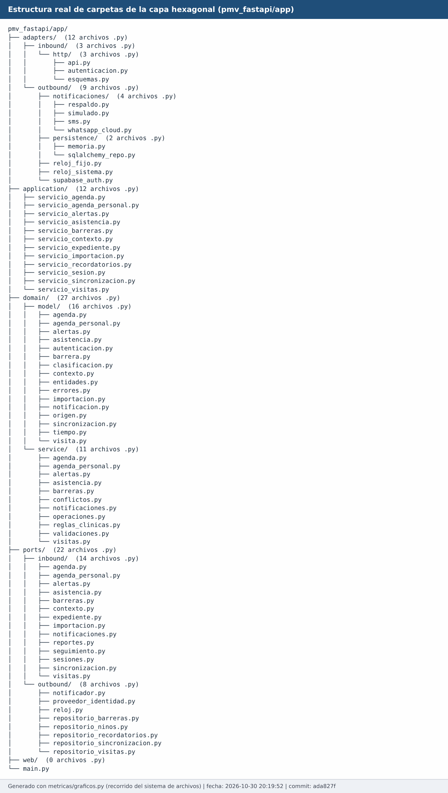

**Figura 9.** Árbol real de `pmv_fastapi/app/` generado recorriendo el sistema de archivos. Archivo: `../semana-10/evidencias/arquitectura/S_arbol_hexagonal.png`.

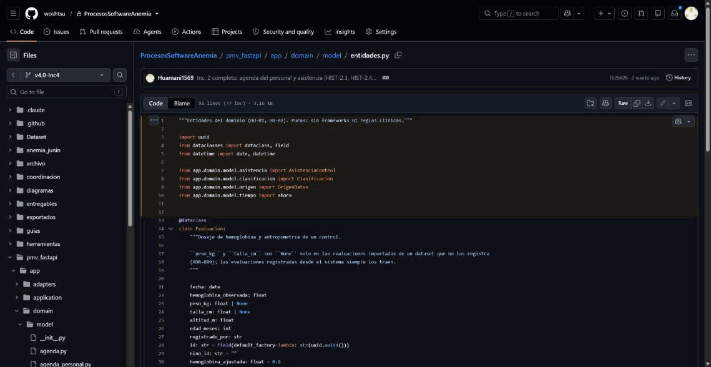

**Figura 10.** Importaciones de una entidad del dominio: solo biblioteca estándar y módulos propios (GitHub, `v4.0-Inc4`). Archivo: `../semana-10/evidencias/github/GH_dominio_entidades_imports.png`.

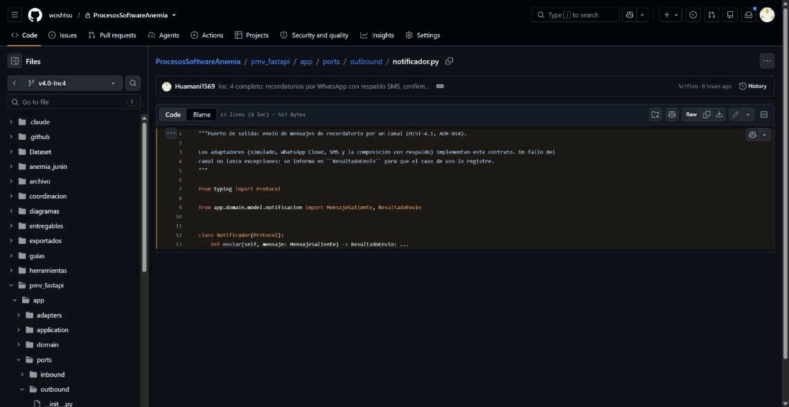

**Figura 11.** Ejemplo de puerto de salida (`Notificador`), implementado por cuatro adaptadores (simulado, WhatsApp Cloud, SMS y respaldo). Archivo: `../semana-10/evidencias/github/GH_puerto_notificador.png`.

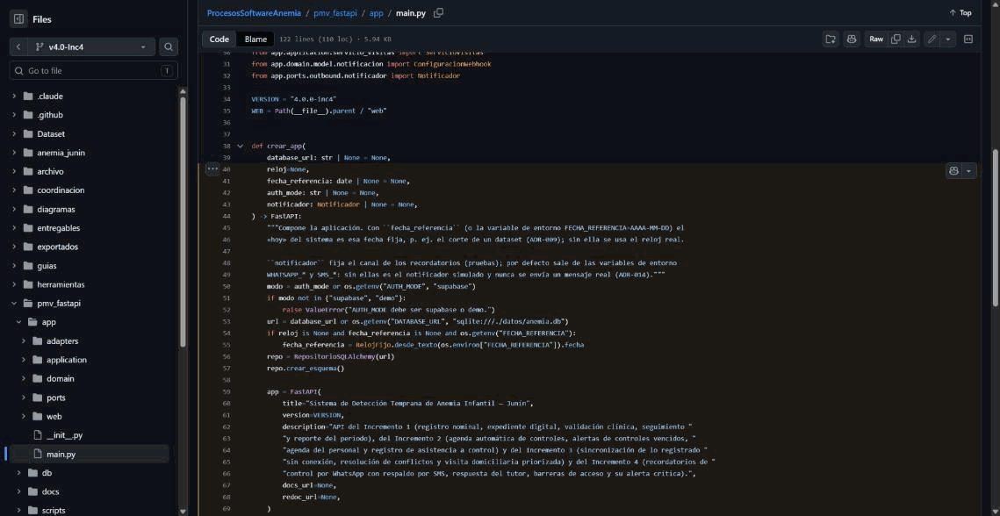

**Figura 12.** `main.py` como única raíz de composición (GitHub, `v4.0-Inc4`). Archivo: `../semana-10/evidencias/github/GH_main_composicion.png`.

**Tabla 20.** Matriz de dependencias entre capas (conteo de importaciones; S10, Tabla 18). Ninguna importación prohibida.

| Capa (origen) | stdlib | terceros | dominio | puertos | application | adaptadores |
| --- | :---: | :---: | :---: | :---: | :---: | :---: |
| `domain` (model y service) | 63 | **0** | 67 | 0 | 0 | 0 |
| `ports` (inbound y outbound) | 32 | **0** | 20 | 0 | 0 | 0 |
| `application` | 14 | **0** | 63 | 48 | 0 | 0 |
| `adapters.inbound` | 7 | 8 (`fastapi`, `pydantic`) | 12 | 13 | 0 | 1 |
| `adapters.outbound` | 14 | 7 (`httpx`, `sqlalchemy`) | 24 | 15 | 0 | 4 |

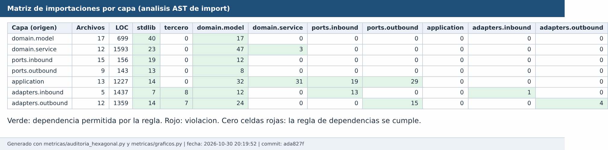

**Figura 13.** Matriz de importaciones por capa; no hay celdas de violación. Archivo: `../semana-10/evidencias/arquitectura/S_matriz_importaciones.png`.

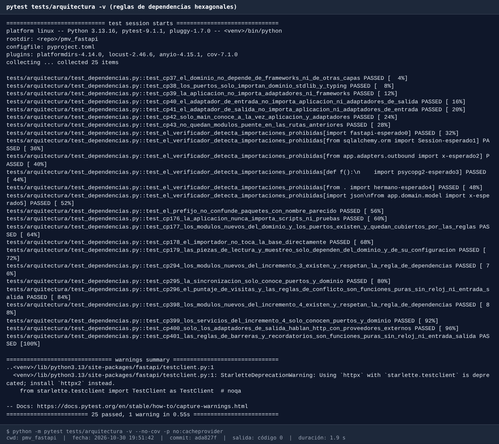

**Figura 14.** Las 25 pruebas de arquitectura (`tests/arquitectura`) validan la regla de dependencia en cada ejecución del CI: todas aprobadas. Archivo: `../semana-10/evidencias/terminal/R06_arquitectura.png`.

Tres hallazgos honestos de la auditoría: (1) la conformidad **ultra estricta** de M1.2 es 80 % porque `application/servicio_sesion.py` implementa el puerto `ProveedorIdentidad` dentro de la capa de aplicación (adenda S9, sección 7); (2) `autenticacion.py` (94 %) y `supabase_auth.py` (97 %) explican por qué la cobertura bajó de 100 % a 99,79 %; (3) el diagrama C4 de componentes del repositorio describe solo el Incremento 1 y no se actualizó.

#### 3.6.2 Evaluación GQM de arquitectura, pruebas y valor

Las tres metas se formularon con la plantilla de Basili et al. (1994) (objeto, propósito, enfoque de calidad, punto de vista y contexto) y se midieron para los cuatro incrementos con los scripts de `herramientas/gqm/`.

**Tabla 21.** Metas, preguntas y métricas GQM (S9, Tablas 8 y 12).

| Meta | Pregunta | Métrica | Fórmula | Meta de la guía (Inc. 1 / Inc. 2) |
| --- | --- | --- | --- | --- |
| **G-01** Evaluar el desacoplamiento del dominio (mantenibilidad, punto de vista del arquitecto) | Q1.1 ¿Cuánto del dominio depende de frameworks? | M1.1 Contaminación del dominio | importaciones de terceros ÷ clases del dominio × 100 | 0 % / 0 % |
| | Q1.2 ¿La estructura es hexagonal? | M1.2 Conformidad hexagonal | componentes conformes ÷ 5 × 100 | 100 % / 100 % |
| | Q1.3 (complementaria) ¿Las dependencias apuntan al núcleo? | M1.3 Violaciones de la regla de dependencia | conteo por AST | propuesta: 0 |
| **G-02** Verificar la estabilidad funcional (cobertura y tasa de fallas, punto de vista de QA) | Q2.1 ¿Cada RF tiene evidencia? | M2.1 Cobertura funcional con capturas | RF con captura aprobada ÷ RF × 100 | 100 % / 100 % |
| | Q2.2 ¿Cuántos defectos hay? | M2.2 Defectos por RF | defectos ÷ RF | ≤ 1,0 / ≤ 0,2 |
| **G-03** Evaluar la efectividad del proceso (valor organizacional, punto de vista del usuario y Product Owner simulado) | Q3.1 ¿Qué brechas del AS-IS se resolvieron? | M3.1 Brechas resueltas | (Σ puntajes B1 a B6 ÷ 6) × 100 | ≥ 60 % / ≥ 90 % |
| | Q3.2 ¿Mejoraron los indicadores de valor? | M3.2 Índice de impacto en valor | promedio de mejoras de V1, V2 y V3 | ≥ 50 % / ≥ 80 % |

**Tabla 22.** Valores GQM por incremento (adenda S9, sección 2). «n/r»: no recalculada.

| Métrica | Inc. 1 `v1.0-PMV` | Inc. 2 `v2.0-Inc2` | Inc. 3 `v3.0-Inc3` | Inc. 4 `v4.0-Inc4` |
| --- | :---: | :---: | :---: | :---: |
| M1.1 contaminación del dominio | 0,0 % (0/8 clases) | 0,0 % (0/32) | 0,0 % (0/55) | **0,0 % (0/86)** |
| M1.2 conformidad hexagonal (estricta) | 40,0 % | 100,0 % | 100,0 % | **100,0 %** |
| M1.3 violaciones de dependencia | 1 | 0 | 0 | **0** |
| M2.1 cobertura funcional con capturas | 100 % (5/5 RF) | 100 % (4/4; 9/9 acumulado) | n/r | n/r (19/19 escenarios con captura en S10) |
| M2.2 defectos por RF | 1,4 (7/5) | 0,25 (1/4) | n/r (indicativo 0,20) | n/r (indicativo 0,75) |
| **M3.1 brechas resueltas (principal)** | 25,0 % | 33,3 % | 50,0 % | **75,0 %** |
| M3.2 índice de impacto en valor (V1, V2, V3) | 57,6 % | 100,0 % | 100,0 % | 100,0 % |
| V3 F1 de controles vencidos | 0,729 | 1,000 | 1,000 | 1,000 (476/476 controles) |
| V4 p95 agregado, 50 usuarios | 175 ms | 815 ms | n/r | **1 100 ms** (una corrida) |
| V5 disponibilidad durante la carga | 100 % (856/856) | 100 % (856/856) | n/r | 100 % (64/64) |

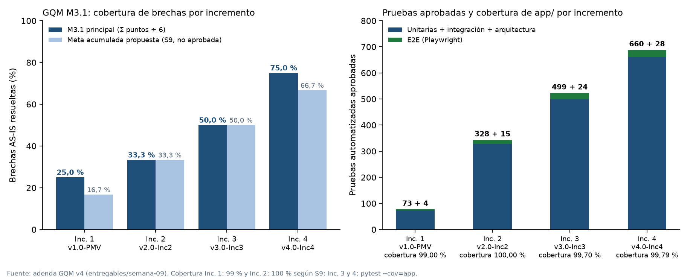

**Figura 15.** Evolución de M3.1 frente a la meta acumulada propuesta en S9 (izquierda; no aprobada) y de las pruebas automáticas y la cobertura por incremento (derecha). Elaboración propia con `evidencias/generar_figuras.py`. Archivo: `evidencias/GQM_v4_evolucion.png`.

La meta acumulada propuesta en S9 (16,7 %, 33,3 %, 50,0 % y 66,7 % hasta INC-4) se alcanza en cada incremento (25,0 %, 33,3 %, 50,0 % y 75,0 %); las metas de la guía (60 % y 90 %) suponían cerrar casi todas las brechas en dos incrementos y no se alcanzaron en su momento.

**Tabla 23.** Puntaje de M3.1 por brecha e incremento (1 = mecanismo completo, operativo y probado; 0,5 = parcial; 0 = no; adenda S9, sección 3).

| Brecha | Plan | Inc. 1 | Inc. 2 | Inc. 3 | Inc. 4 | Evidencia en `v4.0-Inc4` |
| --- | --- | :---: | :---: | :---: | :---: | --- |
| B1 Triple registro | INC-1 | 1,0 | 1,0 | 1,0 | 1,0 | Una escritura por evaluación |
| B2 Agenda sin recordatorios | INC-2 | 0,0 | 0,5 | 0,5 | **1,0** | Recordatorios con puerto `Notificador`; solo el modo simulado y `httpx.MockTransport` están probados |
| B3 Barreras ocultas | INC-4 | 0,0 | 0,0 | 0,0 | **1,0** | 8 tipos de barrera, `REGLAS_BARRERAS_V1`, vigencia de 90 días; reglas sin validar |
| B4 Visita en papel | INC-3 | 0,0 | 0,0 | **1,0** | 1,0 | `VISITA-V1`/`V2`, captura sin conexión; pesos sin validar |
| B5 Riesgo tardío | INC-5 | 0,0 | 0,0 | 0,0 | 0,0 | Sin modelo ni regla de riesgo (INC-5 no implementado) |
| B6 Conectividad | INC-3 e INC-6 | 0,5 | 0,5 | 0,5 | 0,5 | Sincronización idempotente; sin dispositivo real ni INC-6 |
| **Σ puntos** | | **1,5** | **2,0** | **3,0** | **4,5** | **75,0 %** |

**Sensibilidades.** M3.1 depende de cómo se puntúe lo no probado en el mundo real: si B2, B3 y B4 se puntuaran 0,5 por exigir un envío real y un dispositivo real, M3.1 bajaría a **50,0 %**; si B6 puntuara 0, a 66,7 %; la lectura estricta (solo puntaje 1,0) es 66,7 % (4 de 6). El valor de 75,0 % es la lectura principal de la guía y se informa junto a estas variaciones.

**Lo que GQM no pudo medir.** M2.1 y M2.2 de Inc. 3 e Inc. 4 no se recalcularon: no hay mapa curado de RF para las historias nuevas ni registro de defectos posterior a DEF-09; los cinco defectos de la revisión independiente (tres de ellos de concurrencia o seguridad) se corrigieron sin registrarse como DEF. El p95 de 1 100 ms (una sola corrida, sin control de la versión anterior) supera la meta de 800 ms y es el principal riesgo de rendimiento.

#### 3.6.3 Estrategia de pruebas

**Tabla 24.** Pruebas automáticas del repositorio en `v4.0-Inc4`, re-ejecutadas el 30/10/2026 (adenda S9, sección 4; S10, Tabla 8).

| Conjunto | Cantidad | Resultado | Comando (desde `pmv_fastapi/`) |
| --- | :---: | --- | --- |
| Unitarias | 416 | Aprobadas | `python -m pytest --cov=app` |
| Integración (el CI las ejecuta además contra PostgreSQL 16) | 219 | Aprobadas | idem |
| Arquitectura (regla de dependencia) | 25 | Aprobadas | idem |
| **Subtotal** | **660** | **0 fallas; cobertura 99,79 %** (umbral del proyecto: 80 %) | |
| E2E con Playwright (navegador real) | 28 | Aprobadas, 0 fallas | `python -m pytest tests/e2e -m e2e` |

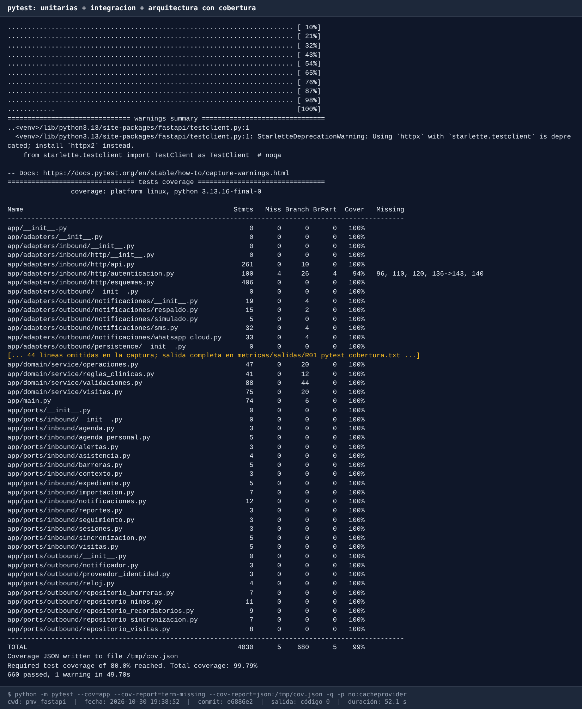

**Figura 16.** pytest con cobertura: 660 pruebas aprobadas y 99,79 % de cobertura (S10, 30/10/2026). Archivo: `../semana-10/evidencias/terminal/R01_pytest_cobertura.png`.

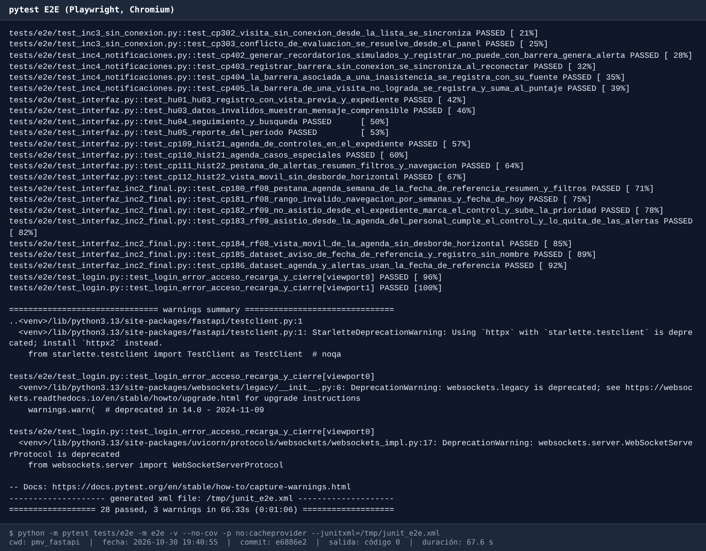

**Figura 17.** 28 pruebas E2E con Playwright aprobadas. Archivo: `../semana-10/evidencias/terminal/R03_e2e_playwright.png`.

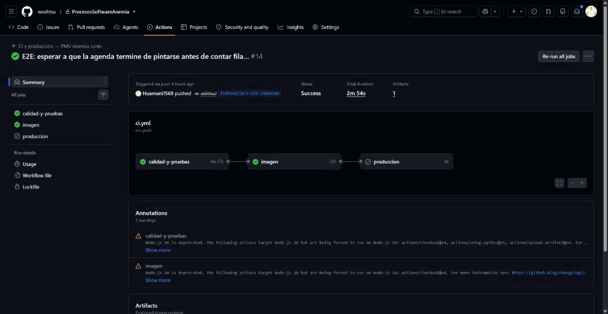

**Figura 18.** Ejecución #14 del CI en la rama de los incrementos 3 y 4: `calidad-y-pruebas` (2 min 27 s) e `imagen` (22 s) en verde; `produccion` se omite fuera de `main`. Archivo: `../semana-10/evidencias/github/GH_actions_ejecucion_verde.png`.

**Despliegue en producción.** El trabajo `produccion` publica `main` en Render con Supabase. El 31/10/2026 se verificó la URL pública (<https://softwareanemia.onrender.com>): `GET /api/salud` respondió `{"estado":"ok","fecha_hoy":"2024-06-30","fecha_referencia":"2024-06-30"}` y `GET /openapi.json` declara la versión `4.0.0-inc4` con 29 rutas, igual que el contrato de `v4.0-Inc4`. La aplicación desplegada usa un reloj fijo al corte del dataset (30/06/2024): sus agendas y vencimientos se calculan a esa fecha y no a la real. Las capturas de producción por incremento están marcadas en la sección 3.6.4 y en el Anexo B.

La cobertura alta no garantizó ausencia de defectos: seis de los siete defectos del Incremento 1 y cinco de los incrementos 3 y 4 escaparon a las pruebas, porque estas verificaban casos válidos y no entradas hostiles ni concurrencia. La revisión independiente (commit `d2ab78b`) corrigió cinco defectos: el webhook de WhatsApp aceptaba cuerpos sin firma si faltaba el secreto (alta), el reenvío simultáneo de una operación duplicaba una evaluación (media), dos generaciones simultáneas de recordatorios enviaban el mensaje dos veces (media) y dos defectos de interfaz (baja; la adenda S9 los cuenta como uno). Cada corrección tiene prueba de regresión salvo los dos de interfaz.


#### 3.6.4 Fichas de prueba funcional con evidencia fotográfica

Cada ficha sigue el formato de la «Ficha Modelo de Prueba Funcional con Evidencia Fotográfica» de la plantilla: encabezado, proyecto, incremento, requerimiento, caso de prueba, dato de entrada, resultado esperado, dos capturas (datos de entrada cargados y confirmación o resultado) y evaluación. Hay 20 fichas: los 19 escenarios de aceptación de los cuatro incrementos y la autenticación. Las capturas son del software en ejecución sobre `v4.0-Inc4` (Playwright con Chromium; escritorio 1366x768; datos sintéticos, `AUTH_MODE=demo`, 30/10/2026), producidas por `entregables/semana-10/metricas/capturar_software.py`; cada escenario incluye aserciones y, si una falla, queda «Rechazado». Excepciones: la captura 1 de RF-05 y de RF-06 y la captura 2 de RF-05 son de S9 sobre `v1.0-PMV` y sobre el hito `v1.5.0-inc2-avance` (el pie de la imagen indica versión y fecha). Los identificadores `CP-RF0X-01` son los de S9; los demás siguen la misma convención. Las vistas móviles (390x844) están en `../semana-10/evidencias/software/`. El evaluador es el QA Lead; la firma manuscrita está pendiente. Cada incremento cierra con el marcador de su captura en producción (<https://softwareanemia.onrender.com>); la aplicación desplegada usa un reloj fijo al 30/06/2024, por lo que sus fechas difieren de las de las capturas locales.

**Tabla 25.** Resumen de las fichas por incremento (S10, Tabla 7).

| Incremento | Fichas | Aprobadas | Capturas (S10, incluye móvil) |
| --- | --- | :---: | :---: |
| Inc. 1 (`v1.0-PMV`) | RF-01 a RF-05 | 5/5 | 15 |
| Inc. 2 (`v2.0-Inc2`) | RF-06 a RF-09 | 4/4 | 13 |
| Inc. 3 (`v3.0-Inc3`) | HIST-3.1, HIST-3.1b, HIST-3.2, HIST-3.3, HIST-3.4, VIS-3.5 | 6/6 | 13 |
| Inc. 4 (`v4.0-Inc4`) | HIST-4.1 a HIST-4.4 | 4/4 | 13 |
| **Total** | **19 escenarios** (más la ficha AUTH) | **19/19** | **54** |

---

**FICHA DE PRUEBA FUNCIONAL Y EVIDENCIA VISUAL POR REQUERIMIENTO (RF-01)**

- **PROYECTO:** Anemia Junín - Sistema Inteligente para Detección Temprana de Anemia Infantil en Zonas Rurales de Junín
- **INCREMENTO EVALUADO:** Incremento 1 (PMV), etiqueta `v1.0-PMV`
- **REQUERIMIENTO:** RF-01 / HU-01 - Registro del niño con evaluación inicial (`POST /api/ninos`)
- **CASO DE PRUEBA:** CP-RF01-01 (Prueba Funcional de UI / Aceptación; automatizada en `tests/integracion/test_api.py` y `tests/unitarias/test_casos_uso.py`)
- **DATO DE ENTRADA:** { dni: "72000001", sexo: "F", fecha_nacimiento: "09/10/2025", altitud_m: 3720, hemoglobina_observada: 11.6, peso_kg: 8.4, talla_cm: 71 } (datos sintéticos); segundo envío con el mismo DNI
- **RESULTADO ESPERADO:** Registro persistido, confirmación visible y expediente abierto en menos de 2 s; el DNI repetido se rechaza con HTTP 409.

**EVIDENCIAS FOTOGRÁFICAS (CAPTURAS DE PANTALLA EN EJECUCIÓN):**

**[ CAPTURA 1: DATOS DE ENTRADA CARGADOS ]**

- **Descripción:** **Figura 19.** RF-01, captura 1. Formulario de registro con los datos sintéticos cargados antes de «Guardar registro»; la vista previa ya muestra Hb ajustada 9,1 g/dL y «Anemia moderada».


- **Archivo de Imagen:** `../semana-10/evidencias/software/RF01_inc1_1_entrada_escritorio.png`

**[ CAPTURA 2: CONFIRMACIÓN / RESULTADO ]**

- **Descripción:** **Figura 20.** RF-01, captura 2. Confirmación y expediente creado tras «Guardar registro» (130 ms); el DNI repetido respondió HTTP 409.

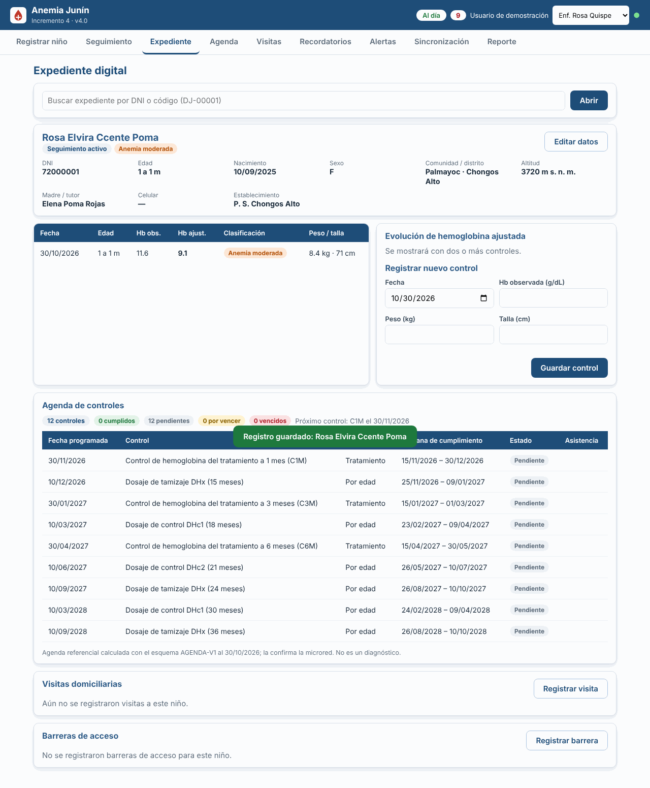

- **Archivo de Imagen:** `../semana-10/evidencias/software/RF01_inc1_2_resultado_escritorio.png`

**EVALUACIÓN: APROBADO | FECHA: 30/10/2026 | EVALUADOR: QA Lead (Huamani R.)**

---

**FICHA DE PRUEBA FUNCIONAL Y EVIDENCIA VISUAL POR REQUERIMIENTO (RF-02)**

- **PROYECTO:** Anemia Junín - Sistema Inteligente para Detección Temprana de Anemia Infantil en Zonas Rurales de Junín
- **INCREMENTO EVALUADO:** Incremento 1 (PMV), etiqueta `v1.0-PMV`
- **REQUERIMIENTO:** RF-02 / HU-02 - Consulta y actualización del expediente; nuevo control (`GET /api/ninos/dni/{dni}`, `PATCH /api/ninos/{id}`, `POST /api/ninos/{id}/evaluaciones`)
- **CASO DE PRUEBA:** CP-RF02-01 (Prueba Funcional de UI / Aceptación; automatizada en `tests/integracion/test_api.py` y `tests/unitarias/test_entidades.py`)
- **DATO DE ENTRADA:** { dni: "71000001", edición: { comunidad: "Llacuas", tutor_celular: "987654322" }, nuevo_control: { hemoglobina_observada: 11.5, peso_kg: 8.2, talla_cm: 69 } }
- **RESULTADO ESPERADO:** Expediente consultado, campos permitidos actualizados y nuevo control persistido: el historial pasa de 2 a 3 evaluaciones.

**EVIDENCIAS FOTOGRÁFICAS (CAPTURAS DE PANTALLA EN EJECUCIÓN):**

**[ CAPTURA 1: DATOS DE ENTRADA CARGADOS ]**

- **Descripción:** **Figura 21.** RF-02, captura 1. Expediente del DNI 71000001 recién consultado, con su historial de 2 evaluaciones y el formulario de nuevo control.

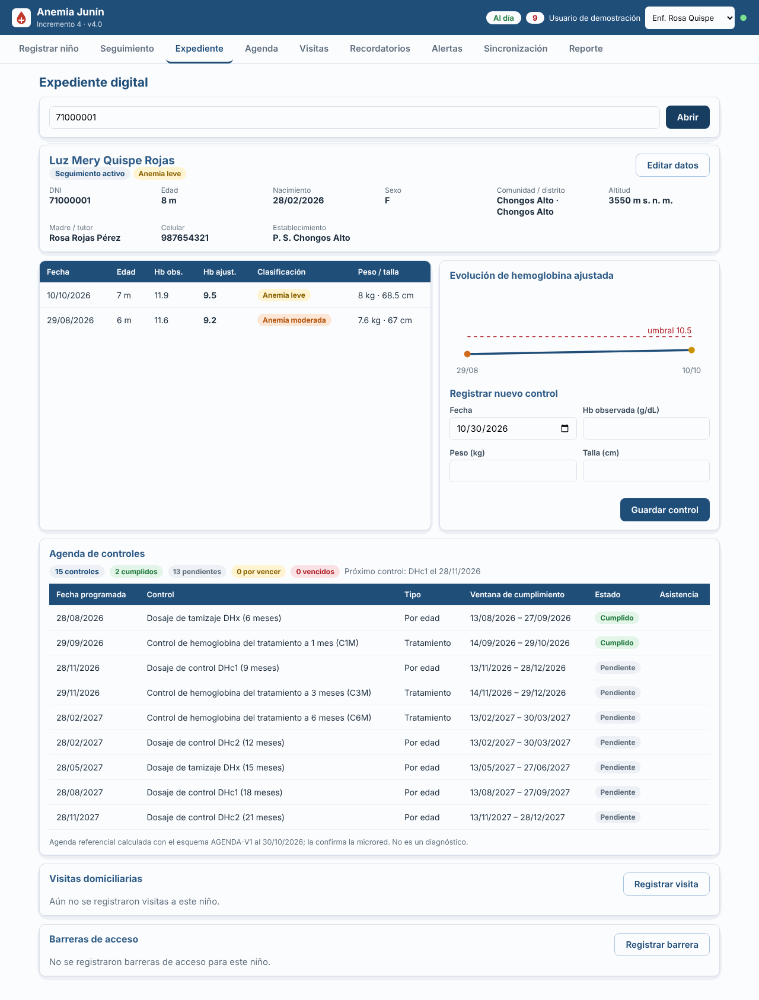

- **Archivo de Imagen:** `../semana-10/evidencias/software/RF02_inc1_1_expediente_escritorio.png`

**[ CAPTURA 2: CONFIRMACIÓN / RESULTADO ]**

- **Descripción:** **Figura 22.** RF-02, captura 2. Nuevo control agregado: el historial pasa de 2 a 3 evaluaciones (la edición de datos se registró en `RF02_inc1_2_edicion_escritorio.png`).

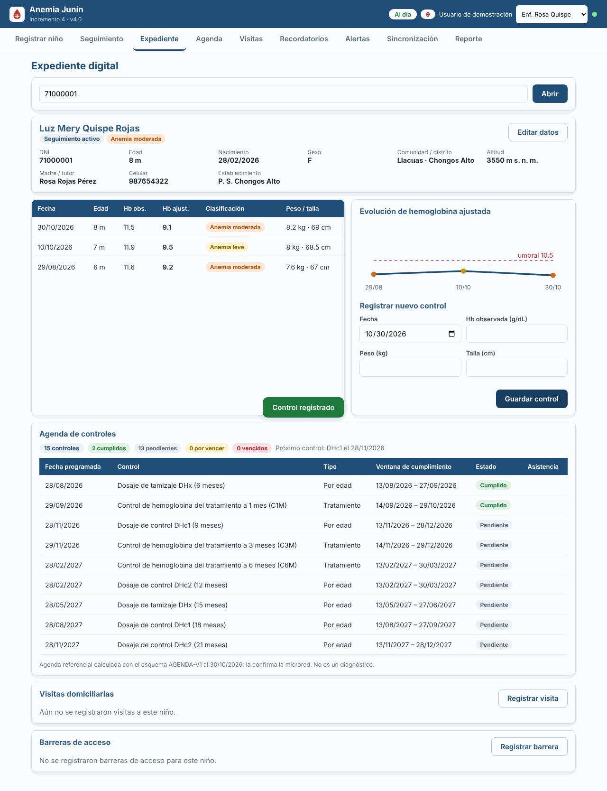

- **Archivo de Imagen:** `../semana-10/evidencias/software/RF02_inc1_3_nuevo_control_escritorio.png`

**EVALUACIÓN: APROBADO | FECHA: 30/10/2026 | EVALUADOR: QA Lead (Huamani R.)**

---

**FICHA DE PRUEBA FUNCIONAL Y EVIDENCIA VISUAL POR REQUERIMIENTO (RF-03)**

- **PROYECTO:** Anemia Junín - Sistema Inteligente para Detección Temprana de Anemia Infantil en Zonas Rurales de Junín
- **INCREMENTO EVALUADO:** Incremento 1 (PMV), etiqueta `v1.0-PMV`
- **REQUERIMIENTO:** RF-03 / HU-03 - Validación con reglas clínicas (`POST /api/validaciones/evaluacion`)
- **CASO DE PRUEBA:** CP-RF03-01 (Prueba Funcional de UI / Aceptación; automatizada en `tests/unitarias/test_reglas_clinicas.py`)
- **DATO DE ENTRADA:** Válido: { hemoglobina_observada: 11.6, altitud_m: 3720 }. Inválido: { dni: "123", hemoglobina_observada: 25 }
- **RESULTADO ESPERADO:** Con datos válidos, vista previa con Hb ajustada por altitud y clasificación; con datos inválidos, rechazo por campo (HTTP 422) sin guardar nada.

**EVIDENCIAS FOTOGRÁFICAS (CAPTURAS DE PANTALLA EN EJECUCIÓN):**

**[ CAPTURA 1: DATOS DE ENTRADA CARGADOS ]**

- **Descripción:** **Figura 23.** RF-03, captura 1. Formulario con Hb 11,6 g/dL a 3 720 m: la vista previa muestra Hb ajustada 9,1 g/dL y «Anemia moderada».

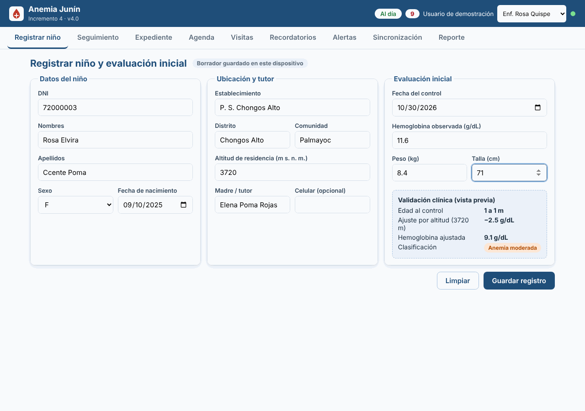

- **Archivo de Imagen:** `../semana-10/evidencias/software/RF03_inc1_1_vista_previa_escritorio.png`

**[ CAPTURA 2: CONFIRMACIÓN / RESULTADO ]**

- **Descripción:** **Figura 24.** RF-03, captura 2. Datos inválidos (DNI «123», Hb 25 g/dL) rechazados con mensajes por campo (HTTP 422); no se guardó nada.

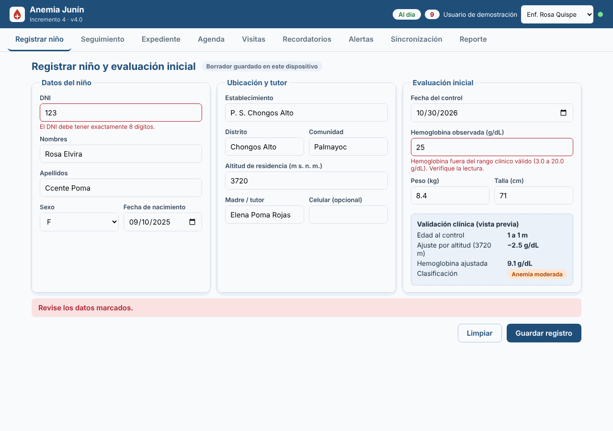

- **Archivo de Imagen:** `../semana-10/evidencias/software/RF03_inc1_2_rechazo_escritorio.png`

**EVALUACIÓN: APROBADO | FECHA: 30/10/2026 | EVALUADOR: QA Lead (Huamani R.)**

---

**FICHA DE PRUEBA FUNCIONAL Y EVIDENCIA VISUAL POR REQUERIMIENTO (RF-04)**

- **PROYECTO:** Anemia Junín - Sistema Inteligente para Detección Temprana de Anemia Infantil en Zonas Rurales de Junín
- **INCREMENTO EVALUADO:** Incremento 1 (PMV), etiqueta `v1.0-PMV`
- **REQUERIMIENTO:** RF-04 / HU-04 - Listado de niños en seguimiento (`GET /api/ninos`)
- **CASO DE PRUEBA:** CP-RF04-01 (Prueba Funcional de UI / Aceptación; automatizada en `tests/integracion/test_api.py` y `tests/e2e/test_interfaz.py`)
- **DATO DE ENTRADA:** Base sintética de 27 niños; filtro de clasificación «Moderada»
- **RESULTADO ESPERADO:** Listado de seguimiento que respeta el filtro por clasificación.

**EVIDENCIAS FOTOGRÁFICAS (CAPTURAS DE PANTALLA EN EJECUCIÓN):**

**[ CAPTURA 1: DATOS DE ENTRADA CARGADOS ]**

- **Descripción:** **Figura 25.** RF-04, captura 1. Pestaña «Seguimiento» con el listado completo de niños, sin filtro.

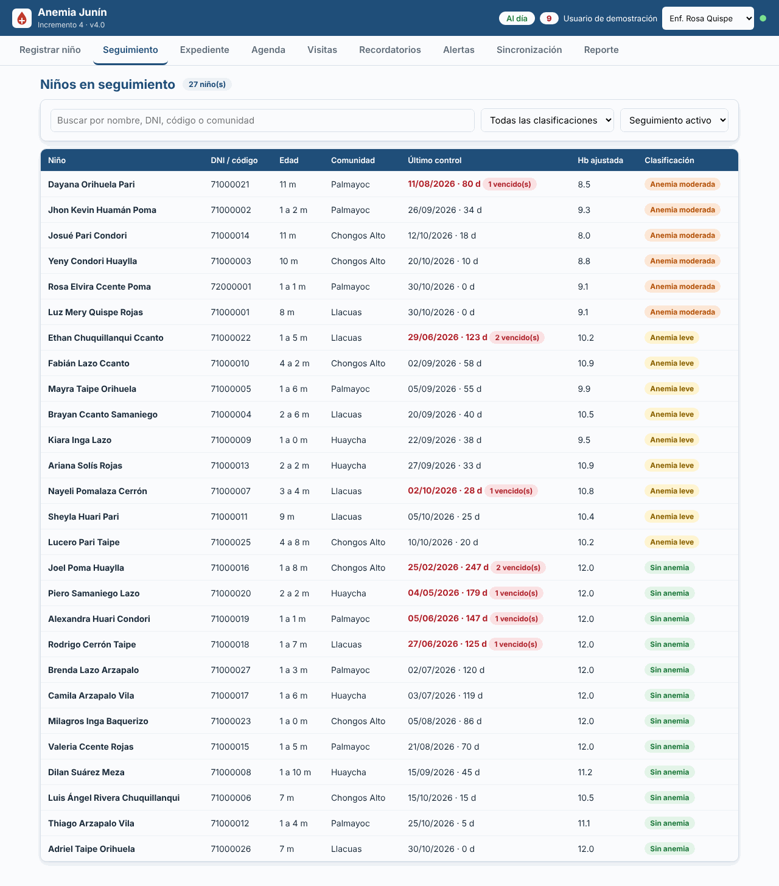

- **Archivo de Imagen:** `../semana-10/evidencias/software/RF04_inc1_1_seguimiento_escritorio.png`

**[ CAPTURA 2: CONFIRMACIÓN / RESULTADO ]**

- **Descripción:** **Figura 26.** RF-04, captura 2. Filtro por clasificación «Moderada» aplicado: 6 niños de 27.

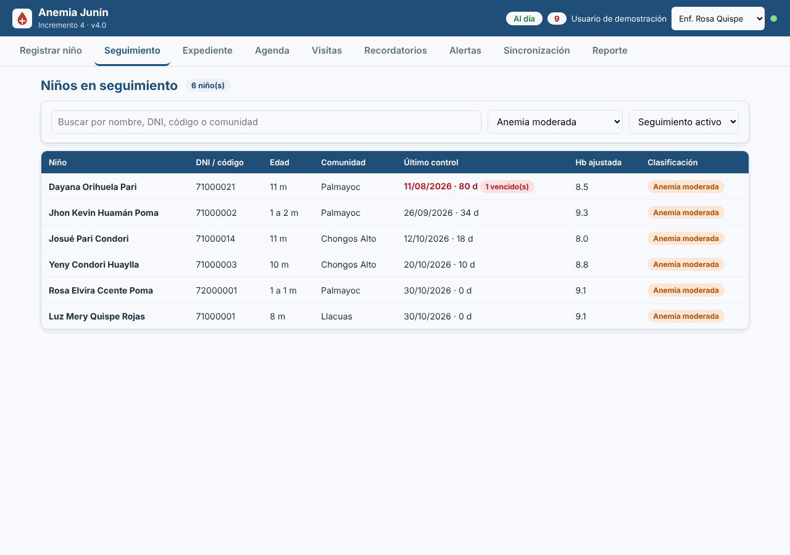

- **Archivo de Imagen:** `../semana-10/evidencias/software/RF04_inc1_2_filtro_moderada_escritorio.png`

**EVALUACIÓN: APROBADO | FECHA: 30/10/2026 | EVALUADOR: QA Lead (Huamani R.)**

---

**FICHA DE PRUEBA FUNCIONAL Y EVIDENCIA VISUAL POR REQUERIMIENTO (RF-05)**

- **PROYECTO:** Anemia Junín - Sistema Inteligente para Detección Temprana de Anemia Infantil en Zonas Rurales de Junín
- **INCREMENTO EVALUADO:** Incremento 1 (PMV), etiqueta `v1.0-PMV`
- **REQUERIMIENTO:** RF-05 / HU-05 - Reporte del periodo en JSON y CSV (`GET /api/reportes/periodo`)
- **CASO DE PRUEBA:** CP-RF05-01 (Prueba Funcional de UI / Aceptación; automatizada en `tests/integracion/test_api.py`)
- **DATO DE ENTRADA:** { desde: "01/09/2026", hasta: "16/10/2026" } sobre la base sintética (captura de S9 sobre `v1.0-PMV`)
- **RESULTADO ESPERADO:** Indicadores del periodo en pantalla y CSV descargable en menos de 2 s.

**EVIDENCIAS FOTOGRÁFICAS (CAPTURAS DE PANTALLA EN EJECUCIÓN):**

**[ CAPTURA 1: DATOS DE ENTRADA CARGADOS ]**

- **Descripción:** **Figura 27.** RF-05, captura 1. Pestaña «Reporte» con el periodo cargado antes de pulsar «Generar» (captura de S9, `v1.0-PMV`; el pie de la imagen indica versión y fecha).

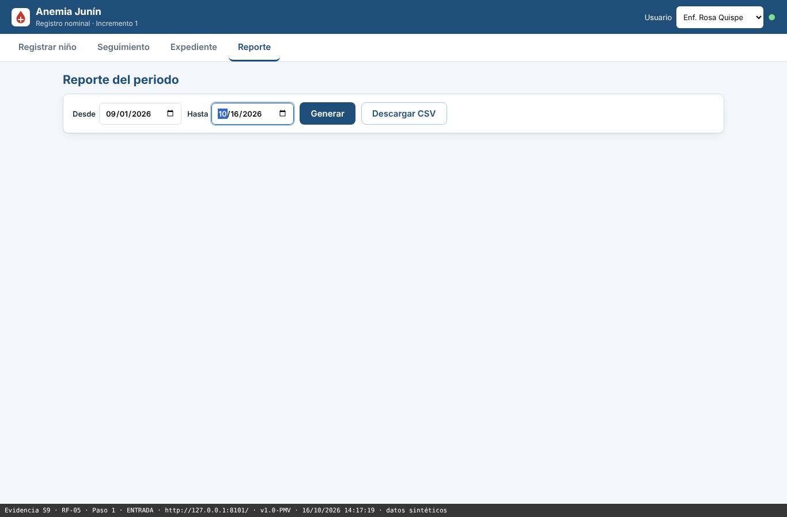

- **Archivo de Imagen:** `../semana-09/evidencias_capturas/RF-05/RF05_inc1_paso1_entrada.png`

**[ CAPTURA 2: CONFIRMACIÓN / RESULTADO ]**

- **Descripción:** **Figura 28.** RF-05, captura 2. Reporte generado: 15 niños registrados, 15 evaluaciones, 13 evaluados y 77 % con anemia. En `v4.0-Inc4` el mismo flujo dio 28 registrados y un CSV de 43 líneas en 86 ms (`RF05_inc1_1_reporte_escritorio.png`).

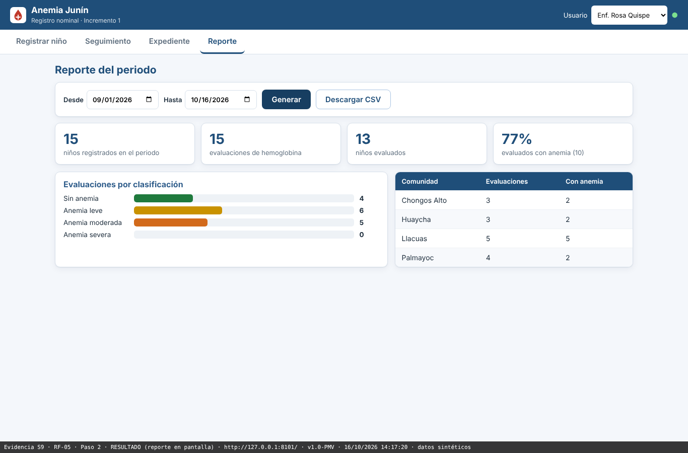

- **Archivo de Imagen:** `../semana-09/evidencias_capturas/RF-05/RF05_inc1_paso2_resultado.png`

**EVALUACIÓN: APROBADO | FECHA: 30/10/2026 | EVALUADOR: QA Lead (Huamani R.)**

**Captura en producción (PMV, Incremento 1):** `<captura de pantalla en https://softwareanemia.onrender.com mostrando la pestaña «Registrar niño» con la vista previa de la clasificación (Hb 11,6 g/dL a 3 720 m: Hb ajustada 9,1 g/dL, «Anemia moderada») sin guardar el registro, y la pestaña «Reporte» del periodo>` (pendiente; archivo previsto `evidencias/produccion/PROD_01_inc1_registro_clasificacion.png`; ver `CAPTURAS_PENDIENTES.md`).

---

**FICHA DE PRUEBA FUNCIONAL Y EVIDENCIA VISUAL POR REQUERIMIENTO (RF-06)**

- **PROYECTO:** Anemia Junín - Sistema Inteligente para Detección Temprana de Anemia Infantil en Zonas Rurales de Junín
- **INCREMENTO EVALUADO:** Incremento 2, etiqueta `v2.0-Inc2`
- **REQUERIMIENTO:** RF-06 / HIST-2.1 - Agenda de controles según la normativa (`GET /api/ninos/{id}/agenda`)
- **CASO DE PRUEBA:** CP-RF06-01 (Prueba Funcional de UI / Aceptación; automatizada en `tests/unitarias/test_agenda.py`)
- **DATO DE ENTRADA:** { dni: "71000022" } (niño con anemia leve en tratamiento)
- **RESULTADO ESPERADO:** Agenda normativa en el expediente con estados cumplido, pendiente y vencido por control.

**EVIDENCIAS FOTOGRÁFICAS (CAPTURAS DE PANTALLA EN EJECUCIÓN):**

**[ CAPTURA 1: DATOS DE ENTRADA CARGADOS ]**

- **Descripción:** **Figura 29.** RF-06, captura 1. Búsqueda del DNI 71000022 en «Seguimiento»: 1 niño con 2 controles vencidos (captura de S9, hito `v1.5.0-inc2-avance`).

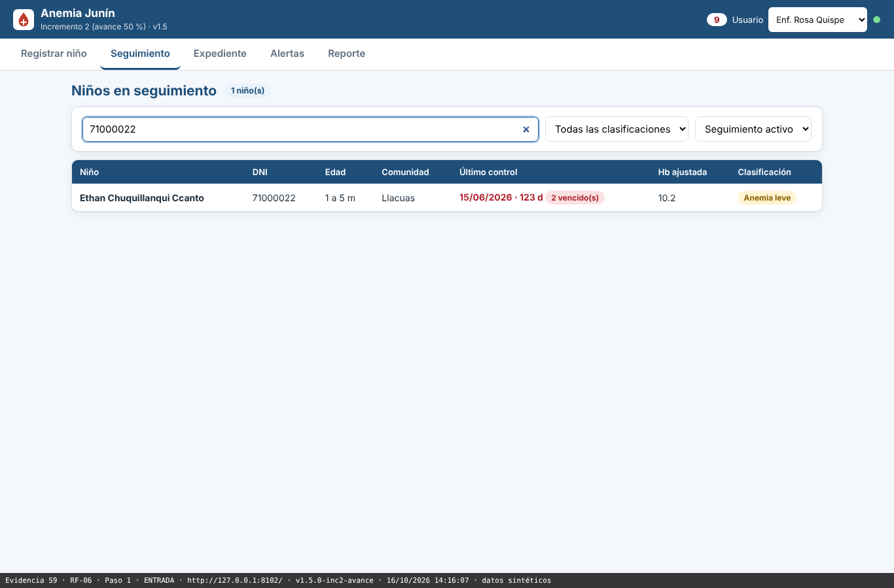

- **Archivo de Imagen:** `../semana-09/evidencias_capturas/RF-06/RF06_inc2_paso1_entrada.png`

**[ CAPTURA 2: CONFIRMACIÓN / RESULTADO ]**

- **Descripción:** **Figura 30.** RF-06, captura 2. Expediente con la agenda de 13 controles (2 cumplidos, 9 pendientes, 2 vencidos) en `v4.0-Inc4`.

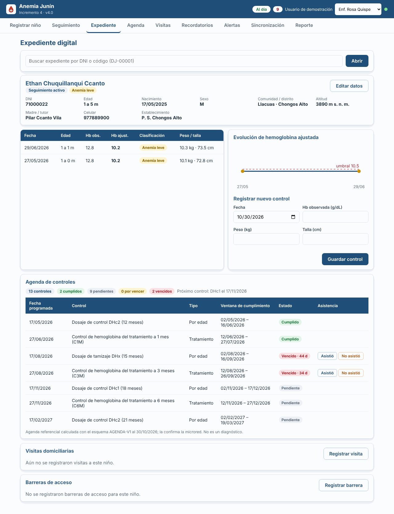

- **Archivo de Imagen:** `../semana-10/evidencias/software/RF06_inc2_1_agenda_expediente_escritorio.png`

**EVALUACIÓN: APROBADO | FECHA: 30/10/2026 | EVALUADOR: QA Lead (Huamani R.)**

---

**FICHA DE PRUEBA FUNCIONAL Y EVIDENCIA VISUAL POR REQUERIMIENTO (RF-07)**

- **PROYECTO:** Anemia Junín - Sistema Inteligente para Detección Temprana de Anemia Infantil en Zonas Rurales de Junín
- **INCREMENTO EVALUADO:** Incremento 2, etiqueta `v2.0-Inc2`
- **REQUERIMIENTO:** RF-07 / HIST-2.2 - Controles vencidos y alertas priorizadas (`GET /api/alertas/controles-vencidos`)
- **CASO DE PRUEBA:** CP-RF07-01 (Prueba Funcional de UI / Aceptación; automatizada en `tests/unitarias/test_alertas.py` y `tests/integracion/test_api_inc2.py`)
- **DATO DE ENTRADA:** Base sintética con 9 controles vencidos; filtro de prioridad MEDIA
- **RESULTADO ESPERADO:** Controles vencidos ordenados por prioridad, con filtro por prioridad.

**EVIDENCIAS FOTOGRÁFICAS (CAPTURAS DE PANTALLA EN EJECUCIÓN):**

**[ CAPTURA 1: DATOS DE ENTRADA CARGADOS ]**

- **Descripción:** **Figura 31.** RF-07, captura 1. Pestaña «Alertas» con los 9 controles vencidos priorizados (7 ALTA, 1 MEDIA, 1 BAJA).

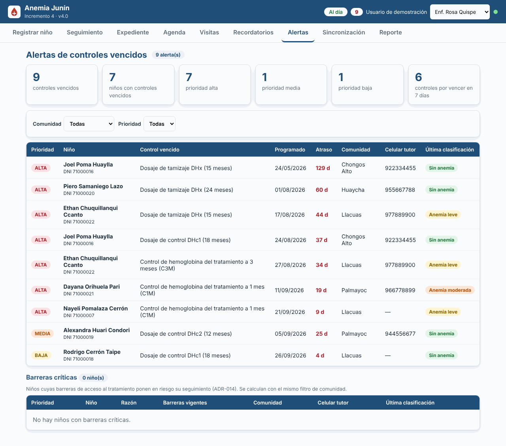

- **Archivo de Imagen:** `../semana-10/evidencias/software/RF07_inc2_1_alertas_escritorio.png`

**[ CAPTURA 2: CONFIRMACIÓN / RESULTADO ]**

- **Descripción:** **Figura 32.** RF-07, captura 2. Lista filtrada por prioridad MEDIA.

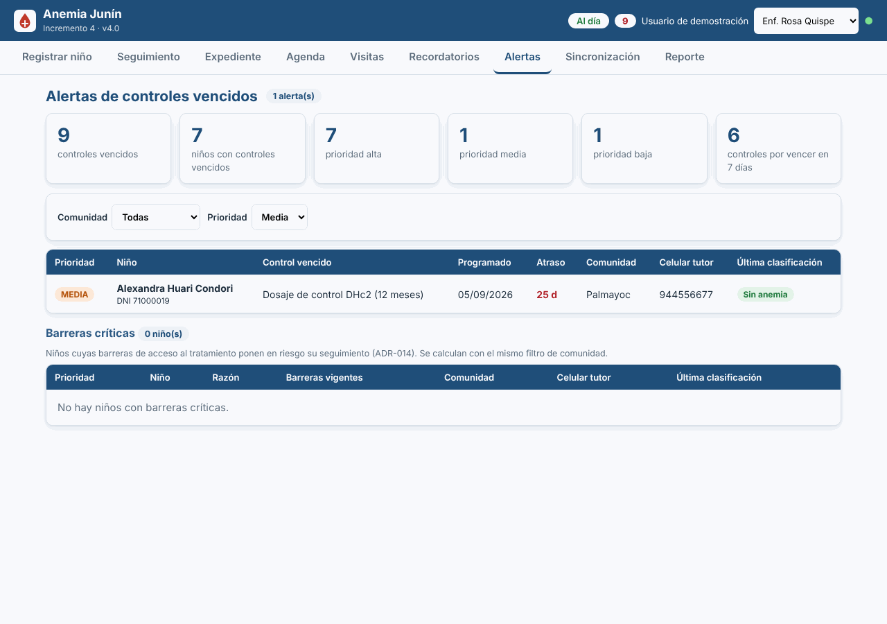

- **Archivo de Imagen:** `../semana-10/evidencias/software/RF07_inc2_2_filtro_media_escritorio.png`

**EVALUACIÓN: APROBADO | FECHA: 30/10/2026 | EVALUADOR: QA Lead (Huamani R.)**

---

**FICHA DE PRUEBA FUNCIONAL Y EVIDENCIA VISUAL POR REQUERIMIENTO (RF-08)**

- **PROYECTO:** Anemia Junín - Sistema Inteligente para Detección Temprana de Anemia Infantil en Zonas Rurales de Junín
- **INCREMENTO EVALUADO:** Incremento 2, etiqueta `v2.0-Inc2`
- **REQUERIMIENTO:** RF-08 / HIST-2.3 - Agenda del personal por rango de fechas (`GET /api/agenda`)
- **CASO DE PRUEBA:** CP-RF08-01 (Prueba Funcional de UI / Aceptación; automatizada en `tests/unitarias/test_agenda_personal.py` y `tests/e2e/test_interfaz_inc2_final.py`)
- **DATO DE ENTRADA:** Rangos de 7 y 30 días; rango mayor de 31 días para la validación
- **RESULTADO ESPERADO:** Controles agrupados por día para un rango de hasta 31 días; un rango mayor se rechaza.

**EVIDENCIAS FOTOGRÁFICAS (CAPTURAS DE PANTALLA EN EJECUCIÓN):**

**[ CAPTURA 1: DATOS DE ENTRADA CARGADOS ]**

- **Descripción:** **Figura 33.** RF-08, captura 1. Pestaña «Agenda» con el rango de la semana cargado.

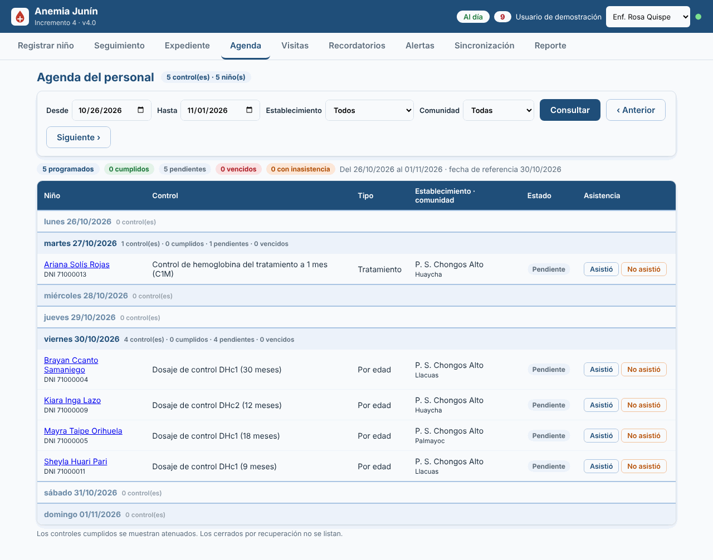

- **Archivo de Imagen:** `../semana-10/evidencias/software/RF08_inc2_1_agenda_semana_escritorio.png`

**[ CAPTURA 2: CONFIRMACIÓN / RESULTADO ]**

- **Descripción:** **Figura 34.** RF-08, captura 2. Agenda de 30 días: 17 controles de 14 niños; el rango mayor de 31 días se rechaza (`RF08_inc2_3_rango_invalido_escritorio.png`).

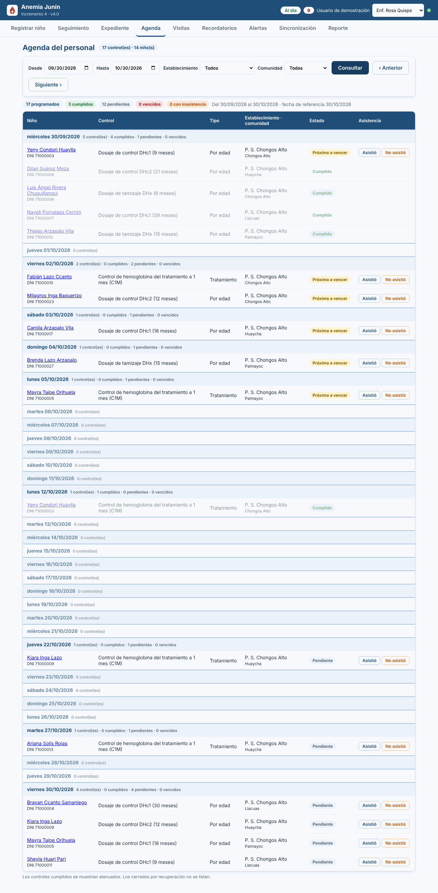

- **Archivo de Imagen:** `../semana-10/evidencias/software/RF08_inc2_2_agenda_30_dias_escritorio.png`

**EVALUACIÓN: APROBADO | FECHA: 30/10/2026 | EVALUADOR: QA Lead (Huamani R.)**

---

**FICHA DE PRUEBA FUNCIONAL Y EVIDENCIA VISUAL POR REQUERIMIENTO (RF-09)**

- **PROYECTO:** Anemia Junín - Sistema Inteligente para Detección Temprana de Anemia Infantil en Zonas Rurales de Junín
- **INCREMENTO EVALUADO:** Incremento 2, etiqueta `v2.0-Inc2`
- **REQUERIMIENTO:** RF-09 / HIST-2.4 - Registro de asistencia a un control (`POST /api/ninos/{id}/controles/{codigo}/asistencia`)
- **CASO DE PRUEBA:** CP-RF09-01 (Prueba Funcional de UI / Aceptación; automatizada en `tests/unitarias/test_asistencia.py` y `tests/e2e/test_interfaz_inc2_final.py`)
- **DATO DE ENTRADA:** Control vencido de un niño sintético; «No asistió» con motivo
- **RESULTADO ESPERADO:** Marca de inasistencia registrada y prioridad de la alerta actualizada.

**EVIDENCIAS FOTOGRÁFICAS (CAPTURAS DE PANTALLA EN EJECUCIÓN):**

**[ CAPTURA 1: DATOS DE ENTRADA CARGADOS ]**

- **Descripción:** **Figura 35.** RF-09, captura 1. Modal «No asistió» con el motivo cargado antes de confirmar.

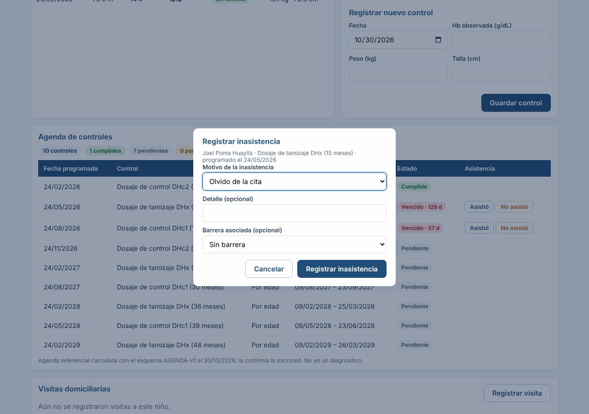

- **Archivo de Imagen:** `../semana-10/evidencias/software/RF09_inc2_1_modal_inasistencia_escritorio.png`

**[ CAPTURA 2: CONFIRMACIÓN / RESULTADO ]**

- **Descripción:** **Figura 36.** RF-09, captura 2. Inasistencia registrada y prioridad actualizada; los vencidos sin registro pasan de 9 a 8.

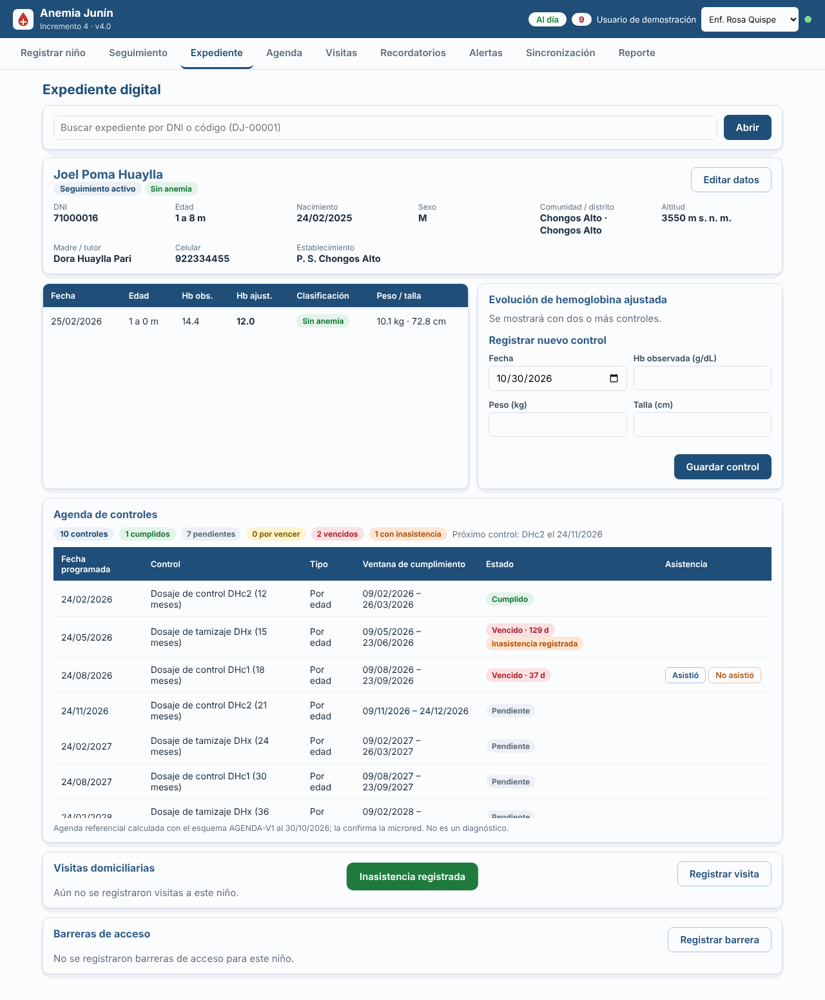

- **Archivo de Imagen:** `../semana-10/evidencias/software/RF09_inc2_2_inasistencia_registrada_escritorio.png`

**EVALUACIÓN: APROBADO | FECHA: 30/10/2026 | EVALUADOR: QA Lead (Huamani R.)**

**Captura en producción (Incremento 2):** `<captura de pantalla en https://softwareanemia.onrender.com mostrando las pestañas «Agenda» y «Alertas» (controles vencidos priorizados) con el aviso de fecha de referencia 30/06/2024 del reloj fijo del dataset>` (pendiente; archivo previsto `evidencias/produccion/PROD_02_inc2_agenda_alertas.png`; ver `CAPTURAS_PENDIENTES.md`).

---

**FICHA DE PRUEBA FUNCIONAL Y EVIDENCIA VISUAL POR REQUERIMIENTO (HIST-3.1)**

- **PROYECTO:** Anemia Junín - Sistema Inteligente para Detección Temprana de Anemia Infantil en Zonas Rurales de Junín
- **INCREMENTO EVALUADO:** Incremento 3, etiqueta `v3.0-Inc3`
- **REQUERIMIENTO:** HIST-3.1 - Registro sin conexión (cola en el dispositivo); cola IndexedDB (`cola.js`) y service worker (`sw.js`)
- **CASO DE PRUEBA:** CP-HIST31-01 (Prueba Funcional de UI / Aceptación; automatizada en `tests/e2e/test_inc3_sin_conexion.py`)
- **DATO DE ENTRADA:** Sin red: { dni: "72300001", hemoglobina_observada: 9.4 } y un nuevo control { hemoglobina_observada: 10.1, peso_kg: 8.6, talla_cm: 72 }
- **RESULTADO ESPERADO:** Las operaciones quedan en la cola local con indicador de pendientes y el servidor no las tiene.

**EVIDENCIAS FOTOGRÁFICAS (CAPTURAS DE PANTALLA EN EJECUCIÓN):**

**[ CAPTURA 1: DATOS DE ENTRADA CARGADOS ]**

- **Descripción:** **Figura 37.** HIST-3.1, captura 1. Aplicación en línea (indicador «Al día») antes de cortar la conexión; los datos se digitan ya sin red.

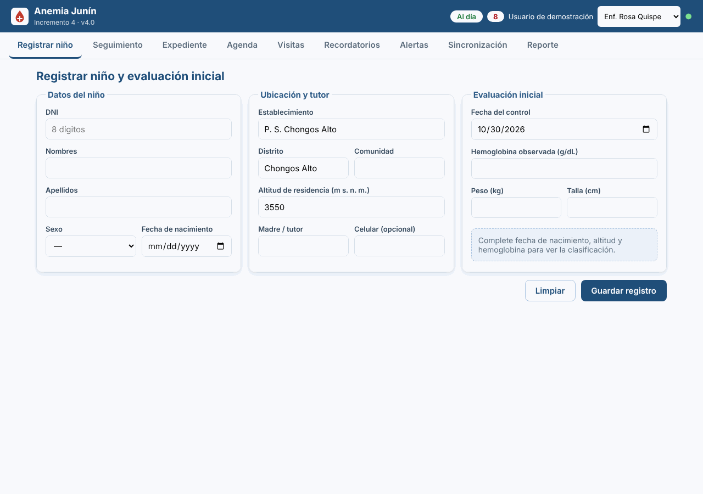

- **Archivo de Imagen:** `../semana-10/evidencias/software/HIST31_inc3_1_en_linea_escritorio.png`

**[ CAPTURA 2: CONFIRMACIÓN / RESULTADO ]**

- **Descripción:** **Figura 38.** HIST-3.1, captura 2. Sin conexión: 2 operaciones pendientes en el dispositivo; el servidor responde 404 para ese DNI.

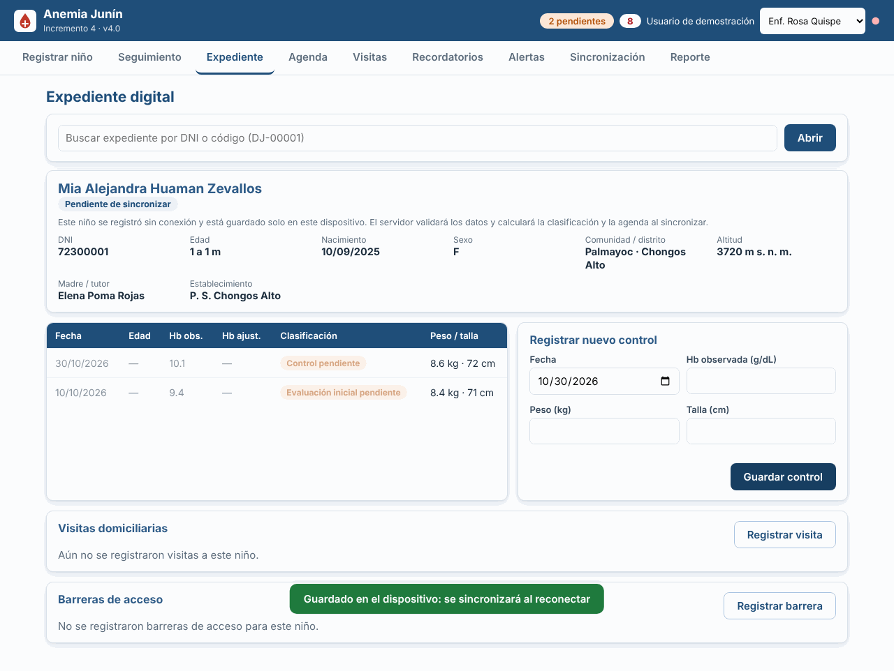

- **Archivo de Imagen:** `../semana-10/evidencias/software/HIST31_inc3_2_pendientes_sin_conexion_escritorio.png`

**EVALUACIÓN: APROBADO | FECHA: 30/10/2026 | EVALUADOR: QA Lead (Huamani R.)**

---

**FICHA DE PRUEBA FUNCIONAL Y EVIDENCIA VISUAL POR REQUERIMIENTO (HIST-3.1b)**

- **PROYECTO:** Anemia Junín - Sistema Inteligente para Detección Temprana de Anemia Infantil en Zonas Rurales de Junín
- **INCREMENTO EVALUADO:** Incremento 3, etiqueta `v3.0-Inc3`
- **REQUERIMIENTO:** HIST-3.1b - Apertura sin conexión desde el caché; service worker (`sw.js`)
- **CASO DE PRUEBA:** CP-HIST31b-01 (Prueba Funcional de UI / Aceptación; automatizada en `tests/e2e/test_inc3_sin_conexion.py`)
- **DATO DE ENTRADA:** Servidor detenido y red cortada; recarga de la aplicación
- **RESULTADO ESPERADO:** La aplicación abre desde el caché con aviso y muestra las lecturas guardadas.

**EVIDENCIAS FOTOGRÁFICAS (CAPTURAS DE PANTALLA EN EJECUCIÓN):**

**[ CAPTURA 1: DATOS DE ENTRADA CARGADOS ]**

- **Descripción:** **Figura 39.** HIST-3.1b, captura 1. Estado previo: aplicación en línea con el servidor activo, antes de detenerlo.


- **Archivo de Imagen:** `../semana-10/evidencias/software/HIST31_inc3_1_en_linea_escritorio.png`

**[ CAPTURA 2: CONFIRMACIÓN / RESULTADO ]**

- **Descripción:** **Figura 40.** HIST-3.1b, captura 2. Recarga con el servidor detenido: la aplicación abre desde el caché con el aviso de «sin conexión» y 30 de 30 filas servidas desde el caché.

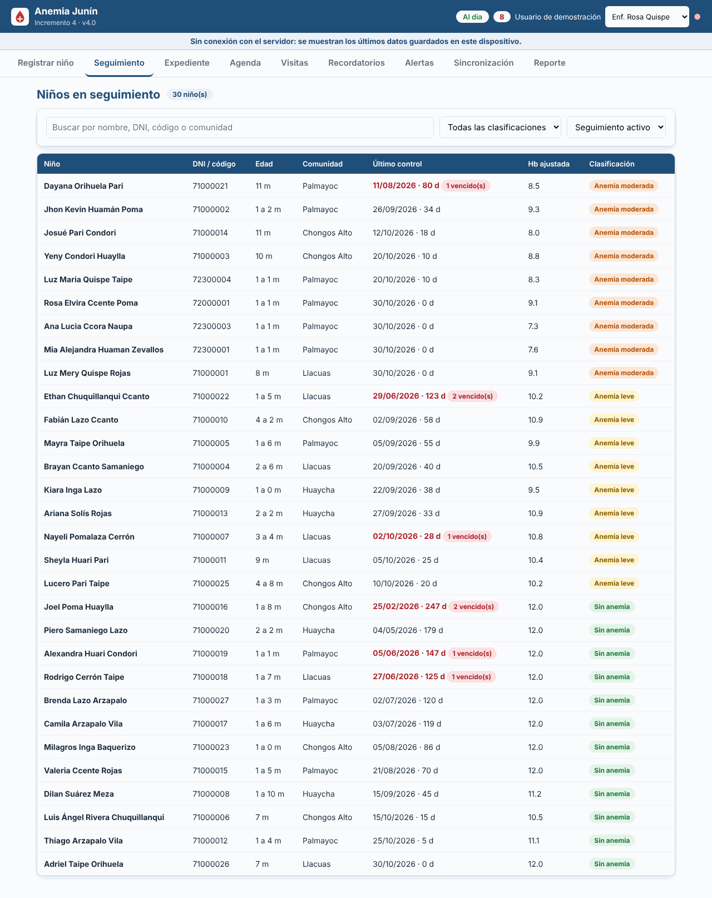

- **Archivo de Imagen:** `../semana-10/evidencias/software/HIST31_inc3_3_recarga_sin_conexion_escritorio.png`

**EVALUACIÓN: APROBADO | FECHA: 30/10/2026 | EVALUADOR: QA Lead (Huamani R.)**

`<captura de pantalla de un teléfono móvil real, con red intermitente, mostrando la cola de pendientes y la sincronización al recuperar la señal>` (pendiente: sin dispositivo real; ver `CAPTURAS_PENDIENTES.md`).

---

**FICHA DE PRUEBA FUNCIONAL Y EVIDENCIA VISUAL POR REQUERIMIENTO (HIST-3.2)**

- **PROYECTO:** Anemia Junín - Sistema Inteligente para Detección Temprana de Anemia Infantil en Zonas Rurales de Junín
- **INCREMENTO EVALUADO:** Incremento 3, etiqueta `v3.0-Inc3`
- **REQUERIMIENTO:** HIST-3.2 - Sincronización idempotente al reconectar (`POST /api/sincronizacion`)
- **CASO DE PRUEBA:** CP-HIST32-01 (Prueba Funcional de UI / Aceptación; automatizada en `tests/unitarias/test_sincronizacion.py` y `tests/integracion/test_api_inc3.py`)
- **DATO DE ENTRADA:** Operaciones pendientes de HIST-3.1; reenvío de la misma operación (mismo identificador)
- **RESULTADO ESPERADO:** Cada operación se aplica una sola vez; el reenvío figura como DUPLICADA y no duplica datos.

**EVIDENCIAS FOTOGRÁFICAS (CAPTURAS DE PANTALLA EN EJECUCIÓN):**

**[ CAPTURA 1: DATOS DE ENTRADA CARGADOS ]**

- **Descripción:** **Figura 41.** HIST-3.2, captura 1. Pestaña «Sincronización» con las operaciones pendientes, antes de volver la red.

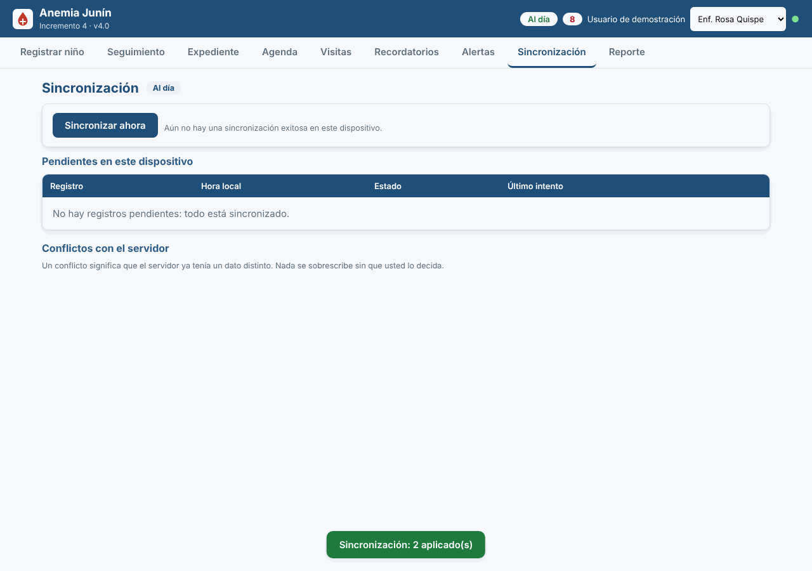

- **Archivo de Imagen:** `../semana-10/evidencias/software/HIST32_inc3_1_panel_antes_de_sincronizar_escritorio.png`

**[ CAPTURA 2: CONFIRMACIÓN / RESULTADO ]**

- **Descripción:** **Figura 42.** HIST-3.2, captura 2. Red restablecida: operaciones aplicadas, indicador «Al día»; el reenvío se marca DUPLICADA y no duplica datos.

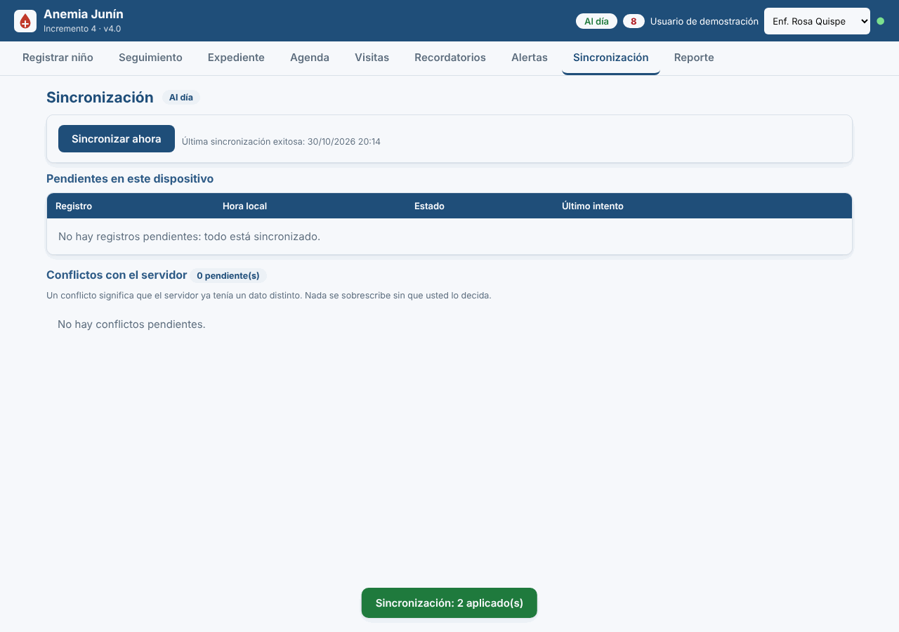

- **Archivo de Imagen:** `../semana-10/evidencias/software/HIST32_inc3_2_sincronizado_escritorio.png`

**EVALUACIÓN: APROBADO | FECHA: 30/10/2026 | EVALUADOR: QA Lead (Huamani R.)**

---

**FICHA DE PRUEBA FUNCIONAL Y EVIDENCIA VISUAL POR REQUERIMIENTO (HIST-3.3)**

- **PROYECTO:** Anemia Junín - Sistema Inteligente para Detección Temprana de Anemia Infantil en Zonas Rurales de Junín
- **INCREMENTO EVALUADO:** Incremento 3, etiqueta `v3.0-Inc3`
- **REQUERIMIENTO:** HIST-3.3 - Resolución de conflictos sin sobrescribir a ciegas (`GET /api/sincronizacion/conflictos`, `POST /api/sincronizacion/conflictos/{id}/resolver`)
- **CASO DE PRUEBA:** CP-HIST33-01 (Prueba Funcional de UI / Aceptación; automatizada en `tests/unitarias/test_conflictos.py` y `tests/integracion/test_api_inc3.py`)
- **DATO DE ENTRADA:** { dni: "72300003" } con un dato distinto en el servidor; control registrado sin conexión; decisión «Conservar servidor»
- **RESULTADO ESPERADO:** Queda un conflicto pendiente y el personal decide; no se sobrescribe a ciegas.

**EVIDENCIAS FOTOGRÁFICAS (CAPTURAS DE PANTALLA EN EJECUCIÓN):**

**[ CAPTURA 1: DATOS DE ENTRADA CARGADOS ]**

- **Descripción:** **Figura 43.** HIST-3.3, captura 1. Conflicto pendiente en «Sincronización»: el servidor tiene un dato distinto al del dispositivo.

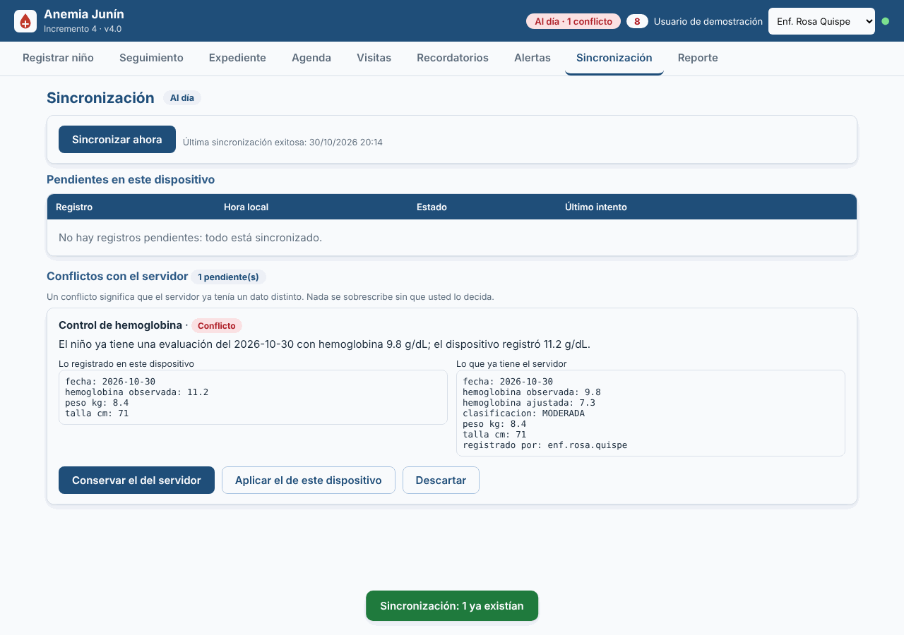

- **Archivo de Imagen:** `../semana-10/evidencias/software/HIST33_inc3_1_conflicto_escritorio.png`

**[ CAPTURA 2: CONFIRMACIÓN / RESULTADO ]**

- **Descripción:** **Figura 44.** HIST-3.3, captura 2. Conflicto resuelto conservando el dato del servidor; aparece «sin conflictos».

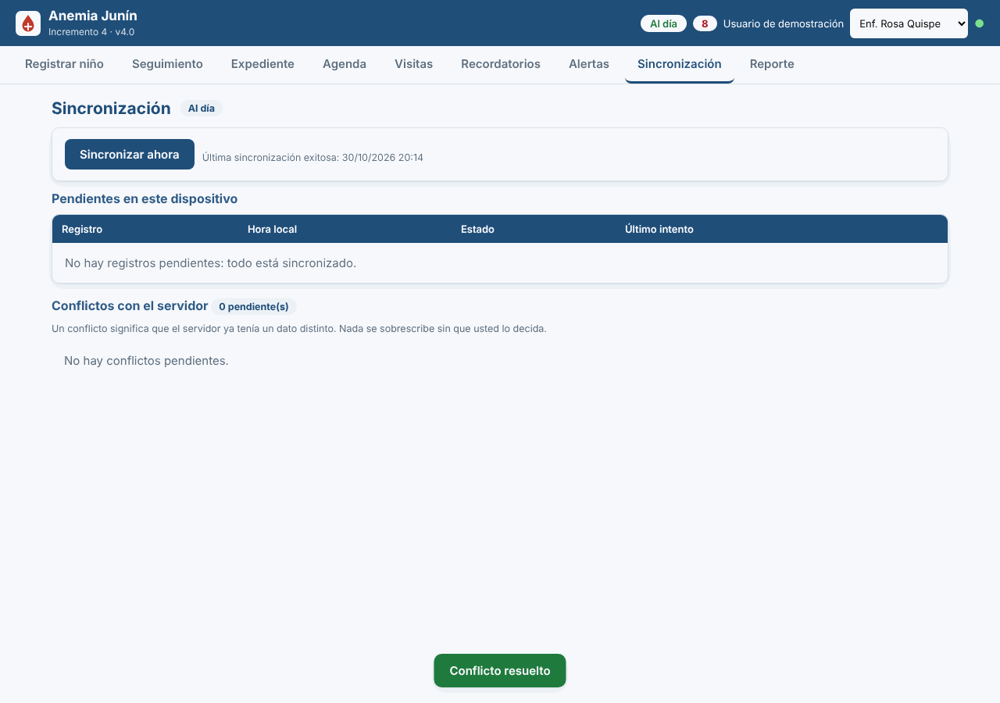

- **Archivo de Imagen:** `../semana-10/evidencias/software/HIST33_inc3_2_conflicto_resuelto_escritorio.png`

**EVALUACIÓN: APROBADO | FECHA: 30/10/2026 | EVALUADOR: QA Lead (Huamani R.)**

---

**FICHA DE PRUEBA FUNCIONAL Y EVIDENCIA VISUAL POR REQUERIMIENTO (HIST-3.4)**

- **PROYECTO:** Anemia Junín - Sistema Inteligente para Detección Temprana de Anemia Infantil en Zonas Rurales de Junín
- **INCREMENTO EVALUADO:** Incremento 3, etiqueta `v3.0-Inc3`
- **REQUERIMIENTO:** HIST-3.4 - Ver lo pendiente y desde cuándo; pestaña «Sincronización»
- **CASO DE PRUEBA:** CP-HIST34-01 (Prueba Funcional de UI / Aceptación; automatizada en `tests/e2e/test_inc3_sin_conexion.py`)
- **DATO DE ENTRADA:** { dni: "72300004" } registrado sin conexión
- **RESULTADO ESPERADO:** Contador de pendientes y antigüedad visibles en la cabecera y en la pestaña «Sincronización».

**EVIDENCIAS FOTOGRÁFICAS (CAPTURAS DE PANTALLA EN EJECUCIÓN):**

**[ CAPTURA 1: DATOS DE ENTRADA CARGADOS ]**

- **Descripción:** **Figura 45.** HIST-3.4, captura 1. Panel con «1 pendiente(s)» y desde cuándo, con el dispositivo sin conexión.

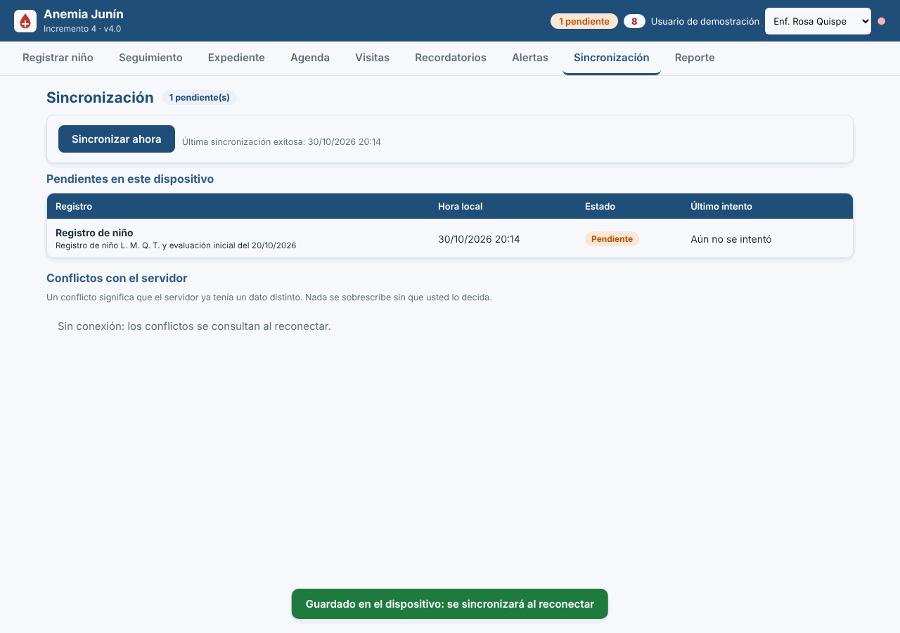

- **Archivo de Imagen:** `../semana-10/evidencias/software/HIST34_inc3_1_panel_pendientes_escritorio.png`

**[ CAPTURA 2: CONFIRMACIÓN / RESULTADO ]**

- **Descripción:** **Figura 46.** HIST-3.4, captura 2. Tras reconectar y sincronizar, el panel queda «al día» sin pendientes.

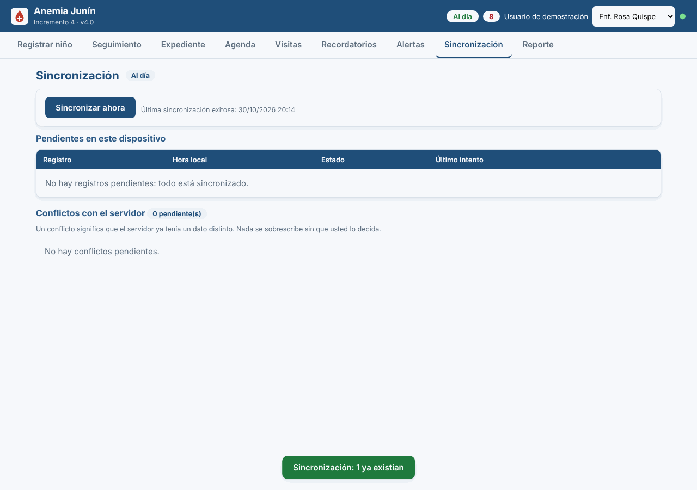

- **Archivo de Imagen:** `../semana-10/evidencias/software/HIST34_inc3_2_panel_al_dia_escritorio.png`

**EVALUACIÓN: APROBADO | FECHA: 30/10/2026 | EVALUADOR: QA Lead (Huamani R.)**

---

**FICHA DE PRUEBA FUNCIONAL Y EVIDENCIA VISUAL POR REQUERIMIENTO (VIS-3.5)**

- **PROYECTO:** Anemia Junín - Sistema Inteligente para Detección Temprana de Anemia Infantil en Zonas Rurales de Junín
- **INCREMENTO EVALUADO:** Incremento 3, etiqueta `v3.0-Inc3`
- **REQUERIMIENTO:** VIS-3.5 - Visita domiciliaria priorizada (`GET /api/visitas/priorizadas`)
- **CASO DE PRUEBA:** CP-VIS35-01 (Prueba Funcional de UI / Aceptación; automatizada en `tests/unitarias/test_visitas.py` y `tests/integracion/test_api_inc3.py`)
- **DATO DE ENTRADA:** Base sintética con niños en tratamiento; visita registrada con { resultado: "REALIZADA", suplemento: "SI", observaciones: "Familia receptiva" }
- **RESULTADO ESPERADO:** Lista ordenada por puntaje explicable con desglose por componente; la visita se puede registrar.

**EVIDENCIAS FOTOGRÁFICAS (CAPTURAS DE PANTALLA EN EJECUCIÓN):**

**[ CAPTURA 1: DATOS DE ENTRADA CARGADOS ]**

- **Descripción:** **Figura 47.** VIS-3.5, captura 1. Pestaña «Visitas»: 18 filas ordenadas por puntaje de 49,5 a 25,0, con desglose por componente.

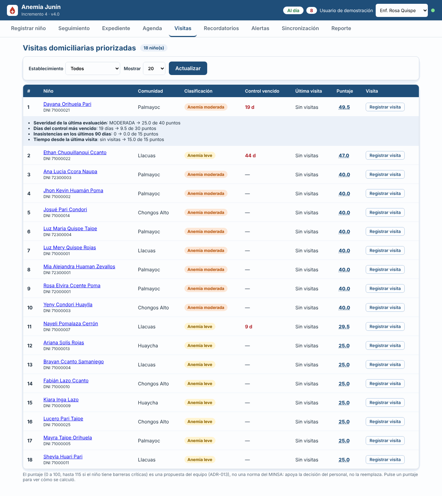

- **Archivo de Imagen:** `../semana-10/evidencias/software/VIS35_inc3_1_visitas_desglose_escritorio.png`

**[ CAPTURA 2: CONFIRMACIÓN / RESULTADO ]**

- **Descripción:** **Figura 48.** VIS-3.5, captura 2. Modal de registro de la visita con el resultado, el suplemento y las observaciones cargados; tras confirmar, el niño sale del primer lugar de la lista.

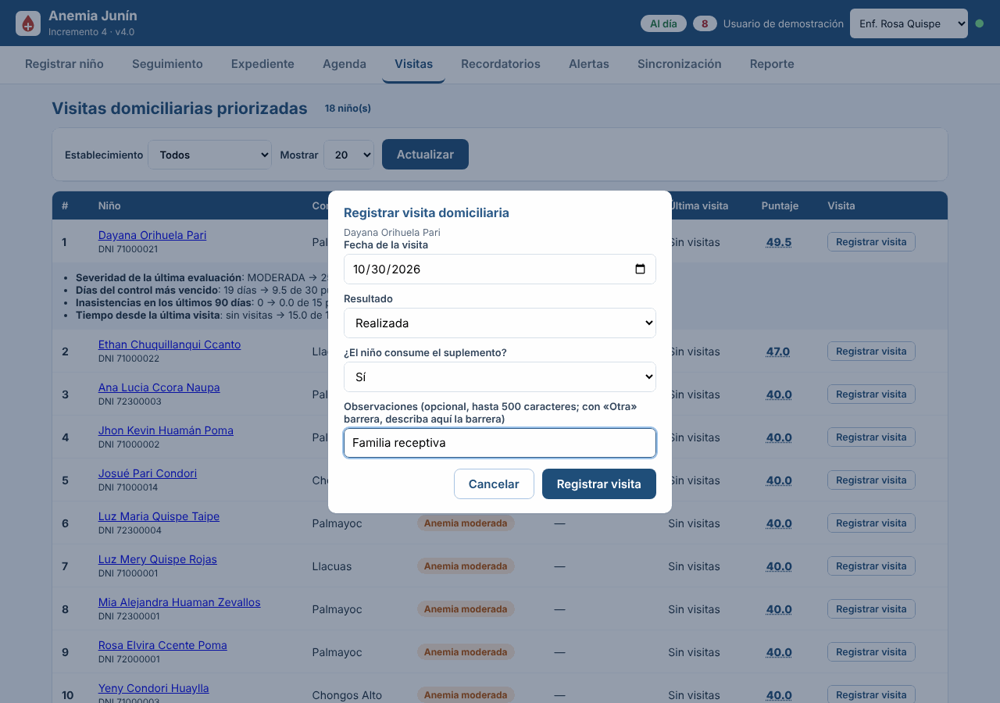

- **Archivo de Imagen:** `../semana-10/evidencias/software/VIS35_inc3_2_modal_visita_escritorio.png`

**EVALUACIÓN: APROBADO | FECHA: 30/10/2026 | EVALUADOR: QA Lead (Huamani R.)**

**Captura en producción (Incremento 3):** `<captura de pantalla en https://softwareanemia.onrender.com mostrando la pestaña «Sincronización» (indicador «Al día», sin pendientes ni conflictos) y la pestaña «Visitas» con la lista priorizada, el puntaje y su desglose>` (pendiente; archivo previsto `evidencias/produccion/PROD_03_inc3_sincronizacion_visitas.png`; ver `CAPTURAS_PENDIENTES.md`).

---

**FICHA DE PRUEBA FUNCIONAL Y EVIDENCIA VISUAL POR REQUERIMIENTO (HIST-4.1)**

- **PROYECTO:** Anemia Junín - Sistema Inteligente para Detección Temprana de Anemia Infantil en Zonas Rurales de Junín
- **INCREMENTO EVALUADO:** Incremento 4, etiqueta `v4.0-Inc4`
- **REQUERIMIENTO:** HIST-4.1 - Recordatorio de control (SIMULADO) (`POST /api/recordatorios/generar`)
- **CASO DE PRUEBA:** CP-HIST41-01 (Prueba Funcional de UI / Aceptación; automatizada en `tests/unitarias/test_recordatorios.py` y `tests/integracion/test_api_inc4.py`)
- **DATO DE ENTRADA:** Base sintética con niños con control próximo o vencido; «Generar recordatorios de hoy» dos veces
- **RESULTADO ESPERADO:** Mensajes rotulados SIMULADO (sin envío real) y sin duplicados al repetir la generación.

**EVIDENCIAS FOTOGRÁFICAS (CAPTURAS DE PANTALLA EN EJECUCIÓN):**

**[ CAPTURA 1: DATOS DE ENTRADA CARGADOS ]**

- **Descripción:** **Figura 49.** HIST-4.1, captura 1. Pestaña «Recordatorios» antes de generar.

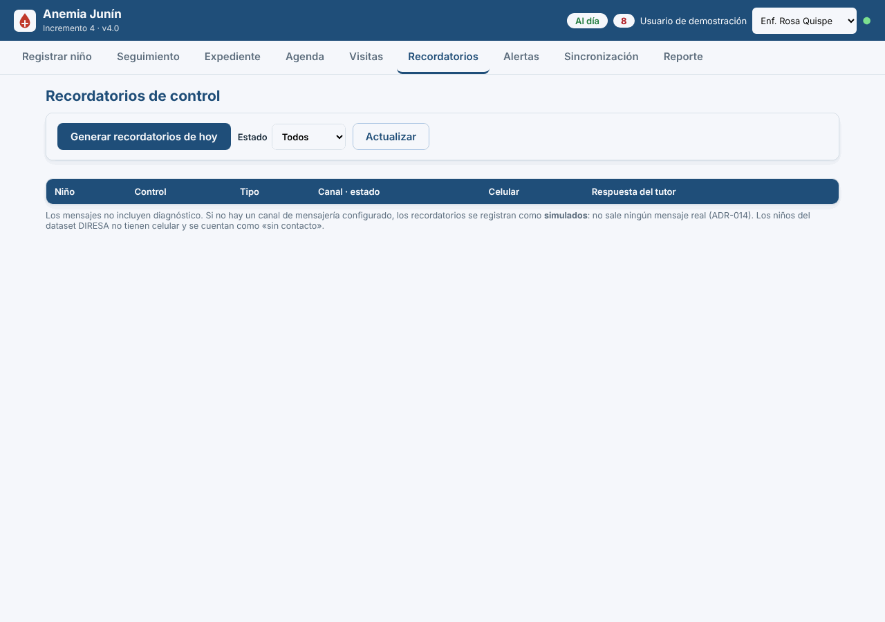

- **Archivo de Imagen:** `../semana-10/evidencias/software/HIST41_inc4_1_recordatorios_antes_escritorio.png`

**[ CAPTURA 2: CONFIRMACIÓN / RESULTADO ]**

- **Descripción:** **Figura 50.** HIST-4.1, captura 2. 24 recordatorios rotulados SIMULADO («no se envió»); repetir la generación no duplica.

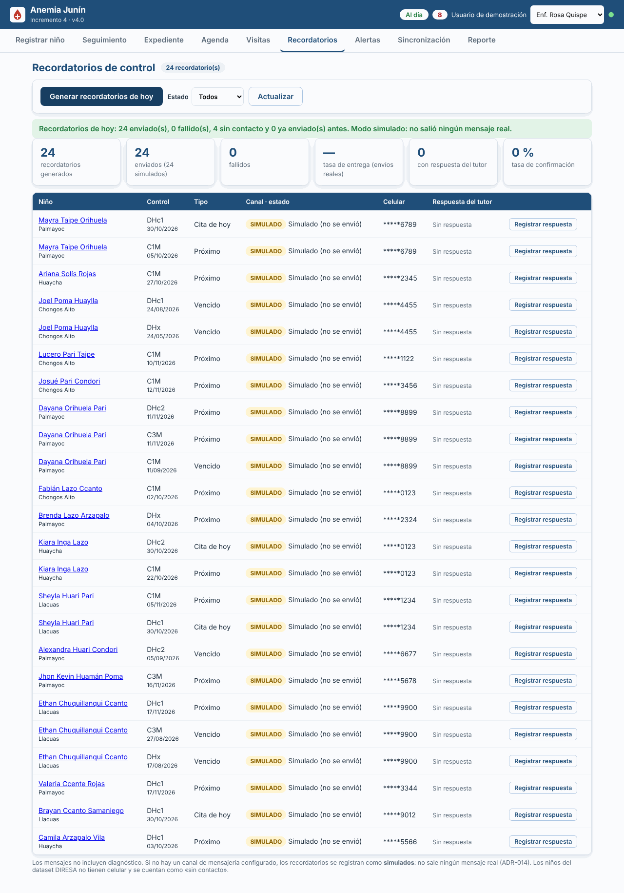

- **Archivo de Imagen:** `../semana-10/evidencias/software/HIST41_inc4_2_recordatorios_simulados_escritorio.png`

**EVALUACIÓN: APROBADO | FECHA: 30/10/2026 | EVALUADOR: QA Lead (Huamani R.)**

`<captura de pantalla del teléfono del tutor mostrando el recordatorio recibido por WhatsApp o SMS>` (pendiente: el envío real nunca se probó; ver `CAPTURAS_PENDIENTES.md`).

---

**FICHA DE PRUEBA FUNCIONAL Y EVIDENCIA VISUAL POR REQUERIMIENTO (HIST-4.2)**

- **PROYECTO:** Anemia Junín - Sistema Inteligente para Detección Temprana de Anemia Infantil en Zonas Rurales de Junín
- **INCREMENTO EVALUADO:** Incremento 4, etiqueta `v4.0-Inc4`
- **REQUERIMIENTO:** HIST-4.2 - Confirmación del tutor (personal y webhook firmado) (`POST /api/recordatorios/{id}/respuesta` y webhook de WhatsApp)
- **CASO DE PRUEBA:** CP-HIST42-01 (Prueba Funcional de UI / Aceptación; automatizada en `tests/unitarias/test_recordatorios.py` y `tests/e2e/test_inc4_notificaciones.py`)
- **DATO DE ENTRADA:** Respuesta 1, 2 o 3 registrada por el personal («No puede asistir» con barrera); webhook con firma válida, ausente e inválida
- **RESULTADO ESPERADO:** Respuesta registrada; el webhook sin firma válida responde 403.

**EVIDENCIAS FOTOGRÁFICAS (CAPTURAS DE PANTALLA EN EJECUCIÓN):**

**[ CAPTURA 1: DATOS DE ENTRADA CARGADOS ]**

- **Descripción:** **Figura 51.** HIST-4.2, captura 1. Modal «Registrar respuesta» del tutor (1 confirmo, 2 no puedo, 3 reprogramar) con la opción cargada.

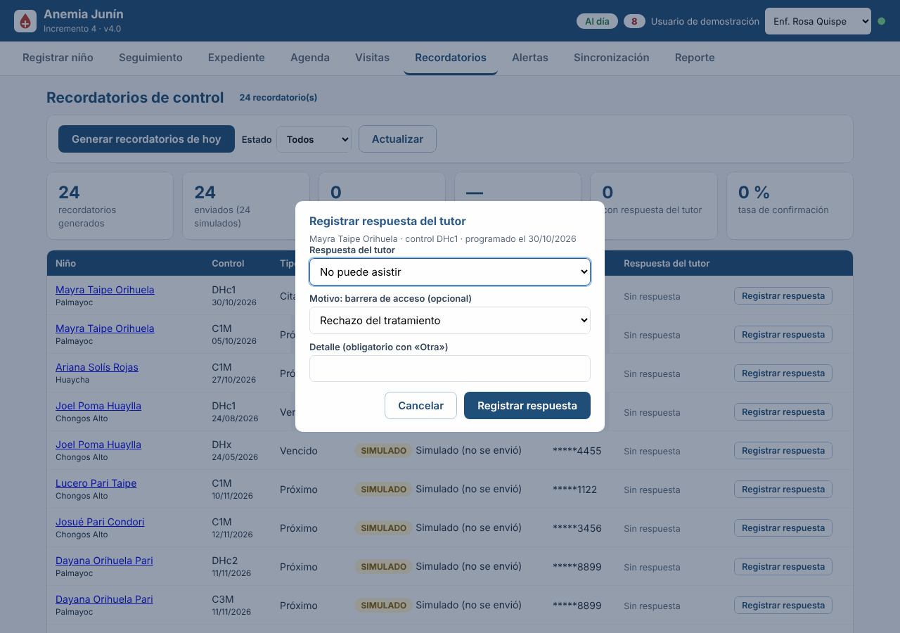

- **Archivo de Imagen:** `../semana-10/evidencias/software/HIST42_inc4_1_modal_respuesta_escritorio.png`

**[ CAPTURA 2: CONFIRMACIÓN / RESULTADO ]**

- **Descripción:** **Figura 52.** HIST-4.2, captura 2. Respuesta «No puede asistir» registrada por el personal. El webhook sin firma o con firma inválida respondió 403 y con firma válida 200, pero en modo simulado el mensaje se ignora (sin canal real que asociar; `HIST42_inc4_3_tras_webhook_escritorio.png`).

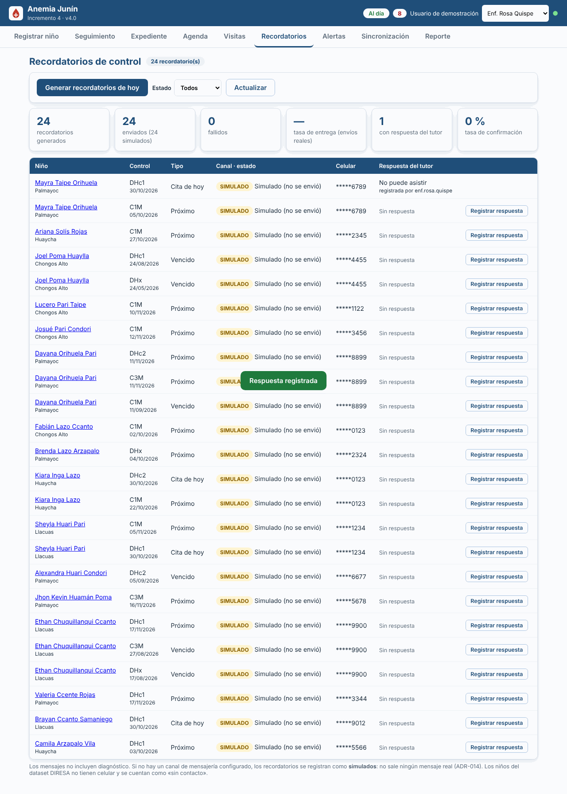

- **Archivo de Imagen:** `../semana-10/evidencias/software/HIST42_inc4_2_respuesta_registrada_escritorio.png`

**EVALUACIÓN: APROBADO | FECHA: 30/10/2026 | EVALUADOR: QA Lead (Huamani R.)**

---

**FICHA DE PRUEBA FUNCIONAL Y EVIDENCIA VISUAL POR REQUERIMIENTO (HIST-4.3)**

- **PROYECTO:** Anemia Junín - Sistema Inteligente para Detección Temprana de Anemia Infantil en Zonas Rurales de Junín
- **INCREMENTO EVALUADO:** Incremento 4, etiqueta `v4.0-Inc4`
- **REQUERIMIENTO:** HIST-4.3 - Barreras de acceso al tratamiento (`POST/GET /api/ninos/{id}/barreras`)
- **CASO DE PRUEBA:** CP-HIST43-01 (Prueba Funcional de UI / Aceptación; automatizada en `tests/unitarias/test_barreras.py` y `tests/integracion/test_api_inc4.py`)
- **DATO DE ENTRADA:** Barrera «Falta de transporte» con detalle, registrada sin conexión
- **RESULTADO ESPERADO:** Barrera pendiente de sincronizar y, al volver la red, en el expediente.

**EVIDENCIAS FOTOGRÁFICAS (CAPTURAS DE PANTALLA EN EJECUCIÓN):**

**[ CAPTURA 1: DATOS DE ENTRADA CARGADOS ]**

- **Descripción:** **Figura 53.** HIST-4.3, captura 1. Modal «Registrar barrera» con el tipo y el detalle cargados.


- **Archivo de Imagen:** `../semana-10/evidencias/software/HIST43_inc4_1_modal_barrera_escritorio.png`

**[ CAPTURA 2: CONFIRMACIÓN / RESULTADO ]**

- **Descripción:** **Figura 54.** HIST-4.3, captura 2. Barrera sincronizada y visible en el expediente (antes de reconectar figuraba como pendiente: `HIST43_inc4_2_barrera_pendiente_sin_conexion_escritorio.png`).


- **Archivo de Imagen:** `../semana-10/evidencias/software/HIST43_inc4_3_barrera_sincronizada_escritorio.png`

**EVALUACIÓN: APROBADO | FECHA: 30/10/2026 | EVALUADOR: QA Lead (Huamani R.)**

---

**FICHA DE PRUEBA FUNCIONAL Y EVIDENCIA VISUAL POR REQUERIMIENTO (HIST-4.4)**

- **PROYECTO:** Anemia Junín - Sistema Inteligente para Detección Temprana de Anemia Infantil en Zonas Rurales de Junín
- **INCREMENTO EVALUADO:** Incremento 4, etiqueta `v4.0-Inc4`
- **REQUERIMIENTO:** HIST-4.4 - Alerta de barreras críticas y suma a la visita priorizada (`GET /api/alertas/barreras`)
- **CASO DE PRUEBA:** CP-HIST44-01 (Prueba Funcional de UI / Aceptación; automatizada en `tests/unitarias/test_barreras.py` y `tests/integracion/test_api_inc4.py`)
- **DATO DE ENTRADA:** Niño con barrera grave (rechazo del tratamiento o efectos adversos), o 2 o más barreras en 60 días
- **RESULTADO ESPERADO:** Alerta de prioridad ALTA y componente BARRERA_CRITICA en el puntaje de la visita.

**EVIDENCIAS FOTOGRÁFICAS (CAPTURAS DE PANTALLA EN EJECUCIÓN):**

**[ CAPTURA 1: DATOS DE ENTRADA CARGADOS ]**

- **Descripción:** **Figura 55.** HIST-4.4, captura 1. Pestaña «Alertas» con las alertas de barreras críticas.


- **Archivo de Imagen:** `../semana-10/evidencias/software/HIST44_inc4_1_alertas_barreras_criticas_escritorio.png`

**[ CAPTURA 2: CONFIRMACIÓN / RESULTADO ]**

- **Descripción:** **Figura 56.** HIST-4.4, captura 2. Visita priorizada con el componente BARRERA_CRITICA (40,0 puntos) y alerta ALTA.


- **Archivo de Imagen:** `../semana-10/evidencias/software/HIST44_inc4_2_visita_con_barrera_critica_escritorio.png`

**EVALUACIÓN: APROBADO | FECHA: 30/10/2026 | EVALUADOR: QA Lead (Huamani R.)**

**Captura en producción (Incremento 4):** `<captura de pantalla en https://softwareanemia.onrender.com mostrando la pestaña «Recordatorios» con los mensajes rotulados SIMULADO (o el estado real del canal, si está configurado) y la pestaña «Alertas» con las barreras críticas>` (pendiente; archivo previsto `evidencias/produccion/PROD_04_inc4_recordatorios_barreras.png`; ver `CAPTURAS_PENDIENTES.md`).

---

**FICHA DE PRUEBA FUNCIONAL Y EVIDENCIA VISUAL POR REQUERIMIENTO (AUTH)**

- **PROYECTO:** Anemia Junín - Sistema Inteligente para Detección Temprana de Anemia Infantil en Zonas Rurales de Junín
- **INCREMENTO EVALUADO:** Autenticación con Supabase Auth (ADR-011), incorporada antes del Incremento 3 y vigente en `v4.0-Inc4`
- **REQUERIMIENTO:** AUTH - Inicio y cierre de sesión; sesión en cookies HttpOnly con protección CSRF
- **CASO DE PRUEBA:** CP-AUTH-01 (Prueba Funcional de UI / Aceptación; automatizada en `tests/integracion/test_autenticacion.py` y `tests/e2e/test_login.py`, con Supabase simulado)
- **DATO DE ENTRADA:** { correo: "enfermeria@example.test", contraseña: (valor ficticio de la prueba) }; credencial errónea; petición de la API sin sesión
- **RESULTADO ESPERADO:** Con una credencial válida, la sesión queda en cookies HttpOnly y se abre la aplicación; la API clínica rechaza (401) las peticiones sin sesión; cerrar la sesión la invalida; una credencial errónea muestra un mensaje de error.

**EVIDENCIAS FOTOGRÁFICAS (CAPTURAS DE PANTALLA EN EJECUCIÓN):**

**[ CAPTURA 1: DATOS DE ENTRADA CARGADOS ]**

- **Descripción:** **Figura 57.** AUTH, captura 1. Pantalla de acceso con el correo y la contraseña de prueba cargados antes de «Iniciar sesión» (axe: 0 violaciones).


- **Archivo de Imagen:** `../semana-10/evidencias/usabilidad/U_login_escritorio.png`

**[ CAPTURA 2: CONFIRMACIÓN / RESULTADO ]**

- **Descripción:** **Figura 58.** AUTH, captura 2. Acceso en móvil (390x844). No hay captura de la aplicación tras el ingreso: ese resultado se verificó por aserciones (aplicación visible, correo en la cabecera, sin token en `localStorage`, 27 de 27 operaciones no públicas con 401 sin sesión) y la prueba con una cuenta real de Supabase queda como captura en producción.


- **Archivo de Imagen:** `../semana-10/evidencias/usabilidad/U_login_movil.png`

**EVALUACIÓN: APROBADO | FECHA: 30/10/2026 | EVALUADOR: QA Lead (Huamani R.)**

*Nota de la evaluación:* Verificado con Supabase simulado (21 pruebas de integración y 2 E2E en escritorio y móvil); validación parcial: no consta una prueba con una cuenta real de Supabase..

**Captura en producción (autenticación):** `<captura de pantalla en https://softwareanemia.onrender.com mostrando la pantalla de inicio de sesión y la aplicación abierta con una cuenta de Supabase autorizada (ocultar el correo y cualquier token)>` (pendiente; archivo previsto `evidencias/produccion/PROD_05_auth_inicio_sesion.png`; ver `CAPTURAS_PENDIENTES.md`).


---


### 3.7 EJE 7: Evaluación FURPS+, Psicología de Colores, WCAG 2.1 y OWASP 2025

#### 3.7.1 Índice de calidad FURPS+

El índice pondera F 30 %, U 15 %, R 15 %, P 15 %, S 10 % y + 15 %. Se calculó con 30 de 35 criterios, medidos por scripts (`entregables/semana-10/metricas/`); cinco no se pudieron medir (lector de pantalla, staging, 500 usuarios, Docker en ejecución y política de contraseñas de Supabase). El índice primario excluye lo no medido y el conservador lo cuenta como 0 %.

**Tabla 26.** Índice FURPS+ por factor (S10, Tabla 5).

| Factor | Peso | Criterios medidos | % solo medidos | % conservador | Brecha principal |
| --- | :---: | :---: | :---: | :---: | --- |
| F Funcionalidad | 30 % | 3 de 3 | 100,0 % | 100,0 % | Ninguna; datos sintéticos, sin usuarios reales |
| U Usabilidad | 15 % | 7 de 8 | 82,7 % | 72,4 % | Contraste de componentes (3 de 8), etiquetas ARIA, foco en modales |
| R Confiabilidad | 15 % | 6 de 7 | 84,0 % | 72,0 % | La caída de la base de datos responde 500 en vez de 503 |
| P Rendimiento | 15 % | 4 de 5 | 85,0 % | 68,0 % | p95 de 2 000 ms con 100 usuarios |
| S Soportabilidad | 10 % | 6 de 6 | 99,0 % | 99,0 % | 23 de 669 bloques con complejidad mayor que 10 |
| + Seguridad y restricciones | 15 % | 4 de 6 | 66,8 % | 44,5 % | 41 de 61 comprobaciones OWASP; 1 hallazgo de severidad alta |
| **IC_P** | **100 %** | | **87,67 %** | **78,43 %** | Por debajo de «Excelente (≥ 90 %)» |


**Figura 59.** Salida de `furps_calculo.py` con el índice primario y el conservador (pie con comando, fecha y commit). Archivo: `../semana-10/evidencias/terminal/FURPS01_calculo_indice.png`.

La diferencia de 9,24 puntos entre ambos índices cuantifica cuánto de la calidad declarada depende de mediciones que faltan.

#### 3.7.2 Factor U: psicología de colores y accesibilidad WCAG 2.1 AA

Los criterios evaluados son los de las pautas WCAG 2.1, nivel AA (W3C, 2018).

**Tabla 27.** Paleta real de la interfaz (`pmv_fastapi/app/web/estilos.css`), significado en salud infantil y contraste medido (S10, Tabla 9).

| Rol | Hexadecimal | Significado | Contraste |
| --- | --- | --- | --- |
| Primario | `#1F4E79` (azul) | Confianza y calma clínica con datos de salud | 8,66:1 sobre blanco |
| Éxito, sin anemia | `#1F7A3D` (verde) | Control cumplido, estado seguro | 5,37:1 sobre blanco |
| Precaución, leve | `#8A6200` (ámbar) | Atención sin urgencia | 5,49:1 sobre blanco |
| Advertencia, moderada | `#B4530B` (naranja) | Riesgo creciente, pendiente de sincronizar | 5,02:1 sobre blanco; **4,23:1 sobre su fondo suave (no cumple 4,5:1)** |
| Alerta, severa | `#B0222B` (rojo) | Acción inmediata: control vencido, prioridad alta, conflicto | 6,75:1 sobre blanco |

De 54 pares texto y fondo medidos (23 combinaciones únicas), solo el naranja sobre su fondo suave incumple 1.4.3. El semáforo se codifica además con texto en las 482 insignias de estado evaluadas, de modo que el color no es el único canal (1.4.1).


**Figura 60.** Paleta real con muestras, hexadecimales, contraste y significado. Archivo: `../semana-10/evidencias/usabilidad/U_paleta_colores.png`.


**Figura 61.** Semáforo de severidad bajo simulación de deuteranopía, protanopía y escala de grises: los tonos moderada y severa se acercan, por eso el texto de cada estado acompaña siempre al color. Archivo: `../semana-10/evidencias/usabilidad/U_semaforo_severidad_daltonismo.png`.

**Tabla 28.** Criterios WCAG evaluados con axe-core 4.14.0, Playwright y cálculo propio (S10, Tabla 11).

| Criterio | Resultado medido | Estado |
| --- | --- | --- |
| 1.4.3 Contraste de texto (≥ 4,5:1) | 22 de 23 pares únicos cumplen (mínimo 4,23:1) | Parcial |
| 1.4.11 Contraste no textual (≥ 3:1) | 3 de 8 componentes: borde de campo 1,33:1, foco 1,84:1, barras «leve» 2,46:1 y «no aplica» 2,58:1 incumplen | No cumple |
| 1.4.1 Uso del color | 482 de 482 insignias con texto | Cumple |
| 1.4.10 Reflujo a 320 px | 13 de 13 pantallas sin desplazamiento horizontal | Cumple |
| 1.3.1 y 4.1.2 Estructura, nombre y rol | `nav role="tablist"` con botones sin `role="tab"` en 13 de 14 pantallas; selects y fechas sin etiqueta | No cumple |
| 2.1.1 Teclado | Tab recorre 29 elementos; el modal abre con Enter y cierra con Esc; 3 regiones con desplazamiento no alcanzables por teclado en móvil | Parcial |
| 2.4.3 y 2.4.7 Foco | Todos los elementos muestran foco, pero el modal no lo retiene (Tab escapa 10 de 14 veces) | Parcial |
| 2.5.8 Tamaño del objetivo (WCAG 2.2, 24 px) | 734 de 924 objetivos cumplen | Parcial |
| 4.1.2 Lectores de pantalla (NVDA, TalkBack) | **No medido**: no había lector en el entorno | No medido |

axe-core halló 22 reglas violadas (52 nodos) en escritorio y 36 (68 nodos) en móvil; solo la pantalla de inicio de sesión no tiene violaciones. Los hallazgos U-1 a U-8 de S10 (`role="tab"`, etiquetas de filtros, naranja `#B4530B` a `#A34A09`, bordes y foco, retención de foco del modal, regiones con desplazamiento, objetivos de 24 px y `role="status"` en avisos) están calculados pero **no aplicados** en el código (acción 18 del plan de mejora). El contraste de 7,1:1 y la compatibilidad total con lectores de pantalla que ejemplifica la plantilla no se afirman: el primario mide 8,66:1, pero la accesibilidad completa no se cumple.


**Figura 62.** Resumen de axe-core por pantalla y vista (14 pantallas, 4 modales y el inicio de sesión). Archivo: `../semana-10/evidencias/usabilidad/U_axe_resumen_pantallas.png`.


**Figura 63.** Foco visible al recorrer las pestañas con Tab. Archivo: `../semana-10/evidencias/usabilidad/U_teclado_foco_pestana.png`.

#### 3.7.3 Factores R y P: confiabilidad y rendimiento

Las mediciones son de una máquina virtual con un proceso uvicorn y datos sintéticos; sirven para detectar brechas, no como capacidad de producción.

**Tabla 29.** Confiabilidad y rendimiento medidos (S10, Tablas 14 y 15; adenda S9, nota 4).

| Atributo | Meta | Valor medido | Estado |
| --- | --- | --- | --- |
| Disponibilidad durante la carga | ≥ 99,5 % | 100 % (332 sondeos, 0 fallidos) | Cumple |
| MTTR tras `kill -9` | < 5 min | 0,85 s (reinicio manual) | Cumple |
| Reconexión a la base tras caer (`pool_pre_ping`) | Sin reiniciar la aplicación | Respondió 200 a los 0,2 s | Cumple |
| Respuesta durante la caída de la base | Controlada (503) | 25 de 26 peticiones respondieron 500 | **No cumple** |
| Lecturas sin servidor (service worker) | 100 % | 30 de 30 filas desde el caché | Cumple |
| p95 con 20 usuarios (Inc. 1 y 2; Inc. 3 y 4) | < 800 ms | 29 ms; 98 ms | Cumple |
| p95 con 100 usuarios (Inc. 1 y 2) | < 800 ms | 2 000 ms (p50 780 ms) | **No cumple** |
| p95 con 50 usuarios, `v4.0-Inc4` (adenda S9) | < 800 ms | 1 100 ms (una corrida, sin control) | **No cumple** |
| p95 con 500 usuarios | < 800 ms | No medido (máximo probado: 100) | No medido |
| LCP de la PWA en móvil lento | < 2 500 ms | 468 ms (84 ms con service worker) | Cumple |
| Disponibilidad en staging (Render) | ≥ 99,5 % | No medido en S10: no existía un entorno de staging | No medido |


**Figura 64.** Locust, 20 usuarios, 60 s, incrementos 3 y 4 (sincronización, visitas y recordatorios): p95 de 98 ms. Archivo: `../semana-10/evidencias/rendimiento/P_locust_B_inc3_inc4_20u.png`.


**Figura 65.** Locust, 100 usuarios, 60 s, incrementos 1 y 2: p95 de 2 000 ms, por encima del umbral de 800 ms. Archivo: `../semana-10/evidencias/rendimiento/P_locust_C_inc1_inc2_100u.png`.


**Figura 66.** Caos con PostgreSQL 16 temporal: 25 de 26 peticiones respondieron 500 durante la caída y la aplicación se recuperó a los 0,2 s. Archivo: `../semana-10/evidencias/terminal/R13_caos_postgres.png`.

La causa probable del aumento del p95 con la carga es un único proceso con una base compartida; no se perfiló el código. La adenda de S9 no pudo repetir `v1.0` en la misma sesión como control, de modo que no se sabe si el aumento de 815 a 1 100 ms viene del código nuevo, de la autenticación o de la máquina. **El p95 es el riesgo de rendimiento abierto del producto** (acción 16 del plan de mejora).

#### 3.7.4 Factor +: auditoría de seguridad OWASP Top 10:2025

La auditoría combinó 30 comprobaciones estáticas (16 cumplen, 13 hallazgos, 1 no medida), 32 pruebas dinámicas contra un servidor local con Supabase simulado (25 cumplen, 7 hallazgos), una prueba de XSS con cuatro cargas en seis pantallas y SAST y SCA con bandit, pip-audit y semgrep. No se ejecutó OWASP ZAP ni se probó un proyecto de Supabase real. La edición 2025 reordenó la lista de la plantilla (SSRF pasó a A01 y apareció A10); se evalúa la lista 2025 (OWASP Foundation, 2025).

**Tabla 30.** Estado por categoría OWASP Top 10:2025 en `v4.0-Inc4` (S10, Tabla 21).

| Código | Categoría | Estado | Mecanismo implementado | Hallazgo abierto |
| --- | --- | --- | --- | --- |
| A01 | Broken Access Control | **Parcial** | Sesión obligatoria en toda ruta `/api` salvo las públicas (27 de 27 operaciones no públicas responden 401 sin sesión); CSRF con `X-CSRF-Protection` y comprobación de `Origin` | H-1: sin roles ni segmentación por establecimiento |
| A02 | Security Misconfiguration | **No mitigado** | `Cache-Control: no-store`, `.env` ignorado por Git, imagen con usuario no root | H-2: 0 de 6 cabeceras de seguridad; H-8; H-9 |
| A03 | Software Supply Chain Failures | **Parcial** | 5 de 5 dependencias de producción con versión exacta; pip-audit sin vulnerabilidades | H-7: el CI no ejecuta SAST ni auditoría de dependencias |
| A04 | Cryptographic Failures | **Mitigado** (en código) | No se guardan contraseñas (Supabase Auth); HMAC-SHA256 con comparación en tiempo constante; cookies `Secure` | TLS y cifrado en reposo del proveedor no medidos |
| A05 | Injection | **Parcial** | SQLAlchemy con parámetros (0 SQL concatenado); `esc()` en el cliente; XSS dinámico sin ejecución en 6 de 6 pantallas | H-3: inyección de fórmulas en el CSV; H-10 |
| A06 | Insecure Design | **Parcial** | Arquitectura hexagonal con 25 pruebas; 14 ADR; cerrojos de concurrencia; webhook que falla cerrado | H-4: sin limitación de tasa; H-11: sin modelo de amenazas |
| A07 | Authentication Failures | **Parcial** | Mensaje de login genérico; cookie `HttpOnly`, `SameSite=Strict`, `Secure`; cierre de sesión borra cookies | H-4 (15 intentos fallidos sin bloqueo propio); H-12: política de contraseñas y MFA no medidas |
| A08 | Software or Data Integrity Failures | **Parcial** | Webhook de WhatsApp con firma HMAC-SHA256 siempre exigida (403 sin firma o inválida; 503 sin secreto) | H-7: la imagen no se firma ni tiene atestaciones |
| A09 | Security Logging and Alerting Failures | **No mitigado** | Cada registro guarda su autor verificado | H-5: 0 usos de logging; sin registro de logins fallidos ni alertas |
| A10 | Mishandling of Exceptional Conditions | **Parcial** | 11 manejadores de errores de dominio (409, 422, 403, 503, 404); JSON malformado devuelve 422 sin traza | H-6: sin manejador global; caída de la base responde 500 |

**Controles de la plantilla que el proyecto no tiene.** La plantilla ejemplifica RBAC con tokens JWT validados en cada petición, cifrado AES-256 en reposo y hash Argon2id. El proyecto valida la sesión de Supabase en cada petición, pero no distingue roles (H-1); no cifra datos en el código (el cifrado en reposo es el del proveedor y no se midió); y no guarda contraseñas, de modo que no usa Argon2id: la autenticación se delega a Supabase Auth. Los controles de inyección (consultas con parámetros), diseño (arquitectura hexagonal) y configuración (secretos fuera del código) sí existen y figuran en la tabla.

Resumen: 1 categoría mitigada, 7 parciales y 2 no mitigadas. Las protecciones de sesión y CSRF solo operan con `AUTH_MODE=supabase` (valor por defecto); con `demo` la API es pública, modo que existe solo para pruebas y capturas.

**Tabla 31.** Análisis estático y de dependencias (S10, Tablas 22 y 23).

| Herramienta | Resultado | Lectura |
| --- | --- | --- |
| bandit | Alta 0, Media 0, Baja 1 (6 723 líneas) | La baja (B107, parámetro con valor vacío por defecto) es un falso positivo |
| pip-audit | Sin vulnerabilidades conocidas en 5 dependencias de producción | Al 30/10/2026 |
| semgrep (reglas locales; el registro estaba bloqueado) | 151 hallazgos en 97 archivos | 125 corresponden al patrón `innerHTML` mitigado con `esc()`; 13 son falsos positivos de decoradores; 12 son calidad; 1 verdadero positivo (CSV, coincide con H-3) |


**Figura 67.** semgrep: 554 reglas sobre 97 archivos, 151 hallazgos clasificados manualmente. Archivo: `../semana-10/evidencias/terminal/O01_semgrep.png`.


**Figura 68.** Pruebas dinámicas T01 a T32 contra el servidor local (sesión, CSRF, cookies, cabeceras, inyección, webhook y errores). Archivo: `../semana-10/evidencias/terminal/O02_pruebas_http_owasp.png`.


**Figura 69.** Comprobaciones estáticas E01 a E30 con su estado (CUMPLE, HALLAZGO, NO MEDIDO). Archivo: `../semana-10/evidencias/terminal/O04_estatico_owasp.png`.


**Figura 70.** XSS dinámico: cargas inyectadas en cuatro campos y revisadas en seis pantallas (0 ejecuciones). Archivo: `../semana-10/evidencias/terminal/O03_xss_dinamico.png`.


**Figura 71.** Manejador del webhook que responde 503 sin secreto y 403 con firma ausente o inválida, corregido en la revisión independiente (GitHub, `v4.0-Inc4`). Archivo: `../semana-10/evidencias/github/GH_webhook_falla_cerrado.png`.


**Figura 72.** Sesión en cookies `HttpOnly` con protección CSRF (GitHub, `v4.0-Inc4`). Archivo: `../semana-10/evidencias/github/GH_sesion_cookies_csrf.png`.


**Figura 73.** Código afectado por el hallazgo H-3: el CSV del reporte no neutraliza celdas que empiezan con `=`, `+`, `-` o `@` (GitHub, `v4.0-Inc4`). Archivo: `../semana-10/evidencias/github/GH_csv_reporte_hallazgo.png`.

**Conteo de vulnerabilidades.** Las herramientas SAST y SCA no confirman ninguna vulnerabilidad alta o crítica, pero la revisión manual y dinámica sí: 1 hallazgo de severidad alta (H-1) y seis de severidad media. **No se afirma ausencia de vulnerabilidades**; el criterio «0 vulnerabilidades críticas o altas» de la plantilla no se cumple.

**Tabla 32.** Hallazgos de seguridad H-1 a H-12 con su acción propuesta (S10, Tabla 24). Ninguna acción está aplicada en el código; las acciones 12 a 18 del plan de mejora CMMI (sección 3.8) las programan.

| N.° | OWASP | Hallazgo | Severidad | Acción propuesta |
| --- | --- | --- | --- | --- |
| H-1 | A01 | Sin roles ni segmentación por establecimiento: todo usuario autenticado ve y modifica todo | **Alta** | Roles en el JWT y políticas RLS por establecimiento |
| H-2 | A02 | Ninguna de las 6 cabeceras de seguridad HTTP | Media | Middleware con CSP, `nosniff`, anti-frame, `Referrer-Policy`, `Permissions-Policy` y HSTS |
| H-3 | A05 | El CSV no neutraliza fórmulas (CWE-1236) | Media | Anteponer `'` a celdas que empiezan con `=`, `+`, `-` o `@` |
| H-4 | A06, A07 | Sin limitación de tasa en el login ni en la API | Media | Limitar intentos por IP y correo; confirmar el bloqueo de Supabase |
| H-5 | A09 | Sin registro ni alertas de eventos de seguridad | Media | Registrar logins fallidos, 401, 403 y firmas inválidas sin datos personales |
| H-6 | A10 | Sin manejador global: la base caída produce 500 | Media | `OperationalError` a 503 y manejador genérico con identificador de correlación |
| H-7 | A03, A08 | CI sin SAST ni auditoría de dependencias; acciones fijadas por etiqueta; imagen sin firma | Media | `bandit` y `pip-audit` en el CI, Dependabot y acciones por SHA |
| H-8 | A02 | `/docs` y `/openapi.json` públicos; cabecera `Server` visible | Baja | Proteger la documentación y ocultar `Server` |
| H-9 | A02 | Contraseña por defecto en `docker-compose.yml` | Baja | Exigir `POSTGRES_PASSWORD` sin valor por defecto |
| H-10 | A05 | `esc()` ausente en `dni`, `sexo` y `celular` al construir HTML | Baja | Aplicar `esc()` o `textContent` (parcialmente abierto en `main`) |
| H-11 | A06 | Sin modelo de amenazas documentado | Baja | Documentar STRIDE de sesión, sincronización y webhook |
| H-12 | A07 | Política de contraseñas, MFA y bloqueo de Supabase sin verificar | No medido | Revisar el panel de Supabase Auth y dejar captura |

**Restricciones técnicas.** El diseño hexagonal (25 de 25 pruebas), Python 3.11 con Ruff (0 errores; 142 archivos formateados) y el contrato OpenAPI al día cumplen. La contenerización con Docker se revisó en el código y el trabajo `imagen` del CI construye la imagen, pero no se ejecutó con `docker compose` en el entorno de medición.

---


### 3.8 EJE 8: Evaluación de Capacidad del Proceso según CMMI-DEV y Mejora Continua

La evaluación usa la representación continua con niveles de capacidad 0 a 3 por área de práctica (CMMI Institute, 2018) y una regla estricta: **el nivel de un área es el de su práctica más débil**. Nivel 1 (Ejecutado) significa que la práctica se realiza y deja producto, pero sin registro sistemático ni contraste con lo planificado; Nivel 2 (Gestionado), que además está planificada, tiene responsables, se contrasta con lo real y sus productos se revisan con evidencia verificable; Nivel 3 (Definido), que existe un estándar documentado y automatizado que se aplica en todos los incrementos (S11, Tabla 4). La autoevaluación la hizo el propio equipo, sin evaluador externo.

**Diagnóstico de nivel de capacidad CMMI (0 a 3)**

**Tabla 33.** Nivel de capacidad por área de práctica al 30/10/2026 (S11, Tabla 6).

| Área | Nivel S11 | Nivel 30/10 | Evidencia que sostiene el nivel | Qué impide el nivel siguiente |
| --- | :---: | :---: | --- | --- |
| ESTIM | 1 | **1 (Ejecutado)** | 133 SP estimados con Planning Poker; 76 entregados | Sin horas reales en ningún incremento (113 h estimadas solo para INC-1); VIS-3.5 sin estimar |
| PLAN | 2 | **2 (Gestionado)** | WBS, cronograma, hitos H0 a H7 y desviaciones medidas (+2, +5, +4, −10 días); seguimiento en `TABLERO.md` | Sin tablero de GitHub Projects; hitos H3 y H4 sin aceptación; replanificación propuesta en S9 no adoptada |
| PQA | 1 | **1 (Ejecutado)** | DoD por actividad e historia, puertas automáticas del CI e informe de revisión independiente | PR #8 integrada sin revisión «Approved»; PR #6 y #7 con verificaciones en rojo; sin plantilla de PR; protección de `main` no verificable |
| CM | 2 | **2 (Gestionado)** | 5 etiquetas (`v1.0-PMV` a `v4.0-Inc4`), ramas `feature/*`, PR integradas, CI en la rama antes de la PR | Sin convención escrita de commits, ramas y etiquetas; la PR #8 entró como un solo commit *squash* que las etiquetas no contienen |
| VER | 2 | **2 (Gestionado)** | 660 pruebas, 28 E2E, 99,79 % de cobertura, 25 pruebas de arquitectura, Ruff 0, contrato OpenAPI | SonarCloud y *hook* de pre-commit sin activar; 5 defectos escaparon a las pruebas |
| VAL | 1 | **1 (Ejecutado)** | 19 de 19 escenarios con captura y ficha | Sin SUS, sin acta de aceptación ni piloto; validaciones con la microred, Meta y dispositivo real pendientes |
| CAR | no evaluada | **1 (Ejecutado)** | 9 hallazgos con causa raíz; cinco porqués para 6 de ellos; plan de 19 acciones | 1 de 19 acciones cumplida y ninguna con efecto medido |


**Figura 74.** Nivel de capacidad CMMI por área, informe S11 frente al 30/10/2026: ninguna área cambia de nivel; CAR se evalúa por primera vez. Archivo: `../semana-11/evidencias/CMMI01_niveles_antes_despues.png`.

El perfil es de tres áreas en Nivel 2 (PLAN, CM y VER) y cuatro en Nivel 1 (ESTIM, PQA, VAL y CAR). No se adoptaron los niveles del ejemplo de la plantilla (CM en Nivel 3, ESTIM y CAR en Nivel 2) porque la evidencia no los sostiene: no hay un estándar de configuración documentado y exigible, no hay horas reales para contrastar la estimación y ninguna mejora tiene aún el efecto medido. La ingeniería (VER y CM) está respaldada por automatización y etiquetas; la gestión, la aceptación del usuario y el aseguramiento de calidad siguen dependiendo del criterio individual.


**Figura 75.** Ejecuciones del flujo «CI y producción» en `main`: la #16 (`c870a7e`, PR #8) en verde y las #6, #8, #9 y #10 en rojo (GitHub, 30/10/2026). Archivo: `../semana-11/evidencias/github/GH_actions_run16_main.png`.


**Figura 76.** Pestaña Projects: «No projects found»; el seguimiento de PLAN se apoya solo en `coordinacion/TABLERO.md` (GitHub, 30/10/2026). Archivo: `../semana-11/evidencias/github/GH_projects.png`.


**Figura 77.** `settings/branches` devuelve 404 para la cuenta que tomó la captura: la protección de `main` no es verificable (GitHub, 30/10/2026). Archivo: `../semana-11/evidencias/github/GH_proteccion_main.png`.


**Figura 78.** Artefactos de proceso en el repositorio: la plantilla de PR, el *hook* de pre-commit, la convención de commits, `CODEOWNERS` y Dependabot no existen; SonarCloud sin organización. Archivo: `../semana-11/evidencias/CMMI03_higiene_repositorio.png`.

**Análisis de causa raíz y plan de mejora continua**

**Tabla 34.** Hallazgos de la evaluación con su causa raíz de proceso y estado al 30/10/2026 (S11, Tabla 10).

| ID | Área | Hallazgo | Causa raíz | Estado |
| --- | --- | --- | --- | --- |
| H1 | ESTIM | No se registra el esfuerzo real; la estimación no se contrasta (INC-2 +5 d, INC-3 +4 d, INC-4 −10 d) | El tablero no tiene campo de horas reales y el Sprint 3 compartió capacidad sin holgura | Abierto |
| H2 | PQA | Revisiones de código sin evidencia consistente | La DoD vive en un documento, no en la herramienta de integración | Abierto, mejora parcial |
| H3 | VAL | Sin aceptación del usuario ni medición de satisfacción | La aceptación no figura como criterio de cierre del incremento | Abierto, ampliado |
| H4 | VER | El análisis estático efectivo es solo Ruff; la autenticación quedó fuera de las fichas | La autenticación se incorporó fuera de un incremento planificado | Parcialmente mitigado |
| H5 | CM | Historial y versiones poco trazables | No hay convención escrita de commits, ramas y etiquetas | Parcialmente mitigado |
| H6 | VER | Defectos escapados con cobertura cercana a 100 % (reincide en Inc. 3 e Inc. 4) | La DoD mide cuánto código se ejecuta y no la variedad de entradas | Abierto, reincidente |
| H7 | CM, VER | El CI de `main` estuvo en rojo desde el 30/10 (3 causas independientes) | Flujo fusionado sin ejecutarse antes en una rama; versiones sin fijar | Mitigado |
| H8 | PQA, VER | Seguridad, accesibilidad y rendimiento fuera de la DoD | El CI no tiene una puerta no funcional | Abierto |
| H9 | CM, VER | El despliegue a producción no verifica el esquema completo ni el estado «Live» | El job `produccion` se escribió con el esquema 2.0 | Abierto |

La causa raíz se atribuye siempre al último eslabón de los cinco porqués, una condición del proceso y no a las personas. Dos ejemplos:

**Tabla 35.** Cinco porqués de H2 y H6 (S11, Tabla 11).

| Hallazgo | Porqué 1 | Porqué 2 | Porqué 3 | Porqué 4 | Porqué 5 (causa raíz) |
| --- | --- | --- | --- | --- | --- |
| H2: revisiones sin evidencia | No se puede comprobar quién revisó cada cambio | La DoD pide un revisor, pero nada obliga a registrarlo | No hay lista de chequeo en el *pull request* | No existe plantilla de *pull request* | La DoD vive en un documento y no en la herramienta de integración |
| H6: defectos escapados con alta cobertura | Las pruebas no incluían entradas hostiles ni concurrencia | Se verificaron los casos válidos y los límites esperados | La cobertura de líneas se tomó como indicador suficiente | La DoD no exigía pruebas exploratorias ni revisión independiente | La DoD mide cuánto código se ejecuta y no la variedad de entradas |


**Figura 79.** Pruebas de regresión de la revisión independiente: 6 aprobadas (CP-357, CP-264b, CP-382b, CP-391b, CP-396 y CP-405). Archivo: `../semana-11/evidencias/CMMI04_regresion_revision_independiente.png`.

**Tabla 36.** Plan de mejora continua: acciones con mayor efecto esperado y estado al 30/10/2026 (S11, Tabla 12; 19 acciones en total).

| N.° | Área | Acción de mejora | Métrica de verificación | Responsable | Fecha objetivo | Estado |
| --- | --- | --- | --- | --- | --- | --- |
| 1 | ESTIM | Campo «horas reales» por tarea; tareas de máximo 6 h; recalibrar la velocidad de 20 SP | 100 % de tareas con horas; desviación ≤ ±20 % por historia | Porras V. | 03/11 (recalibración 09/11) | Pendiente |
| 2 | PQA | Plantilla de PR con la DoD y protección de `main` con revisor obligatorio | 100 % de PR con lista de chequeo y aprobación | Huamani R. | 06/11 | Pendiente |
| 3 | VER | Activar SonarCloud, pruebas de entradas límite en la DoD y *hook* de pre-commit | Reporte de SonarCloud sin incidencias críticas | Huamani R. | 06/11 | Parcial |
| 5 | VAL | Sesión de aceptación con el personal de salud: acta firmada y SUS con al menos cinco respondientes | SUS ≥ 68; acta por RF | Porras V. | 13/11 | Pendiente |
| 8 | CM, VER | Corregir los 3 fallos del CI y añadir Python 3.13 a la matriz | CI de `main` en verde | Huamani R. | 30/10 (matriz 13/11) | Cumplida (corrección) |
| 10 | PQA | Criterios no funcionales en la DoD: cabeceras 6 de 6, 0 vulnerabilidades altas, axe sin críticas, p95 < 800 ms | IC_P ≥ 90 % en la siguiente medición | Huamani R. | 13/11 | Pendiente |
| 12 | VER | Roles en el JWT y políticas RLS por establecimiento (H-1) | Usuario sin rol recibe 403 | Auqui H. | 20/11 | Pendiente |
| 13 a 15 | VER | Cabeceras de seguridad, CSV sin fórmulas, limitación de tasa, registro de eventos y 503 con la base caída (H-2 a H-6, H-8) | `seguridad_http.py`: 6 de 6 cabeceras; 0 respuestas 500 con la base caída | Auqui H. | 06/11 a 13/11 | Pendiente |
| 16 | VER | Paginar alertas y listados, probar PostgreSQL con varios *workers* y repetir la carga con control | p95 < 800 ms | Auqui H. y Huamani R. | 20/11 | Pendiente |
| 19 | VAL | Validación de pesos y reglas con la microred, prueba en dispositivo real y envío real con Meta | Acta de la microred; prueba sin pérdida de datos en campo | Porras V. | 20/11 (depende de terceros) | Pendiente |

Estado del plan: 19 acciones (7 de S11 y 12 nuevas), **1 cumplida, 4 parciales y 14 pendientes**; ninguna vencida, porque la primera fecha es el 03/11/2026, y ninguna con el efecto medido. Las fechas y responsables de las acciones nuevas son una propuesta del equipo. La próxima reevaluación está prevista al cierre de los sprints 5 (09/11) y 6 (23/11/2026). El CAR se califica en Nivel 1 porque las causas están identificadas y las acciones definidas, pero el efecto aún no se midió.

---

## 4. CONCLUSIONES Y LECCIONES APRENDIDAS

### 4.1 Conclusiones Técnicas del Proceso y Producto

1. **La alineación entre el TO-BE y el software se verifica por brecha, no en general.** Cuatro de las seis brechas del AS-IS (B1 a B4: registro nominal único, agenda y recordatorios, barreras y visita priorizada) tienen mecanismo operativo y probado, lo que da M3.1 = 75,0 % (4,5 de 6); B6 es parcial (0,5) y B5, el riesgo de abandono, no se implementó. La línea base real (53,7 % de niños sin dosaje a los 6 meses en 12 486 diagnósticos de la DIRESA Junín) no se movió: el sistema se probó con datos sintéticos y con el dataset importado, no en una posta. Si se exigiera un envío real y un dispositivo real, M3.1 bajaría a 50,0 %.
2. **La arquitectura hexagonal mantuvo el dominio libre de frameworks y permitió probar la lógica clínica sin infraestructura.** El dominio importa 0 bibliotecas de terceros en 86 clases, las 25 pruebas de arquitectura detectan 0 violaciones de la regla de dependencia y las 660 pruebas unitarias, de integración y de arquitectura se ejecutan en 43 s. La estructura no fue correcta desde el inicio: el PMV tenía una conformidad de 40,0 % y una violación de dependencia que se corrigió en el Incremento 2; la lectura ultra estricta de `v4.0-Inc4` sigue en 80 % por `servicio_sesion.py`.
3. **GQM, FURPS+, OWASP y CMMI cuantifican el estado del producto y del proceso, pero no certifican su estabilidad.** Los 660 + 28 pruebas y el 99,79 % de cobertura son evidencia sólida de verificación, y aun así el índice FURPS+ queda en 87,7 % (78,4 % conservador), por debajo del 90 % de excelencia; la auditoría OWASP 2025 deja 12 hallazgos (1 alto, 6 medios, 4 bajos y 1 no medido) y la autoevaluación CMMI ubica cuatro de siete áreas en Nivel 1. El p95 de 1 100 ms frente a la meta de 800 ms es el principal riesgo de rendimiento.
4. **El modelo híbrido entregó cuatro incrementos con retrasos acotados, pero se midió la entrega y no la aceptación.** Se entregaron 76 de 133 SP (57,1 %), con desvíos de +2, +5, +4 y −10 días, sin horas reales registradas, sin actas de revisión con el personal de salud y con INC-5 e INC-6 sin construir; los hitos H3 y H4 exigían prueba de campo y envío real que no se hicieron.
5. **Los resultados tienen límites explícitos.** Los datos son sintéticos o seudonimizados; el envío de recordatorios solo se probó en modo simulado; el inicio de sesión se probó con Supabase simulado; los pesos de visita y las reglas de barreras no se validaron con la microred; y no hubo piloto, SUS ni medición de impacto clínico.

### 4.2 Lecciones Aprendidas en la Adaptación del Ciclo de Vida

1. **El *tailoring* se sustenta en factores, y se confirma midiendo.** La combinación iterativo-incremental, Scrum y DevOps obtuvo 4,75 de 5 por los factores de incertidumbre, riesgo tecnológico y necesidad de retroalimentación. Sin embargo, no hay actas que acrediten que la revisión de cada incremento con el personal de salud se ejecutó, y esa es la diferencia entre un modelo adoptado y uno aplicado.
2. **La DoD debe medir variedad de entradas y calidad no funcional, no solo cobertura.** Con 99,79 % de cobertura escaparon cinco defectos en los incrementos 3 y 4 (uno de seguridad) y seis de siete en el primero. La DoD de este proyecto exigía cobertura ≥ 80 % y 0 errores de Ruff; las acciones 3 y 10 agregan pruebas de entradas hostiles, revisión independiente y puertas de seguridad, accesibilidad y rendimiento.
3. **El CI protege solo si se ejecuta antes de integrar.** El CI de `main` estuvo en rojo el 30/10 por tres causas independientes (versión de Python, runner y una prueba E2E inestable) porque el flujo se fusionó sin ejecutarse en una rama. Fijar versiones, exigir el CI en verde antes de la PR y proteger `main` (acciones 2 y 8) evitan repetirlo.
4. **Se mide lo que se afirma.** Reportar «0 vulnerabilidades» o una cobertura funcional completa habría sido más cómodo que informar 12 hallazgos, un M3.1 sensible a la definición de «probado» y cinco criterios no medidos; el valor del informe está en que cada cifra tiene su fuente y su límite.
5. **Sin esfuerzo real no hay estimación que mejorar.** El proyecto estimó 133 SP y 113 horas del PMV y no registró horas reales; el Sprint 3 compartió capacidad con otro entregable sin holgura. La acción 1 (campo de horas) y la acción 7 (reserva del 20 % de capacidad) son las más baratas con mayor retorno para el siguiente ciclo.
6. **La aceptación del usuario es un criterio de cierre.** Los incrementos 3 y 4 se entregaron el mismo día con pendientes que dependen de terceros (la microred, Meta, las familias y una posta). Programar la aceptación en el cronograma (acción 5) y gestionar esas dependencias desde el inicio es lo que separa un software probado de un software adoptado.

---

## REFERENCIAS BIBLIOGRÁFICAS

Lista en orden alfabético (APA 7). Las cinco referencias de la plantilla del curso (Pressman y Maxim, 2021; Sommerville, 2016; O'Regan, 2017; CMMI Institute, 2018; OWASP Foundation, 2025) se copian tal cual, con el enlace o DOI cuando existen.

- Basili, V. R., Caldiera, G. y Rombach, H. D. (1994). The goal question metric approach. En J. J. Marciniak (Ed.), *Encyclopedia of software engineering* (pp. 528-532). John Wiley & Sons.
- CMMI Institute. (2018). *CMMI for Development, Version 2.0*. Software Engineering Institute.
- Cockburn, A. (2005). *Hexagonal architecture*. https://alistair.cockburn.us/hexagonal-architecture/
- Dirección Regional de Salud Junín. (2024). *Niños menores de 36 meses con diagnóstico de anemia en la Región Junín* [Extracto del HIS, 12 486 diagnósticos del 14/01/2022 al 21/06/2024; conjunto de datos anonimizado en origen]. Dirección Regional de Salud Junín.
- Grady, R. B. y Caswell, D. L. (1987). *Software metrics: Establishing a company-wide program*. Prentice Hall.
- IEEE Computer Society. (2014). *Guide to the software engineering body of knowledge (SWEBOK Guide)* (Versión 3.0; P. Bourque y R. E. Fairley, Eds.). IEEE Computer Society.
- Instituto Nacional de Estadística e Informática. (2026). *ENDES 2025: Indicadores de resultados de los programas presupuestales*. https://proyectos.inei.gob.pe/endes/2025/ppr/Informe_Indicadores_de_Resultados_de_los_Programas_Presupuestales_ENDES_2025.pdf
- ISO/IEC/IEEE. (2017). *Systems and software engineering: Software life cycle processes* (ISO/IEC/IEEE 12207:2017). https://www.iso.org/standard/63712.html
- Kim, G., Humble, J., Debois, P. y Willis, J. (2016). *The DevOps handbook: How to create world-class agility, reliability, and security in technology organizations*. IT Revolution Press.
- Larman, C. (2003). *UML y patrones: Una introducción al análisis y diseño orientado a objetos y al proceso unificado* (2.ª ed.). Prentice Hall.
- Ministerio de Salud del Perú. (2024). *Resolución Ministerial N.° 251-2024/MINSA: Aprueba la NTS N.° 213-MINSA/DGIESP-2024, Norma técnica de salud para el manejo terapéutico y preventivo de la anemia* (modificada por la Resolución Ministerial N.° 429-2024/MINSA). https://www.gob.pe/institucion/minsa/normas-legales/5440166-251-2024-minsa
- O'Regan, G. (2017). *Concise guide to software engineering: from fundamentals to application methods*. Springer. https://doi.org/10.1007/978-3-319-57750-0
- OWASP Foundation. (2025). *OWASP Top 10:2025 The Ten Most Critical Web Application Security Risks*. https://owasp.org/Top10/2025/
- Pressman, R. S. y Maxim, B. R. (2021). *Ingeniería de software: un enfoque práctico* (9.ª ed.). McGraw-Hill.
- Schwaber, K. y Sutherland, J. (2020). *The Scrum guide*. Scrum.org. https://scrumguides.org/scrum-guide.html
- Sommerville, I. (2016). *Software engineering* (10.ª ed.). Pearson Educación.
- Universidad Continental. (2026a). *Guías de trabajo de las semanas 1, 2, 3-4, 9, 10, 11 y 12* [Material del curso]. Procesos de Software (ASUC01702).
- Universidad Continental. (2026b). *Roles claves del equipo de proyecto* [Material complementario del curso]. Procesos de Software (ASUC01702).
- World Wide Web Consortium. (2018). *Web content accessibility guidelines (WCAG) 2.1*. https://www.w3.org/TR/WCAG21/

---

## ANEXOS

### ANEXO A: Enlace del Video Demostrativo del Software

- **URL del video demostrativo (Drive):** <mark>[pendiente: enlace de Drive]</mark>
- **Grabación local de respaldo:** `entregables/semana-12/video/demo_anemia_junin_v4.mp4`, generada con Playwright sobre el código de `v4.0-Inc4` y datos sintéticos. Si el archivo no está en la carpeta al entregar el informe, el enlace de Drive es la única copia.
- **Contenido:** el video no muestra este informe; va directo al software y rotula en pantalla cada parte («PMV · Incremento 1», «Incremento 2», «Incremento 3», «Incremento 4»), con una portada de 15 s y un cierre de calidad y arquitectura (Anexo C). Duración: 5 min 00 s.
- **Guion ejecutable:** `entregables/semana-12/video/GUION_DEMO.md` (pestaña, datos sintéticos, acción y resultado esperado por escena).

### ANEXO B: Enlace del Repositorio de Código en GitHub

- **URL del repositorio:** <https://github.com/woshtsu/ProcesosSoftwareAnemia>
- **Código del producto en la etiqueta evaluada:** <https://github.com/woshtsu/ProcesosSoftwareAnemia/tree/v4.0-Inc4/pmv_fastapi/app>
- **Producción (Render con Supabase):** <https://softwareanemia.onrender.com/>. Verificada el 31/10/2026: `GET /api/salud` responde `{"estado":"ok","fecha_hoy":"2024-06-30","fecha_referencia":"2024-06-30"}` (reloj fijo del dataset: la aplicación desplegada calcula agendas y vencimientos al 30/06/2024) y `GET /openapi.json` declara la versión `4.0.0-inc4` con 29 rutas, la misma del contrato de `v4.0-Inc4`.
- **Integración:** la PR #8 (incrementos 3 y 4) está fusionada en `main` con el CI #16 en verde; la PR #9 (documentación) permanece abierta al 30/10/2026.

`<captura de pantalla en https://softwareanemia.onrender.com/api/salud y en https://softwareanemia.onrender.com/openapi.json mostrando el estado «ok» con la fecha de referencia 30/06/2024 y la versión 4.0.0-inc4 con 29 rutas>` (pendiente; archivo previsto `evidencias/produccion/PROD_06_salud_openapi.png`; ver `CAPTURAS_PENDIENTES.md`).

`<captura de pantalla del panel de Render con el servicio en estado «Live» y el despliegue de v4.0-Inc4>` (pendiente; archivo previsto `evidencias/produccion/PROD_07_render_panel_live.png`; requiere acceso al panel de Render).

**Tabla 37.** Etiquetas de versión del repositorio (S11, Anexo C y Figura 50).

| Etiqueta | Commit | Fecha | Incremento | Contenido | Enlace |
| --- | --- | --- | --- | --- | --- |
| `v1.0-PMV` | `9ce90c3` | 30/09/2026 | Inc. 1 | HU-01 a HU-05 (RF-01 a RF-05) | [árbol](https://github.com/woshtsu/ProcesosSoftwareAnemia/tree/v1.0-PMV) |
| `v1.5.0-inc2-avance` | `416dfbc` | 17/10/2026 | Inc. 2 (hito al 50 %) | Estructura de puertos y adaptadores (ADR-008) | [árbol](https://github.com/woshtsu/ProcesosSoftwareAnemia/tree/v1.5.0-inc2-avance) |
| `v2.0-Inc2` | `fb26626` | 18/10/2026 | Inc. 2 | HIST-2.1 a HIST-2.4 (RF-06 a RF-09) | [árbol](https://github.com/woshtsu/ProcesosSoftwareAnemia/tree/v2.0-Inc2) |
| `v3.0-Inc3` | `e920820` | 30/10/2026 | Inc. 3 | HIST-3.1 a HIST-3.4, VIS-3.5 | [árbol](https://github.com/woshtsu/ProcesosSoftwareAnemia/tree/v3.0-Inc3) |
| `v4.0-Inc4` | `e6886e2` | 30/10/2026 | Inc. 4 | HIST-4.1 a HIST-4.4; versión `4.0.0-inc4` | [árbol](https://github.com/woshtsu/ProcesosSoftwareAnemia/tree/v4.0-Inc4) |

`v1.0-PMV` apunta a un commit ajeno al historial de `main`; `v3.0-Inc3` y `v4.0-Inc4` apuntan a commits de la rama de los incrementos, que no están en el historial de `main` porque la PR #8 entró como un solo commit *squash* (`c870a7e`).


**Figura 80.** Etiquetas del repositorio en GitHub: `v4.0-Inc4`, `v3.0-Inc3`, `v2.0-Inc2`, `v1.5.0-inc2-avance` y `v1.0-PMV`. Archivo: `../semana-10/evidencias/github/GH_etiquetas.png`.


**Figura 81.** Flujo de CI/CD (`.github/workflows/ci.yml`) en `v4.0-Inc4`: tres trabajos (`calidad-y-pruebas`, `imagen`, `produccion`) sobre `ubuntu-24.04` y Python 3.11. Archivo: `../semana-10/evidencias/github/GH_ci_workflow.png`.

### ANEXO C: GUIÓN TÉCNICO Y NARRATIVO DEL VIDEO DE DEMOSTRACIÓN DEL SOFTWARE

**Duración total:** 05 minutos 00 segundos. **Formato:** grabación de pantalla con voz en off del equipo, directamente sobre el software y sin mostrar este informe; un rótulo superpuesto indica qué parte se demuestra (PMV · Incremento 1, Incremento 2, Incremento 3 o Incremento 4). Aplicación local en `v4.0-Inc4` con datos sintéticos, proveedor de identidad simulado (modo demo) y recordatorios simulados; la producción no se usa para grabar, para no escribir datos en ella (sus capturas están en el Anexo B y en 3.6.4). Pasos ejecutables: `entregables/semana-12/video/GUION_DEMO.md`.

**Tabla 38.** Guion técnico minuto a minuto, por incremento.

| Tiempo | Pantalla mostrada | Locución / explicación técnica | Criterio / RF verificado |
| :---: | --- | --- | --- |
| **00:00 - 00:15** | **Portada del video**: tarjeta con el nombre, la versión `v4.0-Inc4` y los cuatro rótulos (PMV, Incremento 2, 3 y 4) sobre la aplicación | «Presentamos Anemia Junín, un sistema web progresivo que apoya a las postas de Junín en el seguimiento de la anemia infantil. Vamos directo al software: veremos el PMV y los incrementos 2, 3 y 4, cada uno rotulado en pantalla. Los datos son sintéticos.» | Alcance: `v1.0-PMV` a `v4.0-Inc4` |
| **00:15 - 01:15** | **Rótulo «PMV · Incremento 1»**<br>00:15: «Registrar niño» (DNI 72000001, Hb 11,6 g/dL, 3 720 m), vista previa, guardar; intento con DNI «123» y Hb 25<br>00:40: «Expediente» del DNI 71000001 y nuevo control<br>00:55: «Seguimiento» filtrado por «Moderada»<br>01:05: «Reporte» del periodo | «Al digitar la hemoglobina, el servidor la ajusta por altitud y la clasifica: 9,1 g/dL ajustada, anemia moderada; el sistema clasifica, no diagnostica ni prescribe. Un DNI inválido o una Hb de 25 se rechazan por campo y un DNI repetido responde 409. Al agregar un control, el historial pasa de 2 a 3 evaluaciones. El listado filtra por clasificación y el reporte del periodo se genera en pantalla y en CSV.» | RF-01 (130 ms; 409), RF-03 (Hb ajustada 9,1 g/dL; 422), RF-02 (2 a 3 evaluaciones), RF-04 (27 niños; 6 «Moderada»), RF-05 (indicadores y CSV en menos de 2 s) |
| **01:15 - 02:10** | **Rótulo «Incremento 2»**<br>01:15: expediente 71000022 con su agenda normativa<br>01:30: «Alertas» con prioridad ALTA<br>01:45: «Agenda» del personal a 30 días<br>02:00: «No asistió» con motivo en un control vencido | «El expediente muestra la agenda normativa de 13 controles con su estado: cumplido, pendiente o vencido. «Alertas» lista los 9 controles vencidos por prioridad, 7 de ellos altos. La agenda del personal muestra los controles por día: 17 en 30 días. Al registrar una inasistencia con su motivo, queda la marca y sube la prioridad.» | RF-06 (13 controles), RF-07 (9 vencidos; 7 ALTA), RF-08 (17 controles de 14 niños), RF-09 (inasistencia registrada) |
| **02:10 - 03:20** | **Rótulo «Incremento 3»**<br>02:10: sin conexión, registro de un niño y un control<br>02:30: pestaña «Sincronización» con los pendientes y su antigüedad<br>02:40: reconexión y sincronización<br>02:55: conflicto y «Conservar servidor»<br>03:05: «Visitas» priorizadas con desglose; registro de una visita | «Sin conexión, los registros quedan en una cola del dispositivo; la cabecera cuenta los pendientes y la pestaña «Sincronización» indica desde cuándo. Al volver la red, cada operación se aplica una sola vez y reenviarla se marca DUPLICADA. Si el servidor tiene un dato distinto, se crea un conflicto y el personal decide. Para el agente comunitario, «Visitas» ordena por un puntaje explicable con su desglose; los pesos son una propuesta del equipo, sin validar con la microred.» | HIST-3.1 (2 pendientes), HIST-3.4, HIST-3.2 (idempotente), HIST-3.3 (conflicto resuelto), VIS-3.5 (18 visitas, 49,5 a 25,0) |
| **03:20 - 04:30** | **Rótulo «Incremento 4»**<br>03:20: «Recordatorios», generar<br>03:40: respuesta del tutor «No puede asistir»<br>03:55: barrera de acceso, también sin conexión<br>04:10: «Alertas» de barreras críticas y «Visitas» con BARRERA_CRITICA | «Generamos 24 recordatorios; todos salen rotulados SIMULADO porque el envío real por WhatsApp no se ha probado. Registramos la respuesta del tutor desde la interfaz: el webhook exige firma y, en modo simulado, no registra respuestas. Una barrera grave se guarda, incluso sin conexión, y dispara una alerta alta que suma 40 puntos a la visita priorizada.» | HIST-4.1 (24 SIMULADO), HIST-4.2 (respuesta; webhook 403 sin firma), HIST-4.3 (barrera sincronizada), HIST-4.4 (alerta ALTA; BARRERA_CRITICA 40,0) |
| **04:30 - 05:00** | **Calidad y arquitectura**<br>04:30: GitHub, `pmv_fastapi/app` en `v4.0-Inc4` (`domain`, `ports`, `adapters`, `application`, `main.py`)<br>04:42: pestaña Actions con el CI en verde<br>04:52: página de etiquetas | «La arquitectura es hexagonal: el dominio importa 0 bibliotecas de terceros en 86 clases y 25 pruebas lo verifican. El CI ejecuta 660 pruebas y 28 E2E con 99,79 % de cobertura y está en verde. Cada incremento tiene su etiqueta: `v1.0-PMV`, `v2.0-Inc2`, `v3.0-Inc3` y `v4.0-Inc4`. Falta validar con una posta real; quedan 12 hallazgos de seguridad abiertos y un p95 de 1 100 ms por vigilar. Gracias.» | Arquitectura hexagonal y SCM (etiquetas), CI/CD, OWASP 2025 (H-1 a H-12) |

### ANEXO D: Cotejo de referencias

Cada referencia de la lista figura en el texto al menos una vez y cada cita del texto figura en la lista. La columna «Origen» distingue las cinco referencias de la plantilla del curso de las agregadas por el proyecto.

**Tabla 39.** Cotejo de referencias: referencia y secciones donde se cita.

| Referencia | Origen | Secciones donde se cita |
| --- | --- | --- |
| Basili, Caldiera y Rombach (1994) | Proyecto | 2.5, 3.6.2 |
| CMMI Institute (2018) | Plantilla | 2.5, 3.8 |
| Cockburn (2005) | Proyecto | 2.4 |
| Dirección Regional de Salud Junín (2024) | Proyecto | 1.2 |
| Grady y Caswell (1987) | Proyecto | 2.5 |
| IEEE Computer Society (2014) | Proyecto | 2.2 |
| INEI (2026) | Proyecto | 1.1 |
| ISO/IEC/IEEE (2017) | Proyecto | 2.3, 3.3 |
| Kim et al. (2016) | Proyecto | 2.2 |
| Larman (2003) | Proyecto | 2.5 |
| MINSA (2024) | Proyecto | 1.1 |
| O'Regan (2017) | Plantilla | 2.2, 2.5 |
| OWASP Foundation (2025) | Plantilla | 2.5, 3.7.4 |
| Pressman y Maxim (2021) | Plantilla | 2.2 |
| Schwaber y Sutherland (2020) | Proyecto | 2.2 |
| Sommerville (2016) | Plantilla | 2.1, 2.2 |
| Universidad Continental (2026a) | Proyecto | 2.1, 2.2 |
| Universidad Continental (2026b) | Proyecto | 2.3 |
| W3C (2018) | Proyecto | 2.5, 3.7.2 |

---

## RÚBRICA DE EVALUACIÓN CUANTITATIVA POR NIVELES DE DESEMPEÑO (SOBRE 20 PUNTOS)

**Asignatura:** Procesos de Software (ASUC01702). **Objeto de evaluación:** proceso de software, producto en GitHub (arquitectura hexagonal) y video demostrativo. **Escala:** 0 a 20 puntos. El puntaje lo asigna el docente; la tabla siguiente es la autoevaluación del equipo.

**Tabla 40.** Autoevaluación frente a los cuatro criterios de la rúbrica.

| Criterio (puntaje máximo) | Evidencia en el informe | Nivel esperado | Riesgo |
| --- | --- | --- | --- |
| 1. Evaluación del proceso de software: *tailoring*, WBS, RAE, DoD y CMMI (5,0) | Secciones 3.1 a 3.4 y 3.8: factores y matriz ponderada (4,75 de 5), WBS con 133 SP, matriz RAE, DoD verificada, desviaciones medidas, CMMI en 7 áreas y plan de 19 acciones | Excelente en rigor; Bueno si el docente pondera los niveles de capacidad | CMMI queda en Nivel 1 en 4 de 7 áreas; sin horas reales, sin GitHub Projects y sin actas de revisión |
| 2. Producto en GitHub y arquitectura hexagonal (6,0) | Sección 3.6.1 y Anexo B: estructura `domain`, `ports`, `adapters` con enlaces a `v4.0-Inc4`, 0 importaciones de terceros en 86 clases, 25 pruebas de arquitectura y 5 etiquetas | Excelente | La ruta es `pmv_fastapi/app/` y no `/src/`; el PMV nació con 40 % de conformidad; `v1.0-PMV` está fuera del historial de `main`; conformidad ultra estricta de 80 % |
| 3. Pruebas, FURPS+ y seguridad OWASP 2025 (4,0) | Secciones 3.6.3, 3.6.4 y 3.7: 19 de 19 fichas con capturas, FURPS+ 87,7 % (78,4 % conservador), WCAG con 22 de 23 pares de texto, OWASP con 12 hallazgos | Bueno | La rúbrica premia «0 vulnerabilidades» y el informe reporta 1 hallazgo alto y 6 medios; accesibilidad sin lector de pantalla; SonarCloud no ejecutado |
| 4. Video demostrativo y guion técnico (5,0) | Anexo C y `video/GUION_DEMO.md`: guion de 5:00 minuto a minuto con criterio verificado por escena; Anexo A | Bueno, condicionado a adjuntar el video | El enlace de Drive está pendiente; la grabación usa datos sintéticos, proveedor de identidad simulado y envío simulado; la producción corre con reloj fijo (30/06/2024) y sus capturas por incremento están pendientes |

**Tabla 41.** Resumen de evaluación en el formato de la plantilla (los puntajes los asigna el docente).

| Criterio evaluado | Puntaje máximo | Puntaje obtenido | Observaciones |
| --- | :---: | :---: | --- |
| 1. Evaluación del proceso de software (*tailoring*, WBS, RAE, CMMI) | 5,0 | ______ | ______ |
| 2. Producto de software en GitHub y arquitectura hexagonal | 6,0 | ______ | ______ |
| 3. Estrategia de pruebas, FURPS+ y seguridad OWASP 2025 | 4,0 | ______ | ______ |
| 4. Video demostrativo y guion técnico del software | 5,0 | ______ | ______ |
| **NOTA FINAL CONSOLIDADA** | **20,0** | ______ | ______ |
