# CORRECCIONES AL INFORME S12 SEGÚN LAS OBSERVACIONES DEL DOCENTE

**Informe:** Informe Académico Integrador S12 («Porras-Auqui-Huamani-informe-unidad-III», 127 páginas).
**Observaciones recibidas el 06/11/2026:**

1. Citado numérico según ISO 690.
2. GQM: faltan evidencias por cada punto de evaluación. Primero debe verse la evidencia en el software (de cara al dominio), no la estructura de carpetas en GitHub.
3. CMMI: faltan evidencias de los artefactos del proceso, como el cronograma, el diseño y las pruebas.

**Este documento no reemplaza al Word entregado.** Contiene bloques listos para copiar en ese Word, sobre la versión que mantiene el equipo. La Parte 0 dice dónde va cada bloque.

---

## PARTE 0. Dónde insertar cada bloque

**Tabla R1.** Cambios por observación y lugar del Word donde se aplican.

| Obs. | Qué cambiar en el Word | Bloque de este documento |
| --- | --- | --- |
| 1 | Reemplazar cada cita autor-año del texto por su número entre corchetes, según la Tabla R2. | Parte 1.1 |
| 1 | Reemplazar toda la lista de «REFERENCIAS BIBLIOGRÁFICAS» y su frase inicial. | Parte 1.2 |
| 1 | Reemplazar la Tabla 39 del Anexo D (cotejo de referencias). | Parte 1.3 |
| 2 | En 3.6, **mover** «3.6.1 Estructura de directorios de la arquitectura hexagonal en GitHub» al final del eje: pasa a ser 3.6.5, o al Anexo E si se prefiere. Así el eje empieza por la evaluación GQM. | — |
| 2 | Renumerar «3.6.2 Evaluación GQM…» como 3.6.1. Después de su Tabla 23 y de los párrafos «Sensibilidades» y «Lo que GQM no pudo medir», **insertar** el subapartado de fichas por métrica. | Parte 2 |
| 2 | En la Tabla 22, reemplazar la fila M2.1 y actualizar el párrafo «Lo que GQM no pudo medir». | Parte 2.1 |
| 3 | En 3.8, **insertar** antes de «Análisis de causa raíz y plan de mejora continua» el subapartado de evidencias por área de práctica. | Parte 3 |
| 3 | En la Tabla 34, agregar el hallazgo H10. En la Tabla 36, actualizar el estado de la acción 3. | Parte 3.3 |

**Numeración.** Las figuras y tablas nuevas usan números provisionales (Figura G1…, Figura C1…, Tabla G1…). Al pegarlas en el Word hay que continuar la numeración del informe y actualizar los índices de tablas y figuras.

**Origen de las capturas.**

- Las capturas de producción (`PROD_*`) son las que subió el equipo a `entregables/semana-12/evidencias/produccion/`.
- Las capturas de pantalla del software son las de las fichas de S10.
- Las capturas de consola **se volvieron a ejecutar el 06/11/2026** sobre el código actual. Su carpeta `app/` es idéntica a la etiqueta `v4.0-Inc4`.
- Las rutas de las imágenes se indican en cada figura, por si se prefiere insertarlas desde el repositorio.

---

## PARTE 1. Observación 1: citado numérico según ISO 690

### 1.1 Citas en el texto

Regla ISO 690 (método numérico):

- Cada fuente recibe un número **según el orden en que se cita por primera vez**.
- Ese número se repite cada vez que se vuelve a citar la misma fuente.
- En el texto va entre corchetes, antes del punto: «… según el SWEBOK [6].». Si son varias fuentes: «[9], [10]».
- Cuando el autor forma parte de la frase se mantiene su nombre: «Sommerville [5] señala…».

**Tabla R2.** Reemplazos de las citas del Word entregado, en orden de aparición.

| Sección | Texto actual | Reemplazar por |
| --- | --- | --- |
| 1.1 | «(INEI, 2026; cifra de contexto, no atribuible al sistema)» | «[1] (cifra de contexto, no atribuible al sistema)» |
| 1.1 | «(aprobada por la RM N.° 251-2024-MINSA y modificada por la RM N.° 429-2024-MINSA; Ministerio de Salud del Perú [MINSA], 2024)» | «(aprobada por la RM N.° 251-2024-MINSA y modificada por la RM N.° 429-2024-MINSA) [2]» |
| 1.2 | «(Dirección Regional de Salud Junín [DIRESA Junín], 2024; HIS; 12 486 diagnósticos…)» | «[3] (HIS; 12 486 diagnósticos…)» |
| 2.1 | «(Universidad Continental, 2026a)» | «[4]» |
| 2.1 | «Sommerville (2016)» | «Sommerville [5]» |
| 2.2 | «El SWEBOK (IEEE Computer Society, 2014)» | «El SWEBOK [6]» |
| 2.2 | «(Universidad Continental, 2026a)» | «[4]» |
| 2.2 | «(Pressman y Maxim, 2021)» | «[7]» |
| 2.2 | «(O’Regan, 2017)» | «[8]» |
| 2.2 | «Sommerville (2016)» | «Sommerville [5]» |
| 2.2 | «(Schwaber y Sutherland, 2020; Kim et al., 2016)» | «[9], [10]» |
| 2.3 | «La norma ISO/IEC/IEEE 12207 (ISO/IEC/IEEE, 2017)» | «La norma ISO/IEC/IEEE 12207 [11]» |
| 2.4 | «Cockburn (2005)» | «Cockburn [12]» |
| 2.5 (tabla de modelos) | «(Basili et al., 1994)» | «[13]» |
| 2.5 (tabla de modelos) | «(Grady y Caswell, 1987; Larman, 2003)» | «[14], [15]» |
| 2.5 (tabla de modelos) | «(W3C, 2018)» | «[16]» |
| 2.5 (tabla de modelos) | «(OWASP Foundation, 2025)» | «[17]» |
| 2.5 (tabla de modelos) | «(O’Regan, 2017)» | «[8]» |
| 2.5 (tabla de modelos) | «(CMMI Institute, 2018)» | «[18]» |
| Tabla 1 (título) | «Tabla 1. Reparto de los roles entre los integrantes del equipo.» | «Tabla 1. Reparto de los roles entre los integrantes del equipo, según los roles clave del curso [19].» |
| 3.6 (GQM) | «la plantilla de Basili et al. (1994)» | «la plantilla de Basili et al. [13]» |
| 3.7.2 | «(W3C, 2018)» | «[16]» |
| 3.7.4 | «(OWASP Foundation, 2025)» | «[17]» |
| 3.8 | «(CMMI Institute, 2018)» | «[18]» |

> En el Word entregado, «Universidad Continental (2026b)» figuraba en la lista pero no se citaba en el texto. La fila de la Tabla 1 lo cita como [19]. Si no se quiere esa cita, hay que quitar [19] de la lista.

### 1.2 Lista de referencias (reemplaza a la actual)

**REFERENCIAS BIBLIOGRÁFICAS**

Lista numerada en el orden de la primera cita, según la norma ISO 690:2021. Las cinco referencias de la plantilla del curso son [5], [7], [8], [17] y [18].

[1] INSTITUTO NACIONAL DE ESTADÍSTICA E INFORMÁTICA. *ENDES 2025: indicadores de resultados de los programas presupuestales* [en línea]. Lima: INEI, 2026 [consulta: 6 noviembre 2026]. Disponible en: https://proyectos.inei.gob.pe/endes/2025/ppr/Informe_Indicadores_de_Resultados_de_los_Programas_Presupuestales_ENDES_2025.pdf

[2] MINISTERIO DE SALUD DEL PERÚ. *Resolución Ministerial N.° 251-2024/MINSA: aprueba la NTS N.° 213-MINSA/DGIESP-2024, Norma técnica de salud para el manejo terapéutico y preventivo de la anemia* (modificada por la Resolución Ministerial N.° 429-2024/MINSA) [en línea]. Lima: MINSA, 2024 [consulta: 6 noviembre 2026]. Disponible en: https://www.gob.pe/institucion/minsa/normas-legales/5440166-251-2024-minsa

[3] DIRECCIÓN REGIONAL DE SALUD JUNÍN. *Niños menores de 36 meses con diagnóstico de anemia en la Región Junín* [conjunto de datos]. Extracto del HIS, 12 486 diagnósticos del 14/01/2022 al 21/06/2024, anonimizado en origen. Huancayo: DIRESA Junín, 2024.

[4] UNIVERSIDAD CONTINENTAL. *Guías de trabajo de las semanas 1, 2, 3-4, 9, 10, 11 y 12. Procesos de Software (ASUC01702)* [material del curso]. Huancayo: Universidad Continental, 2026.

[5] SOMMERVILLE, Ian. *Software engineering*. 10.ª ed. Boston: Pearson, 2016.

[6] IEEE COMPUTER SOCIETY. *Guide to the Software Engineering Body of Knowledge (SWEBOK Guide)*. Versión 3.0. BOURQUE, Pierre y FAIRLEY, Richard E. (eds.). Los Alamitos, CA: IEEE Computer Society, 2014.

[7] PRESSMAN, Roger S. y MAXIM, Bruce R. *Ingeniería de software: un enfoque práctico*. 9.ª ed. Ciudad de México: McGraw-Hill, 2021.

[8] O’REGAN, Gerard. *Concise guide to software engineering: from fundamentals to application methods*. Cham: Springer, 2017. DOI 10.1007/978-3-319-57750-0.

[9] SCHWABER, Ken y SUTHERLAND, Jeff. *The Scrum guide* [en línea]. Scrum.org, 2020 [consulta: 6 noviembre 2026]. Disponible en: https://scrumguides.org/scrum-guide.html

[10] KIM, Gene, HUMBLE, Jez, DEBOIS, Patrick y WILLIS, John. *The DevOps handbook: how to create world-class agility, reliability, and security in technology organizations*. Portland, OR: IT Revolution Press, 2016.

[11] INTERNATIONAL ORGANIZATION FOR STANDARDIZATION. *ISO/IEC/IEEE 12207:2017. Systems and software engineering: software life cycle processes*. Ginebra: ISO, 2017.

[12] COCKBURN, Alistair. *Hexagonal architecture* [en línea]. 2005 [consulta: 6 noviembre 2026]. Disponible en: https://alistair.cockburn.us/hexagonal-architecture/

[13] BASILI, Victor R., CALDIERA, Gianluigi y ROMBACH, H. Dieter. The goal question metric approach. En: MARCINIAK, John J. (ed.). *Encyclopedia of software engineering*. Nueva York: John Wiley & Sons, 1994, pp. 528-532.

[14] GRADY, Robert B. y CASWELL, Deborah L. *Software metrics: establishing a company-wide program*. Englewood Cliffs, NJ: Prentice Hall, 1987.

[15] LARMAN, Craig. *UML y patrones: una introducción al análisis y diseño orientado a objetos y al proceso unificado*. 2.ª ed. Madrid: Prentice Hall, 2003.

[16] WORLD WIDE WEB CONSORTIUM. *Web Content Accessibility Guidelines (WCAG) 2.1* [en línea]. W3C, 2018 [consulta: 6 noviembre 2026]. Disponible en: https://www.w3.org/TR/WCAG21/

[17] OWASP FOUNDATION. *OWASP Top 10:2025: the ten most critical web application security risks* [en línea]. 2025 [consulta: 6 noviembre 2026]. Disponible en: https://owasp.org/Top10/2025/

[18] CMMI INSTITUTE. *CMMI for Development, Version 2.0*. Pittsburgh, PA: CMMI Institute, 2018.

[19] UNIVERSIDAD CONTINENTAL. *Roles claves del equipo de proyecto. Procesos de Software (ASUC01702)* [material complementario del curso]. Huancayo: Universidad Continental, 2026.

> **Notas sobre los cambios de contenido**
>
> - En [18], el editor pasa a ser CMMI Institute, que es quien publica CMMI V2.0. Antes figuraba «Software Engineering Institute».
> - En [5], la editorial queda como «Pearson», que es la de la edición en inglés citada.
> - El resto de datos son los mismos de la lista APA entregada.

### 1.3 Anexo D: cotejo de referencias (reemplaza a la Tabla 39)

Cada número de la lista figura en el texto al menos una vez, y cada cita del texto figura en la lista.

**Tabla 39.** Cotejo de referencias: número, fuente y secciones donde se cita.

| N.° | Fuente | Origen | Secciones donde se cita |
| :---: | --- | --- | --- |
| [1] | INEI (2026) | Proyecto | 1.1 |
| [2] | MINSA (2024) | Proyecto | 1.1 |
| [3] | DIRESA Junín (2024) | Proyecto | 1.2 |
| [4] | Universidad Continental (2026), guías | Proyecto | 2.1, 2.2 |
| [5] | Sommerville (2016) | Plantilla | 2.1, 2.2 |
| [6] | IEEE Computer Society (2014) | Proyecto | 2.2 |
| [7] | Pressman y Maxim (2021) | Plantilla | 2.2 |
| [8] | O’Regan (2017) | Plantilla | 2.2, 2.5 |
| [9] | Schwaber y Sutherland (2020) | Proyecto | 2.2 |
| [10] | Kim et al. (2016) | Proyecto | 2.2 |
| [11] | ISO/IEC/IEEE 12207 (2017) | Proyecto | 2.3 |
| [12] | Cockburn (2005) | Proyecto | 2.4 |
| [13] | Basili, Caldiera y Rombach (1994) | Proyecto | 2.5, 3.6 |
| [14] | Grady y Caswell (1987) | Proyecto | 2.5 |
| [15] | Larman (2003) | Proyecto | 2.5 |
| [16] | W3C (2018) | Proyecto | 2.5, 3.7.2 |
| [17] | OWASP Foundation (2025) | Plantilla | 2.5, 3.7.4 |
| [18] | CMMI Institute (2018) | Plantilla | 2.5, 3.8 |
| [19] | Universidad Continental (2026), roles | Proyecto | Tabla 1 |

---

## PARTE 2. Observación 2: evidencia por cada métrica GQM

### 2.1 Cambios en la Tabla 22 y en el párrafo «Lo que GQM no pudo medir»

**M2.1 en los incrementos 3 y 4.** Ya puede calcularse: los 9 requisitos de esos incrementos tienen ficha aprobada con capturas en el apartado 3.6.4.

- Incremento 3: HIST-3.1 (con su variante 3.1b), HIST-3.2, HIST-3.3, HIST-3.4 y VIS-3.5.
- Incremento 4: HIST-4.1 a HIST-4.4.

**Nueva fila M2.1 de la Tabla 22** (reemplaza a la actual):

| Métrica | Inc. 1 `v1.0-PMV` | Inc. 2 `v2.0-Inc2` | Inc. 3 `v3.0-Inc3` | Inc. 4 `v4.0-Inc4` |
| --- | :---: | :---: | :---: | :---: |
| M2.1 cobertura funcional con capturas | 100 % (5/5 RF) | 100 % (4/4; 9/9 acumulado) | 100 % (5/5; 14/14 acumulado) | **100 % (4/4; 18/18 acumulado)** |

**Párrafo «Lo que GQM no pudo medir»** (reemplaza su primera oración):

> M2.1 ya se calculó para los incrementos 3 y 4 con las fichas del apartado 3.6.4: 100 %, 18 de 18 requisitos con captura aprobada. M2.2 de esos incrementos sigue siendo indicativa (0,20 y 0,75 defectos por requisito), porque los hallazgos de la revisión independiente se corrigieron sin registrarse como DEF (Ficha GQM M2.2).

### 2.2 Texto de entrada del subapartado (insertar después de la Tabla 23)

**Fichas de evaluación GQM con evidencia por métrica**

Cada métrica de la Tabla 21 tiene una ficha con el mismo formato que las fichas de prueba funcional. La ficha da la meta y la pregunta, la fórmula con los datos y el resultado, y dos evidencias:

- **Captura 1:** el software en uso, de cara al dominio: el registro de un niño, la agenda, las alertas, las visitas o la sincronización. Cuando existe, se usa la captura del entorno de producción (`softwareanemia.onrender.com`).
- **Captura 2:** la ejecución reproducible de la medición, con el comando, la fecha y el resultado.

La Tabla G1 resume la trazabilidad entre cada métrica y su evidencia.

**Tabla G1.** Trazabilidad de cada métrica GQM con su evidencia (valores de `v4.0-Inc4`).

| Meta | Métrica | Valor Inc. 4 | Meta / criterio | Evidencia en el software (dominio) | Evidencia de la medición |
| --- | --- | :---: | :---: | --- | --- |
| G-01 | M1.1 Contaminación del dominio | 0,0 % (0/86) | 0 % | Figura G1 | Figura G2 |
| G-01 | M1.2 Conformidad hexagonal | 100 % (5/5) | 100 % | Figura G3 | Figura G4 |
| G-01 | M1.3 Violaciones de dependencia | 0 | 0 | Figura G5 | Figura G6 |
| G-02 | M2.1 Cobertura funcional con capturas | 100 % (18/18) | 100 % | Tabla G2 y fichas 3.6.4 | Figura G7 |
| G-02 | M2.2 Defectos por requisito | 0,75 (indicativo) | ≤ 0,2 (Inc. 2) | Figura G8 | Figura G9 |
| G-03 | M3.1 Brechas AS-IS resueltas | 75,0 % (4,5/6) | ≥ 66,7 % (meta acumulada S9) | Figuras G10 a G17 | Figura G18 |
| G-03 | M3.2 Índice de impacto en valor (V1, V2, V3) | 100 % | ≥ 80 % | Figuras G19 a G21 | Figura G22 |
| G-03 | V4 Rendimiento p95 (50 usuarios) | 1 100 ms | < 800 ms | Figura G23 | Figura G24 |
| G-03 | V5 Disponibilidad durante la carga | 100 % (64/64) | ≥ 99,5 % | Figura G25 | Figura G26 |

---

**FICHA DE EVALUACIÓN GQM Y EVIDENCIA VISUAL POR MÉTRICA (M1.1)**

- **META:** G-01 Evaluar el desacoplamiento del dominio (mantenibilidad, punto de vista del arquitecto).
- **PREGUNTA:** Q1.1 ¿Cuánto del dominio depende de frameworks?
- **MÉTRICA Y FÓRMULA:** M1.1 Contaminación del dominio = importaciones de terceros en el dominio ÷ clases del dominio × 100.
- **DATOS Y CÁLCULO:** 86 clases en `app/domain`, 130 importaciones (63 de la biblioteca estándar, 67 internas, **0 externas**). M1.1 = 0 ÷ 86 × 100 = **0,0 %**.
- **META DE LA GUÍA:** 0 %.

**[ CAPTURA 1: EVIDENCIA EN EL DOMINIO ]**

- **Descripción:** **Figura G1.** Código del modelo de dominio (`app/domain/model/entidades.py`): las entidades del niño y de la evaluación solo importan la biblioteca estándar y otros módulos del dominio, sin FastAPI, SQLAlchemy ni Pydantic.

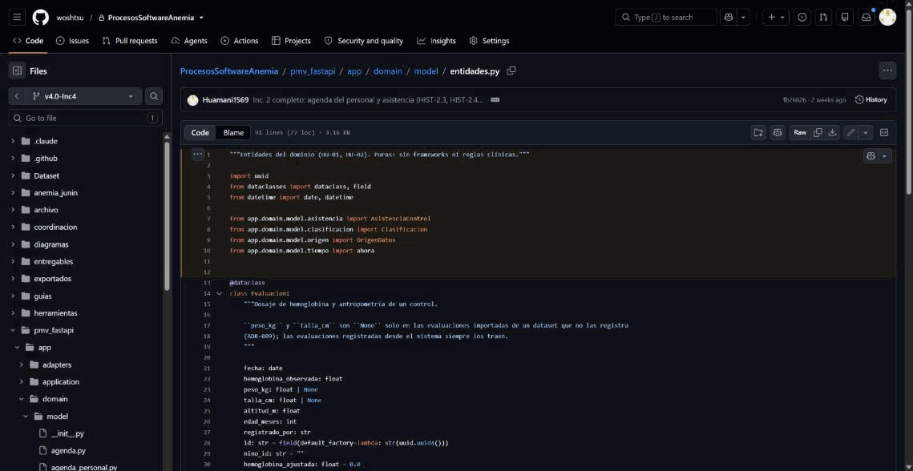

- **Archivo de imagen:** `entregables/semana-10/evidencias/github/GH_dominio_entidades_imports.png`

**[ CAPTURA 2: EJECUCIÓN DE LA MEDICIÓN ]**

- **Descripción:** **Figura G2.** Ejecución de `m11_contaminacion.py` del 06/11/2026 sobre el código actual: 0 importaciones externas en las 86 clases del dominio. El rótulo «v2.0» es la clave interna del script y apunta a `pmv_fastapi/` actual.

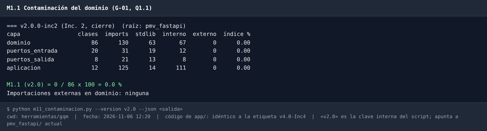

- **Archivo de imagen:** `entregables/semana-12/correcciones/img/G01_m11_contaminacion.png`

**EVALUACIÓN: CUMPLE | FECHA: 06/11/2026 | EVALUADOR: QA Lead (Huamani R.)**

---

**FICHA DE EVALUACIÓN GQM Y EVIDENCIA VISUAL POR MÉTRICA (M1.2)**

- **META:** G-01. **PREGUNTA:** Q1.2 ¿La estructura es hexagonal?
- **MÉTRICA Y FÓRMULA:** M1.2 Conformidad hexagonal = componentes conformes ÷ 5 × 100. Los 5 componentes son: núcleo de dominio, puertos de entrada, puertos de salida, adaptadores de entrada y adaptadores de salida.
- **DATOS Y CÁLCULO:** los 5 componentes son conformes: tienen paquete propio y cumplen la dirección de las dependencias. M1.2 = 5 ÷ 5 × 100 = **100 %**.
- **Sensibilidad:** la lectura ultra estricta da 80 %, porque `ServicioSesion` implementa el puerto `ProveedorIdentidad` dentro de la capa de aplicación.
- **META DE LA GUÍA:** 100 %.

**[ CAPTURA 1: EVIDENCIA EN EL DOMINIO ]**

- **Descripción:** **Figura G3.** Matriz de importaciones entre capas del análisis AST: ninguna celda roja. El dominio no importa ninguna otra capa y cada adaptador solo depende de su puerto.

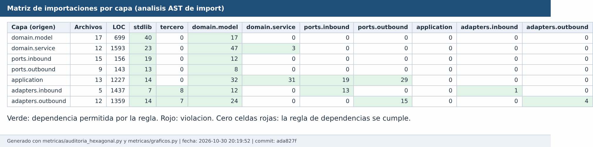

- **Archivo de imagen:** `entregables/semana-10/evidencias/arquitectura/S_matriz_importaciones.png`

**[ CAPTURA 2: EJECUCIÓN DE LA MEDICIÓN ]**

- **Descripción:** **Figura G4.** Ejecución de `m12_conformidad.py` del 06/11/2026: los 5 componentes son CONFORMES (M1.2 = 100 %), con la observación de la lectura ultra estricta.

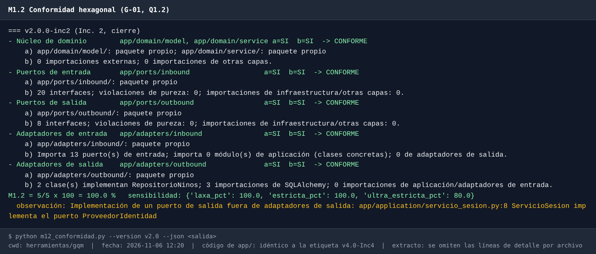

- **Archivo de imagen:** `entregables/semana-12/correcciones/img/G02_m12_conformidad.png`

**EVALUACIÓN: CUMPLE (lectura estricta; 80 % en la ultra estricta) | FECHA: 06/11/2026 | EVALUADOR: QA Lead (Huamani R.)**

---

**FICHA DE EVALUACIÓN GQM Y EVIDENCIA VISUAL POR MÉTRICA (M1.3)**

- **META:** G-01. **PREGUNTA:** Q1.3 ¿Las dependencias apuntan al núcleo?
- **MÉTRICA Y FÓRMULA:** M1.3 Violaciones de la regla de dependencia, contadas por AST como aristas que salen del dominio hacia otras capas.
- **DATOS Y CÁLCULO:** inestabilidad del dominio I = Ce ÷ (Ce + Ca) = 0 ÷ (0 + 41) = **0,00**. Aristas hacia fuera del dominio: **0**.
- **CRITERIO:** 0 violaciones.

**[ CAPTURA 1: EVIDENCIA EN EL DOMINIO ]**

- **Descripción:** **Figura G5.** Pruebas de arquitectura (`tests/arquitectura/test_dependencias.py`) que hacen cumplir la regla en cada ejecución del CI: si el dominio importara un framework o un adaptador, la prueba fallaría.

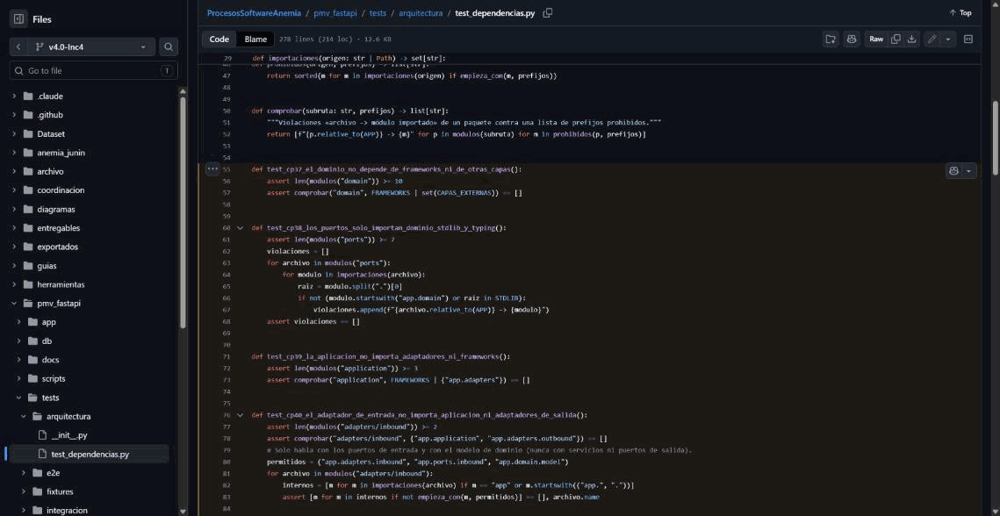

- **Archivo de imagen:** `entregables/semana-10/evidencias/github/GH_pruebas_arquitectura.png`

**[ CAPTURA 2: EJECUCIÓN DE LA MEDICIÓN ]**

- **Descripción:** **Figura G6.** Ejecución de `m13_acoplamiento.py` del 06/11/2026: el núcleo de dominio tiene Ce = 0 e I = 0,00, y hay 0 violaciones de la regla de dependencia.

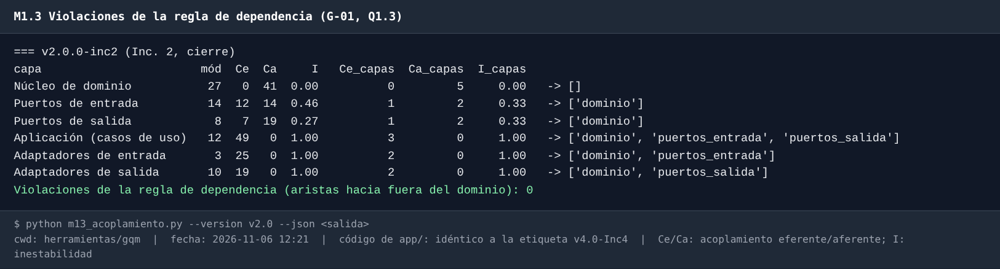

- **Archivo de imagen:** `entregables/semana-12/correcciones/img/G03_m13_acoplamiento.png`

**EVALUACIÓN: CUMPLE | FECHA: 06/11/2026 | EVALUADOR: QA Lead (Huamani R.)**

---

**FICHA DE EVALUACIÓN GQM Y EVIDENCIA VISUAL POR MÉTRICA (M2.1)**

- **META:** G-02 Verificar la estabilidad funcional (punto de vista de QA).
- **PREGUNTA:** Q2.1 ¿Cada requisito tiene evidencia?
- **MÉTRICA Y FÓRMULA:** M2.1 Cobertura funcional con capturas = requisitos con captura aprobada ÷ requisitos × 100.
- **DATOS Y CÁLCULO:**
  - Inc. 1: 5/5. Inc. 2: 4/4. Inc. 3: 5/5. Inc. 4: 4/4.
  - Acumulado: 18 ÷ 18 × 100 = **100 %**. La ficha AUTH es adicional y no cuenta como requisito del plan.
- **META DE LA GUÍA:** 100 %.

**Tabla G2.** Requisitos de cada incremento y ficha del apartado 3.6.4 que los evidencia.

| Incremento | Requisitos | Fichas con captura de entrada y de resultado | Resultado |
| --- | --- | --- | :---: |
| Inc. 1 (PMV) | RF-01 a RF-05 | RF-01, RF-02, RF-03, RF-04 y RF-05 | 5/5 |
| Inc. 2 | RF-06 a RF-09 | RF-06, RF-07, RF-08 y RF-09 | 4/4 |
| Inc. 3 | HIST-3.1 a HIST-3.4, VIS-3.5 | HIST-3.1 (y 3.1b), HIST-3.2, HIST-3.3, HIST-3.4 y VIS-3.5 | 5/5 |
| Inc. 4 | HIST-4.1 a HIST-4.4 | HIST-4.1, HIST-4.2, HIST-4.3 y HIST-4.4 | 4/4 |
| **Total** | **18** | 19 fichas de requisitos y 1 de autenticación | **18/18** |

**[ CAPTURA: EJECUCIÓN QUE RESPALDA LAS FICHAS ]**

- **Descripción:** **Figura G7.** Las 28 pruebas E2E en el navegador (Playwright), ejecutadas el 06/11/2026: 28 aprobadas. Automatizan los escenarios de las fichas de los cuatro incrementos (CP-297 a CP-303 de Inc. 3, recordatorios y barreras de Inc. 4, agenda y alertas de Inc. 2).
  - En una primera corrida, CP-110 (agenda) excedió el tiempo de espera. Pasó 3 de 3 veces aislada y en la corrida completa de la figura. Es la inestabilidad ya registrada en H6.

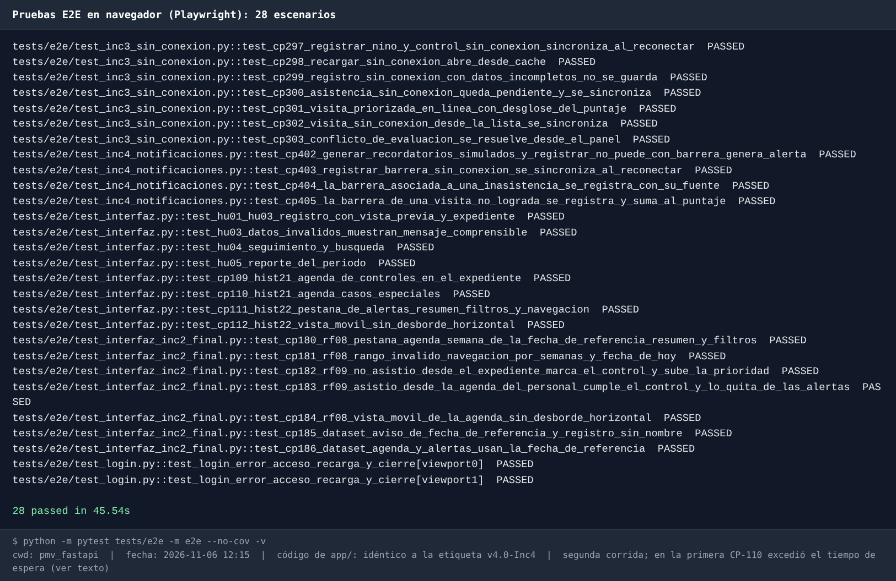

- **Archivo de imagen:** `entregables/semana-12/correcciones/img/T02_e2e_playwright.png`

**EVALUACIÓN: CUMPLE | FECHA: 06/11/2026 | EVALUADOR: QA Lead (Huamani R.)**

---

**FICHA DE EVALUACIÓN GQM Y EVIDENCIA VISUAL POR MÉTRICA (M2.2)**

- **META:** G-02. **PREGUNTA:** Q2.2 ¿Cuántos defectos hay?
- **MÉTRICA Y FÓRMULA:** M2.2 Defectos por requisito = defectos funcionales ÷ requisitos del incremento.
- **DATOS Y CÁLCULO:**
  - Inc. 1: 7 ÷ 5 = 1,40. Inc. 2: 1 ÷ 4 = 0,25 (S9).
  - Inc. 3 y 4, contando los hallazgos de la revisión independiente: Inc. 3, 1 ÷ 5 = **0,20** (duplicado por concurrencia en la sincronización). Inc. 4, 3 ÷ 4 = **0,75** (webhook sin firma, recordatorio duplicado por concurrencia y detalle de barrera demasiado largo).
- **META DE LA GUÍA:** ≤ 1,0 (Inc. 1) y ≤ 0,2 (Inc. 2).
- **Lectura:** Inc. 3 está dentro de la última meta de la guía (≤ 0,2) e Inc. 4 la supera.

**[ CAPTURA 1: EVIDENCIA EN EL DOMINIO ]**

- **Descripción:** **Figura G8.** Defectos por requisito e incremento (DEF-01 a DEF-09 de los incrementos 1 y 2), según su tipo y momento de detección. Fuente: registro de defectos `pmv_fastapi/docs/evidencias/registro_defectos*.md`.

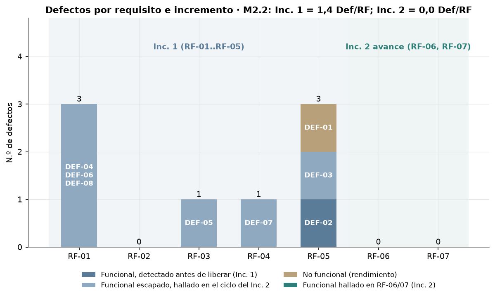

- **Archivo de imagen:** `entregables/semana-09/metricas/graficos/g6_defectos.png`

**[ CAPTURA 2: EJECUCIÓN DE LA MEDICIÓN ]**

- **Descripción:** **Figura G9.** Pruebas de regresión de los defectos de Inc. 3 e Inc. 4 hallados en la revisión independiente, todas aprobadas: CP-357 (webhook falla cerrado), CP-264b (sincronización concurrente), CP-382b (recordatorios concurrentes), CP-391b, CP-396 y CP-405.

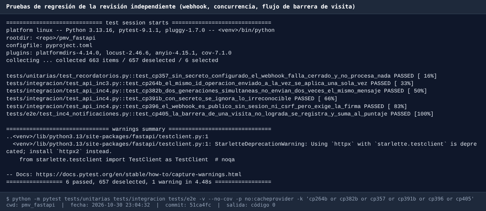

- **Archivo de imagen:** `entregables/semana-11/evidencias/CMMI04_regresion_revision_independiente.png`

**EVALUACIÓN: CUMPLE EN INC. 3; NO CUMPLE EN INC. 4 (0,75 frente a la última meta de la guía, ≤ 0,2); VALOR INDICATIVO | FECHA: 06/11/2026 | EVALUADOR: QA Lead (Huamani R.)**

---

**FICHA DE EVALUACIÓN GQM Y EVIDENCIA VISUAL POR MÉTRICA (M3.1)**

- **META:** G-03 Evaluar la efectividad del proceso (valor organizacional, punto de vista del usuario).
- **PREGUNTA:** Q3.1 ¿Qué brechas del AS-IS se resolvieron?
- **MÉTRICA Y FÓRMULA:** M3.1 = (Σ puntajes B1 a B6 ÷ 6) × 100. Puntaje: 1 = mecanismo completo, operativo y probado; 0,5 = parcial; 0 = no.
- **DATOS Y CÁLCULO:** B1 1,0 + B2 1,0 + B3 1,0 + B4 1,0 + B5 0,0 + B6 0,5 = 4,5. M3.1 = 4,5 ÷ 6 × 100 = **75,0 %**.
- **META:** meta acumulada propuesta en S9 para INC-4: 66,7 %.

**EVIDENCIA EN EL SOFTWARE POR BRECHA (CAPTURAS DE DOMINIO)**

**[ B1 Triple registro manual → registro único (puntaje 1,0) ]**

- **Descripción:** **Figura G10.** Producción: formulario «Registrar niño y evaluación inicial» con la validación clínica en vista previa antes de guardar (Hb ajustada por altitud y clasificación). Una sola digitación alimenta el expediente, el seguimiento y el reporte.

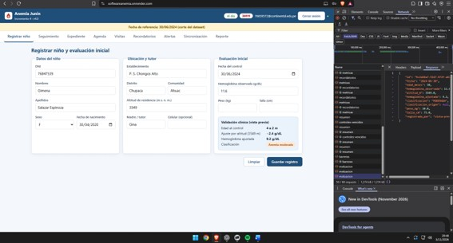

- **Descripción:** **Figura G11.** Producción: «Niños en seguimiento» con los registros del dataset DIRESA anonimizado. Es la misma información, sin volver a digitarla.

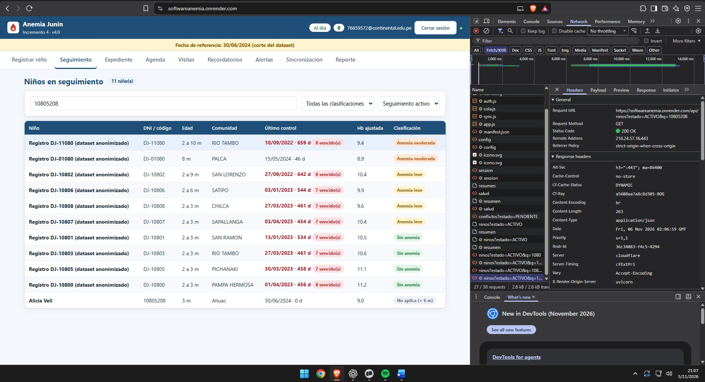

- **Archivos de imagen:** `entregables/semana-12/evidencias/produccion/ROD_01_inc1_registro_clasificacion1.jpg`, `PROD_03_inc3_sincronizacion_seguimiento.jpg`

**[ B2 Agenda sin recordatorios → agenda normativa y recordatorios (puntaje 1,0) ]**

- **Descripción:** **Figura G12.** Producción: agenda del personal con los controles programados por la norma para cada niño.

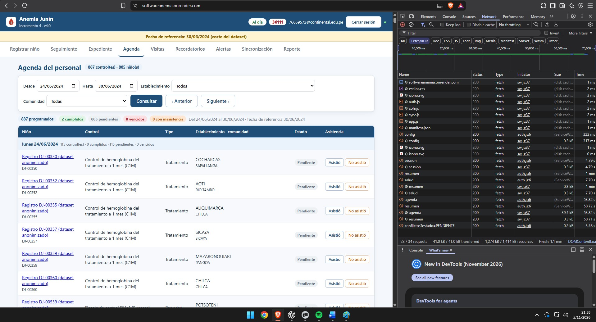

- **Descripción:** **Figura G13.** Recordatorios generados para los controles próximos, con estado SIMULADO: no sale ningún mensaje real hasta que Meta apruebe la plantilla de WhatsApp.

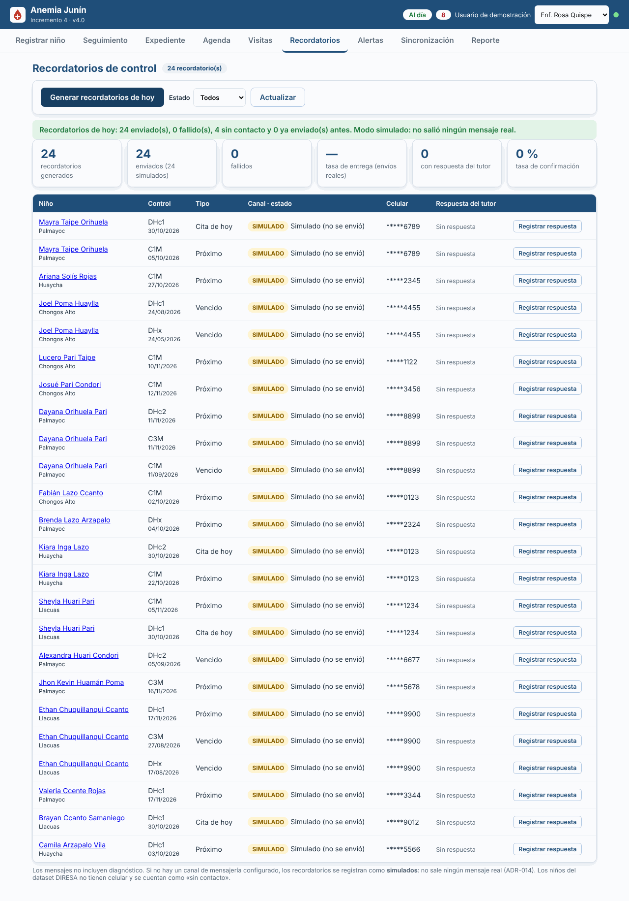

- **Archivos de imagen:** `entregables/semana-12/evidencias/produccion/PROD_02_inc2_agendas.jpg`, `entregables/semana-10/evidencias/software/HIST41_inc4_2_recordatorios_simulados_escritorio.png`

**[ B3 Barreras ocultas → registro de barreras y alerta crítica (puntaje 1,0) ]**

- **Descripción:** **Figura G14.** Alertas: la tabla «Barreras críticas» muestra a los niños cuyas barreras de acceso ponen en riesgo su tratamiento, según `REGLAS_BARRERAS_V1`.

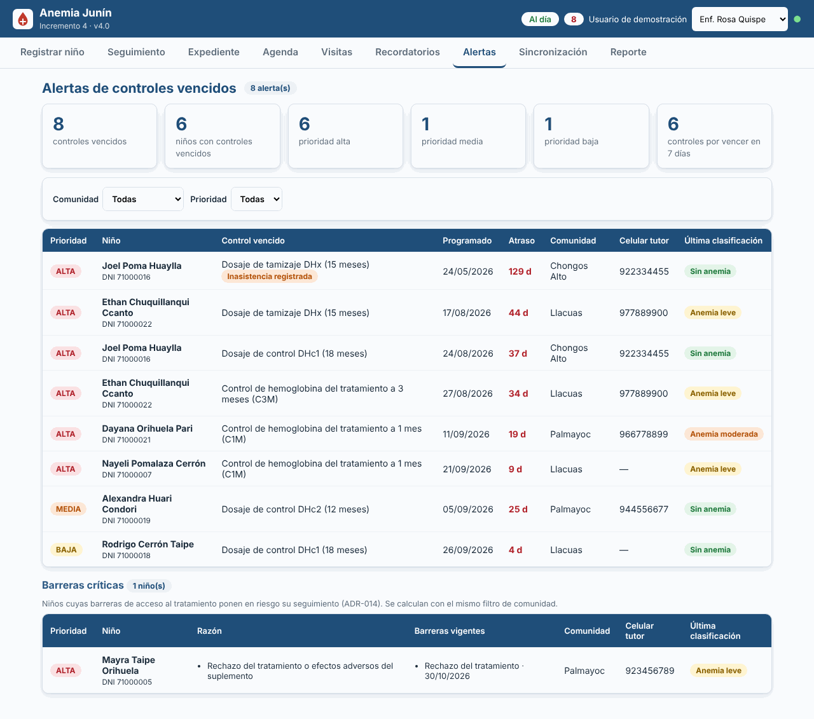

- **Archivo de imagen:** `entregables/semana-10/evidencias/software/HIST44_inc4_1_alertas_barreras_criticas_escritorio.png`

**[ B4 Visita domiciliaria en papel → visitas priorizadas (puntaje 1,0) ]**

- **Descripción:** **Figura G15.** Producción: «Visitas domiciliarias priorizadas» con puntaje explicable. Los niños con anemia severa y el control más vencido aparecen primero. A la derecha, la solicitud a la API de producción responde 200 OK.

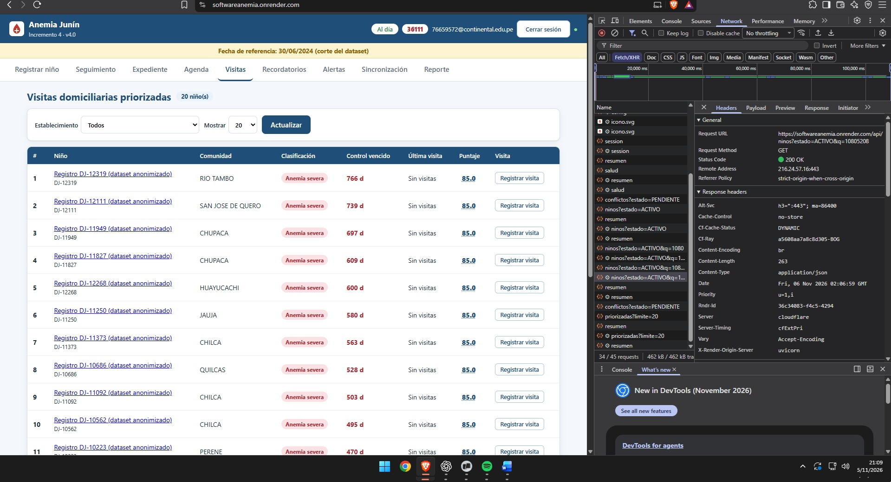

- **Archivo de imagen:** `entregables/semana-12/evidencias/produccion/PROD_03_inc3_sincronizacion_visitas.jpg`

**[ B5 Riesgo identificado tarde (puntaje 0,0) ]**

- Sin evidencia en el software, porque no se implementó: el modelo de riesgo de abandono es del INC-5. La visita priorizada usa controles ya vencidos y es reactiva. Se informa como brecha abierta.

**[ B6 Conectividad intermitente → registro sin conexión y sincronización (puntaje 0,5) ]**

- **Descripción:** **Figura G16.** Producción, en un celular: sin conexión a internet, el registro de un niño queda «Pendiente de sincronizar» y guardado en el dispositivo.

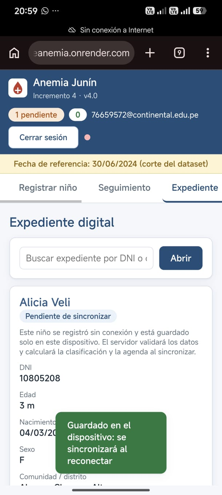{width=35%}

- **Descripción:** **Figura G17.** Producción, en el mismo celular: al volver la conexión, «De nuevo en línea», el indicador pasa a «Al día» y aparece «Sincronización: 1 aplicado(s)».

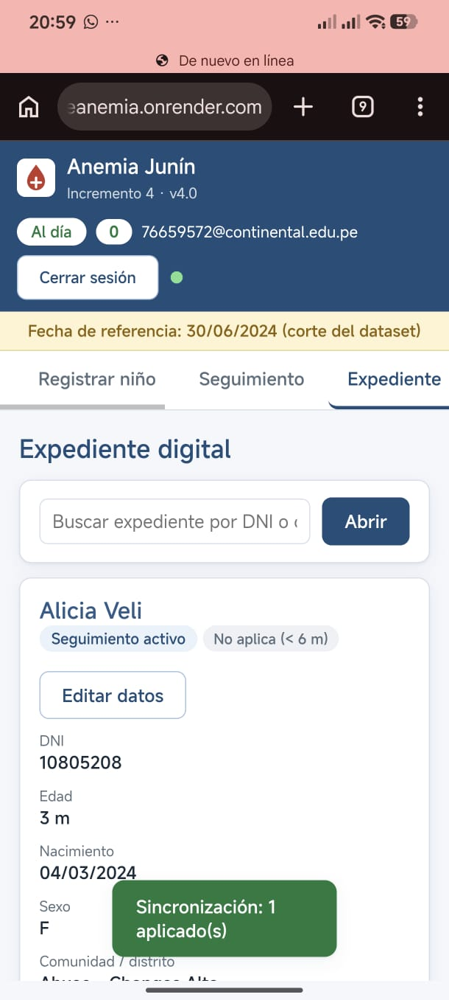{width=35%}

- **Archivos de imagen:** `entregables/semana-12/evidencias/produccion/PROD_03_inc3_sincronizacion_celular1.jpg`, `PROD_03_inc3_sincronizacion_celular3.jpg`
- **Por qué el puntaje es 0,5:** falta el INC-6 y no hubo prueba en una posta con red intermitente real.

**[ CAPTURA: EJECUCIÓN DE LA MEDICIÓN ]**

- **Descripción:** **Figura G18.** Ejecución de `m31_brechas_v4.py` del 06/11/2026 y el detalle de su archivo de salida.
  - Puntaje por brecha y M3.1 = 75,0 %.
  - Rutas de la API presentes para B2, B3, B4 y B6.
  - Archivos de la cola sin conexión.
  - «abandono»: 0 ocurrencias, que explica B5 = 0.

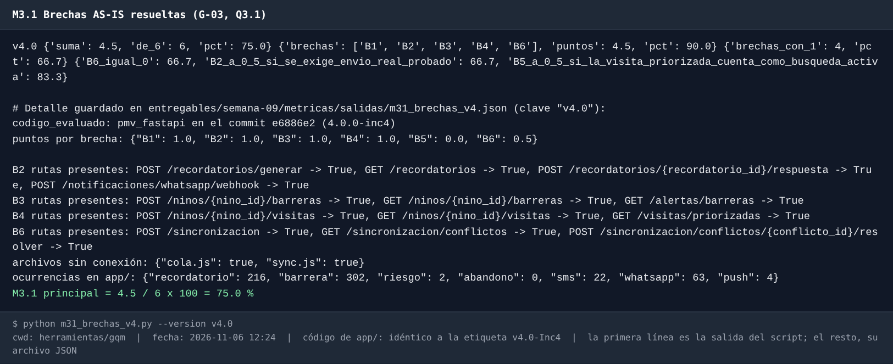

- **Archivo de imagen:** `entregables/semana-12/correcciones/img/G04_m31_brechas.png`

**EVALUACIÓN: CUMPLE (75,0 % ≥ 66,7 %; 50,0 % si se exigiera envío real y dispositivo real) | FECHA: 06/11/2026 | EVALUADOR: QA Lead (Huamani R.)**

---

**FICHA DE EVALUACIÓN GQM Y EVIDENCIA VISUAL POR MÉTRICA (M3.2)**

- **META:** G-03. **PREGUNTA:** Q3.2 ¿Mejoraron los indicadores de valor para el usuario?
- **MÉTRICA Y FÓRMULA:** M3.2 = promedio de las mejoras de V1, V2 y V3 frente a la línea base AS-IS.
  - V1: escrituras manuales por evaluación.
  - V2: % de niños activos con agenda generada.
  - V3: F1 de la detección de controles vencidos frente a un oráculo independiente.
- **DATOS Y CÁLCULO** (muestra B150, 140 niños activos):
  - V1 = **1 escritura** por evaluación; el AS-IS tenía 3 registros.
  - V2 = 140 ÷ 140 = **100 %**.
  - V3: TP 93, FP 0, FN 0, TN 47, F1 = **1,000**; 476 de 476 controles vencidos coinciden.
  - M3.2 = **100 %**.
- **META DE LA GUÍA:** ≥ 80 % (Inc. 2).

**[ CAPTURA 1: EVIDENCIA EN EL DOMINIO ]**

- **Descripción:** **Figura G19.** V1: producción, «Reporte del periodo». Cuenta los niños registrados y las evaluaciones del periodo (762 niños y 2 630 evaluaciones) a partir del registro único, sin volver a digitar.

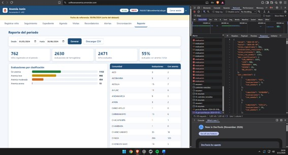

- **Descripción:** **Figura G20.** V2: la agenda normativa se genera sola para cada niño activo. Expediente con sus controles cumplidos, pendientes y vencidos.

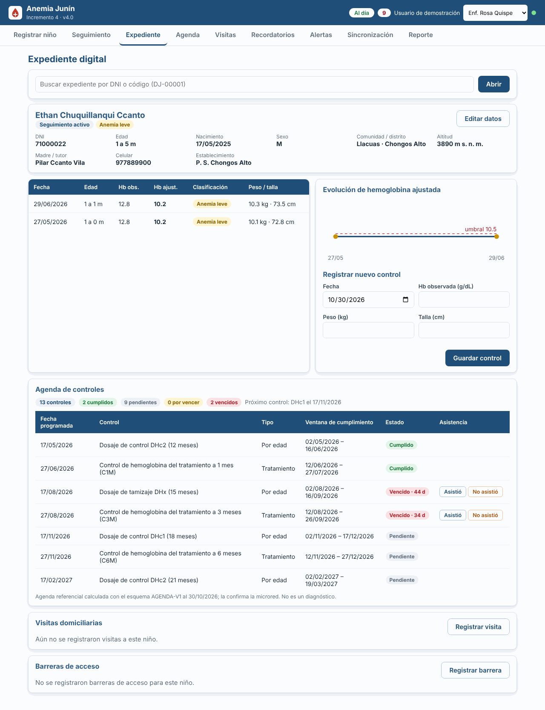

- **Descripción:** **Figura G21.** V3: producción, «Alertas de controles vencidos» sobre el dataset DIRESA anonimizado, con prioridad, días de atraso y comunidad.

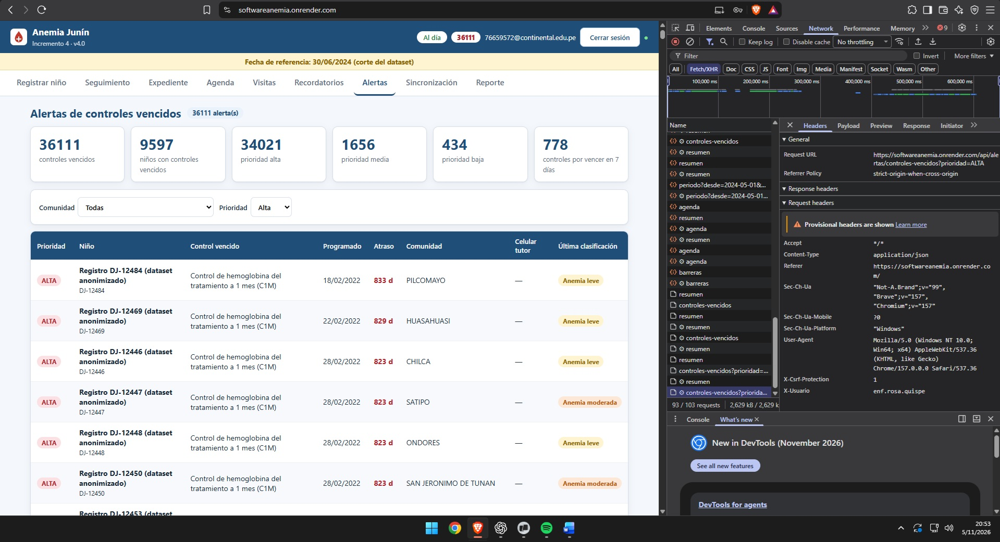

- **Archivos de imagen:** `entregables/semana-12/evidencias/produccion/ROD_01_inc1_registro_clasificacion2.jpg`, `entregables/semana-10/evidencias/software/RF06_inc2_1_agenda_expediente_escritorio.png`, `entregables/semana-12/evidencias/produccion/PROD_02_inc2_alertas.jpg`

**[ CAPTURA 2: EJECUCIÓN DE LA MEDICIÓN ]**

- **Descripción:** **Figura G22.** Resultado de `m32_valor.py`, corrida de la adenda S9 del 30/10/2026 sobre `v4.0-Inc4`. Muestra V1 (1 escritura; 4 vistas que reflejan el registro), V2 (140/140) y V3 (matriz de confusión con F1 = 1,0 y 476/476 controles).

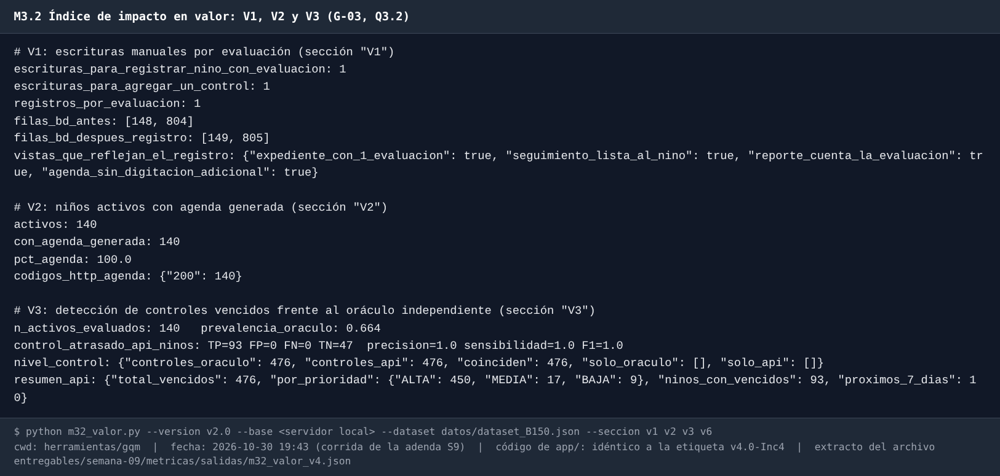

- **Archivo de imagen:** `entregables/semana-12/correcciones/img/G05_m32_valor.png`

**EVALUACIÓN: CUMPLE | FECHA: 06/11/2026 | EVALUADOR: QA Lead (Huamani R.)**

---

**FICHA DE EVALUACIÓN GQM Y EVIDENCIA VISUAL POR MÉTRICA (V4 Y V5)**

- **META:** G-03 (indicadores complementarios de valor).
- **MÉTRICAS:** V4 p95 agregado con 50 usuarios simultáneos; V5 disponibilidad durante la carga = sondas disponibles ÷ sondas × 100.
- **DATOS Y CÁLCULO:**
  - V4: 1 960 solicitudes, 0 fallos, p95 = **1 100 ms** (una corrida).
  - V5: 64 ÷ 64 × 100 = **100 %**.
- **META:** V4 < 800 ms; V5 ≥ 99,5 %.

**[ CAPTURA 1: EVIDENCIA EN EL DOMINIO ]**

- **Descripción:** **Figura G23.** Carga con Locust sobre las pantallas de los incrementos 3 y 4 (20 usuarios). La curva p95 queda por debajo del umbral de 800 ms con 20 usuarios. Con 50 usuarios lo supera (Figura G24).

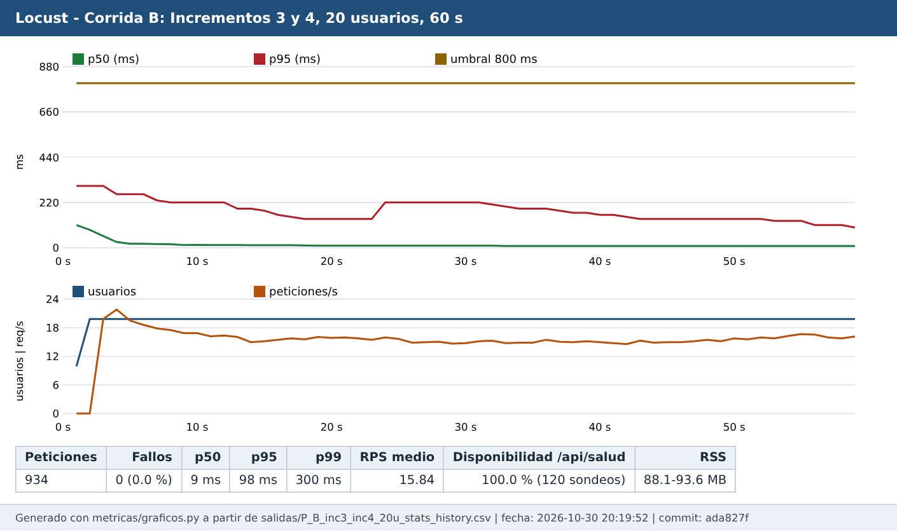

- **Descripción:** **Figura G25.** Producción: `GET /api/salud` responde «ok» y `/openapi.json` declara la versión 4.0.0-inc4.

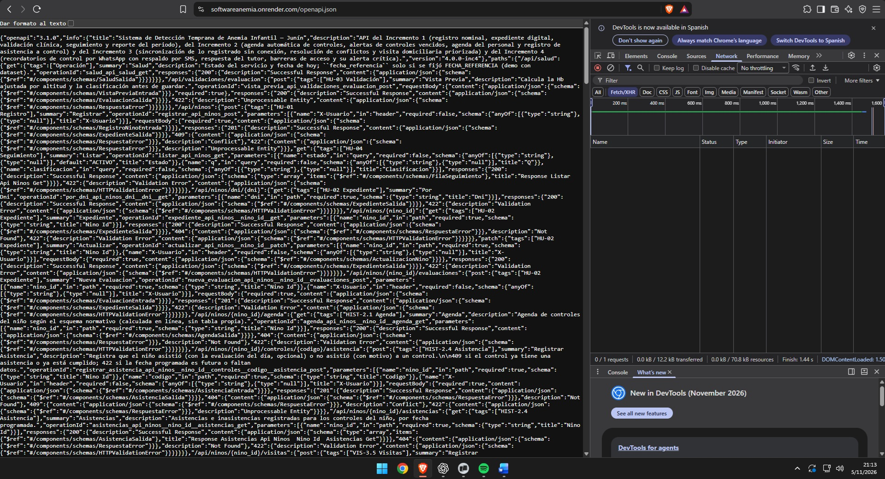

- **Archivos de imagen:** `entregables/semana-10/evidencias/rendimiento/P_locust_B_inc3_inc4_20u.png`, `entregables/semana-12/evidencias/produccion/PROD_06_salud_openapi.jpg`

**[ CAPTURA 2: EJECUCIÓN DE LA MEDICIÓN ]**

- **Descripción:** **Figura G24.** Corrida de carga de la adenda v4 (50 usuarios, 60 s): p95 por endpoint y agregado de 1 100 ms.

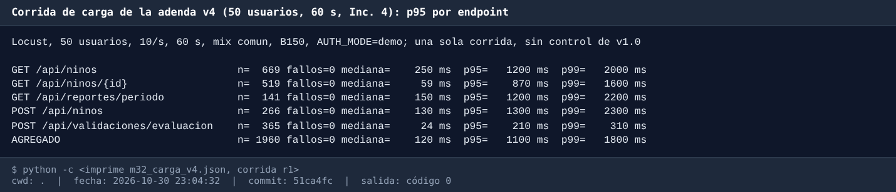

- **Descripción:** **Figura G26.** Sonda de disponibilidad `GET /api/salud` cada segundo durante la carga: 64 de 64 respuestas, 100 %.

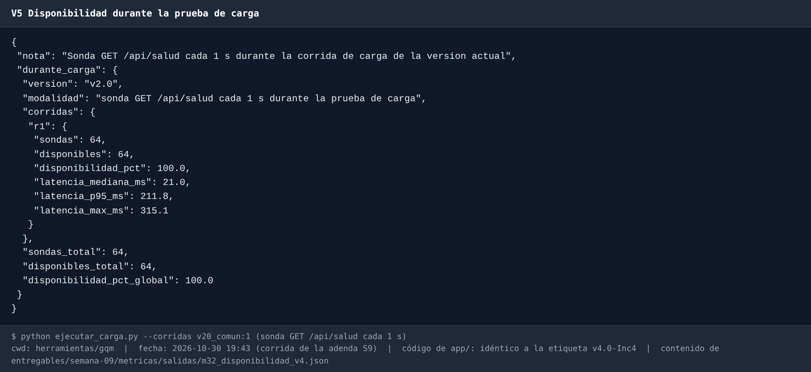

- **Archivos de imagen:** `entregables/semana-11/evidencias/CMMI05_carga_p95_v4.png`, `entregables/semana-12/correcciones/img/G06_v5_disponibilidad.png`

**EVALUACIÓN: V4 NO CUMPLE (1 100 ms > 800 ms; acción 16 del plan de mejora) · V5 CUMPLE | FECHA: 06/11/2026 | EVALUADOR: QA Lead (Huamani R.)**

---

## PARTE 3. Observación 3: evidencias de los artefactos CMMI

### 3.1 Texto de entrada (insertar en 3.8, antes de «Análisis de causa raíz y plan de mejora continua»)

**Evidencias de los productos de trabajo por área de práctica**

El nivel de cada área de la Tabla 33 se sostiene en productos de trabajo del proyecto. La Tabla C1 asocia cada área con sus artefactos (cronograma, estimación, diseño, pruebas, configuración y revisión) y las figuras que siguen los muestran.

El diseño no es un área evaluada en la Tabla 33. Se presenta como **Solución técnica (TS)**, evidencia complementaria de que el diseño se documentó antes de construir. Sus artefactos sostienen a PLAN y VER.

**Tabla C1.** Artefactos del proceso que sostienen el nivel de cada área de práctica.

| Área | Nivel | Artefacto (producto de trabajo) | Evidencia |
| --- | :---: | --- | --- |
| ESTIM | 1 | Backlog estimado en puntos de historia (133 SP, *Planning Poker*) y estimación en horas del INC-1 (113 h-persona) | Figuras C1 y C2 |
| PLAN | 2 | Cronograma de sprints e hitos H0 a H7; seguimiento del plan frente a lo real | Figuras C3 y C4 |
| TS (complementaria) | — | 14 decisiones de arquitectura (ADR-001 a ADR-014), diagrama C4 de contenedores y modelo hexagonal | Figuras C5 a C7 |
| VER | 2 | 660 pruebas automatizadas con 99,79 % de cobertura, 28 pruebas E2E, análisis estático Ruff y SonarCloud | Figuras C8 a C11 |
| VAL | 1 | 20 fichas de prueba funcional con capturas (3.6.4) y ejecución en producción | Figuras C12 y C13 |
| CM | 2 | Etiquetas por incremento, ramas `feature/*` y *pull requests* | Figuras C14 y C15 |
| PQA | 1 | Verificaciones automáticas de la PR y revisión independiente con su regresión | Figuras C16 y C17 |
| CAR | 1 | Hallazgos con causa raíz (Tablas 34 y 35) y nuevo análisis de SonarCloud | Figura C11 y Tabla 34 |

---

**FICHA DE EVIDENCIA CMMI POR ÁREA DE PRÁCTICA (ESTIM — ESTIMACIÓN)**

- **PRÁCTICA EVALUADA:** estimar el tamaño y el esfuerzo del trabajo con un método explícito.
- **PRODUCTO DE TRABAJO:** Tabla 19 del entregable S3-4 (puntos de historia del backlog completo) y estimación de duraciones por actividad del INC-1.
- **NIVEL:** 1 (Ejecutado). La estimación existe, pero no se registran horas reales para contrastarla (H1).

**[ CAPTURA 1: ARTEFACTO ]**

- **Descripción:** **Figura C1.** Estimación del backlog en puntos de historia: 21 SP del INC-1 y 133 SP en total, con complejidad e incertidumbre por elemento. Fuente: entregable S3-4, sección 10.2.

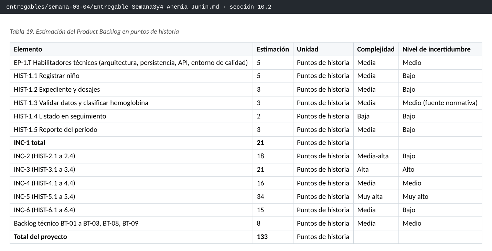

- **Archivo de imagen:** `entregables/semana-12/correcciones/img/C01_estimacion_sp.png`

**[ CAPTURA 2: ARTEFACTO ]**

- **Descripción:** **Figura C2.** Diagrama de Gantt del Incremento 1: actividades A01 a A21 con su duración estimada, responsable y dependencias (28 días, igual a la ruta crítica).

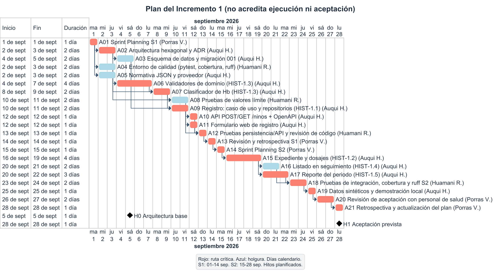

- **Archivo de imagen:** `diagramas/png/32_s34_gantt_incremento1.png`

---

**FICHA DE EVIDENCIA CMMI POR ÁREA DE PRÁCTICA (PLAN — PLANIFICACIÓN)**

- **PRÁCTICA EVALUADA:** planificar el trabajo en un cronograma con hitos y dar seguimiento a las desviaciones.
- **PRODUCTO DE TRABAJO:** cronograma de sprints e hitos (S3-4) y comparación del plan con las fechas reales (S11).
- **NIVEL:** 2 (Gestionado). Hay plan, hitos y desviaciones medidas: +5, +4 y −10 días.

**[ CAPTURA 1: ARTEFACTO ]**

- **Descripción:** **Figura C3.** Cronograma de los sprints 1 a 8 y de los hitos H0 a H7, del 01/09 al 21/12/2026.

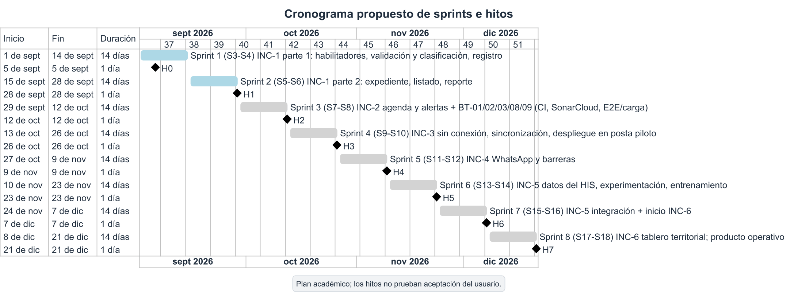

- **Archivo de imagen:** `diagramas/png/33_s34_cronograma_sprints_hitos.png`

**[ CAPTURA 2: SEGUIMIENTO ]**

- **Descripción:** **Figura C4.** Hitos del plan frente a la fecha real del commit: H2 (+5 días), H3 (+4 días) y H4 (−10 días, se adelantó la entrega para recuperar el plan original).

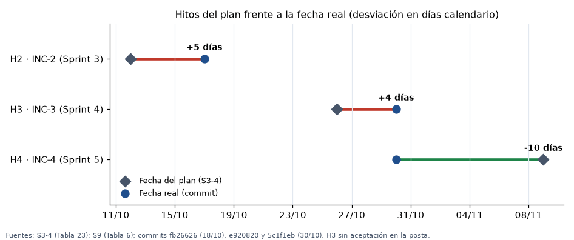

- **Archivo de imagen:** `entregables/semana-11/evidencias/CMMI02_hitos_plan_vs_real.png`

---

**FICHA DE EVIDENCIA CMMI POR ÁREA DE PRÁCTICA (TS — SOLUCIÓN TÉCNICA / DISEÑO, COMPLEMENTARIA)**

- **PRÁCTICA EVALUADA:** diseñar la solución y documentar las decisiones antes de construir.
- **PRODUCTO DE TRABAJO:** registro de decisiones de arquitectura (ADR), diagramas C4 y modelo hexagonal.
- **VALORACIÓN:** las decisiones de cada incremento están registradas: ADR-011 a ADR-014 para los incrementos 3 y 4. Los diagramas C4 y el modelo de datos son del PMV y no se actualizaron. Se registra como hallazgo H10 (Parte 3.3).

**[ CAPTURA 1: ARTEFACTO ]**

- **Descripción:** **Figura C5.** Índice de los 14 ADR con su fecha de creación: cada incremento agregó las decisiones que lo justifican, por ejemplo la sincronización sin conexión (ADR-012), la visita priorizada (ADR-013) y los recordatorios y barreras (ADR-014).

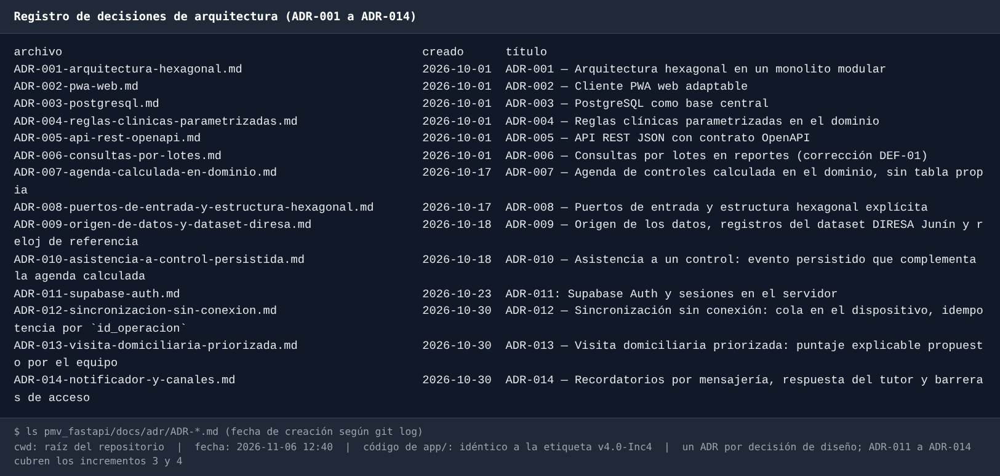

- **Archivo de imagen:** `entregables/semana-12/correcciones/img/C05_adr_indice.png`

**[ CAPTURA 2: ARTEFACTO ]**

- **Descripción:** **Figura C6.** Diagrama C4 de contenedores del PMV: PWA, API FastAPI y base PostgreSQL.

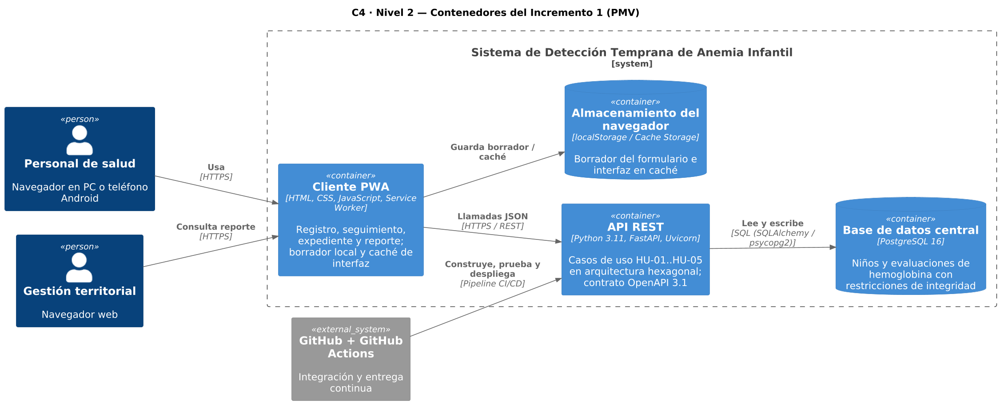

- **Descripción:** **Figura C7.** Modelo hexagonal del Incremento 2: dominio, puertos de entrada y salida, y adaptadores.

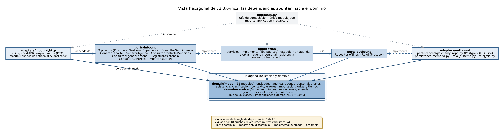

- **Archivos de imagen:** `pmv_fastapi/docs/diagramas/C4_contenedores.png`, `diagramas/png/72_s9_hexagonal_v20.png`

---

**FICHA DE EVIDENCIA CMMI POR ÁREA DE PRÁCTICA (VER — VERIFICACIÓN / PRUEBAS)**

- **PRÁCTICA EVALUADA:** verificar el producto con pruebas y revisiones definidas, en cada cambio.
- **PRODUCTO DE TRABAJO:** suites de pruebas unitarias, de integración, de arquitectura y E2E; análisis estático; CI de GitHub Actions.
- **NIVEL:** 2 (Gestionado). Todas las suites se volvieron a ejecutar el 06/11/2026 con el mismo resultado del 30/10.

**[ CAPTURA 1: EJECUCIÓN ]**

- **Descripción:** **Figura C8.** 660 pruebas unitarias, de integración y de arquitectura aprobadas en 33 s, con 99,79 % de cobertura de líneas y ramas. Solo dos archivos de autenticación quedan por debajo del 100 %.

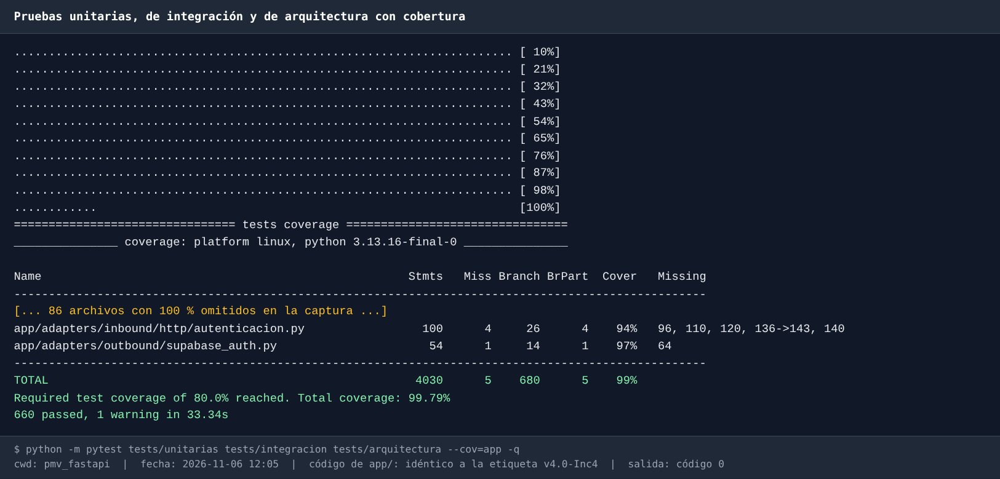

- **Archivo de imagen:** `entregables/semana-12/correcciones/img/T01_pytest_cobertura.png`

**[ CAPTURA 2: EJECUCIÓN ]**

- **Descripción:** **Figura C9.** Análisis estático con Ruff: «All checks passed!» y 142 archivos con el formato correcto.

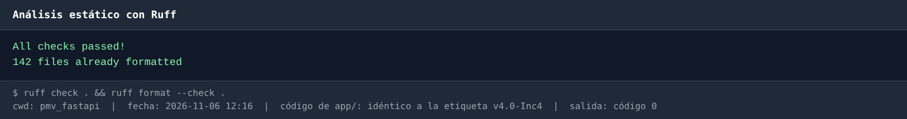

- **Descripción:** **Figura C10.** Ejecuciones del CI en `main`: la #16 (PR #8, incrementos 3 y 4) en verde; las anteriores (#6, #8, #9 y #10), en rojo. Esas fallas se corrigieron por H7.

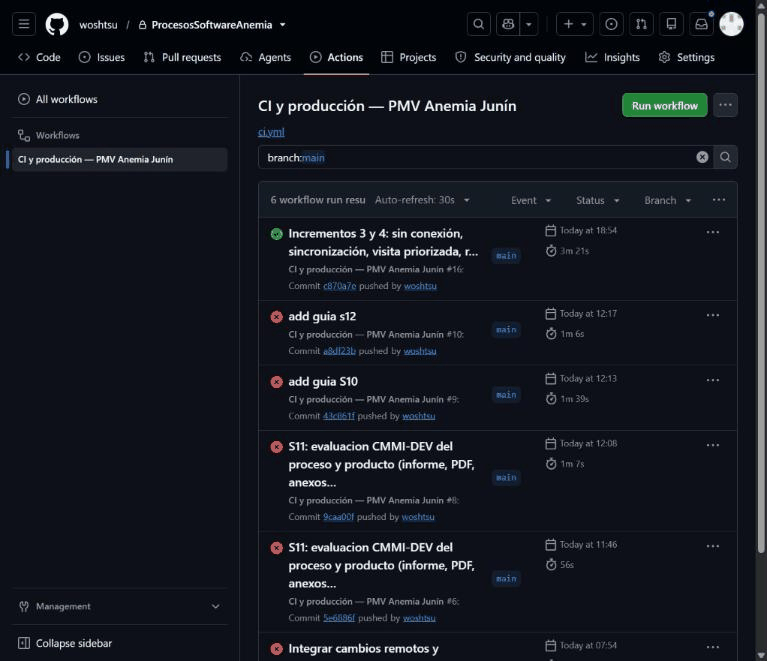

- **Descripción:** **Figura C11.** Primer análisis de SonarCloud del repositorio, del 05/11/2026: Quality Gate aprobado sobre el código nuevo y 129 hallazgos sobre el código completo.
  - El backend desplegado tiene 0 hallazgos.
  - Las 63 vulnerabilidades están en herramientas, scripts y el prototipo anterior.
  - Detalle en `entregables/semana-12/sonarcloud/ANALISIS_SONARCLOUD.md`.

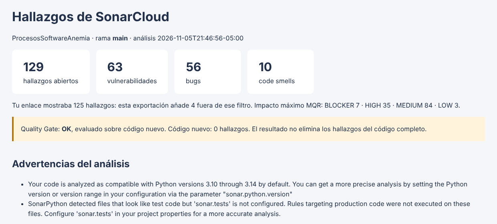

- **Archivos de imagen:** `entregables/semana-12/correcciones/img/T03_ruff.png`, `entregables/semana-11/evidencias/github/GH_actions_run16_main.png`, `entregables/semana-12/correcciones/img/C10_sonar_resumen.png`
- Las pruebas E2E (28 aprobadas) están en la Figura G7.

---

**FICHA DE EVIDENCIA CMMI POR ÁREA DE PRÁCTICA (VAL — VALIDACIÓN)**

- **PRÁCTICA EVALUADA:** validar que el producto sirve en su entorno de uso.
- **PRODUCTO DE TRABAJO:** 20 fichas de prueba funcional con capturas (3.6.4), producto desplegado en producción y video demostrativo.
- **NIVEL:** 1 (Ejecutado). Falta la aceptación del usuario final: no hay acta, ni SUS, ni piloto en una posta (H3).

**[ CAPTURA 1: EJECUCIÓN EN PRODUCCIÓN ]**

- **Descripción:** **Figura C12.** Producción: inicio de sesión del personal en `softwareanemia.onrender.com`.

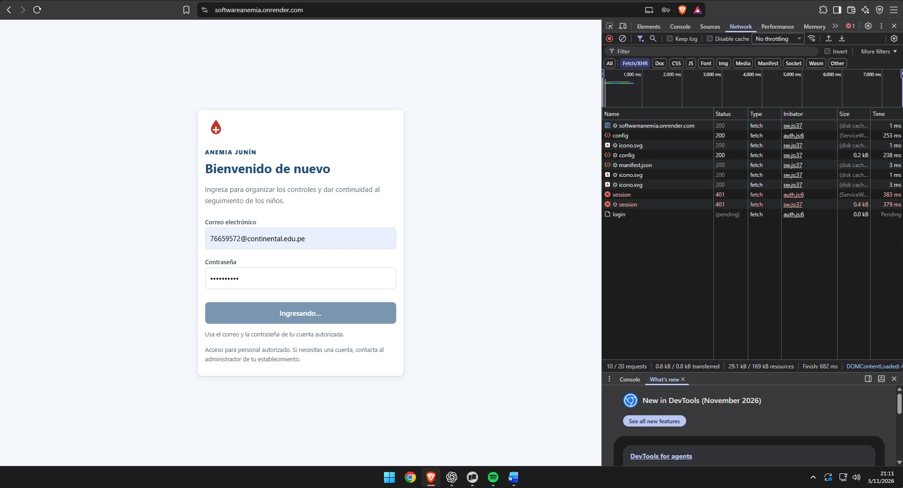

- **Archivo de imagen:** `entregables/semana-12/evidencias/produccion/PROD_05_auth_inicio_sesion.jpg`

**[ CAPTURA 2: ENTORNO DE PRODUCCIÓN ]**

- **Descripción:** **Figura C13.** Panel de Render: el servicio `SoftwareAnemia` está en estado «Live» con el commit `9b71b6e` de `main`. El historial muestra los despliegues disparados por el CI («Deploy Hook») tras cada PR integrada.

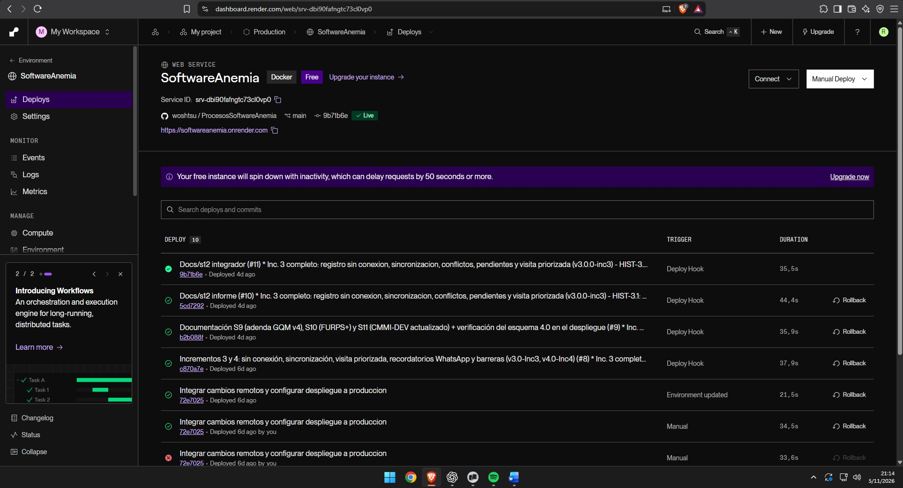

- **Archivo de imagen:** `entregables/semana-12/evidencias/produccion/PROD_07_render_panel_live.jpg`

---

**FICHA DE EVIDENCIA CMMI POR ÁREA DE PRÁCTICA (CM — GESTIÓN DE CONFIGURACIÓN)**

- **PRÁCTICA EVALUADA:** identificar versiones y controlar los cambios.
- **PRODUCTO DE TRABAJO:** etiquetas por incremento, ramas e integración por *pull request*.
- **NIVEL:** 2 (Gestionado).

**[ CAPTURA 1: ARTEFACTO ]**

- **Descripción:** **Figura C14.** Etiquetas del repositorio: `v1.0-PMV`, `v1.5.0-inc2-avance`, `v2.0-Inc2`, `v3.0-Inc3` y `v4.0-Inc4`.

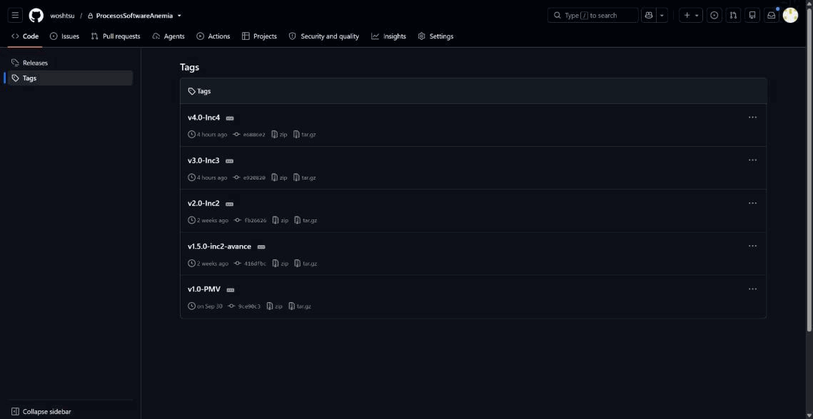

- **Archivo de imagen:** `entregables/semana-10/evidencias/github/GH_etiquetas.png`

**[ CAPTURA 2: CONTROL DE CAMBIOS ]**

- **Descripción:** **Figura C15.** *Pull requests* cerradas: cada incremento y cada entregable entró a `main` por una PR desde su rama.

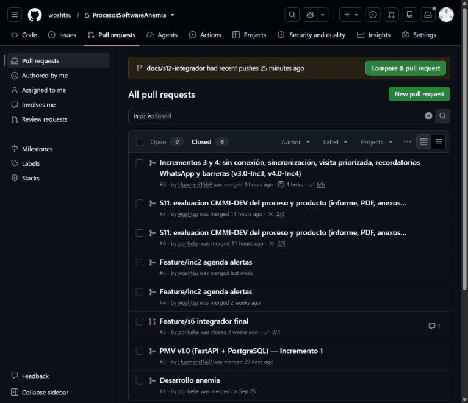

- **Archivo de imagen:** `entregables/semana-11/evidencias/github/GH_prs_cerradas.png`

---

**FICHA DE EVIDENCIA CMMI POR ÁREA DE PRÁCTICA (PQA — ASEGURAMIENTO DE LA CALIDAD)**

- **PRÁCTICA EVALUADA:** revisar objetivamente los procesos y productos y dar seguimiento a las no conformidades.
- **PRODUCTO DE TRABAJO:** verificaciones automáticas de cada PR, informe de revisión independiente y pruebas de regresión de sus hallazgos.
- **NIVEL:** 1 (Ejecutado). No hay aprobación formal («Approved») registrada en las PR ni plantilla de PR (H2).

**[ CAPTURA 1: ARTEFACTO ]**

- **Descripción:** **Figura C16.** PR #8 (incrementos 3 y 4) con sus verificaciones del CI en verde antes de integrarse.

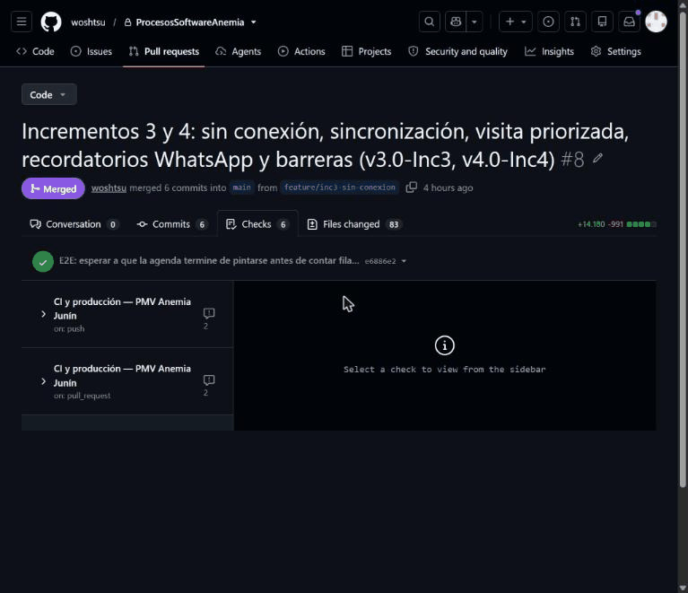

- **Archivo de imagen:** `entregables/semana-11/evidencias/github/GH_pr8_checks.png`

**[ CAPTURA 2: SEGUIMIENTO DE NO CONFORMIDADES ]**

- **Descripción:** **Figura C17.** La revisión independiente encontró cinco defectos. Las pruebas de regresión de los corregidos están aprobadas (seis casos).

- **Archivo de imagen:** `entregables/semana-11/evidencias/CMMI04_regresion_revision_independiente.png`

---

### 3.2 Párrafo de cierre del subapartado

Con estas evidencias, ninguna área cambia de nivel respecto de la Tabla 33. Las de Nivel 1 (ESTIM, PQA, VAL y CAR) tienen productos de trabajo, pero les falta el registro sistemático que exige el Nivel 2: horas reales, aprobación registrada de las PR, aceptación del usuario y efecto medido de las mejoras.

La novedad del 05/11/2026 es el primer análisis de SonarCloud. Avanza la acción 3 del plan de mejora, pero aún no se integra al CI.

### 3.3 Cambios en las Tablas 34 y 36

**Nueva fila de la Tabla 34:**

| ID | Área | Hallazgo | Causa raíz | Estado |
| --- | --- | --- | --- | --- |
| H10 | TS, PLAN | Los diagramas C4 y el modelo de datos son del PMV (01/10/2026). Las decisiones de los incrementos 2 a 4 están en los ADR, pero no en los diagramas. | La DoD exige un ADR por decisión, pero no actualizar los diagramas | Abierto |

**Fila de la acción 3 en la Tabla 36** (reemplaza su estado):

| N.° | Área | Acción de mejora | Métrica de verificación | Responsable | Fecha objetivo | Estado |
| --- | --- | --- | --- | --- | --- | --- |
| 3 | VER | Activar SonarCloud, pruebas de entradas límite en la DoD y *hook* de pre-commit | Reporte de SonarCloud sin incidencias críticas | Huamani R. | 06/11 | Parcial: primer análisis de SonarCloud el 05/11 (129 hallazgos, 0 en el backend desplegado). Falta el análisis desde el CI y corregir los críticos del frontend |
