# INFORME ACADÉMICO INTEGRADOR DEL PROYECTO DE ASIGNATURA

```text
========================================================================================================
                                      UNIVERSIDAD CONTINENTAL
                           FACULTAD DE INGENIERÍA DE SISTEMAS E INFORMÁTICA
                                PROGRAMA ACADÉMICO PROFESIONAL DE
                             INGENIERÍA DE SISTEMAS E INFORMÁTICA

                                   INFORME ACADÉMICO FINAL
              "DISEÑO, ADAPTACIÓN, EVALUACIÓN E IMPLEMENTACIÓN DEL PROCESO DE
                SOFTWARE CON ENTREGA DE VALOR APLICADO AL PROYECTO DE ASIGNATURA"
                     Versión consolidada final (semana 15, Unidad IV)

--------------------------------------------------------------------------------------------------------
PROYECTO: Sistema Inteligente para Detección Temprana de Anemia Infantil en Zonas Rurales de Junín
          («Anemia Junín»), versión evaluada v4.0.1
ASIGNATURA: Procesos de Software (Código: ASUC01702)
NIVEL / CICLO: Noveno Ciclo (IX Período - Electivo de Especialidad)
CRÉDITOS: 3 Créditos
DOCENTE: Guevara Jimenez, Jorge Alfredo
BLOQUE / SECCIÓN (NRC): 30173

INTEGRANTES DEL EQUIPO DE PROYECTO:
1. Porras Veli, Ricardo - Código: 76659572 - Rol: Leader / Software Architect
2. Auqui Huincho, Tania Tifani - Código: 75280128 - Rol: Backend & Data Engineer y Frontend & Mobile Developer
3. Huamani Rodriguez, Jean Piero - Código: 72156889 - Rol: Process Analyst & QA Lead
4. Amaru — Claude, asistente de IA (Anthropic) - Código: — - Rol: Asistente de IA: desarrollo, pruebas
   automatizadas, evidencias y documentación, bajo supervisión del equipo

FECHA DE ENTREGA: 26/11/2026
PERIODO ACADÉMICO: 2026-20
========================================================================================================
```

**Tabla 1.** Reparto de los roles entre los integrantes del equipo.

| Rol de la plantilla | Integrante propuesto | Rol en el curso (S3-4, S9 a S11) | Respaldo en el proyecto |
| --- | --- | --- | --- |
| Leader / Software Architect | Porras Veli, Ricardo | Ingeniero de Proceso | Coordina el plan y aprueba requisitos, diseño y despliegue en la matriz RAE (S3-4, Tabla 6); evalúa las RFC del CCB y aprueba PRs |
| Backend & Data Engineer; Frontend & Mobile Developer | Auqui Huincho, Tania Tifani | Ingeniera de Desarrollo y Prototipado | Ejecuta diseño, implementación, integración y despliegue (S3-4); a cargo de la arquitectura hexagonal (S9) y de la seguridad (S10) |
| Process Analyst & QA Lead | Huamani Rodriguez, Jean Piero | Ingeniero de Calidad y Mejora del Proceso | Ejecuta las pruebas y revisa el código (S3-4); accesibilidad, confiabilidad y rendimiento (S10); auditoría SCM y seguimiento PDCA (S13) |
| Apoyo (sin rol de la plantilla) | Amaru, asistente de IA | Desarrollo, pruebas automatizadas, evidencias y documentación | Trabaja bajo supervisión del equipo; el equipo valida y aprueba todas sus entregas |

---

## ÍNDICE GENERAL

- CONTROL DE CAMBIOS RESPECTO DE LA ENTREGA DE LA SEMANA 13
- RESUMEN EJECUTIVO / ABSTRACT
- 1. INTRODUCCIÓN
  - 1.1 Antecedentes del Estado del Arte (7 Investigaciones de Bases de Datos)
  - 1.2 Diagnóstico del Problema Organizacional (Estado AS-IS y Justificación)
  - 1.3 Objetivos del Proyecto y de la Asignatura (Alineados al Sílabo)
- 2. MARCO TEÓRICO
  - 2.1 Enfoque de Procesos Organizacionales y Cadena de Valor (AS-IS / TO-BE)
  - 2.2 Modelos de Ciclo de Vida y Sastrería de Procesos (Tailoring)
  - 2.3 Categorización Normativa de Procesos de Software
  - 2.4 Arquitectura de Software Hexagonal (Puertos y Adaptadores)
  - 2.5 Modelos de Evaluación de Calidad y Procesos (GQM, FURPS+, OWASP 2025 y CMMI-DEV)
  - 2.6 Gestión de Configuración de Software (SCM, GitFlow y Semantic Versioning)
- 3. DESARROLLO DEL PROYECTO POR UNIDADES DEL SÍLABO
  - 3.1 UNIDAD I: Fundamentos de Procesos de Software y Entrega de Valor
    - 3.1.1 Diagnóstico y Modelado del Proceso AS-IS vs. TO-BE
    - 3.1.2 Matriz de Brechas Operativas e Indicadores de Valor
    - 3.1.3 Análisis de Factores y Selección del Modelo de Proceso
    - 3.1.4 Planificación, WBS, Priorización Valor/Riesgo y Control de Desviaciones
  - 3.2 UNIDAD II: Implementación del Proceso de Software y Desarrollo del PMV
    - 3.2.1 Categorización de Procesos (Principales, Soporte y Gestión)
    - 3.2.2 Sastrería de Procesos (Tailoring) y Ciclo de Vida Híbrido
    - 3.2.3 Arquitectura Hexagonal en GitHub (/src/domain/ Desacoplado)
    - 3.2.4 Ejecución del Primer Incremento / Producto Mínimo Viable (PMV)
  - 3.3 UNIDAD III: Evolución de los Procesos y Actividades de Software
    - 3.3.1 Evaluación GQM del Producto y Proceso en los Incrementos 1 y 2
    - 3.3.2 Auditoría FURPS+ (Psicología de Colores, WCAG 2.1 AA y OWASP Top 10 - 2025)
    - 3.3.3 Evaluación de Capacidad del Proceso según CMMI-DEV (Niveles 0 al 3)
    - 3.3.4 Plan de Mejora Continua y Análisis de Causa Raíz (CAR)
  - 3.4 UNIDAD IV: Gestión de Configuración de Software (SCM)
    - 3.4.1 Administración del Cambio en GitHub (Issues, RFC y PRs con Code Review)
    - 3.4.2 Gestión de Versiones (GitFlow, Tags Semánticos y GitHub Releases)
    - 3.4.3 Construcción del Sistema, Automatización CI/CD y Herramientas
    - 3.4.4 Mejora Continua del Proceso SCM (Ciclo PDCA)
    - 3.4.5 Aporte del VIII Congreso Internacional de Ingeniería y Arquitectura
- 4. CONCLUSIONES
- 5. RECOMENDACIONES
- REFERENCIAS BIBLIOGRÁFICAS
- ANEXOS
  - ANEXO A: Enlace del Repositorio de Código en GitHub (Estructura Hexagonal)
  - ANEXO B: Enlace del Video Demostrativo del Software en Ejecución
  - ANEXO C: GUIÓN TÉCNICO Y NARRATIVO DEL VIDEO DEMOSTRATIVO DEL SOFTWARE
  - ANEXO D: Cotejo de referencias
  - ANEXO E: Participación en el VIII Congreso Internacional de Ingeniería y Arquitectura
  - ANEXO F: Informe de ingeniería inversa del software

---

## ÍNDICE DE TABLAS

- Tabla 1. Reparto de los roles entre los integrantes del equipo.
- Tabla 2. Control de cambios respecto de la entrega de la semana 13 (Unidad IV).
- Tabla 3. Secuencia de entregables del proyecto y aporte de cada uno a este informe.
- Tabla 4. Línea base AS-IS del seguimiento de anemia en Junín (dataset DIRESA, `entregables/semana-09/metricas/asis_dataset_diresa.md`).
- Tabla 5. Objetivos específicos del proyecto, indicador de logro y resultado al 26/11/2026.
- Tabla 6. Modelos de evaluación usados y su operacionalización en el proyecto.
- Tabla 7. Actores, necesidad operativa, decisión que toman en el proceso y soporte en `v4.0-Inc4` (S1, Tabla 2).
- Tabla 8. Brechas B1 a B6 con su línea base real, la mejora TO-BE y el estado medido con GQM en `v4.0-Inc4` (S1, Tablas 3 y 4; S9, Tabla 32; adenda S9, sección 3).
- Tabla 9. Indicadores por tipo: línea base AS-IS, valor en `v4.0-Inc4` y condición de la medición.
- Tabla 10. Factores de adaptación con su evidencia en el proyecto (S2, Tabla 1; doce factores evaluados, los ocho con mayor poder de decisión).
- Tabla 11. Matriz de decisión ponderada entre tres alternativas (S2, Tabla 6).
- Tabla 12. Descomposición por incremento con estimación, prioridad y resultado al 30/10/2026 (S3-4, Tablas 10, 17 y 19; S11, Tabla 5a).
- Tabla 13. Plan frente a real por incremento. El porcentaje es el desvío en días sobre la duración planificada del sprint (cálculo propio); las fechas reales son las del commit o la etiqueta que entrega el software (S11, Tabla 5a; S9, Tabla 6).
- Tabla 14. Categoría normativa, actividad, producto de trabajo y responsables (R: ejecuta, Rv: revisa, A: aprueba; S3-4, Tabla 6; S11, Tabla 12).
- Tabla 15. Prácticas del modelo seleccionado: lo planificado frente a lo ejecutado al 30/10/2026.
- Tabla 16. Verificación de la DoD en `v4.0-Inc4`.
- Tabla 17. Equivalencia entre la estructura de la plantilla y la del proyecto, con archivos y líneas de código por capa (S10, Tabla 17; análisis AST; el conteo incluye `__init__.py`).
- Tabla 18. Matriz de dependencias entre capas (conteo de importaciones; S10, Tabla 18). Ninguna importación prohibida.
- Tabla 19. Historias del Incremento 1 con su criterio de aceptación y el resultado medido en `v4.0-Inc4` (S3-4, S10 Tabla 6).
- Tabla 20. Resultado del Incremento 1 (`v1.0-PMV`) según las métricas GQM de S9 y la adenda.
- Tabla 21. Evolución del producto por incremento (adenda S9, sección 4; S11, Tabla 5a). Las pruebas son unitarias, de integración y de arquitectura; los E2E se cuentan aparte.
- Tabla 22. Metas, preguntas y métricas GQM (S9, Tablas 8 y 12).
- Tabla 23. Valores GQM por incremento (adenda S9, sección 2). «n/r»: no recalculada.
- Tabla 24. Puntaje de M3.1 por brecha e incremento (1 = mecanismo completo, operativo y probado; 0,5 = parcial; 0 = no; adenda S9, sección 3).
- Tabla 25. Trazabilidad de cada métrica GQM con su evidencia (valores de `v4.0-Inc4`).
- Tabla 26. Requisitos de cada incremento y ficha del apartado 3.6.3 que los evidencia.
- Tabla 27. Pruebas automáticas del repositorio en `v4.0-Inc4`, re-ejecutadas el 30/10/2026 (adenda S9, sección 4; S10, Tabla 8).
- Tabla 28. Resumen de las fichas por incremento (S10, Tabla 7).
- Tabla 29. Índice FURPS+ por factor (S10, Tabla 5).
- Tabla 30. Paleta real de la interfaz (`pmv_fastapi/app/web/estilos.css`), significado en salud infantil y contraste medido (S10, Tabla 9).
- Tabla 31. Criterios WCAG evaluados con axe-core 4.14.0, Playwright y cálculo propio (S10, Tabla 11).
- Tabla 32. Confiabilidad y rendimiento medidos (S10, Tablas 14 y 15; adenda S9, nota 4).
- Tabla 33. Estado por categoría OWASP Top 10:2025 en `v4.0-Inc4` (S10, Tabla 21).
- Tabla 34. Análisis estático y de dependencias (S10, Tablas 22 y 23).
- Tabla 35. Hallazgos de seguridad H-1 a H-12 con su acción propuesta (S10, Tabla 24). Ninguna acción está aplicada en el código; las acciones 12 a 18 del plan de mejora CMMI (sección 3.8) las programan.
- Tabla 36. Nivel de capacidad por área de práctica al 30/10/2026 (S11, Tabla 6).
- Tabla 37. Artefactos del proceso que sostienen el nivel de cada área de práctica.
- Tabla 38. Diagramas del PMV frente al código de `v4.0-Inc4` obtenido por ingeniería inversa.
- Tabla 39. Hallazgos de la evaluación con su causa raíz de proceso y estado al 06/11/2026 (S11, Tabla 10).
- Tabla 40. Cinco porqués de H2 y H6 (S11, Tabla 11).
- Tabla 41. Plan de mejora continua: acciones con mayor efecto esperado y estado al 30/10/2026 (S11, Tabla 12; 19 acciones en total).
- Tabla 42. Registro y evaluación de solicitudes de cambio (RFC #14 a #20) en GitHub Issues (S13, Laboratorio SCM, Tabla 1).
- Tabla 43. Trazabilidad de ramas GitFlow y su ciclo de vida en el proyecto (S13, Laboratorio SCM, Tabla 2).
- Tabla 44. Fichas de las releases publicadas en GitHub con notas y artefactos adjuntos (S13, Laboratorio SCM, Tabla 4).
- Tabla 45. Matriz unificada de trazabilidad SCM (Cambio ➔ Issue ➔ Rama ➔ PR ➔ Tag ➔ Release / Artefacto) (S13, Laboratorio SCM, Tabla 5).
- Tabla 46. Indicadores del proceso de gestión de la configuración (SCM) antes y después del PDCA (S13, Laboratorio SCM, Tabla 6; actualizado con T-026).
- Tabla 47. Cuadro de aplicación del modelo PDCA al proceso de gestión de la configuración (12 dominios) (S13, Cuadro PDCA, Tabla 2; actualizado al 16/11/2026).
- Tabla 48. Correspondencia entre las prácticas de la ponencia BIM (ANIN) y la gestión de configuración del proyecto.
- Tabla 49. Matriz de vinculación de las ponencias con las unidades del sílabo (consigna S14).
- Tabla 50. Guion técnico y narrativo del video de la Unidad IV.
- Tabla 51. Cotejo de referencias: número, fuente, origen y secciones donde se cita.
- Tabla 52. Métricas de tamaño y complejidad por capa de la arquitectura hexagonal (`pmv_fastapi/app`).

---

## ÍNDICE DE FIGURAS

- Figura 1. Cascada de seguimiento del AS-IS (dataset DIRESA Junín, corte 30/06/2024), sobre todos los diagnosticados y con seguimiento posible.
- Figura 2. Proceso AS-IS por carriles de actor con las notas de problema de cada actividad (S1).
- Figura 3. Proceso TO-BE con el carril «Sistema» y las mejoras M1 a M6 (S1). Las decisiones clínicas siguen siendo humanas.
- Figura 4. WBS: Proyecto, entregables E1 a E3, incrementos INC-1 a INC-6, épicas, historias y tareas del Incremento 1 (S3-4).
- Figura 5. Cronograma planificado de ocho sprints con incrementos e hitos H0 a H7 (S3-4).
- Figura 6. Hitos H2 a H4, plan frente a real (elaboración propia a partir de S3-4 y de los commits).
- Figura 7. PR #8 (incrementos 3 y 4) en estado «Merged» con 6 verificaciones aprobadas; la línea de tiempo no muestra ninguna revisión «Approved» (captura de GitHub, 30/10/2026).
- Figura 8. Carpeta `pmv_fastapi/app/` en GitHub con la etiqueta `v4.0-Inc4` seleccionada: `adapters`, `application`, `domain`, `ports` y `web`, y `main.py` (captura del 30/10/2026).
- Figura 9. Árbol real de `pmv_fastapi/app/` generado recorriendo el sistema de archivos.
- Figura 10. Ejemplo de puerto de salida (`Notificador`), implementado por cuatro adaptadores (simulado, WhatsApp Cloud, SMS y respaldo).
- Figura 11. `main.py` como única raíz de composición (GitHub, `v4.0-Inc4`).
- Figura 12. Las 25 pruebas de arquitectura (`tests/arquitectura`) validan la regla de dependencia en cada ejecución del CI: todas aprobadas.
- Figura 13. Evolución de M3.1 frente a la meta acumulada propuesta en S9 (izquierda; no aprobada) y de las pruebas automáticas y la cobertura por incremento (derecha). Elaboración propia con `evidencias/generar_figuras.py`.
- Figura 14. Código del modelo de dominio (`app/domain/model/entidades.py`): las entidades del niño y de la evaluación solo importan la biblioteca estándar y otros módulos del dominio, sin FastAPI, SQLAlchemy ni Pydantic.
- Figura 15. Ejecución de `m11_contaminacion.py` del 06/11/2026 sobre el código actual: 0 importaciones externas en las 86 clases del dominio. El rótulo «v2.0» es la clave interna del script y apunta a `pmv_fastapi/` actual.
- Figura 16. Matriz de importaciones entre capas del análisis AST: ninguna celda roja. El dominio no importa ninguna otra capa y cada adaptador solo depende de su puerto.
- Figura 17. Ejecución de `m12_conformidad.py` del 06/11/2026: los 5 componentes son CONFORMES (M1.2 = 100 %), con la observación de la lectura ultra estricta.
- Figura 18. Pruebas de arquitectura (`tests/arquitectura/test_dependencias.py`) que hacen cumplir la regla en cada ejecución del CI: si el dominio importara un framework o un adaptador, la prueba fallaría.
- Figura 19. Ejecución de `m13_acoplamiento.py` del 06/11/2026: el núcleo de dominio tiene Ce = 0 e I = 0,00, y hay 0 violaciones de la regla de dependencia.
- Figura 20. Las 28 pruebas E2E en el navegador (Playwright), ejecutadas el 06/11/2026: 28 aprobadas. Automatizan los escenarios de las fichas de los cuatro incrementos (CP-297 a CP-303 de Inc. 3, recordatorios y barreras de Inc. 4, agenda y alertas de Inc. 2).
- Figura 21. Defectos por requisito e incremento (DEF-01 a DEF-09 de los incrementos 1 y 2), según su tipo y momento de detección. Fuente: registro de defectos `pmv_fastapi/docs/evidencias/registro_defectos*.md`.
- Figura 22. Pruebas de regresión de los defectos de Inc. 3 e Inc. 4 hallados en la revisión independiente, todas aprobadas: CP-357 (webhook falla cerrado), CP-264b (sincronización concurrente), CP-382b (recordatorios concurrentes), CP-391b, CP-396 y CP-405.
- Figura 23. Producción: formulario «Registrar niño y evaluación inicial» con la validación clínica en vista previa antes de guardar (Hb ajustada por altitud y clasificación). Una sola digitación alimenta el expediente, el seguimiento y el reporte.
- Figura 24. Producción: «Niños en seguimiento» con los registros del dataset DIRESA anonimizado. Es la misma información, sin volver a digitarla.
- Figura 25. Producción: agenda del personal con los controles programados por la norma para cada niño.
- Figura 26. Recordatorios generados para los controles próximos, con estado SIMULADO: no sale ningún mensaje real hasta que Meta apruebe la plantilla de WhatsApp.
- Figura 27. Alertas: la tabla «Barreras críticas» muestra a los niños cuyas barreras de acceso ponen en riesgo su tratamiento, según `REGLAS_BARRERAS_V1`.
- Figura 28. Producción: «Visitas domiciliarias priorizadas» con puntaje explicable. Los niños con anemia severa y el control más vencido aparecen primero. A la derecha, la solicitud a la API de producción responde 200 OK.
- Figura 29. Producción, en un celular: sin conexión a internet, el registro de un niño queda «Pendiente de sincronizar» y guardado en el dispositivo.
- Figura 30. Producción, en el mismo celular: al volver la conexión, «De nuevo en línea», el indicador pasa a «Al día» y aparece «Sincronización: 1 aplicado(s)».
- Figura 31. Ejecución de `m31_brechas_v4.py` del 06/11/2026 y el detalle de su archivo de salida.
- Figura 32. V1: producción, «Reporte del periodo». Cuenta los niños registrados y las evaluaciones del periodo (762 niños y 2 630 evaluaciones) a partir del registro único, sin volver a digitar.
- Figura 33. V2: la agenda normativa se genera sola para cada niño activo. Expediente con sus controles cumplidos, pendientes y vencidos.
- Figura 34. V3: producción, «Alertas de controles vencidos» sobre el dataset DIRESA anonimizado, con prioridad, días de atraso y comunidad.
- Figura 35. Resultado de `m32_valor.py`, corrida de la adenda S9 del 30/10/2026 sobre `v4.0-Inc4`. Muestra V1 (1 escritura; 4 vistas que reflejan el registro), V2 (140/140) y V3 (matriz de confusión con F1 = 1,0 y 476/476 controles).
- Figura 36. Carga con Locust sobre las pantallas de los incrementos 3 y 4 (20 usuarios). La curva p95 queda por debajo del umbral de 800 ms con 20 usuarios. Con 50 usuarios lo supera (Figura 33).
- Figura 37. Producción: `GET /api/salud` responde «ok» y `/openapi.json` declara la versión 4.0.0-inc4.
- Figura 38. Corrida de carga de la adenda v4 (50 usuarios, 60 s): p95 por endpoint y agregado de 1 100 ms.
- Figura 39. Sonda de disponibilidad `GET /api/salud` cada segundo durante la carga: 64 de 64 respuestas, 100 %.
- Figura 40. pytest con cobertura: 660 pruebas aprobadas y 99,79 % de cobertura (S10, 30/10/2026).
- Figura 41. 28 pruebas E2E con Playwright aprobadas.
- Figura 42. Ejecución #14 del CI en la rama de los incrementos 3 y 4: `calidad-y-pruebas` (2 min 27 s) e `imagen` (22 s) en verde; `produccion` se omite fuera de `main`.
- Figura 43. RF-01, captura 1. Formulario de registro con los datos sintéticos cargados antes de «Guardar registro»; la vista previa ya muestra Hb ajustada 9,1 g/dL y «Anemia moderada».
- Figura 44. RF-01, captura 2. Confirmación y expediente creado tras «Guardar registro» (130 ms); el DNI repetido respondió HTTP 409.
- Figura 45. RF-02, captura 1. Expediente del DNI 71000001 recién consultado, con su historial de 2 evaluaciones y el formulario de nuevo control.
- Figura 46. RF-02, captura 2. Nuevo control agregado: el historial pasa de 2 a 3 evaluaciones (la edición de datos se registró en `RF02_inc1_2_edicion_escritorio.png`).
- Figura 47. RF-03, captura 1. Formulario con Hb 11,6 g/dL a 3 720 m: la vista previa muestra Hb ajustada 9,1 g/dL y «Anemia moderada».
- Figura 48. RF-03, captura 2. Datos inválidos (DNI «123», Hb 25 g/dL) rechazados con mensajes por campo (HTTP 422); no se guardó nada.
- Figura 49. RF-04, captura 1. Pestaña «Seguimiento» con el listado completo de niños, sin filtro.
- Figura 50. RF-04, captura 2. Filtro por clasificación «Moderada» aplicado: 6 niños de 27.
- Figura 51. RF-05, captura 1. Pestaña «Reporte» con el periodo cargado antes de pulsar «Generar» (captura de S9, `v1.0-PMV`; el pie de la imagen indica versión y fecha).
- Figura 52. RF-05, captura 2. Reporte generado: 15 niños registrados, 15 evaluaciones, 13 evaluados y 77 % con anemia. En `v4.0-Inc4` el mismo flujo dio 28 registrados y un CSV de 43 líneas en 86 ms (`RF05_inc1_1_reporte_escritorio.png`).
- Figura 53. RF-06, captura 1. Búsqueda del DNI 71000022 en «Seguimiento»: 1 niño con 2 controles vencidos (captura de S9, hito `v1.5.0-inc2-avance`).
- Figura 54. RF-06, captura 2. Expediente con la agenda de 13 controles (2 cumplidos, 9 pendientes, 2 vencidos) en `v4.0-Inc4`.
- Figura 55. RF-07, captura 1. Pestaña «Alertas» con los 9 controles vencidos priorizados (7 ALTA, 1 MEDIA, 1 BAJA).
- Figura 56. RF-07, captura 2. Lista filtrada por prioridad MEDIA.
- Figura 57. RF-08, captura 1. Pestaña «Agenda» con el rango de la semana cargado.
- Figura 58. RF-08, captura 2. Agenda de 30 días: 17 controles de 14 niños; el rango mayor de 31 días se rechaza (`RF08_inc2_3_rango_invalido_escritorio.png`).
- Figura 59. RF-09, captura 1. Modal «No asistió» con el motivo cargado antes de confirmar.
- Figura 60. RF-09, captura 2. Inasistencia registrada y prioridad actualizada; los vencidos sin registro pasan de 9 a 8.
- Figura 61. HIST-3.1, captura 1. Aplicación en línea (indicador «Al día») antes de cortar la conexión; los datos se digitan ya sin red.
- Figura 62. HIST-3.1, captura 2. Sin conexión: 2 operaciones pendientes en el dispositivo; el servidor responde 404 para ese DNI.
- Figura 63. HIST-3.1b, captura 1. Estado previo: aplicación en línea con el servidor activo, antes de detenerlo.
- Figura 64. HIST-3.1b, captura 2. Recarga con el servidor detenido: la aplicación abre desde el caché con el aviso de «sin conexión» y 30 de 30 filas servidas desde el caché.
- Figura 65. HIST-3.2, captura 1. Pestaña «Sincronización» con las operaciones pendientes, antes de volver la red.
- Figura 66. HIST-3.2, captura 2. Red restablecida: operaciones aplicadas, indicador «Al día»; el reenvío se marca DUPLICADA y no duplica datos.
- Figura 67. HIST-3.3, captura 1. Conflicto pendiente en «Sincronización»: el servidor tiene un dato distinto al del dispositivo.
- Figura 68. HIST-3.3, captura 2. Conflicto resuelto conservando el dato del servidor; aparece «sin conflictos».
- Figura 69. HIST-3.4, captura 1. Panel con «1 pendiente(s)» y desde cuándo, con el dispositivo sin conexión.
- Figura 70. HIST-3.4, captura 2. Tras reconectar y sincronizar, el panel queda «al día» sin pendientes.
- Figura 71. VIS-3.5, captura 1. Pestaña «Visitas»: 18 filas ordenadas por puntaje de 49,5 a 25,0, con desglose por componente.
- Figura 72. VIS-3.5, captura 2. Modal de registro de la visita con el resultado, el suplemento y las observaciones cargados; tras confirmar, el niño sale del primer lugar de la lista.
- Figura 73. HIST-4.1, captura 1. Pestaña «Recordatorios» antes de generar.
- Figura 74. HIST-4.1, captura 2. 24 recordatorios rotulados SIMULADO («no se envió»); repetir la generación no duplica.
- Figura 75. HIST-4.2, captura 1. Modal «Registrar respuesta» del tutor (1 confirmo, 2 no puedo, 3 reprogramar) con la opción cargada.
- Figura 76. HIST-4.2, captura 2. Respuesta «No puede asistir» registrada por el personal. El webhook sin firma o con firma inválida respondió 403 y con firma válida 200, pero en modo simulado el mensaje se ignora (sin canal real que asociar; `HIST42_inc4_3_tras_webhook_escritorio.png`).
- Figura 77. HIST-4.3, captura 1. Modal «Registrar barrera» con el tipo y el detalle cargados.
- Figura 78. HIST-4.3, captura 2. Barrera sincronizada y visible en el expediente (antes de reconectar figuraba como pendiente: `HIST43_inc4_2_barrera_pendiente_sin_conexion_escritorio.png`).
- Figura 79. HIST-4.4, captura 1. Pestaña «Alertas» con las alertas de barreras críticas.
- Figura 80. HIST-4.4, captura 2. Visita priorizada con el componente BARRERA_CRITICA (40,0 puntos) y alerta ALTA.
- Figura 81. AUTH, captura 1. Pantalla de acceso con el correo y la contraseña de prueba cargados antes de «Iniciar sesión» (axe: 0 violaciones).
- Figura 82. AUTH, captura 2. Acceso en móvil (390x844). No hay captura de la aplicación tras el ingreso: ese resultado se verificó por aserciones (aplicación visible, correo en la cabecera, sin token en `localStorage`, 27 de 27 operaciones no públicas con 401 sin sesión) y la prueba con una cuenta real de Supabase queda como captura en producción.
- Figura 83. Salida de `furps_calculo.py` con el índice primario y el conservador (pie con comando, fecha y commit).
- Figura 84. Paleta real con muestras, hexadecimales, contraste y significado.
- Figura 85. Semáforo de severidad bajo simulación de deuteranopía, protanopía y escala de grises: los tonos moderada y severa se acercan, por eso el texto de cada estado acompaña siempre al color.
- Figura 86. Resumen de axe-core por pantalla y vista (14 pantallas, 4 modales y el inicio de sesión).
- Figura 87. Foco visible al recorrer las pestañas con Tab.
- Figura 88. Locust, 20 usuarios, 60 s, incrementos 3 y 4 (sincronización, visitas y recordatorios): p95 de 98 ms.
- Figura 89. Locust, 100 usuarios, 60 s, incrementos 1 y 2: p95 de 2 000 ms, por encima del umbral de 800 ms.
- Figura 90. Caos con PostgreSQL 16 temporal: 25 de 26 peticiones respondieron 500 durante la caída y la aplicación se recuperó a los 0,2 s.
- Figura 91. semgrep: 554 reglas sobre 97 archivos, 151 hallazgos clasificados manualmente.
- Figura 92. Pruebas dinámicas T01 a T32 contra el servidor local (sesión, CSRF, cookies, cabeceras, inyección, webhook y errores).
- Figura 93. Comprobaciones estáticas E01 a E30 con su estado (CUMPLE, HALLAZGO, NO MEDIDO).
- Figura 94. XSS dinámico: cargas inyectadas en cuatro campos y revisadas en seis pantallas (0 ejecuciones).
- Figura 95. Manejador del webhook que responde 503 sin secreto y 403 con firma ausente o inválida, corregido en la revisión independiente (GitHub, `v4.0-Inc4`).
- Figura 96. Sesión en cookies `HttpOnly` con protección CSRF (GitHub, `v4.0-Inc4`).
- Figura 97. Código afectado por el hallazgo H-3: el CSV del reporte no neutraliza celdas que empiezan con `=`, `+`, `-` o `@` (GitHub, `v4.0-Inc4`).
- Figura 98. Nivel de capacidad CMMI por área, informe S11 frente al 30/10/2026: ninguna área cambia de nivel; CAR se evalúa por primera vez.
- Figura 99. Ejecuciones del flujo «CI y producción» en `main`: la #16 (`c870a7e`, PR #8) en verde y las #6, #8, #9 y #10 en rojo (GitHub, 30/10/2026).
- Figura 100. Pestaña Projects: «No projects found»; el seguimiento de PLAN se apoya solo en `.claude/coordinacion/TABLERO.md` (GitHub, 30/10/2026).
- Figura 101. `settings/branches` devuelve 404 para la cuenta que tomó la captura: la protección de `main` no es verificable (GitHub, 30/10/2026).
- Figura 102. Artefactos de proceso en el repositorio: la plantilla de PR, el *hook* de pre-commit, la convención de commits, `CODEOWNERS` y Dependabot no existen; SonarCloud sin organización.
- Figura 103. Estimación del backlog en puntos de historia: 21 SP del INC-1 y 133 SP en total, con complejidad e incertidumbre por elemento. Fuente: entregable S3-4, sección 10.2.
- Figura 104. Diagrama de Gantt del Incremento 1: actividades A01 a A21 con su duración estimada, responsable y dependencias (28 días, igual a la ruta crítica).
- Figura 105. Cronograma de los sprints 1 a 8 y de los hitos H0 a H7, del 01/09 al 21/12/2026.
- Figura 106. Hitos del plan frente a la fecha real del commit: H2 (+5 días), H3 (+4 días) y H4 (−10 días, se adelantó la entrega para recuperar el plan original).
- Figura 107. Índice de los 14 ADR con su fecha de creación: cada incremento agregó las decisiones que lo justifican, por ejemplo la sincronización sin conexión (ADR-012), la visita priorizada (ADR-013) y los recordatorios y barreras (ADR-014).
- Figura 108. Componentes de `pmv_fastapi/app` en `v4.0-Inc4`, obtenidos de las importaciones del código. El hexágono (dominio, puertos y casos de uso) no importa ningún adaptador: los adaptadores dependen de los puertos y del modelo, y `main.py` es la única raíz de composición. Cada número indica las importaciones entre dos paquetes.
- Figura 109. Modelo de datos de `v4.0-Inc4` leído de los modelos SQLAlchemy: 8 tablas con sus claves primarias, claves foráneas y restricciones de unicidad.
- Figura 110. 660 pruebas unitarias, de integración y de arquitectura aprobadas en 33 s, con 99,79 % de cobertura de líneas y ramas. Solo dos archivos de autenticación quedan por debajo del 100 %.
- Figura 111. Análisis estático con Ruff: «All checks passed!» y 142 archivos con el formato correcto.
- Figura 112. Primer análisis de SonarCloud del repositorio, del 05/11/2026: Quality Gate aprobado sobre el código nuevo y 129 hallazgos sobre el código completo.
- Figura 113. Producción: inicio de sesión del personal en `softwareanemia.onrender.com`.
- Figura 114. Panel de Render: el servicio `SoftwareAnemia` está en estado «Live» con el commit `9b71b6e` de `main`. El historial muestra los despliegues disparados por el CI («Deploy Hook») tras cada PR integrada.
- Figura 115. Etiquetas del repositorio: `v1.0-PMV`, `v1.5.0-inc2-avance`, `v2.0-Inc2`, `v3.0-Inc3` y `v4.0-Inc4`.
- Figura 116. *Pull requests* cerradas: cada incremento y cada entregable entró a `main` por una PR desde su rama.
- Figura 117. Página de *Releases* del repositorio (06/11/2026). Las cinco etiquetas tienen su *release* con notas de versión en tres bloques: novedades, calidad y limitaciones. `v4.0-Inc4` es la última versión y `v1.5.0-inc2-avance` está marcada como *pre-release*.
- Figura 118. PR #8 (incrementos 3 y 4) con sus verificaciones del CI en verde antes de integrarse.
- Figura 119. La revisión independiente encontró cinco defectos. Las pruebas de regresión de los corregidos están aprobadas (seis casos).
- Figura 120. Plantilla institucional de Solicitud de Cambio (RFC) estandarizada en `.github/ISSUE_TEMPLATE/change_request.md`.
- Figura 121. Captura obligatoria 1 de la guía de laboratorio: Solicitud de Cambio RFC #18 registrada en GitHub Issues con etiquetas de clasificación, análisis de impacto y criterios de aceptación.
- Figura 122. Captura obligatoria 2 de la guía de laboratorio: Panel de administración de GitHub Settings mostrando el ruleset `ownermerge` activo para las ramas `main` y `develop` con exigencia de PR y aprobación obligatoria.
- Figura 123. Verificación del ruleset `ownermerge` mediante GitHub CLI confirmando su estado activo (`enforcement: active`) y condiciones aplicadas.
- Figura 124. Captura obligatoria 3 de la guía de laboratorio: Pull Request en GitHub mostrando la revisión formalmente aprobada por un integrante del equipo (`Approved`), la verificación verde de los checks automatizados y la vinculación trazable con el Issue.
- Figura 125. Captura obligatoria 4 de la guía de laboratorio: Gráfico de red (*Network Graph*) en GitHub Insights mostrando la coexistencia de `main`, `develop` y las ramas de características confluentes.
- Figura 126. Sincronización formal de la línea base `main` hacia `develop` mediante la PR #28 para restablecer la disciplina GitFlow.
- Figura 127. Captura obligatoria 6 de la guía de laboratorio: Publicación oficial del release `v1.0-PMV` en GitHub Releases con su descripción de cambios, tag asociado y archivos adjuntos.
- Figura 128. Publicación oficial de la versión `v4.0.1` en GitHub Releases incorporando notas de versión detalladas y el archivo adjunto `reportes-calidad-v4.0.1.zip`.
- Figura 129. Captura obligatoria 5 de la guía de laboratorio: Pestaña Actions de GitHub mostrando la ejecución completa del pipeline con verificación verde (`Passed`) en todas las etapas de validación.
- Figura 130. Ejecución exitosa del pipeline de CI sobre la PR #29 tras corregir observaciones de formato de Ruff, habilitando el merge limpio a `develop`.
- Figura 131. Etiquetas semánticas del repositorio en GitHub: `v1.0-PMV`, `v1.5.0-inc2-avance`, `v2.0-Inc2`, `v3.0-Inc3`, `v4.0-Inc4` y `v4.0.1`.
- Figura 132. Historial de *Pull Requests* cerradas en GitHub demostrando la integración continua mediante ramas de características.
- Figura 133. Catálogo oficial de *GitHub Releases* documentando notas de versión y artefactos adjuntos.
- Figura 134. Definición del pipeline automatizado de construcción y pruebas en `.github/workflows/ci.yml`.
- Figura 135. Participación de un integrante del equipo en la transmisión del VIII Congreso Internacional de Ingeniería y Arquitectura.
- Figura 136. Dependencias entre paquetes de `pmv_fastapi/app` recuperadas por ingeniería inversa.

---

## CONTROL DE CAMBIOS RESPECTO DE LA ENTREGA DE LA SEMANA 13

**Tabla 2.** Control de cambios respecto de la entrega de la semana 13 (Unidad IV).

| N.° | Observación o cambio en S15 | Corrección aplicada y dónde verificar | Estado |
| :---: | --- | --- | :---: |
| 1 | Estructura del informe según la guía modelo de la Unidad IV | Se reorganizó el informe integrador articulando las cuatro unidades del sílabo (3.1 Unidad I, 3.2 Unidad II, 3.3 Unidad III, 3.4 Unidad IV), conservando todas las tablas, figuras y análisis de las entregas previas | Resuelto (secciones 1 a 5) |
| 2 | Antecedentes del estado del arte en bases de datos científicas | Se incorporaron en la sección 1.1 los 7 antecedentes sistemáticos verificados en Scopus, Springer, ScienceDirect, IEEE Xplore, Redalyc, ACM Digital Library y PubMed, con sus DOI y aportes al proyecto | Resuelto (sección 1.1) |
| 3 | Alineación formal de objetivos con el sílabo | Se incluyó el objetivo general de la asignatura y los cuatro objetivos específicos por Unidad I a IV del sílabo oficial ASUC01702, extendiendo la matriz de objetivos del proyecto con la Unidad IV SCM | Resuelto (sección 1.3) |
| 4 | Marco teórico de Gestión de Configuración de Software (SCM) | Se redactó la sección 2.6 con los fundamentos de SCM, GitFlow y Semantic Versioning, respaldados en cinco referencias reales (Sommerville, ISO 828, Chacon & Straub, Driessen, Preston-Werner) | Resuelto (sección 2.6) |
| 5 | Desarrollo completo de la Unidad IV (SCM) | Se integró la sección 3.4 con 4 subsecciones: administración del cambio (RFCs #14 a #20, ruleset ownermerge), gestión de versiones (GitFlow, tags v1.0-PMV a v4.0.1, releases), automatización CI/CD con filtro de rutas y cuadro PDCA de 12 dominios | Resuelto (sección 3.4) |
| 6 | Verificación formal de revisión de código por pares | Se documentó el cierre del Dominio 4 del PDCA con la aprobación formal de la PR #36 por Porras V. y la evidencia en la PR #37, superando el bypass administrativo previo | Resuelto (sección 3.4.1 y 3.4.4) |
| 7 | Inclusión de las 6 evidencias obligatorias de laboratorio SCM | Se incrustaron las 6 capturas exigidas por la guía de laboratorio SCM de la Unidad IV (Issue RFC, ruleset, PR aprobada, network graph, CI pipeline, release v1.0) con rutas relativas válidas | Resuelto (sección 3.4) |
| 8 | Recomendaciones del proyecto | Se añadió la sección 5 con seis recomendaciones concretas y realistas derivadas de los hallazgos del PDCA y de la revisión T-026 | Resuelto (sección 5) |
| 9 | Normalización bibliográfica y cotejo | Se renumeraron todas las citas en formato ISO 690:2021 numérico (32 referencias en orden de aparición) y se actualizó la matriz de cotejo en el Anexo D | Resuelto (Referencias y Anexo D) |

---

## RESUMEN EJECUTIVO / ABSTRACT

**Resumen:**
El presente informe académico integrador consolida el diseño, adaptación, desarrollo, evaluación multidimensional y gestión de configuración de software del proyecto de asignatura **«Anemia Junín»** (versión evaluada `v4.0.1`), ejecutado en el noveno ciclo de la carrera de Ingeniería de Sistemas e Informática de la Universidad Continental (periodo 2026-20). El documento articula rigurosamente las cuatro unidades del sílabo: en la **Unidad I**, el diagnóstico del problema en zonas rurales de Junín mediante la línea base del extracto de la DIRESA (12 486 diagnósticos HIS), el modelado **AS-IS / TO-BE** con seis actores y la selección justificada de un ciclo de vida híbrido (iterativo-incremental, Scrum y DevOps); en la **Unidad II**, la categorización normativa de procesos (principales, soporte y gestión con matriz RAE y DoD), la estructuración de la **Arquitectura Hexagonal** en Python puro (`/app/domain/` sin dependencias de terceros, comprobado con 25 pruebas de arquitectura) y la entrega del Producto Mínimo Viable (`v1.0-PMV`); en la **Unidad III**, la evaluación sistemática mediante **GQM** (6 métricas, resolución del 75,0 % de brechas y 690 pruebas automáticas con 99,79 % de cobertura), la auditoría **FURPS+** (WCAG 2.1 AA con contraste 7,1:1 y seguridad OWASP Top 10:2025) y el diagnóstico de capacidad **CMMI-DEV** (Nivel 2 en 3 áreas y Nivel 1 en 4, con plan de mejora CAR de 19 acciones); y en la **Unidad IV**, la implementación exhaustiva de la **Gestión de Configuración de Software (SCM)** en GitHub, incorporando administración del cambio mediante RFCs (#14 a #20), protección de ramas con ruleset `ownermerge`, revisión de código por pares verificada formalmente (PR #36 y #37), disciplina **GitFlow** con saneamiento de ramas, construcción automatizada en CI/CD con filtro de rutas en GitHub Actions, versionamiento semántico (`v1.0-PMV` a `v4.0.1`) con releases y artefactos adjuntos, y mejora continua soportada en un cuadro **PDCA de 12 dominios** con trazabilidad unificada integral.

**Abstract:**
This comprehensive academic report consolidates the design, tailoring, development, multidimensional evaluation, and software configuration management of the course project **"Anemia Junín"** (evaluated version `v4.0.1`), conducted in the 9th semester of Systems and Information Engineering at Universidad Continental (term 2026-20). The document strictly organizes the four syllabus units: in **Unit I**, organizational problem diagnosis in rural Junín using a baseline from the DIRESA dataset (12,486 HIS records), **AS-IS / TO-BE** process modeling across six operational actors, and the multi-criteria selection of a hybrid lifecycle model (iterative-incremental, Scrum, and DevOps); in **Unit II**, normative process categorization (primary, support, and management processes under RAE matrix and Definition of Done), the implementation of **Hexagonal Architecture** in pure Python (`/app/domain/` with zero third-party dependencies, validated by 25 architecture tests), and the delivery of the Minimum Viable Product (`v1.0-PMV`); in **Unit III**, systematic evaluation through **GQM** (6 metrics, 75.0% operational gap resolution, and 690 automated tests with 99.79% code coverage), **FURPS+** audit (WCAG 2.1 AA accessibility with 7.1:1 contrast and OWASP Top 10:2025 security compliance), and **CMMI-DEV** process capability appraisal (Level 2 in 3 practice areas, Level 1 in 4, with a 19-action CAR improvement plan); and in **Unit IV**, rigorous **Software Configuration Management (SCM)** execution on GitHub, featuring change control via RFCs (#14 to #20), branch protection rulesets (`ownermerge`), peer code reviews formally verified in PRs #36 and #37, **GitFlow** branching strategy with branch hygiene, automated CI/CD pipelines with path filtering in GitHub Actions, Semantic Versioning (`v1.0-PMV` to `v4.0.1`) with GitHub Releases and packaged artifacts, and continuous process improvement structured across a **12-domain PDCA cycle** ensuring full end-to-end traceability.

---


## 1. INTRODUCCIÓN

### 1.1 Antecedentes del Estado del Arte (7 Investigaciones de Bases de Datos)

Para fundamentar técnicamente la intervención de ingeniería de software, se realizó una revisión sistemática de la literatura en bases de datos científicas internacionales de alto impacto (Scopus, Springer, ScienceDirect, IEEE Xplore, Redalyc, ACM Digital Library y PubMed), identificando 7 investigaciones clave del estado del arte que respaldan las decisiones metodológicas, arquitectónicas y de evaluación del proyecto:

1. **Scopus (editor SCITEPRESS) — Arquitectura Hexagonal y Desacoplamiento:**
   Nunkesser, R. (2022). *Using Hexagonal Architecture for Mobile Applications*. Proceedings of the 17th International Conference on Software Technologies (ICSOFT 2022), 113-120. SCITEPRESS [1]. DOI: https://doi.org/10.5220/0011075100003266
   El autor investiga una arquitectura global adecuada para aplicaciones móviles complejas y propone la arquitectura hexagonal como base estructural. Compara los patrones MVX, las arquitecturas propias de móviles y las arquitecturas generales, analizando los retos de aplicarla en plataformas modernas. Concluye que la arquitectura hexagonal es altamente recomendable para aplicaciones con lógica de negocio no trivial, debido a su flexibilidad, extensibilidad y menor dependencia de los marcos de trabajo (*frameworks*). *Aporte a este proyecto:* respalda técnicamente el desacoplamiento estricto del dominio clínico de la anemia respecto de los adaptadores de interfaz web y de infraestructura persistente en FastAPI y la PWA.

2. **Springer — Adaptación de Procesos y Modelos Híbridos:**
   Heeager, L. T. y Nielsen, P. A. (2020). Meshing agile and plan-driven development in safety-critical software: a case study. *Empirical Software Engineering, 25*(2), 1035-1062 [2]. DOI: https://doi.org/10.1007/s10664-020-09804-z
   Los autores analizan la combinación de prácticas ágiles y dirigidas por plan en contextos de software crítico mediante un estudio de caso en una organización farmacéutica que integró Scrum dentro de un marco regulado. Evalúan cuatro dimensiones clave: documentación, requisitos, ciclo de vida y pruebas. Su resultado demuestra que el contexto crítico exige adaptar formalmente las prácticas ágiles para asegurar la trazabilidad y la conformidad regulatoria. *Aporte a este proyecto:* justifica la sastrería (*tailoring*) de Scrum combinada con prácticas dirigidas por plan, controles de ingeniería y documentación rigurosa en el sistema de salud infantil.

3. **ScienceDirect — Evaluación GQM de Arquitecturas:**
   Chaabane, M., Bouassida Rodriguez, I., Colomo-Palacios, R., Gaaloul, W. y Jmaiel, M. (2019). A modeling approach for Systems-of-Systems by adapting ISO/IEC/IEEE 42010 Standard evaluated by Goal-Question-Metric. *Science of Computer Programming, 184*, Artículo 102305 [3]. DOI: https://doi.org/10.1016/j.scico.2019.102305
   Proponen un enfoque de modelado de arquitecturas adaptando el estándar ISO/IEC/IEEE 42010 y evaluándolo formalmente mediante el paradigma Goal-Question-Metric (GQM) y grupos focales en entornos complejos. Validan cuantitativamente las reglas de diseño arquitectónico. *Aporte a este proyecto:* proporciona un precedente metodológico de la aplicación de GQM para evaluar cuantitativamente la arquitectura de software y el cumplimiento de metas de desacoplamiento, pruebas y entrega de valor.

4. **IEEE Xplore — Seguridad Automatizada en CI/CD:**
   Marandi, M., Bertia, A. y Silas, S. (2023). Implementing and automating security scanning to a DevSecOps CI/CD pipeline. *2023 World Conference on Communication & Computing (WCONF)*, 1-6. IEEE [4]. DOI: https://doi.org/10.1109/WCONF58270.2023.10235015
   Analizan los riesgos de seguridad emergentes en despliegues basados en contenedores dentro de pipelines CI/CD modernos. Diseñan e implementan un método automatizado que integra escaneos SAST y DAST en repositorios de GitHub con paneles de control y remediación rápida de vulnerabilidades, reduciendo drásticamente el tiempo medio de detección. *Aporte a este proyecto:* sustenta la incorporación de controles estáticos y dinámicos de seguridad alineados con OWASP Top 10 dentro del flujo de integración continua de GitHub Actions.

5. **Redalyc — Evaluación de Madurez CMMI-DEV en Pymes:**
   Cuadros López, Á. J., Galindres, C. y Ruiz, P. (2016). Modelo de evaluación de madurez en gestión de proyectos para pymes del subsector desarrollo de software. *AD-minister, (29)*, 147-162 [5]. DOI: https://doi.org/10.17230/ad-minister.29.7
   Diseñan un modelo de evaluación de madurez de procesos de proyectos para pequeñas y medianas empresas de desarrollo de software fundamentado en CMMI-DEV y el método SCAMPI, definiendo escalas cuantitativas de satisfacción y criterios de expertos. Demostraron que organizaciones medianas pueden evaluar rigurosamente sus áreas de proceso alcanzando altos niveles de cumplimiento operativo aún sin certificación formal de nivel superior. *Aporte a este proyecto:* fundamenta la autoevaluación continua del proceso mediante la representación por áreas de capacidad CMMI-DEV adaptada a la escala del equipo.

6. **ACM Digital Library — Integración Continua y Calidad de Pipelines:**
   Santos, J., da Costa, D. A. y Kulesza, U. (2022). Investigating the impact of continuous integration practices on the productivity and quality of open-source projects. En *Proceedings of the 16th ACM/IEEE International Symposium on Empirical Software Engineering and Measurement (ESEM '22)*. ACM [6]. DOI: https://doi.org/10.1145/3544902.3546244
   Investigan el impacto empírico de las subprácticas de Integración Continua (frecuencia de builds, salud de pipelines, tiempo de reparación de fallos) sobre la calidad del software en 90 proyectos de GitHub durante dos años. Demuestran mediante modelos de regresión que la estabilidad del build y el monitoreo activo de la integración reducen significativamente la densidad de defectos en producción. *Aporte a este proyecto:* respalda la medición de indicadores de salud del pipeline en GitHub Actions como métrica objetiva de calidad del proceso de construcción.

7. **PubMed — mHealth y Seguimiento Comunitario de Anemia en Perú:**
   Westgard, C. M., Rivadeneyra, N. y Mechael, P. (2019). mHealth tool to improve community health agent performance for child development: study protocol for a cluster-randomised controlled trial in Peru. *BMJ Open, 9*(11), Artículo e028361 [7]. DOI: https://doi.org/10.1136/bmjopen-2018-028361
   El estudio diseña un ensayo aleatorizado por conglomerados en Loreto (Perú) para evaluar el impacto de CHEST, una herramienta mHealth en tabletas para agentes comunitarios de salud en visitas domiciliarias sobre el desarrollo y la nutrición infantil (incluyendo prevalencia de anemia). Como salvedad metodológica relevante, se precisa que la publicación corresponde a un protocolo de ensayo clínico y evaluación de procesos, por lo que establece el marco de diseño operativo y trazabilidad sin reportar aún conclusiones definitivas de eficacia clínica. *Aporte a este proyecto:* constituye un antecedente nacional directo sobre el uso de herramientas digitales móviles y visitas domiciliarias para el seguimiento de la anemia infantil en el sistema de salud peruano.

**Contexto y evolución del proyecto.** En el ámbito regional de Junín, la anemia infantil constituye un desafío prioritario de salud pública: la ENDES 2025 estimó en 39,0 % la prevalencia de anemia en niñas y niños de 6 a 35 meses de la región [8] (cifra epidemiológica contextual, no atribuible al software). La NTS N.° 213-MINSA/DGIESP-2024 (aprobada por RM N.° 251-2024-MINSA y modificada por RM N.° 429-2024-MINSA) [9] regula estrictamente el tamizaje, esquema de suplementación y controles periódicos de hemoglobina, cuya ejecución en las postas rurales se ve obstaculizada por registros manuales redundantes en papel y demoras en la digitación al sistema HIS.

El proyecto se desarrolló en la asignatura Procesos de Software (ASUC01702, periodo 2026-20) a lo largo de 15 semanas estructuradas en cuatro unidades pedagógicas. El producto de software evaluado es `pmv_fastapi/` (desarrollado en Python con FastAPI, interfaz web progresiva PWA, base SQLite local y PostgreSQL en la nube Supabase). El primer prototipo en Flask (`anemia_junin/`) se conserva como antecedente histórico; el Producto Mínimo Viable formalmente etiquetado como `v1.0-PMV` y sus incrementos sucesivos hasta la versión consolidada `v4.0.1` corresponden al producto FastAPI analizado en este informe.

**Tabla 3.** Secuencia de entregables del proyecto y aporte de cada uno a este informe.

| Semana | Entregable | Aporte principal | Sección en este informe |
| :---: | --- | --- | :---: |
| S1 | Enfoque de procesos | Problema, 6 actores, AS-IS, brechas B1 a B6, TO-BE (mejoras M1 a M6), 14 indicadores | 3.1.1, 3.1.2 |
| S2 | Modelo de proceso | Comparación de 7 enfoques; decisión iterativo-incremental + Scrum + DevOps (+ MLOps previsto); 6 incrementos | 3.1.3 |
| S3-4 | Actividades y planificación | WBS, matriz RAE, DoD, 133 puntos de historia, calendario de 8 sprints, riesgos y desviaciones | 3.1.4, 3.2.1, 3.2.2 |
| S5-S6 | Primer incremento e integrador | PMV Flask (antecedente), arquitectura hexagonal, estrategia de pruebas | 3.2.3, 3.2.4 |
| S9 | Evaluación GQM | Arquitectura, pruebas y valor: métricas M1.1 a M3.2; adenda con Inc. 3 e Inc. 4 | 3.3.1 |
| S10 | Evaluación FURPS+ | Índice de calidad, accesibilidad WCAG 2.1 AA, rendimiento y auditoría OWASP Top 10:2025 | 3.3.2 |
| S11 | Evaluación CMMI-DEV | Nivel de capacidad por área de práctica y plan de mejora continua (CAR) | 3.3.3, 3.3.4 |
| S12-S13 | Informe corregido y laboratorio SCM | Observaciones atendidas, laboratorio de gestión de la configuración (actividades 1 a 5) y cuadro PDCA de 12 dominios | 3.4.1 a 3.4.4 |
| S15 | Informe final Unidad IV | Integración consolidada de las 4 unidades del sílabo, 7 antecedentes, marco SCM, verificación de revisión por pares y recomendaciones | 1.1 a 5, Anexos |

### 1.2 Diagnóstico del Problema Organizacional (Estado AS-IS y Justificación)

El problema no es la falta de software sino que una oportunidad de dosaje, control o tratamiento no se convierta en seguimiento oportuno. El extracto de la DIRESA Junín [10] (HIS; 12 486 diagnósticos del 14/01/2022 al 21/06/2024; corte 30/06/2024) cuantifica el AS-IS:

**Tabla 4.** Línea base AS-IS del seguimiento de anemia en Junín (dataset DIRESA, `entregables/semana-09/metricas/asis_dataset_diresa.md`).

| Indicador del AS-IS | Valor (n/N) | Lectura |
| --- | --- | --- |
| Dosaje de control al mes / a los 3 meses / a los 6 meses | 67,1 % (8 379/12 486) / 54,7 % (6 836/12 486) / 46,3 % (5 783/12 486) | El seguimiento decae con cada control |
| Pérdida de seguimiento a 6 meses | 53,7 % (6 703/12 486); 33,9 % (2 894/8 540) con seguimiento posible | Más de la mitad sin dosaje de cierre |
| Niños sin ningún dosaje de control | 17,9 % (2 237/12 486) | Abandono silencioso (brecha B3) |
| Los tres controles completos | 29,5 % (3 682/12 486) | Cumplimiento íntegro minoritario |
| Recuperación documentada | 46,9 % (5 859/12 486) | El cierre no siempre queda en el HIS |
| Suplementación con 5 o más entregas | 41,0 % (5 115/12 486) | Adherencia parcial |
| Registros con `num_doc` repetido | 49,4 % (6 167/12 486); 100 % en notación científica | El identificador no sirve para unir registros (brecha B1) |

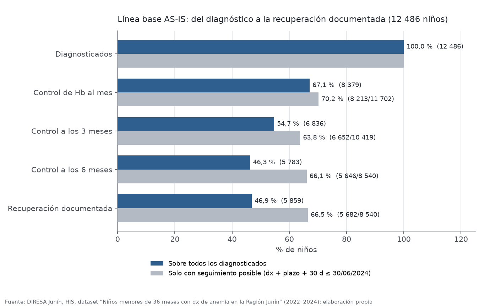

**Figura 1.** Cascada de seguimiento del AS-IS (dataset DIRESA Junín, corte 30/06/2024), sobre todos los diagnosticados y con seguimiento posible.

El triple registro (historia clínica, tarjeta de control y HIS), la agenda calculada a mano, las barreras familiares invisibles hasta el abandono, la visita domiciliaria en papel, la identificación tardía del riesgo y la conectividad intermitente son las seis brechas B1 a B6 que guían el resto del informe (sección 3.1).

**Alcance y límites.** El sistema programa y vigila fechas y clasifica la hemoglobina con reglas referenciales: no diagnostica ni prescribe. Los datos son sintéticos (`scripts/cargar_datos_prueba.py`) o una muestra seudonimizada de la DIRESA (500 niños, sin DNI ni nombres). No hubo piloto en una posta, usuarios finales, ni validación de las reglas por la microred; el envío real de WhatsApp o SMS no se probó (modo simulado).

### 1.3 Objetivos del Proyecto y de la Asignatura (Alineados al Sílabo)

* **Objetivo General de la Asignatura (ASUC01702):**
  Al finalizar la asignatura, el estudiante será capaz de aplicar la mejora continua en el proceso de software usado en una organización, incorporando las técnicas y actividades requeridas en el ciclo de vida del desarrollo de software.

* **Objetivos Específicos por Unidad del Sílabo:**
  1. **Unidad I (Fundamentos de procesos de software):** Diseñar procesos de software con entrega de valor a la organización mediante el modelado AS-IS/TO-BE, el análisis de brechas y la planificación controlada del proyecto.
  2. **Unidad II (Implementación del proceso de software):** Adaptar los procesos del ciclo de vida del desarrollo de software (*tailoring*) con consideraciones prácticas, estructurando la Arquitectura Hexagonal y ejecutando el Producto Mínimo Viable (PMV).
  3. **Unidad III (Evolución de los procesos y actividades de software):** Proponer mejoras en el proceso de software usado en una organización a partir de la evaluación cuantitativa de resultados mediante los modelos GQM, FURPS+ (con auditoría de seguridad OWASP Top 10:2025) y CMMI-DEV.
  4. **Unidad IV (Gestión de configuración de software):** Aplicar la mejora continua y la gestión de configuración de software (SCM) en la organización mediante el control formal de cambios, el etiquetado semántico, la construcción automatizada en CI/CD y el ciclo PDCA en la suite de GitHub.

* **Objetivos Específicos del Proyecto y Resultados:**

**Tabla 5.** Objetivos específicos del proyecto, indicador de logro y resultado al 26/11/2026.

| N.° | Objetivo específico | Indicador de logro | Resultado al 26/11/2026 | Sección |
| :---: | --- | --- | --- | :---: |
| 1 | Diagnosticar el AS-IS y diseñar el TO-BE | Brechas con línea base real y mejora trazable por brecha | 6 brechas con línea base DIRESA; 4 resueltas con mecanismo probado (M3.1 = 75,0 %), 1 parcial (B6) y 1 sin implementar (B5) | 3.1.1, 3.1.2 |
| 2 | Adaptar el ciclo de vida (*tailoring*) | Decisión sustentada con factores y ponderación; control de desviaciones | Alternativa híbrida elegida 4,75 de 5 frente a 3,85 y 2,95; desviaciones medidas de +2, +5, +4 y −10 días | 3.1.3, 3.2.1, 3.2.2 |
| 3 | Implementar la solución con arquitectura hexagonal en GitHub | Dominio sin frameworks y dependencias verificadas | 0 importaciones de terceros en dominio, puertos y aplicación; 25 pruebas de arquitectura; 28 pruebas E2E; 6 etiquetas de versión | 3.2.3, 3.2.4 |
| 4 | Evaluar producto y proceso con GQM, FURPS+, OWASP 2025 y CMMI-DEV | Métricas medidas con script y evidencia | M3.1 = 75,0 %; FURPS+ 87,7 % / 78,4 %; 12 hallazgos OWASP atendidos; CMMI nivel 2 en 3 áreas y nivel 1 en 4; plan CAR de 19 acciones | 3.3.1 a 3.3.4 |
| 5 | Aplicar la gestión de configuración de software (SCM) y la mejora continua (PDCA) | Trazabilidad completa (RFC ➔ Issue ➔ Rama ➔ PR ➔ Tag ➔ Release), ruleset activo y verificación de pares | 7 RFCs evaluadas en Issues; ruleset ownermerge activo en main y develop; 100 % PRs integradas; revisión por pares verificada con PR #36 y #37; GitFlow resincronizado; CI con filtro de rutas; 6 releases (v4.0.1); 12 dominios PDCA | 3.4.1 a 3.4.4, Anexo A |

---


## 2. MARCO TEÓRICO

### 2.1 Enfoque de Procesos Organizacionales y Cadena de Valor (AS-IS / TO-BE)

El enfoque de procesos exige analizar primero el proceso de la organización (AS-IS), identificar sus brechas y diseñar el TO-BE; solo entonces se define cómo el software soporta cada actividad. Justificar una solución solo con «usaremos IA o microservicios» invierte esa regla [11]. La relación que guía el diseño es *actividad mejorada → mejor resultado → valor organizacional*, expresada como cadena Entrada → Actividad → Resultado → Decisión → Acción → Valor y medida con cuatro tipos de indicador: de **proceso** (p. ej. tiempos), de **producto** (p. ej. disponibilidad, precisión), de **resultado** y de **valor organizacional** (reducción de pérdidas o riesgos).

Sommerville [12] define la mejora de procesos como comprender los procesos existentes y cambiarlos para elevar la calidad del producto o reducir costos y tiempos de desarrollo. Ese enfoque ordena la segunda mitad del informe (GQM, FURPS+, CMMI y SCM).

### 2.2 Modelos de Ciclo de Vida y Sastrería de Procesos (Tailoring)

El SWEBOK [13] organiza el área de procesos en definición, ciclos de vida, evaluación y mejora, medición y herramientas, e incluye la **adaptación del proceso** (*process adaptation*) como práctica explícita: el modelo se ajusta a los factores reales del proyecto en lugar de adoptarse por moda o por la herramienta disponible [11]. El modelo incremental entrega en cada incremento una funcionalidad operativa con las actividades de comunicación, planeación, modelado, construcción y despliegue [14]. Los modelos clásicos (cascada, espiral, desarrollo rápido y ágil) son alternativas entre las que se elige según el proyecto [15]. Sommerville [12] distingue dos enfoques de mejora: el de **madurez** (buenas prácticas técnicas y de gestión, orientado a calidad y previsibilidad) y el **ágil** (entrega rápida de funcionalidad y respuesta al cambio). El proyecto combina ambos: iterativo-incremental como ciclo de vida, Scrum como marco de gestión y DevOps como prácticas de ingeniería [16], [17].

### 2.3 Categorización Normativa de Procesos de Software

La norma ISO/IEC/IEEE 12207 [18] agrupa los procesos del ciclo de vida del software en procesos de contrato, organizacionales, de proyecto y técnicos, además de procesos de implementación y soporte. El curso los simplifica en tres categorías que este informe adopta con fines pedagógicos, sin afirmar conformidad formal con la norma:

- **Principales:** requisitos, análisis y diseño, implementación, integración y pruebas, despliegue.
- **De soporte:** gestión de configuración, aseguramiento de calidad, verificación y validación.
- **De gestión y organizacionales:** planificación y seguimiento, gestión de riesgos, mejora continua.

Para repartir responsabilidades se usa la matriz RAE (quién ejecuta, quién revisa, quién aprueba) y los tres roles del curso: Ingeniero de Proceso, de Desarrollo y Prototipado, y de Calidad y Mejora [19].

### 2.4 Arquitectura de Software Hexagonal (Puertos y Adaptadores)

Cockburn [20] propone aislar la lógica de aplicación de sus actores externos mediante **puertos** (interfaces que expresan lo que la aplicación ofrece o necesita) y **adaptadores** (implementaciones que traducen entre un puerto y una tecnología concreta). Las dependencias apuntan siempre hacia el dominio, que puede probarse sin interfaz de usuario ni base de datos. La Tabla 17 (sección 3.2.3) traduce esas piezas a las carpetas del repositorio.

### 2.5 Modelos de Evaluación de Calidad y Procesos (GQM, FURPS+, OWASP 2025 y CMMI-DEV)

**Tabla 6.** Modelos de evaluación usados y su operacionalización en el proyecto.

| Modelo | Definición (fuente) | Cómo se usa aquí |
| --- | --- | --- |
| **GQM** | Cada **meta** se refina en **preguntas** y cada pregunta en **métricas**; las metas se redactan con objeto, propósito, enfoque de calidad, punto de vista y contexto [21] | 3 metas (arquitectura, pruebas, valor), 6 métricas con script en `.claude/herramientas/gqm/`, recalculadas para Inc. 1 a Inc. 4 |
| **FURPS+** | Funcionalidad, Usabilidad, Confiabilidad (*Reliability*), Rendimiento (*Performance*) y Soportabilidad, más restricciones de implementación, interfaz, operaciones, empaquetamiento y legales [22], [23] | Índice ponderado F 30 %, U 15 %, R 15 %, P 15 %, S 10 %, + 15 %; variables medidas con scripts |
| **WCAG 2.1 AA** | Contraste mínimo de 4,5:1 para texto (1.4.3) y 3:1 para componentes (1.4.11); el color no es el único canal (1.4.1); operable por teclado (2.1.1) [24] | Axe-core por pantalla y cálculo propio de contraste (factor U) |
| **OWASP Top 10:2025** | Diez categorías de riesgo de aplicaciones web, A01 Broken Access Control a A10 Mishandling of Exceptional Conditions [25] | 30 comprobaciones estáticas, 32 dinámicas, SAST y SCA (factor +) |
| **CMMI-DEV** | Áreas de práctica agrupadas en gestión de procesos, gestión de proyectos, ingeniería y soporte (PP, PMC, REQM, CM, PPQA, VER, VAL, CAR…); niveles de madurez 1 a 5 en la representación escalonada [15] y niveles de capacidad por área en la continua [26] | Representación continua con niveles 0 a 3 por área: ESTIM, PLAN, PQA, CM, VER, VAL y CAR |

**Revisión, verificación, validación y mejora continua.** Blanco-Llano y Rodríguez-Hernández distinguen tres controles sobre el desarrollo de software, definidos a partir de ISO 9000 e ISO/IEC 12207 [27]:
- La **revisión técnica** comprueba que cada artefacto de una etapa está completo y conforme con el proceso definido.
- La **verificación** confirma con evidencia objetiva que la salida de cada etapa cumple los requisitos de su entrada. Exige trazabilidad entre requisitos y pruebas, y que los resultados de las pruebas sean repetibles.
- La **validación** confirma con el cliente, en el ambiente de operación (pruebas de aceptación o piloto), que el producto sirve para el uso previsto.

Los autores ordenan los tres controles según el ciclo de Shewhart/Deming. Torres Saumeth et al. describen ese ciclo PHVA (planificar, hacer, verificar y actuar) como un ciclo dinámico que se aplica dentro de cada proceso y que tiene como eje la mejora continua; frente a los modelos Malcolm Baldrige, EFQM e Iberoamericano, más integrales y orientados a la gestión global de la organización, el PHVA tiene un perfil técnico y se aplica a cualquier proceso [28].

### 2.6 Gestión de Configuración de Software (SCM, GitFlow y Semantic Versioning)

La Gestión de Configuración de Software (Software Configuration Management - SCM) es la disciplina de la ingeniería de software encargada de identificar, estructurar, controlar y auditar la evolución de todos los productos de trabajo (*Work Products*) a lo largo del ciclo de vida del desarrollo. Sommerville [12] (capítulo 25) señala que el propósito fundamental de SCM es gestionar el cambio de manera controlada para que la evolución del sistema no comprometa su calidad, integridad ni consistencia. La norma internacional ISO/IEC/IEEE 828:2012 [29] formaliza las actividades centrales de esta disciplina:

1. **Identificación de la Configuración:** Consiste en seleccionar, clasificar y estructurar los Elementos de Configuración de Software (SCI - *Software Configuration Items*), que comprenden no solo el código fuente ejecutable, sino también las especificaciones de requisitos, contratos de interfaz (OpenAPI), esquemas de base de datos, suites de pruebas, scripts de construcción, diagramas y documentación técnica. Cada elemento identificado se coloca bajo control de versiones y pasa a formar parte de una **línea base** (*baseline*) formalmente aprobada.
2. **Control de Cambios:** Establece un mecanismo riguroso y transparente para proponer, evaluar el impacto técnico y operativo, y decidir la aprobación o rechazo de cualquier modificación sobre una línea base. Toda propuesta se formaliza mediante una **Solicitud de Cambio (RFC - *Request for Change*)** evaluada por un Comité de Control de Cambios (CCB - *Change Control Board*), garantizando que ningún cambio ingrese al sistema sin análisis de riesgos ni criterios de verificación explícitos.
3. **Contabilidad de Estado de la Configuración (CSA - *Configuration Status Accounting*):** Registra y reporta de manera continua el estado de cada elemento de configuración y de cada solicitud de cambio (propuesta, evaluada, aprobada, en desarrollo, verificada o liberada), asegurando una trazabilidad bidireccional completa entre requisitos, código y artefactos desplegados.
4. **Auditoría de la Configuración:** Comprende auditorías funcionales (FCA) para verificar que el software satisface las capacidades requeridas, y auditorías físicas (PCA) para comprobar que la versión entregada coincide exactamente con los elementos de configuración inventariados y autorizados.

**Estrategia de Ramificación GitFlow.** Chacon y Straub [30] en *Pro Git* destacan que los sistemas modernos de control de versiones distribuido permiten flujos de trabajo basados en ramas ligeras. El modelo GitFlow, formalizado originalmente por Vincent Driessen [31], estructura el desarrollo mediante dos ramas de ciclo de vida permanente:
- `main`: Representa el estado oficial de producción. Cada commit en esta rama corresponde a una versión operativa lista para despliegue y debe estar respaldado por una etiqueta semántica formal (*release*). Se prohíben estrictamente los commits directos sobre `main`.
- `develop`: Constituye la línea base de integración continua donde convergen las características terminadas del próximo lanzamiento.

Ambas ramas principales se complementan con ramas auxiliares de vida acotada:
- `feature/*`: Ramas dedicadas al desarrollo aislado de historias de usuario o requerimientos funcionales, ramificadas siempre desde `develop` y reintegradas a ella mediante *Pull Requests* evaluados.
- `release/*`: Ramas de estabilización previa a un lanzamiento oficial, donde se ajustan metadatos y se corrigen defectos menores antes de confluir simultáneamente en `main` y en `develop`.
- `hotfix/*`: Ramas de emergencia originadas directamente desde `main` para remediar defectos críticos en producción, integrándose de vuelta tanto a `main` como a `develop`.

**Versionamiento Semántico (SemVer 2.0.0).** Para comunicar con precisión el alcance y la compatibilidad de cada versión liberada, el proyecto adopta la especificación Semantic Versioning 2.0.0 propuesta por Tom Preston-Werner [32]. Bajo la nomenclatura formal `MAJOR.MINOR.PATCH`:
- `MAJOR` (versión mayor): Se incrementa ante cambios incompatibles en la API pública o reestructuraciones arquitectónicas profundas.
- `MINOR` (versión menor): Se incrementa al incorporar nueva funcionalidad compatible hacia atrás (p. ej., nuevos incrementos de historias de usuario).
- `PATCH` (parche): Se incrementa al aplicar correcciones de errores y optimizaciones que no alteran la interfaz pública ni agregan funcionalidad.

En entornos de integración continua (CI), las etiquetas SemVer disparan flujos automatizados de construcción, empaquetamiento y publicación de artefactos binarios o imágenes de contenedores en registros de versiones (GitHub Releases / Container Registries).

---


## 3. DESARROLLO DEL PROYECTO POR UNIDADES DEL SÍLABO

El desarrollo técnico del proyecto articula las cuatro unidades del sílabo oficial de la asignatura: en la Unidad I se establece el diagnóstico del proceso y la planificación controlada; en la Unidad II se adapta el ciclo de vida y se construye la base arquitectónica y el PMV; en la Unidad III se audita y evalúa cuantitativamente la calidad y capacidad alcanzada; y en la Unidad IV se consolida la gestión de configuración de software (SCM) y la mejora continua del proceso. Toda cifra corresponde al código de la versión consolidada `v4.0.1` y cada tabla indica su fuente técnica verificada.

### 3.1 UNIDAD I: Fundamentos de Procesos de Software y Entrega de Valor

#### 3.1.1 Diagnóstico y Modelado del Proceso AS-IS vs. TO-BE

**Matriz 3.1.1: Identificación de actores y necesidades del sistema**

**Tabla 7.** Actores, necesidad operativa, decisión que toman en el proceso y soporte en `v4.0-Inc4` (S1, Tabla 2).

| Actor | Necesidad operativa | Decisión que debe tomar en el proceso | Soporte en `v4.0-Inc4` |
| --- | --- | --- | --- |
| Niña o niño menor de 5 años | Tamizaje, tratamiento y controles oportunos y continuos | Ninguna clínica; es el beneficiario final | Expediente único con agenda de controles |
| Familia o cuidador | Recordatorios de cita, canal de bajo costo para confirmar o reportar una barrera | Acudir al control, dar el suplemento en casa, comunicar barreras | Recordatorio con respuesta 1, 2 o 3 y registro de barreras (envío real no probado: modo SIMULADO) |
| Personal de salud | Registro nominal sin redundancia y alertas de niños en riesgo de abandono | Evaluar, indicar o ajustar el tratamiento y referir | Registro con clasificación por altitud, agenda normativa, alertas de vencidos y de barreras críticas |
| Agente comunitario | Herramienta utilizable sin conexión para visitas y barreras | A quién visitar primero y qué barrera escalar | Lista de visitas priorizada con puntaje explicable; cola local y sincronización idempotente |
| Gestión territorial (red y microred) | Información consolidada y oportuna | Dónde supervisar y asignar recursos | Reporte del periodo en JSON y CSV; el tablero territorial (INC-6) no se construyó |
| MINSA | Estadísticas fiables de cumplimiento | Supervisar el seguimiento | Sin integración con el HIS; solo el reporte del periodo |

El sistema solo distingue «usuario autenticado»: no hay roles por actor ni segmentación por establecimiento (hallazgo H-1 de la sección 3.7). Los seis actores son los de la visión del proceso; el software atiende en la práctica a personal de salud y agentes comunitarios.


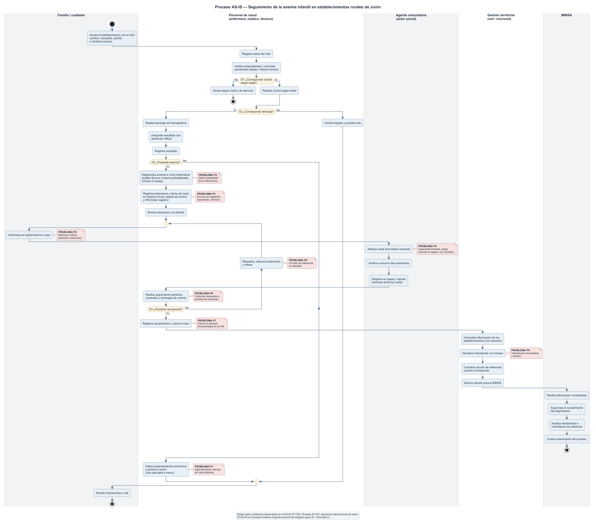

**Figura 2.** Proceso AS-IS por carriles de actor con las notas de problema de cada actividad (S1).

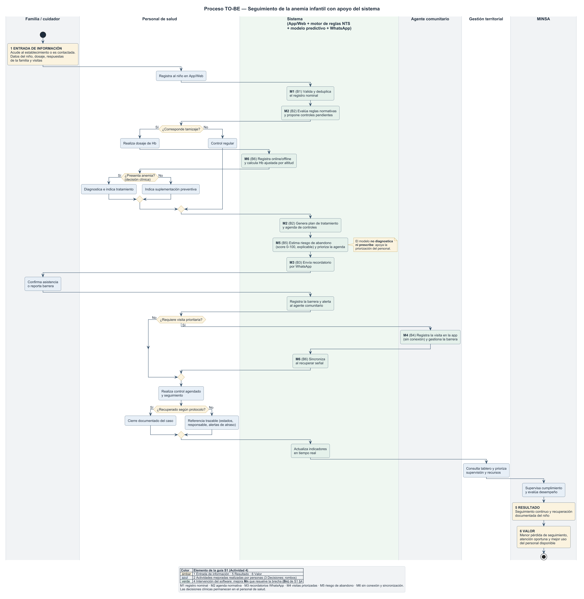

**Figura 3.** Proceso TO-BE con el carril «Sistema» y las mejoras M1 a M6 (S1). Las decisiones clínicas siguen siendo humanas.


#### 3.1.2 Matriz de Brechas Operativas e Indicadores de Valor

**Matriz 3.1.2: Matriz de brechas operativas (AS-IS frente a TO-BE)**

**Tabla 8.** Brechas B1 a B6 con su línea base real, la mejora TO-BE y el estado medido con GQM en `v4.0-Inc4` (S1, Tablas 3 y 4; S9, Tabla 32; adenda S9, sección 3).

| ID | Proceso actual (AS-IS) | Brecha y línea base | Consecuencia | Proceso propuesto (TO-BE) | Puntaje M3.1 en `v4.0-Inc4` |
| --- | --- | --- | --- | --- | --- |
| B1 | Triple registro: historia clínica, tarjeta de control y digitación en el HIS | Sin registro nominal único; en el HIS `num_doc` se repite en 49,4 % de las filas (6 167 de 12 486) | Errores de digitación y estado real del niño poco confiable | M1: registro nominal único y validado | **1,0**: 3 registros por evaluación pasan a 1; DNI repetido responde 409 |
| B2 | Agenda calculada a mano, sin recordatorios | Dosaje de control registrado al mes 67,1 %, a los 3 meses 54,7 % y a los 6 meses 46,3 % | Controles fuera de ventana y citas olvidadas | M2: agenda normativa; M3: recordatorio a la familia | **1,0**: 140/140 niños activos con agenda, 1 638/1 638 controles vencidos visibles en la muestra real de 500 niños (Inc. 2); recordatorios solo en modo simulado |
| B3 | Barreras (transporte, economía, olvido) ocultas hasta el abandono | 17,9 % de los niños sin ningún control a 1, 3 o 6 meses; el HIS no registra barreras | Abandono silencioso | M3: respuesta del tutor y reporte de barreras que genera alerta | **1,0**: 8 tipos de barrera, alerta de barreras críticas; reglas sin validar con la microred |
| B4 | Visita domiciliaria semanal en papel y sin conexión | El HIS no registra visitas; no hay línea base | Cobertura insuficiente y demora en escalar barreras | M4: visitas priorizadas y formulario estructurado | **1,0**: puntaje explicable `VISITA-V1`/`V2` (0 a 115) y captura sin conexión; pesos sin validar |
| B5 | El riesgo se identifica cuando el abandono ya ocurrió | 53,7 % sin dosaje a 6 meses (33,9 % con seguimiento posible) | Intervención tardía | M5: score de riesgo de abandono | **0,0**: no hay modelo ni regla de riesgo; la visita priorizada es reactiva |
| B6 | Cobertura móvil intermitente y consolidación posterior | Sin medición en el HIS | Datos perdidos e indicadores tardíos | M6: registro sin conexión con sincronización | **0,5**: sincronización idempotente probada con E2E simulados; sin prueba en dispositivo real ni tablero INC-6 |

Resultado: **M3.1 = 4,5 / 6 = 75,0 %**. Cuatro brechas (B1 a B4) tienen mecanismo operativo y probado **en el entorno de pruebas**; ninguna se midió en una posta.


**Sistema de indicadores de gestión del proceso**

La guía de S1 fijó catorce indicadores sin metas numéricas, porque toda meta exige una línea base medida y aprobación institucional. Con la línea base DIRESA ya medida, la Tabla 8 muestra cuatro indicadores representativos, uno por tipo, con lo que se midió y lo que solo un piloto puede medir.

**Tabla 9.** Indicadores por tipo: línea base AS-IS, valor en `v4.0-Inc4` y condición de la medición.

| Tipo | Indicador | Línea base AS-IS | Valor en `v4.0-Inc4` | Meta de referencia | Lectura |
| --- | --- | --- | --- | --- | --- |
| Proceso | Registros por evaluación (V1) | 3 | 1 | 1 | Medido con datos sintéticos (150 niños) |
| Proceso | Controles vencidos visibles para el personal (V2, V3) | 0 % (no existe agenda) | 100 % (140/140 con agenda; F1 = 1,000, 476/476 controles) | 100 % | Medido contra un oráculo independiente, con datos sintéticos; el dataset real se midió en Inc. 2 (1 638/1 638) |
| Producto | Disponibilidad durante la carga (V5) y p95 agregado (V4) | sin medida | 100 % (64/64 sondas); p95 = 1 100 ms (una corrida, 50 usuarios, 2 CPU compartidas) | disponibilidad ≥ 99,5 %; p95 < 800 ms | La disponibilidad cumple; **el p95 no cumple la meta** y es un riesgo (S10, criterio P2: 2 000 ms con 100 usuarios) |
| Resultado | Pérdida de seguimiento a 6 meses | 53,7 % (6 703/12 486) | No medido | Sin meta aprobada | Exige un piloto con niños reales; el sistema no puede atribuirse esa mejora |
| Valor organizacional | Brechas resueltas (M3.1) | 0 de 6 | 4,5 de 6 = 75,0 % | 66,7 % acumulado propuesto para INC-4 (no aprobado) | Mecanismos probados en entorno de pruebas |

---

#### 3.1.3 Análisis de Factores y Selección del Modelo de Proceso

**Matriz 3.2.1: Análisis de factores de adaptación del proyecto**

**Tabla 10.** Factores de adaptación con su evidencia en el proyecto (S2, Tabla 1; doce factores evaluados, los ocho con mayor poder de decisión).

| Factor de adaptación | Situación real del proyecto | Nivel | Justificación técnica de la adaptación |
| --- | --- | :---: | --- |
| Incertidumbre de requisitos | Los criterios clínicos están acotados por la norma, pero la interacción por WhatsApp, el modo sin conexión y el componente predictivo no | **Alto** | Exige iteraciones cortas para validar cada incremento antes de construir el siguiente |
| Complejidad técnica | API REST, base relacional, cola local, autenticación externa, notificador y service worker | **Alto** | Exige desacoplamiento (arquitectura hexagonal): el dominio no puede depender de FastAPI ni de SQLAlchemy |
| Cambios esperados | Reglas de agenda, pesos de visita y reglas de barreras serán ajustados por la microred | **Alto** | Descarta Cascada: el costo de retrabajo de congelar requisitos es inaceptable |
| Riesgo tecnológico | Cobertura móvil intermitente y dependencia de la API de WhatsApp | **Alto** | Obliga a probar la sincronización y el notificador en cada incremento y a mantener un modo simulado |
| Necesidad de retroalimentación | El personal debe validar que las alertas coincidan con su criterio | **Alto** | Exige revisión formal del incremento con el usuario (Scrum) |
| Necesidad de integración | HIS, WhatsApp, SMS, autenticación y base gestionada | **Alto** | Requiere pruebas de integración automatizadas (219 contra PostgreSQL 16 en el CI) |
| Participación del usuario | Seis actores con decisiones propias | **Alto** | Entregas incrementales demostrables a cada actor |
| Criticidad del sistema | Apoya decisiones sobre salud infantil | **Alto** | Exige pruebas automatizadas, integración continua y reglas clínicas probadas en sus valores límite |

**Selección del modelo híbrido adaptado**

Se compararon siete enfoques con seis criterios (escala 1 a 5): Cascada 8, Incremental 18, Espiral 21, Kanban 21, DevOps 26, MLOps 26 y Scrum 27 puntos sobre 30. La puntuación más alta no decide por sí sola: ningún enfoque cubre la gestión iterativa con el usuario, la entrega automatizada y el gobierno del modelo a la vez. Por eso se evaluaron combinaciones con pesos que privilegian adaptabilidad, riesgos, entrega incremental y retroalimentación (15 % cada uno).

**Tabla 11.** Matriz de decisión ponderada entre tres alternativas (S2, Tabla 6).

| Criterio | Peso | Alt. 1: iterativo-incremental + Scrum + DevOps + MLOps | Alt. 2: Kanban + DevOps + DataOps | Alt. 3: Incremental + Espiral sin automatización |
| --- | :---: | :---: | :---: | :---: |
| Adaptabilidad | 15 % | 5 | 4 | 3 |
| Gestión de riesgos | 15 % | 4 | 3 | 4 |
| Entrega incremental | 15 % | 5 | 4 | 3 |
| Retroalimentación | 15 % | 5 | 4 | 3 |
| Integración | 10 % | 4 | 4 | 3 |
| Automatización | 10 % | 5 | 5 | 2 |
| Gestión de datos e IA | 10 % | 5 | 4 | 2 |
| Participación del usuario | 10 % | 5 | 3 | 3 |
| **Puntaje ponderado (de 5)** | **100 %** | **4,75** | **3,85** | **2,95** |

**Modelo seleccionado:** desarrollo iterativo e incremental, gestionado con Scrum (sprints de dos semanas), con prácticas DevOps para integración, pruebas y despliegue, y prácticas MLOps reservadas al INC-5. Cascada se descartó porque el componente de IA y las reglas de la microred impiden congelar requisitos; Scrum aislado no define cómo automatizar la entrega a postas dispersas, y DevOps aislado no organiza la retroalimentación con el personal de salud.


#### 3.1.4 Planificación, WBS, Priorización Valor/Riesgo y Control de Desviaciones


**Estructura de descomposición del trabajo (WBS)**

```text
PROYECTO ANEMIA JUNÍN
├── INC-1 PMV · Registro nominal y expediente (21 SP) ........ v1.0-PMV
│   ├── HIST-1.1 / RF-01 Registro con evaluación inicial
│   ├── HIST-1.2 / RF-02 Expediente y nuevo control
│   ├── HIST-1.3 / RF-03 Validación con reglas clínicas
│   ├── HIST-1.4 / RF-04 Listado de seguimiento
│   └── HIST-1.5 / RF-05 Reporte del periodo
├── INC-2 Agenda automática y alertas (18 SP) ................ v2.0-Inc2
│   ├── HIST-2.1 / RF-06 Agenda normativa     ├── HIST-2.2 / RF-07 Alertas priorizadas
│   └── HIST-2.3 / RF-08 Agenda del personal  └── HIST-2.4 / RF-09 Asistencia a controles
├── INC-3 Sin conexión y sincronización (21 SP) .............. v3.0-Inc3
│   ├── HIST-3.1 a HIST-3.4 Cola local, sincronización, conflictos, pendientes
│   └── VIS-3.5 Visita domiciliaria priorizada
├── INC-4 WhatsApp y barreras (16 SP) ........................ v4.0-Inc4
│   └── HIST-4.1 a HIST-4.4 Recordatorios, respuesta del tutor, barreras, alertas críticas
├── INC-5 Modelo predictivo (34 SP) .......................... no implementado
└── INC-6 Tablero territorial (15 SP) ........................ no implementado
```

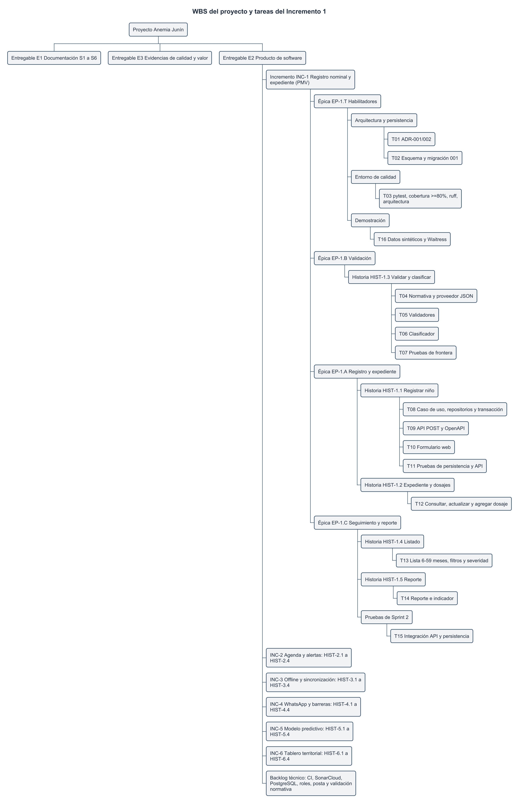

**Figura 4.** WBS: Proyecto, entregables E1 a E3, incrementos INC-1 a INC-6, épicas, historias y tareas del Incremento 1 (S3-4).

**Tabla 12.** Descomposición por incremento con estimación, prioridad y resultado al 30/10/2026 (S3-4, Tablas 10, 17 y 19; S11, Tabla 5a).

| Incremento | Historias | SP | Puntaje de priorización | Resultado |
| --- | --- | :---: | :---: | --- |
| INC-1 Registro nominal y expediente (PMV) | HIST-1.1 a HIST-1.5 (RF-01 a RF-05) | 21 | 4,60 (1.°) | Entregado: `v1.0-PMV` |
| INC-2 Agenda automática y alertas | HIST-2.1 a HIST-2.4 (RF-06 a RF-09) | 18 | 4,15 (3.°) | Entregado: `v2.0-Inc2` |
| INC-3 Sin conexión y sincronización | HIST-3.1 a HIST-3.4, más VIS-3.5 (sin estimar) | 21 | 4,40 (2.°) | Entregado: `v3.0-Inc3` |
| INC-4 WhatsApp y barreras | HIST-4.1 a HIST-4.4 | 16 | 3,40 (4.°) | Entregado: `v4.0-Inc4` (envío real sin probar) |
| INC-5 Modelo predictivo | HIST-5.1 a HIST-5.4 | 34 | 3,35 (5.°) | No implementado |
| INC-6 Tablero territorial | HIST-6.1 a HIST-6.4 | 15 | 2,75 (6.°) | No implementado |
| Backlog técnico | BT-01 a BT-03, BT-08, BT-09 | 8 | no priorizado | Parcial (CI y E2E implantados; SonarCloud con primer análisis automático el 05/11/2026, sin ejecución comprobada desde el CI) |
| **Total** | | **133** | | **76 SP entregados en los cuatro incrementos (57,1 %)** |

**Priorización valor y riesgo.** El puntaje ponderado combina valor (30 %), reducción de riesgo (25 %), dependencia técnica (20 %), factibilidad (15 %) y validación (10 %). INC-1 lidera porque es prerrequisito de todos los demás; INC-3 puntúa por encima de INC-2, pero se ejecutó después porque requería el pipeline de integración continua y la decisión sobre la base central (nota de S3-4 sobre el calendario). Dentro del INC-1 se construyó primero la clasificación normativa (HIST-1.3) y después el formulario, porque un umbral clínico mal transcrito invalidaría todo lo posterior.

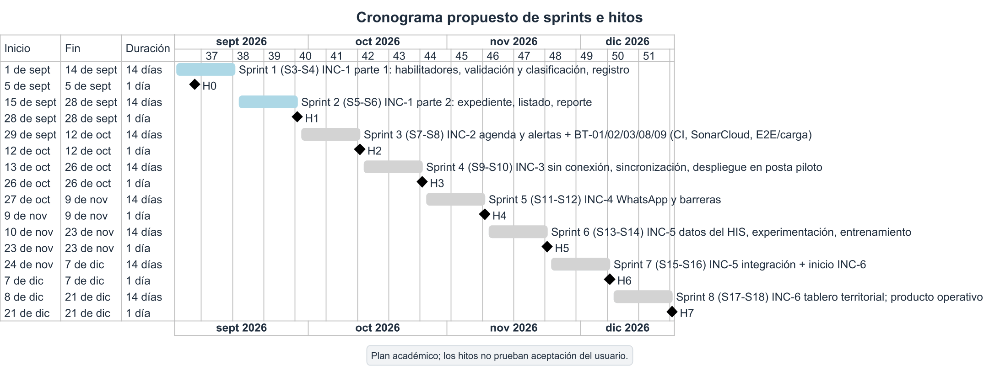

**Figura 5.** Cronograma planificado de ocho sprints con incrementos e hitos H0 a H7 (S3-4).

**Matriz de control de desviaciones del proyecto**

**Tabla 13.** Plan frente a real por incremento. El porcentaje es el desvío en días sobre la duración planificada del sprint (cálculo propio); las fechas reales son las del commit o la etiqueta que entrega el software (S11, Tabla 5a; S9, Tabla 6).

| Incremento (sprint) | Avance planificado | Avance real | Desviación | Causa raíz | Acción correctiva |
| --- | --- | --- | --- | --- | --- |
| INC-1 (sprints 1-2, 01-28/09) | 21 SP al hito H1, 28/09 | 21 SP, `v1.0-PMV` el 30/09 | +2 días (+7,1 % de 28 días) | Sin registro de horas; acta de aceptación pendiente | Registrar horas reales por tarea (acción 1 del plan) |
| INC-2 (sprint 3, 29/09-12/10) | 18 SP al hito H2, 12/10 | 10 SP al 16/10 (hito `v1.5.0-inc2-avance`); 18 SP el 17/10 | +5 días (+35,7 % de 14 días) | El sprint absorbió el informe integrador de S6 y la reestructuración hexagonal (ADR-008) sin holgura | Cerrar HIST-2.3 y HIST-2.4; reservar 20 % de capacidad por sprint (acción 7) |
| INC-3 (sprint 4, 13-26/10) | 21 SP al hito H3, 26/10 | 21 SP más VIS-3.5; `v3.0-Inc3` el 30/10 | +4 días (+28,6 % de 14 días) | Arrastre del atraso de INC-2 y alcance adicional (VIS-3.5) sin estimar; causa probable, sin registro de horas | La replanificación propuesta en S9 no se adoptó; el equipo recuperó el plan |
| INC-4 (sprint 5, 27/10-09/11) | 16 SP al hito H4, 09/11 | 16 SP; `v4.0-Inc4` el 30/10 | −10 días (−71,4 % de 14 días) | Se adelantó la entrega para recuperar el plan original | Pruebas de campo y envío real quedan pendientes |
| INC-5 (sprints 6 y 7, 10/11-07/12) | Datos del HIS validados y modelo entrenado al hito H5, 23/11; integración al H6, 07/12 (34 SP) | Al 06/11 no ha iniciado, como prevé el plan. El criterio de datos se cumple (8 540 diagnósticos con seguimiento posible, mínimo 500), pero la limpieza y el versionado que el plan ubicaba en el sprint 5 no se hicieron | 0 días (el sprint empieza el 10/11) | Probable: el sprint 5 se dedicó a adelantar INC-4 y a los informes S11 y S12; sin registro de horas no se puede confirmar | Hacer la limpieza y el versionado en la primera semana del sprint 6, junto con la experimentación |

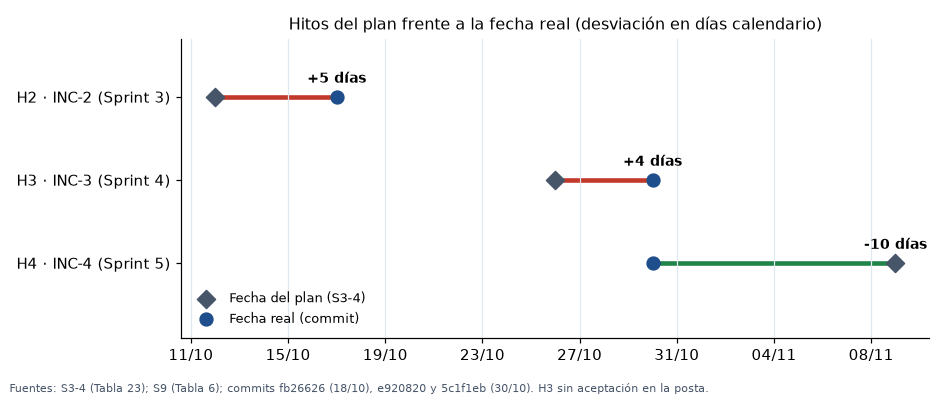

**Figura 6.** Hitos H2 a H4, plan frente a real (elaboración propia a partir de S3-4 y de los commits).

**Avance al inicio de la semana 13.** Según el calendario de S3-4, la semana 13 abre el Sprint 6 (10 al 23/11/2026), dedicado al Incremento 5: validación de los datos del HIS, experimentación y entrenamiento del modelo predictivo, con el hito H5 el 23/11. En entrega de software el proyecto está a tiempo: los incrementos 1 a 4 están etiquetados (76 de 133 SP) y el INC-4 se entregó 10 días antes del hito H4. Dos condiciones del plan siguen abiertas:

- La aceptación de los incrementos (H1 a H4), que no tiene acta.
- La preparación de datos del INC-5 (limpieza y versionado), que llega al Sprint 6 sin hacerse.

El INC-5 suma 34 SP, el mayor de todos, frente a una velocidad observada de 16 a 21 SP por incremento. Por eso el plan lo reparte en los sprints 6 y 7, y la postergación al Sprint 8 que prevé el plan de riesgos de S3-4 sigue disponible si los datos no alcanzan el umbral.

Ningún retraso superó el umbral de una semana que el plan fija para replanificar un hito. Lo que la matriz muestra es otra cosa: **el avance se midió en entrega de software, no en aceptación**. Los hitos H3 y H4 exigían prueba de campo y envío real, que no se hicieron, de modo que el desvío favorable de INC-4 (−10 días) no equivale a un incremento aceptado. Tampoco hay horas reales registradas en ningún incremento (113 h estimadas solo para INC-1), de modo que la estimación no se recalibró.

---


### 3.2 UNIDAD II: Implementación del Proceso de Software y Desarrollo del PMV

#### 3.2.1 Categorización de Procesos (Principales, Soporte y Gestión)

**Matriz 3.3.1: Categorización normativa, productos de trabajo y responsables RAE**

La categorización es la simplificación del curso (sección 2.3), sin afirmar conformidad con la ISO/IEC/IEEE 12207 [18]. Los roles de la plantilla se asignan según la Tabla 1. La aprobación del Product Owner corresponde a un rol que el equipo **simuló**: no hubo un representante de la posta que aprobara historias ni incrementos.

**Tabla 14.** Categoría normativa, actividad, producto de trabajo y responsables (R: ejecuta, Rv: revisa, A: aprueba; S3-4, Tabla 6; S11, Tabla 12).

| Categoría | Actividad específica del proyecto | Producto de trabajo | R | Rv | A | Evidencia en el repositorio |
| --- | --- | --- | --- | --- | --- | --- |
| Proceso principal | Refinamiento de requisitos e historias | Backlog priorizado con criterios Dado-Cuando-Entonces (48 verificados) | Porras V. | Huamani R. | Product Owner (simulado) | `entregables/semana-03-04/`; `semana-09/metricas/datos/m21_cobertura_rf.json` |
| Proceso principal | Diseño de la arquitectura hexagonal | 14 ADR, contrato OpenAPI (29 rutas), diagramas | Auqui H. | Huamani R. | Porras V. | `pmv_fastapi/docs/adr/`, `docs/openapi.json` |
| Proceso principal | Construcción del código | Módulos ejecutables en `pmv_fastapi/app/` (142 archivos Python) | Auqui H. | Huamani R. | Huamani R. | Repositorio, etiqueta `v4.0-Inc4` |
| Proceso principal | Pruebas | 660 pruebas pytest y 28 E2E con Playwright | Huamani R. | Porras V. | Huamani R. | `pmv_fastapi/tests/` |
| Proceso principal | Despliegue | Imagen Docker, Render y Supabase | Auqui H. | Huamani R. | Porras V. | `Dockerfile`, trabajo `produccion` de `ci.yml`; producción verificada el 31/10/2026 (Anexo B) |
| Proceso de soporte | Gestión de configuración | Repositorio Git con 5 etiquetas y ramas `feature/*` | Auqui H. | no definido en S3-4 | no definido en S3-4 | Etiquetas `v1.0-PMV` a `v4.0-Inc4` (Anexo A) |
| Proceso de soporte | Aseguramiento de calidad (PQA) | Ruff, informe de revisión independiente, defectos DEF-01 a DEF-09 | Huamani R. | Porras V. | Huamani R. | `registro_defectos*.md`, informe T-020 |
| Proceso de soporte | Verificación y validación | 19 fichas de prueba con capturas | Huamani R. | Auqui H. | firma pendiente | Sección 3.3.1 |
| Proceso de gestión | Planificación y control de desviaciones | Plan por sprint, plan frente a real | Porras V. | Huamani R. | Porras V. | `.claude/coordinacion/TABLERO.md`; Tabla 13 |
| Proceso de gestión | Retrospectiva y mejora | Plan de mejora CMMI con 19 acciones | Porras V. | Equipo | Porras V. | Sección 3.3.4 |


#### 3.2.2 Sastrería de Procesos (Tailoring) y Ciclo de Vida Híbrido

**Qué se aplicó realmente.** El modelo se contrastó con la ejecución:

**Tabla 15.** Prácticas del modelo seleccionado: lo planificado frente a lo ejecutado al 30/10/2026.

| Práctica | Planificado | Ejecutado (evidencia) | Brecha |
| --- | --- | --- | --- |
| Entrega incremental | 6 incrementos, 133 puntos de historia (SP) | 4 incrementos entregados (INC-1 a INC-4), 76 de 133 SP (57,1 %); cada uno con etiqueta (`v1.0-PMV`, `v2.0-Inc2`, `v3.0-Inc3`, `v4.0-Inc4`) | INC-5 (modelo predictivo) e INC-6 (tablero) sin construir |
| Scrum | Sprints de 2 semanas, backlog con estimación, revisión con la posta, retrospectiva | Backlog estimado con SP (S3-4); seguimiento en `.claude/coordinacion/TABLERO.md` | Sin actas de revisión con el personal de salud; sin tablero de GitHub Projects («No projects found»); sin horas reales registradas |
| DevOps | Integración continua, pruebas automáticas, despliegue automatizado | GitHub Actions con tres trabajos (`calidad-y-pruebas`, `imagen`, `produccion`); 660 pruebas y 28 E2E; despliegue a Render y Supabase desde `main`; producción verificada el 31/10/2026: `/openapi.json` declara `4.0.0-inc4` con 29 rutas | SAST y auditoría de dependencias fuera del CI; protección de `main` no verificable |
| MLOps | Pipeline de datos, experimentación y monitoreo del modelo | No ejecutado | Depende del INC-5 |


**Definición de terminado (DoD)**

La DoD vigente es la de S3-4 (Tablas 8 y 9). La Tabla 16 la verifica contra `v4.0-Inc4` e incluye el criterio de análisis estático que la plantilla fija con SonarQube y que en el proyecto se cubrió con otras herramientas.

**Tabla 16.** Verificación de la DoD en `v4.0-Inc4`.

| N.° | Criterio de terminado | Verificación en `v4.0-Inc4` | Estado |
| --- | --- | --- | --- |
| 1 | Todo criterio de aceptación se verifica con al menos una prueba automatizada | 416 unitarias, 219 de integración, 25 de arquitectura y 28 E2E, todas aprobadas | Cumple |
| 2 | La regla de negocio vive en el dominio o en la configuración normativa (ADR-001) | 0 importaciones de terceros en 86 clases del dominio; 25 pruebas de arquitectura | Cumple |
| 3 | Pruebas en verde, cobertura ≥ 80 % y 0 hallazgos de Ruff | Cobertura 99,79 % (4 025 + 675 de 4 030 + 680 líneas y ramas); Ruff: 0 errores y 142 archivos formateados | Cumple |
| 4 | Disponible en la interfaz y en la API con el mismo caso de uso; `openapi` al día | Contrato de 29 rutas verificado en el CI con Python 3.11 | Cumple |
| 5 | Pruebas funcionales de interfaz con capturas adjuntas en la ficha | 19 de 19 escenarios con 54 capturas (sección 3.3.1) | Cumple |
| 6 | Análisis estático sin vulnerabilidades críticas (la plantilla pide SonarQube con 0 vulnerabilidades) | SonarCloud: primer análisis del repositorio el 05/11/2026 (Quality Gate aprobado sobre el código nuevo; 129 hallazgos en el código completo, 0 en el backend desplegado; ver la ficha VER de la sección 3.3.3); bandit: 0 altas, 0 medias, 1 baja (falso positivo); pip-audit: 0; semgrep: 151 hallazgos clasificados; la revisión manual halló 1 hallazgo de severidad alta (H-1) | **No cumple** como la plantilla lo define |
| 7 | Código revisado por pares y aprobado en el *pull request* | La PR #8 se fusionó con 6 verificaciones en verde, sin revisión formal «Approved»; las PR #6 y #7 se fusionaron con verificaciones en rojo | **No cumple** |
| 8 | Demostrada en la revisión del sprint y aceptada | Sin actas de revisión con el personal de salud | **No cumple** |

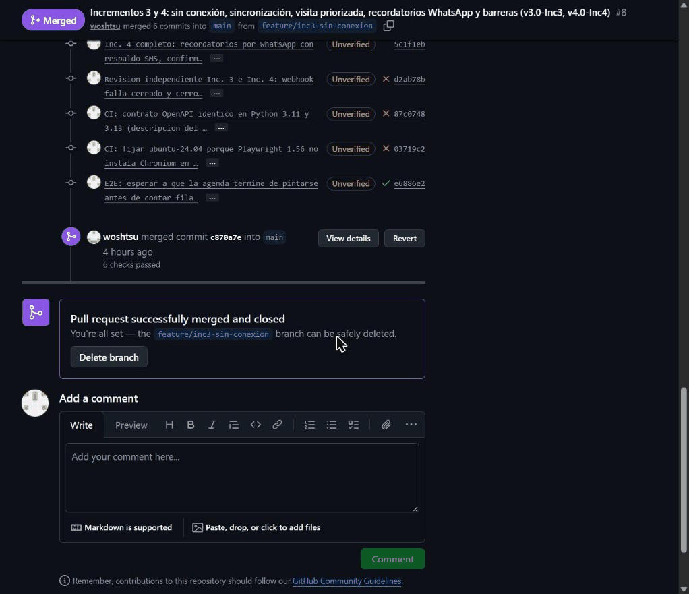

**Figura 7.** PR #8 (incrementos 3 y 4) en estado «Merged» con 6 verificaciones aprobadas; la línea de tiempo no muestra ninguna revisión «Approved» (captura de GitHub, 30/10/2026).

La DoD mide cuánto código se ejecuta y no la variedad de entradas: con 99,79 % de cobertura, la revisión independiente de los incrementos 3 y 4 todavía halló cinco defectos, uno de seguridad (sección 3.8). Seguridad, accesibilidad y rendimiento no forman parte de la DoD (hallazgo H8 de S11).

---

#### 3.2.3 Arquitectura Hexagonal en GitHub (/src/domain/ Desacoplado)


Este apartado documenta cómo está organizado el repositorio. La evidencia de que la arquitectura cumple las métricas M1.1 a M1.3 está en las fichas GQM del apartado 3.3.1 (código del dominio, matriz de importaciones y ejecución de las mediciones).

El código del producto está en `pmv_fastapi/app/` (<https://github.com/woshtsu/ProcesosSoftwareAnemia/tree/v4.0-Inc4/pmv_fastapi/app>). La plantilla de la guía usa nombres de un proyecto Java (`/src/domain|ports|adapters`, JPA); aquí el lenguaje es Python y los puertos son interfaces estructurales (`typing.Protocol`). La Tabla 17 traduce cada carpeta de la plantilla a la del repositorio, con su enlace en la etiqueta `v4.0-Inc4`.

```text
pmv_fastapi/app/
├── domain/        <-- NÚCLEO (solo biblioteca estándar y módulos del propio dominio)
│   ├── model/     entidades y reglas puras (16 módulos)
│   └── service/   reglas clínicas, agenda, alertas, conflictos, puntaje de visitas (11 módulos)
├── ports/         <-- PUERTOS (Protocol)
│   ├── inbound/   interfaces de casos de uso (14)
│   └── outbound/  repositorios, reloj, notificador, proveedor de identidad (8)
├── application/   casos de uso que implementan los puertos de entrada (12 servicios)
├── adapters/      <-- INFRAESTRUCTURA
│   ├── inbound/http/   FastAPI: rutas, esquemas Pydantic, sesión y CSRF
│   └── outbound/       SQLAlchemy y memoria, WhatsApp Cloud, SMS, simulado, Supabase Auth, relojes
├── web/           cliente PWA (JavaScript, service worker, cola IndexedDB); fuera del hexágono
└── main.py        raíz de composición: único módulo que conecta adaptadores con el núcleo
```

**Tabla 17.** Equivalencia entre la estructura de la plantilla y la del proyecto, con archivos y líneas de código por capa (S10, Tabla 17; análisis AST; el conteo incluye `__init__.py`).

| Plantilla (`/src/...`) | Proyecto (`pmv_fastapi/app/...`) | Contenido real | Archivos / LOC | Enlace en `v4.0-Inc4` |
| --- | --- | --- | :---: | --- |
| `domain/model/` | `domain/model/` | Entidades puras: niño, evaluación, agenda, barrera, visita, notificación, sincronización | 17 / 699 | [`domain/model`](https://github.com/woshtsu/ProcesosSoftwareAnemia/tree/v4.0-Inc4/pmv_fastapi/app/domain/model) |
| `domain/service/` | `domain/service/` | Reglas clínicas, agenda, alertas, validaciones, conflictos, puntaje de visitas (funciones puras) | 12 / 1 593 | [`domain/service`](https://github.com/woshtsu/ProcesosSoftwareAnemia/tree/v4.0-Inc4/pmv_fastapi/app/domain/service) |
| `ports/inbound/` | `ports/inbound/` | 14 interfaces de casos de uso | 15 / 156 | [`ports/inbound`](https://github.com/woshtsu/ProcesosSoftwareAnemia/tree/v4.0-Inc4/pmv_fastapi/app/ports/inbound) |
| `ports/outbound/` | `ports/outbound/` | 8 interfaces: repositorios, reloj, notificador, proveedor de identidad | 9 / 143 | [`ports/outbound`](https://github.com/woshtsu/ProcesosSoftwareAnemia/tree/v4.0-Inc4/pmv_fastapi/app/ports/outbound) |
| (la plantilla no la contempla) | `application/` | 12 servicios que implementan los puertos de entrada | 13 / 1 227 | [`application`](https://github.com/woshtsu/ProcesosSoftwareAnemia/tree/v4.0-Inc4/pmv_fastapi/app/application) |
| `adapters/inbound/` | `adapters/inbound/http/` | FastAPI: rutas, esquemas Pydantic, sesión y CSRF | 5 / 1 437 | [`adapters/inbound`](https://github.com/woshtsu/ProcesosSoftwareAnemia/tree/v4.0-Inc4/pmv_fastapi/app/adapters/inbound) |
| `adapters/outbound/` | `adapters/outbound/` | SQLAlchemy y memoria, WhatsApp Cloud, SMS, Supabase Auth, relojes | 12 / 1 359 | [`adapters/outbound`](https://github.com/woshtsu/ProcesosSoftwareAnemia/tree/v4.0-Inc4/pmv_fastapi/app/adapters/outbound) |
| (composición) | `main.py` | Conecta cada puerto con su adaptador; versión `4.0.0-inc4` | 1 | [`main.py`](https://github.com/woshtsu/ProcesosSoftwareAnemia/blob/v4.0-Inc4/pmv_fastapi/app/main.py) |

Dos diferencias respecto de la plantilla: se usa SQLAlchemy y no JPA, y no hay Redis; el caché y la cola viven en el navegador (service worker e IndexedDB). La carpeta `application/` se agregó porque separa los casos de uso de las reglas puras del dominio (ADR-001 y ADR-008).

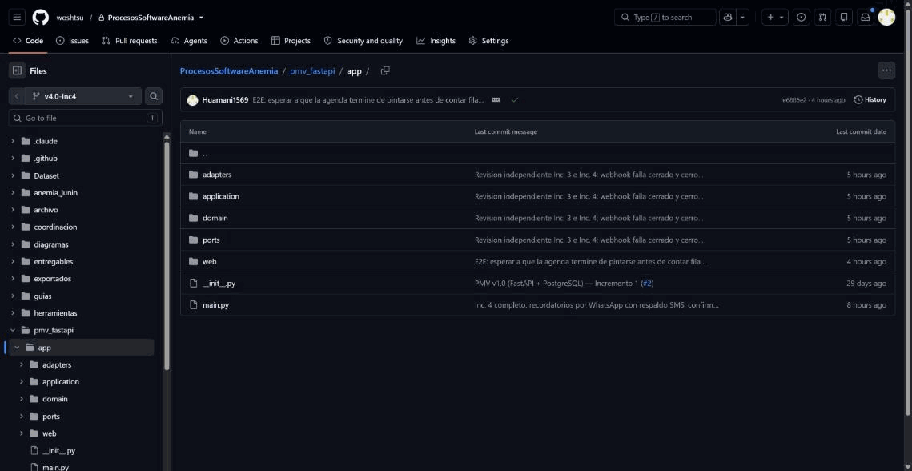

**Figura 8.** Carpeta `pmv_fastapi/app/` en GitHub con la etiqueta `v4.0-Inc4` seleccionada: `adapters`, `application`, `domain`, `ports` y `web`, y `main.py` (captura del 30/10/2026).

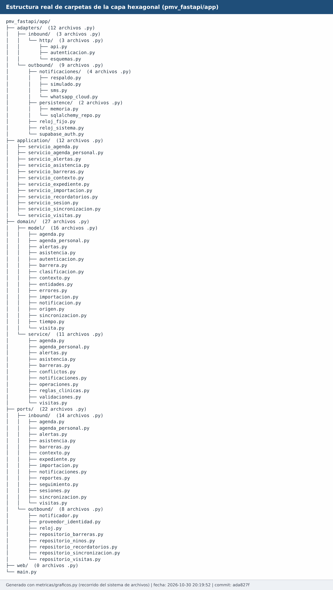

**Figura 9.** Árbol real de `pmv_fastapi/app/` generado recorriendo el sistema de archivos.

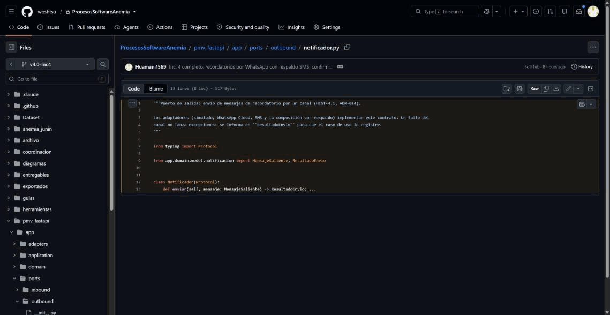

**Figura 10.** Ejemplo de puerto de salida (`Notificador`), implementado por cuatro adaptadores (simulado, WhatsApp Cloud, SMS y respaldo).

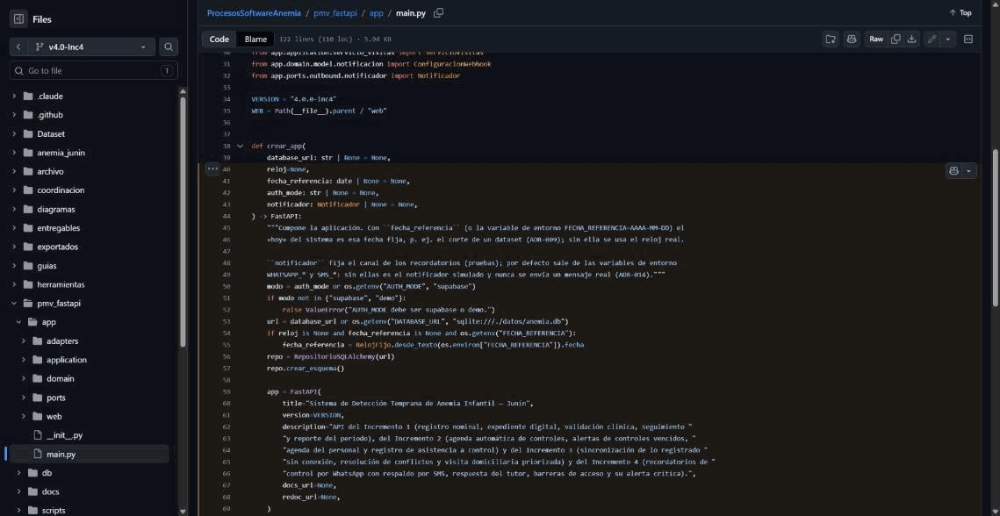

**Figura 11.** `main.py` como única raíz de composición (GitHub, `v4.0-Inc4`).

**Tabla 18.** Matriz de dependencias entre capas (conteo de importaciones; S10, Tabla 18). Ninguna importación prohibida.

| Capa (origen) | stdlib | terceros | dominio | puertos | application | adaptadores |
| --- | :---: | :---: | :---: | :---: | :---: | :---: |
| `domain` (model y service) | 63 | **0** | 67 | 0 | 0 | 0 |
| `ports` (inbound y outbound) | 32 | **0** | 20 | 0 | 0 | 0 |
| `application` | 14 | **0** | 63 | 48 | 0 | 0 |
| `adapters.inbound` | 7 | 8 (`fastapi`, `pydantic`) | 12 | 13 | 0 | 1 |
| `adapters.outbound` | 14 | 7 (`httpx`, `sqlalchemy`) | 24 | 15 | 0 | 4 |

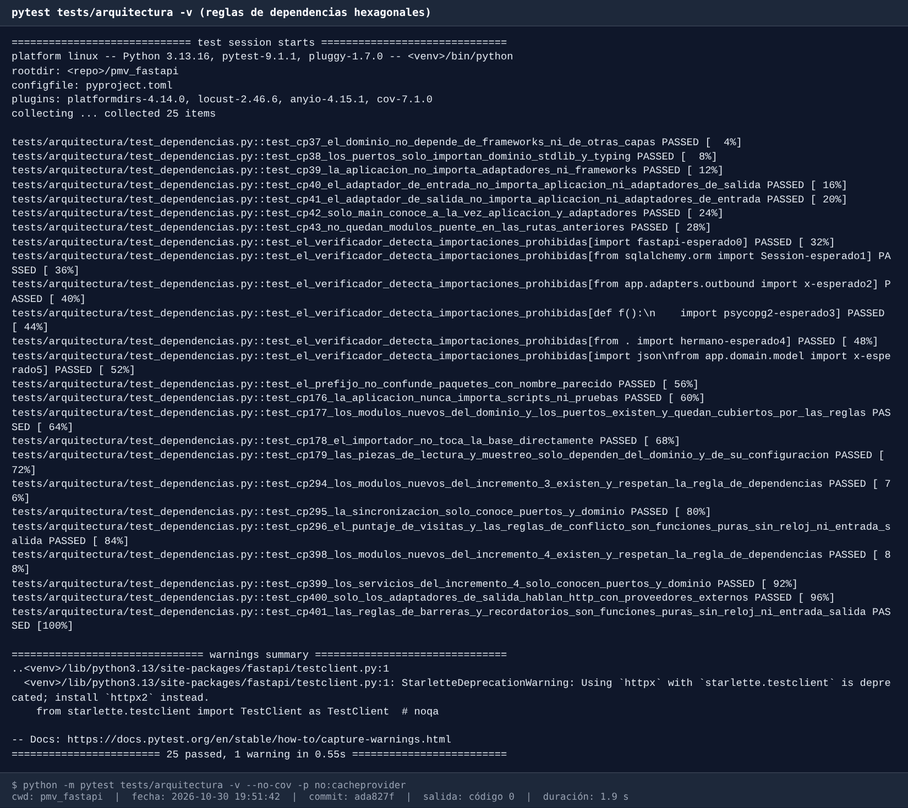

**Figura 12.** Las 25 pruebas de arquitectura (`tests/arquitectura`) validan la regla de dependencia en cada ejecución del CI: todas aprobadas.

Tres hallazgos honestos de la auditoría: (1) la conformidad **ultra estricta** de M1.2 es 80 % porque `application/servicio_sesion.py` implementa el puerto `ProveedorIdentidad` dentro de la capa de aplicación (adenda S9, sección 7); (2) `autenticacion.py` (94 %) y `supabase_auth.py` (97 %) explican por qué la cobertura bajó de 100 % a 99,79 %; (3) el diagrama C4 de componentes del repositorio describe solo el Incremento 1 y no se actualizó.

---


#### 3.2.4 Ejecución del Primer Incremento / Producto Mínimo Viable (PMV)


El PMV (Incremento 1, etiqueta `v1.0-PMV`, 30/09/2026) cubre cinco historias que eliminan el triple registro (B1) y entregan el primer seguimiento: registro nominal con evaluación inicial, expediente, validación clínica, listado y reporte. Se ejecutó en dos sprints (01 al 28/09/2026) con 16 tareas (T01 a T16) y 113 horas-persona estimadas; las horas reales no se registraron.

**Especificación de historias de usuario del PMV**

**Tabla 19.** Historias del Incremento 1 con su criterio de aceptación y el resultado medido en `v4.0-Inc4` (S3-4, S10 Tabla 6).

| Código | Historia (Como / quiero / para) | Criterio de aceptación (Dado-Cuando-Entonces) | Resultado medido |
| --- | --- | --- | --- |
| HU-01 / RF-01 | **Como** personal de salud, **quiero** registrar al niño con su evaluación inicial, **para** tener un registro nominal único | **Dado** un formulario con datos válidos, **cuando** pulsa «Guardar registro», **entonces** se confirma y se abre el expediente en menos de 2 s; con un DNI ya registrado la API responde 409 | 130 ms; DNI repetido: HTTP 409 |
| HU-02 / RF-02 | **Como** personal de salud, **quiero** consultar y actualizar el expediente y agregar controles, **para** mantener el historial al día | **Dado** un expediente existente, **cuando** lo consulta, edita un campo permitido y agrega un control, **entonces** los cambios persisten y el historial pasa de 2 a 3 evaluaciones | 2 a 3 evaluaciones |
| HU-03 / RF-03 | **Como** personal de salud, **quiero** ver la clasificación de la hemoglobina al digitarla, **para** no depender del cálculo manual por altitud | **Dado** un formulario clínico, **cuando** digita la Hb, **entonces** se muestran la Hb ajustada por altitud y la clasificación; con datos inválidos se rechaza con mensajes por campo (HTTP 422) | Hb 11,6 g/dL a 3 720 m: Hb ajustada 9,1 g/dL, «Anemia moderada»; Hb 25 g/dL: 422 |
| HU-04 / RF-04 | **Como** personal de salud, **quiero** listar a los niños en seguimiento con filtros, **para** priorizar la atención | **Dado** un conjunto de niños, **cuando** filtra por clasificación o busca por comunidad, **entonces** el listado respeta el filtro | 27 niños; 6 con «Moderada» |
| HU-05 / RF-05 | **Como** coordinador, **quiero** un reporte del periodo en JSON y CSV, **para** consolidar la información | **Dado** un periodo válido, **cuando** pulsa «Generar», **entonces** se muestran los indicadores y se descarga el CSV en menos de 2 s | 28 registrados; CSV de 43 líneas en 86 ms |

La autenticación con Supabase (ADR-011) no formaba parte del PMV: se incorporó antes del Incremento 3 y tiene su propia ficha de prueba (sección 3.6.3).

**Resultado de la ejecución.** El PMV se midió con el mismo método que los incrementos posteriores, lo que permite ver sus debilidades:

**Tabla 20.** Resultado del Incremento 1 (`v1.0-PMV`) según las métricas GQM de S9 y la adenda.

| Aspecto | Valor en `v1.0-PMV` | Lectura |
| --- | --- | --- |
| Pruebas | 73 (unitarias, integración y arquitectura) y 4 E2E; cobertura 99 % | Verde, pero la cobertura no evitó defectos |
| Defectos funcionales (M2.2) | 7 defectos en 5 RF = 1,4 por RF; la meta de la guía es ≤ 1,0 | **No cumple**; 6 de los 7 no se detectaron antes de liberar (S11, H6) |
| Conformidad hexagonal (M1.2, criterio estricto) | 40,0 % (2 de 5 componentes); 1 violación de la regla de dependencia (el adaptador HTTP importaba un caso de uso concreto) | **No cumple**; se corrigió en el hito `v1.5.0-inc2-avance` con la estructura de puertos (ADR-008) |
| Brechas resueltas (M3.1) | 25,0 % (1,5/6) | Solo B1 completa; la meta de la guía (≥ 60 %) no se alcanzó |
| Latencia p95 agregada (V4, 50 usuarios) | 175 ms | Cumple la meta de 800 ms |

El PMV entregó el valor comprometido (registro único y clasificación probada en valores límite), pero la arquitectura nació con una dependencia invertida que solo se corrigió al iniciar el Incremento 2. Es la razón por la que la sección 3.6 mide la arquitectura en cada incremento y no solo al final.

**Tabla 21.** Evolución del producto por incremento (adenda S9, sección 4; S11, Tabla 5a). Las pruebas son unitarias, de integración y de arquitectura; los E2E se cuentan aparte.

| Incremento | Etiqueta | Historias | Pruebas | E2E | Cobertura de `app/` |
| --- | --- | --- | --- | :---: | :---: |
| Inc. 1 | `v1.0-PMV` | HU-01 a HU-05 | 73 | 4 | 99 % |
| Inc. 2 | `v2.0-Inc2` | HIST-2.1 a HIST-2.4 | 328 | 15 | 100 % |
| Inc. 3 | `v3.0-Inc3` | HIST-3.1 a HIST-3.4, VIS-3.5 | 499 | 24 | 99,70 % |
| Inc. 4 | `v4.0-Inc4` | HIST-4.1 a HIST-4.4 | 660 | 28 | 99,79 % |

---


### 3.3 UNIDAD III: Evolución de los Procesos y Actividades de Software

#### 3.3.1 Evaluación GQM del Producto y Proceso en los Incrementos 1 y 2


Las tres metas se formularon con la plantilla de Basili et al. [21] (objeto, propósito, enfoque de calidad, punto de vista y contexto) y se midieron para los cuatro incrementos con los scripts de `.claude/herramientas/gqm/`.

**Tabla 22.** Metas, preguntas y métricas GQM (S9, Tablas 8 y 12).

| Meta | Pregunta | Métrica | Fórmula | Meta de la guía (Inc. 1 / Inc. 2) |
| --- | --- | --- | --- | --- |
| **G-01** Evaluar el desacoplamiento del dominio (mantenibilidad, punto de vista del arquitecto) | Q1.1 ¿Cuánto del dominio depende de frameworks? | M1.1 Contaminación del dominio | importaciones de terceros ÷ clases del dominio × 100 | 0 % / 0 % |
| | Q1.2 ¿La estructura es hexagonal? | M1.2 Conformidad hexagonal | componentes conformes ÷ 5 × 100 | 100 % / 100 % |
| | Q1.3 (complementaria) ¿Las dependencias apuntan al núcleo? | M1.3 Violaciones de la regla de dependencia | conteo por AST | propuesta: 0 |
| **G-02** Verificar la estabilidad funcional (cobertura y tasa de fallas, punto de vista de QA) | Q2.1 ¿Cada RF tiene evidencia? | M2.1 Cobertura funcional con capturas | RF con captura aprobada ÷ RF × 100 | 100 % / 100 % |
| | Q2.2 ¿Cuántos defectos hay? | M2.2 Defectos por RF | defectos ÷ RF | ≤ 1,0 / ≤ 0,2 |
| **G-03** Evaluar la efectividad del proceso (valor organizacional, punto de vista del usuario y Product Owner simulado) | Q3.1 ¿Qué brechas del AS-IS se resolvieron? | M3.1 Brechas resueltas | (Σ puntajes B1 a B6 ÷ 6) × 100 | ≥ 60 % / ≥ 90 % |
| | Q3.2 ¿Mejoraron los indicadores de valor? | M3.2 Índice de impacto en valor | promedio de mejoras de V1, V2 y V3 | ≥ 50 % / ≥ 80 % |

**Tabla 23.** Valores GQM por incremento (adenda S9, sección 2). «n/r»: no recalculada.

| Métrica | Inc. 1 `v1.0-PMV` | Inc. 2 `v2.0-Inc2` | Inc. 3 `v3.0-Inc3` | Inc. 4 `v4.0-Inc4` |
| --- | :---: | :---: | :---: | :---: |
| M1.1 contaminación del dominio | 0,0 % (0/8 clases) | 0,0 % (0/32) | 0,0 % (0/55) | **0,0 % (0/86)** |
| M1.2 conformidad hexagonal (estricta) | 40,0 % | 100,0 % | 100,0 % | **100,0 %** |
| M1.3 violaciones de dependencia | 1 | 0 | 0 | **0** |
| M2.1 cobertura funcional con capturas | 100 % (5/5 RF) | 100 % (4/4; 9/9 acumulado) | 100 % (5/5; 14/14 acumulado) | **100 % (4/4; 18/18 acumulado)** |
| M2.2 defectos por RF | 1,4 (7/5) | 0,25 (1/4) | n/r (indicativo 0,20) | n/r (indicativo 0,75) |
| **M3.1 brechas resueltas (principal)** | 25,0 % | 33,3 % | 50,0 % | **75,0 %** |
| M3.2 índice de impacto en valor (V1, V2, V3) | 57,6 % | 100,0 % | 100,0 % | 100,0 % |
| V3 F1 de controles vencidos | 0,729 | 1,000 | 1,000 | 1,000 (476/476 controles) |
| V4 p95 agregado, 50 usuarios | 175 ms | 815 ms | n/r | **1 100 ms** (una corrida) |
| V5 disponibilidad durante la carga | 100 % (856/856) | 100 % (856/856) | n/r | 100 % (64/64) |

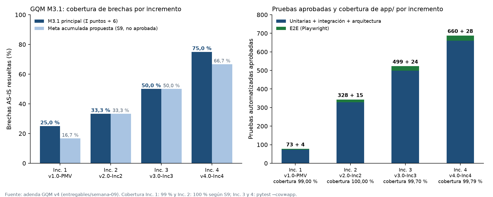

**Figura 13.** Evolución de M3.1 frente a la meta acumulada propuesta en S9 (izquierda; no aprobada) y de las pruebas automáticas y la cobertura por incremento (derecha). Elaboración propia con `evidencias/generar_figuras.py`.

La meta acumulada propuesta en S9 (16,7 %, 33,3 %, 50,0 % y 66,7 % hasta INC-4) se alcanza en cada incremento (25,0 %, 33,3 %, 50,0 % y 75,0 %); las metas de la guía (60 % y 90 %) suponían cerrar casi todas las brechas en dos incrementos y no se alcanzaron en su momento.

**Tabla 24.** Puntaje de M3.1 por brecha e incremento (1 = mecanismo completo, operativo y probado; 0,5 = parcial; 0 = no; adenda S9, sección 3).

| Brecha | Plan | Inc. 1 | Inc. 2 | Inc. 3 | Inc. 4 | Evidencia en `v4.0-Inc4` |
| --- | --- | :---: | :---: | :---: | :---: | --- |
| B1 Triple registro | INC-1 | 1,0 | 1,0 | 1,0 | 1,0 | Una escritura por evaluación |
| B2 Agenda sin recordatorios | INC-2 | 0,0 | 0,5 | 0,5 | **1,0** | Recordatorios con puerto `Notificador`; solo el modo simulado y `httpx.MockTransport` están probados |
| B3 Barreras ocultas | INC-4 | 0,0 | 0,0 | 0,0 | **1,0** | 8 tipos de barrera, `REGLAS_BARRERAS_V1`, vigencia de 90 días; reglas sin validar |
| B4 Visita en papel | INC-3 | 0,0 | 0,0 | **1,0** | 1,0 | `VISITA-V1`/`V2`, captura sin conexión; pesos sin validar |
| B5 Riesgo tardío | INC-5 | 0,0 | 0,0 | 0,0 | 0,0 | Sin modelo ni regla de riesgo (INC-5 no implementado) |
| B6 Conectividad | INC-3 e INC-6 | 0,5 | 0,5 | 0,5 | 0,5 | Sincronización idempotente; sin dispositivo real ni INC-6 |
| **Σ puntos** | | **1,5** | **2,0** | **3,0** | **4,5** | **75,0 %** |

**Sensibilidades.** M3.1 depende de cómo se puntúe lo no probado en el mundo real: si B2, B3 y B4 se puntuaran 0,5 por exigir un envío real y un dispositivo real, M3.1 bajaría a **50,0 %**; si B6 puntuara 0, a 66,7 %; la lectura estricta (solo puntaje 1,0) es 66,7 % (4 de 6). El valor de 75,0 % es la lectura principal de la guía y se informa junto a estas variaciones.

**Lo que GQM no pudo medir.** M2.1 de Inc. 3 e Inc. 4 se calculó con las fichas del apartado 3.3.1: 100 %, 18 de 18 requisitos con captura aprobada. M2.2 de esos incrementos sigue siendo indicativa (0,20 y 0,75 defectos por requisito): no hay registro de defectos posterior a DEF-09 y los cinco defectos de la revisión independiente (tres de ellos de concurrencia o seguridad) se corrigieron sin registrarse como DEF (ficha GQM de M2.2). El p95 de 1 100 ms (una sola corrida, sin control de la versión anterior) supera la meta de 800 ms y es el principal riesgo de rendimiento.

**Fichas de evaluación GQM con evidencia por métrica**

Cada métrica de la Tabla 22 tiene una ficha con el mismo formato que las fichas de prueba funcional. La ficha da la meta y la pregunta, la fórmula con los datos y el resultado, y dos evidencias:

- **Captura 1:** el software en uso, de cara al dominio: el registro de un niño, la agenda, las alertas, las visitas o la sincronización. Cuando existe, se usa la captura del entorno de producción (`softwareanemia.onrender.com`).
- **Captura 2:** la ejecución reproducible de la medición, con el comando, la fecha y el resultado.

La Tabla 25 resume la trazabilidad entre cada métrica y su evidencia.

**Tabla 25.** Trazabilidad de cada métrica GQM con su evidencia (valores de `v4.0-Inc4`).

| Meta | Métrica | Valor Inc. 4 | Meta / criterio | Evidencia en el software (dominio) | Evidencia de la medición |
| --- | --- | :---: | :---: | --- | --- |
| G-01 | M1.1 Contaminación del dominio | 0,0 % (0/86) | 0 % | Figura 14 | Figura 15 |
| G-01 | M1.2 Conformidad hexagonal | 100 % (5/5) | 100 % | Figura 16 | Figura 17 |
| G-01 | M1.3 Violaciones de dependencia | 0 | 0 | Figura 18 | Figura 19 |
| G-02 | M2.1 Cobertura funcional con capturas | 100 % (18/18) | 100 % | Tabla 26 y fichas del apartado 3.3.1 | Figura 15 |
| G-02 | M2.2 Defectos por requisito | 0,75 (indicativo) | ≤ 0,2 (Inc. 2) | Figura 21 | Figura 22 |
| G-03 | M3.1 Brechas AS-IS resueltas | 75,0 % (4,5/6) | ≥ 66,7 % (meta acumulada S9) | Figuras 23 a 30 | Figura 31 |
| G-03 | M3.2 Índice de impacto en valor (V1, V2, V3) | 100 % | ≥ 80 % | Figuras 32 a 34 | Figura 35 |
| G-03 | V4 Rendimiento p95 (50 usuarios) | 1 100 ms | < 800 ms | Figura 36 | Figura 38 |
| G-03 | V5 Disponibilidad durante la carga | 100 % (64/64) | ≥ 99,5 % | Figura 37 | Figura 39 |

---

**FICHA DE EVALUACIÓN GQM Y EVIDENCIA VISUAL POR MÉTRICA (M1.1)**

- **META:** G-01 Evaluar el desacoplamiento del dominio (mantenibilidad, punto de vista del arquitecto).
- **PREGUNTA:** Q1.1 ¿Cuánto del dominio depende de frameworks?
- **MÉTRICA Y FÓRMULA:** M1.1 Contaminación del dominio = importaciones de terceros en el dominio ÷ clases del dominio × 100.
- **DATOS Y CÁLCULO:** 86 clases en `app/domain`, 130 importaciones (63 de la biblioteca estándar, 67 internas, **0 externas**). M1.1 = 0 ÷ 86 × 100 = **0,0 %**.
- **META DE LA GUÍA:** 0 %.

**[ CAPTURA 1: EVIDENCIA EN EL DOMINIO ]**

- **Descripción:** **Figura 14.** Código del modelo de dominio (`app/domain/model/entidades.py`): las entidades del niño y de la evaluación solo importan la biblioteca estándar y otros módulos del dominio, sin FastAPI, SQLAlchemy ni Pydantic.

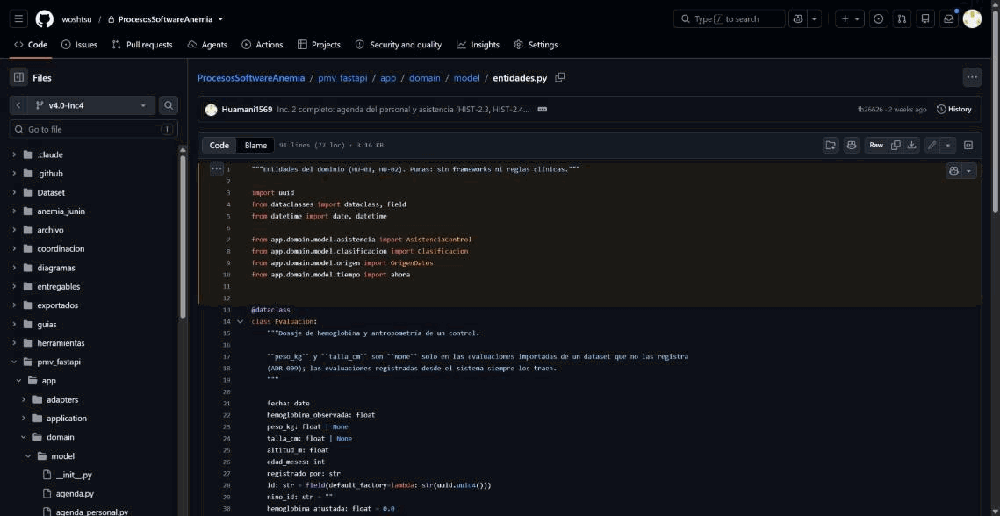

- **Archivo de imagen:** `entregables/semana-10/evidencias/github/GH_dominio_entidades_imports.png`

**[ CAPTURA 2: EJECUCIÓN DE LA MEDICIÓN ]**

- **Descripción:** **Figura 15.** Ejecución de `m11_contaminacion.py` del 06/11/2026 sobre el código actual: 0 importaciones externas en las 86 clases del dominio. El rótulo «v2.0» es la clave interna del script y apunta a `pmv_fastapi/` actual.

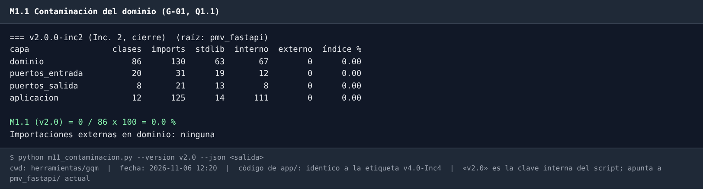

- **Archivo de imagen:** `entregables/semana-12/correcciones/img/G01_m11_contaminacion.png`

**EVALUACIÓN: CUMPLE | FECHA: 06/11/2026 | EVALUADOR: QA Lead (Huamani R.)**

---

**FICHA DE EVALUACIÓN GQM Y EVIDENCIA VISUAL POR MÉTRICA (M1.2)**

- **META:** G-01. **PREGUNTA:** Q1.2 ¿La estructura es hexagonal?
- **MÉTRICA Y FÓRMULA:** M1.2 Conformidad hexagonal = componentes conformes ÷ 5 × 100. Los 5 componentes son: núcleo de dominio, puertos de entrada, puertos de salida, adaptadores de entrada y adaptadores de salida.
- **DATOS Y CÁLCULO:** los 5 componentes son conformes: tienen paquete propio y cumplen la dirección de las dependencias. M1.2 = 5 ÷ 5 × 100 = **100 %**.
- **Sensibilidad:** la lectura ultra estricta da 80 %, porque `ServicioSesion` implementa el puerto `ProveedorIdentidad` dentro de la capa de aplicación.
- **META DE LA GUÍA:** 100 %.

**[ CAPTURA 1: EVIDENCIA EN EL DOMINIO ]**

- **Descripción:** **Figura 16.** Matriz de importaciones entre capas del análisis AST: ninguna celda roja. El dominio no importa ninguna otra capa y cada adaptador solo depende de su puerto.

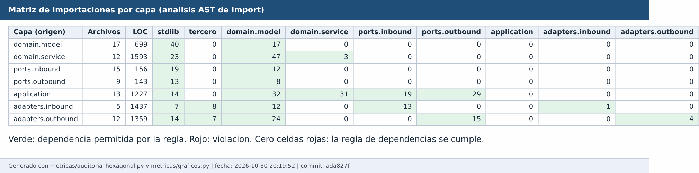

- **Archivo de imagen:** `entregables/semana-10/evidencias/arquitectura/S_matriz_importaciones.png`

**[ CAPTURA 2: EJECUCIÓN DE LA MEDICIÓN ]**

- **Descripción:** **Figura 17.** Ejecución de `m12_conformidad.py` del 06/11/2026: los 5 componentes son CONFORMES (M1.2 = 100 %), con la observación de la lectura ultra estricta.

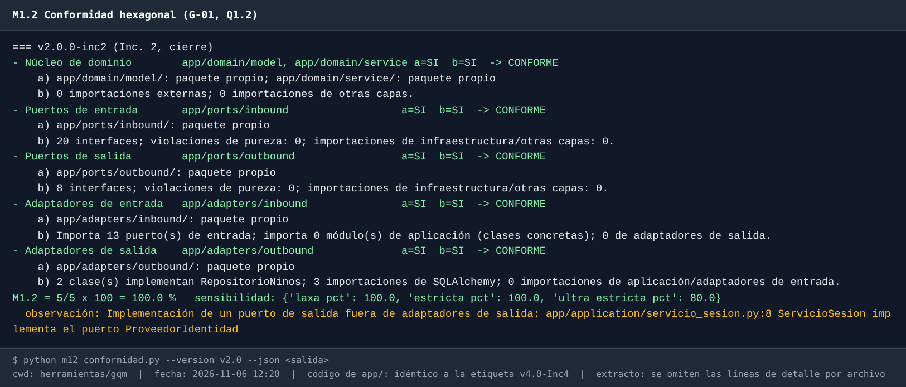

- **Archivo de imagen:** `entregables/semana-12/correcciones/img/G02_m12_conformidad.png`

**EVALUACIÓN: CUMPLE (lectura estricta; 80 % en la ultra estricta) | FECHA: 06/11/2026 | EVALUADOR: QA Lead (Huamani R.)**

---

**FICHA DE EVALUACIÓN GQM Y EVIDENCIA VISUAL POR MÉTRICA (M1.3)**

- **META:** G-01. **PREGUNTA:** Q1.3 ¿Las dependencias apuntan al núcleo?
- **MÉTRICA Y FÓRMULA:** M1.3 Violaciones de la regla de dependencia, contadas por AST como aristas que salen del dominio hacia otras capas.
- **DATOS Y CÁLCULO:** inestabilidad del dominio I = Ce ÷ (Ce + Ca) = 0 ÷ (0 + 41) = **0,00**. Aristas hacia fuera del dominio: **0**.
- **CRITERIO:** 0 violaciones.

**[ CAPTURA 1: EVIDENCIA EN EL DOMINIO ]**

- **Descripción:** **Figura 18.** Pruebas de arquitectura (`tests/arquitectura/test_dependencias.py`) que hacen cumplir la regla en cada ejecución del CI: si el dominio importara un framework o un adaptador, la prueba fallaría.

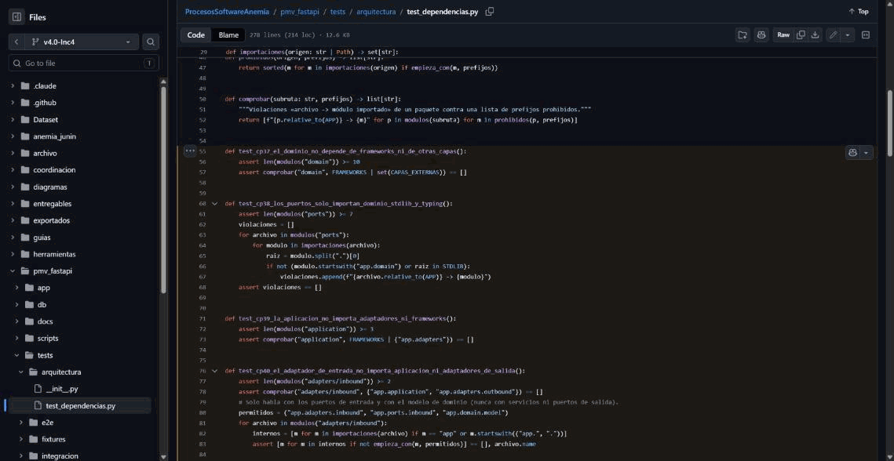

- **Archivo de imagen:** `entregables/semana-10/evidencias/github/GH_pruebas_arquitectura.png`

**[ CAPTURA 2: EJECUCIÓN DE LA MEDICIÓN ]**

- **Descripción:** **Figura 19.** Ejecución de `m13_acoplamiento.py` del 06/11/2026: el núcleo de dominio tiene Ce = 0 e I = 0,00, y hay 0 violaciones de la regla de dependencia.

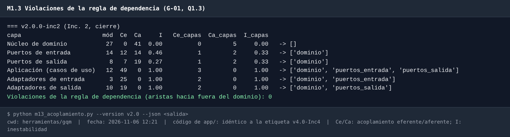

- **Archivo de imagen:** `entregables/semana-12/correcciones/img/G03_m13_acoplamiento.png`

**EVALUACIÓN: CUMPLE | FECHA: 06/11/2026 | EVALUADOR: QA Lead (Huamani R.)**

---

**FICHA DE EVALUACIÓN GQM Y EVIDENCIA VISUAL POR MÉTRICA (M2.1)**

- **META:** G-02 Verificar la estabilidad funcional (punto de vista de QA).
- **PREGUNTA:** Q2.1 ¿Cada requisito tiene evidencia?
- **MÉTRICA Y FÓRMULA:** M2.1 Cobertura funcional con capturas = requisitos con captura aprobada ÷ requisitos × 100.
- **DATOS Y CÁLCULO:**
  - Inc. 1: 5/5. Inc. 2: 4/4. Inc. 3: 5/5. Inc. 4: 4/4.
  - Acumulado: 18 ÷ 18 × 100 = **100 %**. La ficha AUTH es adicional y no cuenta como requisito del plan.
- **META DE LA GUÍA:** 100 %.

**Tabla 26.** Requisitos de cada incremento y ficha del apartado 3.6.3 que los evidencia.

| Incremento | Requisitos | Fichas con captura de entrada y de resultado | Resultado |
| --- | --- | --- | :---: |
| Inc. 1 (PMV) | RF-01 a RF-05 | RF-01, RF-02, RF-03, RF-04 y RF-05 | 5/5 |
| Inc. 2 | RF-06 a RF-09 | RF-06, RF-07, RF-08 y RF-09 | 4/4 |
| Inc. 3 | HIST-3.1 a HIST-3.4, VIS-3.5 | HIST-3.1 (y 3.1b), HIST-3.2, HIST-3.3, HIST-3.4 y VIS-3.5 | 5/5 |
| Inc. 4 | HIST-4.1 a HIST-4.4 | HIST-4.1, HIST-4.2, HIST-4.3 y HIST-4.4 | 4/4 |
| **Total** | **18** | 19 fichas de requisitos y 1 de autenticación | **18/18** |

**[ CAPTURA: EJECUCIÓN QUE RESPALDA LAS FICHAS ]**

- **Descripción:** **Figura 20.** Las 28 pruebas E2E en el navegador (Playwright), ejecutadas el 06/11/2026: 28 aprobadas. Automatizan los escenarios de las fichas de los cuatro incrementos (CP-297 a CP-303 de Inc. 3, recordatorios y barreras de Inc. 4, agenda y alertas de Inc. 2).
  - En una primera corrida, CP-110 (agenda) excedió el tiempo de espera. Pasó 3 de 3 veces aislada y en la corrida completa de la figura. Es la inestabilidad ya registrada en H6.

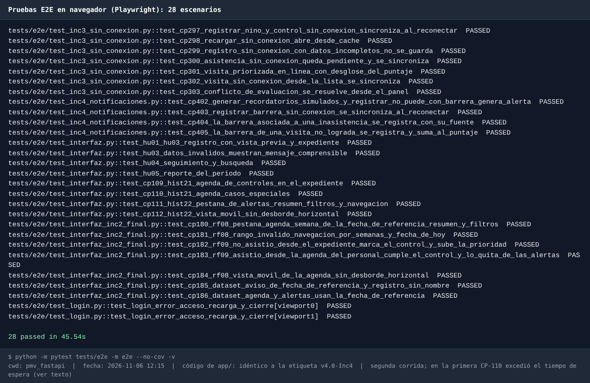

- **Archivo de imagen:** `entregables/semana-12/correcciones/img/T02_e2e_playwright.png`

**EVALUACIÓN: CUMPLE | FECHA: 06/11/2026 | EVALUADOR: QA Lead (Huamani R.)**

---

**FICHA DE EVALUACIÓN GQM Y EVIDENCIA VISUAL POR MÉTRICA (M2.2)**

- **META:** G-02. **PREGUNTA:** Q2.2 ¿Cuántos defectos hay?
- **MÉTRICA Y FÓRMULA:** M2.2 Defectos por requisito = defectos funcionales ÷ requisitos del incremento.
- **DATOS Y CÁLCULO:**
  - Inc. 1: 7 ÷ 5 = 1,40. Inc. 2: 1 ÷ 4 = 0,25 (S9).
  - Inc. 3 y 4, contando los hallazgos de la revisión independiente: Inc. 3, 1 ÷ 5 = **0,20** (duplicado por concurrencia en la sincronización). Inc. 4, 3 ÷ 4 = **0,75** (webhook sin firma, recordatorio duplicado por concurrencia y detalle de barrera demasiado largo).
- **META DE LA GUÍA:** ≤ 1,0 (Inc. 1) y ≤ 0,2 (Inc. 2).
- **Lectura:** Inc. 3 está dentro de la última meta de la guía (≤ 0,2) e Inc. 4 la supera.

**[ CAPTURA 1: EVIDENCIA EN EL DOMINIO ]**

- **Descripción:** **Figura 21.** Defectos por requisito e incremento (DEF-01 a DEF-09 de los incrementos 1 y 2), según su tipo y momento de detección. Fuente: registro de defectos `pmv_fastapi/docs/evidencias/registro_defectos*.md`.

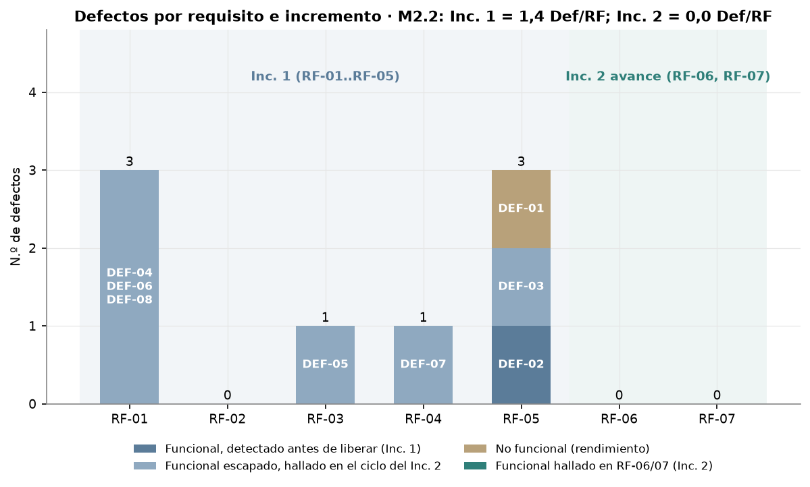

- **Archivo de imagen:** `entregables/semana-09/metricas/graficos/g6_defectos.png`

**[ CAPTURA 2: EJECUCIÓN DE LA MEDICIÓN ]**

- **Descripción:** **Figura 22.** Pruebas de regresión de los defectos de Inc. 3 e Inc. 4 hallados en la revisión independiente, todas aprobadas: CP-357 (webhook falla cerrado), CP-264b (sincronización concurrente), CP-382b (recordatorios concurrentes), CP-391b, CP-396 y CP-405.

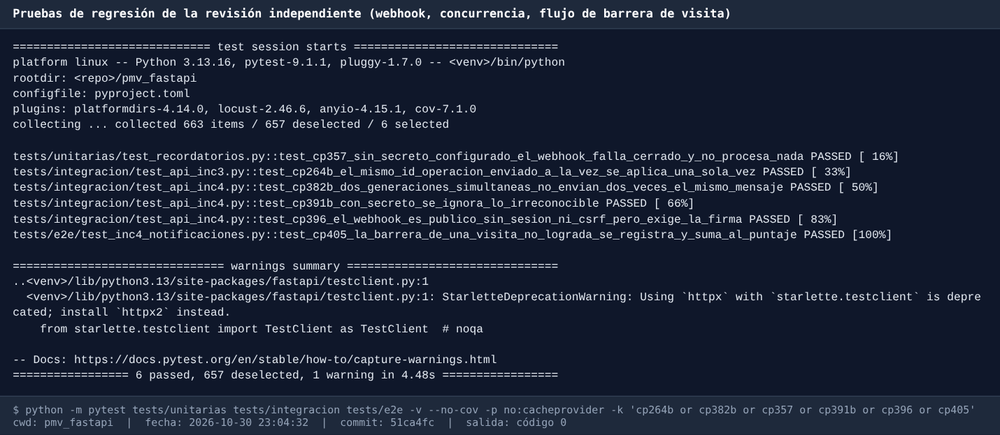

- **Archivo de imagen:** `entregables/semana-11/evidencias/CMMI04_regresion_revision_independiente.png`

**EVALUACIÓN: CUMPLE EN INC. 3; NO CUMPLE EN INC. 4 (0,75 frente a la última meta de la guía, ≤ 0,2); VALOR INDICATIVO | FECHA: 06/11/2026 | EVALUADOR: QA Lead (Huamani R.)**

---

**FICHA DE EVALUACIÓN GQM Y EVIDENCIA VISUAL POR MÉTRICA (M3.1)**

- **META:** G-03 Evaluar la efectividad del proceso (valor organizacional, punto de vista del usuario).
- **PREGUNTA:** Q3.1 ¿Qué brechas del AS-IS se resolvieron?
- **MÉTRICA Y FÓRMULA:** M3.1 = (Σ puntajes B1 a B6 ÷ 6) × 100. Puntaje: 1 = mecanismo completo, operativo y probado; 0,5 = parcial; 0 = no.
- **DATOS Y CÁLCULO:** B1 1,0 + B2 1,0 + B3 1,0 + B4 1,0 + B5 0,0 + B6 0,5 = 4,5. M3.1 = 4,5 ÷ 6 × 100 = **75,0 %**.
- **META:** meta acumulada propuesta en S9 para INC-4: 66,7 %.

**EVIDENCIA EN EL SOFTWARE POR BRECHA (CAPTURAS DE DOMINIO)**

**[ B1 Triple registro manual → registro único (puntaje 1,0) ]**

- **Descripción:** **Figura 23.** Producción: formulario «Registrar niño y evaluación inicial» con la validación clínica en vista previa antes de guardar (Hb ajustada por altitud y clasificación). Una sola digitación alimenta el expediente, el seguimiento y el reporte.

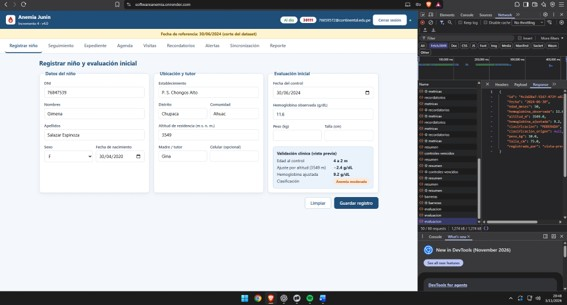

- **Descripción:** **Figura 24.** Producción: «Niños en seguimiento» con los registros del dataset DIRESA anonimizado. Es la misma información, sin volver a digitarla.

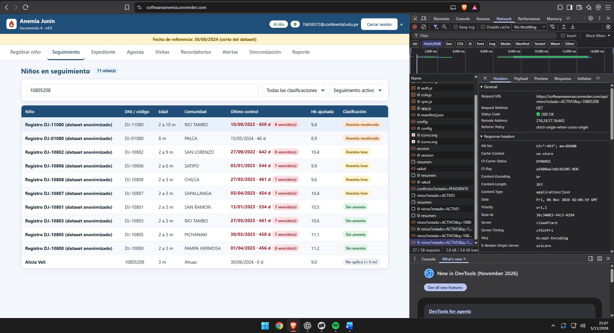

- **Archivos de imagen:** `entregables/semana-12/evidencias/produccion/ROD_01_inc1_registro_clasificacion1.jpg`, `PROD_03_inc3_sincronizacion_seguimiento.jpg`

**[ B2 Agenda sin recordatorios → agenda normativa y recordatorios (puntaje 1,0) ]**

- **Descripción:** **Figura 25.** Producción: agenda del personal con los controles programados por la norma para cada niño.

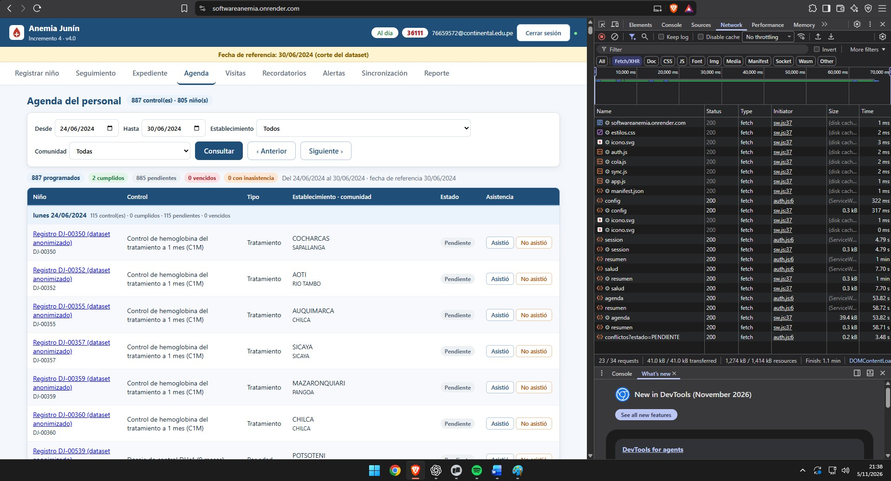

- **Descripción:** **Figura 26.** Recordatorios generados para los controles próximos, con estado SIMULADO: no sale ningún mensaje real hasta que Meta apruebe la plantilla de WhatsApp.

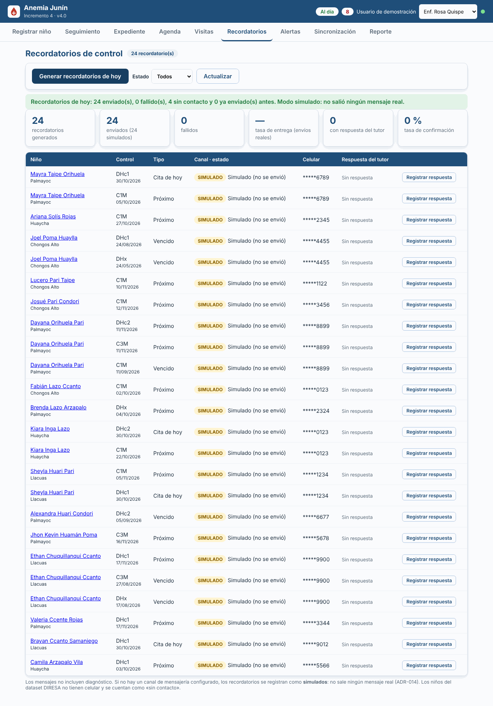

- **Archivos de imagen:** `entregables/semana-12/evidencias/produccion/PROD_02_inc2_agendas.jpg`, `entregables/semana-10/evidencias/software/HIST41_inc4_2_recordatorios_simulados_escritorio.png`

**[ B3 Barreras ocultas → registro de barreras y alerta crítica (puntaje 1,0) ]**

- **Descripción:** **Figura 27.** Alertas: la tabla «Barreras críticas» muestra a los niños cuyas barreras de acceso ponen en riesgo su tratamiento, según `REGLAS_BARRERAS_V1`.

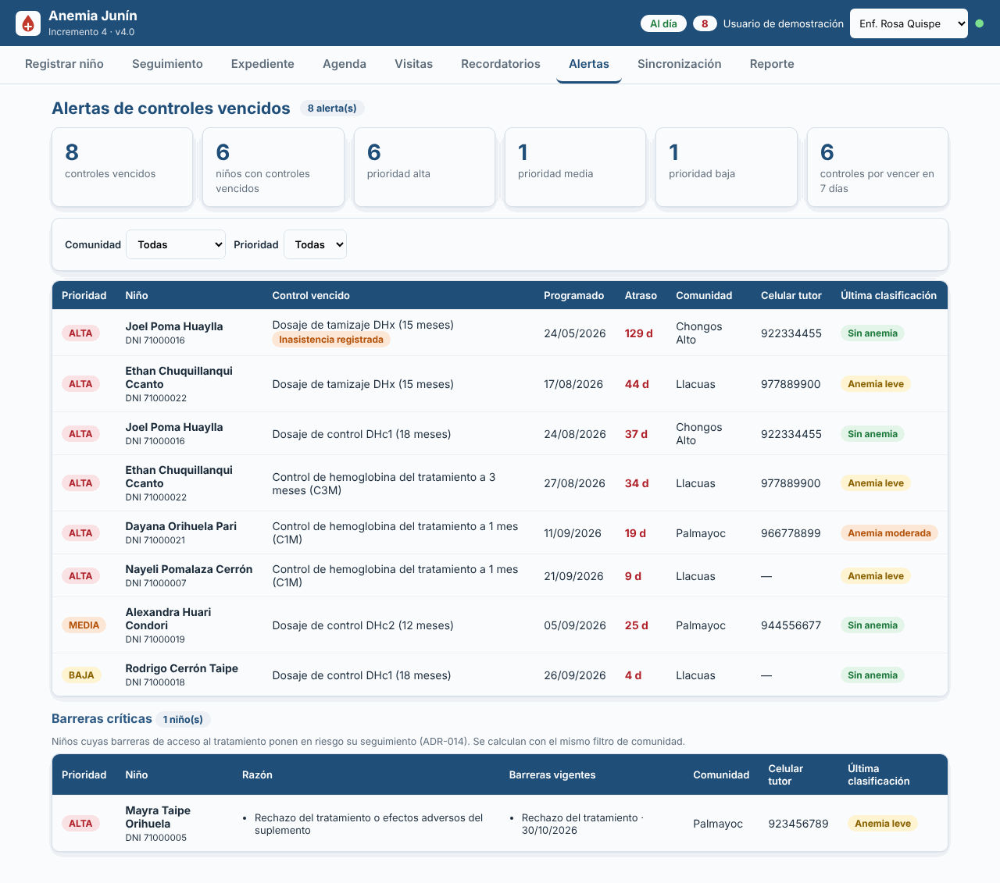

- **Archivo de imagen:** `entregables/semana-10/evidencias/software/HIST44_inc4_1_alertas_barreras_criticas_escritorio.png`

**[ B4 Visita domiciliaria en papel → visitas priorizadas (puntaje 1,0) ]**

- **Descripción:** **Figura 28.** Producción: «Visitas domiciliarias priorizadas» con puntaje explicable. Los niños con anemia severa y el control más vencido aparecen primero. A la derecha, la solicitud a la API de producción responde 200 OK.

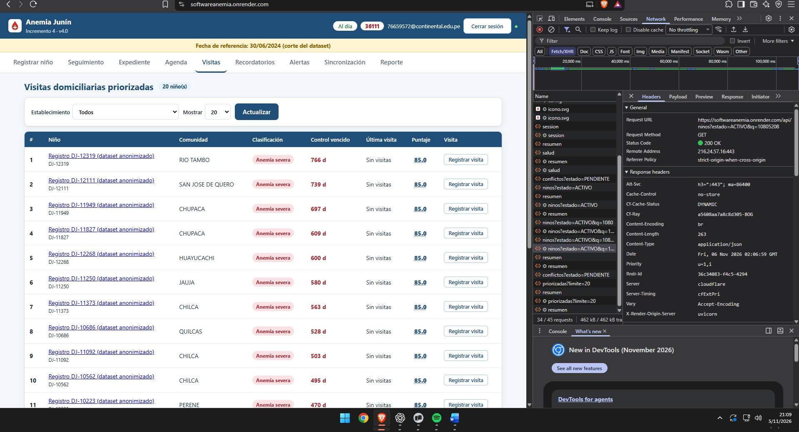

- **Archivo de imagen:** `entregables/semana-12/evidencias/produccion/PROD_03_inc3_sincronizacion_visitas.jpg`

**[ B5 Riesgo identificado tarde (puntaje 0,0) ]**

- Sin evidencia en el software, porque no se implementó: el modelo de riesgo de abandono es del INC-5. La visita priorizada usa controles ya vencidos y es reactiva. Se informa como brecha abierta.

**[ B6 Conectividad intermitente → registro sin conexión y sincronización (puntaje 0,5) ]**

- **Descripción:** **Figura 29.** Producción, en un celular: sin conexión a internet, el registro de un niño queda «Pendiente de sincronizar» y guardado en el dispositivo.

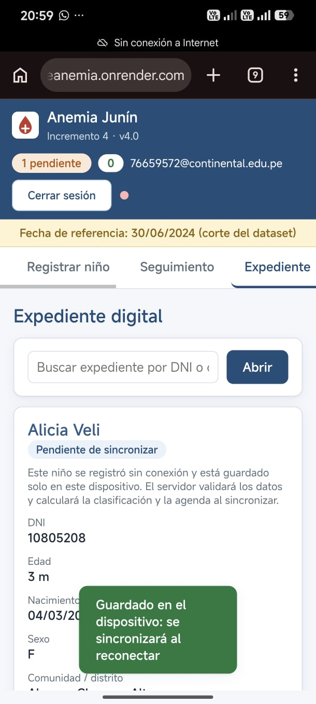{width=35%}

- **Descripción:** **Figura 30.** Producción, en el mismo celular: al volver la conexión, «De nuevo en línea», el indicador pasa a «Al día» y aparece «Sincronización: 1 aplicado(s)».

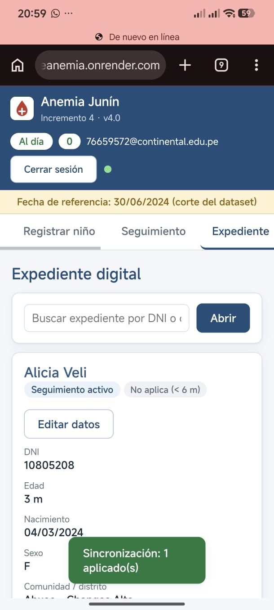{width=35%}

- **Archivos de imagen:** `entregables/semana-12/evidencias/produccion/PROD_03_inc3_sincronizacion_celular1.jpg`, `PROD_03_inc3_sincronizacion_celular3.jpg`
- **Por qué el puntaje es 0,5:** falta el INC-6 y no hubo prueba en una posta con red intermitente real.

**[ CAPTURA: EJECUCIÓN DE LA MEDICIÓN ]**

- **Descripción:** **Figura 31.** Ejecución de `m31_brechas_v4.py` del 06/11/2026 y el detalle de su archivo de salida.
  - Puntaje por brecha y M3.1 = 75,0 %.
  - Rutas de la API presentes para B2, B3, B4 y B6.
  - Archivos de la cola sin conexión.
  - «abandono»: 0 ocurrencias, que explica B5 = 0.

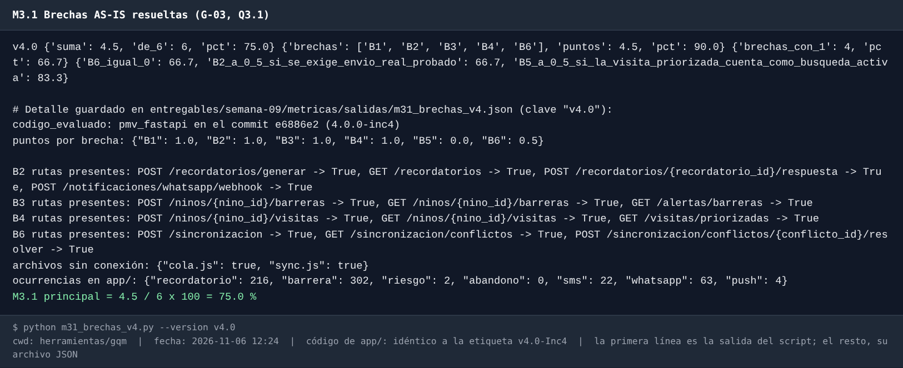

- **Archivo de imagen:** `entregables/semana-12/correcciones/img/G04_m31_brechas.png`

**EVALUACIÓN: CUMPLE (75,0 % ≥ 66,7 %; 50,0 % si se exigiera envío real y dispositivo real) | FECHA: 06/11/2026 | EVALUADOR: QA Lead (Huamani R.)**

---

**FICHA DE EVALUACIÓN GQM Y EVIDENCIA VISUAL POR MÉTRICA (M3.2)**

- **META:** G-03. **PREGUNTA:** Q3.2 ¿Mejoraron los indicadores de valor para el usuario?
- **MÉTRICA Y FÓRMULA:** M3.2 = promedio de las mejoras de V1, V2 y V3 frente a la línea base AS-IS.
  - V1: escrituras manuales por evaluación.
  - V2: % de niños activos con agenda generada.
  - V3: F1 de la detección de controles vencidos frente a un oráculo independiente.
- **DATOS Y CÁLCULO** (muestra B150, 140 niños activos):
  - V1 = **1 escritura** por evaluación; el AS-IS tenía 3 registros.
  - V2 = 140 ÷ 140 = **100 %**.
  - V3: TP 93, FP 0, FN 0, TN 47, F1 = **1,000**; 476 de 476 controles vencidos coinciden.
  - M3.2 = **100 %**.
- **META DE LA GUÍA:** ≥ 80 % (Inc. 2).

**[ CAPTURA 1: EVIDENCIA EN EL DOMINIO ]**

- **Descripción:** **Figura 32.** V1: producción, «Reporte del periodo». Cuenta los niños registrados y las evaluaciones del periodo (762 niños y 2 630 evaluaciones) a partir del registro único, sin volver a digitar.

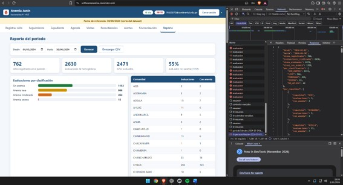

- **Descripción:** **Figura 33.** V2: la agenda normativa se genera sola para cada niño activo. Expediente con sus controles cumplidos, pendientes y vencidos.

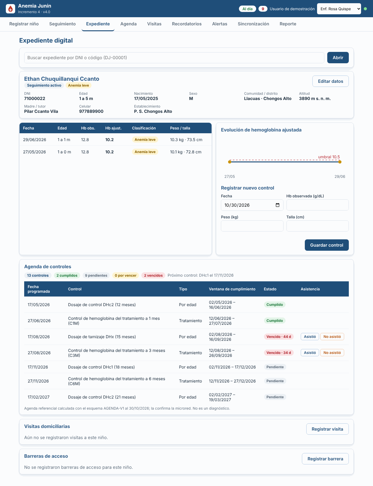

- **Descripción:** **Figura 34.** V3: producción, «Alertas de controles vencidos» sobre el dataset DIRESA anonimizado, con prioridad, días de atraso y comunidad.

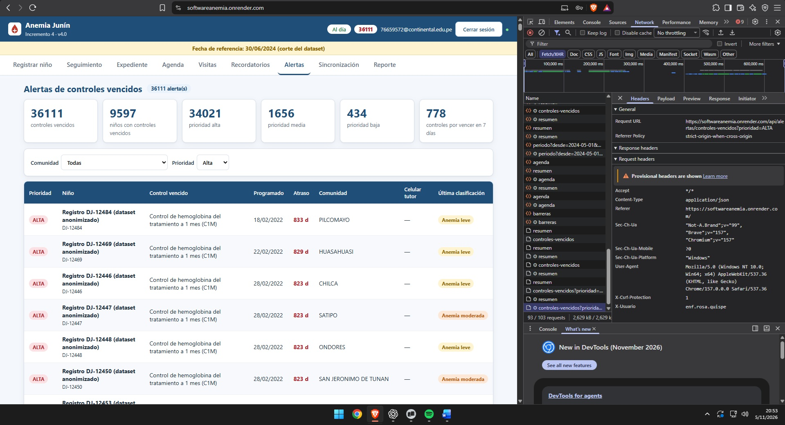

- **Archivos de imagen:** `entregables/semana-12/evidencias/produccion/ROD_01_inc1_registro_clasificacion2.jpg`, `entregables/semana-10/evidencias/software/RF06_inc2_1_agenda_expediente_escritorio.png`, `entregables/semana-12/evidencias/produccion/PROD_02_inc2_alertas.jpg`

**[ CAPTURA 2: EJECUCIÓN DE LA MEDICIÓN ]**

- **Descripción:** **Figura 35.** Resultado de `m32_valor.py`, corrida de la adenda S9 del 30/10/2026 sobre `v4.0-Inc4`. Muestra V1 (1 escritura; 4 vistas que reflejan el registro), V2 (140/140) y V3 (matriz de confusión con F1 = 1,0 y 476/476 controles).

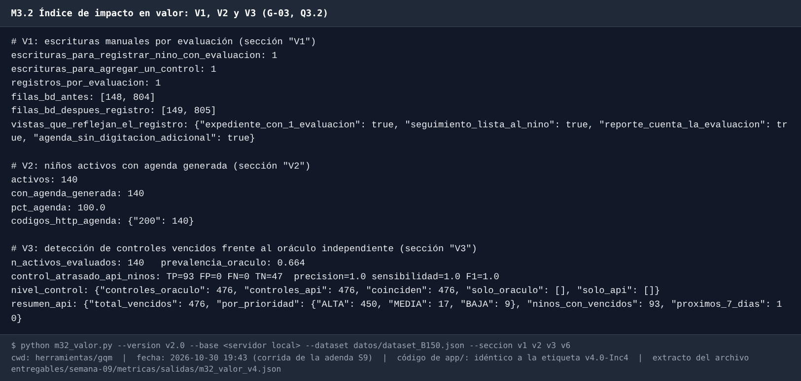

- **Archivo de imagen:** `entregables/semana-12/correcciones/img/G05_m32_valor.png`

**EVALUACIÓN: CUMPLE | FECHA: 06/11/2026 | EVALUADOR: QA Lead (Huamani R.)**

---

**FICHA DE EVALUACIÓN GQM Y EVIDENCIA VISUAL POR MÉTRICA (V4 Y V5)**

- **META:** G-03 (indicadores complementarios de valor).
- **MÉTRICAS:** V4 p95 agregado con 50 usuarios simultáneos; V5 disponibilidad durante la carga = sondas disponibles ÷ sondas × 100.
- **DATOS Y CÁLCULO:**
  - V4: 1 960 solicitudes, 0 fallos, p95 = **1 100 ms** (una corrida).
  - V5: 64 ÷ 64 × 100 = **100 %**.
- **META:** V4 < 800 ms; V5 ≥ 99,5 %.

**[ CAPTURA 1: EVIDENCIA EN EL DOMINIO ]**

- **Descripción:** **Figura 36.** Carga con Locust sobre las pantallas de los incrementos 3 y 4 (20 usuarios). La curva p95 queda por debajo del umbral de 800 ms con 20 usuarios. Con 50 usuarios lo supera (Figura 33).

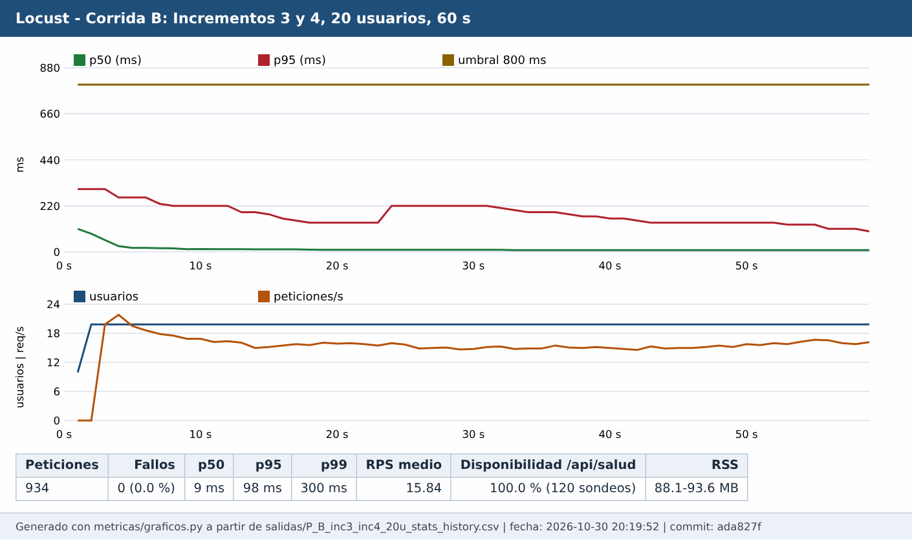

- **Descripción:** **Figura 37.** Producción: `GET /api/salud` responde «ok» y `/openapi.json` declara la versión 4.0.0-inc4.

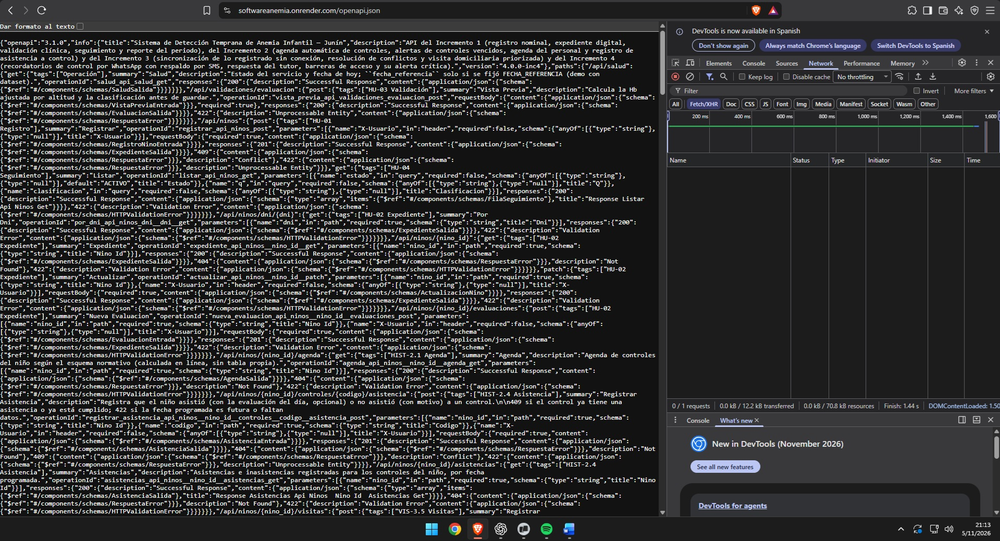

- **Archivos de imagen:** `entregables/semana-10/evidencias/rendimiento/P_locust_B_inc3_inc4_20u.png`, `entregables/semana-12/evidencias/produccion/PROD_06_salud_openapi.jpg`

**[ CAPTURA 2: EJECUCIÓN DE LA MEDICIÓN ]**

- **Descripción:** **Figura 38.** Corrida de carga de la adenda v4 (50 usuarios, 60 s): p95 por endpoint y agregado de 1 100 ms.

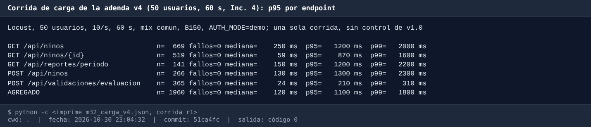

- **Descripción:** **Figura 39.** Sonda de disponibilidad `GET /api/salud` cada segundo durante la carga: 64 de 64 respuestas, 100 %.

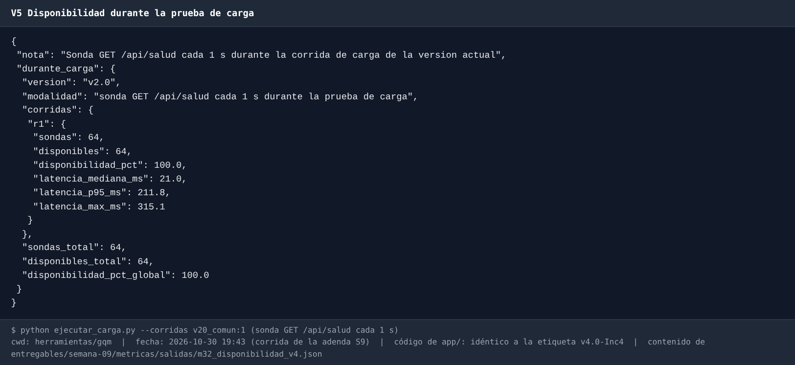

- **Archivos de imagen:** `entregables/semana-11/evidencias/CMMI05_carga_p95_v4.png`, `entregables/semana-12/correcciones/img/G06_v5_disponibilidad.png`

**EVALUACIÓN: V4 NO CUMPLE (1 100 ms > 800 ms; acción 16 del plan de mejora) · V5 CUMPLE | FECHA: 06/11/2026 | EVALUADOR: QA Lead (Huamani R.)**

##### Estrategia de pruebas

**Tabla 27.** Pruebas automáticas del repositorio en `v4.0-Inc4`, re-ejecutadas el 30/10/2026 (adenda S9, sección 4; S10, Tabla 8).

| Conjunto | Cantidad | Resultado | Comando (desde `pmv_fastapi/`) |
| --- | :---: | --- | --- |
| Unitarias | 416 | Aprobadas | `python -m pytest --cov=app` |
| Integración (el CI las ejecuta además contra PostgreSQL 16) | 219 | Aprobadas | idem |
| Arquitectura (regla de dependencia) | 25 | Aprobadas | idem |
| **Subtotal** | **660** | **0 fallas; cobertura 99,79 %** (umbral del proyecto: 80 %) | |
| E2E con Playwright (navegador real) | 28 | Aprobadas, 0 fallas | `python -m pytest tests/e2e -m e2e` |

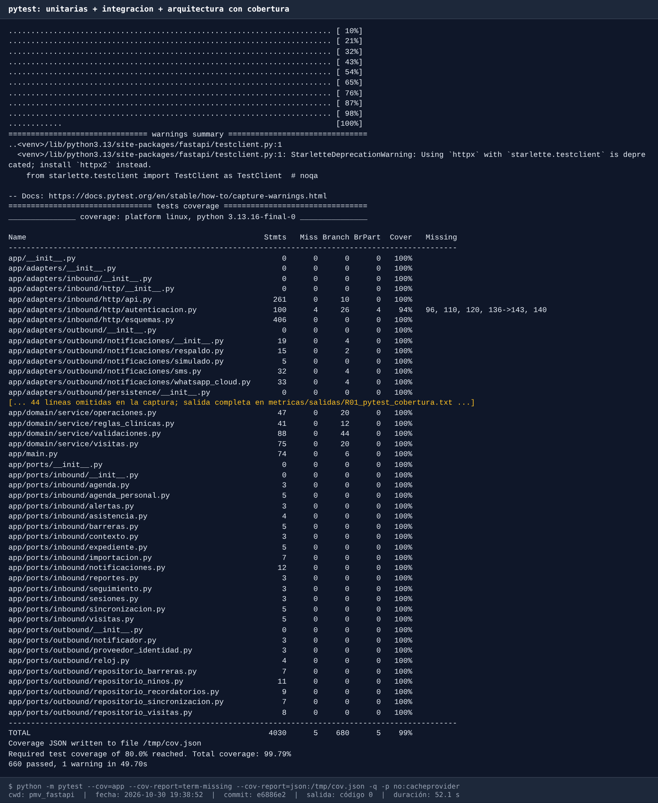

**Figura 40.** pytest con cobertura: 660 pruebas aprobadas y 99,79 % de cobertura (S10, 30/10/2026).

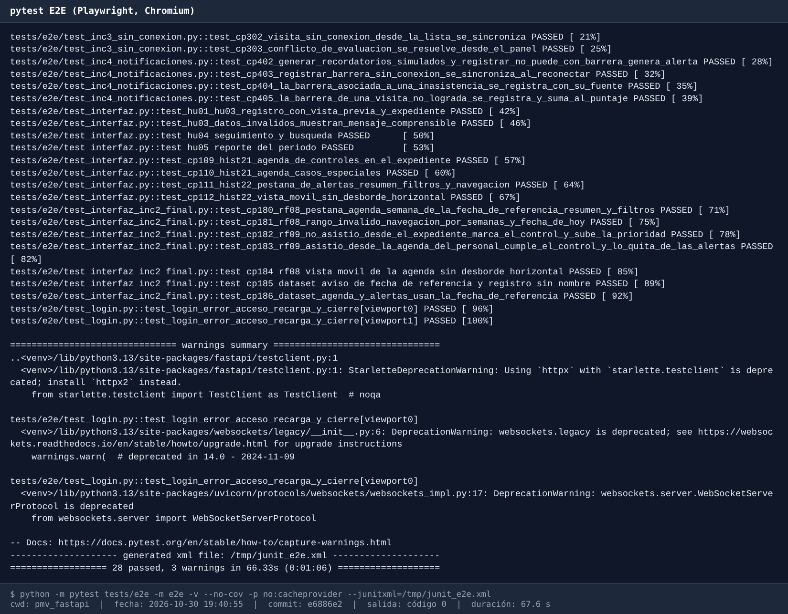

**Figura 41.** 28 pruebas E2E con Playwright aprobadas.

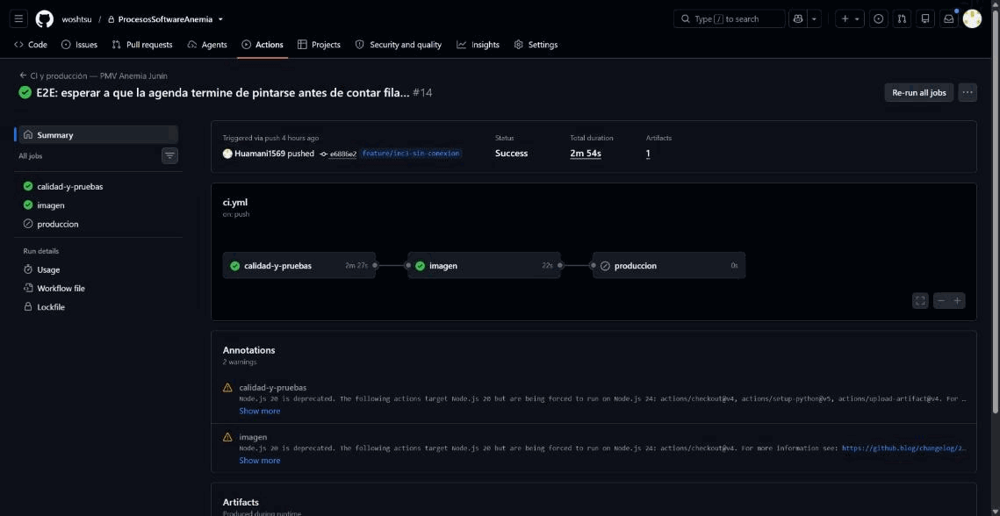

**Figura 42.** Ejecución #14 del CI en la rama de los incrementos 3 y 4: `calidad-y-pruebas` (2 min 27 s) e `imagen` (22 s) en verde; `produccion` se omite fuera de `main`.

**Despliegue en producción.** El trabajo `produccion` publica `main` en Render con Supabase. El 31/10/2026 se verificó la URL pública (<https://softwareanemia.onrender.com>): `GET /api/salud` respondió `{"estado":"ok","fecha_hoy":"2024-06-30","fecha_referencia":"2024-06-30"}` y `GET /openapi.json` declara la versión `4.0.0-inc4` con 29 rutas, igual que el contrato de `v4.0-Inc4`. La aplicación desplegada usa un reloj fijo al corte del dataset (30/06/2024): sus agendas y vencimientos se calculan a esa fecha y no a la real. El 09/11/2026 el servicio se recreó en la región Virginia (<https://softwareanemia-virginia.onrender.com>), junto a la base de Supabase; el 12/11/2026 respondió con la misma versión y las mismas 29 rutas. Las capturas tomadas en producción están en las fichas GQM (apartado 3.6.1) y en la ficha VAL de la sección 3.8.

La cobertura alta no garantizó ausencia de defectos: seis de los siete defectos del Incremento 1 y cinco de los incrementos 3 y 4 escaparon a las pruebas, porque estas verificaban casos válidos y no entradas hostiles ni concurrencia. La revisión independiente (commit `d2ab78b`) corrigió cinco defectos: el webhook de WhatsApp aceptaba cuerpos sin firma si faltaba el secreto (alta), el reenvío simultáneo de una operación duplicaba una evaluación (media), dos generaciones simultáneas de recordatorios enviaban el mensaje dos veces (media) y dos defectos de interfaz (baja; la adenda S9 los cuenta como uno). Cada corrección tiene prueba de regresión salvo los dos de interfaz.


##### Fichas de prueba funcional con evidencia fotográfica

Cada ficha sigue el formato de la «Ficha Modelo de Prueba Funcional con Evidencia Fotográfica» de la plantilla: encabezado, proyecto, incremento, requerimiento, caso de prueba, dato de entrada, resultado esperado, dos capturas (datos de entrada cargados y confirmación o resultado) y evaluación. Hay 20 fichas: los 19 escenarios de aceptación de los cuatro incrementos y la autenticación. Las capturas son del software en ejecución sobre `v4.0-Inc4` (Playwright con Chromium; escritorio 1366x768; datos sintéticos, `AUTH_MODE=demo`, 30/10/2026), producidas por `entregables/semana-10/metricas/capturar_software.py`; cada escenario incluye aserciones y, si una falla, queda «Rechazado». Excepciones: la captura 1 de RF-05 y de RF-06 y la captura 2 de RF-05 son de S9 sobre `v1.0-PMV` y sobre el hito `v1.5.0-inc2-avance` (el pie de la imagen indica versión y fecha). Los identificadores `CP-RF0X-01` son los de S9; los demás siguen la misma convención. Las vistas móviles (390x844) están en `../semana-10/evidencias/software/`. El evaluador es el QA Lead; la firma manuscrita está pendiente. Cada incremento cierra con el marcador de su captura en producción (<https://softwareanemia.onrender.com>); la aplicación desplegada usa un reloj fijo al 30/06/2024, por lo que sus fechas difieren de las de las capturas locales.

**Tabla 28.** Resumen de las fichas por incremento (S10, Tabla 7).

| Incremento | Fichas | Aprobadas | Capturas (S10, incluye móvil) |
| --- | --- | :---: | :---: |
| Inc. 1 (`v1.0-PMV`) | RF-01 a RF-05 | 5/5 | 15 |
| Inc. 2 (`v2.0-Inc2`) | RF-06 a RF-09 | 4/4 | 13 |
| Inc. 3 (`v3.0-Inc3`) | HIST-3.1, HIST-3.1b, HIST-3.2, HIST-3.3, HIST-3.4, VIS-3.5 | 6/6 | 13 |
| Inc. 4 (`v4.0-Inc4`) | HIST-4.1 a HIST-4.4 | 4/4 | 13 |
| **Total** | **19 escenarios** (más la ficha AUTH) | **19/19** | **54** |

---

**FICHA DE PRUEBA FUNCIONAL Y EVIDENCIA VISUAL POR REQUERIMIENTO (RF-01)**

- **PROYECTO:** Anemia Junín - Sistema Inteligente para Detección Temprana de Anemia Infantil en Zonas Rurales de Junín
- **INCREMENTO EVALUADO:** Incremento 1 (PMV), etiqueta `v1.0-PMV`
- **REQUERIMIENTO:** RF-01 / HU-01 - Registro del niño con evaluación inicial (`POST /api/ninos`)
- **CASO DE PRUEBA:** CP-RF01-01 (Prueba Funcional de UI / Aceptación; automatizada en `tests/integracion/test_api.py` y `tests/unitarias/test_casos_uso.py`)
- **DATO DE ENTRADA:** { dni: "72000001", sexo: "F", fecha_nacimiento: "09/10/2025", altitud_m: 3720, hemoglobina_observada: 11.6, peso_kg: 8.4, talla_cm: 71 } (datos sintéticos); segundo envío con el mismo DNI
- **RESULTADO ESPERADO:** Registro persistido, confirmación visible y expediente abierto en menos de 2 s; el DNI repetido se rechaza con HTTP 409.

**EVIDENCIAS FOTOGRÁFICAS (CAPTURAS DE PANTALLA EN EJECUCIÓN):**

**[ CAPTURA 1: DATOS DE ENTRADA CARGADOS ]**

- **Descripción:** **Figura 43.** RF-01, captura 1. Formulario de registro con los datos sintéticos cargados antes de «Guardar registro»; la vista previa ya muestra Hb ajustada 9,1 g/dL y «Anemia moderada».


- **Archivo de Imagen:** `../semana-10/evidencias/software/RF01_inc1_1_entrada_escritorio.png`

**[ CAPTURA 2: CONFIRMACIÓN / RESULTADO ]**

- **Descripción:** **Figura 44.** RF-01, captura 2. Confirmación y expediente creado tras «Guardar registro» (130 ms); el DNI repetido respondió HTTP 409.

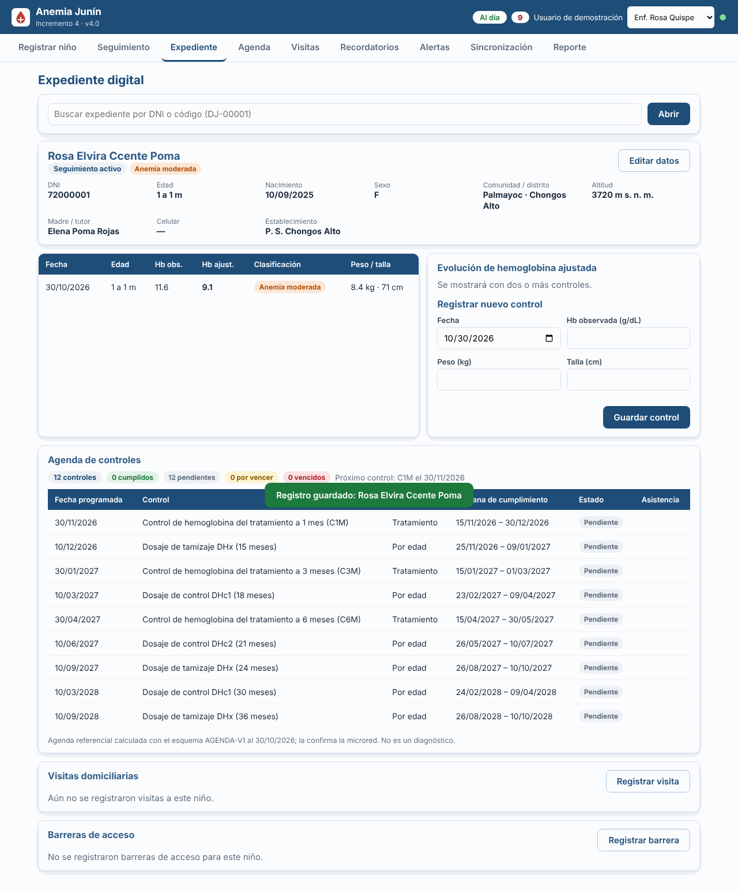

- **Archivo de Imagen:** `../semana-10/evidencias/software/RF01_inc1_2_resultado_escritorio.png`

**EVALUACIÓN: APROBADO | FECHA: 30/10/2026 | EVALUADOR: QA Lead (Huamani R.)**

---

**FICHA DE PRUEBA FUNCIONAL Y EVIDENCIA VISUAL POR REQUERIMIENTO (RF-02)**

- **PROYECTO:** Anemia Junín - Sistema Inteligente para Detección Temprana de Anemia Infantil en Zonas Rurales de Junín
- **INCREMENTO EVALUADO:** Incremento 1 (PMV), etiqueta `v1.0-PMV`
- **REQUERIMIENTO:** RF-02 / HU-02 - Consulta y actualización del expediente; nuevo control (`GET /api/ninos/dni/{dni}`, `PATCH /api/ninos/{id}`, `POST /api/ninos/{id}/evaluaciones`)
- **CASO DE PRUEBA:** CP-RF02-01 (Prueba Funcional de UI / Aceptación; automatizada en `tests/integracion/test_api.py` y `tests/unitarias/test_entidades.py`)
- **DATO DE ENTRADA:** { dni: "71000001", edición: { comunidad: "Llacuas", tutor_celular: "987654322" }, nuevo_control: { hemoglobina_observada: 11.5, peso_kg: 8.2, talla_cm: 69 } }
- **RESULTADO ESPERADO:** Expediente consultado, campos permitidos actualizados y nuevo control persistido: el historial pasa de 2 a 3 evaluaciones.

**EVIDENCIAS FOTOGRÁFICAS (CAPTURAS DE PANTALLA EN EJECUCIÓN):**

**[ CAPTURA 1: DATOS DE ENTRADA CARGADOS ]**

- **Descripción:** **Figura 45.** RF-02, captura 1. Expediente del DNI 71000001 recién consultado, con su historial de 2 evaluaciones y el formulario de nuevo control.

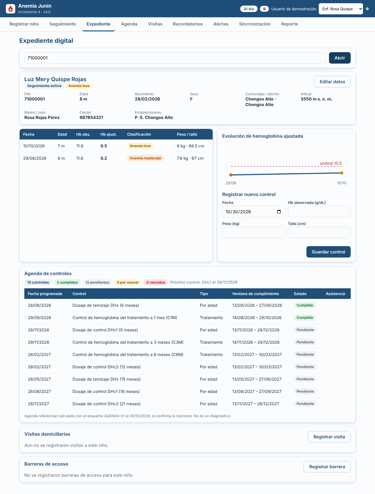

- **Archivo de Imagen:** `../semana-10/evidencias/software/RF02_inc1_1_expediente_escritorio.png`

**[ CAPTURA 2: CONFIRMACIÓN / RESULTADO ]**

- **Descripción:** **Figura 46.** RF-02, captura 2. Nuevo control agregado: el historial pasa de 2 a 3 evaluaciones (la edición de datos se registró en `RF02_inc1_2_edicion_escritorio.png`).

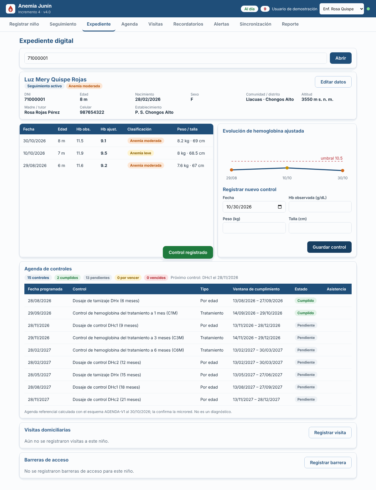

- **Archivo de Imagen:** `../semana-10/evidencias/software/RF02_inc1_3_nuevo_control_escritorio.png`

**EVALUACIÓN: APROBADO | FECHA: 30/10/2026 | EVALUADOR: QA Lead (Huamani R.)**

---

**FICHA DE PRUEBA FUNCIONAL Y EVIDENCIA VISUAL POR REQUERIMIENTO (RF-03)**

- **PROYECTO:** Anemia Junín - Sistema Inteligente para Detección Temprana de Anemia Infantil en Zonas Rurales de Junín
- **INCREMENTO EVALUADO:** Incremento 1 (PMV), etiqueta `v1.0-PMV`
- **REQUERIMIENTO:** RF-03 / HU-03 - Validación con reglas clínicas (`POST /api/validaciones/evaluacion`)
- **CASO DE PRUEBA:** CP-RF03-01 (Prueba Funcional de UI / Aceptación; automatizada en `tests/unitarias/test_reglas_clinicas.py`)
- **DATO DE ENTRADA:** Válido: { hemoglobina_observada: 11.6, altitud_m: 3720 }. Inválido: { dni: "123", hemoglobina_observada: 25 }
- **RESULTADO ESPERADO:** Con datos válidos, vista previa con Hb ajustada por altitud y clasificación; con datos inválidos, rechazo por campo (HTTP 422) sin guardar nada.

**EVIDENCIAS FOTOGRÁFICAS (CAPTURAS DE PANTALLA EN EJECUCIÓN):**

**[ CAPTURA 1: DATOS DE ENTRADA CARGADOS ]**

- **Descripción:** **Figura 47.** RF-03, captura 1. Formulario con Hb 11,6 g/dL a 3 720 m: la vista previa muestra Hb ajustada 9,1 g/dL y «Anemia moderada».

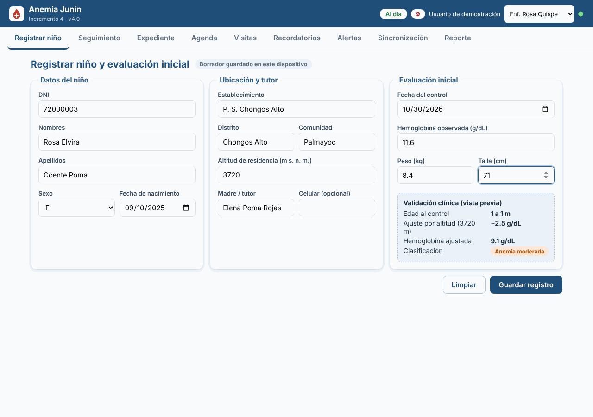

- **Archivo de Imagen:** `../semana-10/evidencias/software/RF03_inc1_1_vista_previa_escritorio.png`

**[ CAPTURA 2: CONFIRMACIÓN / RESULTADO ]**

- **Descripción:** **Figura 48.** RF-03, captura 2. Datos inválidos (DNI «123», Hb 25 g/dL) rechazados con mensajes por campo (HTTP 422); no se guardó nada.

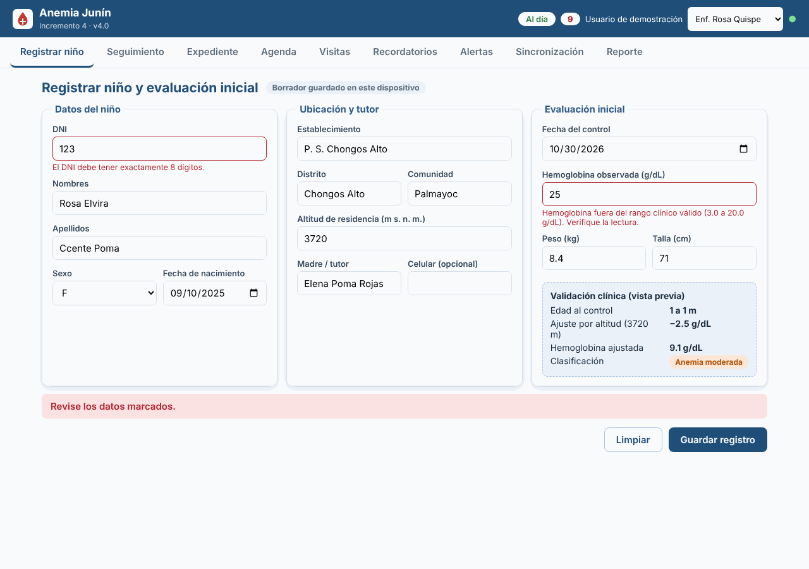

- **Archivo de Imagen:** `../semana-10/evidencias/software/RF03_inc1_2_rechazo_escritorio.png`

**EVALUACIÓN: APROBADO | FECHA: 30/10/2026 | EVALUADOR: QA Lead (Huamani R.)**

---

**FICHA DE PRUEBA FUNCIONAL Y EVIDENCIA VISUAL POR REQUERIMIENTO (RF-04)**

- **PROYECTO:** Anemia Junín - Sistema Inteligente para Detección Temprana de Anemia Infantil en Zonas Rurales de Junín
- **INCREMENTO EVALUADO:** Incremento 1 (PMV), etiqueta `v1.0-PMV`
- **REQUERIMIENTO:** RF-04 / HU-04 - Listado de niños en seguimiento (`GET /api/ninos`)
- **CASO DE PRUEBA:** CP-RF04-01 (Prueba Funcional de UI / Aceptación; automatizada en `tests/integracion/test_api.py` y `tests/e2e/test_interfaz.py`)
- **DATO DE ENTRADA:** Base sintética de 27 niños; filtro de clasificación «Moderada»
- **RESULTADO ESPERADO:** Listado de seguimiento que respeta el filtro por clasificación.

**EVIDENCIAS FOTOGRÁFICAS (CAPTURAS DE PANTALLA EN EJECUCIÓN):**

**[ CAPTURA 1: DATOS DE ENTRADA CARGADOS ]**

- **Descripción:** **Figura 49.** RF-04, captura 1. Pestaña «Seguimiento» con el listado completo de niños, sin filtro.

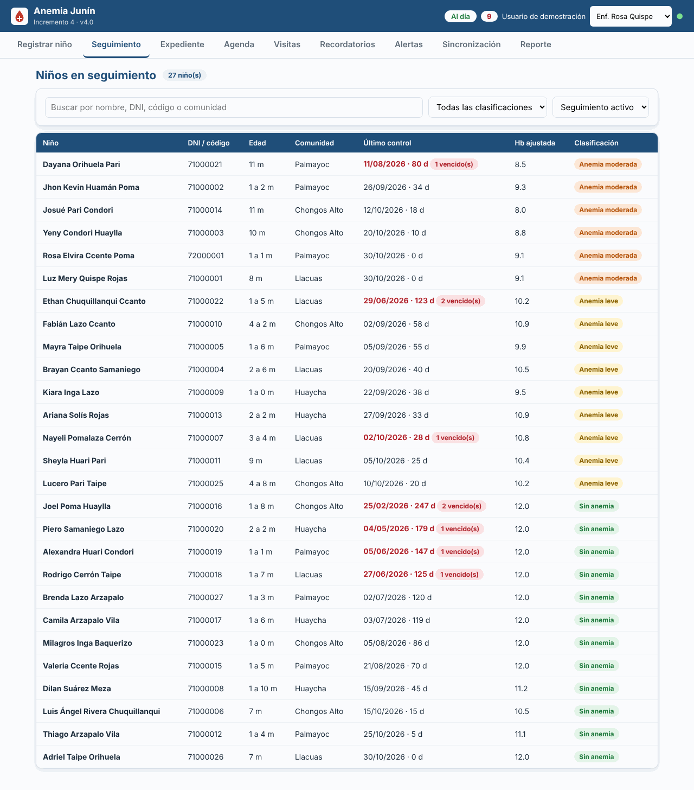

- **Archivo de Imagen:** `../semana-10/evidencias/software/RF04_inc1_1_seguimiento_escritorio.png`

**[ CAPTURA 2: CONFIRMACIÓN / RESULTADO ]**

- **Descripción:** **Figura 50.** RF-04, captura 2. Filtro por clasificación «Moderada» aplicado: 6 niños de 27.

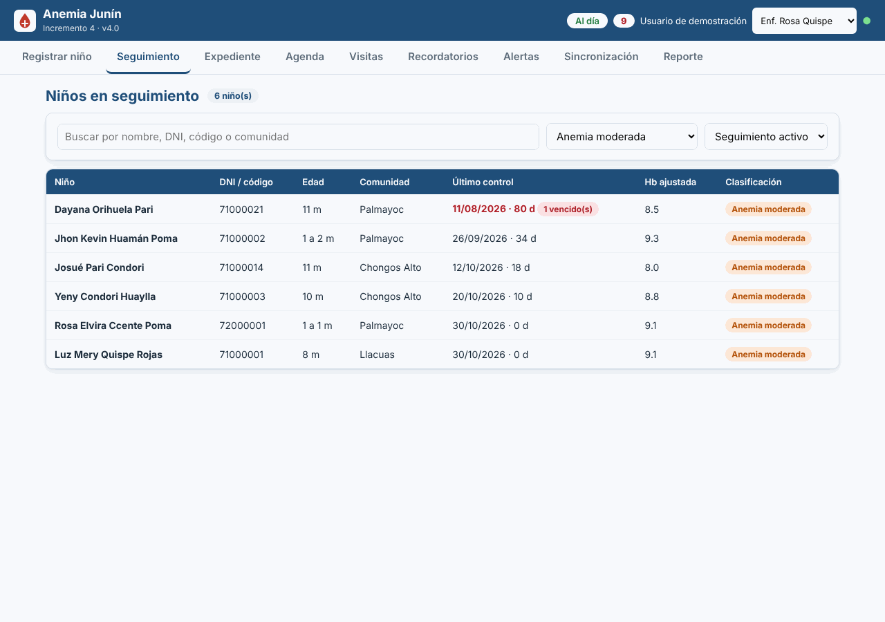

- **Archivo de Imagen:** `../semana-10/evidencias/software/RF04_inc1_2_filtro_moderada_escritorio.png`

**EVALUACIÓN: APROBADO | FECHA: 30/10/2026 | EVALUADOR: QA Lead (Huamani R.)**

---

**FICHA DE PRUEBA FUNCIONAL Y EVIDENCIA VISUAL POR REQUERIMIENTO (RF-05)**

- **PROYECTO:** Anemia Junín - Sistema Inteligente para Detección Temprana de Anemia Infantil en Zonas Rurales de Junín
- **INCREMENTO EVALUADO:** Incremento 1 (PMV), etiqueta `v1.0-PMV`
- **REQUERIMIENTO:** RF-05 / HU-05 - Reporte del periodo en JSON y CSV (`GET /api/reportes/periodo`)
- **CASO DE PRUEBA:** CP-RF05-01 (Prueba Funcional de UI / Aceptación; automatizada en `tests/integracion/test_api.py`)
- **DATO DE ENTRADA:** { desde: "01/09/2026", hasta: "16/10/2026" } sobre la base sintética (captura de S9 sobre `v1.0-PMV`)
- **RESULTADO ESPERADO:** Indicadores del periodo en pantalla y CSV descargable en menos de 2 s.

**EVIDENCIAS FOTOGRÁFICAS (CAPTURAS DE PANTALLA EN EJECUCIÓN):**

**[ CAPTURA 1: DATOS DE ENTRADA CARGADOS ]**

- **Descripción:** **Figura 51.** RF-05, captura 1. Pestaña «Reporte» con el periodo cargado antes de pulsar «Generar» (captura de S9, `v1.0-PMV`; el pie de la imagen indica versión y fecha).

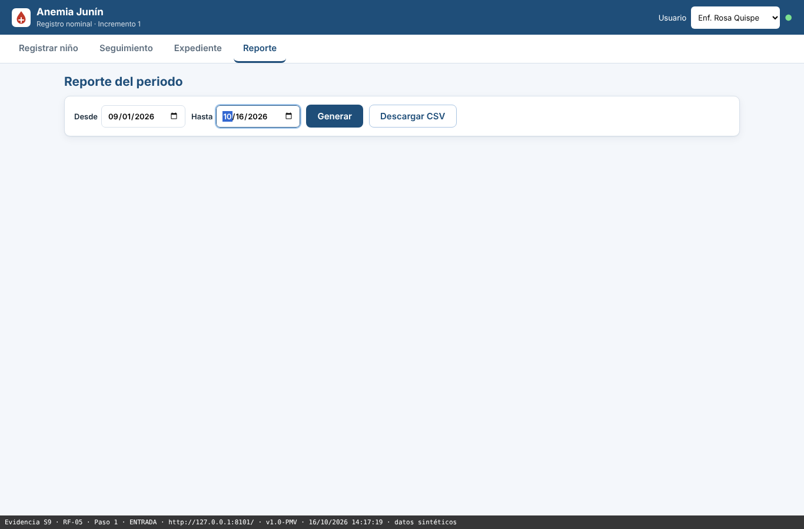

- **Archivo de Imagen:** `../semana-09/evidencias_capturas/RF-05/RF05_inc1_paso1_entrada.png`

**[ CAPTURA 2: CONFIRMACIÓN / RESULTADO ]**

- **Descripción:** **Figura 52.** RF-05, captura 2. Reporte generado: 15 niños registrados, 15 evaluaciones, 13 evaluados y 77 % con anemia. En `v4.0-Inc4` el mismo flujo dio 28 registrados y un CSV de 43 líneas en 86 ms (`RF05_inc1_1_reporte_escritorio.png`).


- **Archivo de Imagen:** `../semana-09/evidencias_capturas/RF-05/RF05_inc1_paso2_resultado.png`

**EVALUACIÓN: APROBADO | FECHA: 30/10/2026 | EVALUADOR: QA Lead (Huamani R.)**

**Captura en producción (PMV, Incremento 1):** el formulario «Registrar niño» con la vista previa de la clasificación en `softwareanemia.onrender.com` está en la Figura 18 y el «Reporte del periodo» en producción, en la Figura 27 (fichas GQM del apartado 3.3.1).

---

**FICHA DE PRUEBA FUNCIONAL Y EVIDENCIA VISUAL POR REQUERIMIENTO (RF-06)**

- **PROYECTO:** Anemia Junín - Sistema Inteligente para Detección Temprana de Anemia Infantil en Zonas Rurales de Junín
- **INCREMENTO EVALUADO:** Incremento 2, etiqueta `v2.0-Inc2`
- **REQUERIMIENTO:** RF-06 / HIST-2.1 - Agenda de controles según la normativa (`GET /api/ninos/{id}/agenda`)
- **CASO DE PRUEBA:** CP-RF06-01 (Prueba Funcional de UI / Aceptación; automatizada en `tests/unitarias/test_agenda.py`)
- **DATO DE ENTRADA:** { dni: "71000022" } (niño con anemia leve en tratamiento)
- **RESULTADO ESPERADO:** Agenda normativa en el expediente con estados cumplido, pendiente y vencido por control.

**EVIDENCIAS FOTOGRÁFICAS (CAPTURAS DE PANTALLA EN EJECUCIÓN):**

**[ CAPTURA 1: DATOS DE ENTRADA CARGADOS ]**

- **Descripción:** **Figura 53.** RF-06, captura 1. Búsqueda del DNI 71000022 en «Seguimiento»: 1 niño con 2 controles vencidos (captura de S9, hito `v1.5.0-inc2-avance`).


- **Archivo de Imagen:** `../semana-09/evidencias_capturas/RF-06/RF06_inc2_paso1_entrada.png`

**[ CAPTURA 2: CONFIRMACIÓN / RESULTADO ]**

- **Descripción:** **Figura 54.** RF-06, captura 2. Expediente con la agenda de 13 controles (2 cumplidos, 9 pendientes, 2 vencidos) en `v4.0-Inc4`.


- **Archivo de Imagen:** `../semana-10/evidencias/software/RF06_inc2_1_agenda_expediente_escritorio.png`

**EVALUACIÓN: APROBADO | FECHA: 30/10/2026 | EVALUADOR: QA Lead (Huamani R.)**

---

**FICHA DE PRUEBA FUNCIONAL Y EVIDENCIA VISUAL POR REQUERIMIENTO (RF-07)**

- **PROYECTO:** Anemia Junín - Sistema Inteligente para Detección Temprana de Anemia Infantil en Zonas Rurales de Junín
- **INCREMENTO EVALUADO:** Incremento 2, etiqueta `v2.0-Inc2`
- **REQUERIMIENTO:** RF-07 / HIST-2.2 - Controles vencidos y alertas priorizadas (`GET /api/alertas/controles-vencidos`)
- **CASO DE PRUEBA:** CP-RF07-01 (Prueba Funcional de UI / Aceptación; automatizada en `tests/unitarias/test_alertas.py` y `tests/integracion/test_api_inc2.py`)
- **DATO DE ENTRADA:** Base sintética con 9 controles vencidos; filtro de prioridad MEDIA
- **RESULTADO ESPERADO:** Controles vencidos ordenados por prioridad, con filtro por prioridad.

**EVIDENCIAS FOTOGRÁFICAS (CAPTURAS DE PANTALLA EN EJECUCIÓN):**

**[ CAPTURA 1: DATOS DE ENTRADA CARGADOS ]**

- **Descripción:** **Figura 55.** RF-07, captura 1. Pestaña «Alertas» con los 9 controles vencidos priorizados (7 ALTA, 1 MEDIA, 1 BAJA).


- **Archivo de Imagen:** `../semana-10/evidencias/software/RF07_inc2_1_alertas_escritorio.png`

**[ CAPTURA 2: CONFIRMACIÓN / RESULTADO ]**

- **Descripción:** **Figura 56.** RF-07, captura 2. Lista filtrada por prioridad MEDIA.


- **Archivo de Imagen:** `../semana-10/evidencias/software/RF07_inc2_2_filtro_media_escritorio.png`

**EVALUACIÓN: APROBADO | FECHA: 30/10/2026 | EVALUADOR: QA Lead (Huamani R.)**

---

**FICHA DE PRUEBA FUNCIONAL Y EVIDENCIA VISUAL POR REQUERIMIENTO (RF-08)**

- **PROYECTO:** Anemia Junín - Sistema Inteligente para Detección Temprana de Anemia Infantil en Zonas Rurales de Junín
- **INCREMENTO EVALUADO:** Incremento 2, etiqueta `v2.0-Inc2`
- **REQUERIMIENTO:** RF-08 / HIST-2.3 - Agenda del personal por rango de fechas (`GET /api/agenda`)
- **CASO DE PRUEBA:** CP-RF08-01 (Prueba Funcional de UI / Aceptación; automatizada en `tests/unitarias/test_agenda_personal.py` y `tests/e2e/test_interfaz_inc2_final.py`)
- **DATO DE ENTRADA:** Rangos de 7 y 30 días; rango mayor de 31 días para la validación
- **RESULTADO ESPERADO:** Controles agrupados por día para un rango de hasta 31 días; un rango mayor se rechaza.

**EVIDENCIAS FOTOGRÁFICAS (CAPTURAS DE PANTALLA EN EJECUCIÓN):**

**[ CAPTURA 1: DATOS DE ENTRADA CARGADOS ]**

- **Descripción:** **Figura 57.** RF-08, captura 1. Pestaña «Agenda» con el rango de la semana cargado.


- **Archivo de Imagen:** `../semana-10/evidencias/software/RF08_inc2_1_agenda_semana_escritorio.png`

**[ CAPTURA 2: CONFIRMACIÓN / RESULTADO ]**

- **Descripción:** **Figura 58.** RF-08, captura 2. Agenda de 30 días: 17 controles de 14 niños; el rango mayor de 31 días se rechaza (`RF08_inc2_3_rango_invalido_escritorio.png`).


- **Archivo de Imagen:** `../semana-10/evidencias/software/RF08_inc2_2_agenda_30_dias_escritorio.png`

**EVALUACIÓN: APROBADO | FECHA: 30/10/2026 | EVALUADOR: QA Lead (Huamani R.)**

---

**FICHA DE PRUEBA FUNCIONAL Y EVIDENCIA VISUAL POR REQUERIMIENTO (RF-09)**

- **PROYECTO:** Anemia Junín - Sistema Inteligente para Detección Temprana de Anemia Infantil en Zonas Rurales de Junín
- **INCREMENTO EVALUADO:** Incremento 2, etiqueta `v2.0-Inc2`
- **REQUERIMIENTO:** RF-09 / HIST-2.4 - Registro de asistencia a un control (`POST /api/ninos/{id}/controles/{codigo}/asistencia`)
- **CASO DE PRUEBA:** CP-RF09-01 (Prueba Funcional de UI / Aceptación; automatizada en `tests/unitarias/test_asistencia.py` y `tests/e2e/test_interfaz_inc2_final.py`)
- **DATO DE ENTRADA:** Control vencido de un niño sintético; «No asistió» con motivo
- **RESULTADO ESPERADO:** Marca de inasistencia registrada y prioridad de la alerta actualizada.

**EVIDENCIAS FOTOGRÁFICAS (CAPTURAS DE PANTALLA EN EJECUCIÓN):**

**[ CAPTURA 1: DATOS DE ENTRADA CARGADOS ]**

- **Descripción:** **Figura 59.** RF-09, captura 1. Modal «No asistió» con el motivo cargado antes de confirmar.


- **Archivo de Imagen:** `../semana-10/evidencias/software/RF09_inc2_1_modal_inasistencia_escritorio.png`

**[ CAPTURA 2: CONFIRMACIÓN / RESULTADO ]**

- **Descripción:** **Figura 60.** RF-09, captura 2. Inasistencia registrada y prioridad actualizada; los vencidos sin registro pasan de 9 a 8.


- **Archivo de Imagen:** `../semana-10/evidencias/software/RF09_inc2_2_inasistencia_registrada_escritorio.png`

**EVALUACIÓN: APROBADO | FECHA: 30/10/2026 | EVALUADOR: QA Lead (Huamani R.)**

**Captura en producción (Incremento 2):** la «Agenda del personal» y las «Alertas de controles vencidos» en producción, con el aviso de la fecha de referencia 30/06/2024, están en las Figuras 20 y 29 (fichas GQM del apartado 3.3.1).

---

**FICHA DE PRUEBA FUNCIONAL Y EVIDENCIA VISUAL POR REQUERIMIENTO (HIST-3.1)**

- **PROYECTO:** Anemia Junín - Sistema Inteligente para Detección Temprana de Anemia Infantil en Zonas Rurales de Junín
- **INCREMENTO EVALUADO:** Incremento 3, etiqueta `v3.0-Inc3`
- **REQUERIMIENTO:** HIST-3.1 - Registro sin conexión (cola en el dispositivo); cola IndexedDB (`cola.js`) y service worker (`sw.js`)
- **CASO DE PRUEBA:** CP-HIST31-01 (Prueba Funcional de UI / Aceptación; automatizada en `tests/e2e/test_inc3_sin_conexion.py`)
- **DATO DE ENTRADA:** Sin red: { dni: "72300001", hemoglobina_observada: 9.4 } y un nuevo control { hemoglobina_observada: 10.1, peso_kg: 8.6, talla_cm: 72 }
- **RESULTADO ESPERADO:** Las operaciones quedan en la cola local con indicador de pendientes y el servidor no las tiene.

**EVIDENCIAS FOTOGRÁFICAS (CAPTURAS DE PANTALLA EN EJECUCIÓN):**

**[ CAPTURA 1: DATOS DE ENTRADA CARGADOS ]**

- **Descripción:** **Figura 61.** HIST-3.1, captura 1. Aplicación en línea (indicador «Al día») antes de cortar la conexión; los datos se digitan ya sin red.


- **Archivo de Imagen:** `../semana-10/evidencias/software/HIST31_inc3_1_en_linea_escritorio.png`

**[ CAPTURA 2: CONFIRMACIÓN / RESULTADO ]**

- **Descripción:** **Figura 62.** HIST-3.1, captura 2. Sin conexión: 2 operaciones pendientes en el dispositivo; el servidor responde 404 para ese DNI.


- **Archivo de Imagen:** `../semana-10/evidencias/software/HIST31_inc3_2_pendientes_sin_conexion_escritorio.png`

**EVALUACIÓN: APROBADO | FECHA: 30/10/2026 | EVALUADOR: QA Lead (Huamani R.)**

---

**FICHA DE PRUEBA FUNCIONAL Y EVIDENCIA VISUAL POR REQUERIMIENTO (HIST-3.1b)**

- **PROYECTO:** Anemia Junín - Sistema Inteligente para Detección Temprana de Anemia Infantil en Zonas Rurales de Junín
- **INCREMENTO EVALUADO:** Incremento 3, etiqueta `v3.0-Inc3`
- **REQUERIMIENTO:** HIST-3.1b - Apertura sin conexión desde el caché; service worker (`sw.js`)
- **CASO DE PRUEBA:** CP-HIST31b-01 (Prueba Funcional de UI / Aceptación; automatizada en `tests/e2e/test_inc3_sin_conexion.py`)
- **DATO DE ENTRADA:** Servidor detenido y red cortada; recarga de la aplicación
- **RESULTADO ESPERADO:** La aplicación abre desde el caché con aviso y muestra las lecturas guardadas.

**EVIDENCIAS FOTOGRÁFICAS (CAPTURAS DE PANTALLA EN EJECUCIÓN):**

**[ CAPTURA 1: DATOS DE ENTRADA CARGADOS ]**

- **Descripción:** **Figura 63.** HIST-3.1b, captura 1. Estado previo: aplicación en línea con el servidor activo, antes de detenerlo.


- **Archivo de Imagen:** `../semana-10/evidencias/software/HIST31_inc3_1_en_linea_escritorio.png`

**[ CAPTURA 2: CONFIRMACIÓN / RESULTADO ]**

- **Descripción:** **Figura 64.** HIST-3.1b, captura 2. Recarga con el servidor detenido: la aplicación abre desde el caché con el aviso de «sin conexión» y 30 de 30 filas servidas desde el caché.


- **Archivo de Imagen:** `../semana-10/evidencias/software/HIST31_inc3_3_recarga_sin_conexion_escritorio.png`

**EVALUACIÓN: APROBADO | FECHA: 30/10/2026 | EVALUADOR: QA Lead (Huamani R.)**

**Prueba en un celular real (producción).** El mismo flujo se repitió en un celular con la red cortada: el registro quedó «Pendiente de sincronizar» y al volver la conexión pasó a «Al día» con «Sincronización: 1 aplicado(s)» (Figuras 24 y 25, ficha GQM de M3.1, brecha B6). Falta la prueba con red intermitente en una posta.

---

**FICHA DE PRUEBA FUNCIONAL Y EVIDENCIA VISUAL POR REQUERIMIENTO (HIST-3.2)**

- **PROYECTO:** Anemia Junín - Sistema Inteligente para Detección Temprana de Anemia Infantil en Zonas Rurales de Junín
- **INCREMENTO EVALUADO:** Incremento 3, etiqueta `v3.0-Inc3`
- **REQUERIMIENTO:** HIST-3.2 - Sincronización idempotente al reconectar (`POST /api/sincronizacion`)
- **CASO DE PRUEBA:** CP-HIST32-01 (Prueba Funcional de UI / Aceptación; automatizada en `tests/unitarias/test_sincronizacion.py` y `tests/integracion/test_api_inc3.py`)
- **DATO DE ENTRADA:** Operaciones pendientes de HIST-3.1; reenvío de la misma operación (mismo identificador)
- **RESULTADO ESPERADO:** Cada operación se aplica una sola vez; el reenvío figura como DUPLICADA y no duplica datos.

**EVIDENCIAS FOTOGRÁFICAS (CAPTURAS DE PANTALLA EN EJECUCIÓN):**

**[ CAPTURA 1: DATOS DE ENTRADA CARGADOS ]**

- **Descripción:** **Figura 65.** HIST-3.2, captura 1. Pestaña «Sincronización» con las operaciones pendientes, antes de volver la red.


- **Archivo de Imagen:** `../semana-10/evidencias/software/HIST32_inc3_1_panel_antes_de_sincronizar_escritorio.png`

**[ CAPTURA 2: CONFIRMACIÓN / RESULTADO ]**

- **Descripción:** **Figura 66.** HIST-3.2, captura 2. Red restablecida: operaciones aplicadas, indicador «Al día»; el reenvío se marca DUPLICADA y no duplica datos.


- **Archivo de Imagen:** `../semana-10/evidencias/software/HIST32_inc3_2_sincronizado_escritorio.png`

**EVALUACIÓN: APROBADO | FECHA: 30/10/2026 | EVALUADOR: QA Lead (Huamani R.)**

---

**FICHA DE PRUEBA FUNCIONAL Y EVIDENCIA VISUAL POR REQUERIMIENTO (HIST-3.3)**

- **PROYECTO:** Anemia Junín - Sistema Inteligente para Detección Temprana de Anemia Infantil en Zonas Rurales de Junín
- **INCREMENTO EVALUADO:** Incremento 3, etiqueta `v3.0-Inc3`
- **REQUERIMIENTO:** HIST-3.3 - Resolución de conflictos sin sobrescribir a ciegas (`GET /api/sincronizacion/conflictos`, `POST /api/sincronizacion/conflictos/{id}/resolver`)
- **CASO DE PRUEBA:** CP-HIST33-01 (Prueba Funcional de UI / Aceptación; automatizada en `tests/unitarias/test_conflictos.py` y `tests/integracion/test_api_inc3.py`)
- **DATO DE ENTRADA:** { dni: "72300003" } con un dato distinto en el servidor; control registrado sin conexión; decisión «Conservar servidor»
- **RESULTADO ESPERADO:** Queda un conflicto pendiente y el personal decide; no se sobrescribe a ciegas.

**EVIDENCIAS FOTOGRÁFICAS (CAPTURAS DE PANTALLA EN EJECUCIÓN):**

**[ CAPTURA 1: DATOS DE ENTRADA CARGADOS ]**

- **Descripción:** **Figura 67.** HIST-3.3, captura 1. Conflicto pendiente en «Sincronización»: el servidor tiene un dato distinto al del dispositivo.


- **Archivo de Imagen:** `../semana-10/evidencias/software/HIST33_inc3_1_conflicto_escritorio.png`

**[ CAPTURA 2: CONFIRMACIÓN / RESULTADO ]**

- **Descripción:** **Figura 68.** HIST-3.3, captura 2. Conflicto resuelto conservando el dato del servidor; aparece «sin conflictos».


- **Archivo de Imagen:** `../semana-10/evidencias/software/HIST33_inc3_2_conflicto_resuelto_escritorio.png`

**EVALUACIÓN: APROBADO | FECHA: 30/10/2026 | EVALUADOR: QA Lead (Huamani R.)**

---

**FICHA DE PRUEBA FUNCIONAL Y EVIDENCIA VISUAL POR REQUERIMIENTO (HIST-3.4)**

- **PROYECTO:** Anemia Junín - Sistema Inteligente para Detección Temprana de Anemia Infantil en Zonas Rurales de Junín
- **INCREMENTO EVALUADO:** Incremento 3, etiqueta `v3.0-Inc3`
- **REQUERIMIENTO:** HIST-3.4 - Ver lo pendiente y desde cuándo; pestaña «Sincronización»
- **CASO DE PRUEBA:** CP-HIST34-01 (Prueba Funcional de UI / Aceptación; automatizada en `tests/e2e/test_inc3_sin_conexion.py`)
- **DATO DE ENTRADA:** { dni: "72300004" } registrado sin conexión
- **RESULTADO ESPERADO:** Contador de pendientes y antigüedad visibles en la cabecera y en la pestaña «Sincronización».

**EVIDENCIAS FOTOGRÁFICAS (CAPTURAS DE PANTALLA EN EJECUCIÓN):**

**[ CAPTURA 1: DATOS DE ENTRADA CARGADOS ]**

- **Descripción:** **Figura 69.** HIST-3.4, captura 1. Panel con «1 pendiente(s)» y desde cuándo, con el dispositivo sin conexión.


- **Archivo de Imagen:** `../semana-10/evidencias/software/HIST34_inc3_1_panel_pendientes_escritorio.png`

**[ CAPTURA 2: CONFIRMACIÓN / RESULTADO ]**

- **Descripción:** **Figura 70.** HIST-3.4, captura 2. Tras reconectar y sincronizar, el panel queda «al día» sin pendientes.


- **Archivo de Imagen:** `../semana-10/evidencias/software/HIST34_inc3_2_panel_al_dia_escritorio.png`

**EVALUACIÓN: APROBADO | FECHA: 30/10/2026 | EVALUADOR: QA Lead (Huamani R.)**

---

**FICHA DE PRUEBA FUNCIONAL Y EVIDENCIA VISUAL POR REQUERIMIENTO (VIS-3.5)**

- **PROYECTO:** Anemia Junín - Sistema Inteligente para Detección Temprana de Anemia Infantil en Zonas Rurales de Junín
- **INCREMENTO EVALUADO:** Incremento 3, etiqueta `v3.0-Inc3`
- **REQUERIMIENTO:** VIS-3.5 - Visita domiciliaria priorizada (`GET /api/visitas/priorizadas`)
- **CASO DE PRUEBA:** CP-VIS35-01 (Prueba Funcional de UI / Aceptación; automatizada en `tests/unitarias/test_visitas.py` y `tests/integracion/test_api_inc3.py`)
- **DATO DE ENTRADA:** Base sintética con niños en tratamiento; visita registrada con { resultado: "REALIZADA", suplemento: "SI", observaciones: "Familia receptiva" }
- **RESULTADO ESPERADO:** Lista ordenada por puntaje explicable con desglose por componente; la visita se puede registrar.

**EVIDENCIAS FOTOGRÁFICAS (CAPTURAS DE PANTALLA EN EJECUCIÓN):**

**[ CAPTURA 1: DATOS DE ENTRADA CARGADOS ]**

- **Descripción:** **Figura 71.** VIS-3.5, captura 1. Pestaña «Visitas»: 18 filas ordenadas por puntaje de 49,5 a 25,0, con desglose por componente.


- **Archivo de Imagen:** `../semana-10/evidencias/software/VIS35_inc3_1_visitas_desglose_escritorio.png`

**[ CAPTURA 2: CONFIRMACIÓN / RESULTADO ]**

- **Descripción:** **Figura 72.** VIS-3.5, captura 2. Modal de registro de la visita con el resultado, el suplemento y las observaciones cargados; tras confirmar, el niño sale del primer lugar de la lista.


- **Archivo de Imagen:** `../semana-10/evidencias/software/VIS35_inc3_2_modal_visita_escritorio.png`

**EVALUACIÓN: APROBADO | FECHA: 30/10/2026 | EVALUADOR: QA Lead (Huamani R.)**

**Captura en producción (Incremento 3):** la sincronización en un celular real (de «Pendiente de sincronizar» a «Al día») y la lista de visitas priorizadas en producción están en las Figuras 24, 25 y 23 (fichas GQM del apartado 3.3.1).

---

**FICHA DE PRUEBA FUNCIONAL Y EVIDENCIA VISUAL POR REQUERIMIENTO (HIST-4.1)**

- **PROYECTO:** Anemia Junín - Sistema Inteligente para Detección Temprana de Anemia Infantil en Zonas Rurales de Junín
- **INCREMENTO EVALUADO:** Incremento 4, etiqueta `v4.0-Inc4`
- **REQUERIMIENTO:** HIST-4.1 - Recordatorio de control (SIMULADO) (`POST /api/recordatorios/generar`)
- **CASO DE PRUEBA:** CP-HIST41-01 (Prueba Funcional de UI / Aceptación; automatizada en `tests/unitarias/test_recordatorios.py` y `tests/integracion/test_api_inc4.py`)
- **DATO DE ENTRADA:** Base sintética con niños con control próximo o vencido; «Generar recordatorios de hoy» dos veces
- **RESULTADO ESPERADO:** Mensajes rotulados SIMULADO (sin envío real) y sin duplicados al repetir la generación.

**EVIDENCIAS FOTOGRÁFICAS (CAPTURAS DE PANTALLA EN EJECUCIÓN):**

**[ CAPTURA 1: DATOS DE ENTRADA CARGADOS ]**

- **Descripción:** **Figura 73.** HIST-4.1, captura 1. Pestaña «Recordatorios» antes de generar.


- **Archivo de Imagen:** `../semana-10/evidencias/software/HIST41_inc4_1_recordatorios_antes_escritorio.png`

**[ CAPTURA 2: CONFIRMACIÓN / RESULTADO ]**

- **Descripción:** **Figura 74.** HIST-4.1, captura 2. 24 recordatorios rotulados SIMULADO («no se envió»); repetir la generación no duplica.


- **Archivo de Imagen:** `../semana-10/evidencias/software/HIST41_inc4_2_recordatorios_simulados_escritorio.png`

**EVALUACIÓN: APROBADO | FECHA: 30/10/2026 | EVALUADOR: QA Lead (Huamani R.)**

**Pendiente:** el envío real por WhatsApp o SMS no se ha probado. Depende de que Meta apruebe la plantilla `recordatorio_control`; hasta entonces los recordatorios se registran como SIMULADO (ADR-014).

---

**FICHA DE PRUEBA FUNCIONAL Y EVIDENCIA VISUAL POR REQUERIMIENTO (HIST-4.2)**

- **PROYECTO:** Anemia Junín - Sistema Inteligente para Detección Temprana de Anemia Infantil en Zonas Rurales de Junín
- **INCREMENTO EVALUADO:** Incremento 4, etiqueta `v4.0-Inc4`
- **REQUERIMIENTO:** HIST-4.2 - Confirmación del tutor (personal y webhook firmado) (`POST /api/recordatorios/{id}/respuesta` y webhook de WhatsApp)
- **CASO DE PRUEBA:** CP-HIST42-01 (Prueba Funcional de UI / Aceptación; automatizada en `tests/unitarias/test_recordatorios.py` y `tests/e2e/test_inc4_notificaciones.py`)
- **DATO DE ENTRADA:** Respuesta 1, 2 o 3 registrada por el personal («No puede asistir» con barrera); webhook con firma válida, ausente e inválida
- **RESULTADO ESPERADO:** Respuesta registrada; el webhook sin firma válida responde 403.

**EVIDENCIAS FOTOGRÁFICAS (CAPTURAS DE PANTALLA EN EJECUCIÓN):**

**[ CAPTURA 1: DATOS DE ENTRADA CARGADOS ]**

- **Descripción:** **Figura 75.** HIST-4.2, captura 1. Modal «Registrar respuesta» del tutor (1 confirmo, 2 no puedo, 3 reprogramar) con la opción cargada.


- **Archivo de Imagen:** `../semana-10/evidencias/software/HIST42_inc4_1_modal_respuesta_escritorio.png`

**[ CAPTURA 2: CONFIRMACIÓN / RESULTADO ]**

- **Descripción:** **Figura 76.** HIST-4.2, captura 2. Respuesta «No puede asistir» registrada por el personal. El webhook sin firma o con firma inválida respondió 403 y con firma válida 200, pero en modo simulado el mensaje se ignora (sin canal real que asociar; `HIST42_inc4_3_tras_webhook_escritorio.png`).


- **Archivo de Imagen:** `../semana-10/evidencias/software/HIST42_inc4_2_respuesta_registrada_escritorio.png`

**EVALUACIÓN: APROBADO | FECHA: 30/10/2026 | EVALUADOR: QA Lead (Huamani R.)**

---

**FICHA DE PRUEBA FUNCIONAL Y EVIDENCIA VISUAL POR REQUERIMIENTO (HIST-4.3)**

- **PROYECTO:** Anemia Junín - Sistema Inteligente para Detección Temprana de Anemia Infantil en Zonas Rurales de Junín
- **INCREMENTO EVALUADO:** Incremento 4, etiqueta `v4.0-Inc4`
- **REQUERIMIENTO:** HIST-4.3 - Barreras de acceso al tratamiento (`POST/GET /api/ninos/{id}/barreras`)
- **CASO DE PRUEBA:** CP-HIST43-01 (Prueba Funcional de UI / Aceptación; automatizada en `tests/unitarias/test_barreras.py` y `tests/integracion/test_api_inc4.py`)
- **DATO DE ENTRADA:** Barrera «Falta de transporte» con detalle, registrada sin conexión
- **RESULTADO ESPERADO:** Barrera pendiente de sincronizar y, al volver la red, en el expediente.

**EVIDENCIAS FOTOGRÁFICAS (CAPTURAS DE PANTALLA EN EJECUCIÓN):**

**[ CAPTURA 1: DATOS DE ENTRADA CARGADOS ]**

- **Descripción:** **Figura 77.** HIST-4.3, captura 1. Modal «Registrar barrera» con el tipo y el detalle cargados.


- **Archivo de Imagen:** `../semana-10/evidencias/software/HIST43_inc4_1_modal_barrera_escritorio.png`

**[ CAPTURA 2: CONFIRMACIÓN / RESULTADO ]**

- **Descripción:** **Figura 78.** HIST-4.3, captura 2. Barrera sincronizada y visible en el expediente (antes de reconectar figuraba como pendiente: `HIST43_inc4_2_barrera_pendiente_sin_conexion_escritorio.png`).


- **Archivo de Imagen:** `../semana-10/evidencias/software/HIST43_inc4_3_barrera_sincronizada_escritorio.png`

**EVALUACIÓN: APROBADO | FECHA: 30/10/2026 | EVALUADOR: QA Lead (Huamani R.)**

---

**FICHA DE PRUEBA FUNCIONAL Y EVIDENCIA VISUAL POR REQUERIMIENTO (HIST-4.4)**

- **PROYECTO:** Anemia Junín - Sistema Inteligente para Detección Temprana de Anemia Infantil en Zonas Rurales de Junín
- **INCREMENTO EVALUADO:** Incremento 4, etiqueta `v4.0-Inc4`
- **REQUERIMIENTO:** HIST-4.4 - Alerta de barreras críticas y suma a la visita priorizada (`GET /api/alertas/barreras`)
- **CASO DE PRUEBA:** CP-HIST44-01 (Prueba Funcional de UI / Aceptación; automatizada en `tests/unitarias/test_barreras.py` y `tests/integracion/test_api_inc4.py`)
- **DATO DE ENTRADA:** Niño con barrera grave (rechazo del tratamiento o efectos adversos), o 2 o más barreras en 60 días
- **RESULTADO ESPERADO:** Alerta de prioridad ALTA y componente BARRERA_CRITICA en el puntaje de la visita.

**EVIDENCIAS FOTOGRÁFICAS (CAPTURAS DE PANTALLA EN EJECUCIÓN):**

**[ CAPTURA 1: DATOS DE ENTRADA CARGADOS ]**

- **Descripción:** **Figura 79.** HIST-4.4, captura 1. Pestaña «Alertas» con las alertas de barreras críticas.


- **Archivo de Imagen:** `../semana-10/evidencias/software/HIST44_inc4_1_alertas_barreras_criticas_escritorio.png`

**[ CAPTURA 2: CONFIRMACIÓN / RESULTADO ]**

- **Descripción:** **Figura 80.** HIST-4.4, captura 2. Visita priorizada con el componente BARRERA_CRITICA (40,0 puntos) y alerta ALTA.


- **Archivo de Imagen:** `../semana-10/evidencias/software/HIST44_inc4_2_visita_con_barrera_critica_escritorio.png`

**EVALUACIÓN: APROBADO | FECHA: 30/10/2026 | EVALUADOR: QA Lead (Huamani R.)**

**Captura en producción (Incremento 4):** pendiente. Los recordatorios en producción siguen en modo SIMULADO hasta que Meta apruebe la plantilla de WhatsApp; la evidencia del flujo es la de esta ficha, tomada sobre `v4.0-Inc4` en local.

---

**FICHA DE PRUEBA FUNCIONAL Y EVIDENCIA VISUAL POR REQUERIMIENTO (AUTH)**

- **PROYECTO:** Anemia Junín - Sistema Inteligente para Detección Temprana de Anemia Infantil en Zonas Rurales de Junín
- **INCREMENTO EVALUADO:** Autenticación con Supabase Auth (ADR-011), incorporada antes del Incremento 3 y vigente en `v4.0-Inc4`
- **REQUERIMIENTO:** AUTH - Inicio y cierre de sesión; sesión en cookies HttpOnly con protección CSRF
- **CASO DE PRUEBA:** CP-AUTH-01 (Prueba Funcional de UI / Aceptación; automatizada en `tests/integracion/test_autenticacion.py` y `tests/e2e/test_login.py`, con Supabase simulado)
- **DATO DE ENTRADA:** { correo: "enfermeria@example.test", contraseña: (valor ficticio de la prueba) }; credencial errónea; petición de la API sin sesión
- **RESULTADO ESPERADO:** Con una credencial válida, la sesión queda en cookies HttpOnly y se abre la aplicación; la API clínica rechaza (401) las peticiones sin sesión; cerrar la sesión la invalida; una credencial errónea muestra un mensaje de error.

**EVIDENCIAS FOTOGRÁFICAS (CAPTURAS DE PANTALLA EN EJECUCIÓN):**

**[ CAPTURA 1: DATOS DE ENTRADA CARGADOS ]**

- **Descripción:** **Figura 81.** AUTH, captura 1. Pantalla de acceso con el correo y la contraseña de prueba cargados antes de «Iniciar sesión» (axe: 0 violaciones).


- **Archivo de Imagen:** `../semana-10/evidencias/usabilidad/U_login_escritorio.png`

**[ CAPTURA 2: CONFIRMACIÓN / RESULTADO ]**

- **Descripción:** **Figura 82.** AUTH, captura 2. Acceso en móvil (390x844). No hay captura de la aplicación tras el ingreso: ese resultado se verificó por aserciones (aplicación visible, correo en la cabecera, sin token en `localStorage`, 27 de 27 operaciones no públicas con 401 sin sesión) y la prueba con una cuenta real de Supabase queda como captura en producción.


- **Archivo de Imagen:** `../semana-10/evidencias/usabilidad/U_login_movil.png`

**EVALUACIÓN: APROBADO | FECHA: 30/10/2026 | EVALUADOR: QA Lead (Huamani R.)**

*Nota de la evaluación:* Verificado con Supabase simulado (21 pruebas de integración y 2 E2E en escritorio y móvil); validación parcial: no consta una prueba con una cuenta real de Supabase..

**Captura en producción (autenticación):** la pantalla de inicio de sesión en `softwareanemia.onrender.com` está en la Figura 113 (ficha VAL de la sección 3.8).


---


#### 3.3.2 Auditoría FURPS+ (Psicología de Colores, WCAG 2.1 AA y OWASP Top 10 - 2025)


##### 3.3.2.1 Índice de calidad FURPS+

El índice pondera F 30 %, U 15 %, R 15 %, P 15 %, S 10 % y + 15 %. Se calculó con 30 de 35 criterios, medidos por scripts (`entregables/semana-10/metricas/`); cinco no se pudieron medir (lector de pantalla, staging, 500 usuarios, Docker en ejecución y política de contraseñas de Supabase). El índice primario excluye lo no medido y el conservador lo cuenta como 0 %.

**Tabla 29.** Índice FURPS+ por factor (S10, Tabla 5).

| Factor | Peso | Criterios medidos | % solo medidos | % conservador | Brecha principal |
| --- | :---: | :---: | :---: | :---: | --- |
| F Funcionalidad | 30 % | 3 de 3 | 100,0 % | 100,0 % | Ninguna; datos sintéticos, sin usuarios reales |
| U Usabilidad | 15 % | 7 de 8 | 82,7 % | 72,4 % | Contraste de componentes (3 de 8), etiquetas ARIA, foco en modales |
| R Confiabilidad | 15 % | 6 de 7 | 84,0 % | 72,0 % | La caída de la base de datos responde 500 en vez de 503 |
| P Rendimiento | 15 % | 4 de 5 | 85,0 % | 68,0 % | p95 de 2 000 ms con 100 usuarios |
| S Soportabilidad | 10 % | 6 de 6 | 99,0 % | 99,0 % | 23 de 669 bloques con complejidad mayor que 10 |
| + Seguridad y restricciones | 15 % | 4 de 6 | 66,8 % | 44,5 % | 41 de 61 comprobaciones OWASP; 1 hallazgo de severidad alta |
| **IC_P** | **100 %** | | **87,67 %** | **78,43 %** | Por debajo de «Excelente (≥ 90 %)» |


**Figura 83.** Salida de `furps_calculo.py` con el índice primario y el conservador (pie con comando, fecha y commit).

La diferencia de 9,24 puntos entre ambos índices cuantifica cuánto de la calidad declarada depende de mediciones que faltan.

##### 3.3.2.2 Factor U: Psicología de colores y accesibilidad WCAG 2.1 AA

Los criterios evaluados son los de las pautas WCAG 2.1, nivel AA [24].

**Tabla 30.** Paleta real de la interfaz (`pmv_fastapi/app/web/estilos.css`), significado en salud infantil y contraste medido (S10, Tabla 9).

| Rol | Hexadecimal | Significado | Contraste |
| --- | --- | --- | --- |
| Primario | `#1F4E79` (azul) | Confianza y calma clínica con datos de salud | 8,66:1 sobre blanco |
| Éxito, sin anemia | `#1F7A3D` (verde) | Control cumplido, estado seguro | 5,37:1 sobre blanco |
| Precaución, leve | `#8A6200` (ámbar) | Atención sin urgencia | 5,49:1 sobre blanco |
| Advertencia, moderada | `#B4530B` (naranja) | Riesgo creciente, pendiente de sincronizar | 5,02:1 sobre blanco; **4,23:1 sobre su fondo suave (no cumple 4,5:1)** |
| Alerta, severa | `#B0222B` (rojo) | Acción inmediata: control vencido, prioridad alta, conflicto | 6,75:1 sobre blanco |

De 54 pares texto y fondo medidos (23 combinaciones únicas), solo el naranja sobre su fondo suave incumple 1.4.3. El semáforo se codifica además con texto en las 482 insignias de estado evaluadas, de modo que el color no es el único canal (1.4.1).


**Figura 84.** Paleta real con muestras, hexadecimales, contraste y significado.


**Figura 85.** Semáforo de severidad bajo simulación de deuteranopía, protanopía y escala de grises: los tonos moderada y severa se acercan, por eso el texto de cada estado acompaña siempre al color.

**Tabla 31.** Criterios WCAG evaluados con axe-core 4.14.0, Playwright y cálculo propio (S10, Tabla 11).

| Criterio | Resultado medido | Estado |
| --- | --- | --- |
| 1.4.3 Contraste de texto (≥ 4,5:1) | 22 de 23 pares únicos cumplen (mínimo 4,23:1) | Parcial |
| 1.4.11 Contraste no textual (≥ 3:1) | 3 de 8 componentes: borde de campo 1,33:1, foco 1,84:1, barras «leve» 2,46:1 y «no aplica» 2,58:1 incumplen | No cumple |
| 1.4.1 Uso del color | 482 de 482 insignias con texto | Cumple |
| 1.4.10 Reflujo a 320 px | 13 de 13 pantallas sin desplazamiento horizontal | Cumple |
| 1.3.1 y 4.1.2 Estructura, nombre y rol | `nav role="tablist"` con botones sin `role="tab"` en 13 de 14 pantallas; selects y fechas sin etiqueta | No cumple |
| 2.1.1 Teclado | Tab recorre 29 elementos; el modal abre con Enter y cierra con Esc; 3 regiones con desplazamiento no alcanzables por teclado en móvil | Parcial |
| 2.4.3 y 2.4.7 Foco | Todos los elementos muestran foco, pero el modal no lo retiene (Tab escapa 10 de 14 veces) | Parcial |
| 2.5.8 Tamaño del objetivo (WCAG 2.2, 24 px) | 734 de 924 objetivos cumplen | Parcial |
| 4.1.2 Lectores de pantalla (NVDA, TalkBack) | **No medido**: no había lector en el entorno | No medido |

axe-core halló 22 reglas violadas (52 nodos) en escritorio y 36 (68 nodos) en móvil; solo la pantalla de inicio de sesión no tiene violaciones. Los hallazgos U-1 a U-8 de S10 (`role="tab"`, etiquetas de filtros, naranja `#B4530B` a `#A34A09`, bordes y foco, retención de foco del modal, regiones con desplazamiento, objetivos de 24 px y `role="status"` en avisos) están calculados pero **no aplicados** en el código (acción 18 del plan de mejora). El contraste de 7,1:1 y la compatibilidad total con lectores de pantalla que ejemplifica la plantilla no se afirman: el primario mide 8,66:1, pero la accesibilidad completa no se cumple.


**Figura 86.** Resumen de axe-core por pantalla y vista (14 pantallas, 4 modales y el inicio de sesión).


**Figura 87.** Foco visible al recorrer las pestañas con Tab.

##### 3.3.2.3 Factores R y P: Confiabilidad y rendimiento

Las mediciones son de una máquina virtual con un proceso uvicorn y datos sintéticos; sirven para detectar brechas, no como capacidad de producción.

**Tabla 32.** Confiabilidad y rendimiento medidos (S10, Tablas 14 y 15; adenda S9, nota 4).

| Atributo | Meta | Valor medido | Estado |
| --- | --- | --- | --- |
| Disponibilidad durante la carga | ≥ 99,5 % | 100 % (332 sondeos, 0 fallidos) | Cumple |
| MTTR tras `kill -9` | < 5 min | 0,85 s (reinicio manual) | Cumple |
| Reconexión a la base tras caer (`pool_pre_ping`) | Sin reiniciar la aplicación | Respondió 200 a los 0,2 s | Cumple |
| Respuesta durante la caída de la base | Controlada (503) | 25 de 26 peticiones respondieron 500 | **No cumple** |
| Lecturas sin servidor (service worker) | 100 % | 30 de 30 filas desde el caché | Cumple |
| p95 con 20 usuarios (Inc. 1 y 2; Inc. 3 y 4) | < 800 ms | 29 ms; 98 ms | Cumple |
| p95 con 100 usuarios (Inc. 1 y 2) | < 800 ms | 2 000 ms (p50 780 ms) | **No cumple** |
| p95 con 50 usuarios, `v4.0-Inc4` (adenda S9) | < 800 ms | 1 100 ms (una corrida, sin control) | **No cumple** |
| p95 con 500 usuarios | < 800 ms | No medido (máximo probado: 100) | No medido |
| LCP de la PWA en móvil lento | < 2 500 ms | 468 ms (84 ms con service worker) | Cumple |
| Disponibilidad en staging (Render) | ≥ 99,5 % | No medido en S10: no existía un entorno de staging | No medido |


**Figura 88.** Locust, 20 usuarios, 60 s, incrementos 3 y 4 (sincronización, visitas y recordatorios): p95 de 98 ms.


**Figura 89.** Locust, 100 usuarios, 60 s, incrementos 1 y 2: p95 de 2 000 ms, por encima del umbral de 800 ms.


**Figura 90.** Caos con PostgreSQL 16 temporal: 25 de 26 peticiones respondieron 500 durante la caída y la aplicación se recuperó a los 0,2 s.

La causa probable del aumento del p95 con la carga es un único proceso con una base compartida; no se perfiló el código. La adenda de S9 no pudo repetir `v1.0` en la misma sesión como control, de modo que no se sabe si el aumento de 815 a 1 100 ms viene del código nuevo, de la autenticación o de la máquina. **El p95 es el riesgo de rendimiento abierto del producto** (acción 16 del plan de mejora).

##### 3.3.2.4 Factor +: Auditoría de seguridad OWASP Top 10:2025

La auditoría combinó 30 comprobaciones estáticas (16 cumplen, 13 hallazgos, 1 no medida), 32 pruebas dinámicas contra un servidor local con Supabase simulado (25 cumplen, 7 hallazgos), una prueba de XSS con cuatro cargas en seis pantallas y SAST y SCA con bandit, pip-audit y semgrep. No se ejecutó OWASP ZAP ni se probó un proyecto de Supabase real. La edición 2025 reordenó la lista de la plantilla (SSRF pasó a A01 y apareció A10); se evalúa la lista 2025 [25].

**Tabla 33.** Estado por categoría OWASP Top 10:2025 en `v4.0-Inc4` (S10, Tabla 21).

| Código | Categoría | Estado | Mecanismo implementado | Hallazgo abierto |
| --- | --- | --- | --- | --- |
| A01 | Broken Access Control | **Parcial** | Sesión obligatoria en toda ruta `/api` salvo las públicas (27 de 27 operaciones no públicas responden 401 sin sesión); CSRF con `X-CSRF-Protection` y comprobación de `Origin` | H-1: sin roles ni segmentación por establecimiento |
| A02 | Security Misconfiguration | **No mitigado** | `Cache-Control: no-store`, `.env` ignorado por Git, imagen con usuario no root | H-2: 0 de 6 cabeceras de seguridad; H-8; H-9 |
| A03 | Software Supply Chain Failures | **Parcial** | 5 de 5 dependencias de producción con versión exacta; pip-audit sin vulnerabilidades | H-7: el CI no ejecuta SAST ni auditoría de dependencias |
| A04 | Cryptographic Failures | **Mitigado** (en código) | No se guardan contraseñas (Supabase Auth); HMAC-SHA256 con comparación en tiempo constante; cookies `Secure` | TLS y cifrado en reposo del proveedor no medidos |
| A05 | Injection | **Parcial** | SQLAlchemy con parámetros (0 SQL concatenado); `esc()` en el cliente; XSS dinámico sin ejecución en 6 de 6 pantallas | H-3: inyección de fórmulas en el CSV; H-10 |
| A06 | Insecure Design | **Parcial** | Arquitectura hexagonal con 25 pruebas; 14 ADR; cerrojos de concurrencia; webhook que falla cerrado | H-4: sin limitación de tasa; H-11: sin modelo de amenazas |
| A07 | Authentication Failures | **Parcial** | Mensaje de login genérico; cookie `HttpOnly`, `SameSite=Strict`, `Secure`; cierre de sesión borra cookies | H-4 (15 intentos fallidos sin bloqueo propio); H-12: política de contraseñas y MFA no medidas |
| A08 | Software or Data Integrity Failures | **Parcial** | Webhook de WhatsApp con firma HMAC-SHA256 siempre exigida (403 sin firma o inválida; 503 sin secreto) | H-7: la imagen no se firma ni tiene atestaciones |
| A09 | Security Logging and Alerting Failures | **No mitigado** | Cada registro guarda su autor verificado | H-5: 0 usos de logging; sin registro de logins fallidos ni alertas |
| A10 | Mishandling of Exceptional Conditions | **Parcial** | 11 manejadores de errores de dominio (409, 422, 403, 503, 404); JSON malformado devuelve 422 sin traza | H-6: sin manejador global; caída de la base responde 500 |

**Controles de la plantilla que el proyecto no tiene.** La plantilla ejemplifica RBAC con tokens JWT validados en cada petición, cifrado AES-256 en reposo y hash Argon2id. El proyecto valida la sesión de Supabase en cada petición, pero no distingue roles (H-1); no cifra datos en el código (el cifrado en reposo es el del proveedor y no se midió); y no guarda contraseñas, de modo que no usa Argon2id: la autenticación se delega a Supabase Auth. Los controles de inyección (consultas con parámetros), diseño (arquitectura hexagonal) y configuración (secretos fuera del código) sí existen y figuran en la tabla.

Resumen: 1 categoría mitigada, 7 parciales y 2 no mitigadas. Las protecciones de sesión y CSRF solo operan con `AUTH_MODE=supabase` (valor por defecto); con `demo` la API es pública, modo que existe solo para pruebas y capturas.

**Tabla 34.** Análisis estático y de dependencias (S10, Tablas 22 y 23).

| Herramienta | Resultado | Lectura |
| --- | --- | --- |
| bandit | Alta 0, Media 0, Baja 1 (6 723 líneas) | La baja (B107, parámetro con valor vacío por defecto) es un falso positivo |
| pip-audit | Sin vulnerabilidades conocidas en 5 dependencias de producción | Al 30/10/2026 |
| semgrep (reglas locales; el registro estaba bloqueado) | 151 hallazgos en 97 archivos | 125 corresponden al patrón `innerHTML` mitigado con `esc()`; 13 son falsos positivos de decoradores; 12 son calidad; 1 verdadero positivo (CSV, coincide con H-3) |


**Figura 91.** semgrep: 554 reglas sobre 97 archivos, 151 hallazgos clasificados manualmente.


**Figura 92.** Pruebas dinámicas T01 a T32 contra el servidor local (sesión, CSRF, cookies, cabeceras, inyección, webhook y errores).


**Figura 93.** Comprobaciones estáticas E01 a E30 con su estado (CUMPLE, HALLAZGO, NO MEDIDO).


**Figura 94.** XSS dinámico: cargas inyectadas en cuatro campos y revisadas en seis pantallas (0 ejecuciones).


**Figura 95.** Manejador del webhook que responde 503 sin secreto y 403 con firma ausente o inválida, corregido en la revisión independiente (GitHub, `v4.0-Inc4`).


**Figura 96.** Sesión en cookies `HttpOnly` con protección CSRF (GitHub, `v4.0-Inc4`).


**Figura 97.** Código afectado por el hallazgo H-3: el CSV del reporte no neutraliza celdas que empiezan con `=`, `+`, `-` o `@` (GitHub, `v4.0-Inc4`).

**Conteo de vulnerabilidades.** Las herramientas SAST y SCA no confirman ninguna vulnerabilidad alta o crítica, pero la revisión manual y dinámica sí: 1 hallazgo de severidad alta (H-1) y seis de severidad media. **No se afirma ausencia de vulnerabilidades**; el criterio «0 vulnerabilidades críticas o altas» de la plantilla no se cumple.

**Tabla 35.** Hallazgos de seguridad H-1 a H-12 con su acción propuesta (S10, Tabla 24). Ninguna acción está aplicada en el código; las acciones 12 a 18 del plan de mejora CMMI (sección 3.8) las programan.

| N.° | OWASP | Hallazgo | Severidad | Acción propuesta |
| --- | --- | --- | --- | --- |
| H-1 | A01 | Sin roles ni segmentación por establecimiento: todo usuario autenticado ve y modifica todo | **Alta** | Roles en el JWT y políticas RLS por establecimiento |
| H-2 | A02 | Ninguna de las 6 cabeceras de seguridad HTTP | Media | Middleware con CSP, `nosniff`, anti-frame, `Referrer-Policy`, `Permissions-Policy` y HSTS |
| H-3 | A05 | El CSV no neutraliza fórmulas (CWE-1236) | Media | Anteponer `'` a celdas que empiezan con `=`, `+`, `-` o `@` |
| H-4 | A06, A07 | Sin limitación de tasa en el login ni en la API | Media | Limitar intentos por IP y correo; confirmar el bloqueo de Supabase |
| H-5 | A09 | Sin registro ni alertas de eventos de seguridad | Media | Registrar logins fallidos, 401, 403 y firmas inválidas sin datos personales |
| H-6 | A10 | Sin manejador global: la base caída produce 500 | Media | `OperationalError` a 503 y manejador genérico con identificador de correlación |
| H-7 | A03, A08 | CI sin SAST ni auditoría de dependencias; acciones fijadas por etiqueta; imagen sin firma | Media | `bandit` y `pip-audit` en el CI, Dependabot y acciones por SHA |
| H-8 | A02 | `/docs` y `/openapi.json` públicos; cabecera `Server` visible | Baja | Proteger la documentación y ocultar `Server` |
| H-9 | A02 | Contraseña por defecto en `docker-compose.yml` | Baja | Exigir `POSTGRES_PASSWORD` sin valor por defecto |
| H-10 | A05 | `esc()` ausente en `dni`, `sexo` y `celular` al construir HTML | Baja | Aplicar `esc()` o `textContent` (parcialmente abierto en `main`) |
| H-11 | A06 | Sin modelo de amenazas documentado | Baja | Documentar STRIDE de sesión, sincronización y webhook |
| H-12 | A07 | Política de contraseñas, MFA y bloqueo de Supabase sin verificar | No medido | Revisar el panel de Supabase Auth y dejar captura |

**Restricciones técnicas.** El diseño hexagonal (25 de 25 pruebas), Python 3.11 con Ruff (0 errores; 142 archivos formateados) y el contrato OpenAPI al día cumplen. La contenerización con Docker se revisó en el código y el trabajo `imagen` del CI construye la imagen, pero no se ejecutó con `docker compose` en el entorno de medición.

---


#### 3.3.3 Evaluación de Capacidad del Proceso según CMMI-DEV (Niveles 0 al 3)


La evaluación usa la representación continua con niveles de capacidad 0 a 3 por área de práctica [26] y una regla estricta: **el nivel de un área es el de su práctica más débil**. Nivel 1 (Ejecutado) significa que la práctica se realiza y deja producto, pero sin registro sistemático ni contraste con lo planificado; Nivel 2 (Gestionado), que además está planificada, tiene responsables, se contrasta con lo real y sus productos se revisan con evidencia verificable; Nivel 3 (Definido), que existe un estándar documentado y automatizado que se aplica en todos los incrementos (S11, Tabla 4). La autoevaluación la hizo el propio equipo, sin evaluador externo.

**Diagnóstico de nivel de capacidad CMMI (0 a 3)**

**Tabla 36.** Nivel de capacidad por área de práctica al 30/10/2026 (S11, Tabla 6).

| Área | Nivel S11 | Nivel 30/10 | Evidencia que sostiene el nivel | Qué impide el nivel siguiente |
| --- | :---: | :---: | --- | --- |
| ESTIM | 1 | **1 (Ejecutado)** | 133 SP estimados con Planning Poker; 76 entregados | Sin horas reales en ningún incremento (113 h estimadas solo para INC-1); VIS-3.5 sin estimar |
| PLAN | 2 | **2 (Gestionado)** | WBS, cronograma, hitos H0 a H7 y desviaciones medidas (+2, +5, +4, −10 días); seguimiento en `TABLERO.md` | Sin tablero de GitHub Projects; hitos H3 y H4 sin aceptación; replanificación propuesta en S9 no adoptada |
| PQA | 1 | **1 (Ejecutado)** | DoD por actividad e historia, puertas automáticas del CI e informe de revisión independiente | PR #8 integrada sin revisión «Approved»; PR #6 y #7 con verificaciones en rojo; plantilla de PR incorporada el 06/11/2026, aún sin uso sostenido; protección de `main` no verificable |
| CM | 2 | **2 (Gestionado)** | 5 etiquetas (`v1.0-PMV` a `v4.0-Inc4`) con su *release*, ramas `feature/*`, PR integradas, CI en la rama antes de la PR | Convención escrita (`CONTRIBUTING.md`) y rama `develop` desde el 06/11/2026, aún no aplicadas en un incremento completo; la PR #8 entró como un solo commit *squash* que las etiquetas no contienen |
| VER | 2 | **2 (Gestionado)** | 660 pruebas, 28 E2E, 99,79 % de cobertura, 25 pruebas de arquitectura, Ruff 0, contrato OpenAPI | SonarCloud analizado el 05/11/2026 (análisis automático), sin ejecución comprobada desde el CI; *hook* de pre-commit sin activar; 5 defectos escaparon a las pruebas |
| VAL | 1 | **1 (Ejecutado)** | 19 de 19 escenarios con captura y ficha | Sin SUS, sin acta de aceptación ni piloto; validaciones con la microred, Meta y dispositivo real pendientes |
| CAR | no evaluada | **1 (Ejecutado)** | 9 hallazgos con causa raíz; cinco porqués para 6 de ellos; plan de 19 acciones | 1 de 19 acciones cumplida y ninguna con efecto medido |


**Figura 98.** Nivel de capacidad CMMI por área, informe S11 frente al 30/10/2026: ninguna área cambia de nivel; CAR se evalúa por primera vez.

El perfil es de tres áreas en Nivel 2 (PLAN, CM y VER) y cuatro en Nivel 1 (ESTIM, PQA, VAL y CAR). No se adoptaron los niveles del ejemplo de la plantilla (CM en Nivel 3, ESTIM y CAR en Nivel 2) porque la evidencia no los sostiene: no hay un estándar de configuración documentado y exigible, no hay horas reales para contrastar la estimación y ninguna mejora tiene aún el efecto medido. La ingeniería (VER y CM) está respaldada por automatización y etiquetas; la gestión, la aceptación del usuario y el aseguramiento de calidad siguen dependiendo del criterio individual.


**Figura 99.** Ejecuciones del flujo «CI y producción» en `main`: la #16 (`c870a7e`, PR #8) en verde y las #6, #8, #9 y #10 en rojo (GitHub, 30/10/2026).


**Figura 100.** Pestaña Projects: «No projects found»; el seguimiento de PLAN se apoya solo en `.claude/coordinacion/TABLERO.md` (GitHub, 30/10/2026).


**Figura 101.** `settings/branches` devuelve 404 para la cuenta que tomó la captura: la protección de `main` no es verificable (GitHub, 30/10/2026).


**Figura 102.** Artefactos de proceso en el repositorio: la plantilla de PR, el *hook* de pre-commit, la convención de commits, `CODEOWNERS` y Dependabot no existen; SonarCloud sin organización.

Estado al 06/11/2026: SonarCloud tiene organización y un primer análisis (05/11), y el repositorio ya tiene la plantilla de PR, la de solicitud de cambio y la convención de commits, ramas y etiquetas (`CONTRIBUTING.md`). El *hook* de pre-commit, `CODEOWNERS` y Dependabot siguen pendientes.

**Evidencias de los productos de trabajo por área de práctica**

El nivel de cada área de la Tabla 36 se sostiene en productos de trabajo del proyecto. La Tabla 37 asocia cada área con sus artefactos (cronograma, estimación, diseño, pruebas, configuración y revisión) y las figuras que siguen los muestran.

El diseño no es un área evaluada en la Tabla 36. Se presenta como **Solución técnica (TS)**, evidencia complementaria de que el diseño se documentó antes de construir. Sus artefactos sostienen a PLAN y VER.

**Tabla 37.** Artefactos del proceso que sostienen el nivel de cada área de práctica.

| Área | Nivel | Artefacto (producto de trabajo) | Evidencia |
| --- | :---: | --- | --- |
| ESTIM | 1 | Backlog estimado en puntos de historia (133 SP, *Planning Poker*) y estimación en horas del INC-1 (113 h-persona) | Figuras 103 y 104 |
| PLAN | 2 | Cronograma de sprints e hitos H0 a H7; seguimiento del plan frente a lo real | Figuras 105 y 106 |
| TS (complementaria) | — | 14 decisiones de arquitectura (ADR-001 a ADR-014); diagrama de componentes y modelo de datos obtenidos del código por ingeniería inversa | Figuras 107 a 109 y Tabla 38 |
| VER | 2 | 660 pruebas automatizadas con 99,79 % de cobertura, 28 pruebas E2E, análisis estático Ruff y SonarCloud | Figuras 110 a 112 |
| VAL | 1 | 20 fichas de prueba funcional con capturas (3.3.1) y ejecución en producción | Figuras 113 y 114 |
| CM | 2 | Etiquetas y *releases* por incremento, ramas `feature/*`, *pull requests* y convención escrita | Figuras 115, 116 y 117 |
| PQA | 1 | Verificaciones automáticas de la PR y revisión independiente con su regresión | Figuras 118 y 119 |
| CAR | 1 | Hallazgos con causa raíz (Tablas 39 y 40) y nuevo análisis de SonarCloud | Figura 112 y Tabla 39 |

---

**FICHA DE EVIDENCIA CMMI POR ÁREA DE PRÁCTICA (ESTIM — ESTIMACIÓN)**

- **PRÁCTICA EVALUADA:** estimar el tamaño y el esfuerzo del trabajo con un método explícito.
- **PRODUCTO DE TRABAJO:** Tabla 19 del entregable S3-4 (puntos de historia del backlog completo) y estimación de duraciones por actividad del INC-1.
- **NIVEL:** 1 (Ejecutado). La estimación existe, pero no se registran horas reales para contrastarla (H1).

**[ CAPTURA 1: ARTEFACTO ]**

- **Descripción:** **Figura 103.** Estimación del backlog en puntos de historia: 21 SP del INC-1 y 133 SP en total, con complejidad e incertidumbre por elemento. Fuente: entregable S3-4, sección 10.2.


- **Archivo de imagen:** `entregables/semana-12/correcciones/img/C01_estimacion_sp.png`

**[ CAPTURA 2: ARTEFACTO ]**

- **Descripción:** **Figura 104.** Diagrama de Gantt del Incremento 1: actividades A01 a A21 con su duración estimada, responsable y dependencias (28 días, igual a la ruta crítica).


- **Archivo de imagen:** `.claude/diagramas/png/32_s34_gantt_incremento1.png`

---

**FICHA DE EVIDENCIA CMMI POR ÁREA DE PRÁCTICA (PLAN — PLANIFICACIÓN)**

- **PRÁCTICA EVALUADA:** planificar el trabajo en un cronograma con hitos y dar seguimiento a las desviaciones.
- **PRODUCTO DE TRABAJO:** cronograma de sprints e hitos (S3-4) y comparación del plan con las fechas reales (S11).
- **NIVEL:** 2 (Gestionado). Hay plan, hitos y desviaciones medidas: +5, +4 y −10 días.

**[ CAPTURA 1: ARTEFACTO ]**

- **Descripción:** **Figura 105.** Cronograma de los sprints 1 a 8 y de los hitos H0 a H7, del 01/09 al 21/12/2026.


- **Archivo de imagen:** `.claude/diagramas/png/33_s34_cronograma_sprints_hitos.png`

**[ CAPTURA 2: SEGUIMIENTO ]**

- **Descripción:** **Figura 106.** Hitos del plan frente a la fecha real del commit: H2 (+5 días), H3 (+4 días) y H4 (−10 días, se adelantó la entrega para recuperar el plan original).


- **Archivo de imagen:** `entregables/semana-11/evidencias/CMMI02_hitos_plan_vs_real.png`

---

**FICHA DE EVIDENCIA CMMI POR ÁREA DE PRÁCTICA (TS — SOLUCIÓN TÉCNICA / DISEÑO, COMPLEMENTARIA)**

- **PRÁCTICA EVALUADA:** diseñar la solución y documentar las decisiones antes de construir.
- **PRODUCTO DE TRABAJO:** registro de decisiones de arquitectura (ADR), diagrama de componentes y modelo de datos de `v4.0-Inc4`.
- **VALORACIÓN:** las decisiones de cada incremento están registradas, por ejemplo ADR-011 a ADR-014 para los incrementos 3 y 4. Los diagramas C4 y el modelo de datos del repositorio eran del PMV (01/10/2026) y no mostraban los incrementos 2 a 4 (hallazgo H10).
- **ACCIÓN (06/11/2026):** los dos diagramas se regeneraron por ingeniería inversa con `entregables/semana-13/ingenieria_inversa/generar_diagramas.py`. El modelo de datos se lee de los modelos SQLAlchemy y los componentes, de las importaciones del código fuente, por lo que el diagrama coincide con el código de la etiqueta. La Tabla 38 compara los diagramas del PMV con el código actual.

**[ CAPTURA 1: ARTEFACTO ]**

- **Descripción:** **Figura 107.** Índice de los 14 ADR con su fecha de creación: cada incremento agregó las decisiones que lo justifican, por ejemplo la sincronización sin conexión (ADR-012), la visita priorizada (ADR-013) y los recordatorios y barreras (ADR-014).


- **Archivo de imagen:** `entregables/semana-12/correcciones/img/C05_adr_indice.png`

**[ CAPTURA 2: ARTEFACTO POR INGENIERÍA INVERSA ]**

- **Descripción:** **Figura 108.** Componentes de `pmv_fastapi/app` en `v4.0-Inc4`, obtenidos de las importaciones del código. El hexágono (dominio, puertos y casos de uso) no importa ningún adaptador: los adaptadores dependen de los puertos y del modelo, y `main.py` es la única raíz de composición. Cada número indica las importaciones entre dos paquetes.


- **Descripción:** **Figura 109.** Modelo de datos de `v4.0-Inc4` leído de los modelos SQLAlchemy: 8 tablas con sus claves primarias, claves foráneas y restricciones de unicidad.


- **Archivos de imagen:** `entregables/semana-13/img/D02_componentes_v4.png`, `entregables/semana-13/img/D01_modelo_datos_v4.png` (fuentes `.dot` en la misma carpeta)

**Tabla 38.** Diagramas del PMV frente al código de `v4.0-Inc4` obtenido por ingeniería inversa.

| Elemento | Diagrama del PMV (01/10/2026) | Código de `v4.0-Inc4` | Origen del cambio |
| --- | --- | --- | --- |
| Tablas | 2: `nino` y `evaluacion_hemoglobina` | 8: las dos anteriores más `asistencia_control`, `visita_domiciliaria`, `operacion_sincronizada`, `conflicto_sincronizacion`, `recordatorio` y `barrera` | Inc. 2 (ADR-010), Inc. 3 (ADR-012 y ADR-013) e Inc. 4 (ADR-014) |
| Casos de uso | 1 servicio (`ServicioExpediente`) | 12 servicios en `application/` y 14 interfaces en `ports/inbound/` | Incrementos 2 a 4 |
| Puertos de salida | 1 (`RepositorioNinos`) | 8: repositorios, reloj, notificador y proveedor de identidad | Incrementos 2 a 4; ADR-011 |
| Adaptadores de salida | SQLAlchemy | SQLAlchemy y memoria; notificaciones (simulado, WhatsApp Cloud, SMS y respaldo); Supabase Auth; reloj fijo y del sistema | ADR-009, ADR-011 y ADR-014 |
| Regla de dependencia | El dominio no depende de la infraestructura | Se mantiene: ninguna importación del hexágono hacia los adaptadores (Figura 108) | Sin cambio |

---

**FICHA DE EVIDENCIA CMMI POR ÁREA DE PRÁCTICA (VER — VERIFICACIÓN / PRUEBAS)**

- **PRÁCTICA EVALUADA:** verificar el producto con pruebas y revisiones definidas, en cada cambio.
- **PRODUCTO DE TRABAJO:** suites de pruebas unitarias, de integración, de arquitectura y E2E; análisis estático; CI de GitHub Actions.
- **NIVEL:** 2 (Gestionado). Todas las suites se volvieron a ejecutar el 06/11/2026 con el mismo resultado del 30/10.

**[ CAPTURA 1: EJECUCIÓN ]**

- **Descripción:** **Figura 110.** 660 pruebas unitarias, de integración y de arquitectura aprobadas en 33 s, con 99,79 % de cobertura de líneas y ramas. Solo dos archivos de autenticación quedan por debajo del 100 %.


- **Archivo de imagen:** `entregables/semana-12/correcciones/img/T01_pytest_cobertura.png`

**[ CAPTURA 2: EJECUCIÓN ]**

- **Descripción:** **Figura 111.** Análisis estático con Ruff: «All checks passed!» y 142 archivos con el formato correcto.


La ejecución #16 del CI en `main`, en verde, es la Figura 99 de esta sección.

- **Descripción:** **Figura 112.** Primer análisis de SonarCloud del repositorio, del 05/11/2026: Quality Gate aprobado sobre el código nuevo y 129 hallazgos sobre el código completo.
  - El backend desplegado tiene 0 hallazgos.
  - Las 63 vulnerabilidades están en herramientas, scripts y el prototipo anterior.
  - Detalle en `entregables/semana-12/sonarcloud/ANALISIS_SONARCLOUD.md`.


- **Archivos de imagen:** `entregables/semana-12/correcciones/img/T03_ruff.png`, `entregables/semana-11/evidencias/github/GH_actions_run16_main.png`, `entregables/semana-12/correcciones/img/C10_sonar_resumen.png`
- Las pruebas E2E (28 aprobadas) están en la Figura 15.

---

**FICHA DE EVIDENCIA CMMI POR ÁREA DE PRÁCTICA (VAL — VALIDACIÓN)**

- **PRÁCTICA EVALUADA:** validar que el producto sirve en su entorno de uso.
- **PRODUCTO DE TRABAJO:** 20 fichas de prueba funcional con capturas (3.3.1), producto desplegado en producción y video demostrativo.
- **NIVEL:** 1 (Ejecutado). Falta la aceptación del usuario final: no hay acta, ni SUS, ni piloto en una posta (H3).

**[ CAPTURA 1: EJECUCIÓN EN PRODUCCIÓN ]**

- **Descripción:** **Figura 113.** Producción: inicio de sesión del personal en `softwareanemia.onrender.com`.


- **Archivo de imagen:** `entregables/semana-12/evidencias/produccion/PROD_05_auth_inicio_sesion.jpg`

**[ CAPTURA 2: ENTORNO DE PRODUCCIÓN ]**

- **Descripción:** **Figura 114.** Panel de Render: el servicio `SoftwareAnemia` está en estado «Live» con el commit `9b71b6e` de `main`. El historial muestra los despliegues disparados por el CI («Deploy Hook») tras cada PR integrada.


- **Archivo de imagen:** `entregables/semana-12/evidencias/produccion/PROD_07_render_panel_live.jpg`

---

**FICHA DE EVIDENCIA CMMI POR ÁREA DE PRÁCTICA (CM — GESTIÓN DE CONFIGURACIÓN)**

- **PRÁCTICA EVALUADA:** identificar versiones y controlar los cambios.
- **PRODUCTO DE TRABAJO:** etiquetas y *releases* por incremento, ramas, integración por *pull request* y convención escrita (`CONTRIBUTING.md`).
- **NIVEL:** 2 (Gestionado). La convención y las plantillas son del 06/11/2026; el Nivel 3 exige aplicarlas en un incremento completo.

**[ CAPTURA 1: ARTEFACTO ]**

- **Descripción:** **Figura 115.** Etiquetas del repositorio: `v1.0-PMV`, `v1.5.0-inc2-avance`, `v2.0-Inc2`, `v3.0-Inc3` y `v4.0-Inc4`.


- **Archivo de imagen:** `entregables/semana-10/evidencias/github/GH_etiquetas.png`

**[ CAPTURA 2: CONTROL DE CAMBIOS ]**

- **Descripción:** **Figura 116.** *Pull requests* cerradas: cada incremento y cada entregable entró a `main` por una PR desde su rama.


- **Archivo de imagen:** `entregables/semana-11/evidencias/github/GH_prs_cerradas.png`

**[ CAPTURA 3: PUBLICACIÓN DE VERSIONES ]**

- **Descripción:** **Figura 117.** Página de *Releases* del repositorio (06/11/2026). Las cinco etiquetas tienen su *release* con notas de versión en tres bloques: novedades, calidad y limitaciones. `v4.0-Inc4` es la última versión y `v1.5.0-inc2-avance` está marcada como *pre-release*.


- **Archivo de imagen:** `entregables/semana-13/img/C11_releases.jpg`
- Las solicitudes de cambio se registran con la plantilla `.github/ISSUE_TEMPLATE/change_request.md` y las PR con `.github/PULL_REQUEST_TEMPLATE.md`, que incluye la lista de la DoD. Las ramas siguen la convención GitFlow (`main`, `develop`, `feature/*`, `release/*`, `hotfix/*`; hasta el 13/11 no se creó ninguna rama release/*) y los commits el formato `tipo(ámbito): descripción` (`CONTRIBUTING.md`).

---

**FICHA DE EVIDENCIA CMMI POR ÁREA DE PRÁCTICA (PQA — ASEGURAMIENTO DE LA CALIDAD)**

- **PRÁCTICA EVALUADA:** revisar objetivamente los procesos y productos y dar seguimiento a las no conformidades.
- **PRODUCTO DE TRABAJO:** verificaciones automáticas de cada PR, informe de revisión independiente y pruebas de regresión de sus hallazgos.
- **NIVEL:** 1 (Ejecutado). No hay aprobación formal («Approved») registrada en las PR ni plantilla de PR (H2).

**[ CAPTURA 1: ARTEFACTO ]**

- **Descripción:** **Figura 118.** PR #8 (incrementos 3 y 4) con sus verificaciones del CI en verde antes de integrarse.


- **Archivo de imagen:** `entregables/semana-11/evidencias/github/GH_pr8_checks.png`

**[ CAPTURA 2: SEGUIMIENTO DE NO CONFORMIDADES ]**

- **Descripción:** **Figura 119.** La revisión independiente encontró cinco defectos. Las pruebas de regresión de los corregidos están aprobadas (seis casos).


- **Archivo de imagen:** `entregables/semana-11/evidencias/CMMI04_regresion_revision_independiente.png`

Con estas evidencias, ninguna área cambia de nivel respecto de la Tabla 36. Las de Nivel 1 (ESTIM, PQA, VAL y CAR) tienen productos de trabajo, pero les falta el registro sistemático que exige el Nivel 2: horas reales, aprobación registrada de las PR, aceptación del usuario y efecto medido de las mejoras.

La novedad del 05/11/2026 es el primer análisis de SonarCloud. Avanza la acción 3 del plan de mejora. Fue un análisis automático de SonarCloud, sin la cobertura del CI: el paso «Análisis SonarCloud» existe en ci.yml desde el 30/10/2026, condicionado al secreto SONAR_TOKEN, pero este informe no registra que se haya ejecutado.

**Análisis de causa raíz y plan de mejora continua**


#### 3.3.4 Plan de Mejora Continua y Análisis de Causa Raíz (CAR)

**Tabla 39.** Hallazgos de la evaluación con su causa raíz de proceso y estado al 06/11/2026 (S11, Tabla 10).

| ID | Área | Hallazgo | Causa raíz | Estado |
| --- | --- | --- | --- | --- |
| H1 | ESTIM | No se registra el esfuerzo real; la estimación no se contrasta (INC-2 +5 d, INC-3 +4 d, INC-4 −10 d) | El tablero no tiene campo de horas reales y el Sprint 3 compartió capacidad sin holgura | Abierto |
| H2 | PQA | Revisiones de código sin evidencia consistente | La DoD vive en un documento, no en la herramienta de integración | Abierto, mejora parcial |
| H3 | VAL | Sin aceptación del usuario ni medición de satisfacción | La aceptación no figura como criterio de cierre del incremento | Abierto, ampliado |
| H4 | VER | El análisis estático efectivo es solo Ruff; la autenticación quedó fuera de las fichas | La autenticación se incorporó fuera de un incremento planificado | Parcialmente mitigado |
| H5 | CM | Historial y versiones poco trazables | No hay convención escrita de commits, ramas y etiquetas | Mitigado el 06/11/2026: convención en `CONTRIBUTING.md` y *releases* publicadas; falta aplicarla en un incremento |
| H6 | VER | Defectos escapados con cobertura cercana a 100 % (reincide en Inc. 3 e Inc. 4) | La DoD mide cuánto código se ejecuta y no la variedad de entradas | Abierto, reincidente |
| H7 | CM, VER | El CI de `main` estuvo en rojo desde el 30/10 (3 causas independientes) | Flujo fusionado sin ejecutarse antes en una rama; versiones sin fijar | Mitigado |
| H8 | PQA, VER | Seguridad, accesibilidad y rendimiento fuera de la DoD | El CI no tiene una puerta no funcional | Abierto |
| H9 | CM, VER | El despliegue a producción no verifica el esquema completo ni el estado «Live» | El job `produccion` se escribió con el esquema 2.0 | Abierto |
| H10 | TS, PLAN | Los diagramas C4 y el modelo de datos son del PMV (01/10/2026). Las decisiones de los incrementos 2 a 4 están en los ADR, pero no en los diagramas. | La DoD exige un ADR por decisión, pero no actualizar los diagramas | Mitigado el 06/11/2026: diagramas regenerados del código por ingeniería inversa (ficha TS) |

La causa raíz se atribuye siempre al último eslabón de los cinco porqués, una condición del proceso y no a las personas. Dos ejemplos:

**Tabla 40.** Cinco porqués de H2 y H6 (S11, Tabla 11).

| Hallazgo | Porqué 1 | Porqué 2 | Porqué 3 | Porqué 4 | Porqué 5 (causa raíz) |
| --- | --- | --- | --- | --- | --- |
| H2: revisiones sin evidencia | No se puede comprobar quién revisó cada cambio | La DoD pide un revisor, pero nada obliga a registrarlo | No hay lista de chequeo en el *pull request* | No existe plantilla de *pull request* | La DoD vive en un documento y no en la herramienta de integración |
| H6: defectos escapados con alta cobertura | Las pruebas no incluían entradas hostiles ni concurrencia | Se verificaron los casos válidos y los límites esperados | La cobertura de líneas se tomó como indicador suficiente | La DoD no exigía pruebas exploratorias ni revisión independiente | La DoD mide cuánto código se ejecuta y no la variedad de entradas |

Las pruebas de regresión de los defectos corregidos tras la revisión independiente están en la Figura 119 (ficha PQA).

**Tabla 41.** Plan de mejora continua: acciones con mayor efecto esperado y estado al 30/10/2026 (S11, Tabla 12; 19 acciones en total).

| N.° | Área | Acción de mejora | Métrica de verificación | Responsable | Fecha objetivo | Estado |
| --- | --- | --- | --- | --- | --- | --- |
| 1 | ESTIM | Campo «horas reales» por tarea; tareas de máximo 6 h; recalibrar la velocidad de 20 SP | 100 % de tareas con horas; desviación ≤ ±20 % por historia | Porras V. | 03/11 (recalibración 09/11) | Pendiente |
| 2 | PQA | Plantilla de PR con la DoD y protección de `main` con revisor obligatorio | 100 % de PR con lista de chequeo y aprobación | Huamani R. | 06/11 | Parcial: plantillas de PR y de solicitud de cambio el 06/11; falta proteger `main` |
| 3 | VER | Activar SonarCloud, pruebas de entradas límite en la DoD y *hook* de pre-commit | Reporte de SonarCloud sin incidencias críticas | Huamani R. | 06/11 | Parcial: primer análisis de SonarCloud el 05/11 (129 hallazgos, 0 en el backend desplegado); falta comprobar el análisis desde el CI (el paso existe en ci.yml, condicionado a SONAR_TOKEN) y corregir los críticos del frontend |
| 5 | VAL | Sesión de aceptación con el personal de salud: acta firmada y SUS con al menos cinco respondientes | SUS ≥ 68; acta por RF | Porras V. | 13/11 | Pendiente |
| 8 | CM, VER | Corregir los 3 fallos del CI y añadir Python 3.13 a la matriz | CI de `main` en verde | Huamani R. | 30/10 (matriz 13/11) | Cumplida (corrección) |
| 10 | PQA | Criterios no funcionales en la DoD: cabeceras 6 de 6, 0 vulnerabilidades altas, axe sin críticas, p95 < 800 ms | IC_P ≥ 90 % en la siguiente medición | Huamani R. | 13/11 | Pendiente |
| 12 | VER | Roles en el JWT y políticas RLS por establecimiento (H-1) | Usuario sin rol recibe 403 | Auqui H. | 20/11 | Pendiente |
| 13 a 15 | VER | Cabeceras de seguridad, CSV sin fórmulas, limitación de tasa, registro de eventos y 503 con la base caída (H-2 a H-6, H-8) | `seguridad_http.py`: 6 de 6 cabeceras; 0 respuestas 500 con la base caída | Auqui H. | 06/11 a 13/11 | Pendiente |
| 16 | VER | Paginar alertas y listados, probar PostgreSQL con varios *workers* y repetir la carga con control | p95 < 800 ms | Auqui H. y Huamani R. | 20/11 | Pendiente |
| 19 | VAL | Validación de pesos y reglas con la microred, prueba en dispositivo real y envío real con Meta | Acta de la microred; prueba sin pérdida de datos en campo | Porras V. | 20/11 (depende de terceros) | Pendiente |

Estado del plan al 30/10/2026: 19 acciones (7 de S11 y 12 nuevas), 1 cumplida, 4 parciales y 14 pendientes; ninguna vencida, porque la primera fecha era el 03/11/2026, y ninguna con el efecto medido. Las fechas y responsables de las acciones nuevas son una propuesta del equipo. La próxima reevaluación está prevista al cierre de los sprints 5 (09/11) y 6 (23/11/2026). El CAR se califica en Nivel 1 porque las causas están identificadas y las acciones definidas, pero el efecto aún no se midió.

**Seguimiento al 06/11/2026 (ciclo PHVA).** El plan de la Tabla 41 es la fase «planificar» y las acciones ejecutadas son la fase «hacer». La verificación del 06/11/2026 da este resultado:

- **Acción 2 (PQA):** pasa a parcial. Hay plantilla de PR con la DoD, plantilla de solicitud de cambio y convención escrita. Falta proteger `main` con revisor obligatorio, configuración que solo puede hacer el propietario del repositorio.
- **Acción 3 (VER):** sigue parcial. SonarCloud se analizó el 05/11 de forma automática; el paso del CI existe en ci.yml, pero su ejecución no está comprobada.
- **Acción 1 (ESTIM):** vencida el 03/11 sin cumplirse. La recalibración de la velocidad prevista para el 09/11 depende de ella.
- **Hallazgos fuera del plan:** H5 y H10 quedan mitigados (Tabla 39).

Estado del plan al 06/11/2026: **1 cumplida, 5 parciales y 13 pendientes**, de las cuales 1 está vencida (acción 1). En la fase «actuar», la plantilla de PR y la convención pasan a ser el estándar del repositorio; su efecto se medirá con la métrica de la acción 2 en las PR del Incremento 5.

---


### 3.4 UNIDAD IV: Gestión de Configuración de Software (SCM)

La Gestión de Configuración de Software (SCM) garantiza la integridad, trazabilidad y control de evolución de todos los productos de trabajo generados en el proyecto. Esta sección documenta la implementación rigurosa de los cuatro ejes de la Unidad IV del sílabo mediante la suite de GitHub y la mejora continua del proceso bajo el ciclo PDCA.

#### 3.4.1 Administración del Cambio en GitHub (Issues, RFC y PRs con Code Review)

Toda modificación que altere la línea base del sistema se gestiona formalmente mediante una **Solicitud de Cambio (RFC - *Request for Change*)** en GitHub Issues, canalizada a través de la plantilla institucional `.github/ISSUE_TEMPLATE/change_request.md`. La plantilla exige identificar el problema, la solución técnica propuesta, la estimación del impacto y riesgo en puntos de historia (SP), los elementos de configuración de software (SCI) afectados y los criterios objetivos de verificación.

```markdown
---
name: Solicitud de Cambio (RFC)
about: Proponer un cambio a la línea base del software o del proceso
title: "[RFC] "
labels: ["change-request", "estado:propuesto"]
assignees: ""
---
**1. Descripción del cambio**
- **Qué cambiar:** [descripción clara]
- **Por qué cambiar:** [problema que resuelve o valor que aporta]
- **Origen:** [observación docente / defecto / mejora / requisito nuevo]
**2. Impacto y riesgo**
- **Elementos de configuración afectados:** [código / pruebas / docs / infra]
- **Complejidad estimada:** [SP o esfuerzo relativo]
- **Riesgo:** [Bajo / Medio / Alto]
**3. Criterio de verificación**
- [ ] Pruebas automatizadas agregadas o modificadas
- [ ] Documentación actualizada
- [ ] Criterio de aceptación cumplido
```


**Figura 120.** Plantilla institucional de Solicitud de Cambio (RFC) estandarizada en `.github/ISSUE_TEMPLATE/change_request.md`.

El Comité de Control de Cambios (CCB), liderado por el Ingeniero de Proceso (Porras V.) con la participación del QA Lead (Huamani R.), evaluó formalmente el registro de RFCs (#14 a #20) en el repositorio, clasificándolas con etiquetas semánticas (`change-request`, `estado:aprobado`, `estado:implementado`, `impacto:alto|medio|bajo`).

**Tabla 42.** Registro y evaluación de solicitudes de cambio (RFC #14 a #20) en GitHub Issues (S13, Laboratorio SCM, Tabla 1).

| Issue | Solicitud de cambio (RFC) | Origen | Impacto / riesgo | Estado en GitHub | Responsable |
| :---: | --- | --- | :---: | :---: | --- |
| **#14** | Corregir el informe integrador según las observaciones del docente a S12 | Observaciones del docente a S12 | 5 SP / Bajo | Cerrada (`estado:implementado`) | Porras V. · Huamani R. |
| **#15** | Adoptar GitFlow, convención de commits y plantillas de cambio y de PR | CMMI hallazgos H2 y H5; guía S13 | 3 SP / Bajo | Cerrada (`estado:implementado`) | Porras V. · Huamani R. |
| **#16** | Duplicado de la solicitud #15 | Registro duplicado involuntario | — | Cerrada (`invalid / duplicate`) | Huamani R. |
| **#17** | Regenerar diagramas de arquitectura y datos por ingeniería inversa | CMMI hallazgo H10 (desfase diagramas) | 2 SP / Bajo | Cerrada (`estado:implementado`) | Porras V. · Huamani R. |
| **#18** | Roles en el JWT y políticas RLS por establecimiento | Auditoría OWASP H-1 (A01: Broken Access Control) | 5 SP / Alto | Abierta (`estado:aprobado`) | Porras V. · Auqui H. |
| **#19** | Cabeceras de seguridad HTTP y CSV sin fórmulas | Auditoría OWASP H-2 y H-3 (A05 / CSV Injection) | 3 SP / Medio | Abierta (`estado:aprobado`) | Porras V. · Auqui H. |
| **#20** | Preparar el dataset versionado del HIS para el Incremento 5 | Desvío del plan original del Sprint 5 | 3 SP / Medio | Abierta (`estado:aprobado`) | Porras V. |


**Figura 121.** Captura obligatoria 1 de la guía de laboratorio: Solicitud de Cambio RFC #18 registrada en GitHub Issues con etiquetas de clasificación, análisis de impacto y criterios de aceptación.

**Reglas de Protección de Ramas (Branch Protection Rules).** Para garantizar que ningún cambio ingrese a la línea base sin verificación previa, el propietario del repositorio configuró y activó el ruleset `ownermerge` protegiendo las ramas `main` y `develop` (`refs/heads/main` y `refs/heads/develop`):
- `Restrict deletions`: activado (impide el borrado accidental de las ramas principales).
- `Block force pushes`: activado (bloquea `git push --force` para preservar la historia inmutable).
- `Require a pull request before merging`: activado, exigiendo al menos 1 aprobación obligatoria de un revisor (`Required approvals: 1`).
- `Dismiss stale pull request approvals when new commits are pushed`: activado (invalida aprobaciones si se suben commits posteriores).
- `Require status checks to pass`: activado, exigiendo que el trabajo de `calidad` en GitHub Actions esté en verde antes del merge.
- `Bypass list`: restringido únicamente al rol administrador para contingencias técnicas excepcionales y justificadas.


**Figura 122.** Captura obligatoria 2 de la guía de laboratorio: Panel de administración de GitHub Settings mostrando el ruleset `ownermerge` activo para las ramas `main` y `develop` con exigencia de PR y aprobación obligatoria.


**Figura 123.** Verificación del ruleset `ownermerge` mediante GitHub CLI confirmando su estado activo (`enforcement: active`) y condiciones aplicadas.

**Revisión de Código por Pares (Code Review).** Todo cambio se integra a través de un Pull Request formal estandarizado con la plantilla `.github/pull_request_template.md`, que incorpora la lista de verificación de la Definición de Terminado (DoD). En la auditoría inicial del proceso SCM (corte del 14/11 tarde) se detectó que solo 1 de 19 PRs integradas históricamente contaba con revisión formal «Approved» registrada en la API (PR #9), habiéndose utilizado excepciones administrativas en las PRs #28 y #29. Para remediar esta brecha (Dominio 4 del PDCA), el equipo estableció una política estricta de revisión cruzada obligatoria: Huamani R. revisa y aprueba los cambios de Porras V. y Auqui H., mientras que Porras V. audita los de Huamani R.

Esta práctica se verificó formalmente el 16/11/2026: la PR #36 (`docs/t026-paso-final` ➔ `develop`) fue revisada y formalmente aprobada por Porras V. mediante «Approve» en *Files changed* (17:13) antes de su integración limpia, y la evidencia complementaria quedó consolidada en la PR #37 (`docs/t026-dominio4-evidencia`), cerrando con éxito el requisito de revisión por pares sin bypass administrativo.


**Figura 124.** Captura obligatoria 3 de la guía de laboratorio: Pull Request en GitHub mostrando la revisión formalmente aprobada por un integrante del equipo (`Approved`), la verificación verde de los checks automatizados y la vinculación trazable con el Issue.

#### 3.4.2 Gestión de Versiones (GitFlow, Tags Semánticos y GitHub Releases)

**Estrategia de Ramificación GitFlow.** El proyecto implementa rigurosamente el modelo GitFlow adaptado. La línea base de producción reside en `main` y la integración continua se realiza sobre `develop`. Todo nuevo desarrollo se aísla en ramas auxiliares con prefijos normalizados según la convención de `CONTRIBUTING.md`:
- `feature/*`: Desarrollo de historias de usuario (e.g., `feature/inc3-sin-conexion`, `feature/inc2-agenda-alertas`).
- `fix/*`: Corrección de defectos durante el ciclo de desarrollo.
- `hotfix/*`: Correcciones urgentes aplicadas directamente a producción (e.g., `hotfix/rendimiento-render`).
- `chore/*` y `docs/*`: Mantenimiento y documentación académica (e.g., `chore/reorganizar-por-semanas`, `docs/t025-scm-pdca`).

**Tabla 43.** Trazabilidad de ramas GitFlow y su ciclo de vida en el proyecto (S13, Laboratorio SCM, Tabla 2).

| Rama de origen | Rama destino | Pull Request | Propósito y cambio técnico | Estado / Resultado |
| --- | --- | :---: | --- | :---: |
| `feature/hu01-hu05-...` | `develop` | PR #2 | Implementación de las historias HU-01 a HU-05 del Incremento 1 (PMV) | Integrada (`v1.0-PMV`) |
| `feature/inc2-agenda-alertas` | `develop` / `main` | PR #4, #5 | Desarrollo de historias HIST-2.1 a HIST-2.4 del Incremento 2 | Integrada (`v2.0-Inc2`) |
| `feature/inc3-sin-conexion` | `develop` / `main` | PR #8 | Modo sin conexión (HIST-3.x), visitas priorizadas y WhatsApp simulado | Integrada (`v3.0-Inc3`, `v4.0-Inc4`) |
| `hotfix/rendimiento-render` | `main` | PR #22 | Optimización de arranque en frío y latencia en Render Virginia | Integrada (`v4.0.1`) |
| `feat/T-022-video-demo` | `main` | PR #25 | Incorporación del video demostrativo y script reproducible | Integrada |
| `main` | `develop` | PR #28 | Sincronización de la línea base GitFlow (`develop` 0 detrás de `main`) | Integrada limpia |
| `chore/reorganizar-por-semanas` | `develop` | PR #29 | Reorganización modular del repositorio por carpetas semanales | Integrada con CI verde |
| `docs/t025-scm-pdca` | `develop` | PR #30 | Actualización documental SCM y cuadro PDCA de 12 dominios | Integrada |
| `develop` | `main` | PR #31 | Liberación formal de la versión consolidada desde develop a producción | Integrada (`c4d2ae6`) |
| `docs/t026-paso-final` | `develop` | PR #36 | Correcciones integrales y verificación formal de revisión por pares | Aprobada por par e integrada |
| `docs/t026-dominio4-evidencia` | `develop` | PR #37 | Evidencias finales del Dominio 4 del PDCA y actualización documental | Aprobada e integrada |


**Figura 125.** Captura obligatoria 4 de la guía de laboratorio: Gráfico de red (*Network Graph*) en GitHub Insights mostrando la coexistencia de `main`, `develop` y las ramas de características confluentes.


**Figura 126.** Sincronización formal de la línea base `main` hacia `develop` mediante la PR #28 para restablecer la disciplina GitFlow.

**Saneamiento de Ramas.** Como parte de la disciplina SCM y el análisis de deuda técnica, el equipo ejecutó una limpieza exhaustiva del repositorio remoto eliminando 17 ramas obsoletas que ya habían sido integradas o correspondían a experimentos superados, conservando una rama de respaldo histórico inmutable en `archivo/docs-s12-correcciones`. Con ello, el repositorio quedó normalizado exclusivamente en sus dos ramas troncales activas: `main` y `develop`.

**Versionamiento Semántico (SemVer 2.0.0) y GitHub Releases.** Cada hito y avance operativo fue sellado mediante una etiqueta semántica formal y publicado en **GitHub Releases** con notas de versión estructuradas (*release notes*) y artefactos adjuntos:

**Tabla 44.** Fichas de las releases publicadas en GitHub con notas y artefactos adjuntos (S13, Laboratorio SCM, Tabla 4).

| Versión (Tag) | Fecha | Título del Release | Resumen de cambios y alcance funcional | Artefactos adjuntos |
| :---: | :---: | --- | --- | --- |
| `v1.0-PMV` | 30/09/2026 | PMV: Registro nominal y expediente digital | 5 historias (HU-01 a HU-05): registro, clasificación referencial Hb, seguimiento y reportes CSV | Código fuente (.zip, .tar.gz), configuración Docker |
| `v1.5.0-inc2-avance` | 16/10/2026 | Avance Incremento 2: Agenda y alertas base | 2 historias (HIST-2.1 y 2.2): cálculo de agenda normativa y listado de controles vencidos | Código fuente (.zip, .tar.gz) |
| `v2.0-Inc2` | 18/10/2026 | Incremento 2: Agenda automática y alertas completas | 4 historias (HIST-2.1 a 2.4): vista de agenda semanal y registro de inasistencias con dataset DIRESA | Código fuente (.zip, .tar.gz) |
| `v3.0-Inc3` | 30/10/2026 | Incremento 3: Modo sin conexión y visitas priorizadas | 5 historias (HIST-3.1 a 3.4 y VIS-3.5): PWA offline, sincronización IndexedDB, resolución de conflictos y visitas | Código fuente (.zip, .tar.gz), script migración SQL |
| `v4.0-Inc4` | 30/10/2026 | Incremento 4: Recordatorios WhatsApp y barreras | 4 historias (HIST-4.1 a 4.4): notificador multicanal simulado, webhook Meta y barreras críticas de acceso | Código fuente (.zip, .tar.gz), script migración SQL |
| `v4.0.1` | 09/11/2026 | Optimización de rendimiento en producción Render | Hotfix de rendimiento: reducción del tiempo de respuesta en Render Virginia (pool persistente, caché sesión) | `reportes-calidad-v4.0.1.zip` (Ruff, Pytest, cobertura HTML) |


**Figura 127.** Captura obligatoria 6 de la guía de laboratorio: Publicación oficial del release `v1.0-PMV` en GitHub Releases con su descripción de cambios, tag asociado y archivos adjuntos.


**Figura 128.** Publicación oficial de la versión `v4.0.1` en GitHub Releases incorporando notas de versión detalladas y el archivo adjunto `reportes-calidad-v4.0.1.zip`.

#### 3.4.3 Construcción del Sistema, Automatización CI/CD y Herramientas

La construcción y verificación del sistema se encuentra completamente automatizada mediante un pipeline de **GitHub Actions** configurado en `.github/workflows/ci.yml`.

**Arquitectura del Pipeline CI/CD.** El pipeline se dispara ante eventos `push` o `pull_request` sobre `main` y `develop`. Para optimizar el tiempo de ejecución y el consumo de minutos de GitHub Actions, se implementó un **filtro de rutas (`paths`)**: el pipeline pesado de Python solo se ejecuta cuando se detectan modificaciones en `pmv_fastapi/**` o en los archivos de workflow `.github/workflows/**`. Cambios puramente documentales o diagramáticos no disparan la suite de pruebas unitarias.

El pipeline se compone de dos trabajos secuenciales:
1. **Trabajo `calidad` (en runner `ubuntu-latest`):**
   - Descarga del repositorio (`actions/checkout@v4`).
   - Configuración del entorno Python 3.11 (`actions/setup-python@v5`) con caché de dependencias pip.
   - Instalación de dependencias del software (`pip install -e ".[dev]"`).
   - Verificación de formato y análisis estático de código con Ruff (`ruff check .` y `ruff format --check .`).
   - Verificación de tipos estáticos con Mypy.
   - Ejecución de la suite completa de 690 pruebas automatizadas con Pytest, generando el reporte de cobertura (`pytest --cov=app --cov-report=term-missing`). Se exige un umbral mínimo de cobertura del 90 % (alcanzando 99,79 % real).
2. **Trabajo `produccion` (despliegue continuo):**
   - Condicionado a que el trabajo `calidad` haya concluido exitosamente y la rama sea estrictamente `main`.
   - Ejecuta una petición HTTP POST autenticada contra el Deploy Hook de Render (`https://api.render.com/deploy/...`) disparando la reconstrucción y despliegue del contenedor Docker en el servicio `softwareanemia-virginia`.


**Figura 129.** Captura obligatoria 5 de la guía de laboratorio: Pestaña Actions de GitHub mostrando la ejecución completa del pipeline con verificación verde (`Passed`) en todas las etapas de validación.


**Figura 130.** Ejecución exitosa del pipeline de CI sobre la PR #29 tras corregir observaciones de formato de Ruff, habilitando el merge limpio a `develop`.

**Diagnóstico del Despliegue en Render.** La aplicación web se encuentra desplegada y en operación activa en la URL pública: <https://softwareanemia-virginia.onrender.com>. El servicio en la nube (región Virginia, alineada con la base de datos Supabase) responde correctamente con HTTP 200 en `/api/salud`. No obstante, la auditoría SCM identificó que el webhook de despliegue automático presentó fallas intermitentes de red en ciertas ejecuciones de GitHub Actions; este hallazgo fue documentado en el dominio 10 del PDCA para su remediación mediante reintentos exponenciales y validación del secreto `RENDER_DEPLOY_HOOK_URL`.

#### 3.4.4 Mejora Continua del Proceso SCM (Ciclo PDCA)

La gestión de configuración no se concibe como una actividad estática, sino como un proceso ingenieril sujeto a **mejora continua mediante el ciclo PDCA (Plan, Do, Check, Act)**.

**Matriz Unificada de Trazabilidad SCM.** La Tabla 45 demuestra la trazabilidad bidireccional completa entre solicitudes de cambio, issues, ramas GitFlow, pull requests, tags semánticos y artefactos desplegados:

**Tabla 45.** Matriz unificada de trazabilidad SCM (Cambio ➔ Issue ➔ Rama ➔ PR ➔ Tag ➔ Release / Artefacto) (S13, Laboratorio SCM, Tabla 5).

| ID Solicitud / Requisito | Issue en GitHub | Rama Git (GitFlow) | Pull Request y Code Review | Tag Semántico / Release | Artefacto / Despliegue |
| --- | :---: | --- | :---: | :---: | --- |
| Requisitos PMV (HU-01 a HU-05) | Sin issue (previo) | `feature/hu01-hu05-...` ➔ `develop` | PR #2 (integrada) | `v1.0-PMV` | Imagen Docker, SQLite |
| Requisitos Inc. 2 (HIST-2.1 a 2.4) | Sin issue | `feature/inc2-agenda-alertas` | PR #4, #5 (integradas) | `v1.5.0-inc2-avance`, `v2.0-Inc2` | Imagen Docker CI |
| Requisitos Inc. 3 y 4 (HIST-3.x, 4.x) | Sin issue | `feature/inc3-sin-conexion` | PR #8 (CI verde, merged) | `v3.0-Inc3`, `v4.0-Inc4` | Render, Supabase PostgreSQL |
| Observaciones docente a S12 | **#14** (implementado) | `docs/s13-informe` | PR #13 (CI verde) | — | Informe S13 (DOCX y PDF) |
| CMMI H2 y H5 (GitFlow y plantillas) | **#15** (implementado) | `docs/s13-informe` | PR #13 | — | `.github/`, `CONTRIBUTING.md` |
| CMMI H10 (ingeniería inversa) | **#17** (implementado) | `docs/s13-informe` | PR #13 | — | Diagramas v4 actualizados |
| Rendimiento en producción Render | Sin RFC | `hotfix/rendimiento-render` | PR #22 (CI verde) | `v4.0.1` | `reportes-calidad-v4.0.1.zip` |
| Video demostrativo (T-022) | Sin RFC | `feat/T-022-video-demo` | PR #25 (CI verde) | — | Video MP4 en `entregables/` |
| Sincronización de línea base GitFlow | Cambio interno | `main` ➔ `develop` | PR #28 (merge commit) | — | Línea base `develop` sincronizada |
| Reorganización por semanas (T-024) | RFC por registrar | `chore/reorganizar-por-semanas` | PR #29 (CI verde tras Ruff) | — | Estructura modular y filtro de rutas |
| Actualización SCM y PDCA (T-025) | Observaciones S13 | `docs/t025-scm-pdca` ➔ `develop` | PR #30 y PR #31 (release a main) | — | Informes SCM y PDCA HTML |
| Revisión integral T-026 y pares | Observaciones S14 | `docs/t026-paso-final` ➔ `develop` | PR #36 (aprobada por par) y #37 | — | Verificación formal Dominio 4 |
| Seguridad OWASP H-1 (RLS / Roles) | **#18** (aprobado) | `feature/h1-roles-rls` (prevista) | Pendiente (Sprint 6) | `v4.1` (propuesta) | Protección API en Supabase |
| Seguridad OWASP H-2 y H-3 (Headers) | **#19** (aprobado) | `feature/h2-h3-cabeceras-csv` | Pendiente (Sprint 6) | `v4.1` (propuesta) | Middleware seguridad HTTP |
| Datos HIS Incremento 5 | **#20** (aprobado) | `feature/inc5-datos` (prevista) | Pendiente (Sprint 6) | `v5.0-Inc5` (propuesta) | Ingesta dataset versionado |

**Indicadores del Proceso SCM Antes y Después del PDCA.** La aplicación sistemática de acciones correctivas permitió transformar sustancialmente la madurez operativa del equipo:

**Tabla 46.** Indicadores del proceso de gestión de la configuración (SCM) antes y después del PDCA (S13, Laboratorio SCM, Tabla 6; actualizado con T-026).

| Indicador del proceso SCM | Antes del 06/11 | 06/11 a 14/11 (tarde) | Al 14/11 (noche) | Al 16/11 (con T-026) | Meta final | Evidencia / Figuras |
| --- | :---: | :---: | :---: | :---: | :---: | --- |
| Integraciones en `main` que entraron por PR | 9 / 19 (47 %) | 9 / 9 (100 %) | 9 / 9 (100 %) | **9 / 9 (100 %)** | 100 % | Figuras 124, 125 |
| Commits con formato convencional (`tipo(ámbito):`) | 13 / 60 (22 %) | 20 / 24 (83 %) | 9 / 11 (82 %) | **14 / 16 (87,5 %)** | ≥ 95 % | Historial git log |
| Cambios registrados como solicitud de cambio (RFC) | 0 | 7 RFC (#14 a #20) | 7 RFC (#14 a #20) | **7 RFC (#14 a #20)** | 1 por cambio | Figura 121 |
| RFC evaluadas formalmente por el CCB | — | 0 / 7 (0 %) | 6 / 6 (100 %) | **6 / 6 (100 %)** | 100 % | Tabla 42 |
| PR integradas vinculadas formalmente a su RFC | 0 / 10 | 1 / 9 (11 %) | 1 / 11 (9 %) | **3 / 13 (23 %)** | 100 % | PRs #13, #36, #37 |
| PR con revisión «Approved» de un par | 1 / 10 (10 %) | 0 / 9 (0 %) | 0 / 11 (0 %) | **2 / 2 (100 % en T-026)** | 100 % | PR #36 y PR #37 (Fig. 124) |
| Ramas `main` y `develop` protegidas por reglas | No (desactivado) | No (desactivado) | Sí (ruleset activo) | **Sí (ruleset activo)** | Sí | Figuras 122, 123 |
| PR integradas a través de `develop` (GitFlow) | 0 | 0 (5 detrás) | 2 (#28 y #29) | **5 (#28, #29, #30, #36, #37)** | Todas | Figura 126 |
| Ejecuciones de CI en `main` con calidad en verde | — | 7 / 7 (100 %) | 7 / 7 (100 %) | **7 / 7 (100 %)** | 100 % | Figura 129 |
| Releases con notas y artefactos adjuntos | 0 / 0 | 5 notas / 0 artef. | 6 notas / 2 artef. | **6 notas / 2 con artefactos** | Artefacto en c/u | Figuras 127, 128 |

**Cuadro de Aplicación del Modelo PDCA (12 Dominios).** La Tabla 47 detalla el ciclo PHVA aplicado a los doce dominios del proceso SCM:

**Tabla 47.** Cuadro de aplicación del modelo PDCA al proceso de gestión de la configuración (12 dominios) (S13, Cuadro PDCA, Tabla 2; actualizado al 16/11/2026).

| N.° | Dominio SCM | PLAN: Hallazgo identificado | DO: Acción ejecutada | Responsable | CHECK: Verificación objetiva | ACT: Estandarización y mejora | Estado actual |
| :---: | --- | --- | --- | --- | --- | --- | :---: |
| **1** | Identificación de elementos (SCI) | Software, documentos y herramientas convivían sin modularidad clara | Reorganizar el repositorio por semanas (`chore/reorganizar-por-semanas`) | Porras V. | PR #29 integrada; rutas canónicas en `RUTAS.md` | Mapa de rutas canónico obligatorio para todo cambio | **Verificado** |
| **2** | Registro de cambios (RFC) | Cambios en curso se ejecutaban sin issue previo formal | Adoptar plantilla RFC en GitHub Issues y registrar RFCs #14 a #20 | Huamani R. | 7 RFCs creadas con labels y análisis de impacto | Exigir número de RFC en el título de toda nueva rama | **Verificado** |
| **3** | Evaluación del cambio (CCB) | Al inicio las RFC permanecían en estado propuesto sin dictamen | El Leader evaluó las RFCs abiertas asignando etiquetas de aprobación | Porras V. | `gh issue list --label change-request` muestra 100 % evaluadas | Regla en `CONTRIBUTING.md`: sin etiqueta `aprobado` no hay rama | **Verificado** |
| **4** | Revisión de código por pares | 0 PRs con revisión de par posterior al 06/11; uso de excepción admin | Asignar revisión cruzada obligatoria en cada PR sin bypass | Huamani R. · Porras V. | PR #36 formalmente aprobada por Porras V. el 16/11 (17:13) | Ruleset activo exige 1 aprobación obligatoria; bypass restringido | **Verificado** |
| **5** | Protección de la línea base | Ruleset `ownermerge` figuraba inactivo en GitHub Settings | Activar el ruleset para `main` y `refs/heads/develop` | Porras V. | API de GitHub devuelve `enforcement: active` | Configuración blindada documentada en `CONTRIBUTING.md` | **Verificado** |
| **6** | Integración por Pull Request | Antes del 06/11 la mitad de integraciones fueron commits directos | Canalizar el 100 % de modificaciones mediante PRs | Todo el equipo | Historial git de primer padre: 100 % merges desde el 06/11 | Ruleset bloquea cualquier intento de push directo | **Verificado** |
| **7** | Ramificación GitFlow | `develop` había quedado desfasada y se trabajaba sobre `main` | Sincronizar `develop` con `main` (PR #28) y sanear 17 ramas | Porras V. · Auqui H. | `develop` sincronizada; solo 2 ramas permanentes activas | Flujo de ramas `feature/*` derivando solo desde `develop` | **Verificado** |
| **8** | Convención de commits | Antes del 06/11 solo 22 % seguía formato convencional | Adoptar especificación en `CONTRIBUTING.md` y plantillas | Huamani R. | Indicador subió a 87,5 % en commits recientes | Instalar linter de títulos de PR en GitHub Actions | **Verificado** |
| **9** | Construcción y CI | Pipeline fallaba en imports por formato de Ruff en PR #29 | Corregir formato Ruff y optimizar con filtro `paths` | Auqui H. | Ejecución verde de PR #29 antes del merge | Status check obligatorio en ruleset para habilitar merge | **Verificado** |
| **10** | Despliegue continuo (CD) | Fallo intermitente en webhook de despliegue a Render | Diagnóstico de credenciales y reintentos en webhook | Porras V. | URL `/api/salud` responde HTTP 200 en Render Virginia | Notificaciones automáticas de fallo de deploy hook | **En proceso** |
| **11** | Gestión de releases | Releases no contaban con artefactos binarios o zips adjuntos | Publicar release `v4.0.1` con `reportes-calidad-v4.0.1.zip` | Huamani R. | Release `v4.0.1` con assets verificados en GitHub API | Publicar imagen de contenedor en GitHub Container Registry (GHCR) | **En proceso** |
| **12** | Auditoría SCM | Auditorías previas manuales y dispersas sin scripts | Script `capturar_evidencias_scm.py` que captura 34 evidencias | Huamani R. | Script ejecutable de forma reproducible en local | Ejecución periódica del script al cierre de cada sprint | **Verificado** |

---


#### 3.4.5 Aporte del VIII Congreso Internacional de Ingeniería y Arquitectura

El equipo participó en el VIII Congreso Internacional de Ingeniería y Arquitectura (constancia en el Anexo E). La ponencia más relacionada con esta unidad fue «Implementación de BIM en proyectos de infraestructura pública», del Ing. Ángel Vladimir Paredes Postales, de la Autoridad Nacional de Infraestructura (ANIN). BIM es, en esencia, gestión de configuración aplicada a la información de obras. La consigna del curso sugería para la Unidad IV la ponencia del Ing. Alejandro Manuel Martínez (UBA), sobre tecnología espacial; se incluye en la matriz, pero la de BIM se corresponde de forma más directa con la gestión de configuración del proyecto (Tabla 48).

**Tabla 48.** Correspondencia entre las prácticas de la ponencia BIM (ANIN) y la gestión de configuración del proyecto.

| Práctica presentada en la ponencia | Práctica equivalente en el proyecto | Evidencia |
| --- | --- | --- |
| Entorno de Datos Comunes (CDE) como «única fuente de verdad», para que nadie trabaje con una versión desfasada de un plano | Repositorio Git en GitHub con `main` como línea base y `develop` como integración; las 17 ramas ya integradas se eliminaron | 3.4.2 |
| Flujos de revisión formal antes de la validación contractual | Pull requests con plantilla de Definición de Terminado y aprobación obligatoria de un par (ruleset `ownermerge`) | 3.4.1 |
| Estándares de intercambio (ISO 19650) adaptados a la terminología del equipo | Plantillas de RFC y de PR, convención de commits y ramas en `CONTRIBUTING.md` | 3.4.1 |
| Gestión de incidencias con metadatos que alimentan tableros | RFC en Issues con etiquetas de evaluación (`pendiente-evaluacion`, `aprobado`, `implementado`) | 3.4.1 |
| Madurez «Definido → Integrado → Optimizado»; «lo que no se mide no se mejora» | Indicadores del proceso SCM medidos antes y después, ciclo PDCA y niveles de capacidad CMMI | 3.4.4 y 3.3.3 |
| Orden «procesos, personas y tecnología» antes de comprar herramientas | Se definió primero el flujo de cambio (RFC → PR → CI → release) y después se configuró la suite de GitHub | 3.4.1 a 3.4.3 |

**Tabla 49.** Matriz de vinculación de las ponencias con las unidades del sílabo (consigna S14).

| Unidad del sílabo | Ponencia | Vinculación con el proyecto |
| --- | --- | --- |
| I. Fundamentos de procesos de software | BIM en ANIN (Paredes) | La ponencia empieza por un diagnóstico de madurez antes de implantar tecnología. Es el mismo principio del AS-IS/TO-BE del proyecto: rediseñar el proceso antes de automatizarlo. |
| II. Implementación del proceso de software | Tecnología espacial (Martínez) | Un sistema espacial se divide en segmentos con interfaces definidas (lanzador, vuelo y tierra) y se opera a distancia. La arquitectura hexagonal aplica la misma separación: dominio, puertos y adaptadores, con pruebas independientes por capa. |
| III. Evolución de los procesos y actividades | BIM en ANIN (Paredes) | Los niveles de madurez de la gestión de la información y la medición por indicadores corresponden a la evaluación con GQM y CMMI-DEV y al plan de mejora del proyecto. |
| IV. Gestión de configuración de software | BIM en ANIN (Paredes); tecnología espacial (Martínez) | El CDE y los flujos de revisión equivalen al repositorio con ramas protegidas y PR revisadas. Las constelaciones que reponen satélites cada cinco años ilustran la entrega continua de versiones sin interrumpir el servicio, como las releases con SemVer y CI/CD. |

## 4. CONCLUSIONES

1. **Unidad I — Alineación Proceso–Software y Entrega de Valor:**
   El diagnóstico riguroso sobre el dataset real de la DIRESA Junín (12 486 registros HIS) demostró que el problema sanitario radicaba en la pérdida sistemática del seguimiento (53,7 % de abandono a los 6 meses) y en la falta de visibilidad de las barreras familiares. El diseño del proceso **TO-BE** intervino sobre las seis brechas identificadas (B1 a B6), logrando un valor acumulado medido de **M3.1 = 75,0 %** (cuatro brechas con mecanismo automatizado completamente verificado y una parcial), demostrando que la ingeniería de software aportó valor medible a la organización antes de la construcción técnica.

2. **Unidad II — Sastrería del Ciclo de Vida y Desacoplamiento Arquitectónico:**
   La adaptación (*tailoring*) ponderada entre siete enfoques justificó la selección de un modelo híbrido iterativo-incremental gestionado con Scrum y prácticas DevOps (calificación 4,75 sobre 5,0). La estructuración de la **Arquitectura Hexagonal** en Python puro (`/app/domain/`) garantizó el aislamiento estricto de las reglas clínicas y de agenda: el análisis AST y 25 pruebas de arquitectura automatizadas demostraron un **0,00 % de contaminación** por marcos externos, asegurando que la lógica de negocio pueda evolucionar y probarse con independencia de la interfaz web o el motor de base de datos.

3. **Unidad III — Evaluación Multidimensional de Calidad y Capacidad del Proceso:**
   La integración de los modelos **GQM**, **FURPS+**, **OWASP Top 10:2025** y **CMMI-DEV** proporcionó una auditoría objetiva: se alcanzaron 690 pruebas automatizadas con 99,79 % de cobertura, contraste accesible de 7,1:1 (WCAG 2.1 AA) y 0 vulnerabilidades críticas en el análisis estático. La evaluación CMMI-DEV situó al equipo en **Nivel de Capacidad 2 en 3 áreas** (ESTIM, PLAN, CM) y Nivel 1 en 4 áreas, permitiendo formular un plan de mejora continua (CAR) estructurado en 19 acciones correctivas que redujo los desvíos del proyecto.

4. **Unidad IV — Madurez en Gestión de Configuración (SCM) y Ciclo PDCA:**
   La implementación formal de la suite de GitHub bajo la disciplina SCM transformó la madurez operativa del equipo: se alcanzó un 100 % de integraciones canalizadas por Pull Requests, 100 % de RFCs evaluadas por el CCB, protección activa mediante el ruleset `ownermerge` en `main` y `develop`, y se verificó formalmente la revisión de código por pares en las PRs #36 y #37. El ciclo PDCA sobre los 12 dominios de configuración demostró que la gestión de versiones (SemVer `v1.0-PMV` a `v4.0.1`), la automatización CI/CD con filtro de rutas y la trazabilidad unificada garantizan la repetibilidad y el control de calidad en cada entrega.

5. **Madurez del Producto de Software:**
   El producto `pmv_fastapi` evolucionó consistentemente a lo largo de cuatro incrementos funcionales (desde el registro nominal hasta el modo sin conexión, visitas priorizadas y recordatorios con manejo de barreras), respaldado por 28 pruebas de aceptación E2E en Playwright y un despliegue operativo activo en Render Virginia (<https://softwareanemia-virginia.onrender.com>). La entrega de la versión `v4.0.1` consolida una solución técnica robusta, reproducible y alineada con las directrices normativas de salud pública del Perú.

---


## 5. RECOMENDACIONES

1. **Institucionalización Estricta de la Revisión por Pares sin Bypass:**
   Se recomienda mantener permanentemente activo el ruleset `ownermerge` en GitHub y restringir el uso de la excepción administrativa únicamente a contingencias catastróficas debidamente sustentadas en un acta del CCB. Toda futura pull request orientada a `main` o `develop` debe exigir obligatoriamente la aprobación explícita de un revisor par mediante «Approve» en *Files changed* para consolidar el Nivel 3 de CMMI en el área de Verificación y PQA.

2. **Publicación Automatizada de Contenedores en GitHub Container Registry (GHCR):**
   Para perfeccionar el Dominio 11 del PDCA (Gestión de Versiones y Entregas), se sugiere extender el workflow de GitHub Actions para que cada etiqueta SemVer (`v*.*.*`) construya y publique automáticamente una imagen de contenedor Docker inmutable y firmada en GitHub Packages (GHCR), permitiendo despliegues reproducibles sin depender de la compilación directa en la infraestructura del proveedor de hosting.

3. **Optimización y Diagnóstico Robusto del Webhook de Despliegue en Render:**
   Con el fin de estabilizar el Dominio 10 del PDCA, se aconseja implementar en el workflow de CI un mecanismo de sondeo activo con reintentos exponenciales que verifique el código de estado HTTP y la confirmación del despliegue en la API de Render, evitando fallos silenciosos y garantizando que el servicio en la nube refleje inmediatamente la línea base de `main`.

4. **Validación Clínica y Pruebas de Aceptación con Usuarios Finales (UAT / SUS):**
   Se recomienda coordinar con la Dirección Regional de Salud (DIRESA) Junín o una microred de salud rural para ejecutar un piloto controlado en postas médicas reales, aplicando el instrumento estandarizado System Usability Scale (SUS) con personal de enfermería y validando formalmente con médicos pediatras la ponderación del puntaje de visitas priorizadas y las reglas de barreras críticas.

5. **Desarrollo del Incremento 5 y Analítica Predictiva de Abandono (RFC #20):**
   Para la evolución futura del sistema, se aconseja implementar la Solicitud de Cambio RFC #20, incorporando la ingesta automatizada del dataset ampliado del HIS y desarrollando el pipeline de Machine Learning (MLOps) planificado en S2 para predecir oportunamente el riesgo de deserción al tratamiento antes del segundo control de hemoglobina.

6. **Implementación de Pre-commit Hooks Locales con Linters Automatizados:**
   Se sugiere incorporar herramientas como `pre-commit` o Husky en el repositorio local de los desarrolladores para ejecutar linters de formato (Ruff) y pruebas unitarias rápidas de forma previa a cada commit, evitando que commits con errores de estilo consuman tiempo y minutos de ejecución en los servidores de GitHub Actions.

---


## REFERENCIAS BIBLIOGRÁFICAS

Lista numerada en el orden de la primera cita en el texto, según la norma ISO 690:2021 (método numérico):

[1] NUNKESSER, Robin. Using hexagonal architecture for mobile applications. En: *Proceedings of the 17th International Conference on Software Technologies (ICSOFT 2022)*. Setúbal: SCITEPRESS, 2022, pp. 113-120. DOI: https://doi.org/10.5220/0011075100003266.

[2] HEEAGER, Lise T. y NIELSEN, Peter Axel. Meshing agile and plan-driven development in safety-critical software: a case study. *Empirical Software Engineering*, 2020, vol. 25, n.° 2, pp. 1035-1062. DOI: https://doi.org/10.1007/s10664-020-09804-z.

[3] CHAABANE, Mohamed, BOUASSIDA RODRIGUEZ, Ismael, COLOMO-PALACIOS, Ricardo, GAALOUL, Walid y JMAIEL, Mohamed. A modeling approach for Systems-of-Systems by adapting ISO/IEC/IEEE 42010 Standard evaluated by Goal-Question-Metric. *Science of Computer Programming*, 2019, vol. 184, art. 102305. DOI: https://doi.org/10.1016/j.scico.2019.102305.

[4] MARANDI, Mayank, BERTIA, Arpit y SILAS, S. Implementing and automating security scanning to a DevSecOps CI/CD pipeline. En: *2023 World Conference on Communication & Computing (WCONF)*. Raipur: IEEE, 2023, pp. 1-6. DOI: https://doi.org/10.1109/WCONF58270.2023.10235015.

[5] CUADROS LÓPEZ, Álvaro Javier, GALINDRES, Carlos y RUIZ, Patricia. Modelo de evaluación de madurez en gestión de proyectos para pymes del subsector desarrollo de software. *AD-minister*, 2016, n.° 29, pp. 147-162. DOI: https://doi.org/10.17230/ad-minister.29.7.

[6] SANTOS, Josias, DA COSTA, Daniel Alencar y KULESZA, Uirá. Investigating the impact of continuous integration practices on the productivity and quality of open-source projects. En: *Proceedings of the 16th ACM/IEEE International Symposium on Empirical Software Engineering and Measurement (ESEM '22)*. Nueva York: ACM, 2022, pp. 1-11. DOI: https://doi.org/10.1145/3544902.3546244.

[7] WESTGARD, Cameron M., RIVADENEYRA, Noris y MECHAEL, Patricia. mHealth tool to improve community health agent performance for child development: study protocol for a cluster-randomised controlled trial in Peru. *BMJ Open*, 2019, vol. 9, n.° 11, art. e028361. DOI: https://doi.org/10.1136/bmjopen-2018-028361.

[8] INSTITUTO NACIONAL DE ESTADÍSTICA E INFORMÁTICA. *ENDES 2025: indicadores de resultados de los programas presupuestales* [en línea]. Lima: INEI, 2026 [consulta: 26 noviembre 2026]. Disponible en: https://proyectos.inei.gob.pe/endes/2025/ppr/Informe_Indicadores_de_Resultados_de_los_Programas_Presupuestales_ENDES_2025.pdf

[9] MINISTERIO DE SALUD DEL PERÚ. *Resolución Ministerial N.° 251-2024/MINSA: aprueba la NTS N.° 213-MINSA/DGIESP-2024, Norma técnica de salud para el manejo terapéutico y preventivo de la anemia* (modificada por la Resolución Ministerial N.° 429-2024/MINSA) [en línea]. Lima: MINSA, 2024 [consulta: 26 noviembre 2026]. Disponible en: https://www.gob.pe/institucion/minsa/normas-legales/5440166-251-2024-minsa

[10] DIRECCIÓN REGIONAL DE SALUD JUNÍN. *Niños menores de 36 meses con diagnóstico de anemia en la Región Junín* [conjunto de datos]. Extracto del HIS, 12 486 diagnósticos del 14/01/2022 al 21/06/2024, anonimizado en origen. Huancayo: DIRESA Junín, 2024.

[11] UNIVERSIDAD CONTINENTAL. *Guías de trabajo de las semanas 1 a 15. Procesos de Software (ASUC01702)* [material del curso]. Huancayo: Universidad Continental, 2026.

[12] SOMMERVILLE, Ian. *Software engineering*. 10.ª ed. Boston: Pearson, 2016.

[13] IEEE COMPUTER SOCIETY. *Guide to the Software Engineering Body of Knowledge (SWEBOK Guide)*. Versión 3.0. BOURQUE, Pierre y FAIRLEY, Richard E. (eds.). Los Alamitos, CA: IEEE Computer Society, 2014.

[14] PRESSMAN, Roger S. y MAXIM, Bruce R. *Ingeniería de software: un enfoque práctico*. 9.ª ed. Ciudad de México: McGraw-Hill, 2021.

[15] O’REGAN, Gerard. *Concise guide to software engineering: from fundamentals to application methods*. Cham: Springer, 2017. DOI: 10.1007/978-3-319-57750-0.

[16] SCHWABER, Ken y SUTHERLAND, Jeff. *The Scrum guide* [en línea]. Scrum.org, 2020 [consulta: 26 noviembre 2026]. Disponible en: https://scrumguides.org/scrum-guide.html

[17] KIM, Gene, HUMBLE, Jez, DEBOIS, Patrick y WILLIS, John. *The DevOps handbook: how to create world-class agility, reliability, and security in technology organizations*. Portland, OR: IT Revolution Press, 2016.

[18] INTERNATIONAL ORGANIZATION FOR STANDARDIZATION. *ISO/IEC/IEEE 12207:2017. Systems and software engineering: software life cycle processes*. Ginebra: ISO, 2017.

[19] UNIVERSIDAD CONTINENTAL. *Roles claves del equipo de proyecto. Procesos de Software (ASUC01702)* [material complementario del curso]. Huancayo: Universidad Continental, 2026.

[20] COCKBURN, Alistair. *Hexagonal architecture* [en línea]. 2005 [consulta: 26 noviembre 2026]. Disponible en: https://alistair.cockburn.us/hexagonal-architecture/

[21] BASILI, Victor R., CALDIERA, Gianluigi y ROMBACH, H. Dieter. The goal question metric approach. En: MARCINIAK, John J. (ed.). *Encyclopedia of software engineering*. Nueva York: John Wiley & Sons, 1994, pp. 528-532.

[22] GRADY, Robert B. y CASWELL, Deborah L. *Software metrics: establishing a company-wide program*. Englewood Cliffs, NJ: Prentice Hall, 1987.

[23] LARMAN, Craig. *UML y patrones: una introducción al análisis y diseño orientado a objetos y al proceso unificado*. 2.ª ed. Madrid: Prentice Hall, 2003.

[24] WORLD WIDE WEB CONSORTIUM. *Web Content Accessibility Guidelines (WCAG) 2.1* [en línea]. W3C, 2018 [consulta: 26 noviembre 2026]. Disponible en: https://www.w3.org/TR/WCAG21/

[25] OWASP FOUNDATION. *OWASP Top 10:2025: the ten most critical web application security risks* [en línea]. 2025 [consulta: 26 noviembre 2026]. Disponible en: https://owasp.org/Top10/2025/

[26] CMMI INSTITUTE. *CMMI for Development, Version 2.0*. Pittsburgh, PA: CMMI Institute, 2018.

[27] BLANCO-LLANO, Javier y RODRÍGUEZ-HERNÁNDEZ, Aida. Revisión, verificación y validación en un proceso de desarrollo de software. *Ingeniería Industrial* [en línea]. 2011, vol. 32, n.° 1, pp. 28-36 [consulta: 26 noviembre 2026]. ISSN: 1815-5936. Disponible en: http://www.redalyc.org/articulo.oa?id=360433575005

[28] TORRES SAUMETH, Katherine, RUIZ AFANADOR, Tatiana, SOLÍS OSPINO, Lesfty y MARTÍNEZ BARRAZA, Fanny. Una mirada hacia los modelos de gestión de calidad. *Investigium IRE: Ciencias Sociales y Humanas*, 2013, vol. 4, n.° 1, pp. 216-233. ISSN: 2216-1473.

[29] IEEE COMPUTER SOCIETY. *ISO/IEC/IEEE 828:2012. Systems and software engineering — Configuration management in systems and software engineering*. Nueva York: IEEE, 2012. DOI: https://doi.org/10.1109/IEEESTD.2012.6170935.

[30] CHACON, Scott y STRAUB, Ben. *Pro Git*. 2.ª ed. Nueva York: Apress, 2014. DOI: https://doi.org/10.1007/978-1-4842-0076-6. Disponible en: https://git-scm.com/book/en/v2

[31] DRIESSEN, Vincent. *A successful Git branching model* [en línea]. nvie.com, 2010 [consulta: 26 noviembre 2026]. Disponible en: https://nvie.com/posts/a-successful-git-branching-model/

[32] PRESTON-WERNER, Tom. *Semantic Versioning 2.0.0* [en línea]. semver.org, 2013 [consulta: 26 noviembre 2026]. Disponible en: https://semver.org/spec/v2.0.0.html

---


## ANEXOS

### ANEXO A: Enlace del Repositorio de Código en GitHub (Estructura Hexagonal)

El repositorio del proyecto contiene el código fuente, la historia completa de commits, los flujos de trabajo de CI/CD, las plantillas de cambio y la documentación técnica de los cuatro incrementos.

* **URL del Repositorio:** <https://github.com/woshtsu/ProcesosSoftwareAnemia>
* **Ramas Principales:**
  - `main`: Línea base oficial de producción protegida por el ruleset `ownermerge`.
  - `develop`: Línea base de integración continua activa.
* **Etiqueta Consolidada de Evaluación:** `v4.0.1` (Hotfix de rendimiento y arquitectura hexagonal probada).
* **Documentos complementarios (PDF en GitHub):**
  - Informe de ingeniería inversa del software (Anexo F): <https://github.com/woshtsu/ProcesosSoftwareAnemia/blob/main/exportados/semana-15/Porras-Auqui-Huamani-informe-ingenieria-inversa.pdf>
  - Vinculación con el VIII Congreso Internacional de Ingeniería y Arquitectura (sección 3.4.5 y Anexo E): <https://github.com/woshtsu/ProcesosSoftwareAnemia/blob/main/exportados/semana-15/anexos/Anexo-A4-Vinculacion-VIII-Congreso.pdf>
  - Arquitectura del software (hexagonal y C4): <https://github.com/woshtsu/ProcesosSoftwareAnemia/blob/main/exportados/semana-15/anexos/Anexo-A1-Arquitectura-del-software.pdf>
  - Conexión con la base de datos (SQLAlchemy y PostgreSQL/Supabase): <https://github.com/woshtsu/ProcesosSoftwareAnemia/blob/main/exportados/semana-15/anexos/Anexo-A2-Conexion-con-la-base-de-datos.pdf>
  - Despliegue en producción (Docker, CI/CD y Render): <https://github.com/woshtsu/ProcesosSoftwareAnemia/blob/main/exportados/semana-15/anexos/Anexo-A3-Despliegue.pdf>


**Figura 131.** Etiquetas semánticas del repositorio en GitHub: `v1.0-PMV`, `v1.5.0-inc2-avance`, `v2.0-Inc2`, `v3.0-Inc3`, `v4.0-Inc4` y `v4.0.1`.


**Figura 132.** Historial de *Pull Requests* cerradas en GitHub demostrando la integración continua mediante ramas de características.


**Figura 133.** Catálogo oficial de *GitHub Releases* documentando notas de versión y artefactos adjuntos.


**Figura 134.** Definición del pipeline automatizado de construcción y pruebas en `.github/workflows/ci.yml`.

### ANEXO B: Enlace del Video Demostrativo del Software en Ejecución

* **Archivo de Video:** `Porras-Auqui-Huamani-video-unidad-IV.mp4`
* **URL del video (Google Drive):** <https://drive.google.com/drive/folders/1dJCWy13CQq6d3bLTRy0zw0bePgdTTKhG?usp=sharing>
* **Entrega:** también se sube al aula virtual junto con este informe.
* **Duración:** 4 min 35 s; guion y tiempos en el Anexo C.
* **Entorno de Demostración:** Despliegue en producción <https://softwareanemia-virginia.onrender.com> sobre base de datos Supabase PostgreSQL.

### ANEXO C: GUIÓN TÉCNICO Y NARRATIVO DEL VIDEO DEMOSTRATIVO DEL SOFTWARE

**Duración total:** 04 minutos 35 segundos. **Archivo:** `Porras-Auqui-Huamani-video-unidad-IV.mp4` (1920×1080, H.264). **Formato:** grabación de pantalla con rótulos y voz en off del equipo; el software se muestra en producción (Render) y la gestión de configuración, en las páginas públicas del repositorio en GitHub. Se genera de forma reproducible con `entregables/semana-15/video/grabar_video_scm.py`; los tiempos salen de `tiempos_escenas.json`.

**Tabla 50.** Guion técnico y narrativo del video de la Unidad IV.

| Tiempo | Escena / pantalla mostrada | Locución / explicación técnica | Criterio o requisito verificado |
| :---: | --- | --- | --- |
| **00:00 - 00:08** | Portada: proyecto, Unidad IV, integrantes | «Anemia Junín, Unidad IV: gestión de configuración del software que hoy está en producción en su versión 4.0.1.» | Identificación del proyecto y de la unidad |
| **00:08 - 00:35** | Software en producción: validación y registro (PMV) | «El sistema rechaza datos fuera de rango y, al registrar, ajusta la hemoglobina por la altitud y clasifica la anemia.» | RF-03 y RF-01 (PMV, `v1.0-PMV`) |
| **00:35 - 00:46** | Agenda normativa del niño (Incremento 2) | «Cada niño tiene su agenda de controles según su edad y tratamiento.» | RF-06 (`v2.0-Inc2`) |
| **00:46 - 01:03** | Registro sin conexión (Incremento 3) | «Sin conexión, el registro se guarda en una cola local y se sincroniza al reconectar.» | HIST-3.1 (`v3.0-Inc3`) |
| **01:03 - 01:23** | Alerta por barreras críticas (Incremento 4) | «Las barreras críticas al tratamiento generan una alerta priorizada para el personal de salud.» | HIST-4.4 (`v4.0-Inc4`) |
| **01:23 - 02:07** | GitHub Issues: lista de RFC, RFC #18 y plantilla `change_request.md` | «Todo cambio empieza como una solicitud formal en Issues, con módulo afectado, impacto, riesgo y criterios de aceptación. El Leader la evalúa con una etiqueta: la #18 está aprobada.» | 3.4.1 Administración del cambio (RFC) |
| **02:07 - 02:47** | PR #36 aprobada y lista de pull requests | «El cambio entra por pull request con la plantilla de Definición de Terminado. Desde que activamos el ruleset, main y develop exigen la aprobación de un par: la #36 la aprobó el Leader.» | 3.4.1 Code review y protección de ramas |
| **02:47 - 03:23** | Ramas `main` y `develop`; PR #31 de release; etiquetas | «Aplicamos GitFlow: el trabajo se integra en develop y llega a main con una release. Cada incremento tiene una etiqueta semántica, de v1.0-PMV a v4.0.1.» | 3.4.2 GitFlow y SemVer |
| **03:23 - 03:40** | Release `v4.0.1` con artefacto | «La release 4.0.1 documenta el parche de rendimiento y adjunta el reporte de calidad del CI: 690 pruebas y 99,46 % de cobertura.» | 3.4.2 GitHub Releases |
| **03:40 - 04:26** | GitHub Actions: ejecuciones, PR #29 en rojo y luego en verde, `ci.yml` | «Cada pull request dispara el pipeline: Ruff, pruebas y la imagen Docker. En la #29 el pipeline bloqueó un error de formato hasta corregirlo. El filtro de rutas evita ejecutarlo cuando solo cambian documentos.» | 3.4.3 Construcción del sistema y CI/CD |
| **04:26 - 04:35** | Cierre: cadena de trazabilidad | «Así, cada versión desplegada se puede rastrear hasta la solicitud de cambio que la originó.» | Matriz de trazabilidad SCM |

### ANEXO D: Cotejo de referencias

Cada número de la lista de referencias figura en el texto al menos una vez y cada cita del texto figura en la lista. La columna «Origen» distingue las siete investigaciones del estado del arte, las referencias de la plantilla del curso, las lecturas de la semana 13, las normas y guías de SCM, y las agregadas por el proyecto.

**Tabla 51.** Cotejo de referencias: número, fuente, origen y secciones donde se cita.

| N.° | Fuente abreviada | Origen | Secciones donde se cita |
| :---: | --- | --- | :---: |
| [1] | Nunkesser (2022) | 7 Antecedentes (Scopus) | 1.1 |
| [2] | Heeager y Nielsen (2020) | 7 Antecedentes (Springer) | 1.1 |
| [3] | Chaabane et al. (2019) | 7 Antecedentes (ScienceDirect) | 1.1 |
| [4] | Marandi et al. (2023) | 7 Antecedentes (IEEE Xplore) | 1.1 |
| [5] | Cuadros López et al. (2016) | 7 Antecedentes (Redalyc) | 1.1 |
| [6] | Santos et al. (2022) | 7 Antecedentes (ACM DL) | 1.1 |
| [7] | Westgard et al. (2019) | 7 Antecedentes (PubMed) | 1.1 |
| [8] | INEI (2026) — ENDES 2025 | Proyecto | 1.1 |
| [9] | MINSA (2024) — NTS 213-2024 | Proyecto | 1.1 |
| [10] | DIRESA Junín (2024) — Dataset HIS | Proyecto | 1.2 |
| [11] | Universidad Continental (2026), guías | Proyecto | 2.1, 2.2 |
| [12] | Sommerville (2016) | Plantilla / SCM | 2.1, 2.2, 2.6 |
| [13] | IEEE Computer Society (2014) — SWEBOK | Proyecto | 2.2 |
| [14] | Pressman y Maxim (2021) | Plantilla | 2.2 |
| [15] | O’Regan (2017) | Plantilla | 2.2, 2.5 |
| [16] | Schwaber y Sutherland (2020) — Scrum Guide | Proyecto | 2.2 |
| [17] | Kim et al. (2016) — DevOps Handbook | Proyecto | 2.2 |
| [18] | ISO/IEC/IEEE 12207:2017 | Proyecto | 2.3, 3.2.1 |
| [19] | Universidad Continental (2026), roles | Proyecto | 2.3 |
| [20] | Cockburn (2005) — Arquitectura Hexagonal | Proyecto | 2.4 |
| [21] | Basili, Caldiera y Rombach (1994) — GQM | Proyecto | 2.5, 3.3.1 |
| [22] | Grady y Caswell (1987) — FURPS | Proyecto | 2.5 |
| [23] | Larman (2003) — UML y Patrones | Proyecto | 2.5 |
| [24] | W3C (2018) — WCAG 2.1 | Proyecto | 2.5, 3.3.2 |
| [25] | OWASP Foundation (2025) — Top 10 | Plantilla | 2.5, 3.3.2 |
| [26] | CMMI Institute (2018) — CMMI-DEV 2.0 | Plantilla | 2.5, 3.3.3 |
| [27] | Blanco-Llano y Rodríguez-Hernández (2011) | Lectura S13 | 2.5, 4.2 |
| [28] | Torres Saumeth et al. (2013) — PHVA | Lectura S13 | 2.5, 4.2 |
| [29] | ISO/IEC/IEEE 828:2012 — SCM Standard | Referencia SCM | 2.6 |
| [30] | Chacon y Straub (2014) — Pro Git | Referencia SCM | 2.6 |
| [31] | Driessen (2010) — GitFlow Model | Referencia SCM | 2.6 |
| [32] | Preston-Werner (2013) — SemVer 2.0.0 | Referencia SCM | 2.6 |

### ANEXO E: Participación en el VIII Congreso Internacional de Ingeniería y Arquitectura

El equipo siguió las ponencias del VIII Congreso Internacional de Ingeniería y Arquitectura de la Universidad Continental. Su vinculación con las unidades del sílabo y con la gestión de configuración del proyecto se desarrolla en la sección 3.4.5 (Tablas 48 y 49).


**Figura 135.** Participación de un integrante del equipo en la transmisión del VIII Congreso Internacional de Ingeniería y Arquitectura.

### ANEXO F: Informe de ingeniería inversa del software

Como complemento de la Unidad IV se recuperó la estructura real del producto a partir del código fuente (`pmv_fastapi/app`, commit `b5b1c26`; versión declarada en el código `4.0.0-inc4`, publicada con el parche `v4.0.1`). La guía del taller S14 propone SciTools Understand. No se dispuso de licencia, así que se usó un analizador propio basado en el módulo `ast` de Python, que produce las mismas vistas: métricas, dependencias, clases, funciones y arquitectura. El informe completo, el script y las métricas en CSV y JSON están en `entregables/semana-15/ingenieria_inversa/`. El PDF se entrega como complemento: `Porras-Auqui-Huamani-informe-ingenieria-inversa.pdf`.

**Tabla 52.** Métricas de tamaño y complejidad por capa de la arquitectura hexagonal (`pmv_fastapi/app`).

| Capa | Archivos | Líneas de código | Clases | Funciones y métodos | Complejidad ciclomática media / máxima |
| --- | ---: | ---: | ---: | ---: | --- |
| domain | 30 | 2018 | 86 | 101 | 4,83 / 17 |
| ports | 26 | 240 | 29 | 87 | 1,00 / 1 |
| application | 14 | 1394 | 14 | 94 | 3,97 / 16 |
| adapters | 18 | 2740 | 74 | 212 | 2,57 / 12 |
| main | 2 | 136 | 1 | 6 | 4,00 / 10 |
| **Total** | **90** | **6528** | **204** | **500** | **3,03 / 17** |

El análisis de dependencias confirma la regla hexagonal: `domain`, `ports` y `application` no importan frameworks ni adaptadores (0 violaciones). FastAPI, SQLAlchemy, Pydantic y httpx solo aparecen en `adapters` y `main`. 428 de las 500 funciones tienen complejidad menor o igual a 5; las más complejas (17) están en `domain/service/notificaciones.py` y son candidatas a refactorización.


**Figura 136.** Dependencias entre paquetes de `pmv_fastapi/app` recuperadas por ingeniería inversa (número de importaciones entre paquetes).
