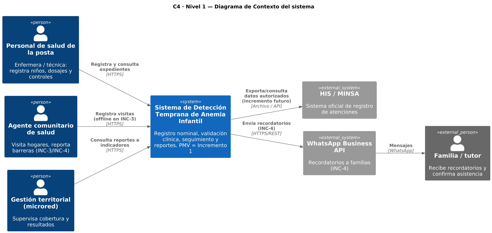
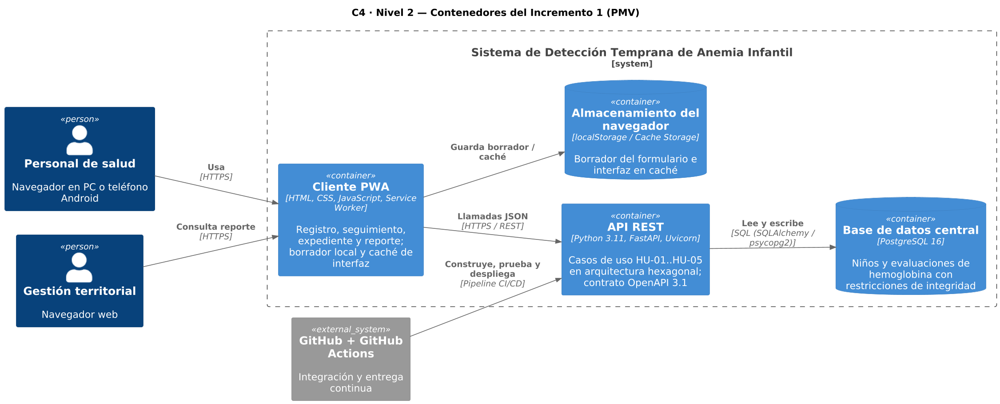
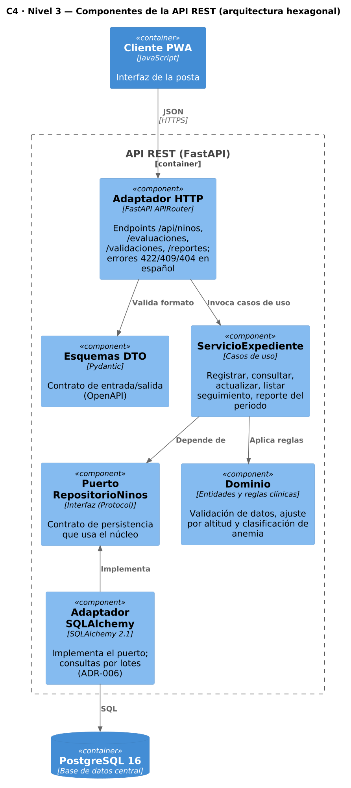
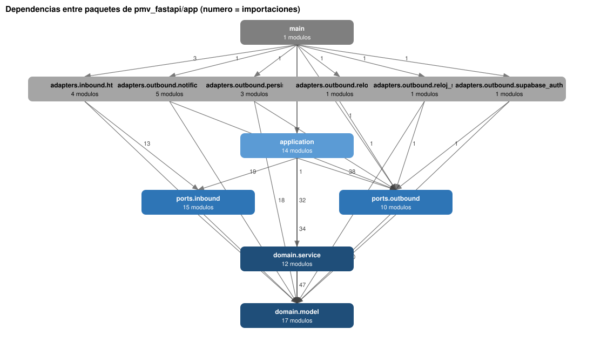

# Anexo A1. Arquitectura del software

**Proyecto:** Anemia Junín (Procesos de Software, Universidad Continental, 2026-20)
**Fecha:** 26/11/2026
**Repositorio:** <https://github.com/woshtsu/ProcesosSoftwareAnemia>

## 1. Estructura hexagonal

El producto `pmv_fastapi` aplica arquitectura hexagonal (ADR-001 y ADR-008): el dominio no depende de marcos externos y los puertos separan la lógica de la infraestructura.

```text
pmv_fastapi/app/
├── main.py             # raíz de composición: crear_app() ensambla puertos y adaptadores
├── domain/
│   ├── model/          # entidades y objetos de valor (niño, evaluación, visita, barrera)
│   └── service/        # reglas clínicas, agenda, alertas, conflictos (Python puro)
├── ports/
│   ├── inbound/        # casos de uso que ofrece la aplicación (agenda, alertas, visitas)
│   └── outbound/       # contratos exigidos al exterior (repositorios, notificador, reloj)
├── application/        # servicios que orquestan los casos de uso
└── adapters/
    ├── inbound/http/   # API REST FastAPI, autenticación y esquemas
    └── outbound/       # persistencia (SQLAlchemy, memoria), notificaciones, Supabase Auth, reloj
```

**Tabla 1.** Estructura de carpetas de `pmv_fastapi/app` con una línea por carpeta.

## 2. Diagramas C4



**Figura 1.** Diagrama C4 de contexto (`pmv_fastapi/docs/diagramas/C4_contexto.png`).



**Figura 2.** Diagrama C4 de contenedores (`C4_contenedores.png`).



**Figura 3.** Diagrama C4 de componentes (`C4_componentes.png`).

## 3. Dependencias por ingeniería inversa



**Figura 4.** Dependencias entre paquetes por ingeniería inversa (`entregables/semana-15/ingenieria_inversa/img/dependencias_paquetes.svg`).

## 4. Puerto y adaptador reales

Puerto de salida del reloj, `pmv_fastapi/app/ports/outbound/reloj.py` (líneas 1 a 11):

```python
"""Puerto de salida: reloj del sistema (permite fijar «hoy» en las pruebas)."""

from datetime import date
from typing import Protocol


class Reloj(Protocol):
    def hoy(self) -> date:
        """Fecha de hoy en Perú."""
        ...
```

Su adaptador, `pmv_fastapi/app/adapters/outbound/reloj_sistema.py` (líneas 1 a 15):

```python
"""Adaptador de salida: reloj real del sistema, en hora de Perú."""

from dataclasses import dataclass
from datetime import date, datetime

from app.domain.model.tiempo import ZONA_PERU
from app.ports.outbound.reloj import Reloj


@dataclass
class RelojSistema(Reloj):
    """Fecha de hoy en Perú, independiente de la zona horaria del servidor (DEF-02)."""

    def hoy(self) -> date:
        return datetime.now(ZONA_PERU).date()
```

El puerto declara solo el contrato (`hoy()`); el adaptador lo implementa con la zona horaria de Perú y el dominio desconoce la fuente de la fecha.

## 5. Decisiones de arquitectura (ADR)

| ADR | Decisión |
| --- | --- |
| ADR-001 | Arquitectura hexagonal |
| ADR-002 | Pwa web |
| ADR-003 | Postgresql |
| ADR-004 | Reglas clinicas parametrizadas |
| ADR-005 | Api rest openapi |
| ADR-006 | Consultas por lotes |
| ADR-007 | Agenda calculada en dominio |
| ADR-008 | Puertos de entrada y estructura hexagonal |
| ADR-009 | Origen de datos y dataset diresa |
| ADR-010 | Asistencia a control persistida |
| ADR-011 | Supabase auth |
| ADR-012 | Sincronizacion sin conexion |
| ADR-013 | Visita domiciliaria priorizada |
| ADR-014 | Notificador y canales |

**Tabla 2.** Registros de decisiones de arquitectura de `pmv_fastapi/docs/adr/`.
