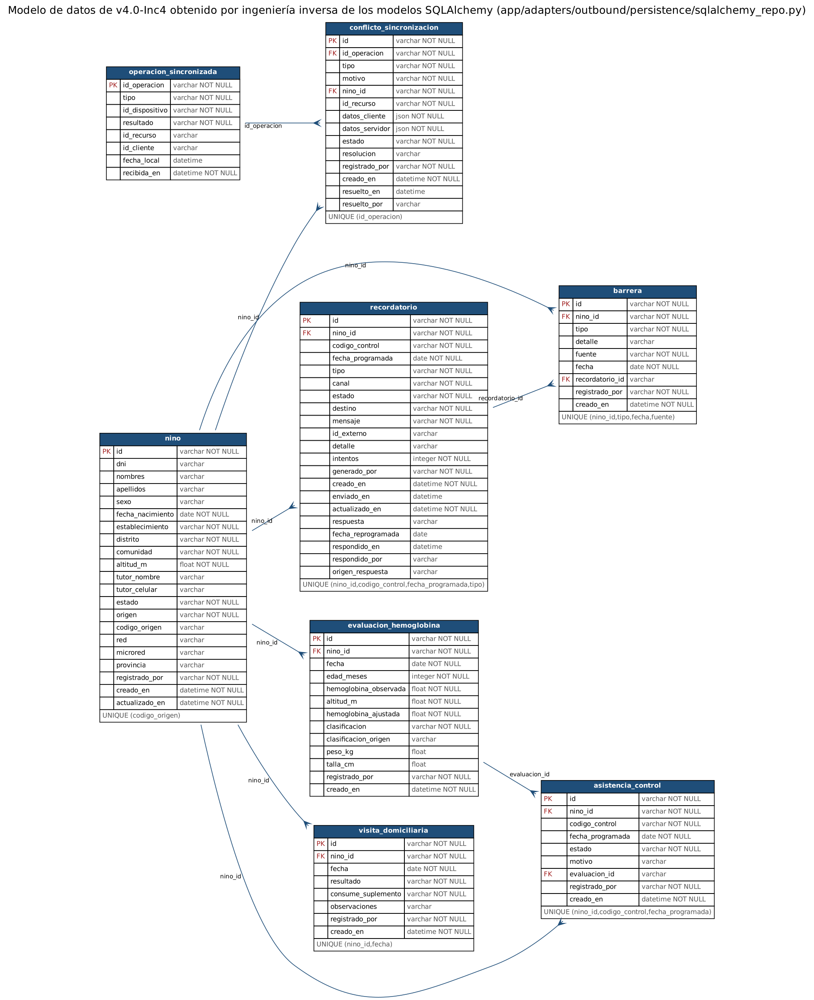

# Anexo A2. Conexión con la base de datos

**Proyecto:** Anemia Junín (Procesos de Software, Universidad Continental, 2026-20)
**Fecha:** 26/11/2026
**Repositorio:** <https://github.com/woshtsu/ProcesosSoftwareAnemia>

## 1. Configuración por variable de entorno

La aplicación lee la URL de la base desde `DATABASE_URL` (`pmv_fastapi/app/main.py`, línea 75). Si no existe, usa SQLite local. Los valores reales no se versionan: `pmv_fastapi/.env.example` solo lista los nombres. En producción la variable se define en Render (Environment) y el CI usa el secreto `SUPABASE_DATABASE_URL`.

```python
    url = database_url or os.getenv("DATABASE_URL", "sqlite:///./datos/anemia.db")
    if reloj is None and fecha_referencia is None and os.getenv("FECHA_REFERENCIA"):
        fecha_referencia = RelojFijo.desde_texto(os.environ["FECHA_REFERENCIA"]).fecha
```

| Variable | Uso |
| --- | --- |
| `DATABASE_URL` | URL SQLAlchemy de la base (SQLite por defecto o `postgresql+psycopg2://...`) |
| `AUTH_MODE` | `supabase` o `demo` |
| `SUPABASE_URL`, `SUPABASE_PUBLISHABLE_KEY` | Supabase Auth |
| `TEST_DATABASE_URL` | Pruebas de integración contra PostgreSQL en el CI |
| `SUPABASE_DATABASE_URL` | Secreto de GitHub para verificar el esquema de producción |

**Tabla 1.** Variables de entorno relacionadas con la base de datos (solo nombres).

## 2. Engine y pool de conexiones

El adaptador `RepositorioSQLAlchemy` (`pmv_fastapi/app/adapters/outbound/persistence/sqlalchemy_repo.py`, líneas 528 a 542) elige el motor según el prefijo de la URL.

```python
):
    def __init__(self, url: str):
        if url.startswith("sqlite:///") and ":memory:" not in url:
            Path(url.removeprefix("sqlite:///")).parent.mkdir(parents=True, exist_ok=True)
        if url.startswith("sqlite"):
            self.engine = create_engine(url, connect_args={"check_same_thread": False}, pool_pre_ping=True)
        else:
            self.engine = create_engine(
                url,
                pool_size=3,
                max_overflow=2,
                pool_recycle=300,
                pool_pre_ping=True,
            )
        self.Sesion = sessionmaker(self.engine, expire_on_commit=False)
```

Para PostgreSQL el pool admite 3 conexiones más 2 de desborde, se recicla cada 300 s y cada conexión se prueba antes de usarse (`pool_pre_ping`), lo que tolera los cortes por inactividad entre Render y Supabase.

## 3. Selección SQLite o PostgreSQL y scripts SQL

SQLite se usa en desarrollo y pruebas unitarias (`crear_esquema()` crea las tablas al arrancar). PostgreSQL (Supabase) se usa en staging y producción con los scripts de `pmv_fastapi/db/`.

| Script | Propósito |
| --- | --- |
| `01_esquema_postgresql.sql` | Esquema completo vigente (versión 4.0) |
| `02_migracion_v2_0.sql` | Migración de 1.x a 2.0 |
| `02_supabase.sql` | Restricciones de Supabase (RLS; revoca acceso a anon y authenticated) |
| `03_migracion_v3_0.sql` | Migración de 2.0 a 3.0 (sin conexión y visitas) |
| `04_migracion_v4_0.sql` | Migración de 3.0 a 4.0 (recordatorios y barreras) |

**Tabla 2.** Scripts SQL de `pmv_fastapi/db/`.

Extracto de `pmv_fastapi/db/01_esquema_postgresql.sql` (líneas 17 a 50, tabla `nino`). Las demás tablas son `evaluacion_hemoglobina`, `asistencia_control`, `visita_domiciliaria`, `operacion_sincronizada`, `conflicto_sincronizacion`, `recordatorio` y `barrera`.

```sql
CREATE TABLE IF NOT EXISTS nino (
    id               VARCHAR(36)  PRIMARY KEY,
    dni              VARCHAR(8)   UNIQUE CHECK (dni IS NULL OR dni ~ '^[0-9]{8}$'),
    nombres          VARCHAR(80),
    apellidos        VARCHAR(80),
    sexo             VARCHAR(1)   CHECK (sexo IS NULL OR sexo IN ('F', 'M')),
    fecha_nacimiento DATE         NOT NULL,
    establecimiento  VARCHAR(120) NOT NULL,
    distrito         VARCHAR(80)  NOT NULL,
    comunidad        VARCHAR(80)  NOT NULL,
    altitud_m        DOUBLE PRECISION NOT NULL CHECK (altitud_m BETWEEN 0 AND 5000),
    tutor_nombre     VARCHAR(120),
    tutor_celular    VARCHAR(9)   CHECK (tutor_celular IS NULL OR tutor_celular ~ '^9[0-9]{8}$'),
    estado           VARCHAR(10)  NOT NULL DEFAULT 'ACTIVO' CHECK (estado IN ('ACTIVO', 'ALTA')),
    origen           VARCHAR(24)  NOT NULL DEFAULT 'SISTEMA'
                     CONSTRAINT ck_nino_origen CHECK (origen IN ('SISTEMA', 'DATASET_DIRESA_JUNIN')),
    codigo_origen    VARCHAR(20)  UNIQUE,
    red              VARCHAR(80),
    microred         VARCHAR(80),
    provincia        VARCHAR(80),
    registrado_por   VARCHAR(60)  NOT NULL,
    creado_en        TIMESTAMPTZ  NOT NULL,
    actualizado_en   TIMESTAMPTZ  NOT NULL,
    CONSTRAINT ck_nino_sistema_completo CHECK (
        origen <> 'SISTEMA' OR (dni IS NOT NULL AND nombres IS NOT NULL AND apellidos IS NOT NULL
                                AND sexo IS NOT NULL AND tutor_nombre IS NOT NULL)),
    CONSTRAINT ck_nino_dataset_codigo CHECK (origen <> 'DATASET_DIRESA_JUNIN' OR codigo_origen IS NOT NULL)
);

CREATE INDEX IF NOT EXISTS ix_nino_comunidad ON nino (comunidad);
CREATE INDEX IF NOT EXISTS ix_nino_estado    ON nino (estado);
CREATE INDEX IF NOT EXISTS ix_nino_origen    ON nino (origen);

-- peso_kg y talla_cm son NULL solo en las evaluaciones importadas (el dataset no las registra);
```

## 4. Modelo de datos



**Figura 1.** Modelo de datos v4 (`entregables/semana-13/img/D01_modelo_datos_v4.png`).

## 5. Verificación de esquema en el CI

El trabajo `produccion` de `.github/workflows/ci.yml` (solo en `main`) abre una conexión de solo lectura con `sslmode=require`, comprueba que existan tablas y vista con consultas `LIMIT 0` y solo entonces solicita el despliegue. No modifica la base ni imprime credenciales.

```python
    with psycopg2.connect(dsn, sslmode='require', connect_timeout=15) as conn:
        conn.set_session(readonly=True)
        with conn.cursor() as cur:
            cur.execute('SET LOCAL statement_timeout = 15000')
            cur.execute('SELECT id FROM public.nino LIMIT 0')
            cur.execute('SELECT origen, codigo_origen FROM public.nino LIMIT 0')
            cur.execute('SELECT id FROM public.asistencia_control LIMIT 0')
            cur.execute('SELECT id FROM public.evaluacion_hemoglobina LIMIT 0')
            cur.execute('SELECT nino_id FROM public.v_ultimo_control LIMIT 0')
        ...
            # Esquema 3.0 (sin conexión y visitas) y 4.0 (recordatorios y barreras)
            for tabla in ('visita_domiciliaria', 'operacion_sincronizada', 'conflicto_sincronizacion', 'recordatorio', 'barrera'):
                cur.execute(f'SELECT 1 FROM public.{tabla} LIMIT 0')
```

**Tabla 3.** Extracto de la verificación de esquema (`.github/workflows/ci.yml`, líneas 129 a 140 aprox.).
