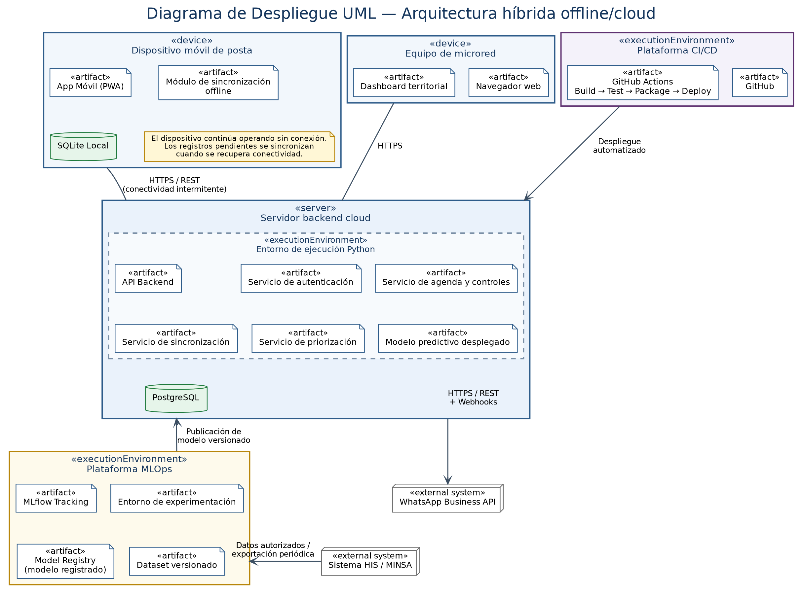

# Anexo A3. Despliegue en producción

**Proyecto:** Anemia Junín (Procesos de Software, Universidad Continental, 2026-20)
**Fecha:** 26/11/2026
**Repositorio:** <https://github.com/woshtsu/ProcesosSoftwareAnemia>

## 1. Resumen

El detalle está en `pmv_fastapi/docs/DESPLIEGUE.md`. La producción se compone de GitHub Actions (CI/CD), una imagen Docker ejecutada como servicio web en Render y PostgreSQL gestionado en Supabase. Los pasos son: (1) inicializar Supabase con `db/01_esquema_postgresql.sql` y `db/02_supabase.sql`; (2) obtener la cadena de conexión; (3) guardar en GitHub los secretos `SUPABASE_DATABASE_URL` y `RENDER_DEPLOY_HOOK_URL`; (4) crear el servicio en Render con `DATABASE_URL` y `PRECALCULAR_AGENDAS=1`, con Auto-Deploy desactivado. Ningún secreto se versiona.

- **URL de producción:** <https://softwareanemia-virginia.onrender.com>
- **Verificación de estado:** `GET /api/salud` (la usa también el `HEALTHCHECK` de la imagen).



**Figura 1.** Diagrama de despliegue (`pmv_fastapi/docs/diagramas/D4_despliegue.png`).

## 2. Dockerfile

Archivo `pmv_fastapi/Dockerfile` (completo). La imagen se ejecuta con un usuario sin privilegios y respeta el puerto `PORT` de Render.

```dockerfile
FROM python:3.11-slim
WORKDIR /app
ENV PYTHONDONTWRITEBYTECODE=1 PYTHONUNBUFFERED=1
COPY requirements.txt .
RUN pip install --no-cache-dir -r requirements.txt
COPY app ./app
COPY scripts ./scripts
RUN useradd --create-home appuser && mkdir -p /app/datos && chown appuser /app/datos
USER appuser
EXPOSE 8000
HEALTHCHECK --interval=30s --timeout=3s CMD python -c "import os, urllib.request; p = os.getenv('PORT', '8000'); urllib.request.urlopen(f'http://127.0.0.1:{p}/api/salud')"
CMD ["sh", "-c", "exec uvicorn app.main:crear_app --factory --host 0.0.0.0 --port ${PORT:-8000} --workers 1 --proxy-headers --forwarded-allow-ips='*' --timeout-keep-alive 30"]
```

## 3. docker-compose.yml (staging)

Archivo `pmv_fastapi/docker-compose.yml` (extracto sin las variables opcionales de mensajería).

```yaml
# Entorno de staging del PMV: API + PWA y base de datos PostgreSQL.
services:
  db:
    image: postgres:16-alpine
    environment:
      POSTGRES_DB: anemia
      POSTGRES_USER: anemia
      POSTGRES_PASSWORD: ${POSTGRES_PASSWORD:-cambiar_en_staging}
    volumes:
      - datos_pg:/var/lib/postgresql/data
      - ./db/01_esquema_postgresql.sql:/docker-entrypoint-initdb.d/01_esquema_postgresql.sql:ro
    healthcheck:
  api:
    build: .
    environment:
      DATABASE_URL: postgresql+psycopg2://anemia:${POSTGRES_PASSWORD:-cambiar_en_staging}@db:5432/anemia
      AUTH_MODE: ${AUTH_MODE:-supabase}
      SUPABASE_URL: ${SUPABASE_URL:-}
      SUPABASE_PUBLISHABLE_KEY: ${SUPABASE_PUBLISHABLE_KEY:-}
      AUTH_COOKIE_SECURE: ${AUTH_COOKIE_SECURE:-true}
      # ... variables opcionales de WhatsApp y SMS omitidas
    ports:
      - "8000:8000"
    depends_on:
      db:
        condition: service_healthy
volumes:
  datos_pg:
```

## 4. Pipeline CI/CD

El flujo `.github/workflows/ci.yml` define tres trabajos encadenados.

| Trabajo | Dependencia | Contenido |
| --- | --- | --- |
| `calidad-y-pruebas` | Ninguna | ruff, pytest con cobertura (SQLite), contrato OpenAPI, integración con PostgreSQL 16, E2E con Playwright, SonarCloud opcional |
| `imagen` | `calidad-y-pruebas` | `docker build` de la imagen del PMV |
| `produccion` | `calidad-y-pruebas` e `imagen` | Solo en `main` y sin pull request: verifica el esquema de Supabase (solo lectura) y llama al deploy hook de Render |

**Tabla 1.** Trabajos del pipeline CI/CD.

El deploy hook solo se acepta si es HTTPS del host `api.render.com`; se le agrega el commit probado como parámetro `ref` (`ci.yml`, líneas 124 a 138 aprox.).

```python
parts = urllib.parse.urlsplit(hook)
if parts.scheme != 'https' or parts.hostname != 'api.render.com':
    sys.exit('El deploy hook debe ser HTTPS de api.render.com.')
        ...
        query = dict(urllib.parse.parse_qsl(parts.query))
        query['ref'] = os.environ['GITHUB_SHA']
        request = urllib.request.Request(url, method='POST')
```

**Tabla 2.** Extracto de la solicitud de despliegue a Render.

La aceptación del hook no certifica el despliegue: se debe confirmar el estado «Live» en Render y consultar `/api/salud`.
