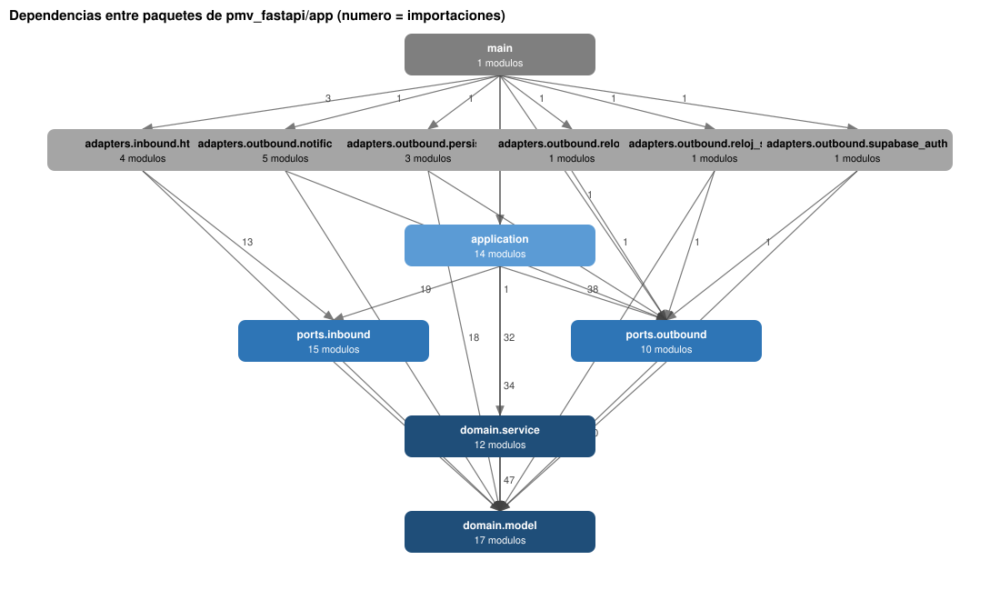
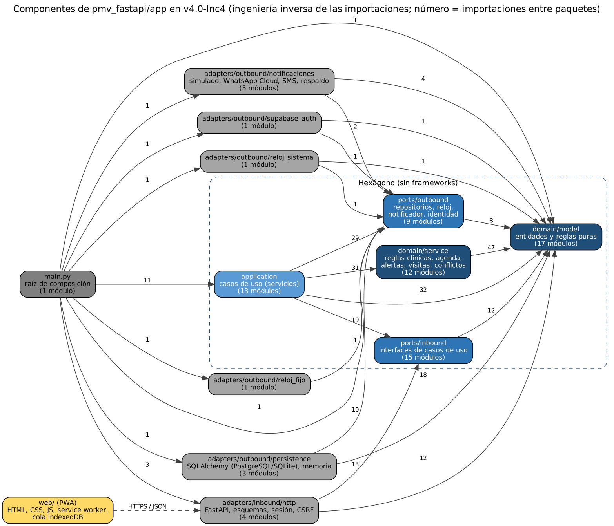
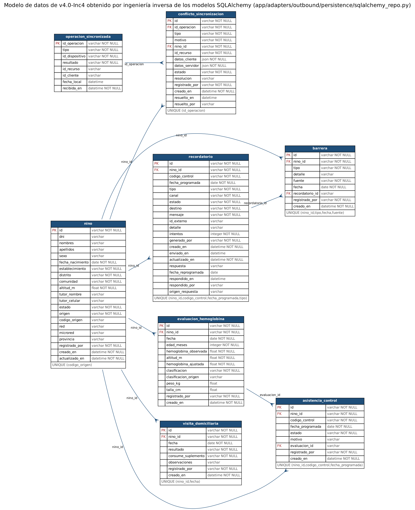

# Informe de ingeniería inversa del software `pmv_fastapi/app`

Proyecto: Sistema de detección temprana de anemia infantil en zonas rurales de Junín. Anexo del informe de la Unidad IV (Procesos de Software).

## 1. Objetivo

Recuperar, a partir del código fuente vigente, la estructura real del producto (tamaño, complejidad, clases y dependencias entre capas) y comprobar si respeta la arquitectura hexagonal que declara el diseño: el dominio no depende de frameworks ni de adaptadores, y los puertos no dependen de adaptadores.

## 2. Alcance

| Elemento | Valor |
|---|---|
| Carpeta analizada | `pmv_fastapi/app/` (90 archivos `.py`; no se incluyen `tests/`, `web/` ni scripts) |
| Commit de la rama analizada | `b5b1c26` (rama `docs/s15-informe-unidad-iv`) |
| Último commit que modificó `pmv_fastapi/app` | `e6d8c4c` (2026-11-09, «cachear agendas y aligerar respuestas para Render») |
| Versión declarada en el código | `VERSION = "4.0.0-inc4"` en `app/main.py`; `version = "4.0.0"` en `pyproject.toml` |
| Intérprete usado | Python 3.13.7 (`pmv_fastapi/.venv`) |

Nota: el código analizado declara la versión 4.0.0-inc4. No se encontró la cadena «4.0.1» en `app/main.py` ni en `pyproject.toml`; si el informe final cita 4.0.1, debe corresponder a una etiqueta de publicación externa a estos archivos.

## 3. Herramienta y limitaciones

La guía del taller (S14) propone SciTools Understand. No está instalado ni se dispone de licencia, por lo que se desarrolló un equivalente propio, `reporte_ingenieria_inversa.py`, que usa solo el módulo `ast` de la biblioteca estándar de Python y no ejecuta el código analizado. Genera métricas por archivo, capa, función y clase, la matriz de dependencias entre capas y la verificación hexagonal. Limitaciones:

- La complejidad ciclomática es una aproximación de McCabe: parte de 1 y suma 1 por cada `if`, expresión condicional, `for`, `while`, `try` (una vez, sin contar cada `except`), `with`, cada operador `and`/`or` adicional, cada cláusula de comprensión (más sus `if`) y cada `case` de `match`. No cuenta funciones anidadas dentro de la función externa (se miden aparte). Los valores pueden diferir de los de Understand.
- Las líneas de comentario incluyen los docstrings; las de código son las restantes no vacías.
- Las dependencias se obtienen de las sentencias `import` (también las que están dentro de funciones). No se detecta el acoplamiento dinámico ni el que ocurre por inyección en `main.py`.
- Los atributos de clase son los asignados a nivel de clase (incluidos campos de `dataclass`) y los `self.x = ...` de los métodos.
- No hay Graphviz (`dot`) ni matplotlib en el equipo. Por eso el diagrama de dependencias nuevo se dibuja con un generador SVG propio (con su `.dot` equivalente) y no se pudieron regenerar los diagramas D01 y D02 de la semana 13 (ver sección 5).
- Es un análisis estático: no mide cobertura de pruebas ni defectos.

## 4. Resumen de métricas

**Tabla 1.** Métricas de tamaño por capa (`pmv_fastapi/app`).

| Capa | Archivos | Líneas totales | Código | Comentarios | En blanco | Clases | Funciones | Métodos |
|---|---:|---:|---:|---:|---:|---:|---:|---:|
| domain | 30 | 2818 | 2018 | 287 | 513 | 86 | 92 | 9 |
| ports | 26 | 473 | 240 | 72 | 161 | 29 | 0 | 87 |
| application | 14 | 1647 | 1394 | 85 | 168 | 14 | 8 | 86 |
| adapters | 18 | 3385 | 2740 | 133 | 512 | 74 | 98 | 114 |
| main | 2 | 163 | 136 | 9 | 18 | 1 | 5 | 1 |
| **Total** | **90** | **8486** | **6528** | **586** | **1372** | **204** | **203** | **297** |

(La capa «main» incluye `main.py` y `app/__init__.py`.) Los archivos de código más extensos son `adapters/outbound/persistence/sqlalchemy_repo.py` (868 líneas de código), `adapters/inbound/http/api.py` (819) y `adapters/inbound/http/esquemas.py` (442).

**Tabla 2.** Complejidad ciclomática aproximada por capa (500 funciones y métodos).

| Capa | Complejidad media | Complejidad máxima |
|---|---:|---:|
| domain | 4,83 | 17 |
| ports | 1,00 | 1 |
| application | 3,97 | 16 |
| adapters | 2,57 | 12 |
| main | 4,00 | 10 |
| **Global** | **3,03** | **17** |

De las 500 funciones y métodos, 428 tienen complejidad menor o igual a 5 y 28 superan 10.

**Tabla 3.** Diez funciones más complejas.

| N.º | Función | Archivo (en `app/`) | Complejidad |
|---:|---|---|---:|
| 1 | `extraer_eventos` | `domain/service/notificaciones.py` | 17 |
| 2 | `_contar` | `domain/service/notificaciones.py` | 17 |
| 3 | `ServicioExpediente.actualizar_datos` | `application/servicio_expediente.py` | 16 |
| 4 | `validar_datos_barrera` | `domain/service/barreras.py` | 16 |
| 5 | `ServicioExpediente.listar_seguimiento` | `application/servicio_expediente.py` | 15 |
| 6 | `localizar_control_registrable` | `domain/service/asistencia.py` | 15 |
| 7 | `ServicioRecordatorios._generar` | `application/servicio_recordatorios.py` | 14 |
| 8 | `ServicioSincronizacion._aplicar_cliente` | `application/servicio_sincronizacion.py` | 14 |
| 9 | `_resumir` | `domain/service/agenda.py` | 14 |
| 10 | `validar_datos_visita` | `domain/service/visitas.py` | 14 |

**Tabla 4.** Métricas de clases (204 clases).

| Indicador | Valor |
|---|---:|
| Clases con base declarada (herencia o implementación de puerto) | 149 |
| Puertos definidos como `Protocol` | 29 |
| Promedio de métodos por clase | 1,46 |
| Promedio de atributos por clase | 4,93 |
| Clase con más métodos | `RepositorioSQLAlchemy` (48 métodos; implementa 5 puertos de repositorio) |
| Segunda y tercera | `RepositorioEnMemoria` (42), `ServicioSincronizacion` (20) |

El detalle completo está en `metricas_clases.csv`, `metricas_funciones.csv`, `metricas_archivos.csv` y `metricas_capas.csv`; el consolidado, en `metricas.json`.

## 5. Arquitectura recuperada

**Tabla 5.** Matriz de dependencias entre capas (número de sentencias `import` de la capa de la fila hacia la capa de la columna; las importaciones dentro de la misma capa no se cuentan).

| Origen \ Destino | domain | ports | application | adapters | main |
|---|---:|---:|---:|---:|---:|
| domain | – | 0 | 0 | 0 | 0 |
| ports | 22 | – | 0 | 0 | 0 |
| application | 66 | 57 | – | 0 | 0 |
| adapters | 36 | 28 | 0 | – | 0 |
| main | 1 | 1 | 12 | 8 | – |

La matriz tiene la forma esperada: todas las flechas apuntan hacia el dominio; solo `main.py` (raíz de composición) conoce a los adaptadores.

**Figura 1.** Dependencias entre paquetes recuperadas del código actual (número = importaciones; generado por `reporte_ingenieria_inversa.py`).



Fuente DOT equivalente: `dependencias_paquetes.dot`.

**Figura 2.** Diagrama de componentes por ingeniería inversa (D02, semana 13).



**Figura 3.** Modelo de datos recuperado de los modelos SQLAlchemy (D01, semana 13).



Las Figuras 2 y 3 no se pudieron regenerar porque `generar_diagramas.py` requiere Graphviz (`dot`), que no está instalado. Se conservan tal como se versionaron (commit `e0f8760`, 6 de noviembre de 2026), anteriores al último cambio de `app/` (commit `e6d8c4c`, 9 de noviembre). Las aristas coinciden con las de la Figura 1, salvo en los conteos de algunas importaciones (por ejemplo, `application` hacia `ports.outbound`: 29 en la Figura 2 y 38 en la Figura 1; hacia `domain.model`: 32 y 34). La estructura de paquetes y el sentido de las dependencias son los mismos. Para regenerarlas: instalar Graphviz y ejecutar `python entregables/semana-13/ingenieria_inversa/generar_diagramas.py`.

**Tabla 6.** Paquetes de tercero importados, por capa.

| Capa | Paquetes de terceros (número de importaciones) |
|---|---|
| domain | ninguno |
| ports | ninguno |
| application | ninguno |
| adapters | fastapi (6), httpx (4), sqlalchemy (3), pydantic (2) |
| main | fastapi (4), starlette (1) |

## 6. Verificación de la arquitectura hexagonal

**Tabla 7.** Reglas verificadas automáticamente.

| Regla | Resultado |
|---|---|
| `domain` no importa `adapters`, `application` ni `main` | Cumple (0 violaciones) |
| `domain` no importa frameworks ni paquetes de terceros | Cumple (0 violaciones) |
| `ports` no importa `adapters` | Cumple (0 violaciones) |
| `application` no importa `adapters` (verificación adicional) | Cumple (0 importaciones) |

Total de violaciones: **0**. El dominio, los puertos y la capa de aplicación solo usan la biblioteca estándar y paquetes internos; los frameworks (FastAPI, SQLAlchemy, pydantic, httpx) están confinados a `adapters` y `main.py`. Limitación: la regla se verifica sobre las sentencias `import`; no detecta que el comportamiento del dominio dependa de un adaptador por otras vías (por ejemplo, objetos pasados por inyección).

## 7. Hallazgos y recomendaciones

1. **Arquitectura limpia y verificable.** Con 0 violaciones, conviene incorporar este análisis (o una prueba equivalente) como comprobación automática en integración continua para que la regla no se degrade.
2. **Complejidad global baja, con concentración en pocas funciones.** La media es 3,03 y el 85,6 % de las funciones (428 de 500) tiene complejidad menor o igual a 5; sin embargo 28 superan 10 y el máximo es 17. Se recomienda refactorizar primero `extraer_eventos` y `_contar` (`domain/service/notificaciones.py`, complejidad 17 cada una).
3. **El dominio concentra la mayor complejidad media (4,83).** Es esperable porque ahí viven las reglas clínicas y de validación (`validar_datos_barrera`, `validar_datos_visita`), pero estas funciones deben mantenerse cubiertas por pruebas unitarias antes de modificarse.
4. **Archivos extensos en los adaptadores.** `sqlalchemy_repo.py` (868 líneas de código; una clase con 48 métodos que implementa cinco puertos) y `api.py` (819) concentran el tamaño. Se sugiere dividirlos por agregado (niños, visitas, sincronización, recordatorios, barreras) para facilitar el mantenimiento.
5. **Servicios de aplicación con varias responsabilidades.** `ServicioExpediente` y `ServicioSincronizacion` implementan varios puertos de entrada y contienen funciones de complejidad 14 a 16; evaluar separarlos por caso de uso.

## 8. Cómo reproducir

Desde la raíz del repositorio (solo requiere Python; no instala paquetes):

```
pmv_fastapi/.venv/Scripts/python.exe entregables/semana-15/ingenieria_inversa/reporte_ingenieria_inversa.py
```

Genera en `entregables/semana-15/ingenieria_inversa/`: `metricas.json`, `metricas_archivos.csv`, `metricas_funciones.csv`, `metricas_clases.csv`, `metricas_capas.csv`, `dependencias_paquetes.dot` e `img/dependencias_paquetes.svg` (y `img/dependencias_paquetes.png` si `dot` está en el PATH). Todas las cifras de este informe provienen de esa salida, calculada sobre el commit `b5b1c26`.
